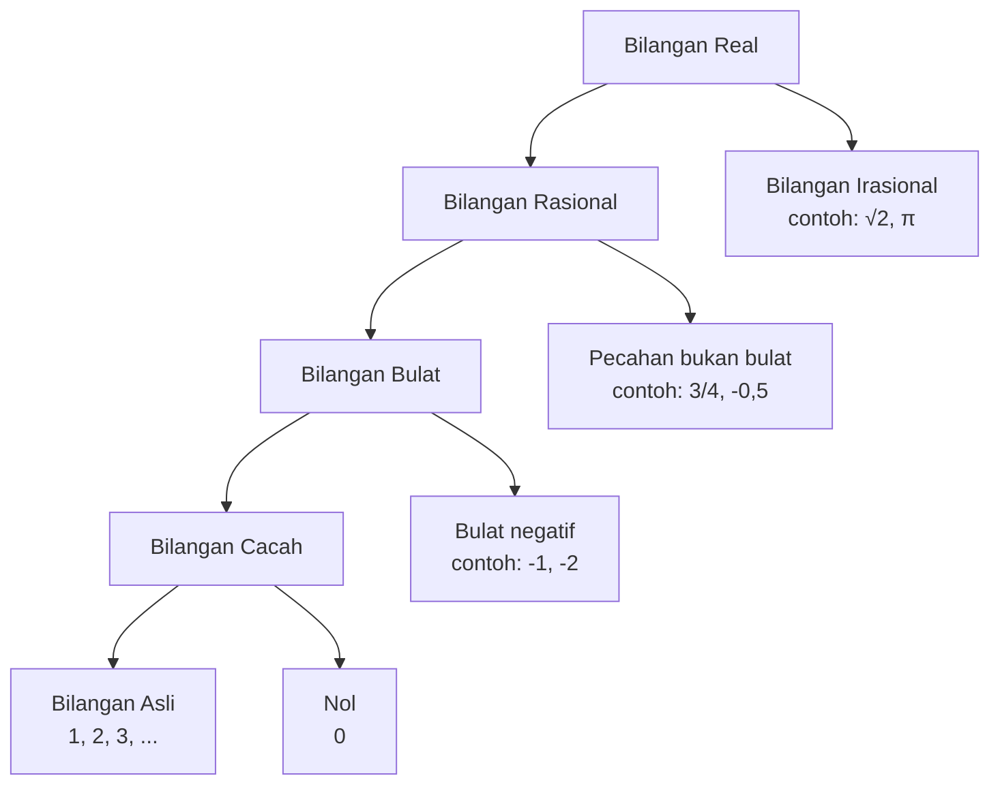
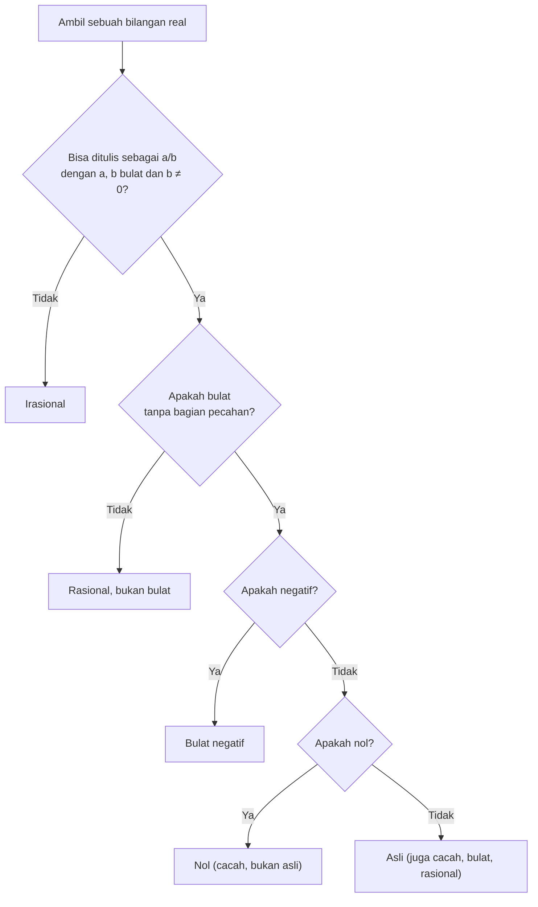

# Part 1 — Mengenal Bilangan

## Tujuan Pembelajaran

Setelah mempelajari bagian ini, kamu mampu:

- menjelaskan perbedaan **angka**, **lambang bilangan**, dan **bilangan**;
- mengenali bilangan asli, cacah, bulat, rasional, irasional, dan real;
- menentukan sebuah bilangan positif, negatif, atau nol, serta genap atau ganjil;
- menentukan sebuah bilangan prima atau komposit;
- menjelaskan hubungan antarjenis bilangan dan menggolongkan bilangan memakai diagram;
- membandingkan dan mengurutkan bilangan dengan garis bilangan;
- menjelaskan mengapa matematika dibutuhkan dalam Machine Learning.

## Prasyarat

Tidak ada. Kamu cukup bisa menghitung benda sederhana (misalnya 1, 2, 3, ...). Perhitungan yang lebih lengkap dibahas di Part 2.

## Mengapa Materi Ini Penting?

Hampir semua hal dalam Machine Learning dimulai dari **bilangan**: data berupa bilangan, model berisi bilangan, dan hasil prediksi juga bilangan. Jika kamu tidak tahu jenis bilangan apa yang sedang kamu hadapi, kamu akan kesulitan memahami rumus yang memakainya. Bagian ini adalah kosakata dasar untuk seluruh materi berikutnya.

## Penjelasan Konsep dari Dasar

### 1. Pengertian Bilangan

**Bilangan** (*number*) adalah gagasan tentang banyaknya, urutan, atau ukuran sesuatu. Misalnya "tiga apel" menyatakan *banyaknya* apel, dan "tinggi 165,5 cm" menyatakan *ukuran* tinggi.

Gagasan itu kita tulis memakai **lambang bilangan** (*numeral*), yaitu tulisan atau simbol yang mewakilinya. Bilangan yang sama bisa ditulis dengan lambang berbeda:

| Lambang | Cara menulis | Bilangan yang diwakili |
|---|---|---|
| 3 | angka Arab (yang kita pakai) | tiga |
| III | angka Romawi | tiga |
| tiga | kata | tiga |
| 6/2 | pecahan | tiga |

**Angka** (*digit*) adalah satu simbol penyusun lambang bilangan: 0, 1, 2, 3, 4, 5, 6, 7, 8, 9. Bilangan 305 terdiri dari tiga angka (3, 0, dan 5). Jadi "angka" adalah huruf-hurufnya, sedangkan "bilangan" adalah kata yang dibentuk darinya.

### 2. Mengapa Matematika Penting untuk Machine Learning

**Machine Learning** (pembelajaran mesin) adalah cara membuat komputer belajar pola dari data, bukan diberi aturan satu per satu. Komputer hanya mengolah bilangan, sehingga seluruh prosesnya adalah matematika:

1. **Data** diubah menjadi bilangan (tinggi badan, harga, nilai piksel gambar).
2. **Model** adalah rumus yang berisi bilangan-bilangan yang disebut *parameter*.
3. **Belajar** berarti mengubah parameter itu sedikit demi sedikit agar prediksi makin dekat dengan kenyataan.
4. **Menilai** model berarti menghitung bilangan yang mengukur seberapa besar kesalahannya.

Karena itu setiap tingkat di peta belajar ini punya peran: aljabar linear untuk menyusun data, kalkulus untuk mengubah parameter, dan probabilitas untuk menangani ketidakpastian. Level 0 menyiapkan dasarnya.

!!! note "Catatan"
    Contoh Machine Learning di halaman ini hanya gambaran awal. Kamu belum perlu menguasainya sekarang.

### 3. Bilangan Asli

**Bilangan asli** (*natural numbers*) adalah bilangan yang dipakai untuk menghitung benda: 1, 2, 3, 4, 5, ... Tanda titik-titik berarti "dan seterusnya tanpa berhenti".

Himpunan bilangan asli dilambangkan $\mathbb{N}$:

$$
\mathbb{N} = \{1, 2, 3, 4, 5, \dots\}
$$

!!! warning "Apakah nol termasuk bilangan asli?"
    Tidak ada kesepakatan tunggal di seluruh dunia. Banyak buku sekolah di Indonesia memulai bilangan asli dari 1, dan **buku ini mengikuti konvensi itu**. Sebagian buku (terutama di ilmu komputer) memasukkan 0. Saat membaca sumber lain, selalu periksa dulu definisi yang dipakai.

### 4. Bilangan Cacah

**Bilangan cacah** (*whole numbers*) adalah bilangan asli ditambah nol: 0, 1, 2, 3, ... Nol dibutuhkan untuk menyatakan "tidak ada", misalnya jumlah apel di keranjang kosong adalah 0.

Himpunan bilangan cacah dalam buku ini dilambangkan $\mathbb{N}_0$:

$$
\mathbb{N}_0 = \{0, 1, 2, 3, 4, \dots\}
$$

Sebagian buku memakai lambang lain (misalnya $\mathbb{W}$ atau $C$), jadi perhatikan keterangan di tiap sumber.

### 5. Bilangan Bulat

**Bilangan bulat** (*integers*) mencakup bilangan cacah dan lawannya (bilangan negatif): ..., -3, -2, -1, 0, 1, 2, 3, ... Bilangan negatif dibutuhkan untuk hal seperti suhu di bawah nol (-5 °C), utang, atau posisi di sebelah kiri titik acuan.

Himpunannya dilambangkan $\mathbb{Z}$ (dari kata Jerman *Zahlen*, "bilangan"):

$$
\mathbb{Z} = \{\dots, -3, -2, -1, 0, 1, 2, 3, \dots\}
$$

Bilangan bulat tidak memiliki bagian pecahan. Jadi 7 dan -4 adalah bilangan bulat, sedangkan 2,5 dan $\frac{1}{3}$ bukan.

### 6. Bilangan Positif, Negatif, dan Nol

- **Bilangan positif**: lebih besar dari nol (1, 7, 0,5). Boleh ditulis dengan tanda plus (+3), tetapi biasanya tidak.
- **Bilangan negatif**: lebih kecil dari nol (-1, -7, -0,5). Tanda minus wajib ditulis.
- **Nol**: bukan positif dan bukan negatif.

!!! tip "Perhatikan"
    Positif dan negatif tidak hanya berlaku untuk bilangan bulat. Pecahan seperti $-\frac{1}{2}$ juga bilangan negatif.

### 7. Bilangan Genap dan Ganjil

Sebuah bilangan bulat disebut **genap** jika habis dibagi 2 (hasil baginya bilangan bulat tanpa sisa), dan **ganjil** jika tidak.

- Genap: ..., -4, -2, 0, 2, 4, 6, 8, ...
- Ganjil: ..., -3, -1, 1, 3, 5, 7, ...

Nol adalah bilangan genap karena $0 \div 2 = 0$ tanpa sisa. Bilangan negatif juga bisa genap atau ganjil: -4 genap, -7 ganjil. Pola ini dipakai terus dalam pemrograman, misalnya untuk membagi data bergantian ke dua kelompok.

Cara cepat memeriksa: lihat angka terakhir. Jika angka terakhir 0, 2, 4, 6, atau 8, bilangannya genap. Jika 1, 3, 5, 7, atau 9, bilangannya ganjil.

### 8. Bilangan Prima dan Komposit

Untuk memahaminya kita perlu istilah **pembagi** (disebut juga **faktor**), yaitu bilangan yang membagi habis bilangan lain. Pembagi dari 12 adalah 1, 2, 3, 4, 6, dan 12, karena masing-masing membagi 12 tanpa sisa.

- **Bilangan prima**: bilangan asli lebih dari 1 yang hanya punya **tepat dua** pembagi, yaitu 1 dan dirinya sendiri. Contoh: 2, 3, 5, 7, 11, 13.
- **Bilangan komposit**: bilangan asli lebih dari 1 yang punya **lebih dari dua** pembagi. Contoh: 12 (pembaginya 1, 2, 3, 4, 6, 12).
- Bilangan **1** bukan prima dan bukan komposit, karena pembaginya hanya satu (yaitu 1).

Bilangan prima di bawah 30: 2, 3, 5, 7, 11, 13, 17, 19, 23, 29.

!!! warning "Yang sering salah"
    2 adalah satu-satunya bilangan prima yang genap. Semua genap lain (4, 6, 8, ...) punya pembagi 2, sehingga komposit.

### 9. Bilangan Rasional

**Bilangan rasional** (*rational numbers*) adalah bilangan yang dapat ditulis sebagai pecahan $\frac{a}{b}$ dengan $a$ dan $b$ bilangan bulat, dan $b \neq 0$. Kata "rasional" berasal dari *rasio*, yaitu perbandingan dua bilangan bulat.

Himpunannya dilambangkan $\mathbb{Q}$ (dari kata Italia *quoziente*, "hasil bagi").

Contoh:

- $\frac{3}{4}$ rasional (a = 3, b = 4).
- 5 rasional, karena $5 = \frac{5}{1}$. Jadi **setiap bilangan bulat adalah bilangan rasional**.
- 0,25 rasional, karena $0{,}25 = \frac{25}{100} = \frac{1}{4}$.
- -0,5 rasional, karena $-0{,}5 = -\frac{1}{2}$.
- 0,666... (angka 6 berulang tanpa akhir) rasional, karena sama dengan $\frac{2}{3}$.

Bentuk desimal bilangan rasional selalu salah satu dari dua jenis: **berhingga** (berhenti, seperti 0,25) atau **berulang** (pola angkanya berulang terus, seperti 0,666... atau 0,142857142857...). Kita bahas lebih dalam di Part 3.

### 10. Bilangan Irasional

**Bilangan irasional** (*irrational numbers*) adalah bilangan yang **tidak dapat** ditulis sebagai pecahan $\frac{a}{b}$ dengan $a$ dan $b$ bilangan bulat. Bentuk desimalnya tidak berhenti dan tidak membentuk pola yang berulang.

Contoh yang terkenal:

- $\sqrt{2} \approx 1{,}41421356\ldots$ (bilangan yang jika dikalikan dengan dirinya sendiri hasilnya 2)
- $\pi \approx 3{,}14159265\ldots$ (perbandingan keliling lingkaran terhadap diameternya)
- $e \approx 2{,}71828182\ldots$ (bilangan yang akan sering kamu temui di Machine Learning)

Tanda $\approx$ dibaca "kira-kira sama dengan". Kita memakainya karena desimal bilangan irasional tidak pernah selesai ditulis, sehingga nilai yang kita tulis hanyalah pendekatan.

Bahwa $\sqrt{2}$ benar-benar tidak bisa ditulis sebagai pecahan dapat dibuktikan, tetapi pembuktiannya di luar cakupan Level 0. Untuk saat ini, terima hasilnya dan fokus pada cara mengenalinya.

!!! warning "Yang sering salah"
    $\frac{22}{7} = 3{,}142857\ldots$ **bukan** $\pi$. Itu hanya pecahan yang nilainya dekat dengan $\pi$. Karena $\frac{22}{7}$ rasional dan $\pi$ irasional, keduanya tidak mungkin sama. Begitu pula 3,14 hanyalah pendekatan.

!!! tip "Tidak semua akar adalah bilangan irasional"
    $\sqrt{9} = 3$ dan $\sqrt{16} = 4$ rasional karena hasilnya bilangan bulat. Yang irasional adalah akar dari bilangan yang bukan kuadrat sempurna, misalnya $\sqrt{2}$, $\sqrt{3}$, dan $\sqrt{10}$. Akar dibahas penuh di Part 5.

### 11. Bilangan Real

**Bilangan real** (*real numbers*) adalah gabungan seluruh bilangan rasional dan irasional. Himpunannya dilambangkan $\mathbb{R}$. Semua bilangan yang dipakai di Level 0 sampai Level 5 adalah bilangan real, kecuali jika disebutkan lain.

Setiap bilangan real menempati tepat satu titik di garis bilangan (lihat di bawah), dan setiap titik di garis bilangan mewakili satu bilangan real.

!!! info "Ada bilangan di luar real"
    Akar kuadrat dari bilangan negatif, seperti $\sqrt{-1}$, bukan bilangan real. Bilangan seperti itu disebut bilangan kompleks dan tidak dibahas di buku ini.

### 12. Hubungan Antarjenis Bilangan

Jenis-jenis bilangan di atas saling memuat seperti kotak di dalam kotak. Setiap bilangan asli juga cacah, setiap bilangan cacah juga bulat, dan seterusnya:

$$
\mathbb{N} \subset \mathbb{N}_0 \subset \mathbb{Z} \subset \mathbb{Q} \subset \mathbb{R}
$$

Lambang $\subset$ dibaca "himpunan bagian dari". Artinya, setiap anggota himpunan di sebelah kiri juga anggota himpunan di sebelah kanan.



Diagram di atas membagi bilangan real menjadi cabang-cabang yang tidak saling tumpang tindih. Dengan itu kita bisa menggolongkan sebuah bilangan secara bertahap, dari yang paling umum:



Perhatikan bahwa satu bilangan bisa masuk beberapa kelompok sekaligus. Bilangan 7 adalah asli, cacah, bulat, rasional, dan real. Saat diminta menyebutkan **jenis** bilangan, jawablah dengan jenis yang paling sempit yang masih benar, lalu sebutkan kelompok lain bila diminta.

### 13. Garis Bilangan dan Perbandingan Nilai

**Garis bilangan** (*number line*) adalah garis lurus tempat kita menaruh bilangan secara berurutan. Nol berada di tengah, bilangan positif di kanan, dan bilangan negatif di kiri. Jarak antartitik yang berdekatan dibuat sama.

```text
   -4   -3   -2   -1    0    1    2    3    4
────┼────┼────┼────┼────┼────┼────┼────┼────┼───▶
```

**Aturan membandingkan:** bilangan yang letaknya **lebih ke kanan** nilainya lebih besar. Hal ini berlaku untuk semua bilangan real.

Simbol yang dipakai:

| Simbol | Dibaca | Contoh |
|---|---|---|
| $<$ | lebih kecil dari | $-3 < 2$ |
| $>$ | lebih besar dari | $5 > -1$ |
| $\leq$ | lebih kecil atau sama dengan | $4 \leq 4$ |
| $\geq$ | lebih besar atau sama dengan | $0 \geq -2$ |
| $=$ | sama dengan | $\frac{1}{2} = 0{,}5$ |

Dari garis bilangan kita peroleh tiga aturan praktis:

1. Setiap bilangan positif lebih besar daripada setiap bilangan negatif, dan nol berada di antaranya.
2. Untuk dua bilangan positif, yang angkanya lebih besar nilainya lebih besar ($7 > 3$).
3. Untuk dua bilangan **negatif**, urutannya terbalik: yang angkanya lebih besar justru lebih kecil. Jadi $-7 < -3$, karena -7 terletak di kiri -3.

Untuk membandingkan pecahan dengan desimal atau akar, ubah semuanya ke bentuk desimal terlebih dahulu.

## Istilah yang Perlu Dipahami

| Istilah | Arti sederhana | Contoh |
|---|---|---|
| Bilangan (*number*) | gagasan tentang banyak, urutan, atau ukuran | tiga |
| Lambang bilangan (*numeral*) | cara menulis bilangan | 3, III |
| Angka (*digit*) | simbol penyusun bilangan, 0 sampai 9 | angka 4 pada 1.045 |
| Himpunan (*set*) | kumpulan benda atau bilangan | $\{1, 2, 3\}$ |
| Anggota (*element*) | satu isi dari himpunan | 2 anggota $\{1, 2, 3\}$ |
| Pembagi / faktor (*divisor*) | bilangan yang membagi habis bilangan lain | pembagi 6: 1, 2, 3, 6 |
| Habis dibagi | dibagi tanpa sisa | 12 habis dibagi 4 |
| Bilangan prima (*prime*) | tepat dua pembagi: 1 dan dirinya | 2, 3, 5, 7 |
| Bilangan komposit (*composite*) | lebih dari dua pembagi | 4, 6, 9, 12 |
| Rasional (*rational*) | dapat ditulis $\frac{a}{b}$ | $\frac{3}{4}$, 5, 0,25 |
| Irasional (*irrational*) | tidak dapat ditulis $\frac{a}{b}$ | $\sqrt{2}$, $\pi$ |
| Real (*real*) | rasional dan irasional digabung | semua titik di garis bilangan |

## Rumus dan Penjelasan Setiap Simbol

### Lambang himpunan bilangan

| Lambang | Dibaca | Isinya |
|---|---|---|
| $\mathbb{N}$ | bilangan asli | 1, 2, 3, ... |
| $\mathbb{N}_0$ | bilangan cacah | 0, 1, 2, 3, ... |
| $\mathbb{Z}$ | bilangan bulat | ..., -2, -1, 0, 1, 2, ... |
| $\mathbb{Q}$ | bilangan rasional | semua yang berbentuk $\frac{a}{b}$ |
| $\mathbb{R}$ | bilangan real | semua titik pada garis bilangan |

### Simbol keanggotaan

$$
5 \in \mathbb{N}, \qquad -3 \notin \mathbb{N}, \qquad \sqrt{2} \in \mathbb{R}
$$

- $\in$ dibaca "anggota dari". Kalimat $5 \in \mathbb{N}$ berarti "5 adalah anggota bilangan asli".
- $\notin$ dibaca "bukan anggota dari".
- $\{\ \}$ (kurung kurawal) menandai isi sebuah himpunan.

### Definisi bilangan rasional

$$
\mathbb{Q} = \left\{ \frac{a}{b} \;\middle|\; a, b \in \mathbb{Z},\ b \neq 0 \right\}
$$

Cara membacanya: "himpunan semua pecahan $\frac{a}{b}$ dengan $a$ dan $b$ bilangan bulat, dan $b$ tidak sama dengan nol".

- $a$ adalah **pembilang** (bilangan yang di atas), $b$ adalah **penyebut** (di bawah).
- Garis tegak "$\mid$" dibaca "dengan syarat".
- $b \neq 0$ wajib, karena pembagian dengan nol tidak punya arti. Kita bahas alasannya di Part 2.

### Definisi bilangan genap dan ganjil

$$
n = 2k \ (\text{genap}), \qquad n = 2k + 1 \ (\text{ganjil})
$$

- $n$ adalah bilangan bulat yang kita periksa.
- $k$ adalah bilangan bulat *sembarang*. Huruf $k$ dipakai sebagai pengganti "suatu bilangan bulat", dan boleh diganti angka apa pun.
- Contoh: 10 genap karena $10 = 2 \times 5$ (di sini $k = 5$). 7 ganjil karena $7 = 2 \times 3 + 1$ (di sini $k = 3$).

Rumus ini berlaku untuk semua bilangan bulat, termasuk nol dan bilangan negatif.

## Contoh Soal dan Pembahasan Langkah demi Langkah

### Contoh 1 — Menggolongkan bilangan

Golongkan bilangan berikut: $-7$, $0$, $5$, $\frac{2}{3}$, $0{,}25$, $\sqrt{9}$, $\sqrt{2}$.

Kita ikuti alur diagram klasifikasi di atas untuk setiap bilangan.

1. **-7**: bisa ditulis $\frac{-7}{1}$, jadi rasional. Tidak ada bagian pecahan, jadi bulat. Negatif, jadi **bulat negatif**.
2. **0**: rasional ($\frac{0}{1}$), bulat, bukan negatif, dan adalah nol. Jadi **nol** (bilangan cacah, bukan bilangan asli).
3. **5**: rasional ($\frac{5}{1}$), bulat, positif. Jadi **bilangan asli**, yang juga cacah, bulat, rasional, dan real.
4. **$\frac{2}{3}$**: sudah berbentuk $\frac{a}{b}$ dengan $a = 2$, $b = 3$. Rasional, dan bukan bulat. Jadi **rasional bukan bulat**.
5. **0,25**: $0{,}25 = \frac{25}{100} = \frac{1}{4}$. Rasional, bukan bulat.
6. **$\sqrt{9}$**: karena $3 \times 3 = 9$, maka $\sqrt{9} = 3$. Jadi **bilangan asli**. Jangan tertipu tanda akar.
7. **$\sqrt{2}$**: tidak ada pecahan yang kuadratnya tepat 2, desimalnya tak berhenti dan tak berpola. Jadi **irasional**.

### Contoh 2 — Prima atau komposit?

Tentukan apakah 51, 91, dan 97 bilangan prima.

**Langkah umum:** cari apakah ada pembagi selain 1 dan bilangan itu sendiri. Cukup uji pembagi sampai sekitar 10, karena $10 \times 10 = 100$ sudah melebihi ketiga bilangan ini. Jika sebuah bilangan punya pembagi yang lebih besar dari 10, pasangannya (hasil baginya) pasti lebih kecil dari 10, dan akan ketahuan saat kita menguji.

- **51**: jumlah angkanya $5 + 1 = 6$, habis dibagi 3, maka 51 habis dibagi 3. Memang $51 = 3 \times 17$. Karena punya pembagi 3 dan 17, **komposit**.
- **91**: tidak habis dibagi 2, 3, atau 5. Coba 7: $7 \times 13 = 91$. Jadi **komposit**.
- **97**: ganjil (bukan kelipatan 2); jumlah angkanya $9 + 7 = 16$ (bukan kelipatan 3); tidak berakhir 0 atau 5 (bukan kelipatan 5); $7 \times 13 = 91$ dan $7 \times 14 = 98$, jadi 97 bukan kelipatan 7. Tidak ada pembagi lain, maka **prima**.

Ingat: 51 dan 91 sering disangka prima karena terlihat "ganjil dan acak", padahal komposit.

### Contoh 3 — Mengurutkan bilangan

Urutkan dari yang terkecil: $-1{,}2$, $-\frac{3}{2}$, $\frac{1}{4}$, $0{,}3$, $\frac{5}{4}$.

1. Ubah semua ke desimal. $-\frac{3}{2} = -3 \div 2 = -1{,}5$. $\frac{1}{4} = 1 \div 4 = 0{,}25$. $\frac{5}{4} = 5 \div 4 = 1{,}25$.
2. Daftar desimalnya: $-1{,}2$; $-1{,}5$; $0{,}25$; $0{,}3$; $1{,}25$.
3. Pisahkan yang negatif: $-1{,}2$ dan $-1{,}5$. Untuk bilangan negatif, urutannya terbalik: $-1{,}5$ ada di kiri $-1{,}2$, jadi $-1{,}5 < -1{,}2$.
4. Bilangan positif: $0{,}25 < 0{,}3 < 1{,}25$.
5. Gabungkan negatif lalu positif.

$$
-\frac{3}{2} < -1{,}2 < \frac{1}{4} < 0{,}3 < \frac{5}{4}
$$

## Contoh Tambahan dengan Tingkat Kesulitan Bertahap

**Mudah.** Apakah -12 genap atau ganjil? Karena $-12 = 2 \times (-6)$, rumus $n = 2k$ terpenuhi dengan $k = -6$. Jadi genap.

**Sedang.** Tulis 8 dan -3 sebagai pecahan untuk menunjukkan keduanya rasional. $8 = \frac{8}{1}$ dan $-3 = \frac{-3}{1}$. Pecahan lain juga boleh, misalnya $8 = \frac{16}{2}$.

**Sedang.** Apakah hasil penjumlahan dua bilangan ganjil selalu genap? Coba beberapa: $3 + 5 = 8$, $7 + 11 = 18$, $1 + 9 = 10$. Semuanya genap. Alasannya: dua bilangan ganjil dapat ditulis $2k + 1$ dan $2m + 1$ (dengan $k$ dan $m$ bilangan bulat), jumlahnya $2k + 2m + 2 = 2(k + m + 1)$, yang berbentuk 2 dikali bilangan bulat, yaitu genap. Contoh angka memberi gambaran; alasan umum memastikan berlaku untuk semua bilangan.

**Menantang.** Apakah $0{,}101001000100001\ldots$ (jumlah angka 0 di antara angka 1 bertambah satu setiap kali, dan terus berlanjut tanpa akhir) rasional atau irasional? Desimalnya tidak berhenti dan polanya tidak berulang karena jumlah nol selalu bertambah. Maka bilangan itu **irasional**.

## Kesalahan Umum dan Cara Menghindarinya

| Kesalahan | Mengapa salah | Yang benar |
|---|---|---|
| "1 adalah bilangan prima" | 1 hanya punya satu pembagi, sedangkan prima butuh tepat dua | 1 bukan prima dan bukan komposit |
| "Semua bilangan prima ganjil" | 2 adalah prima dan genap | 2 satu-satunya prima genap |
| "0 itu bilangan positif" atau "negatif" | nol berada di antara keduanya | 0 bukan positif dan bukan negatif |
| "$-7 > -3$ karena 7 > 3" | untuk bilangan negatif urutannya terbalik | $-7 < -3$; lihat posisinya di garis bilangan |
| "$\sqrt{16}$ irasional karena ada tanda akar" | $\sqrt{16} = 4$ adalah bilangan bulat | periksa dulu hasil akarnya |
| "$\frac{22}{7} = \pi$" | $\frac{22}{7}$ rasional, $\pi$ irasional | $\frac{22}{7}$ hanya pendekatan $\pi$ |
| "Pecahan bukan bilangan" | pecahan adalah bilangan rasional | $\frac{3}{4}$ adalah bilangan |
| Mencampur "angka" dan "bilangan" | angka hanya simbol penyusun | 305 adalah satu bilangan dengan tiga angka |

## Hubungan dengan Materi Berikutnya

- **Part 2** memakai bilangan bulat untuk operasi aritmatika, termasuk operasi pada bilangan negatif.
- **Part 3** membahas pecahan dan desimal secara mendalam, termasuk alasan bilangan rasional berbentuk berhingga atau berulang.
- **Part 5** membahas akar, sehingga kamu bisa menentukan $\sqrt{n}$ rasional atau irasional.
- **Level 1** memakai himpunan bilangan untuk membahas fungsi dan domainnya.

## Hubungan dengan Machine Learning

- **Jenis data menentukan jenis bilangan.** Jumlah anggota keluarga adalah bilangan cacah. Tinggi badan atau harga rumah dimodelkan sebagai bilangan real. Label kelas seperti "kucing = 0, anjing = 1" adalah bilangan cacah yang dipakai sebagai kode, bukan sebagai ukuran.
- **Bilangan negatif muncul di mana-mana**, misalnya pada parameter model dan arah perubahan nilai. Karena itu aturan perbandingan bilangan negatif (-7 < -3) harus kamu kuasai dulu.
- **Komputer menyimpan bilangan real dengan pendekatan.** Komputer tidak bisa menulis desimal tak berhingga, sehingga bilangan seperti $\sqrt{2}$ atau $0{,}1$ disimpan sebagai nilai yang sangat dekat, bukan nilai tepat. Efeknya terlihat pada contoh Python di bawah.
- **Perbandingan bilangan** dipakai untuk membuat keputusan, misalnya "jika peluang > 0,5, prediksi kelas positif".

### Python: melihat jenis bilangan dan pendekatan

Python membedakan `int` (bilangan bulat) dan `float` (bilangan desimal, yaitu pendekatan bilangan real).

```python
print(type(7))      # <class 'int'>
print(type(7.0))    # <class 'float'>
print(type(3 / 4))  # <class 'float'>, hasil 3 / 4 = 0.75
```

Operator `%` menghasilkan **sisa pembagian**, sehingga dipakai untuk memeriksa genap atau ganjil. Hasil `0` berarti habis dibagi.

```python
print(8 % 2)    # 0, genap
print(7 % 2)    # 1, ganjil
print(-4 % 2)   # 0, genap
```

Kode berikut mengumpulkan semua pembagi `n`. Baca sebagai: "ambil setiap `d` dari 1 sampai `n` yang sisa `n % d` sama dengan 0".

```python
n = 12
pembagi = [d for d in range(1, n + 1) if n % d == 0]
print(pembagi)  # [1, 2, 3, 4, 6, 12]
```

Bilangan prima hanya punya dua pembagi. Hasil `n = 97` di atas adalah `[1, 97]`, sehingga 97 prima.

Terakhir, bukti bahwa komputer memakai pendekatan:

```python
import math

akar2 = math.sqrt(2)
print(akar2)             # 1.4142135623730951
print(akar2 ** 2)        # 2.0000000000000004, bukan tepat 2
print(0.1 + 0.2)         # 0.30000000000000004
print(0.1 + 0.2 == 0.3)  # False
```

Selisihnya sangat kecil (sekitar $10^{-16}$), tetapi tidak nol. Itu sebabnya dalam komputasi kita biasanya membandingkan dua bilangan desimal dengan memeriksa apakah selisihnya sangat kecil, bukan dengan `==`. Notasi $10^{-16}$ dijelaskan di Part 6.

## Latihan Mandiri

Kerjakan dulu di kertas sebelum membuka kunci jawaban.

1. Tentukan jenis paling sempit dari tiap bilangan (asli, cacah, bulat, rasional bukan bulat, atau irasional): 12, 0, -8, $\frac{2}{5}$, $\sqrt{7}$.
2. Tentukan benar atau salah, beserta alasan singkat:
    1. Setiap bilangan bulat adalah bilangan rasional.
    2. 0 adalah bilangan asli (menurut konvensi buku ini).
    3. 1 adalah bilangan prima.
    4. $\sqrt{16}$ adalah bilangan irasional.
    5. -6 adalah bilangan genap.
3. Urutkan dari yang terkecil: $-2$, $\frac{1}{2}$, $-1{,}5$, $0$, $0{,}75$, $\sqrt{2}$ (gunakan $\sqrt{2} \approx 1{,}414$).
4. Dari 21, 23, 27, 29, 33, 37, mana yang bilangan prima?
5. Tulis semua pembagi positif dari 18, lalu tentukan apakah 18 prima atau komposit.
6. Isi dengan $<$, $>$, atau $=$:
    1. $-7 \ \square\ -3$
    2. $\frac{3}{4} \ \square\ 0{,}7$
    3. $\frac{1}{3} \ \square\ 0{,}33$
    4. $-0{,}5 \ \square\ -\frac{1}{2}$
    5. $\sqrt{10} \ \square\ 3$ (petunjuk: hitung $3 \times 3$)
7. Tulis 0,375 sebagai pecahan paling sederhana.
8. Apakah 0,333... (angka 3 berulang) bilangan rasional? Jika ya, tulis sebagai pecahan.
9. Tentukan genap atau ganjil: (a) $14 + 9$, (b) $7 + 11$, (c) $6 \times 5$, (d) $7 \times 9$.
10. Tentukan jenis bilangan yang paling tepat untuk tiap fitur data: jumlah anggota keluarga (4), tinggi badan (165,5 cm), label kelas (0 atau 1).

## Kunci Jawaban dan Pembahasan

??? success "Soal 1"
    - 12: bilangan asli (juga cacah, bulat, rasional).
    - 0: bilangan cacah (bukan asli karena asli mulai dari 1).
    - -8: bilangan bulat (negatif).
    - $\frac{2}{5}$: rasional bukan bulat, sebab sudah berbentuk $\frac{a}{b}$ dan bukan bilangan utuh.
    - $\sqrt{7}$: irasional, karena 7 bukan kuadrat sempurna ($2 \times 2 = 4$, $3 \times 3 = 9$, tidak ada bilangan bulat yang kuadratnya 7).

??? success "Soal 2"
    1. **Benar.** Setiap bilangan bulat $n$ dapat ditulis $\frac{n}{1}$.
    2. **Salah.** Bilangan asli dimulai dari 1; 0 adalah bilangan cacah.
    3. **Salah.** 1 hanya punya satu pembagi, sedangkan prima butuh tepat dua.
    4. **Salah.** $\sqrt{16} = 4$ karena $4 \times 4 = 16$, jadi bilangan bulat dan rasional.
    5. **Benar.** $-6 = 2 \times (-3)$.

??? success "Soal 3"
    Ubah ke desimal: $\frac{1}{2} = 0{,}5$; $\sqrt{2} \approx 1{,}414$. Daftar: $-2$; $0{,}5$; $-1{,}5$; $0$; $0{,}75$; $1{,}414$.
    Negatif: $-2 < -1{,}5$ (yang lebih jauh dari nol di sisi negatif lebih kecil). Lalu $0$, lalu positif: $0{,}5 < 0{,}75 < 1{,}414$.

    $$
    -2 < -1{,}5 < 0 < \frac{1}{2} < 0{,}75 < \sqrt{2}
    $$

??? success "Soal 4"
    Uji pembagi tiap bilangan:

    - 21 = 3 × 7, komposit.
    - 23: tidak habis dibagi 2, 3 (2 + 3 = 5), 5, ataupun 7 ($7 \times 3 = 21$, $7 \times 4 = 28$). Prima.
    - 27 = 3 × 9, komposit.
    - 29: tidak habis dibagi 2, 3 (2 + 9 = 11), 5, ataupun 7 ($7 \times 4 = 28$). Prima.
    - 33 = 3 × 11, komposit.
    - 37: tidak habis dibagi 2, 3 (3 + 7 = 10), 5, ataupun 7 ($7 \times 5 = 35$, $7 \times 6 = 42$). Prima.

    Jawaban: **23, 29, dan 37**.

??? success "Soal 5"
    Cari pasangan bilangan yang hasil kalinya 18: $1 \times 18$, $2 \times 9$, $3 \times 6$. Pembaginya: 1, 2, 3, 6, 9, 18 (enam pembagi). Karena lebih dari dua, 18 adalah **komposit**.

??? success "Soal 6"
    1. $-7 < -3$ (di garis bilangan -7 ada di kiri -3).
    2. $\frac{3}{4} = 0{,}75 > 0{,}7$, jadi `>`.
    3. $\frac{1}{3} = 0{,}333\ldots > 0{,}33$, jadi `>`.
    4. $-\frac{1}{2} = -0{,}5$, jadi `=`.
    5. $3 \times 3 = 9 < 10$, jadi bilangan yang kuadratnya 10 lebih besar dari 3. Maka $\sqrt{10} > 3$.

??? success "Soal 7"
    $0{,}375 = \frac{375}{1000}$ (tiga angka di belakang koma, jadi penyebutnya 1000). Bagi pembilang dan penyebut dengan 125 (karena $375 = 125 \times 3$ dan $1000 = 125 \times 8$): $\frac{375}{1000} = \frac{3}{8}$. Periksa: $3 \div 8 = 0{,}375$. Jawaban: $\frac{3}{8}$.

??? success "Soal 8"
    **Ya.** $1 \div 3 = 0{,}333\ldots$ (angka 3 berulang), jadi $0{,}333\ldots = \frac{1}{3}$. Karena dapat ditulis sebagai pecahan bilangan bulat, bilangan ini rasional.

??? success "Soal 9"
    - (a) $14 + 9 = 23$, ganjil. Genap + ganjil = ganjil.
    - (b) $7 + 11 = 18$, genap. Ganjil + ganjil = genap.
    - (c) $6 \times 5 = 30$, genap. Jika salah satu faktor genap, hasil kali genap.
    - (d) $7 \times 9 = 63$, ganjil. Ganjil × ganjil = ganjil.

??? success "Soal 10"
    - Jumlah anggota keluarga (4): bilangan cacah (hasil menghitung anggota).
    - Tinggi badan (165,5 cm): bilangan real. Nilai yang tercatat berupa desimal berhingga, sehingga secara teknis rasional, tetapi dalam pemodelan dianggap bilangan real.
    - Label kelas (0 atau 1): bilangan cacah yang berfungsi sebagai kode kategori. Nilai 0 dan 1 tidak menunjukkan ukuran; angka 1 bukan "lebih besar" dalam arti sebenarnya.

## Ringkasan Materi

- **Bilangan** adalah gagasan, **lambang bilangan** adalah tulisannya, dan **angka** adalah simbol penyusunnya.
- Urutan jenis bilangan: asli ⊂ cacah ⊂ bulat ⊂ rasional ⊂ real. Irasional adalah bilangan real yang bukan rasional.
- Dalam buku ini bilangan asli dimulai dari 1; bilangan cacah menambahkan 0.
- Nol bukan positif dan bukan negatif, tetapi genap.
- Prima: tepat dua pembagi. 1 bukan prima dan bukan komposit. 2 prima genap satu-satunya.
- Rasional dapat ditulis $\frac{a}{b}$ ($b \neq 0$); irasional tidak bisa, contohnya $\sqrt{2}$ dan $\pi$.
- Pada garis bilangan, yang lebih ke kanan lebih besar. Untuk bilangan negatif, angka yang lebih besar justru lebih kecil.
- Komputer menyimpan bilangan real sebagai pendekatan.

## Checklist Penguasaan

Centang jika kamu sudah bisa melakukannya tanpa melihat catatan.

- [ ] Menjelaskan beda angka, lambang bilangan, dan bilangan.
- [ ] Menyebutkan definisi bilangan asli, cacah, dan bulat, serta konvensi tentang nol.
- [ ] Menentukan genap atau ganjil dari sebuah bilangan, termasuk nol dan bilangan negatif.
- [ ] Menentukan sebuah bilangan prima atau komposit dengan menguji pembagi.
- [ ] Menjelaskan beda rasional dan irasional dengan contoh.
- [ ] Menggolongkan bilangan memakai diagram klasifikasi.
- [ ] Membandingkan dan mengurutkan bilangan negatif, pecahan, dan desimal.
- [ ] Membaca simbol $\in$, $\notin$, $\subset$, $<$, $>$, $\leq$, $\geq$.
- [ ] Menjelaskan satu alasan matematika dibutuhkan dalam Machine Learning.
