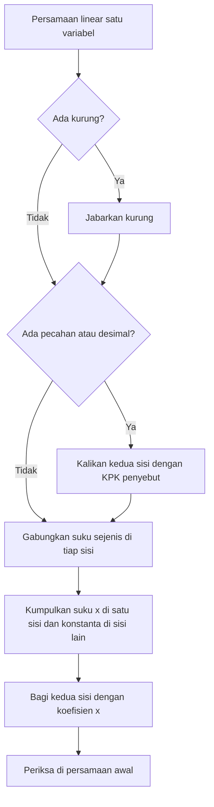

# Part 3 — Persamaan Linear Satu Variabel

## Tujuan Pembelajaran

Setelah mempelajari bagian ini, kamu mampu:

- menjelaskan arti persamaan, tanda sama dengan, sisi kiri, sisi kanan, dan penyelesaian;
- menjelaskan mengapa melakukan operasi yang sama pada kedua sisi menjaga kesetaraan, dan kapan hal itu tidak berlaku;
- menyelesaikan persamaan satu langkah dan dua langkah;
- menyelesaikan persamaan dengan variabel di kedua sisi, dengan kurung, dan dengan pecahan atau desimal;
- mengenali persamaan tanpa penyelesaian dan persamaan dengan banyak penyelesaian;
- memeriksa kebenaran jawaban dan menghindari kesalahan umum.

## Prasyarat

[Part 1](01-mengenal-aljabar.md) (ekspresi, persamaan, identitas) dan [Part 2](02-operasi-bentuk-aljabar.md) (menjabarkan kurung, menggabungkan suku sejenis). Level 0 [Part 7](../level-0-fondasi-matematika/07-variabel-dan-persamaan.md) sudah memperkenalkan persamaan satu dan dua langkah. Bagian ini memperdalamnya dengan alasan dan kasus yang lebih lengkap.

## Mengapa Materi Ini Penting?

"Mencari nilai yang belum diketahui" adalah inti dari banyak masalah: berapa jam parkir yang bisa dibayar dengan uang tertentu, atau berapa parameter yang membuat sebuah model memberi prediksi yang diinginkan. Persamaan linear juga menjadi dasar sistem persamaan (Part 6), fungsi linear (Part 8), dan regresi linear.

## Konsep Dasar dengan Bahasa Sederhana

### 1. Pengertian Persamaan

**Persamaan** (*equation*) adalah pernyataan bahwa dua ekspresi bernilai sama, dihubungkan dengan tanda $=$.

**Persamaan linear satu variabel** (PLSV) adalah persamaan dengan **satu** variabel yang berpangkat satu (tidak ada $x^2$, tidak ada $x$ di penyebut, dan sebagainya). Bentuk dasarnya:

$$
ax + b = c
$$

Nilai variabel yang membuat persamaan benar disebut **penyelesaian** (atau *solusi*, atau akar). **Menyelesaikan** persamaan berarti mencari penyelesaian itu. Pada $2x + 3 = 11$, penyelesaiannya $x = 4$, karena $2(4) + 3 = 11$.

### 2. Makna Tanda Sama Dengan

Tanda $=$ berarti **kedua sisi bernilai sama**. Ia bukan perintah "tuliskan hasilnya". Tiga sifat yang dipakai terus-menerus:

- **Simetris.** Jika $A = B$ maka $B = A$. Jadi $11 = 2x + 3$ sama dengan $2x + 3 = 11$.
- **Transitif.** Jika $A = B$ dan $B = C$ maka $A = C$.
- **Berlaku di setiap baris.** Setiap tanda $=$ yang kamu tulis harus benar. Menulis $3 + 2 = 5 + 4 = 9$ salah karena $3 + 2 \neq 9$.

### 3. Memahami Sisi Kiri dan Sisi Kanan Persamaan

Tanda $=$ membagi persamaan menjadi **sisi kiri** dan **sisi kanan**. Pada $2x + 3 = 11$, sisi kiri adalah $2x + 3$ dan sisi kanan adalah $11$.

Variabel boleh berada di satu sisi atau kedua sisi:

- $2x + 3 = 11$ (variabel di kiri),
- $11 = 2x + 3$ (variabel di kanan),
- $5x - 3 = 2x + 9$ (variabel di kedua sisi).

Tujuan menyelesaikan persamaan adalah membuat variabel berdiri sendirian di satu sisi, misalnya $x = 4$.

### 4. Prinsip Menjaga Kesetaraan

**Prinsip:** jika dua ekspresi bernilai sama, lalu keduanya mengalami operasi yang **sama**, hasilnya tetap sama. Operasi yang aman:

1. menambah bilangan yang sama pada kedua sisi,
2. mengurang bilangan yang sama pada kedua sisi,
3. mengalikan kedua sisi dengan bilangan yang sama, **bukan nol**,
4. membagi kedua sisi dengan bilangan yang sama, **bukan nol**.

**Mengapa valid?** Jika $A = B$, maka $A$ dan $B$ adalah **bilangan yang sama** yang hanya ditulis dengan cara berbeda. Menambah 5 pada bilangan yang sama menghasilkan hasil yang sama. Contoh: $x + 3 = 7$ berarti $x$ adalah bilangan yang jika ditambah 3 menjadi 7. Kurangi 3 dari kedua sisi: $x + 3 - 3 = 7 - 3$ menjadi $x = 4$.

**Analogi timbangan.** Persamaan seperti timbangan dua piringan yang seimbang. Menambah atau mengambil beban yang sama dari kedua piringan menjaganya tetap seimbang.

**Batas analogi timbangan.** Timbangan membuat kita sulit membayangkan bilangan negatif (beban negatif), perkalian dengan pecahan, dan kasus khusus berikut:

- **Dikalikan nol.** Dari $x + 1 = 5$, kalikan kedua sisi dengan 0 menghasilkan $0 = 0$. Pernyataan ini benar untuk **semua** $x$, sehingga informasi tentang $x$ hilang. Karena itu perkalian atau pembagian dengan nol dilarang.
- **Dikuadratkan.** Dari $x = 2$, mengkuadratkan kedua sisi memberi $x^2 = 4$, yang juga benar untuk $x = -2$. Operasi ini bisa menambah penyelesaian palsu. Kita tidak memakainya pada persamaan linear.

### 5. Persamaan Satu Langkah

Satu operasi kebalikan sudah cukup. Operasi kebalikan: tambah dengan kurang, kali dengan bagi.

| Persamaan | Operasi pada $x$ | Kebalikan di kedua sisi | Hasil |
|---|---|---|---|
| $x + 5 = 12$ | tambah 5 | kurang 5 | $x = 7$ |
| $x - 4 = 9$ | kurang 4 | tambah 4 | $x = 13$ |
| $3x = 15$ | kali 3 | bagi 3 | $x = 5$ |
| $\dfrac{x}{4} = 6$ | bagi 4 | kali 4 | $x = 24$ |
| $-x = 6$ | kali $-1$ | kali $-1$ | $x = -6$ |

### 6. Persamaan Dua Langkah

Jika variabel terkena dua operasi, bongkar dengan urutan **terbalik** dari urutan operasi: lepas dulu tambah/kurang, baru kali/bagi.

Selesaikan $3x - 7 = 11$:

1. Tambah 7 di kedua sisi: $3x - 7 + 7 = 11 + 7$, menjadi $3x = 18$.
2. Bagi 3 di kedua sisi: $x = 6$.
3. Periksa: $3(6) - 7 = 11$.

Alasan urutannya: $x$ dikali 3 lebih dulu, baru dikurangi 7. Untuk membongkar, kita lepas yang terakhir dipasang (kurang 7), lalu yang pertama (kali 3).

### 7. Persamaan dengan Variabel di Kedua Sisi

Strategi: kumpulkan suku $x$ di satu sisi dan konstanta di sisi lain.

Selesaikan $5x - 3 = 2x + 9$:

1. Kurangi $2x$ di kedua sisi: $5x - 2x - 3 = 9$, menjadi $3x - 3 = 9$.
2. Tambah 3: $3x = 12$.
3. Bagi 3: $x = 4$.
4. Periksa: kiri $5(4) - 3 = 17$, kanan $2(4) + 9 = 17$. Sama.

Tips: pindahkan suku $x$ yang **lebih kecil** koefisiennya, supaya koefisien yang tersisa positif dan mengurangi salah tanda.

**Dua kasus khusus.** Kadang variabel hilang di tengah jalan:

- $2x + 3 = 2x + 5$. Kurangi $2x$: $3 = 5$. Pernyataan ini **selalu salah**, jadi persamaan **tidak punya penyelesaian**.
- $2(x + 1) = 2x + 2$. Jabarkan: $2x + 2 = 2x + 2$. Kurangi $2x$: $2 = 2$. Pernyataan ini **selalu benar**, jadi **semua** bilangan adalah penyelesaian. Ini identitas (Part 1).

### 8. Persamaan dengan Tanda Kurung

Jabarkan kurung dulu (Part 2), gabungkan suku sejenis, baru selesaikan.

Selesaikan $3(x - 2) = 2x + 5$:

1. Jabarkan: $3x - 6 = 2x + 5$.
2. Kurangi $2x$: $x - 6 = 5$.
3. Tambah 6: $x = 11$.
4. Periksa: kiri $3(11 - 2) = 27$, kanan $2(11) + 5 = 27$.

### 9. Persamaan dengan Pecahan

**Strategi:** kalikan kedua sisi dengan **KPK penyebut** untuk menghilangkan pecahan (valid karena KPK bukan nol).

Selesaikan $\dfrac{x}{3} + \dfrac{x}{2} = 10$:

1. KPK dari 3 dan 2 adalah 6. Kalikan **setiap suku** dengan 6: $6 \cdot \dfrac{x}{3} + 6 \cdot \dfrac{x}{2} = 6 \cdot 10$.
2. Sederhanakan: $2x + 3x = 60$.
3. Gabungkan: $5x = 60$.
4. Bagi 5: $x = 12$.
5. Periksa: $\dfrac{12}{3} + \dfrac{12}{2} = 4 + 6 = 10$.

Untuk desimal, kalikan dengan 10, 100, dan seterusnya agar semua angka menjadi bulat: $0{,}5x + 1{,}2 = 3{,}7$ dikali 10 menjadi $5x + 12 = 37$, lalu $5x = 25$, $x = 5$.

### 10. Memeriksa Kebenaran Jawaban

Selalu **substitusikan jawaban ke persamaan awal** (bukan ke langkah tengah). Hitung kedua sisi. Jika sama, jawaban benar. Jika berbeda, ada kesalahan.

Pemeriksaan menangkap kesalahan yang tidak terlihat. Misalnya, jawaban $x = 7$ untuk $2x + 3 = 11$: kiri $2(7) + 3 = 17 \neq 11$. Jadi jawaban salah, dan jawaban benarnya 4.

Cara memilih langkah:



Diagram menunjukkan urutan umum. Tidak semua langkah dibutuhkan untuk setiap soal; lewati langkah yang tidak relevan.

### 11. Kesalahan Umum dalam Menyelesaikan Persamaan

Daftar lengkap ada di bagian [Kesalahan Umum](#kesalahan-umum) di bawah.

## Istilah yang Perlu Dipahami

| Istilah | Arti sederhana | Contoh |
|---|---|---|
| Persamaan (*equation*) | dua ekspresi yang dinyatakan sama | $2x + 3 = 11$ |
| PLSV | persamaan linear dengan satu variabel | $5x - 3 = 2x + 9$ |
| Sisi kiri / sisi kanan | ekspresi di kiri / kanan tanda $=$ | $2x + 3$ dan $11$ |
| Penyelesaian / solusi | nilai variabel yang membuat persamaan benar | $x = 4$ |
| Operasi kebalikan | operasi yang membatalkan operasi lain | $+$ dan $-$ |
| Kesetaraan | kedua sisi bernilai sama | $A = B$ |
| KPK | kelipatan persekutuan terkecil | KPK$(3, 2) = 6$ |
| Tidak ada penyelesaian | persamaan menghasilkan pernyataan salah | $3 = 5$ |
| Banyak penyelesaian | persamaan menghasilkan pernyataan selalu benar | $2 = 2$ |

## Rumus dan Penjelasan Setiap Simbol

**Bentuk dua langkah:**

$$
ax + b = c \quad\Longrightarrow\quad x = \frac{c - b}{a} \qquad (a \neq 0)
$$

- $x$: variabel yang dicari.
- $a$: koefisien $x$ ($a \neq 0$, jika tidak $x$ hilang).
- $b$: konstanta di sisi kiri.
- $c$: nilai di sisi kanan.
- Diturunkan dengan mengurangi $b$ (jadi $ax = c - b$) lalu membagi dengan $a$.
- Contoh: $2x + 3 = 11$ memiliki $a = 2$, $b = 3$, $c = 11$, jadi $x = \dfrac{11 - 3}{2} = 4$.

**Variabel di kedua sisi:**

$$
ax + b = cx + d \quad\Longrightarrow\quad x = \frac{d - b}{a - c} \qquad (a \neq c)
$$

- Kurangi $cx$ dan $b$ dari kedua sisi: $(a - c)x = d - b$, lalu bagi dengan $(a - c)$.
- Contoh: $5x - 3 = 2x + 9$ memiliki $a = 5$, $b = -3$, $c = 2$, $d = 9$, jadi $x = \dfrac{9 - (-3)}{5 - 2} = \dfrac{12}{3} = 4$.
- Jika $a = c$: bila $b = d$ persamaan menjadi benar untuk semua $x$; bila $b \neq d$ tidak ada penyelesaian.

Rumus ini adalah ringkasan langkah, bukan pengganti pemahaman. Biasakan menyelesaikan dengan langkah, lalu memakai rumus untuk memeriksa.

## Penjelasan Langkah demi Langkah

Prosedur umum untuk $3(x - 2) = 2x + 5$ yang diperinci beserta alasan setiap langkah:

| Langkah | Persamaan | Alasan |
|---|---|---|
| 0 | $3(x - 2) = 2x + 5$ | persamaan awal |
| 1 | $3x - 6 = 2x + 5$ | sifat distributif |
| 2 | $3x - 6 - 2x = 2x + 5 - 2x$ | kurangi $2x$ di kedua sisi |
| 3 | $x - 6 = 5$ | gabung suku sejenis |
| 4 | $x - 6 + 6 = 5 + 6$ | tambah 6 di kedua sisi |
| 5 | $x = 11$ | hitung |
| 6 | $3(11 - 2) = 27 = 2(11) + 5$ | periksa di persamaan awal |

## Contoh Soal dan Pembahasan

### Contoh 1 — Dua langkah dengan variabel negatif

Selesaikan $-2x + 5 = -9$.

1. Kurangi 5 di kedua sisi: $-2x = -14$.
2. Bagi $-2$ di kedua sisi: $x = \dfrac{-14}{-2} = 7$.
3. Periksa: $-2(7) + 5 = -14 + 5 = -9$.

### Contoh 2 — Variabel di kedua sisi dan kurung

Selesaikan $2(x + 3) - (x - 4) = 15$.

1. Jabarkan: $2x + 6 - x + 4 = 15$ (minus membalik $-4$ menjadi $+4$).
2. Gabungkan: $x + 10 = 15$.
3. Kurangi 10: $x = 5$.
4. Periksa: $2(8) - (1) = 16 - 1 = 15$.

### Contoh 3 — Pecahan

Selesaikan $\dfrac{2x}{5} - 1 = 3$.

1. Tambah 1 di kedua sisi: $\dfrac{2x}{5} = 4$.
2. Kalikan 5: $2x = 20$.
3. Bagi 2: $x = 10$.
4. Periksa: $\dfrac{2 \cdot 10}{5} - 1 = 4 - 1 = 3$.

### Contoh 4 — Soal cerita

Sewa sepeda: biaya tetap Rp10.000 ditambah Rp4.000 per jam. Total yang dibayar Rp34.000. Berapa jam sewanya?

1. Misalkan $t$ adalah lama sewa (jam). Total biaya $= 10.000 + 4.000t$.
2. Persamaan: $10.000 + 4.000t = 34.000$.
3. Kurangi 10.000: $4.000t = 24.000$.
4. Bagi 4.000: $t = 6$.
5. Periksa: $10.000 + 4.000(6) = 34.000$. Jadi sewa selama 6 jam.

### Contoh 5 — Tanpa penyelesaian dan banyak penyelesaian

Selesaikan $2x + 3 = 2x + 5$ dan $4(x + 1) = 4x + 4$.

1. Persamaan pertama: kurangi $2x$ dari kedua sisi menghasilkan $3 = 5$, pernyataan salah. **Tidak ada penyelesaian.**
2. Persamaan kedua: jabarkan menjadi $4x + 4 = 4x + 4$. Kurangi $4x$: $4 = 4$, selalu benar. **Semua bilangan** adalah penyelesaian.
3. Uji dengan angka: persamaan kedua dengan $x = 0$ memberi $4 = 4$, dan dengan $x = 10$ memberi $44 = 44$.

## Contoh Tambahan dengan Kesulitan Bertahap

**Mudah.** $x + 9 = 15$ memberi $x = 15 - 9 = 6$.

**Sedang.** $7x + 4 = 3x - 12$. Kurangi $3x$: $4x + 4 = -12$. Kurangi 4: $4x = -16$. Bagi 4: $x = -4$. Periksa: kiri $7(-4) + 4 = -24$, kanan $3(-4) - 12 = -24$.

**Sedang.** $0{,}5x + 1{,}2 = 3{,}7$. Kali 10: $5x + 12 = 37$. Kurangi 12: $5x = 25$. $x = 5$.

**Menantang.** $4(2x - 1) = 3(x + 6)$. Jabarkan: $8x - 4 = 3x + 18$. Kurangi $3x$: $5x - 4 = 18$. Tambah 4: $5x = 22$. $x = \dfrac{22}{5} = 4{,}4$. Periksa: kiri $4(8{,}8 - 1) = 31{,}2$, kanan $3(10{,}4) = 31{,}2$.

## Visualisasi atau Interpretasi Grafik

Persamaan $2x + 3 = 11$ dapat dibaca sebagai pertanyaan: pada $x$ berapa nilai $2x + 3$ mencapai 11? Tabel nilai menunjukkannya:

| $x$ | 1 | 2 | 3 | 4 | 5 |
|---|---|---|---|---|---|
| $2x + 3$ | 5 | 7 | 9 | **11** | 13 |

Nilai 11 muncul tepat saat $x = 4$. Pada grafik (dibahas di Part 5 dan 8), ini adalah titik tempat garis $y = 2x + 3$ memotong garis datar $y = 11$.

## Kesalahan Umum

| Kesalahan | Mengapa salah | Yang benar |
|---|---|---|
| $2x + 3 = 11 \Rightarrow 2x = 11 + 3$ | kebalikan dari $+3$ adalah $-3$ | $2x = 8$ |
| $2x = 8 \Rightarrow x = 8 \times 2$ | kebalikan dari kali adalah bagi | $x = 4$ |
| Mengoperasikan hanya satu sisi | kesetaraan rusak | lakukan di kedua sisi |
| $3(x - 2) = 9 \Rightarrow 3x - 2 = 9$ | 3 tidak dikalikan ke $-2$ | $3x - 6 = 9$ |
| $-3x = 9 \Rightarrow x = 3$ | tanda negatif hilang | $x = -3$ |
| Mengalikan hanya satu suku saat menghilangkan pecahan | suku lain berubah nilai | kalikan **setiap** suku |
| Membagi kedua sisi dengan $x$ | $x$ mungkin nol | kumpulkan suku $x$, lalu bagi dengan koefisien |
| Memeriksa jawaban pada langkah tengah | kesalahan awal tak terdeteksi | periksa di persamaan awal |
| Menyimpulkan "tidak ada solusi" saat variabel hilang tanpa melihat hasilnya | $0 = 0$ berarti semua solusi | lihat apakah pernyataan akhir salah atau benar |
| Menulis $2x + 3 = 11 = 2x = 8$ | rantai tanda sama yang salah | tulis tiap langkah di baris baru |

## Hubungan dengan Machine Learning

- **Mencari parameter.** Misalkan model $y = wx + 3$ harus memberi $y = 11$ saat $x = 4$. Maka $4w + 3 = 11$, jadi $w = 2$. Ini persamaan linear satu variabel dengan $w$ yang dicari.
- **Pelatihan sesungguhnya lebih rumit.** Data nyata punya banyak titik yang tidak semuanya cocok sempurna dengan satu garis, sehingga pelatihan mencari parameter yang paling mendekati, bukan menyelesaikan satu persamaan. Konsep itu dibahas jauh di level berikutnya.
- **Prediksi balik.** Menyelesaikan "berapa $x$ agar $y$ mencapai target" memakai langkah yang sama dengan persamaan di atas.
- **Banyak penyelesaian atau tidak ada.** Dalam sistem yang lebih besar, ada kasus tanpa solusi atau banyak solusi, seperti kasus khusus di bagian 7 (dibahas di Part 6).

### Python: menyelesaikan dan memeriksa persamaan

Rumus $x = \dfrac{c - b}{a}$ untuk $ax + b = c$:

```python
def selesaikan(a, b, c):
    # menyelesaikan a*x + b = c, dengan a tidak nol
    return (c - b) / a

x = selesaikan(2, 3, 11)
print(x)                 # 4.0
print(2 * x + 3 == 11)   # True, pemeriksaan di persamaan awal
```

Variabel di kedua sisi, $5x - 3 = 2x + 9$, dengan rumus $x = \dfrac{d - b}{a - c}$:

```python
a, b, c, d = 5, -3, 2, 9
x = (d - b) / (a - c)
print(x)                              # 4.0
print(a * x + b == c * x + d)         # True
```

Pecahan sebaiknya dihitung tepat dengan `Fraction`, agar tidak ada galat desimal. Untuk $\dfrac{x}{3} + \dfrac{x}{2} = 10$, koefisien $x$ adalah $\dfrac{1}{3} + \dfrac{1}{2}$:

```python
from fractions import Fraction

koef = Fraction(1, 3) + Fraction(1, 2)   # 5/6
x = 10 / koef
print(x)   # 12
print(Fraction(12, 3) + Fraction(12, 2) == 10)   # True
```

Memeriksa beberapa kandidat penyelesaian dengan menguji satu per satu:

```python
for x in range(0, 8):
    if 3 * x - 7 == 11:
        print("penyelesaian:", x)   # penyelesaian: 6
```

## Latihan Mandiri

1. Selesaikan: (a) $x + 9 = 15$ (b) $x - 7 = -3$ (c) $4x = 28$ (d) $\dfrac{x}{5} = 3$ (e) $-x = 6$
2. Selesaikan: (a) $3x - 7 = 11$ (b) $\dfrac{x}{4} + 2 = 5$ (c) $-2x + 5 = -9$ (d) $7 - x = 2$
3. Selesaikan: (a) $5x - 3 = 2x + 9$ (b) $7x + 4 = 3x - 12$ (c) $2x + 10 = 5x - 5$
4. Selesaikan: (a) $3(x - 2) = 2x + 5$ (b) $2(x + 3) - (x - 4) = 15$ (c) $4(2x - 1) = 3(x + 6)$
5. Selesaikan: (a) $\dfrac{x}{3} + \dfrac{x}{2} = 10$ (b) $\dfrac{x + 1}{2} = 5$ (c) $\dfrac{2x}{5} - 1 = 3$ (d) $\dfrac{x}{2} - \dfrac{x}{4} = 3$
6. Selesaikan: (a) $0{,}5x + 1{,}2 = 3{,}7$ (b) $0{,}2x - 0{,}6 = 1{,}4$
7. Tentukan banyak penyelesaian (satu, tidak ada, atau semua): (a) $2x + 3 = 2x + 5$ (b) $3(x + 1) = 3x + 3$ (c) $4x = 8$
8. Apakah $x = -2$ penyelesaian $3x + 5 = -1$? Apakah $x = 4$ penyelesaian $2(x - 1) = x + 5$?
9. (a) Sewa sepeda Rp10.000 ditambah Rp4.000 per jam. Berapa jam jika total Rp34.000? (b) Pada model $y = wx + 3$, titik data $x = 4$, $y = 11$. Berapa $w$?
10. Temukan kesalahan dan perbaiki: (a) $2x + 3 = 11$, $2x = 14$, $x = 7$ (b) $3(x - 2) = 9$, $3x - 2 = 9$, $x = \dfrac{11}{3}$ (c) $4x = 12$, $x = 12 - 4 = 8$

## Kunci Jawaban dan Pembahasan

??? success "Soal 1"
    (a) Kurangi 9: $x = 6$. (b) Tambah 7: $x = 4$. (c) Bagi 4: $x = 7$. (d) Kali 5: $x = 15$. (e) Kali $-1$: $x = -6$.

??? success "Soal 2"
    (a) $3x = 18$, $x = 6$.
    (b) $\dfrac{x}{4} = 3$, $x = 12$.
    (c) $-2x = -14$, $x = 7$.
    (d) $-x = 2 - 7 = -5$, jadi $x = 5$. Periksa: $7 - 5 = 2$.

??? success "Soal 3"
    (a) $3x - 3 = 9$, $3x = 12$, $x = 4$.
    (b) $4x + 4 = -12$, $4x = -16$, $x = -4$.
    (c) Pindahkan $2x$: $10 = 3x - 5$, $15 = 3x$, $x = 5$. Periksa: kiri $2(5) + 10 = 20$, kanan $5(5) - 5 = 20$.

??? success "Soal 4"
    (a) $3x - 6 = 2x + 5$, $x = 11$.
    (b) $2x + 6 - x + 4 = 15$, $x + 10 = 15$, $x = 5$.
    (c) $8x - 4 = 3x + 18$, $5x = 22$, $x = \dfrac{22}{5} = 4{,}4$.

??? success "Soal 5"
    (a) Kali 6: $2x + 3x = 60$, $x = 12$.
    (b) Kali 2: $x + 1 = 10$, $x = 9$.
    (c) $\dfrac{2x}{5} = 4$, $2x = 20$, $x = 10$.
    (d) Kali 4: $2x - x = 12$, $x = 12$. Periksa: $6 - 3 = 3$.

??? success "Soal 6"
    (a) Kali 10: $5x + 12 = 37$, $5x = 25$, $x = 5$.
    (b) Kali 10: $2x - 6 = 14$, $2x = 20$, $x = 10$.

??? success "Soal 7"
    (a) Kurangi $2x$: $3 = 5$, salah. **Tidak ada** penyelesaian.
    (b) Jabarkan: $3x + 3 = 3x + 3$, selalu benar. **Semua** bilangan.
    (c) $x = 2$. **Satu** penyelesaian.

??? success "Soal 8"
    $x = -2$: $3(-2) + 5 = -1$. Sama dengan sisi kanan, jadi **ya**.
    $x = 4$: kiri $2(3) = 6$, kanan $4 + 5 = 9$. Tidak sama, jadi **bukan**. (Penyelesaian sebenarnya: $2x - 2 = x + 5$, $x = 7$.)

??? success "Soal 9"
    (a) $10.000 + 4.000t = 34.000$, $4.000t = 24.000$, $t = 6$ jam.
    (b) $4w + 3 = 11$, $4w = 8$, $w = 2$.

??? success "Soal 10"
    (a) Untuk membatalkan $+3$ harus dikurangi 3. Benar: $2x = 8$, $x = 4$.
    (b) 3 harus dikalikan ke $-2$ juga: $3x - 6 = 9$, $3x = 15$, $x = 5$.
    (c) Pembatal kali adalah bagi: $x = 12 \div 4 = 3$.

## Ringkasan Materi

- Persamaan menyatakan dua ekspresi sama. Menyelesaikannya berarti mencari nilai variabel yang membuatnya benar.
- Kesetaraan terjaga jika kedua sisi diberi operasi yang sama (tambah, kurang, kali, atau bagi dengan bilangan bukan nol), karena kedua sisi adalah bilangan yang sama.
- Dua langkah: lepas tambah/kurang dulu, baru kali/bagi. Variabel di kedua sisi: kumpulkan suku $x$ di satu sisi.
- Kurung: jabarkan dulu. Pecahan: kalikan setiap suku dengan KPK penyebut.
- Jika variabel hilang: pernyataan salah berarti tidak ada penyelesaian, pernyataan benar berarti semua bilangan.
- Selalu periksa jawaban di persamaan awal.

## Checklist Penguasaan

- [ ] Menjelaskan mengapa operasi yang sama di kedua sisi menjaga kesetaraan.
- [ ] Menjelaskan mengapa tidak boleh mengalikan atau membagi dengan nol.
- [ ] Menyelesaikan persamaan satu dan dua langkah dengan koefisien negatif.
- [ ] Menyelesaikan persamaan dengan variabel di kedua sisi dan dengan kurung.
- [ ] Menghilangkan pecahan dan desimal dengan mengalikan semua suku.
- [ ] Mengenali persamaan tanpa penyelesaian dan banyak penyelesaian.
- [ ] Memeriksa jawaban di persamaan awal.
- [ ] Mengubah soal cerita sederhana menjadi persamaan.

## Prasyarat untuk Materi Berikutnya

[Part 4 — Pertidaksamaan Linear](04-pertidaksamaan-linear.md) membutuhkan: menyelesaikan persamaan linear dengan langkah yang sah, memahami kesetaraan, dan membaca garis bilangan. [Part 6](06-sistem-persamaan-linear.md) memakai kasus "tidak ada penyelesaian" dan "banyak penyelesaian" dari bagian 7.
