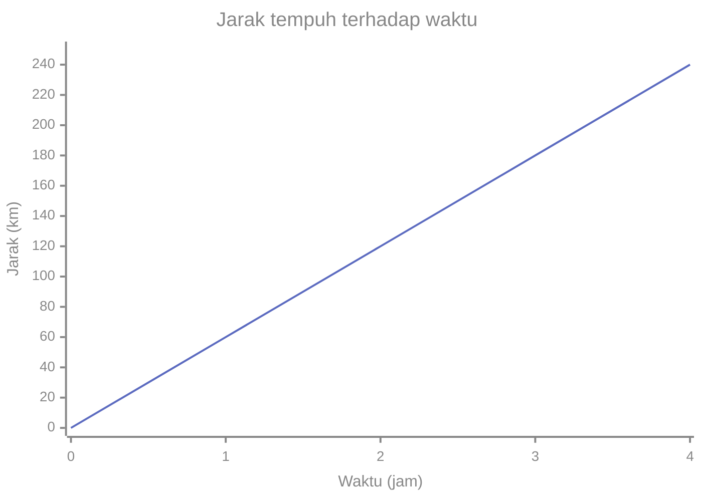
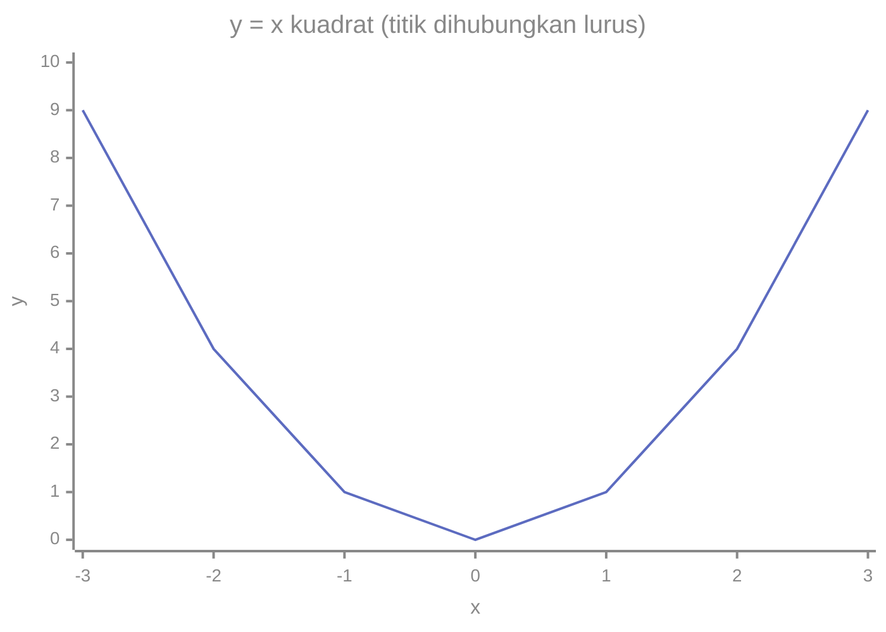
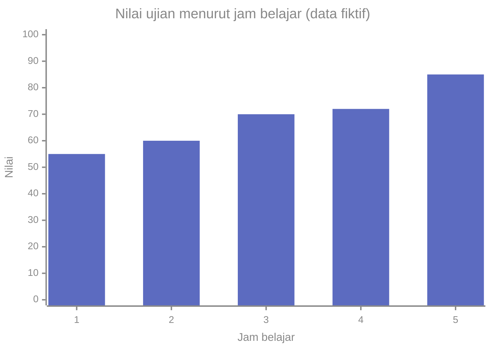

# Part 5 — Koordinat dan Grafik

## Tujuan Pembelajaran

Setelah mempelajari bagian ini, kamu mampu:

- menjelaskan sumbu $x$, sumbu $y$, dan titik asal pada bidang koordinat;
- membaca dan menulis titik koordinat sebagai pasangan terurut $(x, y)$;
- menentukan kuadran sebuah titik;
- membaca grafik: sumbu, skala, dan nilainya;
- membuat tabel nilai dari sebuah aturan dan mengubahnya menjadi grafik;
- menjelaskan hubungan antara masukan (input) dan keluaran (output) dari tabel atau grafik;
- menafsirkan grafik data dengan hati-hati.

## Prasyarat

[Level 0 — Part 1](../level-0-fondasi-matematika/01-mengenal-bilangan.md) (garis bilangan dan bilangan negatif) serta [Part 1](01-mengenal-aljabar.md) dan [Part 3](03-persamaan-linear-satu-variabel.md) di level ini (substitusi dan menghitung nilai ekspresi).

## Mengapa Materi Ini Penting?

Grafik adalah cara tercepat melihat hubungan antara dua besaran. Dalam Machine Learning, setiap data bisa dilihat sebagai sebuah **titik** dalam sebuah ruang, dan model sering digambarkan sebagai garis atau kurva yang melewati titik-titik itu. Tanpa membaca koordinat dan grafik, banyak penjelasan ML akan sulit diikuti.

## Konsep Dasar dengan Bahasa Sederhana

### 1. Mengenal Sumbu X dan Sumbu Y

Pada Level 0 kamu sudah mengenal garis bilangan: satu garis dengan nol di tengah. **Bidang koordinat** (disebut juga bidang Kartesius, menurut matematikawan René Descartes) memakai **dua** garis bilangan yang saling tegak lurus:

- **sumbu $x$**: garis bilangan **mendatar**; positif ke kanan, negatif ke kiri;
- **sumbu $y$**: garis bilangan **tegak**; positif ke atas, negatif ke bawah;
- **titik asal** (*origin*): titik tempat kedua sumbu berpotongan, bernilai $0$ pada kedua sumbu, ditulis $O(0, 0)$.

Jarak antartanda pada tiap sumbu harus sama dan disebut **skala**. Skala di sumbu $x$ dan $y$ boleh berbeda; selalu baca angka pada sumbunya.

### 2. Titik Koordinat

Setiap titik pada bidang diberi alamat berupa dua bilangan, ditulis dalam kurung: $(x, y)$.

- **Bilangan pertama** ($x$): berapa jauh bergerak **mendatar** dari titik asal (kanan jika positif, kiri jika negatif).
- **Bilangan kedua** ($y$): berapa jauh bergerak **tegak** (atas jika positif, bawah jika negatif).

Cara membaca titik $A(3, 2)$: mulai dari titik asal, bergerak 3 langkah ke kanan, lalu 2 langkah ke atas. Cara membaca $B(-4, 3)$: 4 langkah ke kiri, lalu 3 langkah ke atas.

<div style="max-width:440px;margin:1rem auto">
<svg viewBox="0 0 440 440" width="100%" role="img" aria-labelledby="bk-t bk-d" xmlns="http://www.w3.org/2000/svg" style="color:inherit;font-family:inherit;font-size:12px">
<title id="bk-t">Bidang koordinat Kartesius dengan empat kuadran</title>
<desc id="bk-d">Sumbu x mendatar dan sumbu y tegak dari -5 sampai 5. Titik A(3, 2) di kuadran I, B(-4, 3) di kuadran II, C(-2, -3) di kuadran III, dan D(4, -1) di kuadran IV.</desc>
<g stroke="currentColor" stroke-opacity="0.15" stroke-width="1"><line x1="20" y1="420" x2="20" y2="20"/><line x1="20" y1="420" x2="420" y2="420"/><line x1="60" y1="420" x2="60" y2="20"/><line x1="20" y1="380" x2="420" y2="380"/><line x1="100" y1="420" x2="100" y2="20"/><line x1="20" y1="340" x2="420" y2="340"/><line x1="140" y1="420" x2="140" y2="20"/><line x1="20" y1="300" x2="420" y2="300"/><line x1="180" y1="420" x2="180" y2="20"/><line x1="20" y1="260" x2="420" y2="260"/><line x1="260" y1="420" x2="260" y2="20"/><line x1="20" y1="180" x2="420" y2="180"/><line x1="300" y1="420" x2="300" y2="20"/><line x1="20" y1="140" x2="420" y2="140"/><line x1="340" y1="420" x2="340" y2="20"/><line x1="20" y1="100" x2="420" y2="100"/><line x1="380" y1="420" x2="380" y2="20"/><line x1="20" y1="60" x2="420" y2="60"/><line x1="420" y1="420" x2="420" y2="20"/><line x1="20" y1="20" x2="420" y2="20"/></g>
<g stroke="currentColor" stroke-width="1.6" fill="currentColor"><line x1="12" y1="220" x2="428" y2="220"/><line x1="220" y1="428" x2="220" y2="12"/><polygon points="436,220 426,216 426,224" stroke="none"/><polygon points="220,4 216,14 224,14" stroke="none"/></g>
<g stroke="currentColor" stroke-width="1.2"><line x1="20" y1="216" x2="20" y2="224"/><line x1="216" y1="420" x2="224" y2="420"/><line x1="60" y1="216" x2="60" y2="224"/><line x1="216" y1="380" x2="224" y2="380"/><line x1="100" y1="216" x2="100" y2="224"/><line x1="216" y1="340" x2="224" y2="340"/><line x1="140" y1="216" x2="140" y2="224"/><line x1="216" y1="300" x2="224" y2="300"/><line x1="180" y1="216" x2="180" y2="224"/><line x1="216" y1="260" x2="224" y2="260"/><line x1="260" y1="216" x2="260" y2="224"/><line x1="216" y1="180" x2="224" y2="180"/><line x1="300" y1="216" x2="300" y2="224"/><line x1="216" y1="140" x2="224" y2="140"/><line x1="340" y1="216" x2="340" y2="224"/><line x1="216" y1="100" x2="224" y2="100"/><line x1="380" y1="216" x2="380" y2="224"/><line x1="216" y1="60" x2="224" y2="60"/><line x1="420" y1="216" x2="420" y2="224"/><line x1="216" y1="20" x2="224" y2="20"/></g>
<g fill="currentColor"><text x="20" y="238" text-anchor="middle">-5</text><text x="212" y="424" text-anchor="end">-5</text><text x="60" y="238" text-anchor="middle">-4</text><text x="212" y="384" text-anchor="end">-4</text><text x="100" y="238" text-anchor="middle">-3</text><text x="212" y="344" text-anchor="end">-3</text><text x="140" y="238" text-anchor="middle">-2</text><text x="212" y="304" text-anchor="end">-2</text><text x="180" y="238" text-anchor="middle">-1</text><text x="212" y="264" text-anchor="end">-1</text><text x="260" y="238" text-anchor="middle">1</text><text x="212" y="184" text-anchor="end">1</text><text x="300" y="238" text-anchor="middle">2</text><text x="212" y="144" text-anchor="end">2</text><text x="340" y="238" text-anchor="middle">3</text><text x="212" y="104" text-anchor="end">3</text><text x="380" y="238" text-anchor="middle">4</text><text x="212" y="64" text-anchor="end">4</text><text x="420" y="238" text-anchor="middle">5</text><text x="212" y="24" text-anchor="end">5</text><text x="212" y="236" text-anchor="end">0</text></g>
<g fill="currentColor" font-size="14" font-style="italic"><text x="432" y="242">x</text><text x="230" y="6">y</text></g>
<g fill="currentColor" fill-opacity="0.55" font-size="16" font-weight="bold" text-anchor="middle"><text x="320.0" y="36.0">I</text><text x="120.0" y="36.0">II</text><text x="120.0" y="412.0">III</text><text x="320.0" y="412.0">IV</text></g>
<circle cx="340" cy="140" r="5" fill="#e53935"/><text x="350" y="132" text-anchor="start" fill="currentColor" font-weight="bold">A(3, 2)</text><circle cx="60" cy="100" r="5" fill="#e53935"/><text x="50" y="92" text-anchor="end" fill="currentColor" font-weight="bold">B(-4, 3)</text><circle cx="140" cy="340" r="5" fill="#e53935"/><text x="130" y="358" text-anchor="end" fill="currentColor" font-weight="bold">C(-2, -3)</text><circle cx="380" cy="260" r="5" fill="#e53935"/><text x="390" y="278" text-anchor="start" fill="currentColor" font-weight="bold">D(4, -1)</text>
</svg></div>

**Cara membaca gambar.** Garis mendatar dengan angka $-5$ sampai $5$ adalah sumbu $x$, dan garis tegak adalah sumbu $y$. Titik merah $A(3, 2)$ berada 3 kotak di kanan dan 2 kotak di atas titik asal. Titik $B(-4, 3)$ berada 4 kotak di kiri dan 3 kotak di atas. Titik $C(-2, -3)$ berada 2 kotak di kiri dan 3 kotak di bawah. Titik $D(4, -1)$ berada 4 kotak di kanan dan 1 kotak di bawah. Angka romawi I sampai IV menandai empat daerah yang dibahas di bagian 4.

### 3. Pasangan Terurut $(x, y)$

Pasangan $(x, y)$ disebut **pasangan terurut** karena **urutannya penting**: bilangan pertama selalu $x$ dan bilangan kedua selalu $y$.

- $(3, 5)$ adalah titik 3 ke kanan dan 5 ke atas.
- $(5, 3)$ adalah titik 5 ke kanan dan 3 ke atas. Ini **titik yang berbeda**.

Titik pada sumbu:

- Titik di sumbu $x$ memiliki $y = 0$, misalnya $(4, 0)$.
- Titik di sumbu $y$ memiliki $x = 0$, misalnya $(0, -3)$.
- Titik asal adalah $(0, 0)$.

!!! note "Tanda kurung punya banyak arti"
    $(a, b)$ juga dipakai untuk interval ($(3, \infty)$ di Part 4) dan untuk argumen fungsi. Konteks menentukan artinya. Di bagian ini, $(x, y)$ berarti sebuah titik.

### 4. Empat Kuadran

Kedua sumbu membagi bidang menjadi empat daerah yang disebut **kuadran**, bernomor berlawanan arah jarum jam mulai dari kanan atas:

| Kuadran | Tanda $x$ | Tanda $y$ | Letak | Contoh |
|---|---|---|---|---|
| I | $+$ | $+$ | kanan atas | $(3, 2)$ |
| II | $-$ | $+$ | kiri atas | $(-4, 3)$ |
| III | $-$ | $-$ | kiri bawah | $(-2, -3)$ |
| IV | $+$ | $-$ | kanan bawah | $(4, -1)$ |

Titik yang berada **tepat di sumbu** (misalnya $(4, 0)$ atau $(0, -3)$) bukan anggota kuadran mana pun.

### 5. Membaca Grafik

**Grafik** menyajikan hubungan dua besaran. Cara membacanya:

1. **Baca judul dan label sumbu.** Apa yang diukur oleh sumbu $x$ dan sumbu $y$? Apa satuannya?
2. **Perhatikan skala.** Berapa nilai per kotak? Apakah sumbu dimulai dari nol?
3. **Cari titik yang ditanyakan.** Untuk $x$ tertentu, telusuri ke grafik lalu ke sumbu $y$.
4. **Cari pola.** Naik, turun, atau datar?

Contoh: jarak tempuh sebuah mobil (kilometer) terhadap waktu (jam).



Cara membaca: sumbu mendatar adalah waktu dalam jam, dan sumbu tegak adalah jarak dalam kilometer. Pada $x = 2$ jam, grafik berada di $y = 120$ km. Garis naik rata, yang berarti jarak bertambah 60 km setiap jam (kecepatan tetap 60 km/jam).

!!! note "Catatan tentang grafik di halaman ini"
    Grafik garis di halaman ini hanya menampilkan sumbu $x$ di bagian bawah dan sumbu $y$ di sebelah kiri, bukan melewati titik asal. Untuk bidang dengan empat kuadran, gunakan gambar bidang koordinat di bagian 2.

### 6. Membuat Tabel Nilai

**Tabel nilai** mendaftar pasangan masukan ($x$) dan keluaran ($y$) dari sebuah aturan.

Langkah untuk $y = 2x - 1$:

1. Pilih beberapa nilai $x$ yang sederhana, misalnya $-2, -1, 0, 1, 2$.
2. Hitung $y$ untuk tiap $x$ (substitusi, dengan kurung untuk bilangan negatif).
3. Tulis dalam tabel.

| $x$ | Perhitungan | $y$ | Titik $(x, y)$ |
|---|---|---|---|
| $-2$ | $2(-2) - 1 = -4 - 1$ | $-5$ | $(-2, -5)$ |
| $-1$ | $2(-1) - 1 = -2 - 1$ | $-3$ | $(-1, -3)$ |
| $0$ | $2(0) - 1 = 0 - 1$ | $-1$ | $(0, -1)$ |
| $1$ | $2(1) - 1 = 2 - 1$ | $1$ | $(1, 1)$ |
| $2$ | $2(2) - 1 = 4 - 1$ | $3$ | $(2, 3)$ |

Setiap baris menghasilkan satu titik. Memilih lebih banyak $x$ menghasilkan lebih banyak titik.

### 7. Mengubah Tabel menjadi Grafik

Untuk membuat grafik: letakkan setiap titik $(x, y)$ pada bidang, lalu hubungkan titik-titik itu **jika masuk akal** untuk menghubungkannya.

Titik-titik dari tabel $y = 2x - 1$ semuanya berada pada satu garis lurus:

```mermaid
%%{init: {"themeVariables": {"xyChart": {"backgroundColor":"transparent","plotColorPalette":"#5c6bc0, #e53935","titleColor":"#888","xAxisLabelColor":"#888","yAxisLabelColor":"#888","xAxisTitleColor":"#888","yAxisTitleColor":"#888","xAxisLineColor":"#888","yAxisLineColor":"#888","xAxisTickColor":"#888","yAxisTickColor":"#888"}}}}%%
xychart-beta
    title "y = 2x - 1"
    x-axis "x" [-2, -1, 0, 1, 2]
    y-axis "y" -6 --> 4
    line [-5, -3, -1, 1, 3]
```

Grafik ini membaca nilai $y$ dari tabel di atas: pada $x = -2$, $y = -5$; pada $x = 2$, $y = 3$. Garis naik dari kiri ke kanan.

Tidak semua grafik berupa garis lurus. Tabel $y = x^2$ memberi $y$ sebesar $9, 4, 1, 0, 1, 4, 9$ untuk $x = -3, \ldots, 3$:



Bentuknya melengkung seperti huruf U. Grafik di atas dibuat dengan menghubungkan hanya tujuh titik dengan ruas lurus, jadi sudut-sudutnya terlihat kasar. Dengan lebih banyak titik, lengkungannya akan mulus. Bentuk ini dibahas di Part 9.

!!! warning "Kapan titik tidak boleh dihubungkan?"
    Jika masukan hanya bisa bernilai bulat atau terpisah, misalnya "banyak buku" ($1, 2, 3, \ldots$), menghubungkan titik berarti menyatakan ada "2,5 buku". Dalam kasus seperti itu, gambarkan titiknya saja.

### 8. Memahami Hubungan antara Input dan Output

Dalam tabel atau grafik, $x$ adalah **masukan** (*input*, juga disebut variabel bebas) dan $y$ adalah **keluaran** (*output*, juga disebut variabel terikat) karena nilainya bergantung pada $x$. Untuk satu $x$, ada satu $y$.

Cara mendeskripsikan hubungan: tanyakan "jika $x$ naik 1, $y$ berubah berapa?"

| $x$ | $-2$ | $-1$ | $0$ | $1$ | $2$ |
|---|---|---|---|---|---|
| $y = 2x - 1$ | $-5$ | $-3$ | $-1$ | $1$ | $3$ |
| perubahan $y$ | | $+2$ | $+2$ | $+2$ | $+2$ |

Perubahan $y$ selalu $+2$, jadi hubungan ini **linear**: grafiknya garis lurus. Bandingkan dengan $y = x^2$:

| $x$ | $0$ | $1$ | $2$ | $3$ | $4$ |
|---|---|---|---|---|---|
| $y = x^2$ | $0$ | $1$ | $4$ | $9$ | $16$ |
| perubahan $y$ | | $+1$ | $+3$ | $+5$ | $+7$ |

Perubahan $y$ tidak tetap, jadi hubungan ini **tidak linear**.

### 9. Menginterpretasikan Grafik dalam Konteks Data

Pada data nyata, setiap pengamatan menjadi satu titik. Contoh: lama belajar $x$ (jam) dan nilai ujian $y$ untuk lima siswa.

| Siswa | Jam belajar $x$ | Nilai $y$ | Titik |
|---|---|---|---|
| 1 | 1 | 55 | $(1, 55)$ |
| 2 | 2 | 60 | $(2, 60)$ |
| 3 | 3 | 70 | $(3, 70)$ |
| 4 | 4 | 72 | $(4, 72)$ |
| 5 | 5 | 85 | $(5, 85)$ |



Grafik batang di atas menunjukkan data yang sama. Kecenderungannya: semakin lama belajar, semakin tinggi nilai. Namun perhatikan:

- Kecenderungan tidak sempurna. Dari 3 ke 4 jam, nilai hanya naik 2, sedangkan dari 4 ke 5 jam naik 13.
- Data ini **fiktif** dan hanya lima titik; pola sebenarnya mungkin berbeda dengan data lebih banyak.
- Grafik menunjukkan **hubungan**, bukan bukti bahwa belajar *menyebabkan* nilai naik. Faktor lain (kemampuan awal, kualitas tidur) bisa berperan.
- **Skala sumbu** memengaruhi kesan. Jika sumbu $y$ dimulai dari 50, kenaikan terlihat jauh lebih curam daripada jika dimulai dari 0. Selalu lihat angka pada sumbu.

## Istilah yang Perlu Dipahami

| Istilah | Arti sederhana | Contoh |
|---|---|---|
| Bidang koordinat | bidang dengan dua sumbu tegak lurus | bidang Kartesius |
| Sumbu $x$ | garis bilangan mendatar | |
| Sumbu $y$ | garis bilangan tegak | |
| Titik asal (*origin*) | perpotongan kedua sumbu | $(0, 0)$ |
| Koordinat | bilangan yang menentukan letak titik | $3$ dan $2$ pada $(3, 2)$ |
| Pasangan terurut | dua bilangan dengan urutan penting | $(3, 5) \neq (5, 3)$ |
| Kuadran (*quadrant*) | salah satu dari empat daerah bidang | kuadran II |
| Skala | nilai per satuan jarak pada sumbu | 1 kotak = 10 km |
| Tabel nilai | daftar pasangan $x$ dan $y$ | tabel $y = 2x - 1$ |
| Masukan (*input*) | nilai yang dipilih, sumbu $x$ | $x$ |
| Keluaran (*output*) | nilai hasil, sumbu $y$ | $y$ |
| Grafik | gambar hubungan dua besaran | |

## Rumus dan Penjelasan Setiap Simbol

**Titik koordinat:**

$$
P(x, y)
$$

- $P$ adalah nama titik.
- $x$ adalah koordinat mendatar (jarak dan arah dari sumbu $y$).
- $y$ adalah koordinat tegak (jarak dan arah dari sumbu $x$).

**Aturan tanda kuadran:** I $(+,+)$, II $(-,+)$, III $(-,-)$, IV $(+,-)$. Berlaku bila $x \neq 0$ dan $y \neq 0$.

**Jarak dua titik** (pengayaan; memakai teorema Pythagoras dan akar dari Level 0):

$$
d = \sqrt{(x_2 - x_1)^2 + (y_2 - y_1)^2}
$$

- $(x_1, y_1)$ dan $(x_2, y_2)$ adalah dua titik; angka kecil di kanan bawah (subskrip) hanya penanda "titik pertama" dan "titik kedua".
- $x_2 - x_1$ adalah selisih mendatar; $y_2 - y_1$ selisih tegak. Keduanya dikuadratkan, dijumlah, lalu diakarkan.
- Contoh: titik $(1, 2)$ dan $(4, 6)$: $d = \sqrt{(4 - 1)^2 + (6 - 2)^2} = \sqrt{9 + 16} = \sqrt{25} = 5$.

## Penjelasan Langkah demi Langkah

**Cara menggambar titik $(x, y)$:**

1. Mulai dari titik asal.
2. Bergerak mendatar sejauh $x$ (kanan bila positif, kiri bila negatif).
3. Dari posisi itu, bergerak tegak sejauh $y$ (atas bila positif, bawah bila negatif).
4. Tandai titik.

**Cara membuat grafik dari aturan:** buat tabel nilai, ubah setiap baris menjadi titik, gambar titik, dan hubungkan bila masuk akal.

## Contoh Soal dan Pembahasan

### Contoh 1 — Menentukan kuadran

Tentukan kuadran titik $(5, -2)$, $(-3, -7)$, $(0, 4)$, dan $(-1, 6)$.

1. $(5, -2)$: $x$ positif, $y$ negatif, maka **kuadran IV**.
2. $(-3, -7)$: keduanya negatif, maka **kuadran III**.
3. $(0, 4)$: $x = 0$, titik berada pada **sumbu $y$**, bukan di kuadran mana pun.
4. $(-1, 6)$: $x$ negatif, $y$ positif, maka **kuadran II**.

### Contoh 2 — Tabel nilai

Buat tabel nilai $y = 3x - 2$ untuk $x = -2, -1, 0, 1, 2$.

1. $x = -2$: $3(-2) - 2 = -6 - 2 = -8$.
2. $x = -1$: $3(-1) - 2 = -3 - 2 = -5$.
3. $x = 0$: $3(0) - 2 = -2$.
4. $x = 1$: $3(1) - 2 = 1$.
5. $x = 2$: $3(2) - 2 = 4$.
6. Titik: $(-2, -8)$, $(-1, -5)$, $(0, -2)$, $(1, 1)$, $(2, 4)$. Perubahan $y$ setiap $x$ naik 1 selalu $+3$, jadi garis lurus.

### Contoh 3 — Mengenali linear atau bukan

Apakah $y = x^2 - 1$ linear? Buat tabel untuk $x = -2, -1, 0, 1, 2$.

1. $x = -2$: $(-2)^2 - 1 = 4 - 1 = 3$.
2. $x = -1$: $1 - 1 = 0$.
3. $x = 0$: $0 - 1 = -1$.
4. $x = 1$: $1 - 1 = 0$.
5. $x = 2$: $4 - 1 = 3$.
6. Perubahan $y$: $0 - 3 = -3$, $-1 - 0 = -1$, $0 - (-1) = +1$, $3 - 0 = +3$. Tidak tetap, jadi **tidak linear**.

### Contoh 4 — Membaca grafik jarak dan waktu

Dari grafik jarak terhadap waktu di bagian 5, berapa jarak setelah 3 jam, dan kapan jaraknya 240 km?

1. Pada $x = 3$: jarak $y = 180$ km.
2. Mencari $y = 240$: grafik mencapai 240 pada $x = 4$ jam.
3. Kecepatan: setiap jam bertambah 60 km, jadi 60 km/jam. Periksa: $60 \times 4 = 240$.

## Contoh Tambahan dengan Kesulitan Bertahap

**Mudah.** Titik $(2, 3)$ berada di kuadran I karena kedua koordinatnya positif.

**Sedang.** Jarak $(0, 0)$ ke $(6, 8)$: $\sqrt{36 + 64} = \sqrt{100} = 10$.

**Sedang.** Titik-titik $(0, 1)$, $(1, 3)$, $(2, 5)$, $(3, 7)$ naik 2 setiap $x$ naik 1, dan nilai awalnya 1. Aturannya $y = 2x + 1$. Cek: $x = 3$ memberi $7$. Prediksi untuk $x = 10$: $2(10) + 1 = 21$.

**Menantang.** Jika titik $(a, b)$ ada di kuadran II, maka $a < 0$ dan $b > 0$. Titik $(-a, b)$ ada di kuadran I, karena $-a > 0$.

## Visualisasi atau Interpretasi Grafik

Setiap grafik di halaman ini punya tabel nilai pendamping, sehingga kamu tidak harus bergantung pada gambar:

- **Jarak dan waktu:** $(0, 0), (1, 60), (2, 120), (3, 180), (4, 240)$. Naik tetap 60.
- **$y = 2x - 1$:** garis lurus, naik 2 setiap $x$ naik 1.
- **$y = x^2$:** melengkung; turun lalu naik, dengan titik terendah di $(0, 0)$.
- **Nilai dan jam belajar:** titik-titik cenderung naik, tidak sempurna.

## Kesalahan Umum

| Kesalahan | Mengapa salah | Yang benar |
|---|---|---|
| Menukar $x$ dan $y$: titik $(3, 5)$ digambar di 5 kanan 3 atas | urutan pasangan terurut penting | $(3, 5)$ berarti 3 kanan, 5 atas |
| Menganggap $(0, 4)$ ada di kuadran I | titik di sumbu bukan anggota kuadran | titik pada sumbu $y$ |
| Menomori kuadran searah jarum jam | penomoran berlawanan arah jarum jam | I kanan atas, II kiri atas, III kiri bawah, IV kanan bawah |
| Salah tanda saat substitusi, mis. $y = 3(-2) - 2 = -4$ | $3(-2) = -6$ | $-8$ |
| Tidak melihat skala sumbu | nilai per kotak bisa berbeda | baca angka di sumbu |
| Menghubungkan titik pada data terpisah | menyiratkan nilai di antaranya | gambar titik saja |
| Menganggap semua grafik berupa garis lurus | tidak semua hubungan linear | periksa perubahan $y$ pada tabel |
| Menyimpulkan sebab-akibat dari grafik | grafik hanya menunjukkan hubungan | sebut sebagai "ada hubungan" |
| Menggambar hanya dua titik lalu menganggap pasti lurus | dua titik selalu bisa dihubungkan lurus | uji dengan titik ketiga |

## Hubungan dengan Machine Learning

- **Data sebagai titik.** Sebuah data dengan dua nilai $(x, y)$ adalah satu titik di bidang. Dataset adalah kumpulan titik. Dengan banyak fitur, data menjadi titik di ruang dengan banyak sumbu, yang tidak bisa digambar langsung tetapi memakai prinsip yang sama.
- **Garis sebagai model.** Model linear $\hat{y} = wx + b$ digambarkan sebagai garis. Model yang baik adalah garis yang dekat dengan titik-titik data.
- **Jarak dua titik.** Rumus jarak di atas dipakai untuk mengukur kemiripan dua data, misalnya pada algoritma k-nearest neighbors.
- **Grafik untuk eksplorasi.** Melihat grafik data sebelum membuat model membantu menemukan pola, nilai ekstrem, dan kesalahan data.
- **Hati-hati menafsirkan.** Poin tentang sebab-akibat dan skala sumbu berlaku penuh untuk grafik ML.

### Python: titik, kuadran, dan tabel nilai

Pasangan terurut di Python adalah *tuple*, yaitu dua nilai dalam kurung:

```python
A = (3, 2)
x, y = A
print(x, y)   # 3 2
```

Fungsi untuk menentukan kuadran. Kata `if` berarti "jika", `or` berarti "atau", dan `and` berarti "dan". Fungsi berhenti pada `return` pertama yang kondisinya terpenuhi.

```python
def kuadran(x, y):
    if x == 0 or y == 0:
        return "pada sumbu"
    if x > 0 and y > 0:
        return "I"
    if x < 0 and y > 0:
        return "II"
    if x < 0 and y < 0:
        return "III"
    return "IV"

for titik in [(3, 2), (-4, 3), (-2, -3), (4, -1), (4, 0)]:
    print(titik, kuadran(*titik))
# (3, 2) I
# (-4, 3) II
# (-2, -3) III
# (4, -1) IV
# (4, 0) pada sumbu
```

Notasi `*titik` memecah pasangan menjadi dua argumen `x` dan `y`.

Tabel nilai $y = 2x - 1$:

```python
for x in [-2, -1, 0, 1, 2]:
    y = 2 * x - 1
    print(x, y)
# -2 -5
# -1 -3
# 0 -1
# 1 1
# 2 3
```

Memeriksa linear atau bukan lewat perubahan $y$:

```python
def selisih(daftar):
    return [daftar[i + 1] - daftar[i] for i in range(len(daftar) - 1)]

y_linear = [2 * x - 1 for x in range(-2, 3)]
y_kuadrat = [x ** 2 for x in range(0, 5)]
print(selisih(y_linear))    # [2, 2, 2, 2]
print(selisih(y_kuadrat))   # [1, 3, 5, 7]
```

Jarak dua titik:

```python
import math

d = math.sqrt((4 - 1) ** 2 + (6 - 2) ** 2)
print(d)   # 5.0
```

## Latihan Mandiri

1. Sebutkan koordinat titik A, B, C, dan D pada gambar bidang koordinat di bagian 2.
2. Tentukan kuadran atau sumbu: (a) $(5, -2)$ (b) $(-3, -7)$ (c) $(0, 4)$ (d) $(-1, 6)$ (e) $(8, 3)$
3. Apakah $(3, 5)$ dan $(5, 3)$ titik yang sama? Jelaskan.
4. Jika $a < 0$ dan $b < 0$, di kuadran mana titik $(a, b)$? Jika titik berada di sumbu $x$, berapa nilai $y$-nya?
5. Buat tabel nilai $y = 3x - 2$ untuk $x = -2, -1, 0, 1, 2$.
6. Buat tabel nilai $y = x^2 - 1$ untuk $x = -2, -1, 0, 1, 2$. Apakah grafiknya garis lurus?
7. Grafik jarak dan waktu di bagian 5: berapa kecepatannya? Berapa jarak setelah 3 jam? Kapan jarak mencapai 240 km?
8. Titik $(0, 1)$, $(1, 3)$, $(2, 5)$, $(3, 7)$: temukan aturan $y$ dalam $x$ dan prediksi $y$ untuk $x = 10$.
9. Untuk $y = 2x - 1$, berapa perubahan $y$ saat $x$ naik 1? Untuk $y = x^2$, berapa perubahan $y$ saat $x$ naik dari 2 ke 3 dan dari 3 ke 4?
10. Data jam belajar dan nilai (bagian 9): sebutkan satu hal yang boleh disimpulkan dan dua hal yang tidak boleh disimpulkan dari grafik.

## Kunci Jawaban dan Pembahasan

??? success "Soal 1"
    A$(3, 2)$, B$(-4, 3)$, C$(-2, -3)$, D$(4, -1)$.

??? success "Soal 2"
    (a) kuadran IV. (b) kuadran III. (c) pada sumbu $y$. (d) kuadran II. (e) kuadran I.

??? success "Soal 3"
    **Bukan.** $(3, 5)$ berada 3 kanan dan 5 atas, sedangkan $(5, 3)$ berada 5 kanan dan 3 atas. Urutan pasangan terurut penting.

??? success "Soal 4"
    Kuadran III (kedua koordinat negatif). Titik di sumbu $x$ memiliki $y = 0$.

??? success "Soal 5"
    $x = -2$: $-8$. $x = -1$: $-5$. $x = 0$: $-2$. $x = 1$: $1$. $x = 2$: $4$.

??? success "Soal 6"
    $x = -2$: $3$. $x = -1$: $0$. $x = 0$: $-1$. $x = 1$: $0$. $x = 2$: $3$. Perubahan $y$: $-3, -1, +1, +3$. Tidak tetap, jadi **bukan** garis lurus.

??? success "Soal 7"
    Kecepatan: $60$ km/jam (naik 60 km per jam). Jarak setelah 3 jam: $180$ km. Jarak 240 km tercapai pada $4$ jam.

??? success "Soal 8"
    $y$ naik 2 setiap $x$ naik 1, dan $y = 1$ saat $x = 0$. Aturannya $y = 2x + 1$. Cek: $x = 3$ memberi $7$. Untuk $x = 10$: $y = 21$.

??? success "Soal 9"
    $y = 2x - 1$: selalu naik $2$. $y = x^2$: dari $x = 2$ ke $3$, $y$ dari $4$ ke $9$ (naik $5$); dari $3$ ke $4$, $y$ dari $9$ ke $16$ (naik $7$).

??? success "Soal 10"
    Boleh: nilai cenderung naik seiring jam belajar (pada data ini). Tidak boleh: (1) menyimpulkan bahwa belajar *menyebabkan* nilai naik; (2) menyimpulkan pola yang sama berlaku untuk semua siswa, karena hanya lima titik fiktif. Alasan lain yang juga diterima: kesan kemiringan bergantung pada skala sumbu.

## Ringkasan Materi

- Bidang koordinat punya sumbu $x$ (mendatar) dan sumbu $y$ (tegak) yang berpotongan di titik asal $(0, 0)$.
- Titik ditulis sebagai pasangan terurut $(x, y)$: $x$ mendatar, $y$ tegak. Urutan penting.
- Empat kuadran: I $(+,+)$, II $(-,+)$, III $(-,-)$, IV $(+,-)$. Titik di sumbu tidak masuk kuadran.
- Grafik dibaca lewat label sumbu, skala, lalu titik dan pola.
- Tabel nilai mendaftar $(x, y)$ dari sebuah aturan; titik-titik itulah yang digambar.
- Hubungan linear: perubahan $y$ tetap saat $x$ naik tetap.
- Grafik menunjukkan hubungan, bukan sebab-akibat; skala sumbu memengaruhi kesan.

## Checklist Penguasaan

- [ ] Menggambar dan membaca titik $(x, y)$, termasuk dengan koordinat negatif.
- [ ] Menjelaskan mengapa $(3, 5) \neq (5, 3)$.
- [ ] Menentukan kuadran suatu titik dan mengenali titik pada sumbu.
- [ ] Membaca grafik dengan memperhatikan label, satuan, dan skala.
- [ ] Membuat tabel nilai dari sebuah aturan.
- [ ] Mengenali hubungan linear lewat perubahan $y$ yang tetap.
- [ ] Menyebut dua batasan saat menafsirkan grafik data.

## Prasyarat untuk Materi Berikutnya

[Part 6 — Sistem Persamaan Linear](06-sistem-persamaan-linear.md) membutuhkan: membaca titik dan grafik garis, serta membuat tabel nilai, karena interpretasi grafik dua garis dan titik potongnya. [Part 7 — Konsep Fungsi](07-konsep-fungsi.md) membutuhkan: pasangan masukan-keluaran dan tabel nilai.
