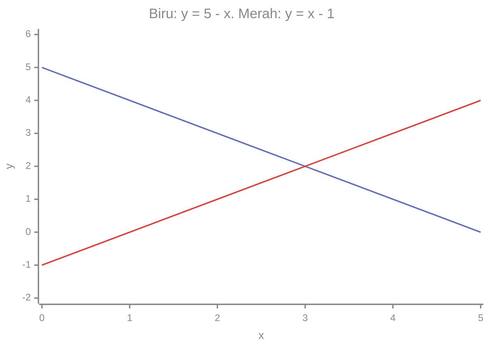
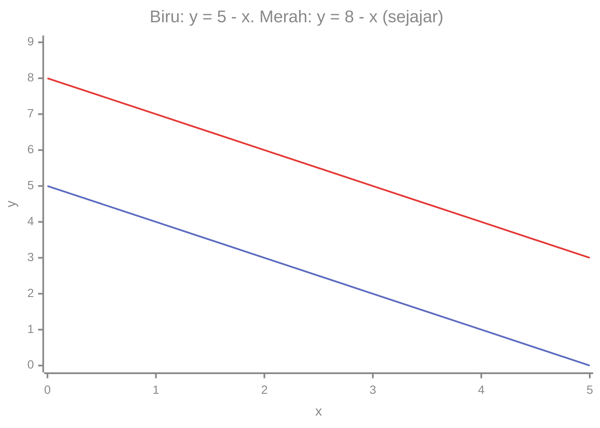

# Part 6 — Sistem Persamaan Linear

## Tujuan Pembelajaran

Setelah mempelajari bagian ini, kamu mampu:

- menjelaskan persamaan linear dua variabel dan mengapa solusinya berupa pasangan nilai;
- menyelesaikan sistem dua persamaan dengan metode substitusi dan eliminasi;
- menafsirkan solusi sebagai titik potong dua garis pada grafik;
- membedakan sistem yang punya satu solusi, tidak punya solusi, dan punya banyak solusi;
- menulis sistem sederhana dalam bentuk matriks sebagai pengantar Level 2;
- menjelaskan hubungan sistem persamaan dengan mencari parameter model Machine Learning.

## Prasyarat

[Part 3](03-persamaan-linear-satu-variabel.md) (menyelesaikan persamaan, termasuk kasus tanpa penyelesaian dan banyak penyelesaian) dan [Part 5](05-koordinat-dan-grafik.md) (koordinat, tabel nilai, membaca grafik).

## Mengapa Materi Ini Penting?

Banyak masalah memiliki **lebih dari satu hal yang tidak diketahui** sekaligus. Dalam Machine Learning, sebuah model linear punya beberapa parameter (misalnya $w$ dan $b$) yang harus dicari dari data. Setiap data memberi satu persamaan, jadi mencari parameter berarti menyelesaikan sistem persamaan. Memahami kasus sederhana dua variabel menyiapkan kamu untuk aljabar linear di Level 2.

## Konsep Dasar dengan Bahasa Sederhana

### 1. Persamaan dengan Dua Variabel

**Persamaan linear dua variabel** adalah persamaan yang memuat dua variabel berpangkat satu, dengan bentuk umum

$$
ax + by = c
$$

Contoh: $x + y = 5$. Persamaan ini punya **banyak** pasangan penyelesaian, karena begitu $x$ dipilih, $y$ ikut ditentukan:

| $x$ | 0 | 1 | 2 | 3 | 4 | 5 |
|---|---|---|---|---|---|---|
| $y = 5 - x$ | 5 | 4 | 3 | 2 | 1 | 0 |

Setiap kolom adalah pasangan $(x, y)$ yang membuat persamaan benar: $(0, 5)$, $(1, 4)$, $(2, 3)$, dan seterusnya (juga pecahan dan bilangan negatif, seperti $(-1, 6)$). Jika titik-titik ini digambar, semuanya berada pada **satu garis lurus**. Itulah sebabnya persamaan ini disebut *linear*.

### 2. Makna Solusi Pasangan Nilai

Karena ada dua variabel, **penyelesaian** sebuah persamaan berupa **pasangan** nilai $(x, y)$, bukan satu bilangan.

Sebuah **sistem persamaan linear** (SPL) adalah dua persamaan atau lebih yang harus dipenuhi **sekaligus**:

$$
\begin{cases}
x + y = 5 \\
x - y = 1
\end{cases}
$$

Kurung kurawal besar berarti "kedua persamaan ini berlaku bersama-sama". **Solusi sistem** adalah pasangan yang memenuhi **semua** persamaan.

Periksa pasangan $(3, 2)$:

- Persamaan 1: $3 + 2 = 5$. Benar.
- Persamaan 2: $3 - 2 = 1$. Benar.

Keduanya benar, jadi $(3, 2)$ adalah solusi sistem. Pasangan $(4, 1)$ memenuhi persamaan 1 ($4 + 1 = 5$) tetapi tidak persamaan 2 ($4 - 1 = 3 \neq 1$), jadi bukan solusi sistem.

### 3. Metode Substitusi

**Ide:** nyatakan satu variabel dalam variabel lain dari salah satu persamaan, lalu **gantikan** (substitusikan) ke persamaan lainnya sehingga tersisa satu variabel.

Selesaikan $x + y = 5$ dan $x - y = 1$:

1. Dari persamaan 1: $y = 5 - x$.
2. Substitusikan ke persamaan 2: $x - (5 - x) = 1$.
3. Jabarkan (minus membalik tanda dalam kurung): $x - 5 + x = 1$, jadi $2x - 5 = 1$.
4. Selesaikan: $2x = 6$, $x = 3$.
5. Cari $y$: $y = 5 - 3 = 2$.
6. Periksa di **kedua** persamaan awal: $3 + 2 = 5$ dan $3 - 2 = 1$. Benar.

Contoh kedua, ketika satu persamaan sudah berbentuk $y = \ldots$: $y = 2x + 1$ dan $3x + y = 11$.

1. Substitusikan $y = 2x + 1$ ke persamaan kedua: $3x + (2x + 1) = 11$.
2. $5x + 1 = 11$, jadi $5x = 10$ dan $x = 2$.
3. $y = 2(2) + 1 = 5$. Solusi $(2, 5)$.
4. Periksa: $3(2) + 5 = 11$. Benar.

### 4. Metode Eliminasi

**Ide:** jumlahkan atau kurangkan kedua persamaan agar satu variabel **hilang**. Metode ini sah karena menjumlahkan dua hal yang sama dengan dua hal yang sama menghasilkan kesamaan baru (prinsip menjaga kesetaraan, Part 3).

Untuk $x + y = 5$ dan $x - y = 1$: jumlahkan sisi kiri dengan sisi kiri, dan sisi kanan dengan sisi kanan.

$$
(x + y) + (x - y) = 5 + 1 \quad\Rightarrow\quad 2x = 6 \quad\Rightarrow\quad x = 3
$$

Suku $y$ dan $-y$ saling menghilangkan. Lalu $y = 5 - 3 = 2$.

**Jika belum ada suku yang saling menghilangkan**, kalikan satu persamaan (seluruh sisinya) dengan bilangan yang sesuai. Contoh:

$$
\begin{cases}
2x + 3y = 12 \\
4x - y = 10
\end{cases}
$$

1. Kalikan persamaan 2 dengan 3: $12x - 3y = 30$.
2. Jumlahkan dengan persamaan 1: $(2x + 3y) + (12x - 3y) = 12 + 30$, jadi $14x = 42$ dan $x = 3$.
3. Substitusikan ke persamaan 2: $4(3) - y = 10$, jadi $12 - y = 10$ dan $y = 2$.
4. Periksa persamaan 1: $2(3) + 3(2) = 12$. Benar. Persamaan 2: $4(3) - 2 = 10$. Benar.

### 5. Interpretasi Grafik

Setiap persamaan linear dua variabel menggambarkan sebuah **garis**. Solusi sistem adalah titik yang berada **di kedua garis sekaligus**, yaitu **titik potong**.

Untuk $x + y = 5$ (atau $y = 5 - x$) dan $x - y = 1$ (atau $y = x - 1$):

| $x$ | 0 | 1 | 2 | 3 | 4 | 5 |
|---|---|---|---|---|---|---|
| $y = 5 - x$ | 5 | 4 | 3 | 2 | 1 | 0 |
| $y = x - 1$ | $-1$ | 0 | 1 | 2 | 3 | 4 |

Pada $x = 3$, kedua baris bernilai $2$. Itulah titik potongnya.



Cara membaca: garis biru turun dari 5 ke 0, dan garis merah naik dari $-1$ ke 4. Keduanya bersilang pada $x = 3$, di ketinggian $y = 2$. Titik silangnya adalah solusi $(3, 2)$.

### 6. Sistem yang Memiliki Satu Solusi

Dua garis dengan **kemiringan berbeda** akan berpotongan di tepat satu titik, sehingga sistem punya **satu solusi**. Itu kasus pada bagian 3 sampai 5: $(3, 2)$.

### 7. Sistem yang Tidak Memiliki Solusi

Dua garis **sejajar** (kemiringan sama, tetapi tidak berimpit) tidak pernah berpotongan, sehingga **tidak ada solusi**.

$$
\begin{cases}
x + y = 5 \\
x + y = 8
\end{cases}
$$

Secara aljabar: kurangkan persamaan pertama dari yang kedua, $(x + y) - (x + y) = 8 - 5$, menghasilkan $0 = 3$. Pernyataan itu **salah**, jadi tidak ada pasangan yang memenuhi keduanya. Arti sederhananya: jumlah $x + y$ tidak mungkin sekaligus 5 dan 8.



Kedua garis turun dengan kecuraman sama, dan selalu terpisah sejauh 3. Mereka tidak pernah bertemu.

### 8. Sistem dengan Banyak Solusi

Jika kedua persamaan sebenarnya **menggambarkan garis yang sama** (berimpit), setiap titik pada garis itu adalah solusi, sehingga ada **tak berhingga** solusi.

$$
\begin{cases}
x + y = 5 \\
2x + 2y = 10
\end{cases}
$$

Persamaan kedua adalah persamaan pertama dikali 2. Secara aljabar: kalikan persamaan pertama dengan 2 lalu kurangkan dari persamaan kedua: $0 = 0$. Pernyataan ini **selalu benar**, jadi semua pasangan yang memenuhi persamaan pertama, seperti $(0, 5)$, $(1, 4)$, dan $(2, 3)$, juga memenuhi yang kedua.

Ringkasan tiga kasus (selaras dengan Part 3, bagian 7):

| Hasil akhir eliminasi | Arti | Grafik |
|---|---|---|
| nilai tunggal, mis. $x = 3$ | satu solusi | garis berpotongan di satu titik |
| pernyataan salah, mis. $0 = 3$ | tidak ada solusi | garis sejajar |
| pernyataan benar, mis. $0 = 0$ | banyak solusi | garis berimpit |

### 9. Pengantar Bentuk Matriks

Ini hanya pengantar untuk Level 2; metode substitusi dan eliminasi tetap yang utama.

**Matriks** adalah susunan bilangan dalam baris dan kolom. **Vektor kolom** adalah matriks dengan satu kolom. Sistem

$$
\begin{cases}
x + y = 5 \\
x - y = 1
\end{cases}
$$

ditulis ringkas sebagai:

$$
\begin{bmatrix} 1 & 1 \\ 1 & -1 \end{bmatrix}
\begin{bmatrix} x \\ y \end{bmatrix}
=
\begin{bmatrix} 5 \\ 1 \end{bmatrix}
$$

Cara membacanya:

- Matriks pertama berisi **koefisien**: baris pertama $(1, 1)$ untuk persamaan 1, baris kedua $(1, -1)$ untuk persamaan 2.
- Vektor kolom $\begin{bmatrix} x \\ y \end{bmatrix}$ berisi variabelnya.
- Vektor di kanan berisi bilangan di sisi kanan persamaan.
- **Aturan perkalian:** setiap baris dikalikan dengan kolom: kalikan pasangan yang berurutan, lalu jumlahkan. Baris pertama: $1 \cdot x + 1 \cdot y = x + y$. Baris kedua: $1 \cdot x + (-1) \cdot y = x - y$. Itulah dua persamaan awal.

Periksa dengan solusi $(3, 2)$: baris pertama $1(3) + 1(2) = 5$; baris kedua $1(3) + (-1)(2) = 1$. Hasilnya $\begin{bmatrix} 5 \\ 1 \end{bmatrix}$, sama dengan ruas kanan.

### 10. Hubungan dengan Sistem Linear dalam Machine Learning

Misalkan model $y = wx + b$ dengan dua parameter $w$ dan $b$ yang belum diketahui. Dua data memberi dua persamaan:

- data $(x = 1, y = 5)$: $w \cdot 1 + b = 5$,
- data $(x = 3, y = 9)$: $w \cdot 3 + b = 9$.

Eliminasi (kurangkan persamaan pertama dari kedua): $2w = 4$, jadi $w = 2$. Lalu $b = 5 - 2 = 3$. Modelnya $y = 2x + 3$. Cek dengan data kedua: $2(3) + 3 = 9$. Benar.

Data nyata lebih rumit: ada **banyak** data dan hampir tidak ada garis yang melewati semuanya sekaligus. Dalam bahasa sistem persamaan: persamaannya lebih banyak daripada yang tidak diketahui, dan sistem itu **tidak punya solusi tepat**. Untuk itu Machine Learning mencari parameter yang membuat kesalahan sekecil mungkin, yang dibahas jauh di level berikutnya. Konsep di bagian ini adalah dasar untuk memahaminya.

## Istilah yang Perlu Dipahami

| Istilah | Arti sederhana | Contoh |
|---|---|---|
| Persamaan linear dua variabel | $ax + by = c$ | $x + y = 5$ |
| Pasangan penyelesaian | pasangan $(x, y)$ yang membuat persamaan benar | $(2, 3)$ |
| Sistem persamaan linear (SPL) | beberapa persamaan yang berlaku sekaligus | $x + y = 5$ dan $x - y = 1$ |
| Solusi sistem | pasangan yang memenuhi semua persamaan | $(3, 2)$ |
| Substitusi | mengganti variabel dengan ekspresi | $y = 5 - x$ |
| Eliminasi | menghilangkan satu variabel dengan menjumlah atau mengurang | $2x = 6$ |
| Titik potong | titik tempat dua garis bertemu | $(3, 2)$ |
| Garis sejajar | dua garis tanpa titik temu | $y = 5 - x$ dan $y = 8 - x$ |
| Garis berimpit | dua garis yang sama | $x + y = 5$ dan $2x + 2y = 10$ |
| Matriks | susunan bilangan baris dan kolom | $\begin{bmatrix} 1 & 1 \\ 1 & -1 \end{bmatrix}$ |
| Vektor kolom | matriks satu kolom | $\begin{bmatrix} x \\ y \end{bmatrix}$ |

## Rumus dan Penjelasan Setiap Simbol

Sistem umum dua persamaan:

$$
\begin{cases}
a_1 x + b_1 y = c_1 \\
a_2 x + b_2 y = c_2
\end{cases}
$$

- $a_1, b_1, c_1$ adalah koefisien dan konstanta persamaan pertama; $a_2, b_2, c_2$ milik persamaan kedua. Angka kecil di kanan bawah (subskrip) menandai persamaan ke-1 atau ke-2.

Hasil penerapan eliminasi secara umum:

$$
x = \frac{c_1 b_2 - c_2 b_1}{D}, \qquad y = \frac{a_1 c_2 - a_2 c_1}{D}, \qquad D = a_1 b_2 - a_2 b_1
$$

- $D$ adalah bilangan penentu apakah ada solusi tunggal.
- Jika $D \neq 0$: **satu solusi**, dihitung dengan rumus di atas.
- Jika $D = 0$: kedua garis sejajar atau berimpit, jadi **tidak ada** atau **banyak** solusi (periksa dengan eliminasi untuk membedakannya).
- Contoh: $x + y = 5$ dan $x - y = 1$ memberi $a_1 = 1$, $b_1 = 1$, $c_1 = 5$, $a_2 = 1$, $b_2 = -1$, $c_2 = 1$. Maka $D = 1(-1) - 1(1) = -2$, $x = \dfrac{5(-1) - 1(1)}{-2} = \dfrac{-6}{-2} = 3$, dan $y = \dfrac{1(1) - 1(5)}{-2} = \dfrac{-4}{-2} = 2$.
- Mengapa $D = 0$ berarti sejajar atau berimpit: kemiringan garis $a x + b y = c$ adalah $-\dfrac{a}{b}$ (dibahas di Part 8). Kemiringan sama berarti $\dfrac{a_1}{b_1} = \dfrac{a_2}{b_2}$, yaitu $a_1 b_2 = a_2 b_1$, atau $D = 0$.

Rumus ini ringkasan dari eliminasi, bukan pengganti pemahaman. Untuk soal tulis tangan, metode substitusi dan eliminasi tetap lebih jelas.

## Penjelasan Langkah demi Langkah

**Memilih metode:**

- **Substitusi** cocok bila satu persamaan sudah berbentuk $y = \ldots$ atau $x = \ldots$, atau koefisien salah satu variabel adalah 1 atau $-1$.
- **Eliminasi** cocok bila koefisien salah satu variabel sama atau berlawanan, atau mudah disamakan dengan perkalian.

**Langkah eliminasi dengan perkalian**, untuk $2x + 3y = 12$ dan $4x - y = 10$:

| Langkah | Tindakan | Hasil | Alasan |
|---|---|---|---|
| 1 | kalikan persamaan 2 dengan 3 | $12x - 3y = 30$ | semua suku dikali 3, kesetaraan terjaga |
| 2 | jumlahkan dengan persamaan 1 | $14x + 0y = 42$ | suku $y$ saling menghilangkan |
| 3 | bagi 14 | $x = 3$ | |
| 4 | substitusi ke persamaan 2 | $y = 2$ | |
| 5 | periksa di kedua persamaan awal | $12 = 12$, $10 = 10$ | |

## Contoh Soal dan Pembahasan

### Contoh 1 — Substitusi

Selesaikan $y = x + 2$ dan $2x + y = 11$.

1. Substitusikan $y = x + 2$ ke persamaan kedua: $2x + (x + 2) = 11$.
2. Gabungkan: $3x + 2 = 11$, jadi $3x = 9$ dan $x = 3$.
3. $y = 3 + 2 = 5$.
4. Periksa: $2(3) + 5 = 11$. Benar. Solusi $(3, 5)$.

### Contoh 2 — Eliminasi dengan pengali

Selesaikan $2x + 3y = 12$ dan $x - y = 1$.

1. Kalikan persamaan kedua dengan 3: $3x - 3y = 3$.
2. Jumlahkan dengan persamaan pertama: $(2x + 3y) + (3x - 3y) = 12 + 3$, jadi $5x = 15$ dan $x = 3$.
3. Dari $x - y = 1$: $y = x - 1 = 2$.
4. Periksa: $2(3) + 3(2) = 12$. Benar. Solusi $(3, 2)$.

### Contoh 3 — Soal cerita

Dua pensil dan satu buku seharga Rp11.000. Satu pensil dan satu buku seharga Rp8.000. Berapa harga masing-masing?

1. Misalkan pensil $p$ dan buku $b$ (rupiah). Persamaan: $2p + b = 11.000$ dan $p + b = 8.000$.
2. Kurangkan persamaan kedua dari yang pertama: $(2p + b) - (p + b) = 11.000 - 8.000$, jadi $p = 3.000$.
3. Dari $p + b = 8.000$: $b = 5.000$.
4. Periksa: $2(3.000) + 5.000 = 11.000$. Benar. Pensil Rp3.000 dan buku Rp5.000.

### Contoh 4 — Mengenali tiga kasus

Tentukan jenis solusi: (a) $x + y = 4$ dan $x - y = 2$; (b) $x + y = 4$ dan $2x + 2y = 9$; (c) $2x + y = 5$ dan $4x + 2y = 10$.

1. (a) Jumlahkan: $2x = 6$, $x = 3$, $y = 1$. **Satu solusi** $(3, 1)$.
2. (b) Kalikan persamaan pertama dengan 2: $2x + 2y = 8$. Kurangkan dari persamaan kedua: $0 = 1$. Salah, jadi **tidak ada solusi**.
3. (c) Persamaan kedua adalah persamaan pertama dikali 2. Kurangkan: $0 = 0$. Benar, jadi **banyak solusi**.

## Contoh Tambahan dengan Kesulitan Bertahap

**Mudah.** $x + y = 10$ dan $x - y = 4$. Jumlahkan: $2x = 14$, $x = 7$, $y = 3$.

**Sedang.** $x + 2y = 8$ dan $x = 2y$. Substitusi: $2y + 2y = 8$, $y = 2$, $x = 4$. Periksa: $4 + 4 = 8$ dan $4 = 4$.

**Sedang.** Menentukan parameter model $y = wx + b$ dari dua data $(1, 5)$ dan $(3, 9)$: $w = 2$, $b = 3$ (bagian 10). Prediksi untuk $x = 10$: $2(10) + 3 = 23$.

**Menantang.** $3x + 2y = 7$ dan $5x - 2y = 1$. Jumlahkan: $8x = 8$, $x = 1$. Dari persamaan pertama: $3 + 2y = 7$, $y = 2$. Periksa: $5(1) - 2(2) = 1$. Benar.

## Visualisasi atau Interpretasi Grafik

Tiga kasus punya tiga gambar yang berbeda:

| Kasus | Gambar | Cirinya |
|---|---|---|
| satu solusi | dua garis bersilangan | kemiringan berbeda |
| tidak ada solusi | dua garis sejajar | kemiringan sama, jarak tetap |
| banyak solusi | satu garis (dua garis berimpit) | kedua persamaan setara |

Grafik di bagian 5 menunjukkan kasus pertama dan di bagian 7 kasus kedua. Untuk kasus ketiga, grafik kedua garis akan menumpuk persis, sehingga hanya terlihat satu garis.

## Kesalahan Umum

| Kesalahan | Mengapa salah | Yang benar |
|---|---|---|
| Hanya memeriksa solusi di satu persamaan | solusi harus memenuhi **semua** persamaan | periksa kedua persamaan awal |
| Substitusi $y = 5 - x$ ke $x - y = 1$ menjadi $x - 5 - x = 1$ | minus tidak membalik tanda $-x$ dalam kurung | $x - (5 - x) = x - 5 + x$ |
| Mengalikan hanya satu suku saat menyamakan koefisien | kesetaraan rusak | kalikan **seluruh** persamaan |
| Menjumlahkan padahal harus mengurangkan | suku $y$ tidak hilang | pilih operasi agar suku saling menghilangkan |
| Menyatakan $0 = 3$ sebagai "solusi $x = 0$" | $0 = 3$ adalah pernyataan salah | tidak ada solusi |
| Menyatakan $0 = 0$ berarti tidak ada solusi | pernyataan benar berarti banyak solusi | banyak solusi |
| Menulis solusi hanya $x = 3$ | solusi berupa **pasangan** | $(x, y) = (3, 2)$ |
| Menukar urutan pasangan $(y, x)$ | urutan penting | $(x, y) = (3, 2)$ |
| Lupa mengganti $x$ ke persamaan untuk mencari $y$ | $y$ belum diketahui | substitusikan nilai $x$ |

## Hubungan dengan Machine Learning

- **Parameter dari data.** Setiap data $(x, y)$ memberi satu persamaan linear dalam parameter $w$ dan $b$. Dua data cukup menentukan $w$ dan $b$ secara tepat, seperti pada bagian 10.
- **Banyak data, tidak ada solusi tepat.** Dengan data nyata (banyak titik yang tidak segaris), sistem tidak punya solusi tepat. ML kemudian mencari parameter yang paling dekat, bukan yang tepat. Itu inti regresi linear di Level 4.
- **Bentuk matriks.** Dalam praktik, sistem persamaan besar ditulis sebagai matriks dan dihitung oleh komputer. Bagian 9 adalah langkah pertama menuju Level 2.
- **Banyak solusi** muncul ketika data kurang informatif (misalnya semua data memberi persamaan yang sama), sehingga parameter tidak dapat ditentukan satu per satu.

### Python: menyelesaikan sistem dua persamaan

Fungsi berikut memakai rumus $D$ di atas. `Fraction` dipakai agar hasil tepat (tanpa galat desimal).

```python
from fractions import Fraction

def selesaikan_sistem(a1, b1, c1, a2, b2, c2):
    D = a1 * b2 - a2 * b1
    if D == 0:
        return "tidak ada solusi atau banyak solusi (D = 0)"
    x = Fraction(c1 * b2 - c2 * b1, D)
    y = Fraction(a1 * c2 - a2 * c1, D)
    return x, y

# x + y = 5 dan x - y = 1
print(selesaikan_sistem(1, 1, 5, 1, -1, 1))    # (Fraction(3, 1), Fraction(2, 1))

# 2x + 3y = 12 dan x - y = 1
print(selesaikan_sistem(2, 3, 12, 1, -1, 1))   # (Fraction(3, 1), Fraction(2, 1))

# garis sejajar: x + y = 5 dan x + y = 8
print(selesaikan_sistem(1, 1, 5, 1, 1, 8))     # tidak ada solusi atau banyak solusi (D = 0)
```

`Fraction(3, 1)` berarti bilangan 3. Dari bagian 10, mencari $w$ dan $b$ dari dua data memakai fungsi yang sama:

```python
# w*1 + b = 5   dan   w*3 + b = 9
w, b = selesaikan_sistem(1, 1, 5, 3, 1, 9)
print(w, b)       # 2 3
print(w * 10 + b) # 23, prediksi untuk x = 10
```

Perkalian matriks dengan vektor, sesuai bagian 9:

```python
A = [[1, 1],
     [1, -1]]
v = [3, 2]

hasil = [sum(a * b for a, b in zip(baris, v)) for baris in A]
print(hasil)   # [5, 1]
```

`zip(baris, v)` memasangkan elemen berurutan, lalu `sum` menjumlahkan hasil kalinya, persis aturan baris kali kolom.

Pemeriksaan solusi di kedua persamaan:

```python
x, y = 3, 2
print(x + y == 5 and x - y == 1)   # True
```

## Latihan Mandiri

1. Manakah yang memenuhi $x + y = 7$: $(3, 4)$, $(5, 3)$, $(-1, 8)$, $(0, 7)$?
2. Apakah $(2, 1)$ solusi sistem $x + y = 3$ dan $2x - y = 3$? Apakah $(3, 0)$?
3. Selesaikan dengan substitusi: $y = x + 2$ dan $2x + y = 11$.
4. Selesaikan dengan substitusi: $x + 2y = 8$ dan $x = 2y$.
5. Selesaikan dengan eliminasi: $x + y = 10$ dan $x - y = 4$.
6. Selesaikan dengan eliminasi (perlu pengali): $2x + 3y = 12$ dan $x - y = 1$.
7. Tentukan jenis solusi: (a) $x + y = 4$ dan $x - y = 2$ (b) $x + y = 4$ dan $2x + 2y = 9$ (c) $2x + y = 5$ dan $4x + 2y = 10$
8. Dua pensil dan satu buku seharga Rp11.000, sedangkan satu pensil dan satu buku Rp8.000. Berapa harga pensil dan buku?
9. Tulis sistem $2x + 3y = 12$ dan $x - y = 1$ dalam bentuk matriks. Periksa bahwa $(3, 2)$ memenuhi perkalian matriks itu.
10. Model $y = wx + b$ dengan data $(1, 5)$ dan $(3, 9)$. Cari $w$ dan $b$, lalu prediksi $y$ untuk $x = 10$. Jika ada data ketiga $(2, 8)$, apakah garis itu masih melewatinya?

## Kunci Jawaban dan Pembahasan

??? success "Soal 1"
    $(3, 4)$: $7$, ya. $(5, 3)$: $8$, tidak. $(-1, 8)$: $7$, ya. $(0, 7)$: $7$, ya.

??? success "Soal 2"
    $(2, 1)$: $2 + 1 = 3$ benar dan $2(2) - 1 = 3$ benar, jadi **ya**. $(3, 0)$: $3 + 0 = 3$ benar tetapi $2(3) - 0 = 6 \neq 3$, jadi **bukan**.

??? success "Soal 3"
    $2x + (x + 2) = 11$, $3x = 9$, $x = 3$, $y = 5$. Periksa: $5 = 3 + 2$ dan $6 + 5 = 11$. Solusi $(3, 5)$.

??? success "Soal 4"
    $2y + 2y = 8$, $y = 2$, $x = 4$. Periksa: $4 + 4 = 8$ dan $4 = 2(2)$. Solusi $(4, 2)$.

??? success "Soal 5"
    Jumlahkan: $2x = 14$, $x = 7$. Lalu $y = 10 - 7 = 3$. Periksa: $7 - 3 = 4$. Solusi $(7, 3)$.

??? success "Soal 6"
    Kalikan persamaan kedua dengan 3: $3x - 3y = 3$. Jumlahkan: $5x = 15$, $x = 3$. $y = x - 1 = 2$. Periksa: $2(3) + 3(2) = 12$. Solusi $(3, 2)$.

??? success "Soal 7"
    (a) Jumlahkan: $2x = 6$, $x = 3$, $y = 1$. **Satu solusi** $(3, 1)$.
    (b) $2(x + y) = 8$, tetapi persamaan kedua menyatakan $2(x + y) = 9$. $0 = 1$, salah. **Tidak ada solusi.**
    (c) Persamaan kedua $= 2 \times$ persamaan pertama. $0 = 0$. **Banyak solusi.**

??? success "Soal 8"
    $2p + b = 11.000$ dan $p + b = 8.000$. Kurangkan: $p = 3.000$. Lalu $b = 8.000 - 3.000 = 5.000$. Pensil Rp3.000, buku Rp5.000.

??? success "Soal 9"
    $\begin{bmatrix} 2 & 3 \\ 1 & -1 \end{bmatrix} \begin{bmatrix} x \\ y \end{bmatrix} = \begin{bmatrix} 12 \\ 1 \end{bmatrix}$. Dengan $(3, 2)$: baris 1: $2(3) + 3(2) = 12$. Baris 2: $1(3) + (-1)(2) = 1$. Hasil $\begin{bmatrix} 12 \\ 1 \end{bmatrix}$. Cocok.

??? success "Soal 10"
    $w + b = 5$ dan $3w + b = 9$. Kurangkan: $2w = 4$, $w = 2$, $b = 3$. Model $y = 2x + 3$. Prediksi $x = 10$: $23$. Untuk data ketiga $(2, 8)$: $2(2) + 3 = 7 \neq 8$. Garis itu **tidak** melewati titik ketiga. Tiga titik itu tidak segaris, sehingga tidak ada $w$ dan $b$ yang memenuhi ketiga persamaan sekaligus.

## Ringkasan Materi

- Persamaan linear dua variabel punya banyak pasangan solusi yang membentuk sebuah garis.
- Solusi sistem adalah pasangan yang memenuhi semua persamaan; periksa di semua persamaan awal.
- Substitusi: nyatakan satu variabel dari persamaan lain, lalu gantikan. Eliminasi: jumlahkan atau kurangkan (setelah menyamakan koefisien) agar satu variabel hilang.
- Secara grafik, solusi adalah titik potong dua garis.
- Tiga kemungkinan: satu solusi (garis berpotongan), tidak ada solusi (sejajar, hasil akhir pernyataan salah), banyak solusi (berimpit, hasil akhir pernyataan benar).
- Bentuk matriks menulis koefisien, variabel, dan konstanta dalam satu persamaan ringkas; dibahas lagi di Level 2.
- Dalam ML, parameter model dicari dari persamaan yang dibentuk oleh data.

## Checklist Penguasaan

- [ ] Menjelaskan mengapa solusi persamaan dua variabel berupa pasangan, bukan satu bilangan.
- [ ] Menyelesaikan sistem dengan substitusi dan memeriksa di kedua persamaan.
- [ ] Menyelesaikan sistem dengan eliminasi, termasuk yang memerlukan pengali.
- [ ] Menafsirkan solusi sebagai titik potong dan menjelaskan garis sejajar dan berimpit.
- [ ] Membedakan satu solusi, tidak ada solusi, dan banyak solusi dari hasil eliminasi.
- [ ] Menulis sistem sederhana dalam bentuk matriks dan memeriksanya.
- [ ] Menjelaskan mengapa dua data menentukan $w$ dan $b$, dan tiga data tidak selalu bisa.

## Prasyarat untuk Materi Berikutnya

[Part 7 — Konsep Fungsi](07-konsep-fungsi.md) membutuhkan: pasangan masukan-keluaran, membaca tabel dan grafik, dan menyelesaikan persamaan. [Part 8](08-fungsi-linear.md) menjelaskan kemiringan garis, yang sudah dipakai secara informal di bagian rumus Part ini. Level 2 memperdalam bentuk matriks dari bagian 9.
