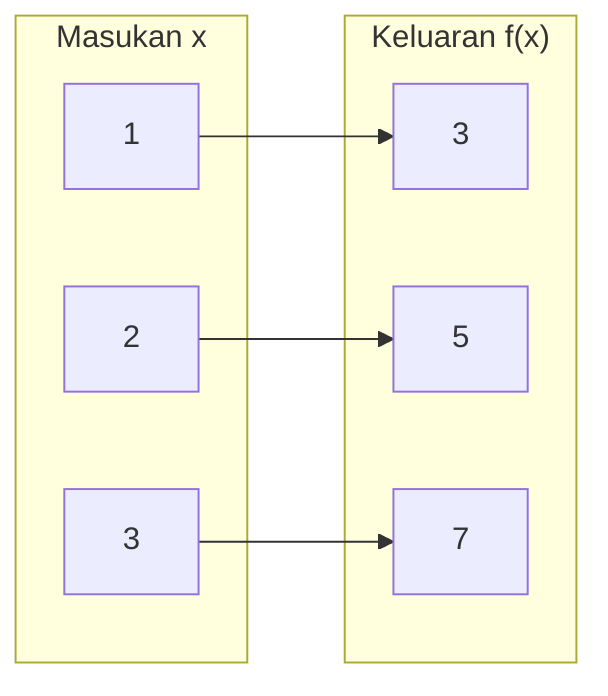
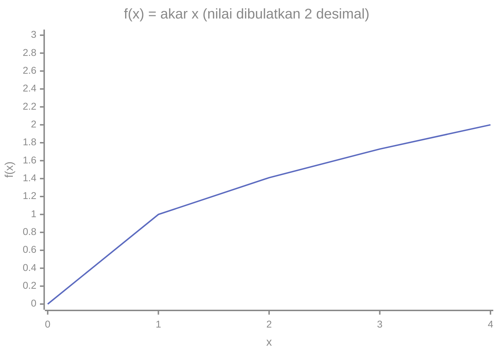

# Part 7 — Konsep Fungsi

## Tujuan Pembelajaran

Setelah mempelajari bagian ini, kamu mampu:

- menjelaskan fungsi sebagai aturan yang memberi tepat satu keluaran untuk setiap masukan;
- membaca notasi $f(x)$, termasuk $f(a + 1)$, dan menghitung nilai fungsi;
- menentukan domain dari rumus sederhana, termasuk pembatasan karena pembagian dengan nol dan akar bilangan negatif;
- membedakan domain, kodomain, dan range;
- membedakan fungsi dari relasi, termasuk memakai uji garis tegak;
- menyajikan fungsi sebagai tabel, rumus, dan grafik;
- mengenali fungsi dengan lebih dari satu variabel masukan.

## Prasyarat

[Part 1](01-mengenal-aljabar.md) (ekspresi dan substitusi), [Part 5](05-koordinat-dan-grafik.md) (tabel nilai, pasangan terurut, grafik), dan [Level 0 — Part 8](../level-0-fondasi-matematika/08-notasi-matematika-dasar.md) (pengantar notasi $f(x)$). Bagian ini memperdalam notasi itu.

## Mengapa Materi Ini Penting?

Fungsi adalah konsep paling sentral dalam Machine Learning: **sebuah model adalah fungsi** yang mengubah masukan (data) menjadi keluaran (prediksi). Memahami domain dan range membantu menjawab pertanyaan penting: masukan apa yang valid, dan keluaran apa yang mungkin?

## Konsep Dasar dengan Bahasa Sederhana

### 1. Apa Itu Fungsi?

**Fungsi** (*function*) adalah aturan yang mengaitkan setiap masukan dengan **tepat satu** keluaran.

Bayangkan mesin dengan aturan "kalikan 2, lalu tambah 3". Masukkan 4, keluarannya $2 \times 4 + 3 = 11$. Masukkan 4 lagi, keluarannya selalu 11. Mesin yang sama dan masukan yang sama tidak boleh memberi dua keluaran berbeda.

Contoh sehari-hari: setiap siswa punya tepat satu nomor induk. Aturan "siswa $\to$ nomor induk" adalah fungsi. Sebaliknya, aturan "siswa $\to$ mata pelajaran yang disukai" bukan fungsi bila seorang siswa menyukai lebih dari satu pelajaran.

Dua syarat yang harus dipenuhi:

1. **Setiap** masukan yang diizinkan punya keluaran.
2. Setiap masukan punya **tepat satu** keluaran.

Boleh saja dua masukan berbeda memberi keluaran yang sama. Misalnya aturan "kuadratkan": $2 \to 4$ dan $-2 \to 4$. Itu tetap fungsi, karena tiap masukan hanya punya satu keluaran.

### 2. Input dan Output

- **Masukan** (*input*, juga **variabel bebas**): nilai yang kita pilih, umumnya $x$.
- **Keluaran** (*output*, juga **variabel terikat**): nilai yang dihasilkan aturan, umumnya $y$ atau $f(x)$. Disebut terikat karena nilainya bergantung pada masukan.

Pada tabel nilai di Part 5, kolom $x$ adalah masukan dan kolom $y$ adalah keluaran.

### 3. Notasi Fungsi $f(x)$

Fungsi diberi nama (biasanya $f$, $g$, atau $h$), dan masukannya ditulis di dalam kurung:

$$
f(x) = 2x + 3
$$

Dibaca "$f$ dari $x$ sama dengan dua $x$ tambah tiga".

- $f$ adalah **nama** fungsi.
- $x$ adalah **masukan** (variabel).
- $2x + 3$ adalah **aturan**.
- $f(x)$ adalah **keluaran** fungsi $f$ untuk masukan $x$. Sering juga ditulis $y = f(x)$.

!!! warning "f(x) bukan f dikali x"
    Tanda kurung pada $f(x)$ menandai masukan fungsi. $f(x)$ **tidak** berarti $f \times x$.

Masukan boleh berupa angka atau ekspresi. Untuk $f(x) = 2x + 3$:

- $f(4) = 2(4) + 3 = 11$.
- $f(-2) = 2(-2) + 3 = -1$.
- $f(a + 1) = 2(a + 1) + 3 = 2a + 2 + 3 = 2a + 5$. Seluruh $a + 1$ menggantikan $x$, dan kurung wajib dipakai.

Huruf variabel boleh diganti: $g(t) = 5t$ adalah aturan yang sama polanya, tetapi bernama $g$ dengan masukan $t$.

### 4. Mengevaluasi Fungsi

**Mengevaluasi** fungsi berarti menghitung keluarannya untuk masukan tertentu. Langkahnya sama dengan substitusi (Part 1): ganti $x$ dengan masukan dalam kurung, lalu hitung dengan urutan operasi.

Untuk $f(x) = x^2 - 3x + 1$:

| Masukan | Substitusi | Keluaran |
|---|---|---|
| $f(0)$ | $0^2 - 3(0) + 1$ | $1$ |
| $f(2)$ | $2^2 - 3(2) + 1 = 4 - 6 + 1$ | $-1$ |
| $f(-1)$ | $(-1)^2 - 3(-1) + 1 = 1 + 3 + 1$ | $5$ |
| $f(3)$ | $3^2 - 3(3) + 1 = 9 - 9 + 1$ | $1$ |

Arti $f(2) = -1$: ketika masukannya 2, keluarannya $-1$. Pada grafik, itu titik $(2, -1)$.

### 5. Fungsi sebagai Aturan Pemetaan

Fungsi dapat dipandang sebagai **pemetaan** (*mapping*): setiap anggota himpunan masukan "dipetakan" ke satu anggota himpunan keluaran. Untuk $f(x) = 2x + 1$ dengan masukan $\{1, 2, 3\}$:



Cara membaca: kolom kiri adalah masukan dan kolom kanan adalah keluaran. Setiap anak panah dari satu masukan berakhir di satu keluaran: $1 \to 3$ (karena $2(1) + 1 = 3$), $2 \to 5$, dan $3 \to 7$. Karena **setiap masukan hanya punya satu panah keluar**, pemetaan ini adalah fungsi.

Jika dari satu masukan keluar **dua panah** (misalnya $1 \to 3$ dan $1 \to 4$), pemetaan itu **bukan fungsi**.

### 6. Domain

**Domain** (*domain*, daerah asal) adalah himpunan semua masukan yang **diizinkan** untuk sebuah fungsi.

Domain ditentukan oleh dua hal:

1. **Pernyataan eksplisit**: misalnya "$f(x) = 2x + 1$ untuk $x \in \{1, 2, 3\}$".
2. **Konteks atau rumus** bila tidak disebutkan: pakai semua bilangan real yang membuat rumus terdefinisi.

Aturan untuk bilangan real:

- **Penyebut tidak boleh nol.** Pada $f(x) = \dfrac{1}{x}$, $x = 0$ dilarang karena pembagian dengan nol tidak terdefinisi (Level 0). Domain: semua $x$ kecuali 0, ditulis $x \neq 0$.
- **Akar kuadrat tidak boleh bernilai negatif.** Pada $f(x) = \sqrt{x}$, syaratnya $x \geq 0$, karena akar kuadrat bilangan negatif tidak ada di bilangan real (Level 0).
- **Kombinasi.** Pada $f(x) = \dfrac{1}{x - 2}$, penyebut $x - 2 \neq 0$, jadi $x \neq 2$. Pada $f(x) = \sqrt{x - 1}$, isi akar $x - 1 \geq 0$, jadi $x \geq 1$.
- **Konteks.** Pada biaya parkir $C(t) = 2.000 + 1.000t$, lama parkir tidak mungkin negatif, jadi domain yang masuk akal adalah $t \geq 0$ meskipun rumusnya tidak melarang $t$ negatif.

Notasi himpunan: $\{x \in \mathbb{R} \mid x \neq 0\}$ dibaca "himpunan semua bilangan real $x$ dengan syarat $x$ tidak sama dengan 0". Lambang $\in$ berarti "anggota dari", $\mathbb{R}$ adalah bilangan real, dan "$\mid$" berarti "dengan syarat".

### 7. Kodomain sebagai Konsep Pengantar

**Kodomain** (*codomain*, daerah kawan) adalah himpunan tempat keluaran **dinyatakan boleh berada**. Kodomain adalah bagian dari definisi fungsi, bukan hasil perhitungan.

Penulisan lengkap: $f : A \to B$ dibaca "fungsi $f$ dari himpunan $A$ ke himpunan $B$". Di sini $A$ adalah domain dan $B$ adalah kodomain.

Contoh: $f : \mathbb{R} \to \mathbb{R}$ dengan $f(x) = x^2$. Kodomainnya semua bilangan real, tetapi keluaran yang benar-benar muncul hanya bilangan tak negatif. Perbedaan antara kodomain (yang "diperbolehkan") dan range (yang "benar-benar muncul") dijelaskan di bagian berikut. Pada tingkat pemula, kamu cukup mengenali bahwa keduanya berbeda.

### 8. Range

**Range** (*range*, daerah hasil) adalah himpunan semua keluaran yang **benar-benar dihasilkan** fungsi untuk masukan dalam domainnya.

Cara menentukan: lihat tabel atau grafik, atau pikirkan nilai terkecil dan terbesar yang bisa muncul.

| Fungsi | Domain | Range | Alasan |
|---|---|---|---|
| $f(x) = 2x + 1$ | $\{0, 1, 2\}$ | $\{1, 3, 5\}$ | hitung tiga masukan |
| $f(x) = x + 1$ | $1 \leq x \leq 3$ | $2 \leq y \leq 4$ | $f(1) = 2$, $f(3) = 4$, naik terus |
| $f(x) = x^2$ | semua bilangan real | $y \geq 0$ | kuadrat tidak pernah negatif |
| $f(x) = -x^2$ | semua bilangan real | $y \leq 0$ | kebalikannya |
| $f(x) = 2x + 3$ | semua bilangan real | semua bilangan real | garis menjangkau semua tinggi |

### 9. Membedakan Domain dan Range

| | Domain | Range |
|---|---|---|
| Isinya | masukan yang diizinkan | keluaran yang benar-benar muncul |
| Variabel | $x$ | $y$ atau $f(x)$ |
| Di grafik | sebaran **mendatar** (kiri-kanan) | sebaran **tegak** (bawah-atas) |
| Ditentukan oleh | rumus dan konteks | domain dan aturan fungsi |

Contoh: $f(x) = \sqrt{x}$. Domain $x \geq 0$ (tidak boleh akar bilangan negatif). Karena akar kuadrat tidak pernah negatif, range juga $y \geq 0$.

Contoh: $f(x) = \dfrac{1}{x}$. Domain $x \neq 0$. Range juga $y \neq 0$, sebab $\dfrac{1}{x}$ tidak pernah sama dengan 0 untuk $x$ berapa pun.

### 10. Fungsi dan Relasi

**Relasi** (*relation*) adalah hubungan apa saja antara masukan dan keluaran; satu masukan boleh punya beberapa keluaran. **Fungsi adalah relasi khusus** yang setiap masukannya punya tepat satu keluaran.

Contoh relasi yang bukan fungsi: $x = y^2$. Untuk $x = 4$, ada dua nilai $y$: $y = 2$ dan $y = -2$. Pasangan $(4, 2)$ dan $(4, -2)$ memiliki masukan yang sama dengan keluaran berbeda.

**Uji garis tegak** pada grafik: jika ada garis tegak yang memotong grafik di **lebih dari satu titik**, grafik itu **bukan** fungsi. Pada $x = y^2$, garis $x = 4$ memotong di dua titik. Pada $y = x^2$, setiap garis tegak memotong paling banyak satu titik, jadi itu fungsi.

Perbedaan penting:

- **Banyak masukan, satu keluaran**: boleh ($f(x) = x^2$: $-2 \to 4$ dan $2 \to 4$).
- **Satu masukan, banyak keluaran**: tidak boleh.

### 11. Tabel, Rumus, dan Grafik Fungsi

Satu fungsi bisa disajikan dengan tiga cara yang saling melengkapi.

**Rumus:** $f(x) = 2x - 1$.

**Tabel:**

| $x$ | $-1$ | $0$ | $1$ | $2$ | $3$ |
|---|---|---|---|---|---|
| $f(x)$ | $-3$ | $-1$ | $1$ | $3$ | $5$ |

**Grafik:**

```mermaid
%%{init: {"themeVariables": {"xyChart": {"backgroundColor":"transparent","plotColorPalette":"#5c6bc0, #e53935","titleColor":"#888","xAxisLabelColor":"#888","yAxisLabelColor":"#888","xAxisTitleColor":"#888","yAxisTitleColor":"#888","xAxisLineColor":"#888","yAxisLineColor":"#888","xAxisTickColor":"#888","yAxisTickColor":"#888"}}}}%%
xychart-beta
    title "f(x) = 2x - 1"
    x-axis "x" [-1, 0, 1, 2, 3]
    y-axis "f(x)" -4 --> 6
    line [-3, -1, 1, 3, 5]
```

Ketiganya memberikan informasi yang sama: rumus ringkas dan berlaku untuk semua masukan; tabel menunjukkan nilai tertentu; grafik memperlihatkan pola. Untuk $f(x) = \sqrt{x}$ domainnya mulai dari 0, dan grafiknya pun mulai dari $x = 0$:



Tidak ada bagian grafik di sebelah kiri $x = 0$, karena domainnya hanya $x \geq 0$. Nilai $1{,}41$ dan $1{,}73$ adalah pendekatan dari $\sqrt{2}$ dan $\sqrt{3}$.

### 12. Fungsi dengan Lebih dari Satu Variabel sebagai Pengantar

Sebuah fungsi boleh memiliki **lebih dari satu masukan**. Contoh: luas persegi panjang bergantung pada panjang dan lebar.

$$
A(p, l) = p \times l
$$

Masukannya dua bilangan $(p, l)$, keluarannya satu bilangan. $A(5, 3) = 15$.

Contoh lain: $f(x, y) = x + 2y$. Maka $f(3, 4) = 3 + 2(4) = 11$ dan $f(4, 3) = 4 + 2(3) = 10$. Urutan masukan **penting**: $f(3, 4) \neq f(4, 3)$.

Dalam Machine Learning, model yang memakai beberapa fitur adalah fungsi dengan banyak masukan:

$$
\hat{y} = f(x_1, x_2) = w_1 x_1 + w_2 x_2 + b
$$

Angka kecil di kanan bawah (subskrip) menandai fitur ke-1 dan ke-2. Grafiknya tidak lagi berupa garis di bidang, tetapi dasar penghitungannya sama: substitusi.

## Istilah yang Perlu Dipahami

| Istilah | Arti sederhana | Contoh |
|---|---|---|
| Fungsi (*function*) | aturan: setiap masukan punya tepat satu keluaran | $f(x) = 2x + 3$ |
| Masukan / variabel bebas | nilai yang dipilih | $x$ |
| Keluaran / variabel terikat | nilai hasil aturan | $f(x)$ atau $y$ |
| Notasi $f(x)$ | keluaran fungsi $f$ untuk masukan $x$ | $f(4) = 11$ |
| Mengevaluasi | menghitung keluaran untuk masukan tertentu | $f(2) = -1$ |
| Pemetaan (*mapping*) | pasangan masukan ke keluaran | $1 \to 3$ |
| Domain | himpunan masukan yang diizinkan | $x \geq 0$ untuk $\sqrt{x}$ |
| Kodomain (*codomain*) | himpunan keluaran yang dinyatakan boleh | $\mathbb{R}$ |
| Range | himpunan keluaran yang benar-benar muncul | $y \geq 0$ untuk $x^2$ |
| Relasi (*relation*) | hubungan masukan dan keluaran apa saja | $x = y^2$ |
| Uji garis tegak | garis tegak memotong paling banyak sekali: fungsi | |
| Fungsi dua variabel | fungsi dengan dua masukan | $f(x, y) = x + 2y$ |

## Rumus dan Penjelasan Setiap Simbol

**Notasi fungsi:**

$$
f : A \to B, \qquad y = f(x)
$$

- $f$ adalah nama fungsi.
- $A$ adalah domain (himpunan masukan); $B$ adalah kodomain.
- $x \in A$ adalah masukan; $y = f(x) \in B$ adalah keluaran.
- Syarat: untuk setiap $x \in A$ ada tepat satu $y$.

**Aturan domain bilangan real:**

| Bentuk dalam rumus | Syarat | Contoh |
|---|---|---|
| $\dfrac{1}{g(x)}$ | $g(x) \neq 0$ | $\dfrac{1}{x - 2}$: $x \neq 2$ |
| $\sqrt{g(x)}$ | $g(x) \geq 0$ | $\sqrt{x - 1}$: $x \geq 1$ |
| polinomial (mis. $2x + 3$, $x^2$) | tidak ada | semua bilangan real |

Di sini $g(x)$ adalah ekspresi apa pun dalam $x$. Aturan lain (logaritma) ditambahkan di Part 10.

**Substitusi ekspresi:** $f(a + 1)$ dihitung dengan mengganti setiap $x$ pada rumus $f$ dengan $(a + 1)$. Untuk $f(x) = 2x + 3$, hasilnya $2(a + 1) + 3 = 2a + 5$.

## Penjelasan Langkah demi Langkah

**Menentukan domain dari rumus:**

1. Cari bagian rumus yang bisa bermasalah: pembagian (penyebut) dan akar kuadrat.
2. Tulis syarat tiap bagian: penyebut $\neq 0$, isi akar $\geq 0$.
3. Selesaikan syarat itu (persamaan atau pertidaksamaan, Part 3 dan 4).
4. Gabungkan syarat-syaratnya.

Contoh $f(x) = \dfrac{\sqrt{x - 1}}{x - 4}$:

| Bagian | Syarat | Hasil |
|---|---|---|
| akar $\sqrt{x - 1}$ | $x - 1 \geq 0$ | $x \geq 1$ |
| penyebut $x - 4$ | $x - 4 \neq 0$ | $x \neq 4$ |
| gabungan | | $x \geq 1$ dan $x \neq 4$ |

## Contoh Soal dan Pembahasan

### Contoh 1 — Mengenali fungsi dari pasangan

Apakah himpunan pasangan $\{(1, 2), (2, 4), (3, 6)\}$ fungsi? Bagaimana dengan $\{(1, 2), (1, 3), (2, 4)\}$?

1. Himpunan pertama: masukan 1, 2, 3 masing-masing punya satu keluaran. **Fungsi.** (Aturannya $y = 2x$.)
2. Himpunan kedua: masukan $1$ punya dua keluaran, yaitu $2$ dan $3$. **Bukan fungsi.**

### Contoh 2 — Mengevaluasi dengan ekspresi

Untuk $f(x) = 3x - 2$, hitung $f(4)$, $f(-1)$, dan $f(a + 1)$.

1. $f(4) = 3(4) - 2 = 12 - 2 = 10$.
2. $f(-1) = 3(-1) - 2 = -3 - 2 = -5$.
3. $f(a + 1) = 3(a + 1) - 2 = 3a + 3 - 2 = 3a + 1$.
4. Cek dengan $a = 3$: $f(4) = 10$, dan $3(3) + 1 = 10$. Cocok.

### Contoh 3 — Menentukan domain

Tentukan domain: (a) $f(x) = \dfrac{1}{x - 3}$ (b) $f(x) = \sqrt{x + 4}$.

1. (a) Penyebut tidak boleh nol: $x - 3 \neq 0$, jadi $x \neq 3$. Domain: semua bilangan real kecuali 3.
2. (b) Isi akar tidak boleh negatif: $x + 4 \geq 0$, jadi $x \geq -4$. Domain: $x \geq -4$.
3. Uji: untuk (b), $f(-4) = \sqrt{0} = 0$ ada. $f(-5) = \sqrt{-1}$ tidak ada di bilangan real.

### Contoh 4 — Menentukan range

Tentukan range $f(x) = x^2$ untuk domain $-2 \leq x \leq 2$.

1. Hitung beberapa nilai: $f(-2) = 4$, $f(-1) = 1$, $f(0) = 0$, $f(1) = 1$, $f(2) = 4$.
2. Nilai terkecil adalah 0 (di $x = 0$) dan nilai terbesar adalah 4 (di $x = \pm 2$).
3. Range: $0 \leq y \leq 4$.

### Contoh 5 — Dua variabel

Untuk $f(x, y) = x + 2y$, hitung $f(3, 4)$ dan $f(4, 3)$.

1. $f(3, 4) = 3 + 2(4) = 11$.
2. $f(4, 3) = 4 + 2(3) = 10$.
3. Hasilnya berbeda, jadi urutan masukan penting.

## Contoh Tambahan dengan Kesulitan Bertahap

**Mudah.** $f(x) = x + 5$: $f(2) = 7$. Arti: masukan 2 memberi keluaran 7.

**Sedang.** $f(x) = x^2 - 3x + 1$. $f(3) = 9 - 9 + 1 = 1$ dan $f(0) = 1$. Dua masukan berbeda (0 dan 3) memberi keluaran sama, dan itu diperbolehkan.

**Sedang.** Range $f(x) = 2x + 1$ untuk domain $\{0, 1, 2\}$ adalah $\{1, 3, 5\}$.

**Menantang.** Domain $f(x) = \dfrac{1}{\sqrt{x - 2}}$. Isi akar harus $\geq 0$, dan akar muncul di penyebut sehingga tidak boleh nol. Gabungan: $x - 2 > 0$, jadi $x > 2$.

## Visualisasi atau Interpretasi Grafik

Domain dan range dapat dibaca langsung dari grafik:

- **Domain:** lihat sebaran grafik pada sumbu $x$ (dari ujung kiri ke ujung kanan). Pada grafik $\sqrt{x}$ di atas, grafik mulai dari $x = 0$ lalu meluas ke kanan, jadi domain $x \geq 0$.
- **Range:** lihat sebaran grafik pada sumbu $y$ (dari bawah ke atas). Grafik $\sqrt{x}$ mulai dari $y = 0$ dan terus naik, jadi range $y \geq 0$.
- **Fungsi atau bukan:** gunakan uji garis tegak. Garis tegak mana pun tidak boleh memotong grafik lebih dari sekali.

## Kesalahan Umum

| Kesalahan | Mengapa salah | Yang benar |
|---|---|---|
| Membaca $f(x)$ sebagai $f \times x$ | kurung menandai masukan | $f(x)$ adalah keluaran di $x$ |
| $f(a + 1) = 2a + 3 + 1$ | hanya $x$ diganti sebagian | $2(a + 1) + 3 = 2a + 5$ |
| Menyatakan domain $\sqrt{x - 1}$ adalah $x \geq 0$ | syarat berlaku pada isi akar | $x - 1 \geq 0$, jadi $x \geq 1$ |
| Menyatakan domain $\dfrac{1}{x}$ semua bilangan real | $x = 0$ membuat pembagian nol | $x \neq 0$ |
| Menganggap dua masukan dengan keluaran sama bukan fungsi | yang dilarang satu masukan banyak keluaran | $x^2$ tetap fungsi |
| Menyamakan kodomain dengan range | kodomain dinyatakan, range muncul | $x^2$: kodomain $\mathbb{R}$, range $y \geq 0$ |
| Menyatakan $x = y^2$ fungsi dengan $x$ sebagai masukan | satu $x$ punya dua $y$ | bukan fungsi (uji garis tegak) |
| Menukar urutan masukan pada $f(x, y)$ | urutan penting | $f(3, 4) \neq f(4, 3)$ |
| Menghitung range hanya dari satu masukan | range mencakup semua masukan | periksa seluruh domain |

## Hubungan dengan Machine Learning

- **Model adalah fungsi.** Setelah dilatih, model mengubah masukan (fitur) menjadi keluaran (prediksi). Untuk masukan yang sama, model yang sama memberi prediksi yang sama, sesuai sifat fungsi.
- **Domain = masukan yang valid.** Model harga rumah mungkin hanya masuk akal untuk luas positif. Memasukkan nilai di luar domain sering menghasilkan prediksi tidak bermakna.
- **Range = keluaran yang mungkin.** Fungsi sigmoid $\sigma(x) = \dfrac{1}{1 + e^{-x}}$, yang dipakai untuk menghasilkan peluang, memiliki range di antara 0 dan 1 (dibahas di Part 10 sebagai pengantar).
- **Banyak masukan.** Model nyata memakai banyak fitur, yaitu fungsi dengan banyak variabel (bagian 12).
- **Tabel, rumus, grafik.** Data adalah tabel, model adalah rumus, dan kurva hasil pelatihan adalah grafik: tiga wajah dari satu fungsi.

### Python: fungsi, domain, dan range

Fungsi Python dengan `def` adalah fungsi matematika yang sama:

```python
def f(x):
    return 2 * x + 3

print(f(4))    # 11
print(f(-2))   # -1
```

Fungsi dengan ekspresi sebagai masukan, $f(a + 1)$, dihitung dengan memberi `a + 1` sebagai argumen:

```python
def g(x):
    return 3 * x - 2

a = 3
print(g(a + 1))      # 10
print(3 * a + 1)     # 10, sama dengan rumus g(a+1) = 3a + 1
```

Python menolak masukan di luar domain:

```python
import math

def h(x):
    return 1 / x

# print(h(0))              # ZeroDivisionError: division by zero
# print(math.sqrt(-1))     # ValueError (pesannya bergantung versi Python)
print(math.sqrt(0))        # 0.0, di dalam domain
```

Memeriksa domain secara eksplisit sebelum menghitung:

```python
def akar_aman(x):
    if x < 0:
        return "di luar domain"
    return math.sqrt(x)

print(akar_aman(4))    # 2.0
print(akar_aman(-4))   # di luar domain
```

Range dari domain terbatas: kumpulkan semua keluaran lalu urutkan nilai unik (`set` menghapus nilai kembar).

```python
def kuadrat(x):
    return x ** 2

domain = [-2, -1, 0, 1, 2]
range_ = sorted(set(kuadrat(x) for x in domain))
print(range_)   # [0, 1, 4]
```

Fungsi dengan dua masukan:

```python
def f2(x, y):
    return x + 2 * y

print(f2(3, 4))   # 11
print(f2(4, 3))   # 10
```

Model dua fitur $\hat{y} = w_1 x_1 + w_2 x_2 + b$ (angka fiktif):

```python
def prediksi(x1, x2, w1=2, w2=1, b=3):
    return w1 * x1 + w2 * x2 + b

print(prediksi(5, 4))   # 17
```

## Latihan Mandiri

1. Apakah fungsi? (a) $\{(1, 2), (2, 4), (3, 6)\}$ (b) $\{(1, 2), (1, 3), (2, 4)\}$ (c) $\{(1, 5), (2, 5), (3, 5)\}$ (d) tabel: $x = -1 \to 1$, $x = 1 \to 1$
2. Untuk $f(x) = 3x - 2$, hitung $f(0)$, $f(4)$, $f(-1)$, $f(a)$, dan $f(a + 1)$.
3. Untuk $f(x) = x^2 - 3x + 1$, hitung $f(0)$, $f(2)$, $f(-1)$, dan $f(3)$.
4. Apa arti $f(5) = 12$ dalam kata-kata, dan pada grafik titik mana yang diwakilinya?
5. Tentukan domain: (a) $f(x) = \dfrac{1}{x}$ (b) $f(x) = \sqrt{x}$ (c) $f(x) = \dfrac{1}{x - 3}$ (d) $f(x) = \sqrt{x + 4}$ (e) $f(x) = 2x + 1$
6. Tentukan range: (a) $f(x) = x^2$ (domain semua bilangan real) (b) $f(x) = 2x + 1$ dengan domain $\{0, 1, 2\}$ (c) $f(x) = x + 1$ dengan $1 \leq x \leq 3$ (d) $f(x) = -x^2$
7. Pada relasi $x = y^2$, tentukan nilai $y$ untuk $x = 9$. Apakah relasi ini fungsi? Bagaimana dengan $y = x^2$?
8. Untuk $f(x, y) = x + 2y$, hitung $f(3, 4)$, $f(4, 3)$, dan $f(0, 0)$. Untuk $A(p, l) = p \times l$, hitung $A(5, 3)$.
9. Buat tabel $f(x) = 2x - 1$ untuk $x = -1, 0, 1, 2, 3$. Berapa perubahan $f(x)$ setiap $x$ naik 1?
10. Model fiktif $\hat{y} = 0{,}5x + 2$ dengan $x$ lama belajar (jam). Tentukan domain yang masuk akal, hitung $f(6)$, dan tentukan range jika $0 \leq x \leq 10$.

## Kunci Jawaban dan Pembahasan

??? success "Soal 1"
    (a) **Fungsi** ($y = 2x$). (b) **Bukan**: masukan 1 punya dua keluaran. (c) **Fungsi**: semua masukan menghasilkan 5; itu boleh. (d) **Fungsi**: dua masukan berbeda boleh punya keluaran sama.

??? success "Soal 2"
    $f(0) = -2$. $f(4) = 10$. $f(-1) = -5$. $f(a) = 3a - 2$. $f(a + 1) = 3(a + 1) - 2 = 3a + 1$.

??? success "Soal 3"
    $f(0) = 1$. $f(2) = 4 - 6 + 1 = -1$. $f(-1) = 1 + 3 + 1 = 5$. $f(3) = 9 - 9 + 1 = 1$.

??? success "Soal 4"
    Untuk masukan 5, keluaran fungsi adalah 12. Pada grafik, itu titik $(5, 12)$.

??? success "Soal 5"
    (a) $x \neq 0$. (b) $x \geq 0$. (c) $x \neq 3$. (d) $x + 4 \geq 0$, jadi $x \geq -4$. (e) semua bilangan real.

??? success "Soal 6"
    (a) $y \geq 0$. (b) $\{1, 3, 5\}$. (c) $f(1) = 2$ dan $f(3) = 4$, jadi $2 \leq y \leq 4$. (d) $y \leq 0$.

??? success "Soal 7"
    Untuk $x = 9$: $y = 3$ atau $y = -3$ (karena $3^2 = (-3)^2 = 9$). Satu masukan, dua keluaran, jadi $x = y^2$ **bukan fungsi** (garis tegak $x = 9$ memotong dua titik). $y = x^2$ adalah fungsi: setiap $x$ memberi satu $y$.

??? success "Soal 8"
    $f(3, 4) = 3 + 8 = 11$. $f(4, 3) = 4 + 6 = 10$. $f(0, 0) = 0$. $A(5, 3) = 15$.

??? success "Soal 9"
    $x = -1$: $-3$; $x = 0$: $-1$; $x = 1$: $1$; $x = 2$: $3$; $x = 3$: $5$. Perubahan setiap $x$ naik 1 selalu $+2$.

??? success "Soal 10"
    Domain wajar: $x \geq 0$ (jam belajar tidak negatif). $f(6) = 0{,}5(6) + 2 = 5$. Untuk $0 \leq x \leq 10$: $f(0) = 2$ dan $f(10) = 7$. Fungsi naik, jadi range $2 \leq \hat{y} \leq 7$.

## Ringkasan Materi

- Fungsi memberi tepat satu keluaran untuk setiap masukan. Dua masukan boleh punya keluaran sama; satu masukan tidak boleh punya dua keluaran.
- $f(x)$ adalah keluaran fungsi $f$ untuk masukan $x$, bukan $f$ kali $x$. Ekspresi sebagai masukan, seperti $f(a + 1)$, diganti utuh dalam kurung.
- Domain adalah masukan yang diizinkan: penyebut $\neq 0$, isi akar kuadrat $\geq 0$, dan batasan konteks.
- Kodomain adalah keluaran yang dinyatakan boleh; range adalah keluaran yang benar-benar muncul. Keduanya bisa berbeda.
- Relasi mengizinkan satu masukan banyak keluaran; fungsi tidak. Uji garis tegak membedakannya pada grafik.
- Fungsi dapat disajikan sebagai rumus, tabel, dan grafik.
- Fungsi bisa memiliki lebih dari satu masukan; urutan masukan penting.
- Model Machine Learning adalah fungsi dari fitur ke prediksi.

## Checklist Penguasaan

- [ ] Menjelaskan definisi fungsi dan memberi contoh yang bukan fungsi.
- [ ] Menghitung $f(a)$, termasuk $f(a + 1)$ dengan kurung yang benar.
- [ ] Menentukan domain dari rumus dengan pembagian atau akar.
- [ ] Membedakan domain, kodomain, dan range dengan contoh.
- [ ] Menentukan range dari tabel, domain terbatas, atau grafik.
- [ ] Memakai uji garis tegak dan membedakan fungsi dari relasi.
- [ ] Menyajikan satu fungsi sebagai rumus, tabel, dan grafik.
- [ ] Menghitung fungsi dua variabel dan menjelaskan peran urutan masukan.

## Prasyarat untuk Materi Berikutnya

[Part 8 — Fungsi Linear](08-fungsi-linear.md) membutuhkan: notasi $f(x)$, evaluasi fungsi, tabel dan grafik, serta ide perubahan keluaran terhadap masukan. [Part 9](09-fungsi-kuadrat-dan-polinomial.md) dan [Part 10](10-fungsi-eksponensial-dan-logaritma.md) memakai domain dan range untuk fungsi yang lebih beragam.
