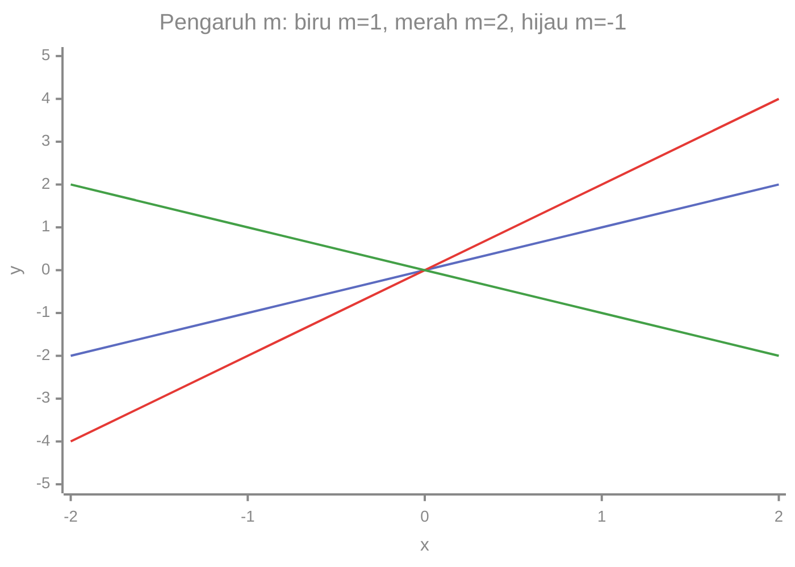
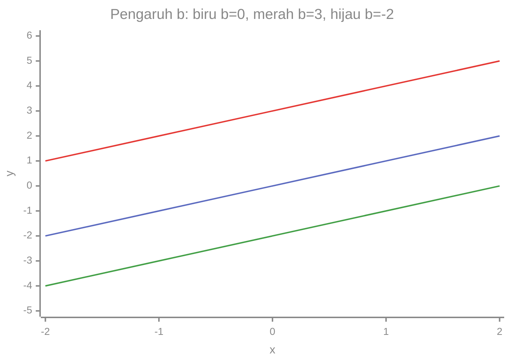

# Part 8 — Fungsi Linear

## Tujuan Pembelajaran

Setelah mempelajari bagian ini, kamu mampu:

- menjelaskan fungsi linear $y = mx + b$ dan arti setiap simbolnya;
- menghitung slope (kemiringan) dari dua titik dan menafsirkannya sebagai perubahan keluaran per satu satuan masukan;
- menentukan intercept dan menuliskan persamaan garis dari slope dan titik, atau dari dua titik;
- membuat tabel dan grafik fungsi linear serta menjelaskan pengaruh $m$ dan $b$;
- membedakan slope positif, negatif, dan nol;
- menjelaskan hubungan fungsi linear dengan model regresi linear, termasuk apa yang belum dibahas di sini.

## Prasyarat

[Part 5](05-koordinat-dan-grafik.md) (koordinat, tabel nilai, perubahan $y$), [Part 6](06-sistem-persamaan-linear.md) (menentukan parameter dari dua data), dan [Part 7](07-konsep-fungsi.md) (notasi $f(x)$, domain, range).

## Mengapa Materi Ini Penting?

Fungsi linear adalah model paling sederhana dan paling sering dipakai: harga naik tetap per unit, jarak naik tetap per jam, atau biaya tetap ditambah biaya per pemakaian. Dalam Machine Learning, regresi linear adalah model pertama yang dipelajari, dan banyak model lain dibangun dari komponen linear. Slope dan intercept adalah dua bilangan yang menentukan seluruh model.

## Konsep Dasar dengan Bahasa Sederhana

### 1. Pengertian Fungsi Linear

**Fungsi linear** adalah fungsi yang keluarannya berubah **dengan besar tetap** setiap masukan naik satu satuan. Grafiknya berupa **garis lurus**.

Contoh sehari-hari: konversi suhu dari Celsius ($C$) ke Fahrenheit ($F$):

$$
F = 1{,}8\,C + 32
$$

- $C = 0$ memberi $F = 32$.
- $C = 10$ memberi $F = 50$.
- $C = 100$ memberi $F = 212$.

Setiap kenaikan $C$ sebesar 1, $F$ naik 1,8, selalu sama. Itulah ciri fungsi linear.

### 2. Bentuk $y = mx + b$

Bentuk umum fungsi linear (disebut bentuk **gradien-intercept**):

$$
y = mx + b \qquad \text{atau} \qquad f(x) = mx + b
$$

dengan $m$ dan $b$ konstanta. Dua kasus khusus:

- $b = 0$: $y = mx$. Garis melewati titik asal $(0, 0)$. Disebut hubungan **berbanding lurus**.
- $m = 0$: $y = b$. Garis **datar**, keluaran selalu sama.

### 3. Makna Variabel $x$ dan $y$

- $x$ adalah **masukan** (variabel bebas).
- $y$ adalah **keluaran** (variabel terikat), karena nilainya bergantung pada $x$.

Huruf boleh berbeda menurut konteks. Pada $F = 1{,}8\,C + 32$, masukannya $C$ dan keluarannya $F$. Dalam konteks parkir, $C(t) = 2.000 + 1.000t$ memakai $t$ sebagai masukan. Polanya sama: $\text{keluaran} = m \times \text{masukan} + b$.

### 4. Makna Kemiringan atau Slope $m$

**Slope** (kemiringan, gradien) $m$ menyatakan **berapa banyak $y$ berubah ketika $x$ naik 1**:

$$
m = \frac{\text{perubahan } y}{\text{perubahan } x}
$$

Pada $y = 2x + 3$: $m = 2$. Setiap $x$ naik 1, $y$ naik 2.

| $x$ | 0 | 1 | 2 | 3 |
|---|---|---|---|---|
| $y = 2x + 3$ | 3 | 5 | 7 | 9 |
| perubahan | | $+2$ | $+2$ | $+2$ |

Jika $x$ naik sebesar $k$, maka $y$ berubah sebesar $mk$. Misalnya $x$ naik 5 membuat $y$ naik $2 \times 5 = 10$.

### 5. Makna Intercept $b$

**Intercept** (titik potong sumbu $y$) $b$ adalah **nilai $y$ ketika $x = 0$**, karena $y = m(0) + b = b$. Pada grafik, itu titik $(0, b)$ tempat garis memotong sumbu $y$.

Pada $y = 2x + 3$, $b = 3$: garis melewati $(0, 3)$. Dalam konteks parkir $C = 2.000 + 1.000t$, $b = 2.000$ adalah biaya tetap sebelum waktu berjalan.

Titik potong sumbu $x$ ($x$-intercept) dicari dari $y = 0$: $0 = mx + b$, jadi $x = -\dfrac{b}{m}$ (untuk $m \neq 0$). Pada $y = 2x + 3$: $x = -\dfrac{3}{2} = -1{,}5$.

### 6. Menghitung Slope dari Dua Titik

Jika diketahui dua titik $(x_1, y_1)$ dan $(x_2, y_2)$ pada garis:

$$
m = \frac{y_2 - y_1}{x_2 - x_1} \qquad (x_1 \neq x_2)
$$

**Mengapa.** Pembilang adalah perubahan $y$ dari titik 1 ke titik 2. Penyebut adalah perubahan $x$ untuk perpindahan yang sama. Rasionya menjawab "berapa $y$ berubah per satu satuan $x$".

Contoh 1: titik $(1, 5)$ dan $(3, 9)$:

$$
m = \frac{9 - 5}{3 - 1} = \frac{4}{2} = 2
$$

Contoh 2 (turun): titik $(0, 6)$ dan $(3, 0)$:

$$
m = \frac{0 - 6}{3 - 0} = \frac{-6}{3} = -2
$$

Urutan boleh ditukar, asalkan **konsisten** di pembilang dan penyebut. Cek contoh 1 dengan urutan terbalik: $\dfrac{5 - 9}{1 - 3} = \dfrac{-4}{-2} = 2$. Hasilnya sama.

Kasus khusus:

- Jika $y_1 = y_2$: pembilang 0, $m = 0$, garis datar.
- Jika $x_1 = x_2$: penyebut 0, slope **tidak terdefinisi** (garis tegak). Garis tegak bukan fungsi (uji garis tegak, Part 7).

### 7. Menentukan Persamaan Garis Sederhana

**Dari slope dan intercept**: langsung. $m = 3$ dan $b = 4$ memberi $y = 3x + 4$.

**Dari slope dan satu titik $(x_1, y_1)$**: hitung $b$ dari $y_1 = m x_1 + b$, yaitu $b = y_1 - m x_1$.

Contoh: slope $-2$, melewati $(2, 1)$. $b = 1 - (-2)(2) = 1 + 4 = 5$. Garisnya $y = -2x + 5$. Cek titik: $-2(2) + 5 = 1$. Benar.

**Dari dua titik**: hitung $m$ dari dua titik, lalu cari $b$ memakai salah satu titik.

Contoh: melewati $(1, 5)$ dan $(3, 9)$. Dari bagian 6, $m = 2$. Lalu $b = 5 - 2(1) = 3$. Garisnya $y = 2x + 3$. Cek titik kedua: $2(3) + 3 = 9$. Benar.

Bentuk lain yang setara, **bentuk titik-gradien**: $y - y_1 = m(x - x_1)$. Jabarkan dan sederhanakan untuk mendapatkan $y = mx + b$.

### 8. Membuat Tabel dan Grafik Fungsi Linear

Langkah (seperti Part 5): pilih beberapa $x$, hitung $y$, gambar titik, hubungkan. Untuk garis lurus, dua titik sudah menentukan garis, tetapi tiga titik berguna untuk memeriksa.

Tabel $y = 2x + 3$:

| $x$ | $-2$ | $-1$ | $0$ | $1$ | $2$ | $3$ | $4$ |
|---|---|---|---|---|---|---|---|
| $y$ | $-1$ | $1$ | $3$ | $5$ | $7$ | $9$ | $11$ |

```mermaid
%%{init: {"themeVariables": {"xyChart": {"backgroundColor":"transparent","plotColorPalette":"#5c6bc0, #e53935, #43a047","titleColor":"#888","xAxisLabelColor":"#888","yAxisLabelColor":"#888","xAxisTitleColor":"#888","yAxisTitleColor":"#888","xAxisLineColor":"#888","yAxisLineColor":"#888","xAxisTickColor":"#888","yAxisTickColor":"#888"}}}}%%
xychart-beta
    title "y = 2x + 3"
    x-axis "x" [-2, -1, 0, 1, 2, 3, 4]
    y-axis "y" -2 --> 12
    line [-1, 1, 3, 5, 7, 9, 11]
```

Cara membaca: garis naik dari kiri ke kanan. Pada $x = 0$ grafik berada di $y = 3$ (intercept). Setiap langkah ke kanan membuat grafik naik 2 (slope).

**Pengaruh $m$** (dengan $b = 0$): biru $y = x$, merah $y = 2x$, hijau $y = -x$.



Ketiganya melewati $(0, 0)$ karena $b = 0$. Garis merah ($m = 2$) lebih curam daripada biru ($m = 1$). Garis hijau ($m = -1$) turun.

**Pengaruh $b$** (dengan $m = 1$): biru $y = x$, merah $y = x + 3$, hijau $y = x - 2$.



Ketiga garis **sejajar** (kemiringan sama, 1) tetapi bergeser naik atau turun. Mengubah $b$ menggeser garis ke atas ($b$ bertambah) atau ke bawah ($b$ berkurang) tanpa mengubah kemiringannya.

### 9. Slope Positif, Negatif, dan Nol

| Slope | Arah garis (kiri ke kanan) | Arti | Contoh |
|---|---|---|---|
| $m > 0$ | naik | $y$ bertambah saat $x$ bertambah | $y = 3x$ |
| $m < 0$ | turun | $y$ berkurang saat $x$ bertambah | $y = -x + 4$ |
| $m = 0$ | datar | $y$ tetap | $y = 5$ |

Semakin besar $|m|$ (nilai absolut), semakin curam garisnya. $y = 3x$ lebih curam daripada $y = 2x$, dan $y = -3x$ sama curamnya dengan $y = 3x$ tetapi menurun.

Dua garis dengan **slope sama** saling sejajar (Part 6).

### 10. Membaca Perubahan Output terhadap Input

Slope adalah "harga satu satuan masukan" dalam satuan keluaran. Cara menafsirkan:

1. Tulis satuan: slope $m$ memiliki satuan "keluaran per masukan".
2. Hubungkan dengan konteks.

Contoh:

- $C = 2.000 + 1.000t$: $m = 1.000$ rupiah per jam. Parkir 5 jam: $2.000 + 5.000 = 7.000$.
- $F = 1{,}8\,C + 32$: $m = 1{,}8$ derajat Fahrenheit per derajat Celsius. Kenaikan 10 °C menaikkan suhu $18$ °F, karena $1{,}8 \times 10 = 18$.

**Hati-hati dengan perluasan.** Rumus linear sering hanya berlaku untuk rentang tertentu. Biaya parkir dengan $t = -3$ jam tidak bermakna. Memakai garis jauh di luar rentang data (disebut ekstrapolasi) bisa memberi hasil yang tidak masuk akal.

### 11. Hubungan dengan Linear Regression

**Regresi linear** (*linear regression*) adalah model yang memprediksi sebuah nilai memakai fungsi linear:

$$
\hat{y} = wx + b
$$

Ini persis bentuk $y = mx + b$ dengan nama berbeda: **bobot** (*weight*) $w$ berperan sebagai slope $m$, dan **bias** $b$ berperan sebagai intercept. Tanda topi pada $\hat{y}$ menandai prediksi.

Tetapi regresi linear **lebih dari sekadar fungsi linear**. Pada data nyata, titik-titik tidak berada tepat di satu garis. Misalnya jam belajar dan nilai ujian (data fiktif dari Part 5): $(1, 55), (2, 60), (3, 70), (4, 72), (5, 85)$. Pertanyaannya: **garis mana yang paling cocok?** Untuk menjawabnya kita perlu:

- sebuah ukuran seberapa jauh garis dari data (disebut *loss function*, fungsi kerugian);
- sebuah cara mencari $w$ dan $b$ yang membuat ukuran itu sekecil mungkin (disebut *model fitting* atau pelatihan).

Keduanya dibahas di level berikutnya. Untuk sekarang, kamu bisa membandingkan dua garis kandidat dengan menjumlahkan kuadrat selisih prediksi dan nilai sebenarnya (seperti pada MSE di Level 0, Part 8):

| $x$ | $y$ | $\hat{y} = 7x + 48$ | selisih | $\hat{y} = 8x + 45$ | selisih |
|---|---|---|---|---|---|
| 1 | 55 | 55 | $0$ | 53 | $-2$ |
| 2 | 60 | 62 | $2$ | 61 | $1$ |
| 3 | 70 | 69 | $-1$ | 69 | $-1$ |
| 4 | 72 | 76 | $4$ | 77 | $5$ |
| 5 | 85 | 83 | $-2$ | 85 | $0$ |

Jumlah kuadrat selisih untuk garis pertama: $0 + 4 + 1 + 16 + 4 = 25$. Untuk garis kedua: $4 + 1 + 1 + 25 + 0 = 31$. Garis pertama lebih dekat ke data menurut ukuran ini. Bagaimana menemukan garis yang **terbaik** secara sistematis adalah topik regresi di level berikutnya.

## Istilah yang Perlu Dipahami

| Istilah | Arti sederhana | Contoh |
|---|---|---|
| Fungsi linear | keluaran berubah tetap per satuan masukan | $y = 2x + 3$ |
| Slope / kemiringan / gradien ($m$) | perubahan $y$ per satu satuan $x$ | $2$ pada $y = 2x + 3$ |
| Intercept ($b$) | nilai $y$ saat $x = 0$ | $3$ pada $y = 2x + 3$ |
| $x$-intercept | nilai $x$ saat $y = 0$ | $-1{,}5$ pada $y = 2x + 3$ |
| Berbanding lurus | $y = mx$, melewati titik asal | $y = 3x$ |
| Garis sejajar | slope sama | $y = x$ dan $y = x + 3$ |
| Bobot (*weight*) $w$ | slope dalam model ML | $w$ pada $\hat{y} = wx + b$ |
| Bias $b$ | intercept dalam model ML | $b$ pada $\hat{y} = wx + b$ |
| Regresi linear | memprediksi nilai dengan fungsi linear dari data | $\hat{y} = wx + b$ |
| Loss function | ukuran kesalahan model terhadap data | jumlah kuadrat selisih |
| Ekstrapolasi | memakai garis di luar rentang data | prediksi $x = 100$ |

## Rumus dan Penjelasan Setiap Simbol

**Bentuk gradien-intercept:**

$$
y = mx + b
$$

- $x$: masukan; $y$: keluaran.
- $m$: slope, perubahan $y$ per satu satuan $x$.
- $b$: intercept, nilai $y$ saat $x = 0$.
- Berlaku untuk garis yang tidak tegak.

**Slope dari dua titik:**

$$
m = \frac{y_2 - y_1}{x_2 - x_1}
$$

- $(x_1, y_1)$ dan $(x_2, y_2)$ adalah dua titik pada garis; angka kecil di kanan bawah (subskrip) menandai titik pertama dan kedua.
- Syarat: $x_1 \neq x_2$.
- Contoh: $(1, 5)$ dan $(3, 9)$ memberi $m = \dfrac{9 - 5}{3 - 1} = 2$.

**Intercept dari slope dan satu titik:**

$$
b = y_1 - m\,x_1
$$

- Diturunkan dari $y_1 = m x_1 + b$.
- Contoh: $m = 2$ dan titik $(1, 5)$: $b = 5 - 2(1) = 3$.

**Perubahan keluaran:**

$$
\Delta y = m\,\Delta x
$$

- $\Delta$ (delta) berarti "perubahan". $\Delta x$ adalah perubahan masukan dan $\Delta y$ adalah perubahan keluaran.
- Contoh: $m = 1{,}8$ dan $\Delta C = 10$ memberi $\Delta F = 18$.

**Titik potong sumbu $x$:** $x = -\dfrac{b}{m}$ untuk $m \neq 0$.

## Penjelasan Langkah demi Langkah

Menentukan persamaan garis dari dua titik $(1, 5)$ dan $(3, 9)$:

| Langkah | Perhitungan | Hasil |
|---|---|---|
| 1. Hitung slope | $m = \dfrac{9 - 5}{3 - 1}$ | $m = 2$ |
| 2. Substitusi satu titik ke $y = mx + b$ | $5 = 2(1) + b$ | $b = 3$ |
| 3. Tulis persamaan | | $y = 2x + 3$ |
| 4. Periksa dengan titik lain | $2(3) + 3$ | $9$, cocok |

## Contoh Soal dan Pembahasan

### Contoh 1 — Membaca $m$ dan $b$

Tentukan slope dan intercept $y = -3x + 7$ dan jelaskan artinya.

1. Bandingkan dengan $y = mx + b$: $m = -3$ dan $b = 7$.
2. Intercept: garis memotong sumbu $y$ di $(0, 7)$.
3. Slope negatif: garis turun. Setiap $x$ naik 1, $y$ turun 3.
4. Cek: $x = 0$ memberi $7$; $x = 1$ memberi $4$ (turun 3); $x = 2$ memberi $1$ (turun 3 lagi).

### Contoh 2 — Slope dari dua titik

Hitung slope garis melalui $(-1, 4)$ dan $(3, -4)$.

1. $y_2 - y_1 = -4 - 4 = -8$.
2. $x_2 - x_1 = 3 - (-1) = 4$.
3. $m = \dfrac{-8}{4} = -2$.
4. Cek dengan urutan terbalik: $\dfrac{4 - (-4)}{-1 - 3} = \dfrac{8}{-4} = -2$.

### Contoh 3 — Persamaan garis dari slope dan titik

Garis dengan slope $-2$ melalui $(2, 1)$. Tulis persamaannya.

1. $b = y_1 - m x_1 = 1 - (-2)(2) = 1 + 4 = 5$.
2. Persamaan: $y = -2x + 5$.
3. Periksa titik: $-2(2) + 5 = 1$. Benar.
4. Periksa titik lain: $x = 0$ memberi $y = 5$, cocok dengan intercept $b = 5$.

### Contoh 4 — Menafsirkan model

Biaya sewa mobil: $C = 150.000 + 80.000d$ dengan $d$ banyak hari. Apa arti angkanya, dan berapa biaya 3 hari?

1. Intercept $150.000$: biaya tetap (misalnya asuransi dan administrasi).
2. Slope $80.000$: tambahan biaya per hari.
3. 3 hari: $150.000 + 80.000(3) = 150.000 + 240.000 = 390.000$.
4. Domain yang masuk akal: $d \geq 1$ (atau $d \geq 0$). Jangan memakai $d$ negatif.

## Contoh Tambahan dengan Kesulitan Bertahap

**Mudah.** $y = 5x$: $m = 5$ dan $b = 0$. Garis melewati $(0, 0)$ dan $(1, 5)$.

**Sedang.** Garis melalui $(0, 5)$ dan $(4, 5)$: $m = \dfrac{5 - 5}{4 - 0} = 0$. Garis datar $y = 5$.

**Sedang.** Titik $(4, 11)$ pada $y = 2x + 3$? $2(4) + 3 = 11$. Ya. Titik $(-2, -2)$? $2(-2) + 3 = -1 \neq -2$. Tidak.

**Menantang.** Dari $F = 1{,}8\,C + 32$, pada suhu berapa nilai Celsius dan Fahrenheit sama? Ganti $F = C$: $C = 1{,}8C + 32$. Kurangi $1{,}8C$: $-0{,}8C = 32$. Bagi $-0{,}8$: $C = -40$. Cek: $1{,}8(-40) + 32 = -72 + 32 = -40$.

## Visualisasi atau Interpretasi Grafik

Rangkuman membaca grafik garis $y = mx + b$:

| Yang dilihat di grafik | Memberi tahu |
|---|---|
| titik potong sumbu $y$ | $b$ |
| naik atau turun | tanda $m$ |
| seberapa curam | nilai $\lvert m \rvert$ |
| dua garis tidak berpotongan | slope sama, $b$ berbeda |
| dua garis berpotongan | slope berbeda; titik potong adalah solusi sistem (Part 6) |

Tiga grafik di bagian 8 menunjukkan bahwa **$m$ memutar** garis (mengubah kecuramannya) dan **$b$ menggeser** garis naik-turun.

## Kesalahan Umum

| Kesalahan | Mengapa salah | Yang benar |
|---|---|---|
| Menghitung slope dengan $\dfrac{x_2 - x_1}{y_2 - y_1}$ | pembilang dan penyebut tertukar | $\dfrac{y_2 - y_1}{x_2 - x_1}$ |
| Mengurangkan dengan urutan berbeda: $\dfrac{9 - 5}{1 - 3}$ | tanda salah, hasil $-2$ | pakai urutan yang sama di keduanya |
| Menyebut $b$ sebagai nilai $y$ ketika $y = 0$ | $b$ adalah $y$ saat $x = 0$ | $x$-intercept adalah $-\dfrac{b}{m}$ |
| Mengira slope negatif berarti garis di bawah sumbu | slope menyatakan arah, bukan posisi | slope negatif berarti garis turun |
| Mengira garis tegak punya slope 0 | garis datar punya slope 0; garis tegak tidak terdefinisi | pembagian dengan nol |
| Mengira dua garis dengan intercept sama selalu sejajar | sejajar bila slope sama | $y = 2x + 3$ dan $y = -x + 3$ berpotongan di $(0, 3)$ |
| Salah tanda pada $b = y_1 - m x_1$ dengan $m$ negatif | $-(-2)(2) = +4$ | $b = 1 - (-4) = 5$ |
| Memakai garis di luar rentang data | hubungan mungkin tidak linear di sana | batasi pada rentang yang masuk akal |
| Menganggap regresi linear hanya menarik garis lewat dua titik | data nyata tidak persis segaris | perlu ukuran kesalahan dan pencarian parameter terbaik |

## Hubungan dengan Machine Learning

- **Regresi linear = fungsi linear dari data.** $\hat{y} = wx + b$ adalah bentuk $y = mx + b$ dengan $w$ sebagai slope dan $b$ sebagai intercept (bias).
- **Dua parameter, dua angka.** Seluruh model satu fitur ditentukan oleh dua bilangan. Pada Part 6, dua data cukup untuk menentukannya; pada data nyata dengan banyak titik, kita mencari pendekatan terbaik.
- **Interpretasi.** $w$ memberi tahu "berapa prediksi berubah bila fitur naik 1", sehingga model linear mudah dijelaskan.
- **Perluasan.** Banyak fitur menghasilkan $\hat{y} = w_1 x_1 + w_2 x_2 + \cdots + b$, yang akan dibahas dengan notasi vektor di Level 2.
- **Yang belum dibahas.** Fungsi kerugian, cara mencari $w$ dan $b$ terbaik, dan evaluasi model memerlukan kalkulus dan statistika di level berikutnya. Jangan mengira memahami $y = mx + b$ saja sudah cukup untuk melatih model.

### Python: fungsi linear, slope, dan membandingkan garis

Fungsi linear sebagai fungsi Python:

```python
def garis(x, m, b):
    return m * x + b

print(garis(4, 2, 3))     # 11
print(garis(0, 2, 3))     # 3, intercept
```

Slope dari dua titik dan intercept dari satu titik:

```python
def slope(x1, y1, x2, y2):
    return (y2 - y1) / (x2 - x1)

m = slope(1, 5, 3, 9)
b = 5 - m * 1
print(m, b)    # 2.0 3.0
```

Karena `/` menghasilkan desimal, `m` dan `b` tampil sebagai `2.0` dan `3.0`. Slope sebuah garis turun:

```python
print(slope(0, 6, 3, 0))     # -2.0
print(slope(-1, 4, 3, -4))   # -2.0
```

Tabel nilai untuk $y = 2x + 3$:

```python
for x in range(-2, 5):
    print(x, garis(x, 2, 3))
# -2 -1
# -1 1
# 0 3
# 1 5
# 2 7
# 3 9
# 4 11
```

Konversi suhu dan titik temu $C = F$:

```python
def celsius_ke_fahrenheit(c):
    return 1.8 * c + 32

print(celsius_ke_fahrenheit(100))   # 212.0
print(celsius_ke_fahrenheit(-40))   # -40.0
```

Membandingkan dua garis kandidat pada data jam belajar dan nilai, dengan jumlah kuadrat selisih:

```python
x = [1, 2, 3, 4, 5]
y = [55, 60, 70, 72, 85]

def jumlah_kuadrat(m, b):
    total = 0
    for xi, yi in zip(x, y):
        total += (m * xi + b - yi) ** 2
    return total

print(jumlah_kuadrat(7, 48))   # 25
print(jumlah_kuadrat(8, 45))   # 31
```

Baris `total += ...` menambahkan kuadrat selisih tiap data ke `total`. Garis dengan nilai lebih kecil (25) lebih dekat ke data. Ini hanya perbandingan dua kandidat, bukan pelatihan model; mencari garis terbaik tanpa menebak adalah materi level berikutnya.

## Latihan Mandiri

1. Pada $y = 3x - 5$, sebutkan slope, intercept, dan titik potong sumbu $y$.
2. Buat tabel $y = -2x + 1$ untuk $x = -2, -1, 0, 1, 2$. Apa slope-nya, dan apa arti slope itu pada tabel?
3. Hitung slope garis melalui: (a) $(2, 3)$ dan $(6, 11)$ (b) $(-1, 4)$ dan $(3, -4)$ (c) $(0, 5)$ dan $(4, 5)$
4. Tulis persamaan garis: (a) $m = 3$, $b = 4$ (b) $m = 2$ melalui $(2, 7)$ (c) melalui $(1, 5)$ dan $(3, 9)$
5. Tentukan naik, turun, atau datar: (a) $y = -3x + 2$ (b) $y = 0{,}5x + 1$ (c) $y = 7$. Mana yang lebih curam: $y = 3x$ atau $y = 2x$?
6. Biaya parkir $C = 2.000 + 1.000t$. Jelaskan arti angka 2.000 dan 1.000, dan hitung biaya untuk 5 jam.
7. Suhu: $F = 1{,}8\,C + 32$. Hitung $F$ untuk $C = 25$ dan untuk $C = -40$. Berapa kenaikan $F$ jika $C$ naik 10?
8. Tentukan titik potong sumbu $x$ dari (a) $y = 2x + 3$ (b) $y = -x + 4$
9. Apakah titik $(4, 11)$ ada pada $y = 2x + 3$? Apakah $(-2, -2)$?
10. Data $(1, 55), (2, 60), (3, 70), (4, 72), (5, 85)$. Bandingkan garis $\hat{y} = 7x + 48$ dan $\hat{y} = 8x + 45$ dengan jumlah kuadrat selisih prediksi dan nilai sebenarnya. Mana yang lebih dekat ke data? Apakah ini sudah cukup untuk menyebutnya garis terbaik?

## Kunci Jawaban dan Pembahasan

??? success "Soal 1"
    $m = 3$, $b = -5$. Titik potong sumbu $y$: $(0, -5)$.

??? success "Soal 2"
    $x = -2$: $5$. $x = -1$: $3$. $x = 0$: $1$. $x = 1$: $-1$. $x = 2$: $-3$. Slope $-2$: setiap $x$ naik 1, $y$ turun 2 (nilai $5, 3, 1, -1, -3$ turun 2 setiap langkah).

??? success "Soal 3"
    (a) $\dfrac{11 - 3}{6 - 2} = \dfrac{8}{4} = 2$.
    (b) $\dfrac{-4 - 4}{3 - (-1)} = \dfrac{-8}{4} = -2$.
    (c) $\dfrac{5 - 5}{4 - 0} = 0$.

??? success "Soal 4"
    (a) $y = 3x + 4$.
    (b) $b = 7 - 2(2) = 3$, jadi $y = 2x + 3$.
    (c) $m = \dfrac{9 - 5}{3 - 1} = 2$, $b = 5 - 2(1) = 3$, jadi $y = 2x + 3$.

??? success "Soal 5"
    (a) turun ($m = -3 < 0$). (b) naik ($m = 0{,}5 > 0$). (c) datar ($m = 0$). $y = 3x$ lebih curam karena $\lvert 3 \rvert > \lvert 2 \rvert$.

??? success "Soal 6"
    $2.000$ adalah biaya tetap (berlaku saat $t = 0$). $1.000$ adalah tambahan biaya per jam. 5 jam: $2.000 + 1.000(5) = 7.000$.

??? success "Soal 7"
    $C = 25$: $1{,}8(25) + 32 = 45 + 32 = 77$. $C = -40$: $1{,}8(-40) + 32 = -72 + 32 = -40$. Kenaikan $C$ sebesar 10 menaikkan $F$ sebesar $1{,}8 \times 10 = 18$.

??? success "Soal 8"
    (a) $0 = 2x + 3$, $x = -1{,}5$. (b) $0 = -x + 4$, $x = 4$.

??? success "Soal 9"
    $(4, 11)$: $2(4) + 3 = 11$, **ya**. $(-2, -2)$: $2(-2) + 3 = -1 \neq -2$, **tidak**.

??? success "Soal 10"
    Garis pertama: prediksi $55, 62, 69, 76, 83$; selisih (prediksi dikurangi nilai) $0, 2, -1, 4, -2$; kuadrat $0, 4, 1, 16, 4$; jumlah $25$. Garis kedua: prediksi $53, 61, 69, 77, 85$; selisih $-2, 1, -1, 5, 0$; kuadrat $4, 1, 1, 25, 0$; jumlah $31$. Garis pertama lebih dekat. Namun ini baru perbandingan **dua kandidat**; belum menunjukkan bahwa tidak ada garis lain yang lebih baik. Mencari garis terbaik secara sistematis memerlukan metode pelatihan di level berikutnya.

## Ringkasan Materi

- Fungsi linear $y = mx + b$ menghasilkan garis lurus; keluaran berubah tetap per satuan masukan.
- $m$ (slope) adalah perubahan $y$ per satu satuan $x$; $m > 0$ naik, $m < 0$ turun, $m = 0$ datar. Perubahan $y$ adalah $\Delta y = m\,\Delta x$.
- $b$ (intercept) adalah nilai $y$ saat $x = 0$; mengubah $b$ menggeser garis naik-turun.
- Slope dari dua titik: $m = \dfrac{y_2 - y_1}{x_2 - x_1}$ dengan $x_1 \neq x_2$. Garis tegak tidak punya slope.
- Persamaan garis: dari $m$ dan $b$, dari $m$ dan satu titik ($b = y_1 - m x_1$), atau dari dua titik.
- Regresi linear memakai $\hat{y} = wx + b$, tetapi juga membutuhkan ukuran kesalahan dan cara mencari $w$ dan $b$ terbaik, yang dibahas di level berikutnya.

## Checklist Penguasaan

- [ ] Menjelaskan arti $m$ dan $b$ pada $y = mx + b$ dengan contoh kontekstual.
- [ ] Menghitung slope dari dua titik, termasuk yang bernilai negatif dan nol.
- [ ] Menuliskan persamaan garis dari dua titik atau dari slope dan satu titik.
- [ ] Membuat tabel dan grafik fungsi linear serta menjelaskan pengaruh $m$ dan $b$.
- [ ] Menafsirkan perubahan keluaran terhadap masukan dalam satuan konteks.
- [ ] Menjelaskan bahwa $w$ dan $b$ pada regresi linear adalah slope dan intercept.
- [ ] Menyebut dua hal yang masih dibutuhkan agar regresi linear dapat dilatih.

## Prasyarat untuk Materi Berikutnya

[Part 9 — Fungsi Kuadrat dan Polinomial](09-fungsi-kuadrat-dan-polinomial.md) membutuhkan: tabel nilai, perubahan $y$ per langkah $x$ (untuk membandingkan dengan fungsi linear), dan notasi fungsi. [Part 12](12-integrasi-dan-evaluasi.md) menggabungkan persamaan, fungsi linear, dan sistem persamaan dalam masalah kontekstual.
