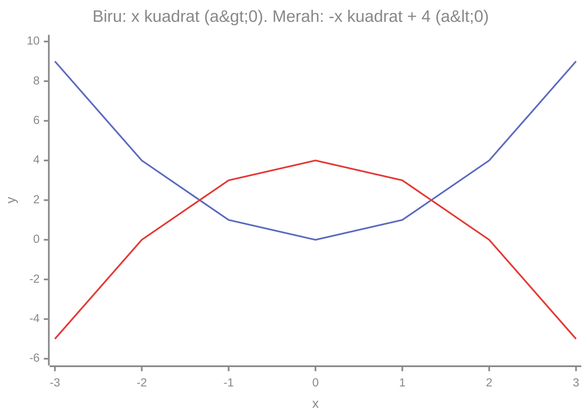

# Part 9 — Fungsi Kuadrat dan Polinomial

## Tujuan Pembelajaran

Setelah mempelajari bagian ini, kamu mampu:

- menjelaskan fungsi pangkat seperti $x^2$ dan $x^3$ dan membandingkan pertumbuhannya;
- mengenali bentuk umum fungsi kuadrat $f(x) = ax^2 + bx + c$ dan arti $a$, $b$, dan $c$;
- menghitung nilai fungsi kuadrat dan membaca grafik parabola, termasuk arah buka dan puncak;
- menjelaskan polinomial dan derajatnya;
- membedakan fungsi linear dan kuadrat lewat tabel (selisih pertama dan kedua);
- menjelaskan mengapa hubungan nonlinear penting dalam Machine Learning.

## Prasyarat

[Part 2](02-operasi-bentuk-aljabar.md) (menjabarkan dan memfaktorkan), [Part 7](07-konsep-fungsi.md) (fungsi, domain, range), dan [Part 8](08-fungsi-linear.md) (fungsi linear, perubahan per langkah). Level 0 [Part 5](../level-0-fondasi-matematika/05-pangkat-dan-akar.md) membahas pangkat dan akar.

!!! info "Pengantar"
    Bagian ini bersifat pengantar. Menyelesaikan persamaan kuadrat secara lengkap dan analisis grafik tingkat lanjut dibahas di materi lanjut. Subbagian bertanda **pengayaan** boleh dilewati pada bacaan pertama.

## Mengapa Materi Ini Penting?

Tidak semua hubungan berupa garis lurus. Lintasan bola, luas, dan banyak ukuran kesalahan berbentuk kurva. Dalam Machine Learning, kuadrat muncul di ukuran kesalahan (misalnya MSE), dan model yang hanya linear tidak dapat menangkap pola melengkung. Parabola adalah kurva pertama yang perlu kamu kenali di luar garis lurus.

## Konsep Dasar dengan Bahasa Sederhana

### 1. Pengertian Pangkat dalam Bentuk Fungsi

Pada Level 0 kamu mengenal pangkat sebagai bilangan. Sekarang masukan $x$ yang dipangkatkan: $f(x) = x^n$.

| $x$ | 1 | 2 | 3 | 4 | 5 |
|---|---|---|---|---|---|
| $x$ | 1 | 2 | 3 | 4 | 5 |
| $x^2$ | 1 | 4 | 9 | 16 | 25 |
| $x^3$ | 1 | 8 | 27 | 64 | 125 |

Pangkat yang lebih tinggi tumbuh jauh lebih cepat: dari $x = 4$ ke $x = 5$, $x$ naik 1, $x^2$ naik 9, dan $x^3$ naik 61. Fungsi $f(x) = x$ bertumbuh tetap (linear); $x^2$ makin cepat.

### 2. Pengertian Fungsi Kuadrat

**Fungsi kuadrat** (*quadratic function*) adalah fungsi yang suku berpangkat tertingginya berpangkat **dua**. Grafiknya berbentuk lengkung simetris yang disebut **parabola**.

Contoh nyata:

- Luas persegi dengan sisi $s$: $A(s) = s^2$.
- Tinggi bola yang dilempar ke atas (dengan angka disederhanakan): $h(t) = -5t^2 + 20t$ meter pada waktu $t$ detik.

| $t$ (detik) | 0 | 1 | 2 | 3 | 4 |
|---|---|---|---|---|---|
| $h(t)$ (meter) | 0 | 15 | 20 | 15 | 0 |

Bola naik sampai ketinggian 20 m pada detik ke-2, lalu turun dan kembali ke tanah pada detik ke-4. Tabelnya simetris: tinggi pada detik 1 sama dengan detik 3.

### 3. Bentuk Umum $f(x) = ax^2 + bx + c$

$$
f(x) = ax^2 + bx + c, \qquad a \neq 0
$$

dengan $a$, $b$, $c$ konstanta. Syarat $a \neq 0$ wajib: jika $a = 0$, suku $x^2$ hilang dan fungsinya menjadi linear $bx + c$.

### 4. Makna Koefisien $a$, $b$, dan $c$

| Koefisien | Pengaruh |
|---|---|
| $a$ | **arah buka** dan **lebar** parabola. $a > 0$ membuka ke atas, $a < 0$ membuka ke bawah. Makin besar $\lvert a \rvert$, makin sempit |
| $c$ | **titik potong sumbu $y$**: $f(0) = c$ |
| $b$ | bersama $a$ menentukan **posisi puncak** |

Alasan $f(0) = c$: substitusi $x = 0$ memberi $a(0)^2 + b(0) + c = c$. Sama seperti intercept $b$ pada garis (Part 8).

**Pengaruh $a$ (angka).** Untuk $x = 2$: $x^2 = 4$, $2x^2 = 8$, $0{,}5x^2 = 2$. Koefisien lebih besar membuat nilai naik lebih cepat, sehingga parabola lebih sempit.

**Posisi puncak (pengayaan).** Puncak berada pada

$$
x = -\frac{b}{2a}
$$

Pada $f(x) = x^2 - 4x + 3$: $a = 1$, $b = -4$, jadi $x = -\dfrac{-4}{2(1)} = 2$, dan $f(2) = 4 - 8 + 3 = -1$. Puncaknya $(2, -1)$.

### 5. Menghitung Nilai Fungsi Kuadrat

Substitusi dengan kurung, pangkat dulu (Part 1, Part 7).

Untuk $f(x) = x^2 - 4x + 3$:

| $x$ | Substitusi | $f(x)$ |
|---|---|---|
| $-1$ | $(-1)^2 - 4(-1) + 3 = 1 + 4 + 3$ | $8$ |
| $0$ | $0 - 0 + 3$ | $3$ |
| $1$ | $1 - 4 + 3$ | $0$ |
| $2$ | $4 - 8 + 3$ | $-1$ |
| $3$ | $9 - 12 + 3$ | $0$ |
| $4$ | $16 - 16 + 3$ | $3$ |
| $5$ | $25 - 20 + 3$ | $8$ |

### 6. Mengenal Grafik Parabola

```mermaid
%%{init: {"themeVariables": {"xyChart": {"backgroundColor":"transparent","plotColorPalette":"#5c6bc0, #e53935, #43a047","titleColor":"#888","xAxisLabelColor":"#888","yAxisLabelColor":"#888","xAxisTitleColor":"#888","yAxisTitleColor":"#888","xAxisLineColor":"#888","yAxisLineColor":"#888","xAxisTickColor":"#888","yAxisTickColor":"#888"}}}}%%
xychart-beta
    title "f(x) = x kuadrat - 4x + 3"
    x-axis "x" [-1, 0, 1, 2, 3, 4, 5]
    y-axis "f(x)" -2 --> 9
    line [8, 3, 0, -1, 0, 3, 8]
```

Cara membaca: dari kiri, kurva turun dari 8 pada $x = -1$, mencapai titik terendah $-1$ pada $x = 2$ (**puncak**, atau titik balik), lalu naik lagi. Kurva simetris terhadap garis tegak $x = 2$: nilai pada $x = 1$ dan $x = 3$ sama (keduanya 0), dan pada $x = 0$ dan $x = 4$ sama (keduanya 3).

Bagian ini dibuat dengan menghubungkan tujuh titik dengan ruas lurus, jadi tampak bersudut. Dengan lebih banyak titik, kurvanya mulus.

Titik tempat kurva memotong sumbu $x$ (di sini $x = 1$ dan $x = 3$, tempat $f(x) = 0$) disebut **akar** atau titik potong sumbu $x$.

### 7. Arah Buka Parabola

- $a > 0$: parabola **membuka ke atas**, punya titik **minimum** di puncak.
- $a < 0$: parabola **membuka ke bawah**, punya titik **maksimum** di puncak.



Garis biru ($a = 1$) membuka ke atas dengan titik terendah $(0, 0)$. Garis merah ($a = -1$) membuka ke bawah dengan titik tertinggi $(0, 4)$.

Untuk $f(x) = -5t^2 + 20t$ pada bola, $a = -5 < 0$, jadi ada ketinggian **maksimum**: puncak di $t = -\dfrac{20}{2(-5)} = 2$ dengan $h(2) = -20 + 40 = 20$.

### 8. Pengertian Polinomial

**Polinomial** (suku banyak) adalah ekspresi yang tersusun dari suku-suku berbentuk $k x^n$, dengan $k$ konstanta dan $n$ bilangan cacah ($0, 1, 2, \ldots$), yang dijumlahkan atau dikurangkan.

Contoh polinomial: $3x^4 - 2x + 1$, $x^3 + x$, $2x + 3$ (linear), $x^2 - 4x + 3$ (kuadrat), dan $5$ (konstan).

Bukan polinomial:

- $\dfrac{1}{x}$ (variabel di penyebut, setara pangkat $-1$),
- $\sqrt{x}$ (setara pangkat $\tfrac{1}{2}$, bukan bilangan cacah),
- $2^x$ (variabel berada di eksponen; ini fungsi eksponensial, Part 10).

Penulisan baku: urutkan suku dari pangkat tertinggi ke terendah, misalnya $3x^4 + 0x^3 + 0x^2 - 2x + 1$ ditulis $3x^4 - 2x + 1$.

### 9. Derajat Polinomial

**Derajat** polinomial adalah pangkat tertinggi variabelnya (dengan koefisien tidak nol).

| Polinomial | Derajat | Nama |
|---|---|---|
| $5$ | 0 | konstan |
| $2x + 3$ | 1 | linear |
| $x^2 - 4x + 3$ | 2 | kuadrat |
| $x^3 - 3x$ | 3 | kubik |
| $3x^4 - 2x + 1$ | 4 | |

Derajat memberi petunjuk bentuk grafik: polinomial berderajat $n$ memiliki **paling banyak** $n - 1$ belokan. Linear (derajat 1) tidak berbelok, kuadrat (derajat 2) berbelok sekali di puncak, kubik (derajat 3) berbelok paling banyak dua kali.

Contoh kubik $f(x) = x^3 - 3x$ (nilai pada $x$ kelipatan 0,5):

```mermaid
%%{init: {"themeVariables": {"xyChart": {"backgroundColor":"transparent","plotColorPalette":"#5c6bc0, #e53935, #43a047","titleColor":"#888","xAxisLabelColor":"#888","yAxisLabelColor":"#888","xAxisTitleColor":"#888","yAxisTitleColor":"#888","xAxisLineColor":"#888","yAxisLineColor":"#888","xAxisTickColor":"#888","yAxisTickColor":"#888"}}}}%%
xychart-beta
    title "f(x) = x pangkat 3 - 3x"
    x-axis "x" [-2, -1.5, -1, -0.5, 0, 0.5, 1, 1.5, 2]
    y-axis "f(x)" -4 --> 4
    line [-2, 1.125, 2, 1.375, 0, -1.375, -2, -1.125, 2]
```

Kurva ini naik, turun, lalu naik lagi: dua belokan (di sekitar $x = -1$ dan $x = 1$), sesuai batas derajat 3.

### 10. Membandingkan Fungsi Linear dan Kuadrat

Cara membedakan dari tabel dengan $x$ naik 1 setiap baris:

- **Linear:** *selisih pertama* (perubahan $y$) **tetap**.
- **Kuadrat:** *selisih pertama berubah*, tetapi *selisih kedua* (perubahan dari selisih pertama) **tetap**.

| $x$ | 0 | 1 | 2 | 3 | 4 |
|---|---|---|---|---|---|
| $y = 2x + 1$ (linear) | 1 | 3 | 5 | 7 | 9 |
| selisih pertama | | 2 | 2 | 2 | 2 |
| $y = x^2$ (kuadrat) | 0 | 1 | 4 | 9 | 16 |
| selisih pertama | | 1 | 3 | 5 | 7 |
| selisih kedua | | | 2 | 2 | 2 |

Untuk $f(x) = ax^2 + bx + c$, selisih kedua selalu $2a$ (bila $x$ naik 1). Pada $x^2$, $a = 1$, jadi selisih kedua 2.

**Menebak jenis dari data.** Data $(0, 1), (1, 2), (2, 5), (3, 10)$: selisih pertama $1, 3, 5$; selisih kedua $2, 2$. Tetap, jadi kuadrat dengan $2a = 2$, yaitu $a = 1$. Karena $f(0) = c = 1$, kita coba $f(x) = x^2 + 1$: $f(1) = 2$, $f(2) = 5$, $f(3) = 10$. Cocok.

### 11. Pengantar Hubungan Nonlinear dengan Machine Learning

Data nyata sering melengkung. Pada data tinggi bola:

| $t$ | 0 | 1 | 2 | 3 | 4 |
|---|---|---|---|---|---|
| $h$ | 0 | 15 | 20 | 15 | 0 |

Garis datar $\hat{y} = 10$ (rata-rata data) adalah pendekatan lurus yang masuk akal, dan karena data simetris, garis lurus terbaik pun datar. Jumlah kuadrat selisihnya: $(0 - 10)^2 + (15 - 10)^2 + (20 - 10)^2 + (15 - 10)^2 + (0 - 10)^2 = 100 + 25 + 100 + 25 + 100 = 350$. Sebaliknya, model kuadrat $\hat{y} = -5t^2 + 20t$ cocok **tepat** dengan jumlah kuadrat selisih $0$.

Pelajaran: **model linear tidak bisa menangkap pola melengkung**, sedangkan menambahkan suku $x^2$ memperkaya model. Ini dasar dari *polynomial regression*. Hal yang perlu dipelajari kemudian:

- derajat yang terlalu tinggi membuat kurva "menghafal" data (*overfitting*);
- cara memilih derajat dan mencari koefisien terbaik.

Keduanya dibahas di level berikutnya.

## Istilah yang Perlu Dipahami

| Istilah | Arti sederhana | Contoh |
|---|---|---|
| Fungsi kuadrat | fungsi dengan pangkat tertinggi 2 | $x^2 - 4x + 3$ |
| Parabola | bentuk grafik fungsi kuadrat | lengkung seperti huruf U |
| Puncak (*vertex*) | titik balik parabola | $(2, -1)$ |
| Sumbu simetri | garis tegak yang membagi parabola menjadi dua sama | $x = 2$ |
| Minimum / maksimum | nilai terendah / tertinggi di puncak | $-1$ / $20$ |
| Akar (*root*) | nilai $x$ dengan $f(x) = 0$ | $x = 1$ dan $x = 3$ |
| Polinomial (suku banyak) | jumlah suku $k x^n$ dengan $n$ bilangan cacah | $3x^4 - 2x + 1$ |
| Derajat (*degree*) | pangkat tertinggi dalam polinomial | 4 |
| Selisih pertama / kedua | perubahan $y$ / perubahan dari perubahan $y$ | $1, 3, 5$ / $2, 2$ |
| Nonlinear | tidak berbentuk garis lurus | parabola |
| Overfitting | model terlalu menghafal data | derajat terlalu tinggi |

## Rumus dan Penjelasan Setiap Simbol

**Fungsi kuadrat:**

$$
f(x) = ax^2 + bx + c, \qquad a \neq 0
$$

- $x$: masukan. $a$, $b$, $c$: koefisien.
- $f(0) = c$.
- Selisih kedua untuk $x$ naik 1: $2a$.

**Puncak (pengayaan):**

$$
x_p = -\frac{b}{2a}, \qquad y_p = f(x_p)
$$

- $x_p$ adalah koordinat mendatar puncak; $y_p$ adalah nilai fungsi di sana.
- Contoh $f(x) = -2x^2 + 8x$: $a = -2$, $b = 8$, $x_p = -\dfrac{8}{2(-2)} = 2$, $y_p = -8 + 16 = 8$ (nilai maksimum karena $a < 0$).

**Akar kuadrat (pengayaan).** Akar $f(x) = 0$ dapat dicari dengan memfaktorkan (Part 2) atau rumus

$$
x = \frac{-b \pm \sqrt{D}}{2a}, \qquad D = b^2 - 4ac
$$

- $D$ disebut diskriminan. Tanda $\pm$ berarti dua kemungkinan: $-$ dan $+$.
- $D > 0$: dua akar real berbeda. $D = 0$: satu akar. $D < 0$: tidak ada akar real (parabola tidak menyentuh sumbu $x$).
- Contoh $x^2 - 4x + 3$: $D = 16 - 12 = 4$, jadi $x = \dfrac{4 \pm 2}{2}$, yaitu $x = 3$ atau $x = 1$. Contoh $x^2 + 1$: $D = 0 - 4 = -4 < 0$, tidak ada akar real.

**Polinomial berderajat $n$:**

$$
p(x) = a_n x^n + a_{n-1} x^{n-1} + \cdots + a_1 x + a_0, \qquad a_n \neq 0
$$

- Angka kecil di kanan bawah (subskrip) menandai koefisien tiap pangkat.
- $n$ adalah derajat dan $a_n$ adalah koefisien pemimpin.

## Penjelasan Langkah demi Langkah

**Membuat sketsa parabola $f(x) = ax^2 + bx + c$:**

1. Lihat tanda $a$: buka ke atas atau ke bawah.
2. Hitung $c = f(0)$: titik potong sumbu $y$.
3. Hitung puncak: $x_p = -\dfrac{b}{2a}$, lalu $y_p = f(x_p)$.
4. Buat tabel dengan beberapa $x$ di kiri dan kanan $x_p$ (simetris).
5. Gambar titik dan hubungkan dengan lengkung mulus.

Untuk $f(x) = x^2 - 4x + 3$: $a = 1 > 0$ (buka ke atas); $c = 3$; puncak $(2, -1)$; nilai di $x = 0$ dan $x = 4$ sama-sama 3 (simetris), dan di $x = 1$ dan $x = 3$ sama-sama 0.

## Contoh Soal dan Pembahasan

### Contoh 1 — Membaca koefisien

Tentukan $a$, $b$, $c$ pada $f(x) = 2x^2 - 5x + 3$ dan pada $g(x) = -x^2 + 4$.

1. $f$: $a = 2$, $b = -5$, $c = 3$. Karena $a > 0$, membuka ke atas. $f(0) = 3$.
2. $g$: tidak ada suku $x$, jadi $b = 0$. $a = -1$, $c = 4$. Karena $a < 0$, membuka ke bawah. $g(0) = 4$.

### Contoh 2 — Nilai dan puncak

Untuk $f(x) = -2x^2 + 8x$, tentukan arah buka dan nilai ekstremnya.

1. $a = -2 < 0$, jadi membuka ke bawah dan puncaknya **maksimum**.
2. $x_p = -\dfrac{b}{2a} = -\dfrac{8}{2(-2)} = -\dfrac{8}{-4} = 2$.
3. $f(2) = -2(2)^2 + 8(2) = -8 + 16 = 8$.
4. Nilai maksimum 8 pada $x = 2$.
5. Cek simetri: $f(1) = -2 + 8 = 6$ dan $f(3) = -18 + 24 = 6$. Sama, sesuai sumbu simetri $x = 2$.

### Contoh 3 — Linear atau kuadrat?

Tentukan jenis fungsi dari $(0, 2), (1, 5), (2, 8), (3, 11)$ dan dari $(0, 1), (1, 0), (2, 1), (3, 4)$.

1. Data pertama: selisih pertama $5 - 2 = 3$, $8 - 5 = 3$, $11 - 8 = 3$. Tetap, jadi **linear**: $y = 3x + 2$.
2. Data kedua: selisih pertama $-1, 1, 3$. Selisih kedua $2, 2$. Tetap, jadi **kuadrat** dengan $2a = 2$, $a = 1$.
3. Karena $f(0) = c = 1$, kita coba $f(x) = x^2 + bx + 1$. Dari $f(1) = 0$: $1 + b + 1 = 0$, jadi $b = -2$. Fungsi: $x^2 - 2x + 1 = (x - 1)^2$. Cek $f(3) = 9 - 6 + 1 = 4$. Cocok.

### Contoh 4 — Bola yang dilempar

Tinggi bola $h(t) = -5t^2 + 20t$. Kapan bola kembali ke tanah, dan berapa tinggi maksimum?

1. Kembali ke tanah berarti $h = 0$: $-5t^2 + 20t = 0$. Faktorkan faktor bersama $-5t$: $-5t(t - 4) = 0$.
2. Hasil kali nol berarti salah satu faktor nol: $t = 0$ (saat dilempar) atau $t = 4$ (saat jatuh).
3. Tinggi maksimum di $t = -\dfrac{20}{2(-5)} = 2$: $h(2) = -20 + 40 = 20$ meter.
4. Cek simetri: $h(1) = 15$ dan $h(3) = 15$.

### Contoh 5 — Akar lewat rumus (pengayaan)

Cari akar $x^2 - 5x + 6 = 0$.

1. $a = 1$, $b = -5$, $c = 6$. $D = (-5)^2 - 4(1)(6) = 25 - 24 = 1$.
2. $x = \dfrac{5 \pm \sqrt{1}}{2} = \dfrac{5 \pm 1}{2}$, yaitu $x = 3$ atau $x = 2$.
3. Cek dengan faktorisasi (Part 2): $x^2 - 5x + 6 = (x - 2)(x - 3)$, akar 2 dan 3.

## Contoh Tambahan dengan Kesulitan Bertahap

**Mudah.** $f(x) = x^2$: $f(3) = 9$ dan $f(-3) = 9$. Nilainya sama karena parabola simetris terhadap sumbu $y$.

**Sedang.** $g(x) = 3x^2 - 6x + 1$. $a = 3 > 0$ (minimum). $x_p = -\dfrac{-6}{2(3)} = 1$. $g(1) = 3 - 6 + 1 = -2$. Minimum $-2$ di $x = 1$.

**Sedang.** Derajat $3x^4 - 2x + 1$ adalah 4 (pangkat tertinggi). Derajat $x^3 + x$ adalah 3.

**Menantang.** Parabola dengan puncak $(2, -1)$ yang melewati $(0, 3)$, dengan $a = 1$: bentuk $x^2 + bx + 3$ dengan $-\dfrac{b}{2} = 2$ memberi $b = -4$. Fungsi: $x^2 - 4x + 3$. Cek puncak: $f(2) = -1$.

## Visualisasi atau Interpretasi Grafik

Rangkuman membaca grafik parabola:

| Yang dilihat | Memberi tahu |
|---|---|
| buka ke atas atau ke bawah | tanda $a$ |
| titik potong sumbu $y$ | $c$ |
| titik terendah atau tertinggi | puncak, minimum atau maksimum |
| garis simetri | $x = -\dfrac{b}{2a}$ |
| titik potong sumbu $x$ | akar (bila ada) |
| seberapa sempit | besar $\lvert a \rvert$ |

Grafik polinomial berderajat $n$ memiliki paling banyak $n - 1$ belokan, jadi grafik kubik paling banyak dua belokan seperti pada contoh di bagian 9.

## Kesalahan Umum

| Kesalahan | Mengapa salah | Yang benar |
|---|---|---|
| Menganggap $(x - 2)^2 = x^2 - 4$ | suku tengah hilang (Part 2) | $x^2 - 4x + 4$ |
| Menganggap $f(x) = bx + c$ adalah kuadrat | tanpa $x^2$ itu linear | kuadrat butuh $a \neq 0$ |
| Mengira $a < 0$ berarti parabola di bawah sumbu $x$ | $a$ menentukan arah buka, bukan posisi | $a < 0$ membuka ke bawah |
| $f(-3)$ untuk $f(x) = x^2$ ditulis $-9$ | kuadrat dari bilangan negatif positif | $(-3)^2 = 9$ |
| Menyamakan puncak dengan titik potong sumbu $y$ | puncak di $x = -\dfrac{b}{2a}$, bukan selalu di $x = 0$ | hitung $x_p$ |
| Menganggap $\sqrt{x}$ atau $\dfrac{1}{x}$ polinomial | pangkat bukan bilangan cacah | bukan polinomial |
| Mengira selisih pertama tetap pada fungsi kuadrat | tetap hanya pada linear | selisih **kedua** yang tetap |
| Menyimpulkan akar selalu ada | $D < 0$ berarti tidak ada akar real | periksa $D$ |
| Mengira derajat tinggi selalu lebih baik di ML | bisa terjadi overfitting | pilih derajat sesuai data |

## Hubungan dengan Machine Learning

- **Kuadrat di ukuran kesalahan.** MSE memakai kuadrat selisih. Sebagai fungsi dari parameter, kuadrat selisih membentuk parabola, dan titik terendah parabola adalah parameter terbaik. Ide ini muncul lagi di level kalkulus dan optimisasi.
- **Pola melengkung.** Seperti contoh bola, model linear tidak bisa menangkap kurva; menambahkan suku $x^2$ memungkinkannya (*polynomial regression*).
- **Catatan:** $\hat{y} = w_2 x^2 + w_1 x + b$ masih disebut model *linear dalam parameter* karena $w_2$, $w_1$, $b$ hanya dikalikan dan dijumlah, meskipun hubungan terhadap $x$ melengkung. Detailnya di level berikutnya.
- **Derajat dan overfitting.** Polinomial berderajat tinggi bisa menyentuh semua titik data, tetapi belokannya bisa liar di antara titik. Memilih kompleksitas model adalah tema besar ML.
- **Minimum dan maksimum.** Banyak masalah ML dirumuskan sebagai mencari nilai minimum sebuah fungsi.

### Python: fungsi kuadrat, puncak, akar, dan polinomial

Fungsi kuadrat dan tabel nilainya:

```python
def f(x):
    return x ** 2 - 4 * x + 3

for x in range(-1, 6):
    print(x, f(x))
# -1 8
# 0 3
# 1 0
# 2 -1
# 3 0
# 4 3
# 5 8
```

Puncak dan akar memakai rumus pengayaan:

```python
import math

a, b, c = 1, -4, 3
x_puncak = -b / (2 * a)
print(x_puncak, f(x_puncak))   # 2.0 -1.0

D = b ** 2 - 4 * a * c
print(D)   # 4
if D >= 0:
    akar1 = (-b + math.sqrt(D)) / (2 * a)
    akar2 = (-b - math.sqrt(D)) / (2 * a)
    print(akar1, akar2)   # 3.0 1.0
```

Memeriksa selisih pertama dan kedua dari sebuah tabel:

```python
def selisih(daftar):
    return [daftar[i + 1] - daftar[i] for i in range(len(daftar) - 1)]

y = [x ** 2 for x in range(0, 5)]
print(y)                       # [0, 1, 4, 9, 16]
print(selisih(y))              # [1, 3, 5, 7]
print(selisih(selisih(y)))     # [2, 2, 2]
```

Polinomial umum dengan daftar koefisien (dari pangkat 0 ke atas). Untuk $x^2 - 4x + 3$ koefisiennya `[3, -4, 1]`:

```python
def poli(koef, x):
    return sum(c * x ** i for i, c in enumerate(koef))

koef = [3, -4, 1]
print(poli(koef, 2))              # -1
derajat = len(koef) - 1           # 2
print(derajat)
```

Membandingkan model datar dan model kuadrat pada data bola, dengan jumlah kuadrat selisih:

```python
t = [0, 1, 2, 3, 4]
h = [0, 15, 20, 15, 0]

def jumlah_kuadrat(prediksi):
    return sum((p - y) ** 2 for p, y in zip(prediksi, h))

datar = [10 for _ in t]
kuadrat = [-5 * ti ** 2 + 20 * ti for ti in t]
print(jumlah_kuadrat(datar))     # 350
print(jumlah_kuadrat(kuadrat))   # 0
```

## Latihan Mandiri

1. Buat tabel $x$, $x^2$, dan $x^3$ untuk $x = 1, 2, 3, 4$. Mana yang tumbuh paling cepat?
2. Tentukan $a$, $b$, $c$: (a) $f(x) = 2x^2 - 5x + 3$ (b) $f(x) = -x^2 + 4$ (c) $f(x) = x^2 + 6x$
3. Hitung $f(x) = x^2 - 4x + 3$ untuk $x = 0, 1, 2, 3, 4$ dan tentukan puncaknya.
4. Tentukan arah buka dan nilai ekstrem (puncak): (a) $f(x) = -2x^2 + 8x$ (b) $g(x) = 3x^2 - 6x + 1$
5. Apakah polinomial? Jika ya, berapa derajatnya? (a) $3x^4 - 2x + 1$ (b) $\dfrac{1}{x}$ (c) $\sqrt{x}$ (d) $2^x$ (e) $5$ (f) $x^3 + x$
6. Data $(0, 1), (1, 2), (2, 5), (3, 10)$: hitung selisih pertama dan kedua, tentukan jenis fungsinya, dan temukan rumusnya.
7. Tentukan linear atau kuadrat: (a) $y$ untuk $x = 0, 1, 2, 3$ adalah $2, 5, 8, 11$ (b) $y$ adalah $1, 0, 1, 4$
8. (Pengayaan) Cari akar: (a) $x^2 - 5x + 6 = 0$ (b) $x^2 - 4 = 0$ (c) $x^2 + 1 = 0$
9. Tinggi bola $h(t) = -5t^2 + 20t$. Hitung $h(0), \ldots, h(4)$, kapan bola kembali ke tanah, dan berapa tinggi maksimumnya?
10. Data bola $(0, 0), (1, 15), (2, 20), (3, 15), (4, 0)$. Hitung jumlah kuadrat selisih untuk model datar $\hat{y} = 10$ dan untuk $\hat{y} = -5t^2 + 20t$. Apa yang ditunjukkan hasil ini tentang model linear?

## Kunci Jawaban dan Pembahasan

??? success "Soal 1"
    $x = 1$: $1, 1, 1$. $x = 2$: $2, 4, 8$. $x = 3$: $3, 9, 27$. $x = 4$: $4, 16, 64$. $x^3$ tumbuh paling cepat.

??? success "Soal 2"
    (a) $a = 2$, $b = -5$, $c = 3$. (b) $a = -1$, $b = 0$, $c = 4$. (c) $a = 1$, $b = 6$, $c = 0$.

??? success "Soal 3"
    $f(0) = 3$, $f(1) = 0$, $f(2) = -1$, $f(3) = 0$, $f(4) = 3$. Puncak: $x_p = -\dfrac{-4}{2} = 2$, $f(2) = -1$, jadi $(2, -1)$.

??? success "Soal 4"
    (a) $a = -2 < 0$: buka ke bawah. $x_p = -\dfrac{8}{2(-2)} = 2$. $f(2) = -8 + 16 = 8$. **Maksimum 8** di $x = 2$.
    (b) $a = 3 > 0$: buka ke atas. $x_p = -\dfrac{-6}{2(3)} = 1$. $g(1) = 3 - 6 + 1 = -2$. **Minimum $-2$** di $x = 1$.

??? success "Soal 5"
    (a) Ya, derajat 4. (b) Bukan ($x$ di penyebut). (c) Bukan (akar). (d) Bukan (variabel di eksponen). (e) Ya, derajat 0. (f) Ya, derajat 3.

??? success "Soal 6"
    Selisih pertama: $1, 3, 5$. Selisih kedua: $2, 2$. Tetap, jadi kuadrat dengan $2a = 2$, $a = 1$. $f(0) = c = 1$. Dari $f(1) = 2$: $1 + b + 1 = 2$, jadi $b = 0$. Rumus $f(x) = x^2 + 1$. Cek $f(2) = 5$ dan $f(3) = 10$.

??? success "Soal 7"
    (a) Selisih pertama $3, 3, 3$ tetap: **linear**, $y = 3x + 2$. (b) Selisih pertama $-1, 1, 3$; selisih kedua $2, 2$: **kuadrat**, $y = (x - 1)^2$.

??? success "Soal 8"
    (a) $D = 25 - 24 = 1$, $x = \dfrac{5 \pm 1}{2}$: $x = 3$ atau $x = 2$.
    (b) $x^2 = 4$, jadi $x = 2$ atau $x = -2$ (atau $D = 16$, $x = \dfrac{0 \pm 4}{2}$).
    (c) $D = -4 < 0$: tidak ada akar real.

??? success "Soal 9"
    $h(0) = 0$, $h(1) = 15$, $h(2) = 20$, $h(3) = 15$, $h(4) = 0$. Kembali ke tanah saat $h = 0$: $-5t(t - 4) = 0$, jadi $t = 4$ (selain $t = 0$ saat dilempar). Tinggi maksimum 20 m pada $t = 2$.

??? success "Soal 10"
    Model datar: $100 + 25 + 100 + 25 + 100 = 350$. Model kuadrat: setiap prediksi persis sama dengan data, jadi $0$. Hasilnya menunjukkan bahwa model linear (garis lurus, termasuk garis datar) tidak dapat menangkap pola melengkung ini, sedangkan menambah suku kuadrat dapat.

## Ringkasan Materi

- Fungsi kuadrat: $f(x) = ax^2 + bx + c$ dengan $a \neq 0$; grafiknya parabola.
- $a$ menentukan arah buka ($a > 0$ ke atas, $a < 0$ ke bawah) dan lebar; $c = f(0)$ adalah titik potong sumbu $y$; puncak ada di $x = -\dfrac{b}{2a}$.
- Parabola simetris terhadap garis tegak melalui puncaknya.
- Polinomial adalah jumlah suku $kx^n$ dengan $n$ bilangan cacah; derajatnya adalah pangkat tertinggi; derajat $n$ punya paling banyak $n - 1$ belokan.
- Dari tabel: linear punya selisih pertama tetap; kuadrat punya selisih kedua tetap ($2a$).
- Model linear tidak dapat menangkap pola melengkung; suku kuadrat memperkaya model, tetapi derajat yang terlalu tinggi berisiko overfitting.

## Checklist Penguasaan

- [ ] Menghitung nilai $f(x)$ untuk fungsi kuadrat dengan substitusi yang benar.
- [ ] Menjelaskan arti $a$ dan $c$, dan menentukan arah buka dari tanda $a$.
- [ ] Menentukan puncak parabola dan menyebutnya minimum atau maksimum.
- [ ] Menjelaskan sifat simetri parabola.
- [ ] Menentukan derajat polinomial dan mengenali yang bukan polinomial.
- [ ] Membedakan linear dan kuadrat dari selisih pertama dan kedua.
- [ ] Menjelaskan mengapa pola melengkung membutuhkan model nonlinear.

## Prasyarat untuk Materi Berikutnya

[Part 10 — Fungsi Eksponensial dan Logaritma](10-fungsi-eksponensial-dan-logaritma.md) membutuhkan: pangkat dan akar dari Level 0, notasi fungsi, dan membaca tabel serta grafik. Perbedaan penting yang harus diingat: pada $x^2$ variabel berada di **basis**, sedangkan pada fungsi eksponensial variabel berada di **eksponen**.
