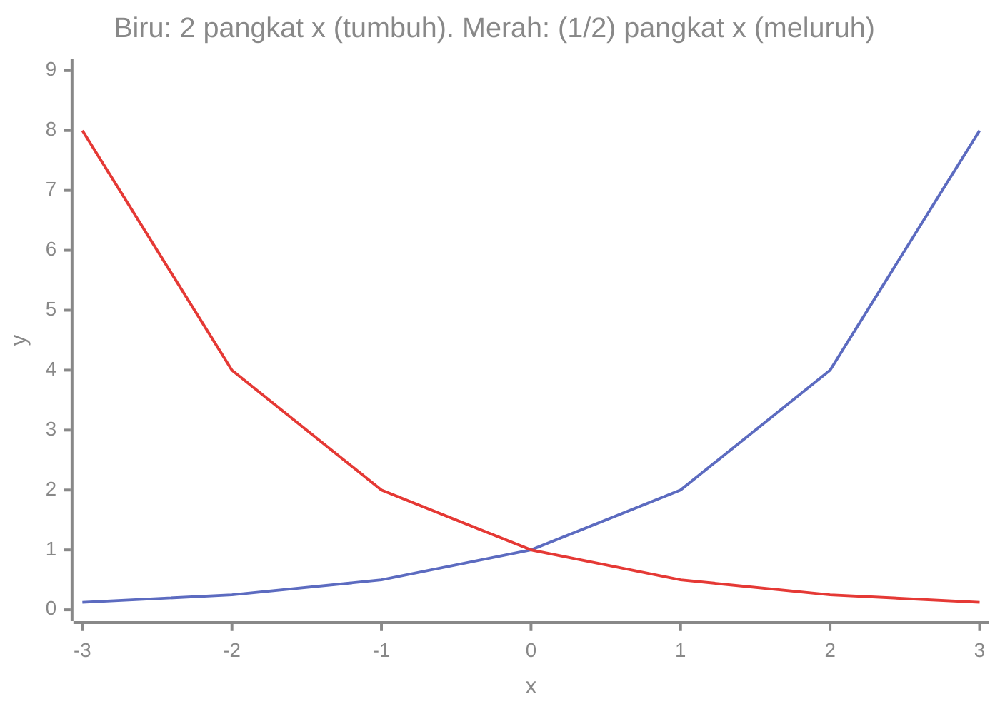
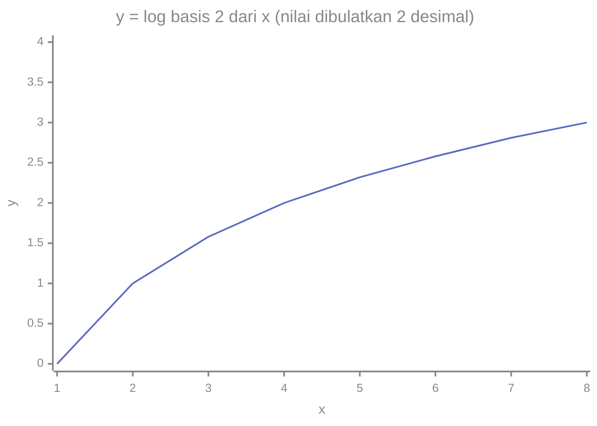

# Part 10 — Fungsi Eksponensial dan Logaritma

## Tujuan Pembelajaran

Setelah mempelajari bagian ini, kamu mampu:

- menjelaskan fungsi eksponensial $f(x) = a^x$ dan membedakannya dari fungsi pangkat seperti $x^2$;
- menjelaskan pertumbuhan dan peluruhan eksponensial serta menghitungnya;
- menjelaskan bilangan Euler $e$ sebagai pengantar;
- menjelaskan logaritma sebagai kebalikan pangkat dan menghitung logaritma sederhana;
- membedakan $\log$ dan $\ln$, serta menyebut batasan domain logaritma;
- memakai sifat dasar logaritma;
- mengenali, sebagai pratinjau, peran eksponensial dan logaritma dalam sigmoid, softmax, dan log loss.

## Prasyarat

[Level 0 — Part 5](../level-0-fondasi-matematika/05-pangkat-dan-akar.md) (pangkat, pangkat negatif dan pecahan, akar), [Part 7](07-konsep-fungsi.md) (fungsi, domain, range), dan [Part 9](09-fungsi-kuadrat-dan-polinomial.md) (grafik fungsi nonlinear). Kamu juga membutuhkan [notasi ilmiah](../level-0-fondasi-matematika/06-nilai-absolut-dan-notasi-ilmiah.md) dari Level 0 untuk bagian terakhir.

!!! info "Pengantar"
    Bagian ini memperkenalkan konsepnya. Penggunaan eksponensial dan logaritma dalam model (sigmoid, softmax, log loss) hanya **pratinjau**; pembahasan matematis mendetail ada di level berikutnya.

## Mengapa Materi Ini Penting?

Eksponensial menggambarkan pertumbuhan yang sangat cepat dan peluruhan yang cepat. Logaritma adalah "kebalikannya", yang mengubah perkalian menjadi penjumlahan dan bilangan raksasa menjadi bilangan kecil. Keduanya muncul di hampir setiap model klasifikasi: fungsi sigmoid memakai $e^{-x}$, dan ukuran kesalahan klasifikasi memakai logaritma.

## Konsep Dasar dengan Bahasa Sederhana

### 1. Pengertian Fungsi Eksponensial

**Fungsi eksponensial** adalah fungsi yang **variabelnya berada di eksponen**, seperti $f(x) = 2^x$.

Bandingkan dengan fungsi pangkat di Part 9, tempat variabel berada di **basis**, seperti $x^2$:

| | Variabel | Contoh |
|---|---|---|
| Fungsi pangkat | di basis | $f(x) = x^2$ |
| Fungsi eksponensial | di eksponen | $f(x) = 2^x$ |

Contoh nyata: sebuah bakteri membelah menjadi dua setiap jam. Setelah $t$ jam, banyaknya menjadi $2^t$ kali jumlah awal: $1, 2, 4, 8, 16, 32, \ldots$

Bandingkan kecepatan tumbuhnya:

| $x$ | 0 | 1 | 2 | 3 | 4 | 5 | 10 | 20 |
|---|---|---|---|---|---|---|---|---|
| $2x$ (linear) | 0 | 2 | 4 | 6 | 8 | 10 | 20 | 40 |
| $x^2$ (kuadrat) | 0 | 1 | 4 | 9 | 16 | 25 | 100 | 400 |
| $2^x$ (eksponensial) | 1 | 2 | 4 | 8 | 16 | 32 | 1.024 | 1.048.576 |

Awalnya $2^x$ tampak biasa saja, tetapi pada $x = 20$ nilainya lebih dari satu juta. Pertumbuhan eksponensial akhirnya mengalahkan pertumbuhan linear dan kuadrat.

### 2. Dasar Pangkat dan Bilangan Basis

Ingat dari Level 0: $a^0 = 1$, $a^{-n} = \dfrac{1}{a^n}$, dan $a^{1/2} = \sqrt{a}$. Dengan itu, $2^x$ terdefinisi untuk **semua** bilangan real $x$, bukan hanya bilangan bulat:

| $x$ | $-3$ | $-2$ | $-1$ | $0$ | $1$ | $2$ | $3$ |
|---|---|---|---|---|---|---|---|
| $2^x$ | $\tfrac{1}{8}$ | $\tfrac{1}{4}$ | $\tfrac{1}{2}$ | $1$ | $2$ | $4$ | $8$ |

**Syarat basis** $a$ pada $a^x$: $a > 0$ dan $a \neq 1$.

- $a = 1$: $1^x = 1$ untuk semua $x$, hanya garis datar (bukan eksponensial yang berarti).
- $a < 0$: misalnya $(-2)^{1/2}$ tidak ada di bilangan real, sehingga fungsinya tidak terdefinisi untuk semua $x$.
- $a = 0$: $0^x$ bermasalah untuk $x \leq 0$.

**Nilai $a^x$ selalu positif** untuk basis $a > 0$, berapa pun $x$-nya, termasuk $x$ negatif. Jadi range $a^x$ adalah $y > 0$.

### 3. Bentuk $f(x) = a^x$

**Bentuk dasar:** $f(x) = a^x$ dengan $a > 0$ dan $a \neq 1$.

**Bentuk umum dengan nilai awal:** $f(x) = c \cdot a^x$, dengan $c$ nilai saat $x = 0$ (karena $a^0 = 1$) dan $a$ **faktor pertumbuhan** per satu langkah $x$.

- Jika $a > 1$: **pertumbuhan** (nilai naik).
- Jika $0 < a < 1$: **peluruhan** (nilai turun).



Cara membaca: kedua garis memotong $x = 0$ di $y = 1$. Garis biru naik makin curam ke kanan (tumbuh), garis merah turun mendekati 0 tetapi **tidak pernah menyentuh** 0 (meluruh). Keduanya selalu di atas sumbu $x$, sesuai $a^x > 0$. Grafik satu adalah pencerminan grafik lainnya terhadap sumbu $y$, karena $\left(\tfrac{1}{2}\right)^x = 2^{-x}$.

### 4. Pengantar Bilangan Euler $e$

**Bilangan Euler** $e$ adalah konstanta khusus dengan nilai $e \approx 2{,}71828$ (irasional, seperti $\pi$). Bilangan ini muncul dari pertumbuhan majemuk yang makin sering dihitung. Perhatikan $\left(1 + \dfrac{1}{n}\right)^n$ untuk $n$ yang makin besar:

| $n$ | $\left(1 + \dfrac{1}{n}\right)^n$ |
|---|---|
| 1 | $2$ |
| 10 | $2{,}5937\ldots$ |
| 100 | $2{,}7048\ldots$ |
| 1.000 | $2{,}7169\ldots$ |
| 1.000.000 | $2{,}71828\ldots$ |

Hasilnya mendekati bilangan tertentu, yaitu $e$. Fungsi $f(x) = e^x$ disebut **fungsi eksponensial natural**. Nilai pentingnya:

- $e^0 = 1$,
- $e^1 \approx 2{,}718$,
- $e^{-1} \approx 0{,}368$ (karena $e^{-1} = \dfrac{1}{e}$),
- $e^x > 0$ untuk semua $x$.

Mengapa $e$ istimewa baru terlihat di kalkulus: fungsi $e^x$ punya sifat khusus yang membuat rumus-rumus menjadi sederhana. Untuk sekarang, cukup mengenalinya sebagai basis alami yang dipakai di ML.

### 5. Pertumbuhan dan Peluruhan Eksponensial

Model umum: setelah $t$ langkah,

$$
N(t) = N_0 \cdot r^t
$$

- $N_0$: nilai awal.
- $r$: faktor per langkah. $r > 1$ tumbuh; $0 < r < 1$ meluruh.

**Hubungan dengan persen (Level 0, Part 4).** Pertumbuhan $p\%$ per langkah berarti $r = 1 + \dfrac{p}{100}$. Penurunan $p\%$ berarti $r = 1 - \dfrac{p}{100}$.

**Contoh tumbuh.** Tabungan Rp1.000.000 dengan bunga majemuk 10% per tahun: $r = 1{,}1$. Setelah $t$ tahun: $1.000.000 \times 1{,}1^t$.

| $t$ | 0 | 1 | 2 | 3 |
|---|---|---|---|---|
| Saldo (Rp) | 1.000.000 | 1.100.000 | 1.210.000 | 1.331.000 |

Perhatikan: kenaikan tahun ke-2 (110.000) lebih besar daripada tahun ke-1 (100.000), karena bunga dihitung dari saldo yang sudah bertambah. Itulah ciri eksponensial.

**Contoh meluruh.** Zat radioaktif 100 gram dengan waktu paruh 5 tahun (separuhnya hilang tiap 5 tahun): $m(t) = 100 \cdot \left(\tfrac{1}{2}\right)^{t/5}$.

| $t$ (tahun) | 0 | 5 | 10 | 15 |
|---|---|---|---|---|
| $m$ (gram) | 100 | 50 | 25 | 12,5 |

### 6. Pengertian Logaritma

**Logaritma** (*logarithm*) menjawab pertanyaan: **"pangkat berapa?"**

$$
\log_a(y) = x \quad\text{berarti}\quad a^x = y
$$

Dibaca "logaritma $y$ berbasis $a$ sama dengan $x$". Jadi $\log_2(8) = 3$ karena $2^3 = 8$. Pertanyaan yang dijawab: "2 harus dipangkatkan berapa agar menjadi 8?" Jawabannya 3.

Contoh:

| Logaritma | Pertanyaan | Jawaban |
|---|---|---|
| $\log_2(8)$ | $2^? = 8$ | $3$ |
| $\log_{10}(1000)$ | $10^? = 1000$ | $3$ |
| $\log_2\!\left(\tfrac{1}{4}\right)$ | $2^? = \tfrac{1}{4}$ | $-2$ |
| $\log_5(1)$ | $5^? = 1$ | $0$ |
| $\log_7(7)$ | $7^? = 7$ | $1$ |

Dua nilai yang selalu benar: $\log_a(1) = 0$ (karena $a^0 = 1$) dan $\log_a(a) = 1$ (karena $a^1 = a$).

### 7. Hubungan Logaritma dengan Pangkat

Logaritma dan pangkat adalah **kebalikan** satu sama lain (seperti akar dengan kuadrat, atau pengurangan dengan penjumlahan):

$$
a^{\log_a(y)} = y, \qquad \log_a\!\left(a^x\right) = x
$$

Ini berguna untuk menyelesaikan persamaan: $2^x = 32$ berarti $x = \log_2(32) = 5$.

**Grafik** $y = \log_2(x)$ adalah pencerminan grafik $y = 2^x$ terhadap garis $y = x$, yaitu pasangan $(x, y)$ ditukar menjadi $(y, x)$:

| $2^x$: $(x, y)$ | $(-1, \tfrac{1}{2})$ | $(0, 1)$ | $(1, 2)$ | $(2, 4)$ | $(3, 8)$ |
|---|---|---|---|---|---|
| $\log_2$: $(x, y)$ | $(\tfrac{1}{2}, -1)$ | $(1, 0)$ | $(2, 1)$ | $(4, 2)$ | $(8, 3)$ |



Cara membaca: kurva naik, tetapi makin **landai**. Dari $x = 1$ ke $x = 2$ nilainya naik 1, tetapi dari $x = 4$ ke $x = 8$ (lipat dua lagi) nilainya hanya naik 1. Logaritma tumbuh lambat; setiap kali masukan **dilipatkan**, keluaran hanya **bertambah** konstan. Itu kebalikan dari eksponensial.

### 8. Notasi $\log(x)$ dan $\ln(x)$

- $\log_a(x)$: logaritma berbasis $a$.
- $\log_{10}(x)$: logaritma **biasa** (*common logarithm*), basis 10. Sering ditulis $\log(x)$ di buku sekolah dan kalkulator.
- $\ln(x)$: logaritma **natural**, basis $e$. $\ln(x) = \log_e(x)$.

!!! warning "Konvensi bisa berbeda"
    Di banyak bahasa pemrograman dan makalah Machine Learning, $\log(x)$ **berarti $\ln(x)$** (basis $e$), bukan basis 10. Di Python, `math.log(x)` adalah logaritma natural. Selalu periksa basisnya. Di buku ini, basis akan ditulis eksplisit atau memakai $\ln$.

Nilai: $\ln(e) = 1$, $\ln(1) = 0$, $\ln(e^2) = 2$.

**Domain dan range.** Karena $a^x > 0$ selalu, logaritma hanya terdefinisi untuk masukan **positif**:

- **Domain** $\log_a(x)$: $x > 0$. Tidak ada $\log(0)$ ataupun logaritma bilangan negatif di bilangan real.
- **Range**: semua bilangan real.

Basis harus $a > 0$ dan $a \neq 1$. Contoh domain: $\log(x - 2)$ butuh $x - 2 > 0$, jadi $x > 2$.

### 9. Sifat Dasar Logaritma

Untuk basis $a > 0$, $a \neq 1$, dan $x, y > 0$:

| Sifat | Rumus | Contoh |
|---|---|---|
| hasil kali jadi jumlah | $\log_a(xy) = \log_a x + \log_a y$ | $\log_2 4 + \log_2 8 = 2 + 3 = 5 = \log_2 32$ |
| hasil bagi jadi selisih | $\log_a\!\left(\dfrac{x}{y}\right) = \log_a x - \log_a y$ | $\log_3 81 - \log_3 9 = 4 - 2 = 2 = \log_3 9$ |
| pangkat turun | $\log_a(x^n) = n \log_a x$ | $\log_{10}(100^3) = 3 \times 2 = 6$ |
| nilai khusus | $\log_a 1 = 0$, $\log_a a = 1$ | |
| ganti basis | $\log_a x = \dfrac{\ln x}{\ln a}$ | $\log_2 10 = \dfrac{\ln 10}{\ln 2} \approx 3{,}32$ |

**Mengapa hasil kali menjadi jumlah?** Misalkan $\log_a x = m$ dan $\log_a y = n$. Artinya $x = a^m$ dan $y = a^n$. Maka $xy = a^m \cdot a^n = a^{m+n}$ (aturan pangkat, Level 0). Jadi $\log_a(xy) = m + n = \log_a x + \log_a y$.

!!! warning "Jumlah di dalam log tidak bisa dipecah"
    $\log(x + y) \neq \log x + \log y$. Contoh: $\log_{10}(10 + 90) = \log_{10}(100) = 2$, sedangkan $\log_{10}(10) + \log_{10}(90) = 1 + 1{,}954\ldots = 2{,}954\ldots$

### 10. Menghitung Nilai Logaritma Sederhana

Cara: tanyakan "basis dipangkatkan berapa agar menjadi bilangan ini?"

| Logaritma | Pemikiran | Hasil |
|---|---|---|
| $\log_3(81)$ | $3^4 = 81$ | $4$ |
| $\log_2(0{,}5)$ | $2^{-1} = \tfrac{1}{2}$ | $-1$ |
| $\log_{10}(0{,}001)$ | $10^{-3} = 0{,}001$ | $-3$ |
| $\log_4(2)$ | $4^{1/2} = \sqrt{4} = 2$ | $\tfrac{1}{2}$ |

Jika bilangannya bukan pangkat bulat, perkirakan dengan batas: $\log_2(10)$. Karena $2^3 = 8 < 10 < 16 = 2^4$, nilainya antara 3 dan 4 (sebenarnya $\approx 3{,}32$).

### 11. Pengantar Penggunaan Eksponensial dan Logaritma dalam Machine Learning

Bagian ini **pratinjau**; tidak perlu dikuasai sekarang.

**Sigmoid.** Fungsi $\sigma(x) = \dfrac{1}{1 + e^{-x}}$ mengubah bilangan real apa pun menjadi nilai di antara 0 dan 1, sehingga cocok untuk menyatakan peluang.

| $x$ | $-6$ | $-4$ | $-2$ | $0$ | $2$ | $4$ | $6$ |
|---|---|---|---|---|---|---|---|
| $\sigma(x)$ | $0{,}002$ | $0{,}018$ | $0{,}119$ | $0{,}5$ | $0{,}881$ | $0{,}982$ | $0{,}998$ |

Perhatikan $\sigma(0) = \dfrac{1}{1 + e^0} = \dfrac{1}{2}$, dan $\sigma(2) + \sigma(-2) = 0{,}881 + 0{,}119 = 1$.

**Softmax (model peluang eksponensial).** Mengubah beberapa skor menjadi peluang yang jumlahnya 1: peluang $\propto e^{\text{skor}}$ (tanda $\propto$ berarti "sebanding dengan"). Untuk skor $(1, 2, 3)$: $e^1 \approx 2{,}718$, $e^2 \approx 7{,}389$, $e^3 \approx 20{,}086$, jumlahnya $\approx 30{,}193$. Peluangnya: $0{,}090$, $0{,}245$, $0{,}665$ (jumlahnya 1).

**Log loss.** Ukuran kesalahan klasifikasi memakai $-\ln(p)$, dengan $p$ peluang yang diberikan model untuk kelas yang benar:

| $p$ | $0{,}9$ | $0{,}5$ | $0{,}1$ | $1$ |
|---|---|---|---|---|
| $-\ln(p)$ | $0{,}105$ | $0{,}693$ | $2{,}303$ | $0$ |

Peluang benar yang tinggi menghasilkan kerugian kecil; peluang rendah menghasilkan kerugian besar, dan $p \to 0$ membuat kerugian membesar tanpa batas.

**Mengapa logaritma?** Menggabungkan banyak peluang berarti mengalikannya, dan hasilnya bisa sangat kecil: $0{,}01^{200} = 10^{-400}$ terlalu kecil bagi komputer dan dibulatkan menjadi 0 (*underflow*). Dengan sifat hasil kali menjadi jumlah, kita menjumlahkan logaritmanya: $200 \times \ln(0{,}01) \approx -921$, yang mudah disimpan.

## Istilah yang Perlu Dipahami

| Istilah | Arti sederhana | Contoh |
|---|---|---|
| Fungsi eksponensial | variabel berada di eksponen | $f(x) = 2^x$ |
| Basis (*base*) | bilangan yang dipangkatkan | 2 pada $2^x$ |
| Faktor pertumbuhan | pengali per satu langkah | 1,1 untuk bunga 10% |
| Pertumbuhan eksponensial | nilai naik dengan faktor $> 1$ | $2^x$ |
| Peluruhan eksponensial | nilai turun dengan faktor antara 0 dan 1 | $\left(\tfrac{1}{2}\right)^x$ |
| Waktu paruh | waktu nilai tinggal separuh | 5 tahun |
| Bilangan Euler $e$ | konstanta $\approx 2{,}71828$ | $e^1$ |
| Logaritma (*logarithm*) | pangkat yang dibutuhkan basis | $\log_2 8 = 3$ |
| $\log$ | umumnya basis 10 (di pemrograman sering basis $e$) | $\log_{10} 1000 = 3$ |
| $\ln$ | logaritma natural, basis $e$ | $\ln e = 1$ |
| Sigmoid | fungsi dengan keluaran antara 0 dan 1 | $\sigma(0) = 0{,}5$ |
| Log loss | ukuran kesalahan klasifikasi berbasis $-\ln p$ | $-\ln 0{,}9 \approx 0{,}105$ |
| Underflow | bilangan terlalu kecil sehingga dibulatkan 0 | $10^{-400}$ |

## Rumus dan Penjelasan Setiap Simbol

**Fungsi eksponensial:**

$$
f(x) = a^x, \qquad a > 0,\ a \neq 1
$$

- $a$: basis. $x$: masukan, bilangan real apa pun.
- Domain: semua bilangan real. Range: $y > 0$. $f(0) = 1$.

**Pertumbuhan atau peluruhan:**

$$
N(t) = N_0 \cdot r^t
$$

- $N_0$: nilai awal. $r$: faktor per langkah; $r = 1 \pm \dfrac{p}{100}$ untuk perubahan $p\%$.
- Contoh: $N_0 = 1.000.000$, $r = 1{,}1$, $t = 3$: $1.000.000 \times 1{,}331 = 1.331.000$.

**Definisi logaritma:**

$$
\log_a(y) = x \iff a^x = y, \qquad a > 0,\ a \neq 1,\ y > 0
$$

- Lambang $\iff$ dibaca "jika dan hanya jika" (kedua pernyataan setara).
- Contoh: $a = 2$, $y = 8$: $x = 3$, karena $2^3 = 8$.

**Sifat logaritma:** hasil kali menjadi jumlah, hasil bagi menjadi selisih, $\log_a(x^n) = n\log_a x$ (tabel di bagian 9). Syarat: $x, y > 0$.

**Sigmoid:**

$$
\sigma(x) = \frac{1}{1 + e^{-x}}
$$

- $x$: bilangan real apa pun. Keluaran: antara 0 dan 1 (tidak pernah tepat 0 atau 1).
- Alasan keluaran antara 0 dan 1: $e^{-x} > 0$, jadi penyebut $1 + e^{-x} > 1$, dan hasil bagi $\dfrac{1}{\text{lebih dari } 1}$ berada antara 0 dan 1.

## Penjelasan Langkah demi Langkah

**Menyelesaikan persamaan eksponensial sederhana $2^x = 32$:**

| Langkah | Tindakan | Hasil |
|---|---|---|
| 1 | Tulis ulang sebagai logaritma | $x = \log_2(32)$ |
| 2 | Tanya: 2 dipangkatkan berapa jadi 32? | $2^5 = 32$ |
| 3 | Jawab | $x = 5$ |
| 4 | Periksa | $2^5 = 32$ |

**Menyelesaikan $3^x = \dfrac{1}{27}$:** $3^{-3} = \dfrac{1}{27}$, jadi $x = -3$.

## Contoh Soal dan Pembahasan

### Contoh 1 — Pertumbuhan majemuk

Uang Rp1.000.000 dengan bunga majemuk 10% per tahun. Berapa saldo setelah 3 tahun?

1. Faktor pertumbuhan $r = 1 + 0{,}10 = 1{,}1$.
2. $N(3) = 1.000.000 \times 1{,}1^3$.
3. $1{,}1^3 = 1{,}1 \times 1{,}1 \times 1{,}1 = 1{,}21 \times 1{,}1 = 1{,}331$.
4. $N(3) = 1.331.000$ rupiah.
5. Bandingkan dengan bunga tunggal (naik tetap 100.000 per tahun): $1.300.000$. Majemuk lebih besar karena bunga berbunga.

### Contoh 2 — Menghitung logaritma

Hitung $\log_3(81)$, $\log_2(0{,}5)$, dan $\log_4(2)$.

1. $\log_3(81)$: $3^2 = 9$, $3^3 = 27$, $3^4 = 81$. Hasil $4$.
2. $\log_2(0{,}5)$: $0{,}5 = \dfrac{1}{2} = 2^{-1}$. Hasil $-1$.
3. $\log_4(2)$: $4^{1/2} = \sqrt{4} = 2$. Hasil $\dfrac{1}{2}$.

### Contoh 3 — Memakai sifat logaritma

Hitung $\log_2(8) + \log_2(4)$ dan bandingkan dengan $\log_2(32)$.

1. $\log_2(8) = 3$ dan $\log_2(4) = 2$. Jumlah $= 5$.
2. $\log_2(32) = 5$ karena $2^5 = 32$.
3. Sama, sesuai sifat $\log_a(xy) = \log_a x + \log_a y$ dengan $x \cdot y = 8 \times 4 = 32$.

### Contoh 4 — Domain logaritma

Tentukan domain $f(x) = \ln(x - 2)$ dan $g(x) = \ln(5 - x)$.

1. $f$: isi logaritma harus positif: $x - 2 > 0$, jadi $x > 2$.
2. $g$: $5 - x > 0$, jadi $x < 5$ (bagi dengan $-1$ membalik tanda, Part 4).
3. Uji: $f(3) = \ln(1) = 0$ ada. $f(2) = \ln(0)$ tidak ada.

### Contoh 5 — Sigmoid dan log loss

Hitung $\sigma(0)$ dan $\sigma(2)$, lalu $-\ln(0{,}9)$.

1. $\sigma(0) = \dfrac{1}{1 + e^{0}} = \dfrac{1}{1 + 1} = 0{,}5$.
2. $\sigma(2) = \dfrac{1}{1 + e^{-2}}$. Karena $e^{-2} \approx 0{,}1353$: $\dfrac{1}{1{,}1353} \approx 0{,}881$.
3. $-\ln(0{,}9) \approx 0{,}105$ (nilai kerugian kecil karena peluang benar tinggi).

## Contoh Tambahan dengan Kesulitan Bertahap

**Mudah.** $2^5 = 32$ sehingga $\log_2(32) = 5$.

**Sedang.** Peluruhan: $m(t) = 100 \cdot \left(\tfrac{1}{2}\right)^{t/5}$. Setelah 10 tahun, $\left(\tfrac{1}{2}\right)^2 = \tfrac{1}{4}$, sehingga $m = 25$ gram.

**Sedang.** $\log_{10}(0{,}001) = -3$, karena $10^{-3} = 0{,}001$.

**Menantang.** Domain $\log_2(x^2)$: butuh $x^2 > 0$, yang benar untuk semua $x$ kecuali 0. Domain: $x \neq 0$. Sifat pangkat juga memberi $\log_2(x^2) = 2\log_2\lvert x \rvert$ untuk $x \neq 0$.

## Visualisasi atau Interpretasi Grafik

- **$a^x$ dengan $a > 1$:** naik dan makin curam; selalu di atas sumbu $x$; melewati $(0, 1)$.
- **$a^x$ dengan $0 < a < 1$:** turun mendekati 0; melewati $(0, 1)$.
- **$\log_a x$ dengan $a > 1$:** naik makin landai; hanya ada untuk $x > 0$; melewati $(1, 0)$.
- **Sigmoid:** bentuk huruf S, mendekati 0 di kiri dan 1 di kanan, melewati $(0, 0{,}5)$.

Grafik logaritma tidak pernah muncul di sebelah kiri sumbu $y$, sesuai domain $x > 0$.

## Kesalahan Umum

| Kesalahan | Mengapa salah | Yang benar |
|---|---|---|
| Mencampur $x^2$ dan $2^x$ | variabel di basis berbeda dengan di eksponen | $2^3 = 8$, $3^2 = 9$ |
| $\log(x + y) = \log x + \log y$ | sifat berlaku untuk hasil kali | $\log(xy) = \log x + \log y$ |
| $\log(0)$ atau $\log(-3)$ dianggap ada | $a^x > 0$ selalu | tidak terdefinisi di bilangan real |
| $\log_2(8) = 4$ (menghitung $8 \div 2$) | logaritma adalah pangkat, bukan pembagian | $2^3 = 8$, jadi $3$ |
| Menganggap $\log$ selalu basis 10 | di Python dan banyak makalah ML, $\log$ berarti $\ln$ | periksa basis |
| $e^{-1} = -e$ | pangkat negatif berarti kebalikan | $e^{-1} = \dfrac{1}{e} \approx 0{,}368$ |
| Menganggap $2^{-3}$ negatif | pangkat negatif tidak membuat hasil negatif | $\dfrac{1}{8}$ |
| $\log_a(x^n) = (\log_a x)^n$ | pangkat turun menjadi pengali | $n \log_a x$ |
| Bunga majemuk dihitung seperti naik tetap | majemuk bertambah dari saldo baru | pakai $r^t$ |
| Mengira sigmoid bisa tepat 0 atau 1 | $e^{-x} > 0$ | selalu di antara 0 dan 1 |

## Hubungan dengan Machine Learning

- **Sigmoid** memetakan skor model menjadi peluang antara 0 dan 1, sehingga dipakai pada klasifikasi biner (misalnya spam atau bukan).
- **Softmax** memakai $e^{\text{skor}}$ untuk mengubah beberapa skor menjadi peluang yang jumlahnya 1, dipakai pada klasifikasi banyak kelas.
- **Log loss** (cross-entropy) memakai $-\ln(p)$ untuk menghukum prediksi yang yakin tetapi salah dengan kuat.
- **Logaritma menstabilkan komputasi.** Mengubah perkalian peluang menjadi penjumlahan log menghindari underflow.
- **Skala data.** Variabel yang berskala sangat lebar (misalnya pendapatan) sering ditransformasi dengan logaritma agar lebih mudah dimodelkan.

Semua ini baru pratinjau; turunan dan sifat matematis lengkapnya dibahas di level kalkulus dan Machine Learning klasik.

### Python: eksponensial, logaritma, dan fungsi ML

Pangkat dan eksponensial:

```python
import math

print(2 ** 10)         # 1024
print(2 ** -3)         # 0.125
print(math.exp(1))     # 2.718281828459045, bilangan e
print(math.exp(-1))    # 0.36787944117144233
```

Logaritma. `math.log(x)` adalah **logaritma natural** ($\ln$). Untuk basis 10 dan 2 ada fungsi khusus:

```python
print(math.log(math.e))   # 1.0
print(math.log10(1000))   # 3.0
print(math.log2(8))       # 3.0
print(math.log2(10))      # 3.321928094887362, antara 3 dan 4
print(math.log(8, 2))     # 3.0, logaritma 8 berbasis 2
```

`math.log10` dan `math.log2` lebih teliti daripada `math.log(x, basis)`, yang kadang memberi galat desimal kecil. Sebagai contoh, `math.log(0.001, 10)` memberi `-2.9999999999999996`, bukan tepat `-3`.

Menunjukkan $\left(1 + \tfrac{1}{n}\right)^n$ mendekati $e$:

```python
for n in [1, 10, 100, 1000, 10 ** 6]:
    print(n, (1 + 1 / n) ** n)
# 1 2.0
# 10 2.5937424601000023
# 100 2.7048138294215285
# 1000 2.7169239322355936
# 1000000 2.7182804690957534
```

Pertumbuhan dan peluruhan:

```python
saldo = [1_000_000 * 1.1 ** t for t in range(4)]
print([round(s) for s in saldo])   # [1000000, 1100000, 1210000, 1331000]

massa = [100 * 0.5 ** (t / 5) for t in [0, 5, 10, 15]]
print(massa)   # [100.0, 50.0, 25.0, 12.5]
```

Sigmoid dan softmax:

```python
def sigmoid(x):
    return 1 / (1 + math.exp(-x))

print(sigmoid(0))                     # 0.5
print(round(sigmoid(2), 3))           # 0.881
print(round(sigmoid(-2), 3))          # 0.119
print(sigmoid(2) + sigmoid(-2))       # 0.9999999999999999, hampir 1 (galat pembulatan)

skor = [1, 2, 3]
eksp = [math.exp(s) for s in skor]
total = sum(eksp)
peluang = [e / total for e in eksp]
print([round(p, 3) for p in peluang]) # [0.09, 0.245, 0.665]
print(sum(peluang))                   # 1.0
```

Log loss dan alasan memakai logaritma:

```python
for p in [0.9, 0.5, 0.1]:
    print(p, round(-math.log(p), 3))
# 0.9 0.105
# 0.5 0.693
# 0.1 2.303

print(0.01 ** 200)                 # 0.0, underflow
print(200 * math.log(0.01))        # -921.0340371976182
```

Hasil `0.0` pada baris pertama bukan berarti nilainya tepat nol, melainkan terlalu kecil untuk disimpan. Jumlah logaritma di baris kedua tetap bisa dihitung.

## Latihan Mandiri

1. Buat tabel $2^x$ untuk $x = -2, -1, 0, 1, 2, 3, 4$. Bandingkan $2^x$ dan $x^2$ untuk $x = 10$.
2. Tentukan tumbuh atau meluruh: (a) $3^x$ (b) $(0{,}5)^x$ (c) $1{,}05^x$ (d) $\left(\tfrac{1}{3}\right)^x$. Hitung $\left(\tfrac{1}{3}\right)^2$.
3. (a) Rp1.000.000 dengan bunga majemuk 10% per tahun: hitung saldo setelah 1, 2, dan 3 tahun. (b) $m(t) = 100\left(\tfrac{1}{2}\right)^{t/5}$: hitung $m(5)$, $m(10)$, $m(15)$.
4. Tulis dalam bentuk logaritma: (a) $2^5 = 32$ (b) $10^3 = 1000$ (c) $5^0 = 1$ (d) $3^{-2} = \tfrac{1}{9}$
5. Hitung: (a) $\log_2 16$ (b) $\log_3 81$ (c) $\log_{10} 0{,}001$ (d) $\log_4 2$ (e) $\log_7 7$ (f) $\log_9 1$
6. Selesaikan: (a) $2^x = 64$ (b) $3^x = \tfrac{1}{27}$ (c) $10^x = 0{,}01$
7. Hitung memakai sifat logaritma: (a) $\log_2 8 + \log_2 4$ (b) $\log_3 81 - \log_3 9$ (c) $\log_2(2^7)$ (d) $3\log_{10}(100)$
8. Tentukan domain: (a) $\ln(x - 2)$ (b) $\ln(5 - x)$ (c) $\ln(x^2)$
9. Hitung: (a) $e^0$ (b) $e^1$ (pembulatan 3 desimal) (c) $e^{-1}$ (pembulatan 3 desimal) (d) $\ln e$ (e) $\ln 1$ (f) $\ln(e^2)$
10. (Pratinjau ML) Hitung $\sigma(0)$, $\sigma(2)$ (3 desimal), dan $\sigma(-2)$. Berapa $-\ln(0{,}9)$ dan $-\ln(0{,}1)$ (3 desimal)? Apa arti perbedaannya?

## Kunci Jawaban dan Pembahasan

??? success "Soal 1"
    $2^{-2} = 0{,}25$; $2^{-1} = 0{,}5$; $2^0 = 1$; $2^1 = 2$; $2^2 = 4$; $2^3 = 8$; $2^4 = 16$. Untuk $x = 10$: $2^{10} = 1.024$ dan $10^2 = 100$, jadi eksponensial jauh lebih besar.

??? success "Soal 2"
    (a) tumbuh ($3 > 1$). (b) meluruh ($0{,}5 < 1$). (c) tumbuh. (d) meluruh. $\left(\tfrac{1}{3}\right)^2 = \tfrac{1}{9}$.

??? success "Soal 3"
    (a) $1.000.000 \times 1{,}1 = 1.100.000$; $\times 1{,}1^2 = 1.210.000$; $\times 1{,}1^3 = 1.331.000$.
    (b) $m(5) = 100 \cdot \tfrac{1}{2} = 50$; $m(10) = 100 \cdot \tfrac{1}{4} = 25$; $m(15) = 100 \cdot \tfrac{1}{8} = 12{,}5$ gram.

??? success "Soal 4"
    (a) $\log_2(32) = 5$. (b) $\log_{10}(1000) = 3$. (c) $\log_5(1) = 0$. (d) $\log_3\!\left(\tfrac{1}{9}\right) = -2$.

??? success "Soal 5"
    (a) $2^4 = 16$, jadi $4$. (b) $3^4 = 81$, jadi $4$. (c) $10^{-3} = 0{,}001$, jadi $-3$. (d) $4^{1/2} = 2$, jadi $\tfrac{1}{2}$. (e) $7^1 = 7$, jadi $1$. (f) $9^0 = 1$, jadi $0$.

??? success "Soal 6"
    (a) $2^6 = 64$, jadi $x = 6$. (b) $3^{-3} = \tfrac{1}{27}$, jadi $x = -3$. (c) $10^{-2} = 0{,}01$, jadi $x = -2$.

??? success "Soal 7"
    (a) $3 + 2 = 5$. (b) $4 - 2 = 2$. (c) $7$. (d) $3 \times 2 = 6$ (sama dengan $\log_{10}(100^3) = \log_{10}(1.000.000) = 6$).

??? success "Soal 8"
    (a) $x - 2 > 0$, jadi $x > 2$. (b) $5 - x > 0$, jadi $x < 5$. (c) $x^2 > 0$, jadi $x \neq 0$.

??? success "Soal 9"
    (a) $1$. (b) $2{,}718$. (c) $0{,}368$. (d) $1$. (e) $0$. (f) $2$.

??? success "Soal 10"
    $\sigma(0) = 0{,}5$. $\sigma(2) \approx 0{,}881$. $\sigma(-2) \approx 0{,}119$ (jumlah keduanya 1). $-\ln(0{,}9) \approx 0{,}105$ dan $-\ln(0{,}1) \approx 2{,}303$. Peluang benar yang tinggi (0,9) memberi kerugian kecil; peluang benar yang rendah (0,1) memberi kerugian jauh lebih besar. Itulah cara log loss menghukum prediksi yang yakin tetapi salah.

## Ringkasan Materi

- Fungsi eksponensial $a^x$ ($a > 0$, $a \neq 1$) memiliki variabel di eksponen. Selalu positif, melewati $(0, 1)$, tumbuh bila $a > 1$ dan meluruh bila $0 < a < 1$.
- Model $N(t) = N_0 r^t$ dengan faktor $r = 1 \pm \dfrac{p}{100}$ untuk perubahan $p\%$.
- $e \approx 2{,}71828$ adalah basis natural; $e^x$ adalah eksponensial natural.
- $\log_a(y) = x \iff a^x = y$: logaritma menjawab "pangkat berapa?" dan merupakan kebalikan pangkat.
- $\ln$ adalah log basis $e$. Di pemrograman, $\log$ sering berarti $\ln$.
- Domain logaritma $x > 0$; range semua bilangan real.
- Sifat: hasil kali menjadi jumlah, hasil bagi menjadi selisih, pangkat turun menjadi pengali; $\log(x + y)$ tidak dapat dipecah.
- Dalam ML (pratinjau): sigmoid, softmax, log loss, dan menghindari underflow memakai eksponensial dan logaritma.

## Checklist Penguasaan

- [ ] Membedakan $x^2$ (variabel di basis) dan $2^x$ (variabel di eksponen).
- [ ] Menghitung pertumbuhan dan peluruhan eksponensial dari faktor per langkah.
- [ ] Menjelaskan logaritma sebagai pertanyaan "pangkat berapa?".
- [ ] Menghitung logaritma sederhana dan mengubah antara bentuk pangkat dan logaritma.
- [ ] Menyebut domain logaritma dan membedakan $\log$ dengan $\ln$.
- [ ] Memakai sifat hasil kali, hasil bagi, dan pangkat, serta mengenali kesalahan $\log(x + y)$.
- [ ] Menjelaskan secara singkat peran sigmoid, softmax, dan log loss sebagai pratinjau.

## Prasyarat untuk Materi Berikutnya

[Part 11 — Pengantar Fungsi Trigonometri](11-pengantar-trigonometri.md) bersifat pengayaan dan tidak membutuhkan logaritma. [Part 12](12-integrasi-dan-evaluasi.md) menghubungkan fungsi linear, kuadrat, dan eksponensial dalam soal kontekstual. Level 2 dan Level 3 memakai $e^x$ dan $\ln x$ secara lebih mendalam.
