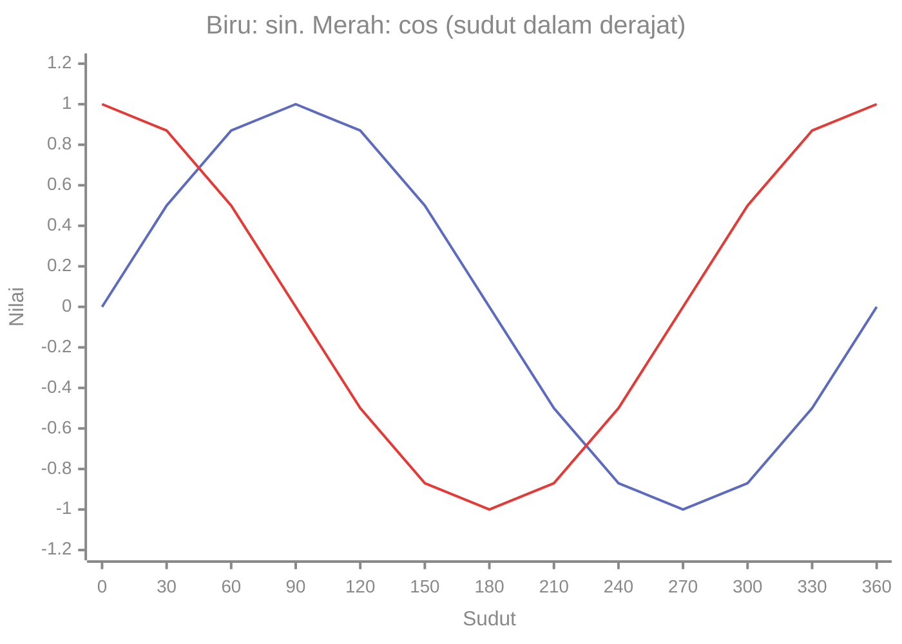

# Part 11 — Pengantar Fungsi Trigonometri

!!! info "Bagian pengayaan"
    Part ini bersifat **pengayaan**. Trigonometri dasar adalah pengetahuan pendukung yang berguna, tetapi **bukan prasyarat** untuk setiap algoritma Machine Learning klasik (misalnya regresi linear, regresi logistik, pohon keputusan, atau k-nearest neighbors). Kamu boleh membaca sekilas lalu kembali ketika membutuhkannya. Identitas rumit dan pembuktian trigonometri lanjutan tidak dibahas.

## Tujuan Pembelajaran

Setelah mempelajari bagian ini, kamu mampu:

- menjelaskan sudut dan mengukurnya dalam derajat dan radian, serta mengonversinya;
- menjelaskan sinus, kosinus, dan tangen pada segitiga siku-siku;
- menghitung sisi segitiga siku-siku dengan teorema Pythagoras dan perbandingan trigonometri;
- mengingat nilai dasar sinus dan kosinus untuk sudut istimewa;
- membaca grafik sinus dan kosinus secara garis besar;
- menyebut, secara jujur, kapan trigonometri dipakai dalam Machine Learning dan kapan tidak.

## Prasyarat

[Level 0 — Part 5](../level-0-fondasi-matematika/05-pangkat-dan-akar.md) (pangkat dan akar, termasuk $\sqrt{2}$ dan $\sqrt{3}$), [Part 5](05-koordinat-dan-grafik.md) di level ini (koordinat dan grafik), dan [Part 7](07-konsep-fungsi.md) (fungsi, domain, range).

## Mengapa Materi Ini Penting?

Beberapa fungsi tidak berbentuk garis atau kurva sederhana, melainkan **berulang secara berkala**: jam dalam sehari, musim, gelombang suara. Fungsi sinus dan kosinus menggambarkan pola berulang itu. Trigonometri juga menjadi dasar mengukur **sudut antara dua vektor**, yang dipakai untuk mengukur kemiripan data.

## Konsep Dasar dengan Bahasa Sederhana

### 1. Pengertian Sudut

**Sudut** terbentuk oleh dua sinar yang berpangkal di satu titik (titik sudut). Ukuran sudut menyatakan seberapa jauh satu sinar diputar terhadap sinar lainnya.

- Satu putaran penuh: $360^\circ$.
- Setengah putaran (sudut lurus): $180^\circ$.
- Seperempat putaran (sudut siku-siku): $90^\circ$.

Jenis sudut: **lancip** (di antara $0^\circ$ dan $90^\circ$), **siku-siku** ($90^\circ$), **tumpul** (di antara $90^\circ$ dan $180^\circ$), dan **lurus** ($180^\circ$). Tanda $^\circ$ dibaca "derajat".

### 2. Derajat dan Radian

Selain derajat, sudut diukur dalam **radian** (*radian*). Satu radian adalah sudut pada pusat lingkaran yang busurnya sama panjang dengan jari-jari lingkaran.

Karena keliling lingkaran adalah $2\pi$ kali jari-jari, satu putaran penuh adalah $2\pi$ radian:

$$
360^\circ = 2\pi \text{ rad}, \qquad 180^\circ = \pi \text{ rad}
$$

**Konversi:**

$$
\text{radian} = \text{derajat} \times \frac{\pi}{180}, \qquad \text{derajat} = \text{radian} \times \frac{180}{\pi}
$$

| Derajat | $0^\circ$ | $30^\circ$ | $45^\circ$ | $60^\circ$ | $90^\circ$ | $180^\circ$ | $270^\circ$ | $360^\circ$ |
|---|---|---|---|---|---|---|---|---|
| Radian | $0$ | $\dfrac{\pi}{6}$ | $\dfrac{\pi}{4}$ | $\dfrac{\pi}{3}$ | $\dfrac{\pi}{2}$ | $\pi$ | $\dfrac{3\pi}{2}$ | $2\pi$ |

Contoh: $60^\circ \times \dfrac{\pi}{180} = \dfrac{\pi}{3}$. Satu radian kira-kira $57{,}3^\circ$.

Dalam matematika lanjutan dan hampir semua bahasa pemrograman (termasuk Python), fungsi trigonometri **bekerja dengan radian**, bukan derajat.

### 3. Sinus, Kosinus, dan Tangen

Perhatikan segitiga siku-siku dengan satu sudut lancip $\theta$ (huruf Yunani "teta"). Sisi-sisinya diberi nama menurut posisinya terhadap $\theta$:

- **sisi miring** (*hypotenuse*): sisi terpanjang, di depan sudut siku-siku;
- **sisi depan** (*opposite*): sisi di seberang $\theta$;
- **sisi samping** (*adjacent*): sisi yang menempel pada $\theta$ selain sisi miring.

Tiga perbandingan:

$$
\sin\theta = \frac{\text{depan}}{\text{miring}}, \qquad
\cos\theta = \frac{\text{samping}}{\text{miring}}, \qquad
\tan\theta = \frac{\text{depan}}{\text{samping}}
$$

Penolong ingatan: **sin-de-mi**, **cos-sa-mi**, **tan-de-sa**. Karena $\tan\theta = \dfrac{\text{depan}}{\text{samping}} = \dfrac{\text{depan}/\text{miring}}{\text{samping}/\text{miring}}$, maka $\tan\theta = \dfrac{\sin\theta}{\cos\theta}$.

Perbandingan ini hanya bergantung pada **besar sudut**, bukan ukuran segitiganya. Segitiga yang lebih besar tetapi sebangun memberi perbandingan yang sama.

### 4. Hubungan Sisi Segitiga Siku-Siku

**Teorema Pythagoras:** pada segitiga siku-siku dengan sisi tegak $a$ dan $b$ dan sisi miring $c$,

$$
a^2 + b^2 = c^2
$$

Contoh: sisi $3$ dan $4$ memberi $c = \sqrt{9 + 16} = \sqrt{25} = 5$. Segitiga $3$-$4$-$5$ ini adalah contoh klasik.

Untuk sudut $\theta$ yang berhadapan dengan sisi 3 (depan $= 3$, samping $= 4$, miring $= 5$):

- $\sin\theta = \dfrac{3}{5} = 0{,}6$,
- $\cos\theta = \dfrac{4}{5} = 0{,}8$,
- $\tan\theta = \dfrac{3}{4} = 0{,}75$.

Perhatikan $\sin^2\theta + \cos^2\theta = 0{,}36 + 0{,}64 = 1$. Ini selalu benar, sebab dibagi $c^2$ dari $a^2 + b^2 = c^2$ memberi $\left(\dfrac{a}{c}\right)^2 + \left(\dfrac{b}{c}\right)^2 = 1$.

**Mencari sisi.** Jika sisi miring $10$ dan $\theta = 30^\circ$, maka sisi depan $= 10 \times \sin 30^\circ = 10 \times 0{,}5 = 5$ dan sisi samping $= 10 \times \cos 30^\circ \approx 8{,}66$.

### 5. Nilai Dasar Sinus dan Kosinus

Untuk sudut istimewa:

| $\theta$ | $0^\circ$ | $30^\circ$ | $45^\circ$ | $60^\circ$ | $90^\circ$ |
|---|---|---|---|---|---|
| $\sin\theta$ | $0$ | $\dfrac{1}{2}$ | $\dfrac{\sqrt{2}}{2} \approx 0{,}707$ | $\dfrac{\sqrt{3}}{2} \approx 0{,}866$ | $1$ |
| $\cos\theta$ | $1$ | $\dfrac{\sqrt{3}}{2}$ | $\dfrac{\sqrt{2}}{2}$ | $\dfrac{1}{2}$ | $0$ |
| $\tan\theta$ | $0$ | $\dfrac{\sqrt{3}}{3} \approx 0{,}577$ | $1$ | $\sqrt{3} \approx 1{,}732$ | tidak terdefinisi |

Pola: nilai sinus naik dari 0 ke 1, sedangkan nilai kosinus turun dari 1 ke 0. Untuk $90^\circ$, $\tan$ tidak terdefinisi karena $\cos 90^\circ = 0$ (pembagian dengan nol).

**Memperluas ke sudut besar.** Pada **lingkaran satuan** (lingkaran berjari-jari 1 berpusat di titik asal), sudut $\theta$ yang diukur dari sumbu $x$ positif ke arah berlawanan jarum jam menunjuk satu titik di lingkaran. Koordinat titik itu adalah $(\cos\theta, \sin\theta)$. Dengan begitu sinus dan kosinus terdefinisi untuk **semua** sudut, termasuk lebih dari $90^\circ$ dan negatif:

- $\sin 180^\circ = 0$ dan $\cos 180^\circ = -1$ (titik $(-1, 0)$),
- $\sin 270^\circ = -1$ dan $\cos 270^\circ = 0$ (titik $(0, -1)$).

Karena koordinat titik pada lingkaran berjari-jari 1 tidak pernah melebihi 1 atau kurang dari $-1$, nilai sinus dan kosinus selalu berada di antara $-1$ dan $1$.

### 6. Pengantar Grafik Trigonometri

Dengan lingkaran satuan, $\sin\theta$ dan $\cos\theta$ menjadi fungsi dari sudut $\theta$. Tabel nilai (dibulatkan 2 desimal):

| $\theta$ | $0^\circ$ | $30^\circ$ | $60^\circ$ | $90^\circ$ | $120^\circ$ | $150^\circ$ | $180^\circ$ | $210^\circ$ | $240^\circ$ | $270^\circ$ | $300^\circ$ | $330^\circ$ | $360^\circ$ |
|---|---|---|---|---|---|---|---|---|---|---|---|---|---|
| $\sin\theta$ | 0 | 0,5 | 0,87 | 1 | 0,87 | 0,5 | 0 | $-0{,}5$ | $-0{,}87$ | $-1$ | $-0{,}87$ | $-0{,}5$ | 0 |
| $\cos\theta$ | 1 | 0,87 | 0,5 | 0 | $-0{,}5$ | $-0{,}87$ | $-1$ | $-0{,}87$ | $-0{,}5$ | 0 | 0,5 | 0,87 | 1 |



Cara membaca: kurva biru (sinus) mulai dari 0, naik ke puncak 1 pada $90^\circ$, turun melewati 0 pada $180^\circ$, mencapai $-1$ pada $270^\circ$, dan kembali ke 0 pada $360^\circ$. Kurva merah (kosinus) bentuknya sama tetapi bergeser: mulai dari 1. Ciri penting:

- **Periodik:** pola berulang setiap $360^\circ$ (atau $2\pi$ radian). Panjang pengulangan ini disebut **periode**.
- **Amplitudo:** tinggi puncak dari tengah, yaitu 1.
- **Terbatas:** nilainya selalu di antara $-1$ dan $1$ (range $[-1, 1]$).

Grafik dibuat dari 13 titik yang dihubungkan lurus, sehingga lengkungannya tampak bersudut. Pada kenyataannya kurvanya mulus.

### 7. Kapan Trigonometri Diperlukan untuk Machine Learning?

Secara jujur: **sebagian besar algoritma Machine Learning klasik tidak membutuhkan trigonometri.** Regresi linear dan logistik, pohon keputusan, Naive Bayes, dan k-means dapat dipelajari tanpa trigonometri. Kamu boleh melewatkannya dan kembali nanti.

Beberapa tempat trigonometri berguna:

- **Kemiripan kosinus** (*cosine similarity*): mengukur sudut antara dua vektor data. Dua vektor yang searah memiliki kosinus 1 dan yang tegak lurus memiliki kosinus 0. Dipakai di pencarian teks dan sistem rekomendasi. Perhitungannya memakai perkalian titik (Level 2).
- **Data berkala dan sinyal:** audio, getaran, dan deret waktu memiliki pola gelombang sinus dan kosinus.
- **Fitur yang berulang berkala:** jam dalam sehari atau bulan dalam setahun. Mengodekan jam $h$ sebagai pasangan $(\sin, \cos)$ dari sudut $15^\circ \times h$ membuat jam 23 dan jam 1 tampak berdekatan, seperti kenyataannya.
- **Model transformer** memakai sinus dan kosinus pada pengodean posisi.
- **Rotasi** dalam grafika dan penglihatan komputer.

Semua ini membutuhkan dasar yang akan kamu pelajari lebih lengkap saat dibutuhkan. Pada tahap ini, cukup memahami makna sudut, radian, serta sinus dan kosinus sebagai fungsi berkala.

## Istilah yang Perlu Dipahami

| Istilah | Arti sederhana | Contoh |
|---|---|---|
| Sudut (*angle*) | ukuran putaran antara dua sinar | $90^\circ$ |
| Derajat | satuan sudut; satu putaran $360^\circ$ | $180^\circ$ |
| Radian (*radian*) | satuan sudut; satu putaran $2\pi$ | $\dfrac{\pi}{2}$ |
| Sisi miring | sisi di depan sudut siku-siku | 5 pada segitiga 3-4-5 |
| Sisi depan / samping | sisi di seberang / menempel pada $\theta$ | |
| Sinus ($\sin$) | depan dibagi miring | $\sin 30^\circ = 0{,}5$ |
| Kosinus ($\cos$) | samping dibagi miring | $\cos 60^\circ = 0{,}5$ |
| Tangen ($\tan$) | depan dibagi samping | $\tan 45^\circ = 1$ |
| Teorema Pythagoras | $a^2 + b^2 = c^2$ | $3^2 + 4^2 = 5^2$ |
| Lingkaran satuan | lingkaran berjari-jari 1 | titik $(\cos\theta, \sin\theta)$ |
| Periode | panjang satu pengulangan | $360^\circ$ untuk sinus |
| Amplitudo | tinggi puncak dari tengah | 1 untuk $\sin$ dan $\cos$ |
| Kemiripan kosinus | kosinus sudut antara dua vektor | 0,707 untuk sudut $45^\circ$ |

## Rumus dan Penjelasan Setiap Simbol

**Konversi derajat dan radian:**

$$
\text{rad} = \text{derajat} \cdot \frac{\pi}{180}
$$

- $\pi \approx 3{,}14159$. Contoh: $120^\circ \cdot \dfrac{\pi}{180} = \dfrac{2\pi}{3}$.

**Perbandingan trigonometri pada segitiga siku-siku** (sudut lancip $\theta$):

$$
\sin\theta = \frac{d}{m}, \quad \cos\theta = \frac{s}{m}, \quad \tan\theta = \frac{d}{s}
$$

- $d$: sisi depan, $s$: sisi samping, $m$: sisi miring. Berlaku untuk segitiga siku-siku, $s \neq 0$ untuk $\tan$.

**Pythagoras dan identitas dasar:**

$$
a^2 + b^2 = c^2, \qquad \sin^2\theta + \cos^2\theta = 1
$$

- $\sin^2\theta$ berarti $(\sin\theta)^2$. Contoh: $0{,}6^2 + 0{,}8^2 = 0{,}36 + 0{,}64 = 1$.

**Lingkaran satuan:** titik pada sudut $\theta$ adalah $(\cos\theta, \sin\theta)$; nilai $\sin\theta$ dan $\cos\theta$ selalu berada di $[-1, 1]$.

**Periodik:** $\sin(\theta + 360^\circ) = \sin\theta$ dan $\cos(\theta + 360^\circ) = \cos\theta$.

## Penjelasan Langkah demi Langkah

**Mencari sisi segitiga siku-siku bila diketahui satu sisi dan satu sudut lancip:**

1. Gambar segitiga dan beri nama sisi depan, samping, dan miring terhadap sudut yang diketahui.
2. Pilih perbandingan yang memuat sisi yang diketahui dan sisi yang dicari ($\sin$ untuk depan-miring, $\cos$ untuk samping-miring, $\tan$ untuk depan-samping).
3. Tulis persamaan lalu selesaikan untuk sisi yang dicari (Part 3).
4. Periksa: hasil harus masuk akal, misalnya sisi miring harus yang terpanjang.

## Contoh Soal dan Pembahasan

### Contoh 1 — Konversi sudut

Ubah $120^\circ$ ke radian dan $\dfrac{3\pi}{2}$ ke derajat.

1. $120 \times \dfrac{\pi}{180} = \dfrac{120\pi}{180} = \dfrac{2\pi}{3}$.
2. $\dfrac{3\pi}{2} \times \dfrac{180}{\pi} = \dfrac{3 \times 180}{2} = 270$, jadi $270^\circ$.
3. Cek: $270^\circ$ adalah tiga perempat putaran, dan $\dfrac{3\pi}{2}$ adalah $\dfrac{3}{4}$ dari $2\pi$. Cocok.

### Contoh 2 — Perbandingan pada segitiga 5-12-13

Segitiga siku-siku bersisi tegak 5 dan 12. Hitung $\sin$, $\cos$, dan $\tan$ sudut yang berhadapan dengan sisi 5.

1. Sisi miring: $\sqrt{5^2 + 12^2} = \sqrt{25 + 144} = \sqrt{169} = 13$.
2. Depan $= 5$, samping $= 12$, miring $= 13$.
3. $\sin\theta = \dfrac{5}{13}$, $\cos\theta = \dfrac{12}{13}$, $\tan\theta = \dfrac{5}{12}$.
4. Cek $\sin^2\theta + \cos^2\theta = \dfrac{25}{169} + \dfrac{144}{169} = \dfrac{169}{169} = 1$.

### Contoh 3 — Mencari sisi

Sebuah tangga bersandar pada dinding dengan membentuk sudut $60^\circ$ terhadap tanah. Panjang tangga 4 m. Berapa tinggi ujung tangga di dinding?

1. Tangga adalah sisi miring ($m = 4$). Tinggi di dinding adalah sisi **depan** dari sudut $60^\circ$ di tanah.
2. Perbandingan depan-miring adalah sinus: $\sin 60^\circ = \dfrac{d}{4}$.
3. $d = 4 \sin 60^\circ = 4 \times \dfrac{\sqrt{3}}{2} = 2\sqrt{3} \approx 3{,}46$ m.
4. Periksa: tinggi $3{,}46$ m kurang dari panjang tangga 4 m, masuk akal.

### Contoh 4 — Membaca grafik

Dari grafik sinus di bagian 6, tentukan nilai maksimum, nilai minimum, dan kapan $\sin\theta = 0$ dalam satu periode.

1. Maksimum 1 di $\theta = 90^\circ$.
2. Minimum $-1$ di $\theta = 270^\circ$.
3. $\sin\theta = 0$ di $0^\circ$, $180^\circ$, dan $360^\circ$.
4. Periodenya $360^\circ$.

## Contoh Tambahan dengan Kesulitan Bertahap

**Mudah.** $\sin 30^\circ = \dfrac{1}{2}$ dan $\cos 60^\circ = \dfrac{1}{2}$. Dua sudut yang jumlahnya $90^\circ$ memiliki sinus dan kosinus yang bertukar.

**Sedang.** Sisi tegak 6 dan 8 memberi sisi miring $\sqrt{36 + 64} = 10$. $\sin\theta = \dfrac{6}{10} = 0{,}6$ dan $\cos\theta = 0{,}8$.

**Sedang.** Apakah $\sin 60^\circ = 2\sin 30^\circ$? $\sin 60^\circ \approx 0{,}866$, sedangkan $2 \times 0{,}5 = 1$. **Tidak sama**: sinus bukan fungsi linear, jadi sudut yang dua kali lipat tidak memberi sinus dua kali lipat.

**Menantang.** Kemiripan kosinus vektor $(1, 0)$ dan $(1, 1)$: $\cos\theta = \dfrac{1 \cdot 1 + 0 \cdot 1}{1 \cdot \sqrt{2}} = \dfrac{1}{\sqrt{2}} \approx 0{,}707$, yang bersesuaian dengan sudut $45^\circ$. Rumus perkalian titik dibahas di Level 2; di sini hanya contoh bahwa kosinus mengukur sudut.

## Visualisasi atau Interpretasi Grafik

- **Segitiga siku-siku:** dua sudut lancip dan satu sudut siku-siku. Sisi miring selalu yang terpanjang.
- **Lingkaran satuan:** sudut $\theta$ menunjuk titik $(\cos\theta, \sin\theta)$. Naik dari $0^\circ$ ke $90^\circ$ membuat titik bergerak dari $(1, 0)$ ke $(0, 1)$, dengan $\cos$ turun dan $\sin$ naik.
- **Grafik sinus dan kosinus:** gelombang yang berulang tiap $360^\circ$, dengan puncak 1 dan lembah $-1$. Kosinus adalah sinus yang bergeser sebesar $90^\circ$.

## Kesalahan Umum

| Kesalahan | Mengapa salah | Yang benar |
|---|---|---|
| Menghitung `math.sin(30)` di Python untuk "sinus 30 derajat" | Python memakai radian | `math.sin(math.radians(30))` |
| Menganggap $\sin 60^\circ = 2\sin 30^\circ$ | sinus bukan fungsi linear | $0{,}866 \neq 1$ |
| Menukar sin dan cos: $\sin = \dfrac{\text{samping}}{\text{miring}}$ | $\sin$ memakai sisi depan | $\sin = \dfrac{\text{depan}}{\text{miring}}$ |
| Menyebut sisi depan tanpa menyebut sudut acuan | "depan" bergantung pada sudut yang dipakai | tentukan $\theta$ dulu |
| $\sin^2\theta = \sin(\theta^2)$ | $\sin^2\theta$ berarti $(\sin\theta)^2$ | kuadrat dari nilai sinus |
| Mengira $\sin\theta$ bisa bernilai 2 | $\sin\theta$ selalu di $[-1, 1]$ | gunakan range $[-1, 1]$ |
| Menganggap $\tan 90^\circ = 0$ | $\cos 90^\circ = 0$ membuat $\tan$ tak terdefinisi | tak terdefinisi |
| Mengira trigonometri wajib untuk semua ML | tidak dibutuhkan algoritma klasik umum | hanya pendukung |
| Mencampur derajat dan radian dalam satu rumus | satuan harus konsisten | ubah dulu ke satu satuan |

## Hubungan dengan Machine Learning

Seperti disebut di bagian 7, trigonometri bersifat **pendukung**, bukan syarat. Dua contoh nyata yang bisa kamu hitung sekarang:

- **Kemiripan kosinus.** Vektor $(1, 0)$ dan $(0, 1)$ saling tegak lurus ($90^\circ$), kosinusnya $0$: tidak mirip. Vektor $(1, 0)$ dan $(1, 1)$ membentuk $45^\circ$, kosinusnya $0{,}707$: cukup mirip.
- **Fitur jam berulang.** Jika jam ditulis sebagai angka biasa, jam 23 dan jam 1 tampak berjauhan ($|23 - 1| = 22$), padahal hanya terpisah 2 jam. Dengan sudut $15^\circ \times h$ dan pasangan $(\sin, \cos)$, jam 23 menjadi $(-0{,}259, 0{,}966)$ dan jam 1 menjadi $(0{,}259, 0{,}966)$. Jarak antara kedua titik itu hanya sekitar $0{,}52$, sedangkan jam 0 dan jam 12 (bertolak belakang) berjarak $2$.

### Python: sudut, radian, dan fungsi trigonometri

Fungsi trigonometri Python memakai **radian**. `math.radians` mengubah derajat ke radian dan `math.degrees` sebaliknya.

```python
import math

print(math.pi)                 # 3.141592653589793
print(math.radians(180))       # 3.141592653589793
print(math.degrees(math.pi / 2))  # 90.0
```

Nilai dasar, dibulatkan agar mudah dibaca. Hasil mentahnya memuat galat desimal sangat kecil, misalnya `math.sin(math.radians(30))` memberi `0.49999999999999994`:

```python
for d in [0, 30, 45, 60, 90]:
    r = math.radians(d)
    print(d, round(math.sin(r), 4), round(math.cos(r), 4))
# 0 0.0 1.0
# 30 0.5 0.866
# 45 0.7071 0.7071
# 60 0.866 0.5
# 90 1.0 0.0
```

Perhatikan `math.cos(math.radians(90))` bukan tepat nol, melainkan sekitar `6.1e-17`. Ini akibat pendekatan desimal (Level 0, Part 1). Pembulatan menutupinya.

Mencari sisi segitiga: tangga 4 m, sudut $60^\circ$:

```python
tinggi = 4 * math.sin(math.radians(60))
print(round(tinggi, 2))   # 3.46
```

Teorema Pythagoras dan perbandingan pada segitiga 5-12-13:

```python
miring = math.sqrt(5 ** 2 + 12 ** 2)
print(miring)                  # 13.0
print(5 / miring, 12 / miring) # 0.38461538461538464 0.9230769230769231
```

Kemiripan kosinus dua vektor $(1, 0)$ dan $(1, 1)$, yang rumus perkalian titiknya dibahas di Level 2:

```python
a = (1, 0)
b = (1, 1)
perkalian_titik = a[0] * b[0] + a[1] * b[1]
panjang_a = math.sqrt(a[0] ** 2 + a[1] ** 2)
panjang_b = math.sqrt(b[0] ** 2 + b[1] ** 2)
kosinus = perkalian_titik / (panjang_a * panjang_b)
print(round(kosinus, 3))                     # 0.707
print(round(math.degrees(math.acos(kosinus))))   # 45
```

`math.acos` adalah kebalikan kosinus (menghasilkan sudut dalam radian). Pengodean jam berulang:

```python
def kodekan_jam(h):
    sudut = math.radians(15 * h)
    return (math.sin(sudut), math.cos(sudut))

p23 = kodekan_jam(23)
p1 = kodekan_jam(1)
p0 = kodekan_jam(0)
p12 = kodekan_jam(12)
print(round(math.dist(p23, p1), 3))   # 0.518, jam 23 dan 1 berdekatan
print(round(math.dist(p0, p12), 3))   # 2.0, jam 0 dan 12 berjauhan
```

`math.dist` menghitung jarak dua titik seperti rumus di Part 5.

## Latihan Mandiri

1. Golongkan sudut: (a) $35^\circ$ (b) $90^\circ$ (c) $120^\circ$ (d) $180^\circ$.
2. Konversi: (a) $45^\circ$ ke radian (b) $120^\circ$ ke radian (c) $\dfrac{\pi}{6}$ ke derajat (d) $\dfrac{3\pi}{2}$ ke derajat.
3. Segitiga siku-siku dengan sisi tegak 5 dan 12. Hitung sisi miring serta $\sin$, $\cos$, $\tan$ sudut yang berhadapan dengan sisi 5.
4. Sisi miring 10 dan $\theta = 30^\circ$. Hitung sisi depan dan (perkiraan) sisi samping.
5. Tuliskan nilai: (a) $\sin 30^\circ$ (b) $\cos 60^\circ$ (c) $\tan 45^\circ$ (d) $\sin 90^\circ$ (e) $\cos 0^\circ$ (f) $\cos 90^\circ$.
6. Sisi tegak 6 dan 8. Hitung sisi miring, $\sin\theta$, dan $\cos\theta$ untuk sudut yang berhadapan dengan sisi 6.
7. Dari grafik sinus: nilai maksimum dan minimum, di sudut berapa nilainya, dan berapa periodenya? Berapa $\sin 180^\circ$?
8. Benar atau salah: $\sin 60^\circ = 2\sin 30^\circ$. Jelaskan.
9. Hitung kemiripan kosinus: (a) $(1, 0)$ dan $(1, 1)$ (b) $(1, 0)$ dan $(0, 1)$. Berapa sudut yang bersesuaian?
10. (Pengayaan ML) Jam $h$ dikodekan sebagai $(\sin(15^\circ h), \cos(15^\circ h))$. Hitung koordinat jam 23 dan jam 1 (3 desimal), lalu jaraknya. Bandingkan dengan jarak jam 0 dan jam 12.

## Kunci Jawaban dan Pembahasan

??? success "Soal 1"
    (a) lancip. (b) siku-siku. (c) tumpul. (d) lurus.

??? success "Soal 2"
    (a) $45 \times \dfrac{\pi}{180} = \dfrac{\pi}{4}$. (b) $\dfrac{120\pi}{180} = \dfrac{2\pi}{3}$. (c) $\dfrac{\pi}{6} \times \dfrac{180}{\pi} = 30^\circ$. (d) $\dfrac{3 \times 180}{2} = 270^\circ$.

??? success "Soal 3"
    Sisi miring $\sqrt{25 + 144} = 13$. $\sin\theta = \dfrac{5}{13}$, $\cos\theta = \dfrac{12}{13}$, $\tan\theta = \dfrac{5}{12}$. Cek: $\dfrac{25}{169} + \dfrac{144}{169} = 1$.

??? success "Soal 4"
    Depan $= 10 \sin 30^\circ = 10 \times 0{,}5 = 5$. Samping $= 10 \cos 30^\circ = 10 \times \dfrac{\sqrt{3}}{2} \approx 8{,}66$. Cek: $5^2 + 8{,}66^2 \approx 25 + 75 = 100 = 10^2$.

??? success "Soal 5"
    (a) $0{,}5$. (b) $0{,}5$. (c) $1$. (d) $1$. (e) $1$. (f) $0$.

??? success "Soal 6"
    Sisi miring $\sqrt{36 + 64} = 10$. $\sin\theta = \dfrac{6}{10} = 0{,}6$. $\cos\theta = \dfrac{8}{10} = 0{,}8$.

??? success "Soal 7"
    Maksimum 1 di $90^\circ$; minimum $-1$ di $270^\circ$; periode $360^\circ$ ($2\pi$ radian). $\sin 180^\circ = 0$.

??? success "Soal 8"
    **Salah.** $\sin 60^\circ \approx 0{,}866$, sedangkan $2\sin 30^\circ = 2 \times 0{,}5 = 1$. Sinus bukan fungsi linear.

??? success "Soal 9"
    (a) $\cos\theta = \dfrac{1}{1 \cdot \sqrt{2}} \approx 0{,}707$, sudut $45^\circ$. (b) Perkalian titik $1 \cdot 0 + 0 \cdot 1 = 0$, jadi $\cos\theta = 0$ dan sudutnya $90^\circ$ (saling tegak lurus).

??? success "Soal 10"
    Jam 23: sudut $345^\circ$, koordinat $(-0{,}259, 0{,}966)$. Jam 1: sudut $15^\circ$, koordinat $(0{,}259, 0{,}966)$. Jarak $= \sqrt{(0{,}518)^2 + 0^2} \approx 0{,}518$. Jam 0: $(0, 1)$ dan jam 12: $(0, -1)$ dengan jarak $2$. Dengan pengodean ini, jam yang dekat (23 dan 1) berdekatan, dan yang berlawanan (0 dan 12) berjauhan.

## Ringkasan Materi

- Sudut diukur dalam derajat ($360^\circ$ satu putaran) atau radian ($2\pi$ satu putaran). Konversi: $\text{rad} = \text{derajat} \cdot \dfrac{\pi}{180}$.
- Pada segitiga siku-siku: $\sin\theta = \dfrac{\text{depan}}{\text{miring}}$, $\cos\theta = \dfrac{\text{samping}}{\text{miring}}$, $\tan\theta = \dfrac{\text{depan}}{\text{samping}}$. Pythagoras: $a^2 + b^2 = c^2$; $\sin^2\theta + \cos^2\theta = 1$.
- Nilai dasar: $\sin 30^\circ = \tfrac{1}{2}$, $\sin 45^\circ = \tfrac{\sqrt{2}}{2}$, $\sin 60^\circ = \tfrac{\sqrt{3}}{2}$; $\cos$ berkebalikan.
- Sinus dan kosinus periodik (periode $360^\circ$), terbatas antara $-1$ dan $1$.
- Fungsi trigonometri di Python memakai radian.
- Trigonometri bersifat pendukung untuk Machine Learning (kemiripan kosinus, data berulang, sinyal), bukan syarat untuk algoritma klasik.

## Checklist Penguasaan

- [ ] Mengonversi derajat dan radian dalam dua arah.
- [ ] Menyebut definisi $\sin$, $\cos$, $\tan$ pada segitiga siku-siku.
- [ ] Menghitung sisi segitiga siku-siku dari satu sisi dan satu sudut.
- [ ] Mengingat nilai $\sin$ dan $\cos$ untuk $0^\circ$, $30^\circ$, $45^\circ$, $60^\circ$, $90^\circ$.
- [ ] Menjelaskan periode, amplitudo, dan range sinus.
- [ ] Menjelaskan bahwa Python memakai radian.
- [ ] Menyebut dua penggunaan trigonometri dalam ML dan menyatakan bahwa ia bukan syarat umum.

## Prasyarat untuk Materi Berikutnya

[Part 12 — Integrasi dan Evaluasi Level 1](12-integrasi-dan-evaluasi.md) tidak memerlukan trigonometri. Jika kamu melewatkan Part 11, kamu tetap dapat menyelesaikan Level 1. Level 2 memakai kosinus saat membahas sudut antar vektor.
