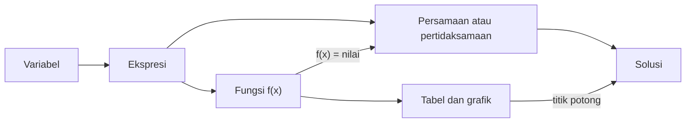
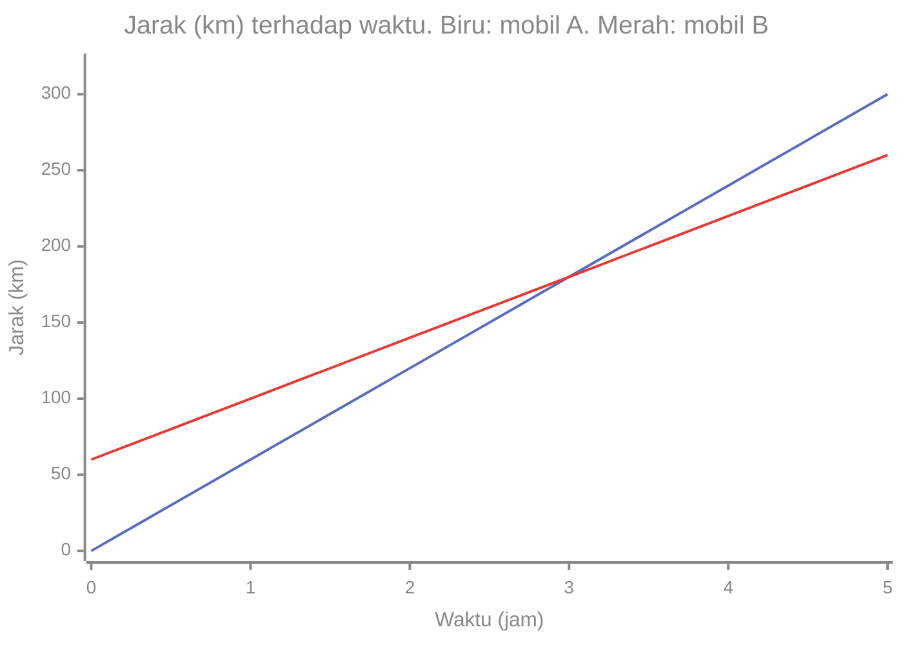

# Part 12 — Integrasi dan Evaluasi Level 1

## Tujuan Pembelajaran

Setelah mempelajari bagian ini, kamu mampu:

- menghubungkan variabel, ekspresi, persamaan, pertidaksamaan, dan fungsi dalam satu gambaran utuh;
- menafsirkan persamaan sebagai pencarian nilai pada fungsi, dan titik potong grafik sebagai solusi sistem;
- membaca grafik dan menafsirkan kemiringan sebagai laju perubahan;
- menyelesaikan soal kontekstual dengan langkah pemodelan yang terstruktur;
- memakai persamaan linear untuk prediksi sederhana dan menjelaskan batas modelnya;
- mengukur penguasaan Level 1 lewat latihan campuran dan evaluasi konseptual, lalu mempersiapkan diri untuk Level 2.

## Prasyarat

[Part 1](01-mengenal-aljabar.md) sampai [Part 10](10-fungsi-eksponensial-dan-logaritma.md). [Part 11 (trigonometri)](11-pengantar-trigonometri.md) adalah pengayaan dan tidak diwajibkan untuk bagian ini.

## Mengapa Materi Ini Penting?

Mempelajari topik satu per satu belum tentu berarti kamu dapat memakainya bersama. Dalam Machine Learning, masalah nyata menggabungkan banyak konsep: sebuah model adalah fungsi, belajar berarti menyelesaikan persamaan atau meminimalkan kesalahan, dan hasilnya dibaca lewat grafik. Part ini menjahit semuanya dan memeriksa apakah kamu **paham alasannya**, bukan hanya hafal langkahnya.

## Konsep Dasar dengan Bahasa Sederhana

### 1. Menghubungkan Variabel, Ekspresi, dan Persamaan

Konsep-konsep Level 1 saling bertumpu:



Cara membaca: variabel dipakai membentuk ekspresi. Ekspresi yang dihubungkan dengan $=$, $<$, atau $>$ menjadi persamaan atau pertidaksamaan, yang dicari solusinya. Ekspresi yang diberi nama dan masukan menjadi fungsi, yang dapat disajikan sebagai tabel dan grafik. Persamaan dan fungsi terhubung dua arah: menyelesaikan $f(x) = \text{nilai}$ adalah persamaan, dan titik potong dua grafik memberi solusi.

Satu contoh menyatukan semuanya. Biaya parkir dengan $t$ jam:

- **Ekspresi:** $2.000 + 1.000t$.
- **Fungsi:** $C(t) = 2.000 + 1.000t$.
- **Persamaan:** $2.000 + 1.000t = 7.000$ menanyakan "berapa jam jika membayar 7.000?". Penyelesaiannya $1.000t = 5.000$, $t = 5$.
- **Pertidaksamaan:** $2.000 + 1.000t \leq 10.000$ menanyakan "berapa jam paling lama jika anggaran 10.000?". Penyelesaiannya $1.000t \leq 8.000$, $t \leq 8$.

### 2. Menghubungkan Persamaan dan Fungsi

Persamaan $y = 2x + 3$ adalah fungsi $f(x) = 2x + 3$. Tiga cara memandangnya:

1. **Menghitung keluaran:** diberi $x$, cari $f(x)$ (substitusi). $f(4) = 11$.
2. **Mencari masukan:** diberi $f(x) = 11$, cari $x$ (menyelesaikan persamaan). $2x + 3 = 11$ memberi $x = 4$. Pada grafik: pada tinggi 11, di titik $x$ berapa grafik berada?
3. **Membandingkan dua fungsi:** $f(x) = g(x)$ adalah sistem; titik potong grafik adalah solusi. Untuk $f(x) = 2x + 3$ dan $g(x) = x + 5$: $2x + 3 = x + 5$ memberi $x = 2$, dan $f(2) = g(2) = 7$. Titik potongnya $(2, 7)$.

Untuk pertidaksamaan $f(x) > g(x)$: cari bagian $x$ tempat grafik $f$ berada di atas grafik $g$. Di contoh ini, $2x + 3 > x + 5$ memberi $x > 2$.

### 3. Membaca Grafik dan Menafsirkan Kemiringan

**Kemiringan adalah laju perubahan:** berapa keluaran berubah per satu satuan masukan.

Dua mobil: A berangkat dari $0$ km dengan 60 km/jam, sehingga $A(t) = 60t$. B berangkat dari titik 60 km di depan dengan 40 km/jam, sehingga $B(t) = 60 + 40t$.

| $t$ (jam) | 0 | 1 | 2 | 3 | 4 | 5 |
|---|---|---|---|---|---|---|
| $A(t)$ | 0 | 60 | 120 | 180 | 240 | 300 |
| $B(t)$ | 60 | 100 | 140 | 180 | 220 | 260 |



Cara membaca: garis biru (A) lebih **curam** karena slope-nya 60 lebih besar daripada slope B yaitu 40. Garis merah (B) mulai lebih tinggi karena intercept-nya 60. Kedua garis berpotongan di $t = 3$ jam pada jarak 180 km, yaitu saat A menyusul B. Sebelum $t = 3$, B di depan. Sesudahnya, A di depan.

Secara aljabar: $60t = 60 + 40t$, jadi $20t = 60$ dan $t = 3$. Cek: $60 \times 3 = 180$ dan $60 + 40 \times 3 = 180$.

### 4. Menyelesaikan Masalah Kontekstual

Langkah pemodelan yang dapat dipakai untuk soal cerita:

1. **Pahami.** Apa yang diketahui, dan apa yang ditanyakan?
2. **Beri nama variabel** beserta satuannya.
3. **Modelkan.** Tulis persamaan, pertidaksamaan, sistem, atau fungsi.
4. **Selesaikan.** Pakai metode yang sesuai.
5. **Periksa** di persamaan awal dan cek kewajaran (satuan, tanda, domain).
6. **Tafsirkan** jawaban dalam kalimat sesuai konteks.

**Contoh A — Membandingkan paket.** Paket A: Rp50.000 tetap ditambah Rp5.000 per GB. Paket B: Rp80.000 tetap, berapa pun pemakaian. Pada pemakaian berapa A sama dengan B, dan mana yang lebih murah sebelum itu?

1. Misalkan $g$ adalah pemakaian dalam GB. $A(g) = 50.000 + 5.000g$ dan $B(g) = 80.000$.
2. Sama: $50.000 + 5.000g = 80.000$, jadi $5.000g = 30.000$ dan $g = 6$.
3. Untuk $g < 6$: misalnya $g = 2$, $A = 60.000 < 80.000$. A lebih murah.
4. Untuk $g > 6$: misalnya $g = 10$, $A = 100.000 > 80.000$. B lebih murah.
5. Kesimpulan: A lebih murah jika pemakaian kurang dari 6 GB, sama pada 6 GB, dan B lebih murah di atas 6 GB.

**Contoh B — Sistem persamaan.** 3 tiket dewasa dan 2 tiket anak harganya Rp190.000. 2 tiket dewasa dan 3 tiket anak harganya Rp160.000. Berapa harga tiap tiket? (Hitung dalam ribuan rupiah.)

1. $a$ adalah harga dewasa, $c$ harga anak. $3a + 2c = 190$ dan $2a + 3c = 160$.
2. Kalikan persamaan pertama dengan 3: $9a + 6c = 570$. Kalikan persamaan kedua dengan 2: $4a + 6c = 320$.
3. Kurangkan: $5a = 250$, jadi $a = 50$.
4. Substitusi ke persamaan pertama: $3(50) + 2c = 190$, jadi $2c = 40$ dan $c = 20$.
5. Periksa persamaan kedua: $2(50) + 3(20) = 160$. Benar.
6. Tiket dewasa Rp50.000 dan tiket anak Rp20.000.

**Contoh C — Pertumbuhan eksponensial.** Tabungan Rp1.000.000 dengan bunga majemuk 10% per tahun. Kapan saldo pertama kali lebih dari Rp1.200.000?

1. Saldo $= 1.000.000 \times 1{,}1^t$. Kita cari $t$ bilangan bulat pertama yang membuat $1{,}1^t > 1{,}2$.
2. Coba: $t = 1$ memberi $1{,}1$ (belum). $t = 2$ memberi $1{,}21$ (sudah lebih dari 1,2).
3. Jadi setelah 2 tahun saldo $1.210.000 > 1.200.000$.
4. Pada akhir tahun pertama saldo hanya $1.100.000$.

### 5. Contoh Persamaan Linear dalam Prediksi

Misalkan model fiktif harga rumah (juta rupiah) dari luas $L$ (meter persegi):

$$
\hat{y} = 1{,}5L + 50
$$

- $L = 60$: $\hat{y} = 1{,}5(60) + 50 = 140$ juta.
- Berapa luas agar prediksi harga 200 juta? $1{,}5L + 50 = 200$ memberi $1{,}5L = 150$ dan $L = 100$ meter persegi.

**Dari mana $1{,}5$ dan $50$ berasal?** Misalkan dua rumah: $(40, 110)$ dan $(80, 170)$. Slope $w = \dfrac{170 - 110}{80 - 40} = \dfrac{60}{40} = 1{,}5$. Intercept $b = 110 - 1{,}5(40) = 50$. Ini sama dengan menyelesaikan sistem $40w + b = 110$ dan $80w + b = 170$ (Part 6).

**Tetapi data nyata tidak persis lurus.** Jika ada rumah ketiga $(60, 145)$, model memprediksi $140$ sehingga selisihnya $145 - 140 = 5$. Tiga titik tidak segaris, sehingga tidak ada satu garis yang melalui ketiganya. Itulah alasan regresi linear membutuhkan ukuran kesalahan dan metode pelatihan (Part 8).

**Batas model.** Domain yang wajar: $L > 0$. Memakai model untuk $L = 10.000$ (di luar rentang data) adalah ekstrapolasi yang tidak dapat dipercaya. Prediksi $L = 0$ menghasilkan 50 juta, yang tidak bermakna untuk rumah tanpa luas. Intercept dalam model adalah angka matematis, bukan selalu makna nyata.

## Istilah yang Perlu Dipahami

| Istilah | Arti sederhana | Contoh |
|---|---|---|
| Pemodelan | mengubah masalah nyata menjadi persamaan atau fungsi | $C(t) = 2.000 + 1.000t$ |
| Laju perubahan | perubahan keluaran per satu satuan masukan | slope 60 km/jam |
| Titik potong grafik | tempat dua grafik bertemu; solusi sistem | $(3, 180)$ |
| Menyelesaikan $f(x) = c$ | mencari masukan untuk keluaran $c$ | $2x + 3 = 11$ |
| Ekstrapolasi | memakai model di luar rentang data | prediksi $L = 10.000$ |
| Kewajaran (*sanity check*) | memeriksa apakah jawaban masuk akal | tinggi tidak negatif |
| Evaluasi konseptual | menilai pemahaman alasan, bukan hafalan | "jelaskan mengapa..." |

## Rumus dan Penjelasan Setiap Simbol

Part ini merangkum rumus dari part sebelumnya. Rujukan cepat:

| Topik | Rumus | Syarat | Part |
|---|---|---|---|
| Persamaan linear | $ax + b = c \Rightarrow x = \dfrac{c - b}{a}$ | $a \neq 0$ | 3 |
| Pertidaksamaan | kali atau bagi dengan bilangan negatif membalik tanda | | 4 |
| Sistem dua persamaan | $D = a_1 b_2 - a_2 b_1 \neq 0$ memberi satu solusi | $D \neq 0$ | 6 |
| Jarak dua titik | $d = \sqrt{(x_2 - x_1)^2 + (y_2 - y_1)^2}$ | | 5 |
| Slope | $m = \dfrac{y_2 - y_1}{x_2 - x_1}$ | $x_1 \neq x_2$ | 8 |
| Garis | $y = mx + b$ | | 8 |
| Kuadrat | $f(x) = ax^2 + bx + c$, puncak di $x = -\dfrac{b}{2a}$ | $a \neq 0$ | 9 |
| Eksponensial | $N(t) = N_0 r^t$ | $r > 0$ | 10 |
| Logaritma | $\log_a(y) = x \iff a^x = y$ | $y > 0$ | 10 |

## Penjelasan Langkah demi Langkah

**Titik potong dua fungsi linear** $f(x) = m_1 x + b_1$ dan $g(x) = m_2 x + b_2$:

| Langkah | Tindakan | Untuk $f = 60t$ dan $g = 60 + 40t$ |
|---|---|---|
| 1 | samakan: $f(x) = g(x)$ | $60t = 60 + 40t$ |
| 2 | kumpulkan suku $x$ | $20t = 60$ |
| 3 | selesaikan | $t = 3$ |
| 4 | hitung $y$ dari salah satu fungsi | $60(3) = 180$ |
| 5 | periksa pada fungsi lain | $60 + 40(3) = 180$ |

## Contoh Soal dan Pembahasan

### Contoh 1 — Persamaan sebagai fungsi

Untuk $f(x) = 2x + 3$ dan $g(x) = x + 5$, tentukan kapan $f(x) = g(x)$ dan kapan $f(x) > g(x)$.

1. $2x + 3 = x + 5$. Kurangi $x$: $x + 3 = 5$. Kurangi 3: $x = 2$.
2. Titik potong: $f(2) = 7$ dan $g(2) = 7$, jadi $(2, 7)$.
3. Pertidaksamaan: $2x + 3 > x + 5$ memberi $x > 2$.
4. Uji: $x = 3$ memberi $f = 9 > g = 8$. Benar. $x = 0$ memberi $f = 3 < g = 5$. Sesuai $x > 2$.

### Contoh 2 — Menafsirkan kemiringan

Taksi: tarif awal Rp8.000 ditambah Rp3.000 per km. Tulis fungsinya, tafsirkan slope dan intercept, lalu cari jarak jika total Rp35.000.

1. $T(k) = 8.000 + 3.000k$ dengan $k$ jarak dalam km.
2. Slope $3.000$: tambahan biaya per kilometer. Intercept $8.000$: tarif awal (saat $k = 0$).
3. $8.000 + 3.000k = 35.000$ memberi $3.000k = 27.000$ dan $k = 9$.
4. Periksa: $8.000 + 3.000(9) = 35.000$. Jarak 9 km.

### Contoh 3 — Kapan eksponensial melampaui linear?

Bandingkan $L(t) = 100 + 50t$ (tambah 50 per langkah) dan $E(t) = 100 \times 1{,}5^t$ (naik 50% per langkah) untuk $t = 0, \ldots, 4$.

| $t$ | 0 | 1 | 2 | 3 | 4 |
|---|---|---|---|---|---|
| $L(t)$ | 100 | 150 | 200 | 250 | 300 |
| $E(t)$ | 100 | 150 | 225 | 337,5 | 506,25 |

1. Pada $t = 1$ keduanya sama (150).
2. Pada $t = 2$ eksponensial sudah lebih besar (225 melawan 200), dan jaraknya makin melebar.
3. Selisih $L$ selalu bertambah 50. Selisih $E$ makin besar ($75, 112{,}5, 168{,}75$).
4. Pelajaran: pertumbuhan eksponensial akhirnya mengalahkan pertumbuhan linear.

### Contoh 4 — Prediksi dan keterbatasannya

Dari model $\hat{y} = 1{,}5L + 50$, berapa prediksi untuk $L = 80$? Jika harga sebenarnya 170, berapa selisihnya? Jika sebuah rumah $L = 60$ berharga 145, berapa selisihnya?

1. $\hat{y}(80) = 1{,}5(80) + 50 = 170$. Selisih $170 - 170 = 0$.
2. $\hat{y}(60) = 140$. Selisih $145 - 140 = 5$.
3. Model cocok sempurna di satu titik tetapi meleset 5 di titik lain, yang menunjukkan data nyata tidak persis garis.

## Contoh Tambahan dengan Kesulitan Bertahap

**Mudah.** $2t + 4 = 10$ memberi $t = 3$. Sebagai fungsi, $f(3) = 10$.

**Sedang.** Dua garis $y = 2x$ dan $y = 2x + 5$ memiliki slope sama, jadi sejajar dan tidak pernah bertemu. Sistemnya tidak punya solusi: $2x = 2x + 5$ menghasilkan $0 = 5$.

**Sedang.** Tiket anak dan dewasa: bila dewasa Rp50.000 dan anak Rp20.000, biaya 2 dewasa dan 1 anak adalah $2(50.000) + 20.000 = 120.000$.

**Menantang.** Pada paket A dan B (contoh A di bagian 4), jika B turun menjadi Rp70.000: $50.000 + 5.000g = 70.000$ memberi $g = 4$. Titik sama bergeser dari 6 GB ke 4 GB.

## Visualisasi atau Interpretasi Grafik

Grafik mobil A dan B merangkum banyak konsep:

| Pengamatan pada grafik | Konsep |
|---|---|
| garis lurus | fungsi linear |
| garis A lebih curam | slope A lebih besar |
| B mulai lebih tinggi | intercept B lebih besar |
| titik potong di $t = 3$ | solusi sistem $60t = 60 + 40t$ |
| B di atas A sebelum $t = 3$ | pertidaksamaan $B(t) > A(t)$ untuk $t < 3$ |

## Kesalahan Umum

| Kesalahan | Mengapa salah | Yang benar |
|---|---|---|
| Langsung mengutak-atik angka tanpa mendefinisikan variabel | jawaban sulit ditafsirkan | tulis arti variabel dan satuannya |
| Tidak memeriksa jawaban di soal asli | kesalahan pemodelan terlewat | substitusikan ke konteks |
| Menjawab tanpa satuan atau konteks | jawaban tidak lengkap | tulis dalam kalimat |
| Menyamakan slope dengan intercept | $m$ adalah laju, $b$ adalah nilai awal | baca kembali arti keduanya |
| Menganggap titik potong grafik selalu ada | garis sejajar tidak berpotongan | periksa slope |
| Memakai model di luar rentang data | ekstrapolasi tidak terjamin | batasi pada domain yang wajar |
| Menganggap garis melalui dua titik cocok untuk semua data | data nyata menyimpang | perlu ukuran kesalahan |
| Menganggap eksponensial selalu lebih besar dari linear sejak awal | di awal bisa sama atau lebih kecil | bandingkan tabelnya |
| Mengabaikan syarat domain (pembagian nol, log positif) | hasil tak terdefinisi | periksa domain |

## Hubungan dengan Machine Learning

- **Model = fungsi; prediksi = evaluasi.** Menghitung $\hat{y}$ adalah substitusi pada fungsi.
- **Mencari masukan untuk target tertentu** (balik prediksi) adalah menyelesaikan persamaan.
- **Parameter dari data** adalah menyelesaikan sistem, dan data berlebih membuat sistem tak punya solusi tepat. Itu motivasi regresi.
- **Laju perubahan = slope = bobot.** Interpretasi bobot model linear sama dengan interpretasi slope.
- **Evaluasi.** Membandingkan dua model dengan ukuran kesalahan adalah bentuk sederhana dari pemilihan model.
- **Hati-hati.** Model sederhana mudah dijelaskan, tetapi jangan mengekstrapolasi tanpa alasan.

### Python: ringkasan alat Level 1

Fungsi prediksi dan mencari masukan dari target:

```python
def prediksi(L, w=1.5, b=50):
    return w * L + b

print(prediksi(60))       # 140.0
print(prediksi(80))       # 170.0

def luas_untuk_target(y, w=1.5, b=50):
    return (y - b) / w

print(luas_untuk_target(200))   # 100.0
```

Menentukan $w$ dan $b$ dari dua titik, lalu memeriksa titik ketiga:

```python
x1, y1 = 40, 110
x2, y2 = 80, 170

w = (y2 - y1) / (x2 - x1)
b = y1 - w * x1
print(w, b)                  # 1.5 50.0

print(145 - (w * 60 + b))    # 5.0, selisih pada titik ketiga
```

Titik potong dua fungsi linear:

```python
def titik_potong(m1, b1, m2, b2):
    if m1 == m2:
        return "sejajar atau berimpit"
    x = (b2 - b1) / (m1 - m2)
    return x, m1 * x + b1

print(titik_potong(60, 0, 40, 60))   # (3.0, 180.0)
print(titik_potong(2, 0, 2, 5))      # sejajar atau berimpit
```

Membandingkan paket A dan B:

```python
def biaya_a(g):
    return 50000 + 5000 * g

for g in [2, 6, 10]:
    print(g, biaya_a(g), 80000)
# 2 60000 80000
# 6 80000 80000
# 10 100000 80000
```

Pertumbuhan linear dan eksponensial berdampingan:

```python
for t in range(5):
    print(t, 100 + 50 * t, 100 * 1.5 ** t)
# 0 100 100.0
# 1 150 150.0
# 2 200 225.0
# 3 250 337.5
# 4 300 506.25
```

Mencari tahun pertama saldo melewati batas dengan menguji satu per satu:

```python
t = 0
while 1_000_000 * 1.1 ** t <= 1_200_000:
    t += 1
print(t)   # 2
```

`while` berarti "selama kondisi benar, ulangi". Perulangan berhenti pada $t$ pertama yang membuat saldo lebih dari 1.200.000.

## Latihan Campuran

Kerjakan dulu, lalu cocokkan dengan kunci. Setiap soal merujuk part yang berbeda.

1. Sederhanakan $4(x + 2) - 3(x - 1)$.
2. Selesaikan $5x - 3 = 2x + 9$.
3. Selesaikan $3 - 2x \geq 9$ dan sebutkan alasan tandanya.
4. Selesaikan sistem $x + y = 7$ dan $2x - y = 2$.
5. Titik $(-3, 5)$ ada di kuadran mana? Hitung jaraknya ke $(1, 2)$.
6. Untuk $f(x) = x^2 - 2x + 3$, hitung $f(0)$, $f(1)$, $f(-2)$, dan $f(a + 1)$.
7. Tentukan domain $f(x) = \dfrac{\sqrt{x - 3}}{x - 5}$.
8. Garis melalui $(2, 5)$ dan $(6, 13)$: tentukan slope, persamaan, dan titik potong sumbu $x$.
9. Untuk $f(x) = -x^2 + 6x - 5$: arah buka, puncak, nilai ekstrem, dan akar.
10. Hitung $500 \times 1{,}2^2$, $\log_2 64$, dan selesaikan $2^x = \tfrac{1}{8}$.
11. Hitung $\sigma(0)$ untuk $\sigma(x) = \dfrac{1}{1 + e^{-x}}$. Mungkinkah $\sigma(x) = 1{,}2$?
12. Taksi memakai tarif awal Rp8.000 ditambah Rp3.000 per km. Berapa km jika total Rp35.000?
13. Bandingkan $100 + 50t$ dan $100 \times 1{,}5^t$ untuk $t = 4$.

## Kunci Jawaban dan Pembahasan Latihan Campuran

??? success "Soal 1 (Part 2)"
    $4x + 8 - 3x + 3 = x + 11$ (minus membalik $-1$ menjadi $+3$). Cek $x = 2$: awal $4(4) - 3(1) = 13$; hasil $2 + 11 = 13$.

??? success "Soal 2 (Part 3)"
    Kurangi $2x$: $3x - 3 = 9$; tambah 3: $3x = 12$; $x = 4$. Periksa: $5(4) - 3 = 17 = 2(4) + 9$.

??? success "Soal 3 (Part 4)"
    Kurangi 3: $-2x \geq 6$. Bagi $-2$ (negatif) dan **balik tanda**: $x \leq -3$. Uji $x = -4$: $3 + 8 = 11 \geq 9$ benar. Uji $x = 0$: $3 \geq 9$ salah.

??? success "Soal 4 (Part 6)"
    Jumlahkan: $3x = 9$, $x = 3$. $y = 7 - 3 = 4$. Periksa: $2(3) - 4 = 2$. Solusi $(3, 4)$.

??? success "Soal 5 (Part 5)"
    $x < 0$ dan $y > 0$: kuadran II. Jarak $\sqrt{(1 - (-3))^2 + (2 - 5)^2} = \sqrt{16 + 9} = 5$.

??? success "Soal 6 (Part 7)"
    $f(0) = 3$. $f(1) = 1 - 2 + 3 = 2$. $f(-2) = 4 + 4 + 3 = 11$. $f(a + 1) = (a + 1)^2 - 2(a + 1) + 3 = a^2 + 2a + 1 - 2a - 2 + 3 = a^2 + 2$. Cek $a = 1$: $f(2) = 4 - 4 + 3 = 3$ dan $1 + 2 = 3$.

??? success "Soal 7 (Part 7)"
    Akar: $x - 3 \geq 0$ memberi $x \geq 3$. Penyebut: $x \neq 5$. Domain: $x \geq 3$ dan $x \neq 5$.

??? success "Soal 8 (Part 8)"
    $m = \dfrac{13 - 5}{6 - 2} = 2$. $b = 5 - 2(2) = 1$. Persamaan $y = 2x + 1$. Cek $(6, 13)$: $12 + 1 = 13$. Titik potong sumbu $x$: $0 = 2x + 1$, $x = -0{,}5$.

??? success "Soal 9 (Part 9)"
    $a = -1 < 0$: buka ke bawah. $x_p = -\dfrac{6}{2(-1)} = 3$. $f(3) = -9 + 18 - 5 = 4$ (maksimum). Akar: $-x^2 + 6x - 5 = 0$ setara $x^2 - 6x + 5 = 0$, yaitu $(x - 1)(x - 5) = 0$, jadi $x = 1$ atau $x = 5$.

??? success "Soal 10 (Part 10)"
    $500 \times 1{,}44 = 720$. $\log_2 64 = 6$. $2^x = \tfrac{1}{8} = 2^{-3}$ memberi $x = -3$.

??? success "Soal 11 (Part 10)"
    $\sigma(0) = \dfrac{1}{1 + 1} = 0{,}5$. Tidak mungkin $\sigma(x) = 1{,}2$: karena $e^{-x} > 0$, penyebut lebih dari 1, jadi $\sigma(x)$ selalu antara 0 dan 1.

??? success "Soal 12 (Part 3, 12)"
    $8.000 + 3.000k = 35.000$, $3.000k = 27.000$, $k = 9$ km.

??? success "Soal 13 (Part 10, 12)"
    Linear: $100 + 50(4) = 300$. Eksponensial: $100 \times 1{,}5^4 = 100 \times 5{,}0625 = 506{,}25$. Eksponensial sudah jauh lebih besar.

## Evaluasi Akhir Level 1

Evaluasi ini menilai **pemahaman alasan**. Jawab dengan kalimatmu sendiri, lalu bandingkan dengan jawaban contoh. Jawaban yang benar boleh berbeda kata asalkan intinya sama.

1. Mengapa $3x + 2y$ tidak dapat disederhanakan menjadi $5xy$ atau $5x$? Berikan bukti dengan angka.
2. Mengapa melakukan operasi yang sama pada kedua sisi persamaan menjaga solusinya? Mengapa mengalikan dengan nol dilarang?
3. Mengapa tanda pertidaksamaan dibalik saat dibagi bilangan negatif? Jelaskan dengan contoh angka, bukan hanya aturan.
4. Apa arti solusi sistem dua persamaan secara aljabar dan secara grafik? Kapan sistem tidak punya solusi?
5. Apa beda fungsi dan relasi? Beri satu contoh relasi yang bukan fungsi.
6. Apa beda domain, kodomain, dan range? Beri contoh dengan $f(x) = x^2$.
7. Pada $y = mx + b$, apa arti $m$ dan $b$? Apa yang terjadi pada grafik bila $m$ diubah, dan bila $b$ diubah?
8. Mengapa model linear tidak cukup untuk data lengkung seperti lintasan bola? Apa yang dapat ditambahkan?
9. Mengapa logaritma hanya terdefinisi untuk bilangan positif? Apa hubungan logaritma dengan pangkat?
10. Dua titik data menentukan garis, tetapi tiga titik data nyata biasanya tidak. Mengapa, dan apa yang masih dibutuhkan untuk melatih regresi linear sesungguhnya?

??? success "Jawaban contoh evaluasi"
    1. $3x + 2y$ memuat dua suku dengan variabel berbeda, sehingga tidak ada faktor sama yang dapat ditarik keluar ($3x + 2x = (3 + 2)x$ bisa, tetapi $x$ dan $y$ tidak). Bukti: $x = 4$, $y = 5$ memberi $3x + 2y = 22$, sedangkan $5xy = 100$ dan $5x = 20$.
    2. $A = B$ berarti keduanya bilangan yang sama; memberi operasi yang sama pada bilangan yang sama menghasilkan hasil yang sama, sehingga solusi tidak berubah. Dikalikan nol semua persamaan menjadi $0 = 0$ yang benar untuk semua $x$, sehingga informasi tentang $x$ hilang.
    3. Dari $2 < 5$, kali $-3$ memberi $-6$ dan $-15$. Pada garis bilangan $-6$ berada di kanan $-15$, jadi $-6 > -15$. Mengalikan dengan bilangan negatif memantulkan garis bilangan terhadap nol sehingga urutan terbalik.
    4. Secara aljabar: pasangan $(x, y)$ yang memenuhi semua persamaan. Secara grafik: titik potong garis-garisnya. Tidak ada solusi bila garis sejajar (kemiringan sama, intercept beda); hasil eliminasinya pernyataan salah seperti $0 = 3$.
    5. Relasi adalah hubungan apa saja antara masukan dan keluaran; fungsi mensyaratkan tepat satu keluaran untuk setiap masukan. Contoh relasi bukan fungsi: $x = y^2$ (untuk $x = 4$, $y = 2$ atau $-2$).
    6. Domain: masukan yang diizinkan (semua bilangan real untuk $x^2$). Kodomain: himpunan keluaran yang dinyatakan boleh (misalnya semua bilangan real). Range: keluaran yang benar-benar muncul ($y \geq 0$).
    7. $m$ adalah perubahan $y$ per satu satuan $x$ (kecuraman dan arah); $b$ adalah nilai $y$ saat $x = 0$. Mengubah $m$ memutar atau mengubah kecuraman garis; mengubah $b$ menggeser garis ke atas atau ke bawah tanpa mengubah kemiringan.
    8. Garis lurus memiliki perubahan tetap, sedangkan data lengkung memiliki perubahan yang berubah. Menambah suku kuadrat (atau pangkat lebih tinggi) memungkinkan kurva melengkung. Derajat terlalu tinggi berisiko overfitting.
    9. $a^x$ selalu positif untuk basis $a > 0$, jadi tidak ada pangkat yang menghasilkan 0 atau bilangan negatif. Logaritma menjawab "basis dipangkatkan berapa agar menjadi bilangan ini?", yaitu kebalikan pangkat.
    10. Dua titik menghasilkan dua persamaan untuk dua parameter, sehingga ada solusi tunggal. Data nyata mengandung variasi sehingga tidak segaris dan sistemnya tidak punya solusi tepat. Yang dibutuhkan: ukuran kesalahan (fungsi kerugian) dan cara mencari parameter yang membuat kesalahan sekecil mungkin (pelatihan), yang dibahas di level berikutnya.

**Cara menilai diri.** Setiap jawaban yang memuat alasan (bukan hanya hafalan aturan) dan contoh angka bernilai penuh. Jika kamu menjawab dengan benar tetapi tanpa alasan, kembali ke part terkait dan latih menjelaskannya. Targetkan menjawab lancar minimal 8 dari 10 butir sebelum melanjutkan.

## Persiapan Menuju Level 2

Level 2 mempelajari **Aljabar Linear dan Kalkulus**. Pemetaan kesiapan:

| Yang dibutuhkan Level 2 | Berasal dari | Ulangi jika |
|---|---|---|
| Menyelesaikan sistem persamaan dan membaca bentuk matriks | Part 6 | belum bisa eliminasi atau substitusi |
| Memahami fungsi, domain, dan range | Part 7 | belum nyaman dengan $f(x)$ |
| Slope sebagai laju perubahan (dasar turunan) | Part 8 | belum bisa menghitung slope dari dua titik |
| Parabola dan polinomial (untuk fungsi dan optimisasi) | Part 9 | belum bisa menghitung puncak parabola |
| $e^x$ dan $\ln x$ (kalkulus dan peluang) | Part 10 | belum paham logaritma sebagai kebalikan pangkat |
| Menyederhanakan ekspresi aljabar | Part 2 | masih sering salah tanda |
| Notasi $\sum$, indeks, subskrip | Level 0, Part 8 | belum bisa menghitung $\sum_{i=1}^{n}$ |
| Kosinus dan sudut (opsional, untuk kemiripan vektor) | Part 11 | hanya jika ingin mendalami geometri vektor |

**Kriteria minimal**: kuasai Part 1 sampai 8 dengan baik, dan paham ide dasar Part 9 dan 10. Part 11 boleh dilewati. Jika evaluasi akhir belum 8 dari 10, ulangi part yang terkait dahulu. Belajar sedikit lebih lambat di sini membuat Level 2 jauh lebih lancar.

!!! note "Yang belum dibahas di Level 1"
    Fungsi komposisi dan fungsi invers belum dijadwalkan (pengayaan). Persamaan kuadrat secara lengkap, fungsi trigonometri lanjutan, dan pelatihan model belum termasuk. Semua itu akan muncul ketika dibutuhkan.

## Ringkasan Materi

- Variabel membentuk ekspresi; ekspresi membentuk persamaan, pertidaksamaan, dan fungsi; fungsi disajikan sebagai tabel, rumus, dan grafik.
- Menyelesaikan $f(x) = c$ adalah persamaan; titik potong dua grafik adalah solusi sistem; $f(x) > g(x)$ adalah pertidaksamaan grafik.
- Slope adalah laju perubahan; intercept adalah nilai awal.
- Soal kontekstual: definisikan variabel, modelkan, selesaikan, periksa, tafsirkan.
- Model linear mudah dijelaskan tetapi punya batas: ekstrapolasi, data tidak persis garis, pola melengkung.
- Eksponensial akhirnya mengungguli linear; logaritma adalah kebalikan pangkat.
- Kesiapan Level 2: kuasai Part 1–8 dan ide dasar Part 9–10.

## Checklist Penguasaan

- [ ] Menjelaskan hubungan variabel, ekspresi, persamaan, dan fungsi dengan satu contoh.
- [ ] Menyelesaikan $f(x) = c$ dan menemukan titik potong dua fungsi linear.
- [ ] Menafsirkan slope dan intercept dalam konteks dan membaca grafik dua garis.
- [ ] Menyelesaikan soal cerita dengan langkah pemodelan dan memeriksa jawabannya.
- [ ] Menyebut dua batas model linear untuk prediksi.
- [ ] Mengerjakan latihan campuran dengan benar.
- [ ] Menjawab minimal 8 dari 10 butir evaluasi konseptual dengan alasan.
- [ ] Mengetahui bagian mana yang harus diulang sebelum Level 2.

## Prasyarat untuk Materi Berikutnya

Jika kamu sudah memenuhi kriteria kesiapan di atas, kamu siap melanjutkan ke [Level 2 — Aljabar Linear dan Kalkulus](../level-2-aljabar-linear-dan-kalkulus/index.md).
