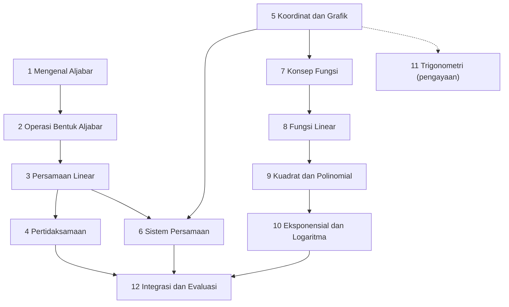

# Level 1 — Aljabar Dasar dan Fungsi

Level ini memperkenalkan aljabar dan fungsi, yaitu bahasa yang dipakai untuk menulis model Machine Learning. Kamu akan belajar menulis, menyederhanakan, dan menyelesaikan bentuk aljabar, membaca grafik, lalu memahami fungsi sebagai aturan yang mengubah masukan menjadi keluaran.

!!! success "Status materi"
    Seluruh 12 part Level 1 sudah tersedia dan bisa dibaca dari tabel di bawah.

## Prasyarat

Level 0 — Fondasi Matematika, terutama operasi dan sifat bilangan, pecahan, pangkat dan akar, nilai absolut, serta [pengantar variabel dan persamaan](../level-0-fondasi-matematika/07-variabel-dan-persamaan.md) dan [notasi dasar](../level-0-fondasi-matematika/08-notasi-matematika-dasar.md). Level 1 mengulang hal-hal tersebut secukupnya, lalu memperdalamnya.

## Tujuan Level 1

Setelah menyelesaikan Level 1, kamu mampu:

- membaca, menyederhanakan, dan memfaktorkan bentuk aljabar sederhana;
- menyelesaikan persamaan dan pertidaksamaan linear serta sistem persamaan linear sederhana;
- membaca titik koordinat dan grafik;
- menjelaskan fungsi, masukan, keluaran, domain, dan range;
- menjelaskan fungsi linear (kemiringan dan intercept) dan mengenali fungsi kuadrat, polinomial, eksponensial, dan logaritma;
- menghubungkan semuanya dengan model dasar Machine Learning.

## Daftar materi

| Part | Materi | Jenis | Status |
|---|---|---|---|
| 1 | [Mengenal Aljabar](01-mengenal-aljabar.md) | esensial | Tersedia |
| 2 | [Operasi Bentuk Aljabar](02-operasi-bentuk-aljabar.md) | esensial | Tersedia |
| 3 | [Persamaan Linear Satu Variabel](03-persamaan-linear-satu-variabel.md) | esensial | Tersedia |
| 4 | [Pertidaksamaan Linear](04-pertidaksamaan-linear.md) | esensial | Tersedia |
| 5 | [Koordinat dan Grafik](05-koordinat-dan-grafik.md) | esensial | Tersedia |
| 6 | [Sistem Persamaan Linear](06-sistem-persamaan-linear.md) | esensial | Tersedia |
| 7 | [Konsep Fungsi](07-konsep-fungsi.md) | esensial | Tersedia |
| 8 | [Fungsi Linear](08-fungsi-linear.md) | esensial | Tersedia |
| 9 | [Fungsi Kuadrat dan Polinomial](09-fungsi-kuadrat-dan-polinomial.md) | esensial (sebagian pengantar) | Tersedia |
| 10 | [Fungsi Eksponensial dan Logaritma](10-fungsi-eksponensial-dan-logaritma.md) | esensial (pengantar) | Tersedia |
| 11 | [Pengantar Fungsi Trigonometri](11-pengantar-trigonometri.md) | pengayaan | Tersedia |
| 12 | [Integrasi dan Evaluasi Level 1](12-integrasi-dan-evaluasi.md) | evaluasi | Tersedia |

**Esensial** berarti dibutuhkan oleh level berikutnya. **Pengayaan** berarti berguna sebagai pengetahuan pendukung, tetapi tidak menjadi syarat untuk setiap algoritma Machine Learning klasik. Fungsi komposisi dan fungsi invers belum dijadwalkan dan dianggap pengayaan.

!!! note "Urutan Part 5 dan 6"
    Koordinat dan Grafik (Part 5) sengaja dibahas sebelum Sistem Persamaan Linear (Part 6), karena sistem persamaan paling mudah dipahami lewat grafik dua garis.

## Hubungan antarpart

Panah putus-putus menandai part pengayaan. Part 1 sampai 3 menjadi dasar dua jalur: jalur persamaan (Part 3, 4, 6) dan jalur fungsi (Part 5, 7 sampai 10). Part 12 menggabungkan keduanya.

## Cara belajar

Baca berurutan sesuai nomor part. Kerjakan latihan sebelum membuka kunci jawaban, dan lanjut setelah checklist penguasaan terpenuhi.
