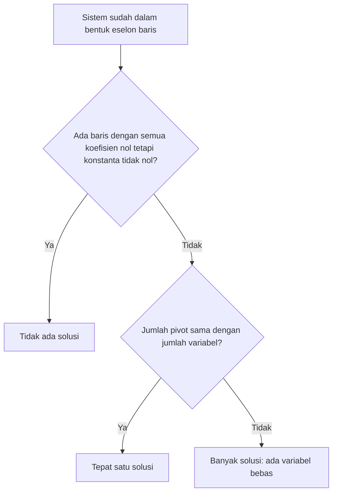

# Part 4 — Sistem Persamaan Linear (Bentuk Matriks)

## Tujuan Pembelajaran

Setelah mempelajari bagian ini, kamu mampu:

- menulis sistem persamaan linear sebagai $A\mathbf{x} = \mathbf{b}$ dan sebagai matriks yang diperluas;
- menyebut tiga operasi baris elementer dan menjelaskan mengapa solusi sistem tidak berubah olehnya;
- menyelesaikan sistem dengan eliminasi Gauss dan substitusi balik;
- membedakan sistem yang punya satu solusi, tidak punya solusi, dan punya banyak solusi dari hasil eliminasi;
- menghubungkan determinan dan invers dengan keunikan solusi;
- menjelaskan kaitan sistem linear dengan pencarian parameter dalam Machine Learning.

## Prasyarat

[Part 3 — Matriks](03-matriks.md) (perkalian matriks kali vektor, determinan, invers $2 \times 2$) serta [Level 1 — Part 6](../level-1-aljabar-dasar-dan-fungsi/06-sistem-persamaan-linear.md) (substitusi, eliminasi, tiga jenis solusi, dan bentuk matriks secara pengantar). Bagian ini mengubah eliminasi menjadi prosedur yang sistematis dan berlaku untuk sistem berapa pun ukurannya.

## Mengapa Materi Ini Penting?

Banyak masalah menghasilkan banyak persamaan dengan banyak yang tidak diketahui. Menyelesaikannya dengan substitusi acak cepat menjadi kacau. **Eliminasi Gauss** adalah prosedur baku yang dapat diikuti langkah demi langkah, dan komputer memakai variannya untuk menyelesaikan sistem berukuran ribuan. Dalam Machine Learning, mencari parameter model dari data sering berakhir pada sistem linear (misalnya persamaan normal pada regresi), jadi memahami jenis solusinya membantu memahami kapan parameter dapat ditentukan.

## Konsep Dasar dengan Bahasa Sederhana

### 1. Bentuk $A\mathbf{x} = \mathbf{b}$

Sistem tiga persamaan dengan tiga yang tidak diketahui:

$$
\begin{cases}
x + y + z = 6 \\
2y + 5z = -4 \\
2x + 5y - z = 27
\end{cases}
$$

Semua koefisien dikumpulkan dalam **matriks koefisien** $A$, variabel dalam vektor $\mathbf{x}$, dan konstanta dalam vektor $\mathbf{b}$:

$$
\underbrace{\begin{bmatrix} 1 & 1 & 1 \\ 0 & 2 & 5 \\ 2 & 5 & -1 \end{bmatrix}}_{A}
\underbrace{\begin{bmatrix} x \\ y \\ z \end{bmatrix}}_{\mathbf{x}}
=
\underbrace{\begin{bmatrix} 6 \\ -4 \\ 27 \end{bmatrix}}_{\mathbf{b}}
$$

Periksa dengan aturan perkalian matriks kali vektor (Part 3): baris pertama $1x + 1y + 1z = x + y + z$, baris kedua $0x + 2y + 5z$, baris ketiga $2x + 5y - z$. Itulah ketiga persamaan awal.

Suku yang tidak ada (misalnya $x$ pada persamaan kedua) ditulis dengan koefisien $0$.

**Matriks yang diperluas** (*augmented matrix*) menggabungkan $A$ dan $\mathbf{b}$ menjadi satu tabel, dengan garis tegak sebagai pengingat tanda sama dengan:

$$
\left[\begin{array}{ccc|c}
1 & 1 & 1 & 6 \\
0 & 2 & 5 & -4 \\
2 & 5 & -1 & 27
\end{array}\right]
$$

Hanya angkanya yang ditulis, tanpa huruf $x$, $y$, $z$, sehingga lebih ringkas.

### 2. Operasi Baris Elementer

Setiap baris matriks diperluas mewakili satu persamaan. **Operasi baris elementer** (OBE) adalah tiga jenis perubahan pada baris yang **tidak mengubah solusi** sistem:

1. **Menukar** dua baris ($R_i \leftrightarrow R_j$). Urutan persamaan tidak memengaruhi solusinya.
2. **Mengalikan** sebuah baris dengan bilangan **bukan nol** ($R_i \leftarrow c\,R_i$). Ini sama dengan mengalikan kedua sisi persamaan dengan bilangan yang sama (Level 1, Part 3).
3. **Menambahkan kelipatan satu baris ke baris lain** ($R_i \leftarrow R_i + c\,R_j$). Ini adalah eliminasi di Level 1: menjumlahkan dua persamaan menghasilkan persamaan baru yang tetap benar untuk solusi yang sama.

Mengapa mengalikan dengan **nol** dilarang? Persamaan $2x + 3y = 12$ dikali 0 menjadi $0 = 0$, yang benar untuk semua $x$ dan $y$. Informasi hilang, sehingga solusi bisa berubah.

Notasi: $R_2 \leftarrow R_2 - 2R_1$ dibaca "baris 2 diganti dengan baris 2 dikurangi dua kali baris 1".

### 3. Eliminasi Gauss

**Eliminasi Gauss** memakai OBE untuk mengubah matriks diperluas menjadi **bentuk eselon baris**: bentuk "tangga" tempat setiap baris dimulai dengan lebih banyak nol daripada baris di atasnya. Elemen bukan nol pertama di setiap baris disebut **pivot**. Setelah itu, solusi dicari dari baris paling bawah ke atas (**substitusi balik**).

Selesaikan sistem pada bagian 1:

$$
\left[\begin{array}{ccc|c}
1 & 1 & 1 & 6 \\
0 & 2 & 5 & -4 \\
2 & 5 & -1 & 27
\end{array}\right]
$$

**Langkah 1.** Nolkan elemen di bawah pivot pertama (kolom 1). Baris 2 sudah bernilai 0 di kolom 1. Untuk baris 3: $R_3 \leftarrow R_3 - 2R_1$. Hitung: $2 - 2(1) = 0$; $5 - 2(1) = 3$; $-1 - 2(1) = -3$; $27 - 2(6) = 15$.

$$
\left[\begin{array}{ccc|c}
1 & 1 & 1 & 6 \\
0 & 2 & 5 & -4 \\
0 & 3 & -3 & 15
\end{array}\right]
$$

**Langkah 2.** Nolkan elemen di bawah pivot kedua (kolom 2, nilai 2). Agar tidak muncul pecahan, pakai $R_3 \leftarrow 2R_3 - 3R_2$. Hitung: $2(0) - 3(0) = 0$; $2(3) - 3(2) = 0$; $2(-3) - 3(5) = -6 - 15 = -21$; $2(15) - 3(-4) = 30 + 12 = 42$.

$$
\left[\begin{array}{ccc|c}
1 & 1 & 1 & 6 \\
0 & 2 & 5 & -4 \\
0 & 0 & -21 & 42
\end{array}\right]
$$

Matriks kini berbentuk segitiga atas (eselon baris), dengan pivot $1$, $2$, dan $-21$.

**Langkah 3: substitusi balik.** Baca dari bawah:

- Baris 3: $-21z = 42$, jadi $z = -2$.
- Baris 2: $2y + 5z = -4$. Masukkan $z = -2$: $2y - 10 = -4$, jadi $2y = 6$ dan $y = 3$.
- Baris 1: $x + y + z = 6$. Masukkan: $x + 3 - 2 = 6$, jadi $x = 5$.

**Periksa di persamaan awal:** $5 + 3 - 2 = 6$ benar; $2(3) + 5(-2) = 6 - 10 = -4$ benar; $2(5) + 5(3) - (-2) = 10 + 15 + 2 = 27$ benar. Solusinya $(x, y, z) = (5, 3, -2)$.

Contoh kecil untuk dibandingkan dengan Level 1: $x + y = 5$ dan $x - y = 1$:

$$
\left[\begin{array}{cc|c} 1 & 1 & 5 \\ 1 & -1 & 1 \end{array}\right]
\xrightarrow{R_2 \leftarrow R_2 - R_1}
\left[\begin{array}{cc|c} 1 & 1 & 5 \\ 0 & -2 & -4 \end{array}\right]
$$

Baris 2: $-2y = -4$, jadi $y = 2$. Baris 1: $x + 2 = 5$, jadi $x = 3$. Sama dengan hasil Level 1.

**Jika pivot bernilai nol.** Bila elemen yang seharusnya menjadi pivot bernilai $0$, tukar baris dengan baris di bawahnya yang elemen kolom itu bukan nol. Contoh: $y = 3$ dan $x = 4$ ditulis sebagai $\left[\begin{array}{cc|c} 0 & 1 & 3 \\ 1 & 0 & 4 \end{array}\right]$. Tukar $R_1 \leftrightarrow R_2$ menghasilkan bentuk segitiga.

### 4. Jenis Solusi

Dari hasil eliminasi, kita dapat membaca jenis solusi tanpa menyelesaikannya penuh:

| Hasil bentuk eselon | Arti | Jenis solusi |
|---|---|---|
| ada baris dengan semua koefisien nol tetapi konstanta $c \neq 0$ | pernyataan $0 = c$ yang salah | **tidak ada solusi** |
| jumlah pivot sama dengan jumlah variabel | setiap variabel ditentukan | **tepat satu solusi** |
| tidak ada baris yang kontradiksi, tetapi pivot kurang dari jumlah variabel | ada variabel yang tidak dibatasi | **banyak solusi** |

Banyaknya pivot disebut **rank** (peringkat) secara informal; rank $<$ banyak variabel berarti ada **variabel bebas**.



Diagram menunjukkan urutan pemeriksaan: pertama cari kontradiksi, lalu hitung pivot.

**Contoh banyak solusi.** Sistem $x + y + z = 6$, $x - y + z = 2$, $2x + 2z = 8$:

$$
\left[\begin{array}{ccc|c}
1 & 1 & 1 & 6 \\
1 & -1 & 1 & 2 \\
2 & 0 & 2 & 8
\end{array}\right]
$$

- $R_2 \leftarrow R_2 - R_1$ memberi $\begin{bmatrix} 0 & -2 & 0 & -4 \end{bmatrix}$.
- $R_3 \leftarrow R_3 - 2R_1$ memberi $\begin{bmatrix} 0 & -2 & 0 & -4 \end{bmatrix}$.
- $R_3 \leftarrow R_3 - R_2$ memberi $\begin{bmatrix} 0 & 0 & 0 & 0 \end{bmatrix}$.

Baris ketiga menjadi baris nol: persamaan ketiga ternyata tidak membawa informasi baru (ia adalah jumlah dua persamaan pertama). Pivot hanya dua, padahal variabel ada tiga, sehingga $z$ menjadi **variabel bebas**. Misalkan $z = t$ (bilangan apa saja):

- Baris 2: $-2y = -4$, jadi $y = 2$.
- Baris 1: $x + 2 + t = 6$, jadi $x = 4 - t$.

Solusinya $(x, y, z) = (4 - t,\ 2,\ t)$ untuk setiap $t$. Cek: $t = 0$ memberi $(4, 2, 0)$: $4 + 2 + 0 = 6$, $4 - 2 + 0 = 2$, $8 + 0 = 8$. Cek $t = 1$: $(3, 2, 1)$ memenuhi semuanya. Ada tak berhingga solusi, yang membentuk satu garis di ruang tiga dimensi.

**Contoh tidak ada solusi.** Ubah persamaan terakhir menjadi $2x + 2z = 9$. Dengan operasi yang sama, $R_3 \leftarrow R_3 - 2R_1$ memberi $\begin{bmatrix} 0 & -2 & 0 & -3 \end{bmatrix}$, dan $R_3 \leftarrow R_3 - R_2$ memberi $\begin{bmatrix} 0 & 0 & 0 & 1 \end{bmatrix}$, yaitu $0 = 1$. Pernyataan salah, jadi **tidak ada solusi**.

### 5. Hubungan dengan Determinan dan Invers

Untuk sistem **persegi** (jumlah persamaan sama dengan jumlah variabel), tiga hal ini setara:

- $A$ punya invers (Part 3), yaitu $\det A \neq 0$ untuk ukuran $2 \times 2$.
- Eliminasi menghasilkan pivot sebanyak variabel.
- Sistem $A\mathbf{x} = \mathbf{b}$ memiliki **tepat satu solusi** untuk setiap $\mathbf{b}$.

Jika $\det A = 0$ (matriks singular), sistemnya tidak punya solusi atau punya banyak solusi, bergantung pada $\mathbf{b}$. Contoh: $A = \begin{bmatrix} 2 & 1 \\ 4 & 2 \end{bmatrix}$ punya $\det A = 0$. Dengan $\mathbf{b} = (3, 6)$: $R_2 \leftarrow R_2 - 2R_1$ memberi $\begin{bmatrix} 0 & 0 & 0 \end{bmatrix}$, jadi banyak solusi. Dengan $\mathbf{b} = (3, 7)$: $R_2 \leftarrow R_2 - 2R_1$ memberi $\begin{bmatrix} 0 & 0 & 1 \end{bmatrix}$, jadi tidak ada solusi.

Jika $A$ punya invers, $\mathbf{x} = A^{-1}\mathbf{b}$. Tetapi untuk sistem besar, eliminasi lebih cepat dan lebih teliti daripada menghitung invers lebih dulu, sehingga komputer jarang menghitung invers secara eksplisit.

### 6. Hubungan dengan Sistem Linear dalam Machine Learning

- **Parameter dari data.** Model linear $y = wx + b$ dari dua data memberi sistem $2 \times 2$ (Level 1). Dengan banyak fitur, sistemnya lebih besar, dan eliminasi Gauss (atau variannya) menyelesaikannya.
- **Persamaan normal.** Untuk regresi linear, parameter terbaik memenuhi sistem $(X^{\top}X)\mathbf{w} = X^{\top}\mathbf{y}$, yaitu bentuk $A\mathbf{x} = \mathbf{b}$ dengan $A = X^{\top}X$. Detailnya ada di Level 4. Matriks $X^{\top}X$ hanya punya invers jika fitur tidak saling bergantung.
- **Lebih banyak persamaan daripada yang tidak diketahui** (banyak data, sedikit parameter): biasanya **tidak ada solusi tepat** karena data tidak persis segaris. Itu sebabnya regresi mencari solusi paling mendekati.
- **Lebih sedikit persamaan daripada yang tidak diketahui** (banyak fitur, sedikit data): biasanya **banyak solusi**, dan parameter tidak unik. Teknik regularisasi (level berikutnya) membantu memilih satu.

## Istilah yang Perlu Dipahami

| Istilah | Arti sederhana | Contoh |
|---|---|---|
| Matriks koefisien $A$ | tabel koefisien variabel | $\begin{bmatrix} 1 & 1 \\ 1 & -1 \end{bmatrix}$ |
| Vektor konstanta $\mathbf{b}$ | bilangan di sisi kanan | $(5, 1)$ |
| Matriks diperluas | $A$ dan $\mathbf{b}$ digabung | $[A \mid \mathbf{b}]$ |
| Operasi baris elementer (OBE) | tukar baris, kali baris, tambah kelipatan baris | $R_2 \leftarrow R_2 - R_1$ |
| Pivot | elemen bukan nol pertama dalam baris | $1$, $2$, $-21$ |
| Bentuk eselon baris | bentuk tangga: pivot makin ke kanan | segitiga atas |
| Eliminasi Gauss | OBE sampai bentuk eselon, lalu substitusi balik | |
| Substitusi balik | mencari variabel dari baris bawah ke atas | $z$, lalu $y$, lalu $x$ |
| Variabel bebas | variabel yang boleh bernilai apa saja | $t$ |
| Rank | banyaknya pivot (informal) | 2 |
| Singular | matriks tanpa invers ($\det = 0$) | |

## Rumus dan Penjelasan Setiap Simbol

**Bentuk matriks sebuah sistem:**

$$
A\mathbf{x} = \mathbf{b}, \qquad A \in \mathbb{R}^{m \times n},\ \mathbf{x} \in \mathbb{R}^{n},\ \mathbf{b} \in \mathbb{R}^{m}
$$

- $m$ adalah banyak persamaan (baris $A$) dan $n$ adalah banyak variabel (kolom $A$).
- $A\mathbf{x}$ terdefinisi karena $A$ punya $n$ kolom dan $\mathbf{x}$ punya $n$ elemen (Part 3).

**Operasi baris elementer:**

| OBE | Notasi | Syarat |
|---|---|---|
| tukar | $R_i \leftrightarrow R_j$ | |
| kali | $R_i \leftarrow c\,R_i$ | $c \neq 0$ |
| tambah kelipatan | $R_i \leftarrow R_i + c\,R_j$ | $i \neq j$ |

**Pengali eliminasi.** Untuk menolkan elemen $a_{ik}$ memakai pivot $a_{jk}$ di baris atas: $R_i \leftarrow R_i - \dfrac{a_{ik}}{a_{jk}}R_j$, dengan syarat pivot $a_{jk} \neq 0$. Contoh: pada $\begin{bmatrix} 1 & 1 & 1 \end{bmatrix}$ dan $\begin{bmatrix} 2 & 5 & -1 \end{bmatrix}$, pengalinya $\dfrac{2}{1} = 2$.

**Solusi bila persegi dan invers ada:** $\mathbf{x} = A^{-1}\mathbf{b}$.

## Penjelasan Langkah demi Langkah

**Prosedur eliminasi Gauss:**

1. Tulis matriks diperluas $[A \mid \mathbf{b}]$.
2. Untuk kolom pertama: pastikan pivot (elemen bukan nol) ada di baris pertama (tukar baris bila perlu).
3. Nolkan semua elemen **di bawah** pivot dengan $R_i \leftarrow R_i - (\text{pengali}) R_j$.
4. Pindah ke kolom berikutnya dan baris berikutnya, ulangi.
5. Jika muncul baris $\begin{bmatrix} 0 & \cdots & 0 & c \end{bmatrix}$ dengan $c \neq 0$: **berhenti, tidak ada solusi.**
6. Jika pivot kurang dari jumlah variabel dan tidak ada kontradiksi: **banyak solusi**; nyatakan variabel bebas dengan parameter.
7. Jika pivot lengkap: lakukan substitusi balik dari baris terbawah.
8. **Periksa** solusi pada persamaan awal.

## Contoh Soal dan Pembahasan

### Contoh 1 — Dua persamaan

Selesaikan $x + 2y = 5$ dan $3x + 4y = 11$.

1. Matriks diperluas: $\left[\begin{array}{cc|c} 1 & 2 & 5 \\ 3 & 4 & 11 \end{array}\right]$.
2. $R_2 \leftarrow R_2 - 3R_1$: $3 - 3 = 0$; $4 - 6 = -2$; $11 - 15 = -4$. Baris 2: $\begin{bmatrix} 0 & -2 & -4 \end{bmatrix}$.
3. Substitusi balik: $-2y = -4$, jadi $y = 2$. Lalu $x + 4 = 5$, jadi $x = 1$.
4. Periksa: $1 + 2(2) = 5$ benar; $3(1) + 4(2) = 11$ benar. Solusi $(1, 2)$.

### Contoh 2 — Tiga persamaan

Selesaikan $x + y + z = 6$, $2x - y + z = 3$, dan $x + 2y - z = 2$.

1. Matriks diperluas: $\left[\begin{array}{ccc|c} 1 & 1 & 1 & 6 \\ 2 & -1 & 1 & 3 \\ 1 & 2 & -1 & 2 \end{array}\right]$.
2. $R_2 \leftarrow R_2 - 2R_1$: $\begin{bmatrix} 0 & -3 & -1 & -9 \end{bmatrix}$. $R_3 \leftarrow R_3 - R_1$: $\begin{bmatrix} 0 & 1 & -2 & -4 \end{bmatrix}$.
3. Nolkan kolom 2 pada baris 3: $R_3 \leftarrow 3R_3 + R_2$. Hitung: $3(1) + (-3) = 0$; $3(-2) + (-1) = -7$; $3(-4) + (-9) = -21$. Baris 3: $\begin{bmatrix} 0 & 0 & -7 & -21 \end{bmatrix}$.
4. Substitusi balik: $-7z = -21$, jadi $z = 3$. Baris 2: $-3y - 3 = -9$, jadi $y = 2$. Baris 1: $x + 2 + 3 = 6$, jadi $x = 1$.
5. Periksa: $1 + 2 + 3 = 6$; $2 - 2 + 3 = 3$; $1 + 4 - 3 = 2$. Semua benar. Solusi $(1, 2, 3)$.

### Contoh 3 — Mengenali jenis solusi

Tentukan jenis solusi: (a) $x + y = 4$, $2x + 2y = 8$; (b) $x + y = 4$, $2x + 2y = 9$; (c) $x + y = 4$, $x - y = 2$.

1. (a) $R_2 \leftarrow R_2 - 2R_1$ memberi $\begin{bmatrix} 0 & 0 & 0 \end{bmatrix}$: **banyak solusi**. Misalkan $y = t$, maka $x = 4 - t$.
2. (b) $R_2 \leftarrow R_2 - 2R_1$ memberi $\begin{bmatrix} 0 & 0 & 1 \end{bmatrix}$, yaitu $0 = 1$: **tidak ada solusi**.
3. (c) $R_2 \leftarrow R_2 - R_1$ memberi $\begin{bmatrix} 0 & -2 & -2 \end{bmatrix}$, jadi $y = 1$ dan $x = 3$: **satu solusi** $(3, 1)$.

### Contoh 4 — Memakai determinan dan invers

Selesaikan $3x + y = 7$ dan $5x + 2y = 12$ dengan invers.

1. $A = \begin{bmatrix} 3 & 1 \\ 5 & 2 \end{bmatrix}$ dan $\mathbf{b} = (7, 12)$. $\det A = 6 - 5 = 1 \neq 0$, jadi ada solusi tunggal.
2. $A^{-1} = \begin{bmatrix} 2 & -1 \\ -5 & 3 \end{bmatrix}$ (dari Part 3).
3. $\mathbf{x} = A^{-1}\mathbf{b} = (2 \cdot 7 - 1 \cdot 12,\ -5 \cdot 7 + 3 \cdot 12) = (14 - 12,\ -35 + 36) = (2, 1)$.
4. Periksa: $3(2) + 1 = 7$ dan $5(2) + 2(1) = 12$. Benar.

## Contoh Tambahan dengan Kesulitan Bertahap

**Mudah.** $x + y = 10$ dan $x - y = 4$: $R_2 \leftarrow R_2 - R_1$ memberi $-2y = -6$, jadi $y = 3$ dan $x = 7$.

**Sedang.** Pivot nol: $\left[\begin{array}{cc|c} 0 & 1 & 3 \\ 1 & 0 & 4 \end{array}\right]$. Tukar baris menghasilkan $x = 4$ dan $y = 3$.

**Sedang.** Matriks $A = \begin{bmatrix} 2 & 1 \\ 4 & 2 \end{bmatrix}$ singular. Dengan $\mathbf{b} = (3, 6)$ banyak solusi (misalnya $y = 3 - 2x$ untuk sembarang $x$); dengan $\mathbf{b} = (3, 7)$ tidak ada solusi.

**Menantang.** Dua persamaan dengan tiga variabel: $x + y + z = 3$ dan $x - y + z = 1$. $R_2 \leftarrow R_2 - R_1$ memberi $\begin{bmatrix} 0 & -2 & 0 & -2 \end{bmatrix}$, jadi $y = 1$. Pivot hanya dua untuk tiga variabel, sehingga $z = t$ bebas dan $x = 2 - t$. Solusi $(2 - t,\ 1,\ t)$. Cek $t = 0$: $(2, 1, 0)$ memberi $2 + 1 + 0 = 3$ dan $2 - 1 + 0 = 1$. Benar. Lebih sedikit persamaan daripada variabel hampir selalu menghasilkan banyak solusi.

## Visualisasi atau Interpretasi Grafik

- **Dua persamaan, dua variabel:** dua garis (Level 1). Satu solusi = berpotongan; tidak ada = sejajar; banyak = berimpit.
- **Tiga persamaan, tiga variabel:** tiga bidang di ruang tiga dimensi. Satu solusi: ketiga bidang bertemu di satu titik. Banyak solusi: bertemu di satu garis (seperti contoh $(4 - t, 2, t)$) atau berimpit. Tidak ada solusi: tidak ada titik yang dimiliki ketiganya.
- **Baris nol** pada eliminasi berarti sebuah persamaan tidak menambah informasi (ia kombinasi persamaan lain).

## Kesalahan Umum

| Kesalahan | Mengapa salah | Yang benar |
|---|---|---|
| Mengalikan baris dengan 0 | informasi hilang | pengali harus bukan nol |
| Menjalankan operasi pada satu bagian baris saja | persamaan jadi tidak setara | operasikan seluruh baris, termasuk konstanta |
| Lupa mengoperasikan kolom konstanta | solusi salah | matriks diperluas |
| Kesalahan tanda saat $R_i - c R_j$ dengan elemen negatif | $-(-3)$ menjadi $+3$ | hitung per elemen dengan teliti |
| Menyimpulkan "tidak ada solusi" dari baris nol penuh (koefisien dan konstanta semuanya 0) | baris nol penuh berarti persamaan itu berlebih, bukan kontradiksi | tidak ada solusi hanya bila konstanta tidak nol |
| Menyimpulkan "banyak solusi" dari baris dengan koefisien nol dan konstanta $1$ | itu kontradiksi $0 = 1$ | tidak ada solusi |
| Melewatkan substitusi balik di persamaan awal sebagai pemeriksaan | kesalahan hitung tidak terdeteksi | periksa di semua persamaan awal |
| Mencari invers lebih dulu untuk sistem besar | lebih lambat dan rawan galat | pakai eliminasi |
| Mengira sistem persegi selalu punya solusi tunggal | determinan nol memberi nol atau banyak solusi | periksa pivot atau determinan |
| Menuliskan koefisien yang tidak ada sebagai kosong | harus $0$ | tulis $0$ |

## Hubungan dengan Machine Learning

- **Menentukan parameter.** Banyak model dilatih dengan menyelesaikan sistem linear (secara langsung atau berulang). Eliminasi Gauss adalah dasar metode langsungnya.
- **Persamaan normal.** Regresi linear dapat diselesaikan dengan sistem $(X^{\top}X)\mathbf{w} = X^{\top}\mathbf{y}$ (Level 4).
- **Keunikan parameter.** Jika fitur saling bergantung (misalnya satu fitur adalah dua kali fitur lain), pivot kurang dan ada banyak parameter yang sama baiknya.
- **Data berlebih.** Lebih banyak data daripada parameter berarti sistem tanpa solusi tepat, sehingga dicari solusi paling mendekati.
- **Skala besar.** Komputer memakai varian eliminasi (faktorisasi LU dan sejenisnya) dengan strategi memilih pivot agar teliti secara numerik.

### Python: eliminasi Gauss dengan `Fraction`

Fungsi berikut menyelesaikan sistem persegi dan melaporkan jenis solusinya. Pecahan dihitung tepat dengan `Fraction`.

```python
from fractions import Fraction

def selesaikan(A, b):
    n = len(A)
    M = [[Fraction(x) for x in A[i]] + [Fraction(b[i])] for i in range(n)]
    baris = 0
    pivot = []
    for kolom in range(n):
        p = None
        for i in range(baris, n):
            if M[i][kolom] != 0:
                p = i
                break
        if p is None:
            continue
        M[baris], M[p] = M[p], M[baris]          # tukar baris
        for i in range(baris + 1, n):
            f = M[i][kolom] / M[baris][kolom]    # pengali eliminasi
            M[i] = [a - f * c for a, c in zip(M[i], M[baris])]
        pivot.append(kolom)
        baris += 1
    for i in range(baris, n):
        if M[i][n] != 0:
            return "tidak ada solusi"
    if len(pivot) < n:
        return "banyak solusi"
    x = [Fraction(0)] * n
    for i in range(n - 1, -1, -1):               # substitusi balik
        s = sum(M[i][j] * x[j] for j in range(i + 1, n))
        x[i] = (M[i][n] - s) / M[i][i]
    return x
```

Bagian demi bagian: mencari pivot bukan nol, menukar baris, menolkan elemen di bawah pivot, memeriksa kontradiksi (baris nol dengan konstanta tidak nol), lalu substitusi balik. Fungsi pembantu agar hasil mudah dibaca:

```python
def tampil(hasil):
    return hasil if isinstance(hasil, str) else [str(v) for v in hasil]

print(tampil(selesaikan([[1, 1, 1], [0, 2, 5], [2, 5, -1]], [6, -4, 27])))   # ['5', '3', '-2']
print(tampil(selesaikan([[1, 1], [1, -1]], [5, 1])))                         # ['3', '2']
print(tampil(selesaikan([[1, 2], [3, 4]], [5, 11])))                         # ['1', '2']
print(tampil(selesaikan([[1, 1, 1], [2, -1, 1], [1, 2, -1]], [6, 3, 2])))    # ['1', '2', '3']
print(tampil(selesaikan([[0, 1], [1, 0]], [3, 4])))                          # ['4', '3'], perlu tukar baris
```

Jenis solusi lain:

```python
print(selesaikan([[1, 1], [2, 2]], [4, 8]))                      # banyak solusi
print(selesaikan([[1, 1], [2, 2]], [4, 9]))                      # tidak ada solusi
print(selesaikan([[1, 1, 1], [1, -1, 1], [2, 0, 2]], [6, 2, 8])) # banyak solusi
print(selesaikan([[1, 1, 1], [1, -1, 1], [2, 0, 2]], [6, 2, 9])) # tidak ada solusi
print(selesaikan([[2, 1], [4, 2]], [3, 7]))                      # tidak ada solusi (determinan 0)
```

Memeriksa solusi dengan perkalian matriks kali vektor (Part 3):

```python
A = [[1, 1, 1], [0, 2, 5], [2, 5, -1]]
x = [5, 3, -2]
print([sum(a * xi for a, xi in zip(baris, x)) for baris in A])   # [6, -4, 27], sama dengan b
```

## Latihan Mandiri

1. Tulis sistem $2x + 3y = 12$ dan $x - y = 1$ sebagai $A\mathbf{x} = \mathbf{b}$ dan sebagai matriks yang diperluas.
2. Mana yang termasuk operasi baris elementer? (a) menukar baris 1 dan 2 (b) mengalikan baris 2 dengan 0 (c) $R_2 \leftarrow R_2 + 4R_1$ (d) mengkuadratkan semua elemen baris 1. Beri alasan.
3. Selesaikan dengan eliminasi Gauss: $x + 2y = 5$ dan $3x + 4y = 11$.
4. Selesaikan: $x + y + z = 6$, $2x - y + z = 3$, $x + 2y - z = 2$.
5. Tentukan jenis solusi (satu, tidak ada, banyak): (a) $x + y = 4$, $2x + 2y = 8$ (b) $x + y = 4$, $2x + 2y = 9$ (c) $x + y = 4$, $x - y = 2$
6. Selesaikan: $x + y + z = 6$, $x - y + z = 2$, $2x + 2z = 8$. Tulis solusi dengan parameter dan periksa untuk $t = 2$.
7. Ubah persamaan ketiga soal 6 menjadi $2x + 2z = 9$. Apa jenis solusinya? Jelaskan dari baris terakhir hasil eliminasi.
8. Matriks $A = \begin{bmatrix} 2 & 1 \\ 4 & 2 \end{bmatrix}$ punya determinan berapa? Untuk $\mathbf{b} = (3, 6)$ dan $\mathbf{b} = (3, 7)$, tentukan jenis solusi.
9. Selesaikan $3x + y = 7$ dan $5x + 2y = 12$ dengan invers ($A^{-1} = \begin{bmatrix} 2 & -1 \\ -5 & 3 \end{bmatrix}$).
10. (ML) (a) Tiga data $(1, 5)$, $(3, 9)$, $(2, 8)$ dipakai mencari $w$ dan $b$ pada $y = wx + b$. Apakah sistemnya punya solusi tepat? (b) Satu data $(2, 7)$ dipakai mencari $w$ dan $b$. Apa jenis solusinya?

## Kunci Jawaban dan Pembahasan

??? success "Soal 1"
    $A = \begin{bmatrix} 2 & 3 \\ 1 & -1 \end{bmatrix}$, $\mathbf{x} = (x, y)$, $\mathbf{b} = (12, 1)$. Matriks diperluas: $\left[\begin{array}{cc|c} 2 & 3 & 12 \\ 1 & -1 & 1 \end{array}\right]$.

??? success "Soal 2"
    (a) **Ya**: menukar baris tidak mengubah solusi. (b) **Tidak**: kali nol menghapus informasi. (c) **Ya**: menambahkan kelipatan baris lain. (d) **Tidak**: mengkuadratkan bukan operasi yang menjaga kesetaraan.

??? success "Soal 3"
    $R_2 \leftarrow R_2 - 3R_1$ memberi $\begin{bmatrix} 0 & -2 & -4 \end{bmatrix}$. $y = 2$, $x = 5 - 4 = 1$. Solusi $(1, 2)$. Periksa: $3(1) + 4(2) = 11$.

??? success "Soal 4"
    $R_2 \leftarrow R_2 - 2R_1$: $\begin{bmatrix} 0 & -3 & -1 & -9 \end{bmatrix}$. $R_3 \leftarrow R_3 - R_1$: $\begin{bmatrix} 0 & 1 & -2 & -4 \end{bmatrix}$. $R_3 \leftarrow 3R_3 + R_2$: $\begin{bmatrix} 0 & 0 & -7 & -21 \end{bmatrix}$. $z = 3$, lalu $-3y - 3 = -9$ memberi $y = 2$, lalu $x = 6 - 2 - 3 = 1$. Solusi $(1, 2, 3)$.

??? success "Soal 5"
    (a) $R_2 - 2R_1 = \begin{bmatrix} 0 & 0 & 0 \end{bmatrix}$: **banyak solusi**. (b) $\begin{bmatrix} 0 & 0 & 1 \end{bmatrix}$: **tidak ada solusi**. (c) $R_2 - R_1 = \begin{bmatrix} 0 & -2 & -2 \end{bmatrix}$, $y = 1$, $x = 3$: **satu solusi**.

??? success "Soal 6"
    Dari bagian 4: $y = 2$, $z = t$ bebas, $x = 4 - t$. Solusi $(4 - t, 2, t)$. Untuk $t = 2$: $(2, 2, 2)$. Periksa: $2 + 2 + 2 = 6$; $2 - 2 + 2 = 2$; $2(2) + 2(2) = 8$. Semua benar.

??? success "Soal 7"
    Dengan $2x + 2z = 9$, eliminasi menghasilkan baris $\begin{bmatrix} 0 & 0 & 0 & 1 \end{bmatrix}$, yaitu $0 = 1$ (pernyataan salah). Jadi **tidak ada solusi**.

??? success "Soal 8"
    $\det A = 2 \cdot 2 - 1 \cdot 4 = 0$ (singular). Untuk $\mathbf{b} = (3, 6)$: $R_2 - 2R_1 = \begin{bmatrix} 0 & 0 & 0 \end{bmatrix}$, **banyak solusi**. Untuk $\mathbf{b} = (3, 7)$: $\begin{bmatrix} 0 & 0 & 1 \end{bmatrix}$, **tidak ada solusi**.

??? success "Soal 9"
    $\mathbf{x} = A^{-1}\mathbf{b} = (2 \cdot 7 - 12,\ -5 \cdot 7 + 3 \cdot 12) = (2, 1)$. Periksa: $3(2) + 1 = 7$; $5(2) + 2(1) = 12$.

??? success "Soal 10"
    (a) Persamaannya $w + b = 5$, $3w + b = 9$, $2w + b = 8$. Dua yang pertama memberi $w = 2$ dan $b = 3$, tetapi persamaan ketiga memberi $2(2) + 3 = 7 \neq 8$. **Tidak ada solusi tepat**: tiga titik itu tidak segaris. (b) Satu persamaan $2w + b = 7$ dengan dua yang tidak diketahui: **banyak solusi** (misalnya $w = 1, b = 5$ atau $w = 2, b = 3$, yaitu $b = 7 - 2w$).

## Ringkasan Materi

- Sistem linear ditulis $A\mathbf{x} = \mathbf{b}$, dan ringkasnya sebagai matriks diperluas $[A \mid \mathbf{b}]$.
- Tiga OBE (tukar baris, kali baris dengan bilangan bukan nol, tambah kelipatan baris lain) tidak mengubah solusi.
- Eliminasi Gauss mengubah matriks menjadi bentuk eselon baris, lalu substitusi balik dari baris terbawah.
- Baris $0 = c$ ($c \neq 0$): tidak ada solusi. Pivot kurang dari variabel tanpa kontradiksi: banyak solusi (ada variabel bebas). Pivot lengkap: satu solusi.
- Untuk sistem persegi: invers ada $\Leftrightarrow$ pivot lengkap $\Leftrightarrow$ solusi tunggal untuk setiap $\mathbf{b}$.
- Dalam ML: data berlebih berarti tidak ada solusi tepat; fitur bergantung berarti banyak parameter yang sama baiknya.

## Checklist Penguasaan

- [ ] Menulis sistem sebagai $A\mathbf{x} = \mathbf{b}$ dan matriks diperluas.
- [ ] Menyebut tiga OBE dan alasan solusi tidak berubah.
- [ ] Menyelesaikan sistem $3 \times 3$ dengan eliminasi Gauss dan substitusi balik.
- [ ] Mengenali jenis solusi dari baris hasil eliminasi.
- [ ] Menulis solusi dengan variabel bebas untuk kasus banyak solusi.
- [ ] Menghubungkan determinan atau invers dengan keunikan solusi.
- [ ] Menjelaskan mengapa data berlebih menghasilkan sistem tanpa solusi tepat.

## Prasyarat untuk Materi Berikutnya

[Part 5 — Transformasi Linear](05-transformasi-linear.md) membutuhkan: matriks kali vektor, determinan, dan gambaran bahwa $A\mathbf{x} = \mathbf{b}$ menanyakan "vektor $\mathbf{x}$ mana yang diubah matriks $A$ menjadi $\mathbf{b}$". Sistem yang sama muncul lagi di Part 8 saat mencari titik tempat gradien bernilai nol.
