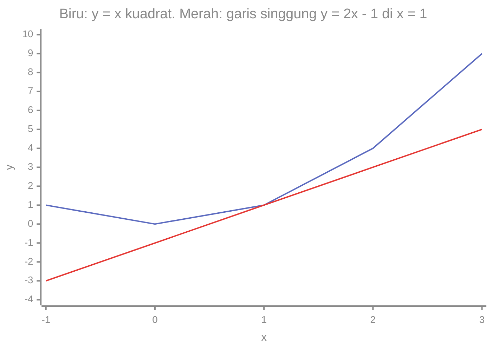
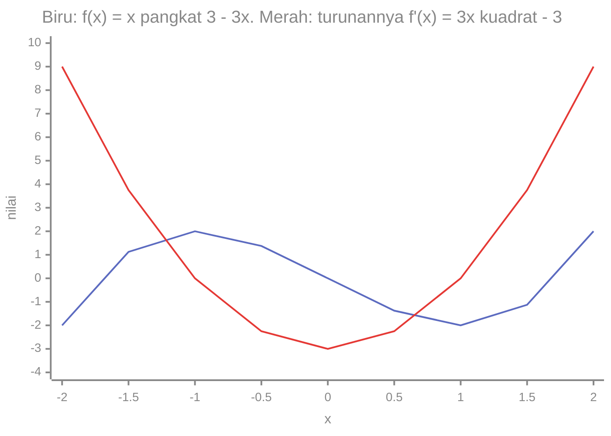

# Part 7 — Turunan

## Tujuan Pembelajaran

Setelah mempelajari bagian ini, kamu mampu:

- menjelaskan turunan sebagai laju perubahan sesaat dan sebagai kemiringan garis singgung;
- menurunkan turunan sebuah fungsi dari definisinya sebagai limit;
- memakai aturan turunan: konstanta, pangkat, kelipatan, jumlah, hasil kali, hasil bagi;
- memakai aturan rantai (*chain rule*) untuk fungsi bersusun;
- menghitung turunan fungsi eksponensial dan logaritma, serta turunan sigmoid;
- menjelaskan turunan kedua secara intuitif sebagai kelengkungan dan memakainya untuk membedakan minimum dari maksimum;
- menjelaskan kapan turunan tidak ada dan mengapa turunan menjadi dasar cara model belajar.

## Prasyarat

[Part 6 — Limit dan Kontinuitas](06-limit-dan-kontinuitas.md) (limit, bentuk $\frac{0}{0}$, kontinuitas), [Level 1 — Part 8](../level-1-aljabar-dasar-dan-fungsi/08-fungsi-linear.md) (slope), [Part 9](../level-1-aljabar-dasar-dan-fungsi/09-fungsi-kuadrat-dan-polinomial.md) (parabola dan selisih kedua), serta [Part 10](../level-1-aljabar-dasar-dan-fungsi/10-fungsi-eksponensial-dan-logaritma.md) (eksponensial, logaritma, sigmoid).

## Mengapa Materi Ini Penting?

Melatih model berarti mengubah parameter sedikit demi sedikit agar kesalahan mengecil. Pertanyaannya: **ke arah mana** dan **seberapa besar** parameter diubah? Turunan menjawabnya. Turunan fungsi kerugian terhadap sebuah parameter memberi tahu apakah menaikkan parameter itu menaikkan atau menurunkan kerugian, dan seberapa cepat. Seluruh pelatihan jaringan saraf berdiri di atas turunan.

## Konsep Dasar dengan Bahasa Sederhana

### 1. Laju Perubahan Rata-rata dan Sesaat

Sebuah benda jatuh dengan jarak $s(t) = t^2$ meter setelah $t$ detik (angka disederhanakan). **Kecepatan rata-rata** pada selang waktu adalah perubahan jarak dibagi perubahan waktu:

| Selang | Perhitungan | Kecepatan rata-rata |
|---|---|---|
| $t = 1$ sampai $t = 3$ | $\dfrac{9 - 1}{2}$ | $4$ |
| $t = 1$ sampai $t = 2$ | $\dfrac{4 - 1}{1}$ | $3$ |
| $t = 1$ sampai $t = 1{,}1$ | $\dfrac{1{,}21 - 1}{0{,}1}$ | $2{,}1$ |
| $t = 1$ sampai $t = 1{,}01$ | $\dfrac{1{,}0201 - 1}{0{,}01}$ | $2{,}01$ |

Ketika selang dipersempit, kecepatan rata-rata mendekati **2**. Itulah **kecepatan sesaat** pada $t = 1$. Persis seperti slope pada fungsi linear (Level 1), tetapi sekarang untuk kurva yang lajunya berubah-ubah.

### 2. Makna Geometris: Garis Singgung

Rata-rata laju antara dua titik $(a, f(a))$ dan $(a + h, f(a + h))$ adalah **kemiringan garis potong** (*secant*) yang melewati keduanya:

$$
\frac{f(a + h) - f(a)}{h}
$$

Jika titik kedua digeser mendekati titik pertama ($h \to 0$), garis potong berputar dan mendekati **garis singgung** (*tangent*), yaitu garis yang hanya "menyentuh" kurva di titik itu. Kemiringan garis singgung adalah **turunan**.

Pada $f(x) = x^2$ di $x = 1$, kemiringan garis singgungnya 2, jadi garis singgungnya $y = 2x - 1$ (melewati $(1, 1)$ dengan kemiringan 2). Gambar kurva dan garis singgungnya:



Cara membaca: kedua garis bertemu di $x = 1$, $y = 1$ (di sana garis singgung "menyentuh" kurva). Di titik itu garis merah menanjak dengan kemiringan 2. Di tempat lain ($x = 0$ atau $x = 2$) garis merah tidak lagi menempel pada kurva: garis singgung hanya baik di dekat titik sentuhnya.

### 3. Definisi Turunan

**Turunan** fungsi $f$ di titik $a$ adalah limit kemiringan garis potong ketika $h \to 0$:

$$
f'(a) = \lim_{h \to 0} \frac{f(a + h) - f(a)}{h}
$$

Jika limit ini ada, kita katakan $f$ **dapat diturunkan** (*differentiable*) di $a$. Jika dihitung untuk setiap $x$, kita memperoleh **fungsi turunan** $f'(x)$.

Notasi yang setara: $f'(x)$ (dibaca "f aksen x"), $\dfrac{df}{dx}$, atau $\dfrac{dy}{dx}$ jika $y = f(x)$. Simbol $\dfrac{d}{dx}$ berarti "turunan terhadap $x$".

**Contoh 1: $f(x) = x^2$.**

$$
\frac{f(x + h) - f(x)}{h} = \frac{(x + h)^2 - x^2}{h} = \frac{2xh + h^2}{h} = 2x + h
$$

Ketika $h \to 0$, hasilnya $2x$. Jadi $(x^2)' = 2x$. Di $x = 1$: $f'(1) = 2$, cocok dengan garis singgung di atas.

**Contoh 2: $f(x) = 3x + 2$.** $\dfrac{3(x + h) + 2 - 3x - 2}{h} = \dfrac{3h}{h} = 3$. Turunan fungsi linear adalah **slope-nya** (Level 1).

**Contoh 3: $f(x) = 5$ (konstanta).** $\dfrac{5 - 5}{h} = 0$. Turunan konstanta adalah $0$.

**Contoh 4: $f(x) = x^3$.** $\dfrac{(x + h)^3 - x^3}{h} = \dfrac{3x^2h + 3xh^2 + h^3}{h} = 3x^2 + 3xh + h^2 \to 3x^2$. Cek angka di $x = 2$: untuk $h = 0{,}1$ hasilnya $12{,}61$, untuk $h = 0{,}01$ hasilnya $12{,}0601$, dan menuju $3(2)^2 = 12$.

### 4. Aturan Turunan

Menghitung dari definisi setiap kali itu melelahkan, jadi kita memakai aturan. Misalkan $c$ dan $n$ konstanta, serta $f$ dan $g$ fungsi yang dapat diturunkan:

| Aturan | Rumus | Contoh |
|---|---|---|
| Konstanta | $(c)' = 0$ | $(7)' = 0$ |
| Pangkat | $(x^n)' = n\,x^{n-1}$ | $(x^5)' = 5x^4$ |
| Kelipatan konstanta | $(c\,f)' = c\,f'$ | $(4x^3)' = 12x^2$ |
| Jumlah dan selisih | $(f \pm g)' = f' \pm g'$ | $(x^2 + 3x)' = 2x + 3$ |
| Hasil kali | $(fg)' = f'g + fg'$ | lihat di bawah |
| Hasil bagi | $\left(\dfrac{f}{g}\right)' = \dfrac{f'g - fg'}{g^2}$ | lihat di bawah |

Aturan pangkat berlaku untuk eksponen apa pun, termasuk pecahan dan negatif: $\sqrt{x} = x^{1/2}$ memberi $(\sqrt{x})' = \tfrac{1}{2}x^{-1/2} = \dfrac{1}{2\sqrt{x}}$, dan $\dfrac{1}{x} = x^{-1}$ memberi $\left(\dfrac{1}{x}\right)' = -x^{-2} = -\dfrac{1}{x^2}$.

**Contoh polinomial:** $(3x^2 - 5x + 2)' = 3 \cdot 2x - 5 \cdot 1 + 0 = 6x - 5$.

**Contoh hasil kali:** $f(x) = x^2(x + 1)$, dengan bagian pertama $u = x^2$ dan bagian kedua $v = x + 1$. Maka $u' = 2x$ dan $v' = 1$:

$$
(uv)' = u'v + uv' = 2x(x + 1) + x^2 \cdot 1 = 2x^2 + 2x + x^2 = 3x^2 + 2x
$$

Cek dengan menjabarkan dulu: $x^2(x + 1) = x^3 + x^2$, dan turunannya $3x^2 + 2x$. Sama.

**Contoh hasil bagi:** $f(x) = \dfrac{x^2}{x + 1}$ dengan $u = x^2$, $v = x + 1$:

$$
\left(\frac{u}{v}\right)' = \frac{u'v - uv'}{v^2} = \frac{2x(x + 1) - x^2 \cdot 1}{(x + 1)^2} = \frac{x^2 + 2x}{(x + 1)^2}
$$

Syarat: $v \neq 0$ (di sini $x \neq -1$). Di $x = 1$: $\dfrac{1 + 2}{4} = \dfrac{3}{4}$.

### 5. Aturan Rantai (*Chain Rule*)

Banyak fungsi adalah **susunan** dua fungsi: bagian dalam dihitung dulu, hasilnya dimasukkan ke bagian luar. Misalnya $y = (3x + 1)^2$: dalam $u = 3x + 1$, luar $y = u^2$.

**Aturan rantai:** turunan fungsi susun adalah **turunan luar (dihitung di bagian dalam) dikali turunan dalam**:

$$
\frac{d}{dx} f\bigl(g(x)\bigr) = f'\bigl(g(x)\bigr) \cdot g'(x)
$$

Dalam notasi pecahan, jika $y = f(u)$ dan $u = g(x)$:

$$
\frac{dy}{dx} = \frac{dy}{du} \cdot \frac{du}{dx}
$$

Seolah $du$ "saling menghapus" (hanya cara mengingat).

**Contoh 1:** $y = (3x + 1)^2$. Luar: $u^2$, turunan $2u$. Dalam: $3x + 1$, turunan $3$. Hasil: $2(3x + 1) \cdot 3 = 6(3x + 1)$. Cek dengan menjabarkan: $(3x + 1)^2 = 9x^2 + 6x + 1$, turunannya $18x + 6 = 6(3x + 1)$. Sama.

**Contoh 2:** $y = (x^2 + 1)^3$. Luar $u^3 \to 3u^2$, dalam $x^2 + 1 \to 2x$. Hasil: $3(x^2 + 1)^2 \cdot 2x = 6x(x^2 + 1)^2$.

**Contoh 3:** $y = \sqrt{2x + 1} = (2x + 1)^{1/2}$. Luar: $\tfrac{1}{2}u^{-1/2}$, dalam: $2$. Hasil: $\tfrac{1}{2}(2x + 1)^{-1/2} \cdot 2 = \dfrac{1}{\sqrt{2x + 1}}$.

Aturan rantai dapat dipakai berlapis (tiga fungsi atau lebih): kalikan semua turunan lapisan. Inilah ide di balik *backpropagation* (Part 9).

### 6. Turunan Eksponensial dan Logaritma

| Fungsi | Turunan | Syarat |
|---|---|---|
| $e^x$ | $e^x$ | |
| $e^{kx}$ | $k\,e^{kx}$ | $k$ konstanta (aturan rantai) |
| $a^x$ | $a^x \ln a$ | $a > 0$ |
| $\ln x$ | $\dfrac{1}{x}$ | $x > 0$ |
| $\log_a x$ | $\dfrac{1}{x \ln a}$ | $x > 0$, $a > 0$, $a \neq 1$ |
| $\sin x$ | $\cos x$ | $x$ dalam radian |

**Mengapa $(e^x)' = e^x$?** Dari definisi: $\dfrac{e^{x + h} - e^x}{h} = e^x \cdot \dfrac{e^h - 1}{h}$. Faktor $\dfrac{e^h - 1}{h}$ mendekati 1 ketika $h \to 0$:

| $h$ | $0{,}1$ | $0{,}01$ | $0{,}001$ | $0{,}0001$ |
|---|---|---|---|---|
| $\dfrac{e^h - 1}{h}$ | $1{,}0517$ | $1{,}0050$ | $1{,}0005$ | $1{,}00005$ |

Itulah sebabnya bilangan $e$ istimewa: **fungsi $e^x$ adalah satu-satunya yang turunannya sama dengan dirinya sendiri** (kecuali kelipatan konstanta). Untuk $a^x$, faktor itu menjadi $\ln a$: $(2^x)' = 2^x \ln 2$, dan di $x = 0$ nilainya $\ln 2 \approx 0{,}693$.

**Dengan aturan rantai:**

- $(e^{3x})' = 3e^{3x}$ dan $(e^{-x})' = -e^{-x}$.
- $(\ln(2x + 1))' = \dfrac{1}{2x + 1} \cdot 2 = \dfrac{2}{2x + 1}$.
- $(\ln(x^2 + 1))' = \dfrac{2x}{x^2 + 1}$.
- $(x e^x)' = e^x + x e^x = e^x(1 + x)$ (hasil kali).

**Turunan sigmoid.** $\sigma(x) = \dfrac{1}{1 + e^{-x}} = (1 + e^{-x})^{-1}$. Dengan aturan rantai (luar $u^{-1} \to -u^{-2}$, dalam $1 + e^{-x} \to -e^{-x}$):

$$
\sigma'(x) = -(1 + e^{-x})^{-2} \cdot (-e^{-x}) = \frac{e^{-x}}{(1 + e^{-x})^2}
$$

Karena $1 - \sigma(x) = \dfrac{e^{-x}}{1 + e^{-x}}$, hasilnya dapat ditulis ringkas:

$$
\sigma'(x) = \sigma(x)\bigl(1 - \sigma(x)\bigr)
$$

Di $x = 0$: $\sigma(0) = 0{,}5$, jadi $\sigma'(0) = 0{,}5 \times 0{,}5 = 0{,}25$ (nilai terbesarnya). Di $x = 4$: $\sigma(4) \approx 0{,}982$, jadi $\sigma'(4) \approx 0{,}982 \times 0{,}018 \approx 0{,}0177$: sangat kecil. Kurva sigmoid mendatar di ujung-ujungnya, sehingga turunannya hampir nol (Part 6 dan Part 9).

### 7. Turunan Kedua secara Intuitif

**Turunan kedua** adalah turunan dari turunan, ditulis $f''(x)$ atau $\dfrac{d^2 f}{dx^2}$. Jika $f'$ adalah laju perubahan $f$, maka $f''$ adalah **laju perubahan dari laju itu**.

- Pada gerak: $s$ jarak, $s'$ kecepatan, $s''$ percepatan.
- Pada grafik: $f''$ menyatakan **kelengkungan**.
  - $f''(x) > 0$: kurva **cekung ke atas** (seperti mangkuk; kemiringan makin naik).
  - $f''(x) < 0$: kurva **cekung ke bawah** (seperti kubah; kemiringan makin turun).

**Contoh:** $f(x) = x^2$ memberi $f'(x) = 2x$ dan $f''(x) = 2 > 0$, sehingga cekung ke atas di mana pun. Ini selaras dengan "selisih kedua $= 2a$" untuk $x^2$ di Level 1, Part 9. Untuk $f(x) = ax^2 + bx + c$ turunan keduanya $2a$: tanda $a$ menentukan arah buka parabola.

**Contoh:** $f(x) = x^3$ memberi $f'(x) = 3x^2$ dan $f''(x) = 6x$. Tandanya berganti di $x = 0$: kurva cekung ke bawah untuk $x < 0$ dan cekung ke atas untuk $x > 0$.

**Titik kritis dan minimum atau maksimum.** Di titik tempat $f$ mencapai minimum atau maksimum **lokal** (puncak atau lembah), garis singgungnya datar, sehingga $f'(x) = 0$. Turunan kedua membedakannya:

- $f'(x) = 0$ dan $f''(x) > 0$: **minimum lokal** (lembah, cekung ke atas).
- $f'(x) = 0$ dan $f''(x) < 0$: **maksimum lokal** (puncak, cekung ke bawah).
- $f'(x) = 0$ dan $f''(x) = 0$: tidak dapat disimpulkan dengan cara ini.

Contoh $f(x) = x^2 - 4x + 3$: $f'(x) = 2x - 4 = 0$ memberi $x = 2$, dan $f''(x) = 2 > 0$, jadi **minimum** di $x = 2$ dengan nilai $f(2) = -1$. Hasil yang sama dengan puncak parabola di Level 1, Part 9 ($x = -\dfrac{b}{2a} = 2$). Gagasan ini dipakai di Part 11 untuk mencari parameter dengan kerugian terkecil.

Contoh kubik $f(x) = x^3 - 3x$ (dari Level 1, Part 9): $f'(x) = 3x^2 - 3$ dan $f''(x) = 6x$.



Cara membaca: garis merah (turunan) bernilai $0$ di $x = -1$ dan $x = 1$, tepat tempat garis biru $f$ berbalik arah: puncak di $x = -1$ ($f = 2$) dan lembah di $x = 1$ ($f = -2$). Di antara keduanya turunan negatif, dan $f$ turun. Di luar keduanya turunan positif, dan $f$ naik. Uji turunan kedua: $f''(-1) = -6 < 0$ (maksimum lokal) dan $f''(1) = 6 > 0$ (minimum lokal).

### 8. Kapan Turunan Tidak Ada

Turunan hanya ada jika limit pada definisi ada, yaitu limit kiri dan limit kanan kemiringan garis potong sama (Part 6). Kasus umum:

- **Sudut tajam (*kink*).** $f(x) = \lvert x \rvert$ di $0$: kemiringan kiri $-1$, kanan $+1$. Tidak sama, jadi $f'(0)$ tidak ada. ReLU $\max(0, x)$ di $0$: kemiringan kiri $0$, kanan $1$. Tidak ada.
- **Loncatan atau lubang.** Fungsi yang tidak kontinu di sebuah titik tidak punya turunan di sana.
- **Garis singgung tegak.** Contoh $\sqrt[3]{x}$ di 0.

**Dapat diturunkan $\Rightarrow$ kontinu**, tetapi tidak sebaliknya ($\lvert x \rvert$ kontinu di 0 namun tidak dapat diturunkan).

### 9. Garis Singgung

Jika $f$ dapat diturunkan di $a$, persamaan garis singgungnya (bentuk titik-gradien, Level 1):

$$
y - f(a) = f'(a)\,(x - a)
$$

Contoh: $f(x) = x^2$ di $a = 2$: $f(2) = 4$ dan $f'(2) = 4$, jadi $y - 4 = 4(x - 2)$, yaitu $y = 4x - 4$.

## Istilah yang Perlu Dipahami

| Istilah | Arti sederhana | Contoh |
|---|---|---|
| Laju perubahan sesaat | seberapa cepat nilai berubah tepat di satu titik | kecepatan sesaat |
| Garis potong (*secant*) | garis melalui dua titik pada kurva | |
| Garis singgung (*tangent*) | garis yang menyentuh kurva di satu titik dengan kemiringan turunan | $y = 2x - 1$ |
| Turunan (*derivative*) | limit kemiringan garis potong | $f'(x) = 2x$ untuk $x^2$ |
| $f'(x)$, $\frac{df}{dx}$ | notasi turunan | |
| Dapat diturunkan | turunan ada di titik itu | $x^2$ di mana pun |
| Aturan rantai | turunan luar kali turunan dalam | $((3x+1)^2)' = 6(3x+1)$ |
| Turunan kedua $f''$ | turunan dari turunan; kelengkungan | $(x^2)'' = 2$ |
| Cekung ke atas / bawah | $f'' > 0$ / $f'' < 0$ | mangkuk / kubah |
| Titik kritis | titik dengan $f'(x) = 0$ | $x = 2$ untuk $x^2 - 4x + 3$ |
| Minimum / maksimum lokal | lembah / puncak di sekitar titik | |
| Sudut tajam (*kink*) | titik tempat kemiringan kiri dan kanan berbeda | $\lvert x \rvert$ di 0 |

## Rumus dan Penjelasan Setiap Simbol

**Definisi turunan:**

$$
f'(a) = \lim_{h \to 0} \frac{f(a + h) - f(a)}{h}
$$

- $a$ titik; $h$ selisih kecil; pembilang adalah perubahan $f$, penyebut perubahan $x$. Berlaku bila limit ada.

**Aturan:** konstanta $0$; pangkat $n x^{n-1}$; kelipatan, jumlah, selisih berjalan per bagian; hasil kali $f'g + fg'$; hasil bagi $\dfrac{f'g - fg'}{g^2}$ (syarat $g \neq 0$).

**Aturan rantai:** $\dfrac{d}{dx}f(g(x)) = f'(g(x))\,g'(x)$.

**Eksponensial dan logaritma:** $(e^x)' = e^x$; $(a^x)' = a^x \ln a$; $(\ln x)' = \dfrac{1}{x}$ untuk $x > 0$; $(\log_a x)' = \dfrac{1}{x \ln a}$.

**Sigmoid:** $\sigma'(x) = \sigma(x)(1 - \sigma(x))$.

**Turunan kedua:** $f''(x) = (f')'(x)$; uji: $f'(x_0) = 0$, $f''(x_0) > 0 \Rightarrow$ minimum lokal; $f''(x_0) < 0 \Rightarrow$ maksimum lokal.

**Garis singgung:** $y - f(a) = f'(a)(x - a)$.

## Penjelasan Langkah demi Langkah

**Menurunkan $f(x) = \dfrac{x^2}{x + 1}$ dan menghitung $f'(1)$:**

| Langkah | Perhitungan |
|---|---|
| 1. Kenali bentuk | hasil bagi $\dfrac{u}{v}$ dengan $u = x^2$, $v = x + 1$ |
| 2. Turunan tiap bagian | $u' = 2x$, $v' = 1$ |
| 3. Rumus hasil bagi | $\dfrac{u'v - uv'}{v^2} = \dfrac{2x(x + 1) - x^2}{(x + 1)^2}$ |
| 4. Sederhanakan | $\dfrac{x^2 + 2x}{(x + 1)^2}$ |
| 5. Substitusi $x = 1$ | $\dfrac{3}{4} = 0{,}75$ |
| 6. Periksa dengan angka | $\dfrac{f(1{,}001) - f(0{,}999)}{0{,}002} \approx 0{,}75$ |

## Contoh Soal dan Pembahasan

### Contoh 1 — Dari definisi

Turunkan $f(x) = 2x^2 + 1$ dari definisi.

1. $f(x + h) = 2(x + h)^2 + 1 = 2x^2 + 4xh + 2h^2 + 1$.
2. $f(x + h) - f(x) = 4xh + 2h^2$.
3. Bagi $h$: $4x + 2h$.
4. Limit $h \to 0$: $f'(x) = 4x$.
5. Cek dengan aturan: $(2x^2)' = 2 \cdot 2x = 4x$ dan $(1)' = 0$. Sama.

### Contoh 2 — Beberapa aturan sekaligus

Turunkan $f(x) = 5x^3 - 2x^2 + 7x - 4$ dan $g(x) = (x^2 + 1)(x - 2)$.

1. $f'(x) = 15x^2 - 4x + 7$ (pangkat dan jumlah; konstanta $-4$ hilang).
2. $g$: $u = x^2 + 1$, $v = x - 2$; $u' = 2x$, $v' = 1$. $g' = 2x(x - 2) + (x^2 + 1) \cdot 1 = 2x^2 - 4x + x^2 + 1 = 3x^2 - 4x + 1$.
3. Cek: $g(x) = x^3 - 2x^2 + x - 2$, turunannya $3x^2 - 4x + 1$. Sama.

### Contoh 3 — Aturan rantai berlapis

Turunkan $y = \sqrt{x^2 + 1}$.

1. Tulis $y = (x^2 + 1)^{1/2}$. Luar: $\tfrac{1}{2}u^{-1/2}$. Dalam: $x^2 + 1$, turunan $2x$.
2. $y' = \tfrac{1}{2}(x^2 + 1)^{-1/2} \cdot 2x = \dfrac{x}{\sqrt{x^2 + 1}}$.
3. Di $x = 1$: $\dfrac{1}{\sqrt{2}} \approx 0{,}7071$.
4. Cek numerik: $\dfrac{y(1{,}001) - y(0{,}999)}{0{,}002} \approx 0{,}7071$.

### Contoh 4 — Eksponensial, logaritma, dan sigmoid

Hitung $(e^{3x})'$, $(\ln(x^2 + 1))'$, dan $\sigma'(0)$.

1. $(e^{3x})' = 3e^{3x}$ (di $x = 0$: $3$).
2. $(\ln(x^2 + 1))' = \dfrac{2x}{x^2 + 1}$ (di $x = 1$: $\dfrac{2}{2} = 1$).
3. $\sigma'(0) = \sigma(0)(1 - \sigma(0)) = 0{,}5 \times 0{,}5 = 0{,}25$.

### Contoh 5 — Turunan untuk mencari minimum

Cari titik kritis dan jenisnya untuk $f(x) = x^3 - 3x$.

1. $f'(x) = 3x^2 - 3 = 3(x - 1)(x + 1) = 0$ memberi $x = 1$ atau $x = -1$.
2. $f''(x) = 6x$.
3. $f''(1) = 6 > 0$: **minimum lokal**, $f(1) = -2$.
4. $f''(-1) = -6 < 0$: **maksimum lokal**, $f(-1) = 2$.
5. Cocok dengan grafik di bagian 7.

## Contoh Tambahan dengan Kesulitan Bertahap

**Mudah.** $(x^{10})' = 10x^9$ dan $(6x)' = 6$.

**Sedang.** Garis singgung $f(x) = x^3$ di $x = 1$: $f(1) = 1$, $f'(1) = 3$, jadi $y - 1 = 3(x - 1)$, yaitu $y = 3x - 2$.

**Sedang.** $\left(\dfrac{1}{x}\right)' = -\dfrac{1}{x^2}$. Di $x = 2$: $-\dfrac{1}{4}$. Fungsinya menurun makin landai.

**Menantang.** Fungsi kerugian sederhana $L(w) = (w - 3)^2$. Aturan rantai: $L'(w) = 2(w - 3) \cdot 1$. Titik kritis $w = 3$ dengan $L''(w) = 2 > 0$, jadi minimum, dan $L(3) = 0$.

## Visualisasi atau Interpretasi Grafik

- **Turunan positif**: kurva naik. **Negatif**: kurva turun. **Nol**: garis singgung datar (puncak, lembah, atau datar sesaat).
- **Besar turunan** menunjukkan kecuraman: makin besar nilai mutlaknya, makin curam.
- **Turunan kedua** menunjukkan bentuk: mangkuk ($f'' > 0$) atau kubah ($f'' < 0$).
- Pada grafik $f$ dan $f'$ di bagian 7, setiap kali $f'$ memotong sumbu mendatar, $f$ berbalik arah.
- **Sigmoid:** curam di tengah (turunan maksimum $0{,}25$) dan mendatar di ujung (turunan mendekati 0).

## Kesalahan Umum

| Kesalahan | Mengapa salah | Yang benar |
|---|---|---|
| $(x^3)' = x^2$ | eksponen harus dikalikan | $3x^2$ |
| $(x^3)' = 3x^3$ | eksponen berkurang satu | $3x^2$ |
| $(7)' = 7$ | konstanta tidak berubah | $0$ |
| $(fg)' = f'g'$ | hasil kali butuh dua suku | $f'g + fg'$ |
| $\left(\dfrac{f}{g}\right)' = \dfrac{f'}{g'}$ | rumus hasil bagi berbeda | $\dfrac{f'g - fg'}{g^2}$ |
| Lupa turunan dalam: $((3x+1)^2)' = 2(3x+1)$ | aturan rantai kurang satu faktor | $2(3x+1) \cdot 3$ |
| $(e^{3x})' = e^{3x}$ | lupa faktor dalam | $3e^{3x}$ |
| $(\ln x)' = \dfrac{1}{\ln x}$ atau $x$ | salah rumus | $\dfrac{1}{x}$ |
| $(2^x)' = x\,2^{x-1}$ | variabel di eksponen, bukan basis | $2^x \ln 2$ |
| $f'(x_0) = 0$ pasti minimum | bisa maksimum atau bukan keduanya | periksa $f''$ |
| Menyatakan $\lvert x \rvert$ punya turunan di 0 | sudut tajam | tidak ada |
| Menghitung turunan numerik dengan $h$ sangat kecil sekali | galat pembulatan mendominasi | $h$ sekitar $10^{-5}$ |

## Hubungan dengan Machine Learning

- **Arah perbaikan.** Misalkan $L(w)$ adalah kerugian sebagai fungsi satu parameter $w$. Jika $L'(w) > 0$, menaikkan $w$ menaikkan kerugian, jadi $w$ harus **diturunkan**; jika $L'(w) < 0$, $w$ harus dinaikkan. Contoh $L(w) = (w - 3)^2$ memberi $L'(w) = 2(w - 3)$: di $w = 0$ turunannya $-6$ (naikkan $w$), di $w = 5$ turunannya $4$ (turunkan $w$), dan di $w = 3$ turunannya $0$ (di dasar lembah). Part 11 membangun metode lengkapnya.
- **Aturan rantai** adalah mesin *backpropagation*: kerugian bergantung pada keluaran, yang bergantung pada lapisan, yang bergantung pada bobot (Part 9).
- **Turunan sigmoid** $\sigma(1 - \sigma)$ selalu $\leq 0{,}25$ dan mendekati 0 di ujung. Jaringan dalam yang mengalikan banyak turunan seperti ini dapat membuat sinyal hampir hilang (*vanishing gradient*).
- **ReLU** punya turunan $0$ untuk $x < 0$ dan $1$ untuk $x > 0$ (tidak ada di 0; ditetapkan dengan konvensi).
- **Turunan kedua** menunjukkan kelengkungan fungsi kerugian dan membantu menilai apakah titik kritis adalah minimum.
- **Pemeriksaan turunan** (*gradient check*): membandingkan turunan rumus dengan turunan numerik adalah cara standar menemukan kesalahan dalam kode.

### Python: turunan numerik dan pemeriksaan rumus

Turunan numerik memakai definisi dengan $h$ kecil. Ada dua versi: maju dan tengah (lebih teliti).

```python
import math

def turunan_maju(f, x, h=1e-6):
    return (f(x + h) - f(x)) / h

def turunan_tengah(f, x, h=1e-6):
    return (f(x + h) - f(x - h)) / (2 * h)

def kuadrat(x):
    return x * x

print(round(turunan_tengah(kuadrat, 2), 6))   # 4.0
```

Pengaruh ukuran $h$ terhadap hasil untuk $f(x) = x^2$ di $x = 2$ (yang benar 4):

```python
for h in [1e-1, 1e-3, 1e-5, 1e-8, 1e-12, 1e-14, 1e-16]:
    print(h, round(turunan_maju(kuadrat, 2, h), 6))
# 0.1 4.1
# 0.001 4.001
# 1e-05 4.00001
# 1e-08 4.0
# 1e-12 4.000356
# 1e-14 4.085621
# 1e-16 0.0
```

Mulanya hasil makin dekat ke 4 ketika $h$ mengecil. Tetapi untuk $h$ terlalu kecil, komputer kehilangan ketelitian karena mengurangkan dua bilangan yang hampir sama (Level 0, Part 1), dan hasilnya menjauh lagi, sampai `0.0` untuk $h = 10^{-16}$. Jadi $h$ sekitar $10^{-5}$ sampai $10^{-6}$ adalah pilihan yang wajar.

Memeriksa beberapa turunan hasil rumus dengan angka (selisih diharapkan sangat kecil):

```python
def sigmoid(x):
    return 1 / (1 + math.exp(-x))

def turunan_sigmoid(x):
    s = sigmoid(x)
    return s * (1 - s)

for x in (0, 4):
    print(x, round(turunan_sigmoid(x), 8), round(turunan_tengah(sigmoid, x), 8))
# 0 0.25 0.25
# 4 0.01766271 0.01766271

print(round(turunan_tengah(lambda x: x ** 3 - 3 * x, 1), 6))           # 0.0, titik kritis
print(round(turunan_tengah(lambda x: (3 * x + 1) ** 2, 1), 6))         # 24.0 = 6 * (3*1 + 1)
print(round(turunan_tengah(lambda x: math.sqrt(x ** 2 + 1), 1), 6))    # 0.707107
print(round(turunan_tengah(lambda x: x * x / (x + 1), 1), 6))          # 0.75
print(round(turunan_tengah(math.log, 2), 6))                           # 0.5 = 1/2
print(round(turunan_tengah(lambda x: 2 ** x, 0), 6), round(math.log(2), 6))   # 0.693147 0.693147
```

Garis singgung dari turunan numerik:

```python
def garis_singgung(f, a):
    m = turunan_tengah(f, a)
    b = f(a) - m * a
    return round(m, 4), round(b, 4)

print(garis_singgung(kuadrat, 2))   # (4.0, -4.0), yaitu y = 4x - 4
```

Turunan kedua dan uji minimum atau maksimum:

```python
def turunan_kedua(f, x, h=1e-4):
    return (f(x + h) - 2 * f(x) + f(x - h)) / (h * h)

f = lambda x: x ** 3 - 3 * x
print(round(turunan_kedua(f, 1), 3))    # 6.0, positif: minimum lokal di x = 1
print(round(turunan_kedua(f, -1), 3))   # -6.0, negatif: maksimum lokal di x = -1
```

Turunan sebagai arah perbaikan pada $L(w) = (w - 3)^2$:

```python
def L(w):
    return (w - 3) ** 2

for w in (0, 3, 5):
    print(w, round(turunan_tengah(L, w), 4))
# 0 -6.0
# 3 0.0
# 5 4.0
```

## Latihan Mandiri

1. Untuk $s(t) = t^2$, hitung laju rata-rata dari $t = 1$ ke $t = 3$, ke $t = 2$, dan ke $t = 1{,}1$. Berapa dugaan laju sesaat di $t = 1$?
2. Turunkan dari definisi: (a) $f(x) = x^2$ di $a = 3$ (b) $f(x) = 2x^2 + 1$ untuk sembarang $x$.
3. Turunkan: (a) $5x^3 - 2x^2 + 7x - 4$ (b) $x^5$ (c) $3$ (d) $\sqrt{x}$ (e) $\dfrac{1}{x}$
4. Turunkan dengan aturan hasil kali: $(x^2 + 1)(x - 2)$. Cek dengan menjabarkan.
5. Turunkan $\dfrac{x}{x + 1}$ dan hitung nilainya di $x = 1$.
6. Turunkan dengan aturan rantai: (a) $(2x + 3)^4$ (b) $\sqrt{x^2 + 1}$ (c) $(3x^2 - 1)^2$
7. Turunkan: (a) $e^{3x}$ (b) $\ln x$ di $x = 2$ (c) $\ln(x^2 + 1)$ (d) $2^x$ di $x = 0$ (e) $x e^x$
8. Tentukan garis singgung: (a) $f(x) = x^2$ di $x = 2$ (b) $f(x) = x^3$ di $x = 1$.
9. Untuk $f(x) = x^3 - 3x$: cari $f'$ dan $f''$, titik kritis, dan jenisnya.
10. (ML) $L(w) = (w - 3)^2$: hitung $L'(w)$, nilainya di $w = 0$, $w = 5$, dan $w = 3$, lalu jelaskan artinya. Hitung juga $\sigma'(0)$ dan $\sigma'(4)$ (3 desimal untuk yang kedua) dan jelaskan mengapa $\sigma'(4)$ kecil.

## Kunci Jawaban dan Pembahasan

??? success "Soal 1"
    $[1, 3]$: $\dfrac{9 - 1}{2} = 4$. $[1, 2]$: $\dfrac{4 - 1}{1} = 3$. $[1, 1{,}1]$: $\dfrac{1{,}21 - 1}{0{,}1} = 2{,}1$. Nilainya menuju $2$, jadi laju sesaat di $t = 1$ adalah $2$.

??? success "Soal 2"
    (a) $\dfrac{(3 + h)^2 - 9}{h} = \dfrac{6h + h^2}{h} = 6 + h \to 6$. (b) $\dfrac{2(x + h)^2 + 1 - 2x^2 - 1}{h} = \dfrac{4xh + 2h^2}{h} = 4x + 2h \to 4x$.

??? success "Soal 3"
    (a) $15x^2 - 4x + 7$. (b) $5x^4$. (c) $0$. (d) $\dfrac{1}{2\sqrt{x}}$. (e) $\dfrac{1}{x} = x^{-1}$, turunan $-x^{-2} = -\dfrac{1}{x^2}$.

??? success "Soal 4"
    $u = x^2 + 1$, $v = x - 2$. $u'v + uv' = 2x(x - 2) + (x^2 + 1) = 2x^2 - 4x + x^2 + 1 = 3x^2 - 4x + 1$. Cek: $x^3 - 2x^2 + x - 2$ diturunkan $3x^2 - 4x + 1$.

??? success "Soal 5"
    $\dfrac{1 \cdot (x + 1) - x \cdot 1}{(x + 1)^2} = \dfrac{1}{(x + 1)^2}$. Di $x = 1$: $\dfrac{1}{4} = 0{,}25$.

??? success "Soal 6"
    (a) $4(2x + 3)^3 \cdot 2 = 8(2x + 3)^3$. (b) $\dfrac{1}{2}(x^2 + 1)^{-1/2} \cdot 2x = \dfrac{x}{\sqrt{x^2 + 1}}$. (c) $2(3x^2 - 1) \cdot 6x = 12x(3x^2 - 1)$.

??? success "Soal 7"
    (a) $3e^{3x}$. (b) $\dfrac{1}{x}$, di $x = 2$ bernilai $0{,}5$. (c) $\dfrac{2x}{x^2 + 1}$. (d) $2^x \ln 2$, di $x = 0$ bernilai $\ln 2 \approx 0{,}693$. (e) $e^x + x e^x = e^x(1 + x)$.

??? success "Soal 8"
    (a) $f(2) = 4$, $f'(2) = 4$: $y - 4 = 4(x - 2)$, $y = 4x - 4$. (b) $f(1) = 1$, $f'(1) = 3$: $y - 1 = 3(x - 1)$, $y = 3x - 2$.

??? success "Soal 9"
    $f'(x) = 3x^2 - 3$, $f''(x) = 6x$. $f'(x) = 0$ memberi $x = \pm 1$. $f''(1) = 6 > 0$: minimum lokal ($f = -2$). $f''(-1) = -6 < 0$: maksimum lokal ($f = 2$).

??? success "Soal 10"
    $L'(w) = 2(w - 3)$. $L'(0) = -6$: kerugian turun bila $w$ dinaikkan, jadi naikkan $w$. $L'(5) = 4$: kerugian naik bila $w$ dinaikkan, jadi turunkan $w$. $L'(3) = 0$: dasar lembah, kerugian terkecil. $\sigma'(0) = 0{,}25$. $\sigma'(4) = \sigma(4)(1 - \sigma(4)) \approx 0{,}982 \times 0{,}018 \approx 0{,}018$. Kecil karena kurva sigmoid mendatar di dekat $x = 4$ (hampir 1), sehingga kemiringannya hampir nol.

## Ringkasan Materi

- Turunan $f'(a) = \lim_{h \to 0}\dfrac{f(a + h) - f(a)}{h}$ adalah laju perubahan sesaat sekaligus kemiringan garis singgung di titik $a$.
- Aturan: $(c)' = 0$; $(x^n)' = nx^{n-1}$; kelipatan, jumlah, selisih per bagian; $(fg)' = f'g + fg'$; $\left(\dfrac{f}{g}\right)' = \dfrac{f'g - fg'}{g^2}$.
- Aturan rantai: $\dfrac{d}{dx}f(g(x)) = f'(g(x))\,g'(x)$; turunan luar kali turunan dalam.
- $(e^x)' = e^x$, $(a^x)' = a^x \ln a$, $(\ln x)' = \dfrac{1}{x}$; $\sigma'(x) = \sigma(x)(1 - \sigma(x))$ dengan maksimum $0{,}25$ di $x = 0$.
- Turunan kedua $f''$ mengukur kelengkungan; di titik kritis ($f' = 0$): $f'' > 0$ minimum lokal, $f'' < 0$ maksimum lokal.
- Turunan tidak ada di sudut tajam (seperti $\lvert x \rvert$ dan ReLU di 0) dan di titik diskontinu; dapat diturunkan $\Rightarrow$ kontinu.
- Turunan memberi arah perbaikan parameter; turunan numerik berguna untuk memeriksa rumus, dengan $h$ sekitar $10^{-5}$.

## Checklist Penguasaan

- [ ] Menjelaskan turunan sebagai kemiringan garis singgung dan laju perubahan sesaat.
- [ ] Menurunkan turunan sebuah fungsi sederhana dari definisinya.
- [ ] Memakai aturan pangkat, jumlah, hasil kali, dan hasil bagi dengan benar.
- [ ] Memakai aturan rantai termasuk pada akar, pangkat, eksponensial, dan logaritma.
- [ ] Menghitung turunan sigmoid dan menjelaskan nilai maksimumnya.
- [ ] Memakai turunan pertama dan kedua untuk menemukan dan membedakan minimum dan maksimum lokal.
- [ ] Menjelaskan mengapa turunan tidak ada di sudut tajam.
- [ ] Menjelaskan mengapa $h$ tidak boleh terlalu kecil pada turunan numerik.

## Prasyarat untuk Materi Berikutnya

[Part 8 — Turunan Parsial dan Gradien](08-turunan-parsial-dan-gradien.md) membutuhkan: turunan fungsi satu variabel dan semua aturannya. [Part 9 — Chain Rule dan Backpropagation](09-chain-rule-dan-backpropagation.md) membutuhkan: aturan rantai dan turunan sigmoid dari bagian ini. Part 10 — Integral membutuhkan: turunan (integral adalah kebalikannya). Part 11 membutuhkan: titik kritis dan turunan kedua.
