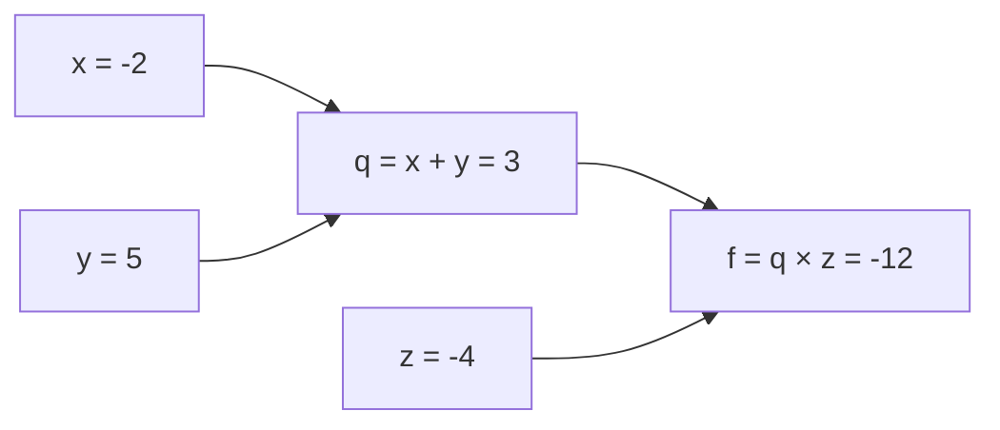
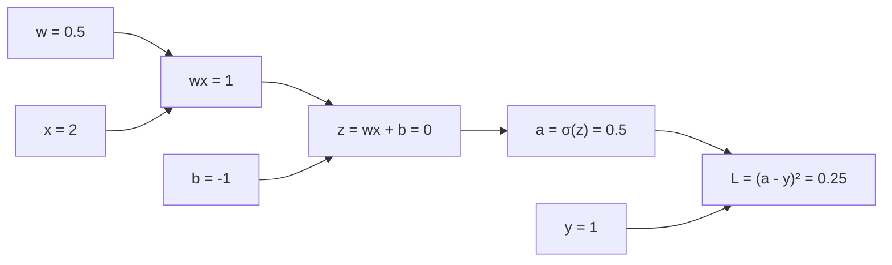

# Part 9 — Chain Rule dan Backpropagation

!!! info "Bagian pengantar"
    Part ini memperkenalkan **ide** backpropagation dengan angka tunggal (skalar). Bentuk matriks, Jacobian, dan jaringan besar dibahas di Level 5. Tidak ada pelatihan jaringan sungguhan di sini; yang dikerjakan adalah menghitung gradien dengan benar dan memahami alasannya.

## Tujuan Pembelajaran

Setelah mempelajari bagian ini, kamu mampu:

- memakai aturan rantai pada fungsi bertingkat (tiga lapis atau lebih);
- menggambar dan membaca *computational graph* (graf komputasi);
- melakukan *forward pass* dan *backward pass* secara manual pada graf sederhana;
- menjelaskan mengapa gradien pada simpul yang dipakai berkali-kali dijumlahkan;
- menghitung gradien sebuah neuron (kombinasi linear, sigmoid, dan kerugian) terhadap bobot dan bias;
- menjelaskan backpropagation sebagai aturan rantai yang dikerjakan dari belakang ke depan dan mengapa ia efisien;
- menjelaskan masalah *vanishing gradient* dengan perhitungan sederhana.

## Prasyarat

[Part 7 — Turunan](07-turunan.md) (aturan rantai satu variabel, turunan sigmoid $\sigma' = \sigma(1 - \sigma)$) dan [Part 8 — Turunan Parsial dan Gradien](08-turunan-parsial-dan-gradien.md) (turunan parsial, gradien terhadap parameter). Juga diperlukan [Level 1 — Part 10](../level-1-aljabar-dasar-dan-fungsi/10-fungsi-eksponensial-dan-logaritma.md) untuk fungsi sigmoid.

## Mengapa Materi Ini Penting?

Jaringan saraf adalah fungsi yang tersusun dari banyak lapisan: keluaran lapisan pertama menjadi masukan lapisan kedua, dan seterusnya, lalu diukur kerugiannya. Untuk melatihnya kita membutuhkan turunan kerugian terhadap **setiap** bobot di **setiap** lapisan. Menurunkan rumus untuk tiap bobot secara terpisah akan mustahil. Backpropagation menyelesaikannya dengan satu prinsip: **aturan rantai, dikerjakan dari ujung (kerugian) ke pangkal (masukan), dengan menyimpan dan memakai ulang hasil antara.**

## Konsep Dasar dengan Bahasa Sederhana

### 1. Fungsi Bertingkat

Fungsi bertingkat adalah beberapa fungsi yang dirangkai: $y = f\bigl(g(h(x))\bigr)$. Aturan rantai (Part 7) berlaku untuk rangkaian sepanjang apa pun: **kalikan turunan setiap lapisan**, masing-masing dihitung di titik yang dilewati.

Misalkan $u = 2x + 1$, $v = u^2$, dan $y = \ln v$. Maka $y = \ln\bigl((2x + 1)^2\bigr)$ dan

$$
\frac{dy}{dx} = \frac{dy}{dv} \cdot \frac{dv}{du} \cdot \frac{du}{dx}
= \frac{1}{v} \cdot 2u \cdot 2 = \frac{4u}{u^2} = \frac{4}{2x + 1}
$$

Di $x = 1$: $u = 3$, $v = 9$, sehingga $\dfrac{1}{9} \cdot 6 \cdot 2 = \dfrac{12}{9} = \dfrac{4}{3}$. Cocok dengan $\dfrac{4}{2(1) + 1} = \dfrac{4}{3}$.

Perhatikan pola kerjanya: **hitung maju** nilai-nilai antara ($u$, $v$, $y$) terlebih dahulu, lalu **kalikan turunan lokal** dari belakang. Inilah backpropagation dalam bentuk paling sederhana.

### 2. Computational Graph

**Computational graph** (graf komputasi) menggambarkan perhitungan sebagai **simpul** (nilai atau operasi) yang dihubungkan **panah** (aliran data). Dengan graf, aturan rantai menjadi prosedur mekanis.

**Contoh 1:** $f(x, y, z) = (x + y) \cdot z$ dengan $x = -2$, $y = 5$, $z = -4$.



Cara membaca: masukan $x$ dan $y$ masuk ke penjumlahan sehingga $q = 3$; lalu $q$ dan $z$ masuk ke perkalian sehingga $f = -12$.

**Forward pass** (hitung maju): isi nilai dari kiri ke kanan. Hasilnya $q = 3$ dan $f = -12$.

**Backward pass** (hitung mundur): mulai dari ujung dengan $\dfrac{\partial f}{\partial f} = 1$, lalu pada setiap simpul kalikan **gradien yang datang dari kanan** dengan **turunan lokal** simpul itu.

| Simpul | Turunan lokal | Gradien yang dicari | Hitungan |
|---|---|---|---|
| $f = q \cdot z$ | $\dfrac{\partial f}{\partial q} = z$, $\dfrac{\partial f}{\partial z} = q$ | $\dfrac{\partial f}{\partial q}$ | $z = -4$ |
| | | $\dfrac{\partial f}{\partial z}$ | $q = 3$ |
| $q = x + y$ | $\dfrac{\partial q}{\partial x} = 1$, $\dfrac{\partial q}{\partial y} = 1$ | $\dfrac{\partial f}{\partial x} = \dfrac{\partial f}{\partial q} \cdot \dfrac{\partial q}{\partial x}$ | $(-4)(1) = -4$ |
| | | $\dfrac{\partial f}{\partial y}$ | $(-4)(1) = -4$ |

Hasil: $\nabla f = (-4,\ -4,\ 3)$. **Tafsir:** menaikkan $x$ sebesar $0{,}01$ mengubah $f$ kira-kira $-0{,}04$. Cek: $f(-1{,}99;\ 5;\ -4) = (3{,}01)(-4) = -12{,}04$. Cocok.

Dua pola yang berulang:

- **Simpul penjumlahan** menyalurkan gradien yang datang **apa adanya** ke semua masukannya (turunan lokalnya 1).
- **Simpul perkalian** menukar: gradien ke satu masukan adalah gradien yang datang dikali **nilai masukan yang lain**.

**Simpul yang dipakai berkali-kali.** Jika satu nilai mengalir ke beberapa tempat, gradiennya adalah **jumlah** dari gradien tiap jalur (aturan rantai banyak jalur). Contoh: $f = x \cdot x$, dengan $x$ masuk ke perkalian lewat dua panah. Jalur pertama memberi $x$ (nilai masukan yang lain) dan jalur kedua juga $x$, jumlahnya $2x$. Di $x = 3$: $6$, sama dengan $(x^2)' = 2x$.

### 3. Satu Neuron: Bobot, Aktivasi, Kerugian

Sebuah **neuron** buatan menghitung $z = wx + b$ (kombinasi linear), lalu **fungsi aktivasi** $a = \sigma(z)$ (di sini sigmoid), lalu kerugian terhadap target $y$: $L = (a - y)^2$. Susunan ini adalah rangkaian lima operasi.

Ambil $x = 2$, $w = 0{,}5$, $b = -1$, target $y = 1$.



**Forward pass:** $wx = 1$; $z = 1 - 1 = 0$; $a = \sigma(0) = 0{,}5$; $L = (0{,}5 - 1)^2 = 0{,}25$.

**Backward pass**, dari kerugian ke parameter:

| Langkah | Turunan lokal | Perhitungan | Hasil |
|---|---|---|---|
| 1. Kerugian | $\dfrac{\partial L}{\partial L} = 1$ | | $1$ |
| 2. Ke $a$ | $\dfrac{\partial L}{\partial a} = 2(a - y)$ | $2(0{,}5 - 1)$ | $-1$ |
| 3. Ke $z$ | $\dfrac{\partial a}{\partial z} = \sigma'(z) = a(1 - a)$ | $0{,}5 \times 0{,}5 = 0{,}25$, sehingga $\dfrac{\partial L}{\partial z} = (-1)(0{,}25)$ | $-0{,}25$ |
| 4. Ke $w$ | $\dfrac{\partial z}{\partial w} = x$ | $(-0{,}25)(2)$ | $-0{,}5$ |
| 5. Ke $b$ | $\dfrac{\partial z}{\partial b} = 1$ | $(-0{,}25)(1)$ | $-0{,}25$ |
| 6. Ke $x$ | $\dfrac{\partial z}{\partial x} = w$ | $(-0{,}25)(0{,}5)$ | $-0{,}125$ |

Jadi $\dfrac{\partial L}{\partial w} = -0{,}5$ dan $\dfrac{\partial L}{\partial b} = -0{,}25$. Rumus ringkasnya:

$$
\frac{\partial L}{\partial w} = \underbrace{2(a - y)}_{\partial L/\partial a} \cdot \underbrace{a(1 - a)}_{\partial a/\partial z} \cdot \underbrace{x}_{\partial z/\partial w}
$$

**Satu langkah pembaruan** (pratinjau Part 11): bergerak berlawanan arah gradien dengan langkah $\eta = 0{,}1$.

- $w \leftarrow 0{,}5 - 0{,}1(-0{,}5) = 0{,}55$.
- $b \leftarrow -1 - 0{,}1(-0{,}25) = -0{,}975$.
- Kerugian baru: $z = 0{,}55 \cdot 2 - 0{,}975 = 0{,}125$, $a = \sigma(0{,}125) \approx 0{,}5312$, $L = (0{,}5312 - 1)^2 \approx 0{,}2198 < 0{,}25$. Kerugian turun.

### 4. Backpropagation

**Backpropagation** (propagasi balik) adalah penerapan aturan rantai pada computational graph dengan urutan:

1. **Forward pass:** hitung dan **simpan** semua nilai antara dari masukan sampai kerugian.
2. **Backward pass:** mulai dari kerugian dengan gradien $1$; pada setiap simpul, gradien ke masukan $=$ (gradien yang datang) $\times$ (turunan lokal), dijumlahkan bila ada banyak jalur.
3. Setelah selesai, setiap parameter punya gradiennya.

**Contoh dua lapisan (angka tunggal).** Masukan $x = 1$, target $y = 1$. Lapisan 1: $z_1 = w_1 x + b_1$, $a_1 = \sigma(z_1)$. Lapisan 2 (keluaran linear): $z_2 = w_2 a_1 + b_2$, kerugian $L = (z_2 - y)^2$. Parameter: $w_1 = 0{,}5$, $b_1 = 0$, $w_2 = 2$, $b_2 = -1$.

Forward pass (dibulatkan empat desimal):

| Nilai | Perhitungan | Hasil |
|---|---|---|
| $z_1$ | $0{,}5 \cdot 1 + 0$ | $0{,}5$ |
| $a_1$ | $\sigma(0{,}5)$ | $0{,}6225$ |
| $z_2$ | $2 \cdot 0{,}6225 - 1$ | $0{,}2449$ |
| $L$ | $(0{,}2449 - 1)^2$ | $0{,}5701$ |

Backward pass dari belakang:

| Gradien | Rumus | Hasil |
|---|---|---|
| $\dfrac{\partial L}{\partial z_2}$ | $2(z_2 - y)$ | $-1{,}5102$ |
| $\dfrac{\partial L}{\partial w_2}$ | $\dfrac{\partial L}{\partial z_2} \cdot a_1$ | $-0{,}9400$ |
| $\dfrac{\partial L}{\partial b_2}$ | $\dfrac{\partial L}{\partial z_2} \cdot 1$ | $-1{,}5102$ |
| $\dfrac{\partial L}{\partial a_1}$ | $\dfrac{\partial L}{\partial z_2} \cdot w_2$ | $-3{,}0203$ |
| $\dfrac{\partial L}{\partial z_1}$ | $\dfrac{\partial L}{\partial a_1} \cdot \sigma'(z_1)$, dengan $\sigma'(0{,}5) = 0{,}6225 \times 0{,}3775 = 0{,}2350$ | $-0{,}7098$ |
| $\dfrac{\partial L}{\partial w_1}$ | $\dfrac{\partial L}{\partial z_1} \cdot x$ | $-0{,}7098$ |
| $\dfrac{\partial L}{\partial b_1}$ | $\dfrac{\partial L}{\partial z_1} \cdot 1$ | $-0{,}7098$ |

**Perhatikan pemakaian ulang:** nilai $\dfrac{\partial L}{\partial z_2}$ dihitung **sekali** lalu dipakai untuk $w_2$, $b_2$, dan diteruskan ke lapisan 1. Itulah sumber efisiensinya.

**Mengapa efisien?** Alternatifnya, menghitung turunan numerik setiap parameter membutuhkan dua kali forward pass **per parameter** (untuk $n$ parameter, $2n$ forward pass). Backpropagation menghitung gradien **semua** parameter dengan satu forward pass dan satu backward pass yang biayanya kira-kira sama dengan forward pass. Untuk jutaan parameter, selisihnya sangat besar.

### 5. Vanishing Gradient

Dalam rangkaian panjang, gradien ke lapisan awal adalah **hasil kali** banyak turunan lokal. Jika setiap faktor kecil, hasil kalinya menyusut sangat cepat.

Turunan sigmoid paling besar $0{,}25$ (di $z = 0$). Jika $k$ lapisan sigmoid dilalui, gradien paling besar sekitar $0{,}25^k$:

| $k$ (banyak lapisan) | 1 | 3 | 5 | 10 |
|---|---|---|---|---|
| $0{,}25^k$ | $0{,}25$ | $0{,}0156$ | $0{,}000977$ | $0{,}00000095$ |

Pada 10 lapisan, sinyal gradien menyusut menjadi sekitar sepersejuta, sehingga lapisan awal hampir tidak belajar. Ini disebut **vanishing gradient**.

Sebaliknya, jika faktor lokalnya lebih dari 1, hasil kali membesar: $1{,}5^{10} \approx 57{,}7$. Ini **exploding gradient**.

**Aktivasi ReLU** $a = \max(0, z)$ memiliki turunan $1$ untuk $z > 0$ (tidak menyusutkan sinyal) dan $0$ untuk $z < 0$ (memutus aliran gradien). Itu sebabnya ReLU lebih populer pada jaringan dalam, dengan catatan neuron yang selalu menerima $z < 0$ tidak pernah belajar ("neuron mati").

### 6. Hubungan dengan Jaringan Saraf

- **Jaringan saraf = fungsi bertingkat.** Setiap lapisan melakukan $\mathbf{a}^{(l)} = \sigma\bigl(W^{(l)}\mathbf{a}^{(l-1)} + \mathbf{b}^{(l)}\bigr)$: perkalian matriks (Part 3) dan aktivasi. Contoh di atas memakai angka tunggal agar terlihat polanya.
- **Gradien parameter** semua lapisan dihitung dengan backpropagation. Pada lapisan berisi vektor, turunan lokal berupa **matriks** turunan parsial yang disebut Jacobian (Level 5).
- **Siklus pelatihan:** forward pass $\to$ hitung kerugian $\to$ backward pass $\to$ perbarui parameter (Part 11).
- **Diferensiasi otomatis.** Pustaka pembelajaran mendalam membangun graf komputasi saat forward pass dan menjalankan backward pass otomatis. Kamu tidak menurunkan rumus manual, tetapi memahami prinsipnya membantu menemukan kesalahan seperti gradien yang hilang.

## Istilah yang Perlu Dipahami

| Istilah | Arti sederhana | Contoh |
|---|---|---|
| Fungsi bertingkat | fungsi yang masukannya keluaran fungsi lain | $\ln((2x+1)^2)$ |
| Turunan lokal | turunan satu operasi terhadap masukannya | $\partial q/\partial x = 1$ |
| Computational graph | diagram simpul dan panah untuk sebuah perhitungan | $(x+y)z$ |
| Simpul (*node*) | satu nilai atau operasi pada graf | $q = x + y$ |
| Forward pass | menghitung nilai dari masukan ke keluaran | $L = 0{,}25$ |
| Backward pass | menghitung gradien dari keluaran ke masukan | $\partial L/\partial w$ |
| Backpropagation | aturan rantai pada graf, dari belakang ke depan | |
| Neuron | $z = wx + b$ lalu aktivasi | |
| Fungsi aktivasi | fungsi nonlinear setelah kombinasi linear | $\sigma$, ReLU |
| Bobot dan bias | parameter yang dilatih | $w$, $b$ |
| Vanishing gradient | gradien mengecil hingga hampir nol | $0{,}25^{10}$ |
| Exploding gradient | gradien membesar tanpa terkendali | $1{,}5^{10}$ |
| Neuron mati | ReLU yang selalu menerima $z < 0$ | gradien selalu 0 |

## Rumus dan Penjelasan Setiap Simbol

**Aturan rantai untuk rangkaian:**

$$
\frac{dy}{dx} = \frac{dy}{du_k} \cdot \frac{du_k}{du_{k-1}} \cdots \frac{du_1}{dx}
$$

- $u_1, \ldots, u_k$ adalah nilai antara; setiap pecahan adalah turunan lokal satu langkah.

**Aturan banyak jalur:** jika $L$ bergantung pada $x$ lewat beberapa jalur, $\dfrac{\partial L}{\partial x} = \sum_{\text{jalur}} \bigl(\text{hasil kali turunan lokal sepanjang jalur}\bigr)$.

**Neuron sigmoid dengan kerugian kuadrat:** $z = wx + b$, $a = \sigma(z)$, $L = (a - y)^2$:

$$
\frac{\partial L}{\partial w} = 2(a - y)\,a(1 - a)\,x, \qquad
\frac{\partial L}{\partial b} = 2(a - y)\,a(1 - a), \qquad
\frac{\partial L}{\partial x} = 2(a - y)\,a(1 - a)\,w
$$

- $a(1 - a) = \sigma'(z)$ (Part 7); $x$ masukan; $y$ target.

**Pembaruan parameter (pratinjau):** $w \leftarrow w - \eta\,\dfrac{\partial L}{\partial w}$ dengan $\eta > 0$ disebut laju belajar.

## Penjelasan Langkah demi Langkah

**Menghitung gradien sebuah graf secara mekanis:**

1. **Gambar** graf dari ekspresi: satu simpul untuk setiap operasi.
2. **Forward pass:** isi nilai setiap simpul dari kiri ke kanan dan simpan.
3. **Mulai dari ujung:** gradien simpul keluaran terhadap dirinya sendiri adalah 1.
4. **Mundur satu simpul demi satu:** gradien ke masukan $=$ gradien yang datang $\times$ turunan lokal. Jika sebuah nilai dipakai di beberapa tempat, **jumlahkan** gradien dari semua tempat.
5. **Periksa** dengan turunan numerik: geser parameter sedikit ($h \approx 10^{-5}$) dan lihat apakah $L$ berubah sesuai gradien.

## Contoh Soal dan Pembahasan

### Contoh 1 — Rantai tiga lapis

Hitung $\dfrac{dy}{dx}$ untuk $y = \ln\bigl((2x + 1)^2\bigr)$ di $x = 1$ lewat rangkaian.

1. $u = 2x + 1 = 3$, $v = u^2 = 9$, $y = \ln 9 \approx 2{,}197$.
2. Turunan lokal: $\dfrac{du}{dx} = 2$, $\dfrac{dv}{du} = 2u = 6$, $\dfrac{dy}{dv} = \dfrac{1}{v} = \dfrac{1}{9}$.
3. Kalikan: $2 \times 6 \times \dfrac{1}{9} = \dfrac{12}{9} = \dfrac{4}{3}$.
4. Cek dengan rumus langsung $\dfrac{4}{2x + 1} = \dfrac{4}{3}$. Sama.

### Contoh 2 — Graf aritmetika

Untuk $f = (x + y)z$ dengan $x = -2$, $y = 5$, $z = -4$, hitung semua gradien.

1. Forward: $q = 3$, $f = -12$.
2. Backward: $\dfrac{\partial f}{\partial q} = z = -4$ dan $\dfrac{\partial f}{\partial z} = q = 3$.
3. Simpul penjumlahan menyalurkan $-4$: $\dfrac{\partial f}{\partial x} = -4$ dan $\dfrac{\partial f}{\partial y} = -4$.
4. Cek: ubah $z$ menjadi $-3{,}99$: $f = 3 \times (-3{,}99) = -11{,}97$, perubahan $+0{,}03$, sesuai $3 \times 0{,}01$.

### Contoh 3 — Neuron sigmoid

Hitung $\dfrac{\partial L}{\partial w}$ dan $\dfrac{\partial L}{\partial b}$ untuk neuron dengan $x = 1$, $w = 2$, $b = 1$, target $y = 0$.

1. Forward: $z = 2 \cdot 1 + 1 = 3$; $a = \sigma(3) \approx 0{,}9526$; $L = (0{,}9526 - 0)^2 \approx 0{,}9074$.
2. $\dfrac{\partial L}{\partial a} = 2(a - y) = 1{,}9051$.
3. $\sigma'(3) = a(1 - a) = 0{,}9526 \times 0{,}0474 \approx 0{,}0452$.
4. $\dfrac{\partial L}{\partial z} = 1{,}9051 \times 0{,}0452 \approx 0{,}0861$.
5. $\dfrac{\partial L}{\partial w} = 0{,}0861 \times x = 0{,}0861$ dan $\dfrac{\partial L}{\partial b} = 0{,}0861$.
6. **Pelajaran:** kerugian cukup besar ($0{,}91$) tetapi gradiennya kecil ($0{,}086$), karena sigmoid sudah jenuh di $z = 3$ ($\sigma' \approx 0{,}045$). Itu contoh nyata efek turunan sigmoid kecil.

### Contoh 4 — Banyak jalur

Untuk $f(x) = x \cdot x + x$ (nilai $x$ dipakai tiga kali: dua kali di perkalian, sekali di penjumlahan), hitung $\dfrac{df}{dx}$ di $x = 3$.

1. Graf: $p = x \cdot x$ (dua panah dari $x$), $f = p + x$.
2. Dari simpul penjumlahan: $\dfrac{\partial f}{\partial p} = 1$ dan jalur langsung ke $x$ memberi $1$.
3. Dari perkalian $p = x \cdot x$: jalur pertama memberi $x = 3$ dan jalur kedua memberi $x = 3$; dikali gradien datang 1, jumlahnya $6$.
4. Jumlahkan semua jalur ke $x$: $6 + 1 = 7$.
5. Cek: $f' = 2x + 1 = 7$. Cocok.

## Contoh Tambahan dengan Kesulitan Bertahap

**Mudah.** Untuk $f = 3a + 2b$, graf punya dua perkalian dan satu penjumlahan: $\dfrac{\partial f}{\partial a} = 3$ dan $\dfrac{\partial f}{\partial b} = 2$.

**Sedang.** Neuron dengan $x = 2$, $w = 0{,}5$, $b = -1$, $y = 1$ (bagian 3): satu langkah dengan $\eta = 0{,}1$ menurunkan kerugian dari $0{,}25$ menjadi sekitar $0{,}2198$.

**Sedang.** ReLU: untuk $z = -2$, turunan lokal $0$ sehingga seluruh gradien ke parameter sebelumnya menjadi $0$ (aliran terputus). Untuk $z = 3$, turunan lokal $1$ sehingga gradien diteruskan utuh.

**Menantang.** Jaringan dua lapisan di bagian 4: pada $w_1 = 0{,}5$, $b_1 = 0$, $w_2 = 2$, $b_2 = -1$ gradiennya $(-0{,}7098;\ -0{,}7098;\ -0{,}9400;\ -1{,}5102)$ untuk $(w_1, b_1, w_2, b_2)$. Gradien lapisan pertama lebih kecil daripada lapisan kedua karena melewati $\sigma' = 0{,}235$. Dengan lebih banyak lapisan sigmoid, selisih ini menumpuk.

## Visualisasi atau Interpretasi Grafik

- **Graf komputasi** menunjukkan seluruh perhitungan: panah ke kanan adalah forward pass, dan gradien mengalir ke kiri pada backward pass.
- Pada **simpul perkalian**, gradien ke satu masukan "dibobot" oleh masukan lain; pada **simpul penjumlahan**, gradien disalurkan sama.
- Pada **sigmoid**, turunan lokal $\sigma(1 - \sigma)$ paling besar di tengah (0,25) dan mendekati 0 di ujung, sehingga gradien menyusut di wilayah jenuh.

## Kesalahan Umum

| Kesalahan | Mengapa salah | Yang benar |
|---|---|---|
| Menjumlahkan turunan lokal sepanjang rantai | rantai adalah **hasil kali** | kalikan turunan lokal |
| Mengalikan gradien dari jalur berbeda | jalur berbeda **dijumlahkan** | jumlahkan hasil kali tiap jalur |
| Lupa simpan nilai forward pass | turunan lokal membutuhkannya | simpan $a$, $z$, dan sejenisnya |
| Memakai turunan $\sigma$ sebagai $\sigma'(z) = \sigma(z)$ | salah rumus | $\sigma(z)(1 - \sigma(z))$ |
| Menghitung $\partial L/\partial a$ tanpa faktor 2 pada kerugian kuadrat | $(a - y)^2$ diturunkan $2(a - y)$ | sertakan 2 |
| Salah tanda $-\eta\,\partial L/\partial w$ | memperbarui searah gradien menaikkan kerugian | kurangi gradien |
| Menyimpulkan model rusak karena gradien lapisan awal sangat kecil | bisa karena vanishing gradient | periksa aktivasi dan kedalaman |
| Menganggap ReLU punya turunan di 0 | tidak ada (Part 7) | gunakan konvensi (misalnya 0) |
| Percaya rumus gradien tanpa diperiksa | kesalahan kecil mudah terjadi | bandingkan dengan turunan numerik |
| Menganggap backpropagation algoritma pelatihan lengkap | ia hanya menghitung gradien | pembaruan parameter dilakukan metode lain (Part 11) |

## Hubungan dengan Machine Learning

- **Inti pelatihan jaringan saraf.** Setiap pembaruan bobot memakai gradien dari backpropagation.
- **Efisiensi.** Satu backward pass menghasilkan gradien untuk semua parameter, sehingga pelatihan model besar menjadi mungkin.
- **Memori.** Karena nilai antara dari forward pass dibutuhkan saat backward, pelatihan memakai memori lebih banyak daripada sekadar prediksi.
- **Pemilihan aktivasi dan arsitektur** dipengaruhi vanishing gradient dan exploding gradient.
- **Pemeriksaan gradien** (*gradient checking*): membandingkan gradien rumus dan gradien numerik adalah cara baku memeriksa implementasi.
- **Bentuk matriks** (Level 5): bobot lapisan berupa matriks, dan turunan lokal berupa Jacobian, tetapi aturannya sama dengan di sini.

### Python: forward dan backward secara manual

Neuron sigmoid dengan kerugian kuadrat. Fungsi mengembalikan nilai dan gradien:

```python
import math

def sigmoid(z):
    return 1 / (1 + math.exp(-z))

def neuron(x, w, b, y):
    # forward pass
    z = w * x + b
    a = sigmoid(z)
    L = (a - y) ** 2
    # backward pass
    dL_da = 2 * (a - y)
    da_dz = a * (1 - a)
    dL_dz = dL_da * da_dz
    return {"z": z, "a": a, "L": L,
            "dw": dL_dz * x, "db": dL_dz, "dx": dL_dz * w}

print(neuron(2, 0.5, -1, 1))
# {'z': 0.0, 'a': 0.5, 'L': 0.25, 'dw': -0.5, 'db': -0.25, 'dx': -0.125}

hasil = neuron(1, 2, 1, 0)
print({k: round(v, 4) for k, v in hasil.items()})
# {'z': 3, 'a': 0.9526, 'L': 0.9074, 'dw': 0.0861, 'db': 0.0861, 'dx': 0.1721}
```

Memeriksa dengan turunan numerik (selisih tengah, $h = 10^{-6}$):

```python
def turunan_tengah(f, x, h=1e-6):
    return (f(x + h) - f(x - h)) / (2 * h)

L_w = lambda w: neuron(2, w, -1, 1)["L"]
L_b = lambda b: neuron(2, 0.5, b, 1)["L"]
print(round(turunan_tengah(L_w, 0.5), 4))    # -0.5
print(round(turunan_tengah(L_b, -1), 4))     # -0.25
```

Satu langkah pembaruan dengan $\eta = 0{,}1$:

```python
eta = 0.1
g = neuron(2, 0.5, -1, 1)
w_baru = 0.5 - eta * g["dw"]
b_baru = -1 - eta * g["db"]
print(w_baru, b_baru)                          # 0.55 -0.975
print(round(neuron(2, w_baru, b_baru, 1)["L"], 4))   # 0.2198, lebih kecil dari 0.25
```

Jaringan dua lapisan angka tunggal dari bagian 4:

```python
def dua_lapis(x, w1, b1, w2, b2, y):
    z1 = w1 * x + b1
    a1 = sigmoid(z1)
    z2 = w2 * a1 + b2
    L = (z2 - y) ** 2
    dz2 = 2 * (z2 - y)
    dw2 = dz2 * a1
    db2 = dz2
    da1 = dz2 * w2
    dz1 = da1 * a1 * (1 - a1)
    return {"L": L, "dw1": dz1 * x, "db1": dz1, "dw2": dw2, "db2": db2}

h = dua_lapis(1, 0.5, 0, 2, -1, 1)
print({k: round(v, 4) for k, v in h.items()})
# {'L': 0.5701, 'dw1': -0.7098, 'db1': -0.7098, 'dw2': -0.94, 'db2': -1.5102}

L_total = lambda w1, b1, w2, b2: dua_lapis(1, w1, b1, w2, b2, 1)["L"]
param = [0.5, 0, 2, -1]
for i in range(4):
    def f(t, i=i):
        p = list(param)
        p[i] = t
        return L_total(*p)
    print(round(turunan_tengah(f, param[i]), 4))
# -0.7098
# -0.7098
# -0.94
# -1.5102
```

Vanishing gradient dan graf aritmetika:

```python
print([0.25 ** k for k in (1, 3, 5, 10)])   # [0.25, 0.015625, 0.0009765625, 9.5367431640625e-07]
print(1.5 ** 10)                            # 57.6650390625

x, y, z = -2, 5, -4
q = x + y
f = q * z
print(q, f)                    # 3 -12
print(z, z, q)                 # df/dx = -4, df/dy = -4, df/dz = 3
```

## Latihan Mandiri

1. Hitung $f = (x + y)z$ dan semua gradiennya untuk $x = -2$, $y = 5$, $z = -4$. Periksa $\dfrac{\partial f}{\partial z}$ dengan menaikkan $z$ sebesar $0{,}01$.
2. Hitung $\dfrac{dy}{dx}$ untuk $y = \ln\bigl((2x + 1)^2\bigr)$ di $x = 1$ lewat rangkaian $u \to v \to y$.
3. Neuron $z = wx + b$, $a = \sigma(z)$, $L = (a - y)^2$ dengan $x = 2$, $w = 0{,}5$, $b = -1$, $y = 1$. Lakukan forward pass dan backward pass, dan beri $\dfrac{\partial L}{\partial w}$, $\dfrac{\partial L}{\partial b}$, dan $\dfrac{\partial L}{\partial x}$.
4. Dari soal 3, lakukan satu pembaruan dengan $\eta = 0{,}1$ dan hitung kerugian baru. Apakah turun?
5. Jaringan dua lapisan dengan $x = 1$, $y = 1$, $w_1 = 0{,}5$, $b_1 = 0$, $w_2 = 2$, $b_2 = -1$ (aktivasi sigmoid di lapisan 1, keluaran linear): hitung $z_1$, $a_1$, $z_2$, $L$, lalu semua gradien (4 desimal).
6. Gambarkan (dalam kata atau daftar) graf untuk $L = (\sigma(wx + b) - y)^2$ dan sebutkan turunan lokal tiap simpul.
7. Hitung $0{,}25^5$ dan $0{,}25^{10}$, serta $1^{10}$. Apa maknanya bagi jaringan 10 lapis sigmoid dibandingkan ReLU aktif?
8. ReLU $a = \max(0, z)$: berapa turunan lokal untuk $z = -2$ dan $z = 3$? Apa akibatnya pada gradien parameter sebelum ReLU?
9. Periksa $\dfrac{\partial L}{\partial w}$ pada soal 3 dengan turunan numerik: hitung $L$ untuk $w = 0{,}5 \pm 0{,}001$ dan bagi selisihnya dengan $0{,}002$.
10. Jelaskan dengan kalimatmu sendiri: (a) mengapa backpropagation menghitung dari belakang ke depan, (b) apa yang harus disimpan saat forward pass, dan (c) mengapa lebih efisien daripada menghitung turunan numerik tiap parameter.

## Kunci Jawaban dan Pembahasan

??? success "Soal 1"
    $q = x + y = 3$, $f = q \cdot z = -12$. $\dfrac{\partial f}{\partial q} = z = -4$, $\dfrac{\partial f}{\partial z} = q = 3$, $\dfrac{\partial f}{\partial x} = \dfrac{\partial f}{\partial y} = -4$. Cek $z = -3{,}99$: $f = 3(-3{,}99) = -11{,}97$, naik $0{,}03 = 3 \times 0{,}01$.

??? success "Soal 2"
    $u = 3$, $v = 9$. $\dfrac{du}{dx} = 2$, $\dfrac{dv}{du} = 2u = 6$, $\dfrac{dy}{dv} = \dfrac{1}{9}$. Hasil kali $2 \cdot 6 \cdot \dfrac{1}{9} = \dfrac{4}{3}$.

??? success "Soal 3"
    Forward: $wx = 1$, $z = 0$, $a = 0{,}5$, $L = 0{,}25$. Backward: $\dfrac{\partial L}{\partial a} = 2(0{,}5 - 1) = -1$; $\sigma'(0) = 0{,}25$; $\dfrac{\partial L}{\partial z} = -0{,}25$. $\dfrac{\partial L}{\partial w} = -0{,}25 \times 2 = -0{,}5$; $\dfrac{\partial L}{\partial b} = -0{,}25$; $\dfrac{\partial L}{\partial x} = -0{,}25 \times 0{,}5 = -0{,}125$.

??? success "Soal 4"
    $w = 0{,}5 - 0{,}1(-0{,}5) = 0{,}55$ dan $b = -1 - 0{,}1(-0{,}25) = -0{,}975$. $z = 0{,}55 \cdot 2 - 0{,}975 = 0{,}125$, $a = \sigma(0{,}125) \approx 0{,}5312$, $L \approx (0{,}5312 - 1)^2 \approx 0{,}2198$. Turun dari $0{,}25$: **ya**.

??? success "Soal 5"
    $z_1 = 0{,}5$, $a_1 = 0{,}6225$, $z_2 = 0{,}2449$, $L = 0{,}5701$. $\dfrac{\partial L}{\partial z_2} = -1{,}5102$; $\dfrac{\partial L}{\partial w_2} = -0{,}9400$; $\dfrac{\partial L}{\partial b_2} = -1{,}5102$; $\dfrac{\partial L}{\partial a_1} = -3{,}0203$; $\sigma'(0{,}5) = 0{,}2350$; $\dfrac{\partial L}{\partial z_1} = -0{,}7098$; $\dfrac{\partial L}{\partial w_1} = -0{,}7098$; $\dfrac{\partial L}{\partial b_1} = -0{,}7098$.

??? success "Soal 6"
    Simpul: (1) $m = wx$, turunan lokal $\partial m/\partial w = x$, $\partial m/\partial x = w$. (2) $z = m + b$, turunan lokal $1$ dan $1$. (3) $a = \sigma(z)$, turunan lokal $a(1 - a)$. (4) $s = a - y$, turunan lokal $1$ terhadap $a$ dan $-1$ terhadap $y$. (5) $L = s^2$, turunan lokal $2s$. Gradien dikalikan mundur dari (5) ke (1).

??? success "Soal 7"
    $0{,}25^5 \approx 0{,}000977$ dan $0{,}25^{10} \approx 9{,}5 \times 10^{-7}$ (sekitar sepersejuta), sedangkan $1^{10} = 1$. Pada 10 lapisan sigmoid, gradien ke lapisan awal menyusut mendekati nol; ReLU aktif ($z > 0$) meneruskan gradien utuh.

??? success "Soal 8"
    $z = -2$: turunan lokal $0$, sehingga gradien ke parameter sebelumnya menjadi $0$ (aliran terputus). $z = 3$: turunan lokal $1$, gradien diteruskan.

??? success "Soal 9"
    Untuk $w = 0{,}501$: $z = 0{,}501 \cdot 2 - 1 = 0{,}002$, $a = \sigma(0{,}002) \approx 0{,}5005$, $L \approx 0{,}249500$. Untuk $w = 0{,}499$: $z = -0{,}002$, $a \approx 0{,}4995$, $L \approx 0{,}250500$. Selisihnya $0{,}249500 - 0{,}250500 = -0{,}001000$; dibagi $0{,}002$ menghasilkan $-0{,}5$. Cocok dengan gradien dari backpropagation.

??? success "Soal 10"
    (a) Gradien kerugian terhadap parameter bergantung pada gradien lapisan di sebelah kanannya (aturan rantai), jadi kita harus mulai dari kerugian dan bergerak mundur. (b) Nilai antara seperti $z$ dan $a$ di setiap lapisan, karena turunan lokal memakainya. (c) Satu backward pass memakai ulang hasil antara dan menghasilkan semua gradien dengan biaya kira-kira satu forward pass; turunan numerik butuh dua forward pass per parameter.

## Ringkasan Materi

- Fungsi bertingkat diturunkan dengan **mengalikan turunan lokal** sepanjang rantai; jalur berbeda **dijumlahkan**.
- Computational graph menggambarkan perhitungan sebagai simpul dan panah. Forward pass menghitung nilai; backward pass menghitung gradien dari ujung ke pangkal.
- Simpul penjumlahan menyalurkan gradien; simpul perkalian menukarnya dengan masukan lain; sigmoid mengalikan dengan $a(1 - a)$.
- Untuk neuron sigmoid dengan kerugian kuadrat: $\dfrac{\partial L}{\partial w} = 2(a - y)\,a(1 - a)\,x$.
- Backpropagation efisien karena memakai ulang hasil antara: satu backward pass memberi gradien semua parameter.
- Hasil kali banyak turunan kecil (sigmoid $\leq 0{,}25$) menyebabkan vanishing gradient; ReLU meneruskan gradien tetapi dapat "mati".
- Gradien dapat diperiksa dengan turunan numerik.

## Checklist Penguasaan

- [ ] Menurunkan fungsi bertingkat dengan mengalikan turunan lokal.
- [ ] Menggambar graf komputasi untuk sebuah ekspresi.
- [ ] Melakukan forward dan backward pass manual pada graf aritmetika.
- [ ] Menjelaskan mengapa gradien dari beberapa jalur dijumlahkan.
- [ ] Menghitung gradien neuron sigmoid terhadap $w$, $b$, dan $x$.
- [ ] Menjelaskan mengapa backpropagation efisien dan apa yang disimpan saat forward pass.
- [ ] Menjelaskan vanishing gradient dengan perhitungan $0{,}25^k$.
- [ ] Memeriksa gradien dengan turunan numerik.

## Prasyarat untuk Materi Berikutnya

[Part 10 — Integral](10-integral.md) tidak membutuhkan Part 9. Part 11 — Optimasi dan Gradient Descent membutuhkan: gradien parameter dan langkah pembaruan $w \leftarrow w - \eta\,\partial L/\partial w$ dari bagian ini. Level 5 membahas backpropagation dalam bentuk matriks.
