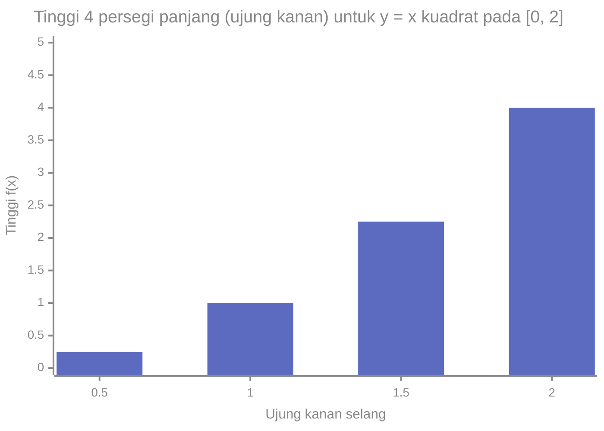

# Part 10 — Integral

## Tujuan Pembelajaran

Setelah mempelajari bagian ini, kamu mampu:

- menjelaskan integral sebagai akumulasi dan sebagai kebalikan turunan;
- mencari antiturunan dan menjelaskan mengapa selalu ada konstanta integrasi $C$;
- menghitung integral tak tentu dengan aturan dasar dan memeriksanya dengan menurunkan;
- menjelaskan integral tentu sebagai luas bertanda lewat jumlah Riemann;
- memakai teorema dasar kalkulus untuk menghitung integral tentu: $\int_a^b f(x)\,dx = F(b) - F(a)$;
- menafsirkan luas di atas dan di bawah sumbu, serta menghitung nilai rata-rata fungsi;
- mengenali dua pemakaian integral yang akan muncul di Machine Learning: probabilitas kontinu dan penjumlahan numerik.

## Prasyarat

[Part 7 — Turunan](07-turunan.md) (aturan turunan, turunan eksponensial dan logaritma, sigmoid) dan [Part 6 — Limit dan Kontinuitas](06-limit-dan-kontinuitas.md) (limit, karena integral tentu adalah limit jumlah). Juga dipakai [Level 0 — Part 8](../level-0-fondasi-matematika/08-notasi-matematika-dasar.md) (notasi $\sum$) dan [Level 1 — Part 10](../level-1-aljabar-dasar-dan-fungsi/10-fungsi-eksponensial-dan-logaritma.md) ($e^x$ dan $\ln x$). Part ini tidak membutuhkan Part 8 dan 9.

## Mengapa Materi Ini Penting?

Turunan menjawab "seberapa cepat sesuatu berubah". Integral menjawab pertanyaan kebalikannya: "jika tahu lajunya, berapa total yang terkumpul?" Contoh: dari kecepatan kita ingin tahu jarak; dari kepadatan peluang kita ingin tahu peluang sebuah rentang. Dalam Machine Learning, peluang untuk data kontinu adalah luas di bawah kurva (Level 3), dan nilai harapan dari kerugian adalah integral. Banyak integral tidak punya rumus sederhana, sehingga komputer menghitungnya sebagai jumlah luas persegi panjang kecil, yang juga kita pelajari di sini.

## Konsep Dasar dengan Bahasa Sederhana

### 1. Antiturunan

**Antiturunan** (*antiderivative*) dari $f$ adalah fungsi $F$ yang **turunannya adalah $f$**: $F'(x) = f(x)$. Ini kebalikan dari menurunkan.

Contoh: $f(x) = 2x$. Fungsi apa yang turunannya $2x$? Dari Part 7, $(x^2)' = 2x$. Jadi $F(x) = x^2$ adalah antiturunan.

Tetapi $(x^2 + 5)' = 2x$ dan $(x^2 - 100)' = 2x$ juga. Konstanta hilang saat menurunkan, sehingga **ada banyak antiturunan yang hanya berbeda konstanta**. Seluruhnya ditulis $F(x) + C$ dengan $C$ konstanta sembarang. Bayangkan seperti ketinggian: dari kemiringan (turunan) sebuah jalan kita bisa mengetahui bentuk jalan, tetapi bukan ketinggian awalnya.

### 2. Integral Tak Tentu

**Integral tak tentu** adalah himpunan semua antiturunan:

$$
\int f(x)\,dx = F(x) + C
$$

- $\int$ adalah tanda integral (huruf S yang memanjang, dari kata *summa*).
- $f(x)$ disebut **integran** (fungsi yang diintegralkan).
- $dx$ menandai **variabel** yang diintegralkan.
- $C$ adalah **konstanta integrasi**.

Hasilnya adalah **fungsi** (satu keluarga fungsi), bukan satu bilangan.

**Aturan dasar** (masing-masing dapat diperiksa dengan menurunkan hasilnya):

| Integran | Hasil | Syarat |
|---|---|---|
| $k$ (konstanta) | $kx + C$ | |
| $x^n$ | $\dfrac{x^{n+1}}{n + 1} + C$ | $n \neq -1$ |
| $\dfrac{1}{x}$ | $\ln\lvert x \rvert + C$ | $x \neq 0$ |
| $e^x$ | $e^x + C$ | |
| $e^{kx}$ | $\dfrac{e^{kx}}{k} + C$ | $k \neq 0$ |
| $\cos x$ | $\sin x + C$ | $x$ dalam radian |
| $a f(x) + b g(x)$ | $a\int f\,dx + b\int g\,dx$ | linearitas |

Aturan pangkat adalah kebalikan aturan pangkat turunan: naikkan eksponen satu, lalu bagi dengan eksponen baru. Syarat $n \neq -1$ muncul karena $n = -1$ akan membagi dengan nol; kasus itu ditangani oleh $\ln\lvert x \rvert$ (karena $(\ln x)' = \tfrac{1}{x}$).

**Contoh:**

- $\displaystyle\int (3x^2 - 4x + 5)\,dx = x^3 - 2x^2 + 5x + C$. Cek: $(x^3 - 2x^2 + 5x)' = 3x^2 - 4x + 5$.
- $\displaystyle\int \sqrt{x}\,dx = \int x^{1/2}\,dx = \frac{x^{3/2}}{3/2} + C = \frac{2}{3}x^{3/2} + C$.
- $\displaystyle\int \frac{1}{x^2}\,dx = \int x^{-2}\,dx = \frac{x^{-1}}{-1} + C = -\frac{1}{x} + C$.
- $\displaystyle\int e^{3x}\,dx = \frac{e^{3x}}{3} + C$. Cek dengan aturan rantai: $\left(\tfrac{1}{3}e^{3x}\right)' = \tfrac{1}{3} \cdot 3e^{3x} = e^{3x}$.

**Menentukan $C$ dari satu keterangan.** Jika diketahui turunan dan satu nilai fungsi, $C$ dapat dicari. Contoh: $F'(x) = 2x - 3$ dan $F(1) = 0$. Integralkan: $F(x) = x^2 - 3x + C$. Syarat $F(1) = 0$: $1 - 3 + C = 0$, jadi $C = 2$ dan $F(x) = x^2 - 3x + 2$.

### 3. Luas di Bawah Kurva dan Jumlah Riemann

Bagaimana menghitung luas daerah di bawah kurva $y = f(x)$ antara $x = a$ dan $x = b$? Idenya: bagi daerah itu menjadi **$n$ persegi panjang tegak** dengan lebar sama $\Delta x = \dfrac{b - a}{n}$, hitung luas masing-masing (tinggi dikali lebar), lalu jumlahkan. Hasilnya disebut **jumlah Riemann**.

Untuk $f(x) = x^2$ pada $[0, 2]$ dengan $n = 4$, lebar $\Delta x = 0{,}5$. Jika tinggi persegi panjang diambil dari **ujung kanan** setiap selang:

| Selang | Ujung kanan $x_k$ | Tinggi $f(x_k)$ | Luas $f(x_k)\,\Delta x$ |
|---|---|---|---|
| $[0;\,0{,}5]$ | $0{,}5$ | $0{,}25$ | $0{,}125$ |
| $[0{,}5;\,1]$ | $1$ | $1$ | $0{,}5$ |
| $[1;\,1{,}5]$ | $1{,}5$ | $2{,}25$ | $1{,}125$ |
| $[1{,}5;\,2]$ | $2$ | $4$ | $2$ |
| Jumlah | | | $3{,}75$ |



Cara membaca: setiap batang adalah tinggi sebuah persegi panjang selebar $0{,}5$. Luas total $= (0{,}25 + 1 + 2{,}25 + 4) \times 0{,}5 = 7{,}5 \times 0{,}5 = 3{,}75$. Karena kurva naik, batang dari ujung kanan **melebihi** kurva, sehingga $3{,}75$ adalah perkiraan yang terlalu besar.

Jika tinggi diambil dari **ujung kiri** ($0$, $0{,}25$, $1$, $2{,}25$), luasnya $(0 + 0{,}25 + 1 + 2{,}25) \times 0{,}5 = 1{,}75$ (terlalu kecil). Luas sebenarnya berada di antara keduanya.

Makin banyak persegi panjang, makin baik perkiraannya:

| $n$ | Jumlah kiri | Jumlah kanan |
|---|---|---|
| 4 | $1{,}75$ | $3{,}75$ |
| 8 | $2{,}1875$ | $3{,}1875$ |
| 100 | $2{,}6268$ | $2{,}7068$ |
| 1.000 | $2{,}6627$ | $2{,}6707$ |

Keduanya mendekati bilangan yang sama, yaitu $\tfrac{8}{3} \approx 2{,}6667$. Bilangan itulah **integral tentu**.

### 4. Integral Tentu

**Integral tentu** dari $f$ dari $a$ sampai $b$ adalah **limit jumlah Riemann** ketika $n \to \infty$ (Part 6):

$$
\int_a^b f(x)\,dx = \lim_{n \to \infty} \sum_{k=1}^{n} f(x_k)\,\Delta x
$$

- $a$ dan $b$ adalah **batas bawah** dan **batas atas**.
- $\Delta x = \dfrac{b - a}{n}$ lebar tiap persegi panjang; $x_k$ titik di selang ke-$k$.
- Hasilnya **satu bilangan**: **luas bertanda** antara kurva dan sumbu $x$ dari $a$ sampai $b$ (bagian 6).

Menghitung limit itu setiap kali sangat berat. Untungnya ada jalan pintas.

### 5. Teorema Dasar Kalkulus

**Teorema dasar kalkulus** menghubungkan turunan dan integral, dua topik yang tampaknya berbeda.

**Bagian 1.** Jika $A(x) = \int_a^x f(t)\,dt$ (luas yang terkumpul sampai $x$), maka $A'(x) = f(x)$. Laju pertambahan luas adalah tinggi kurva di titik itu.

**Bagian 2 (yang paling sering dipakai).** Jika $F$ adalah **antiturunan** dari $f$ (dan $f$ kontinu), maka

$$
\int_a^b f(x)\,dx = F(b) - F(a)
$$

Penulisan ringkas: $\Bigl[F(x)\Bigr]_a^b = F(b) - F(a)$. Cukup temukan antiturunan, lalu hitung selisih nilainya di batas atas dan batas bawah. **Konstanta $C$ tidak perlu**, karena ia saling menghapus: $(F(b) + C) - (F(a) + C) = F(b) - F(a)$.

**Contoh 1:** $\displaystyle\int_0^2 x^2\,dx = \left[\frac{x^3}{3}\right]_0^2 = \frac{8}{3} - 0 = \frac{8}{3} \approx 2{,}6667$. Sama dengan limit jumlah Riemann di atas.

**Contoh 2:** $\displaystyle\int_1^3 (2x + 1)\,dx = \Bigl[x^2 + x\Bigr]_1^3 = (9 + 3) - (1 + 1) = 10$. Cek geometri: daerahnya trapesium dengan tinggi sisi $f(1) = 3$ dan $f(3) = 7$ serta lebar 2: luas $\dfrac{3 + 7}{2} \times 2 = 10$.

**Contoh 3:** $\displaystyle\int_0^1 e^x\,dx = \Bigl[e^x\Bigr]_0^1 = e - 1 \approx 1{,}7183$.

**Contoh 4:** $\displaystyle\int_1^{e} \frac{1}{x}\,dx = \Bigl[\ln x\Bigr]_1^{e} = \ln e - \ln 1 = 1 - 0 = 1$.

### 6. Luas Bertanda dan Sifat Integral Tentu

**Luas bertanda.** Bagian kurva **di atas** sumbu $x$ menyumbang luas **positif**, bagian **di bawah** menyumbang **negatif**. Itulah sebabnya hasilnya disebut luas *bertanda*.

- $\displaystyle\int_{-1}^{1} x\,dx = \left[\frac{x^2}{2}\right]_{-1}^{1} = \frac{1}{2} - \frac{1}{2} = 0$. Luas di kiri (negatif) sama dengan di kanan (positif), jadi saling meniadakan.
- $\displaystyle\int_0^2 (x - 1)\,dx = \left[\frac{x^2}{2} - x\right]_0^2 = (2 - 2) - 0 = 0$. Segitiga di bawah sumbu ($x$ dari 0 ke 1, luas $\tfrac{1}{2}$) dan segitiga di atas ($x$ dari 1 ke 2, luas $\tfrac{1}{2}$) saling meniadakan.

**Luas sebenarnya (tanpa tanda)** adalah $\int_a^b \lvert f(x) \rvert\,dx$, yang dihitung dengan memecah di titik tempat $f$ berganti tanda. Untuk $x - 1$ pada $[0, 2]$: $\tfrac{1}{2} + \tfrac{1}{2} = 1$.

**Sifat** (untuk $f$ dan $g$ kontinu):

| Sifat | Rumus |
|---|---|
| Batas sama | $\int_a^a f\,dx = 0$ |
| Batas ditukar | $\int_b^a f\,dx = -\int_a^b f\,dx$ |
| Kelipatan konstanta | $\int_a^b c\,f\,dx = c\int_a^b f\,dx$ |
| Jumlah | $\int_a^b (f + g)\,dx = \int_a^b f\,dx + \int_a^b g\,dx$ |
| Penjumlahan selang | $\int_a^c f\,dx = \int_a^b f\,dx + \int_b^c f\,dx$ |

Contoh penjumlahan selang: jika $\int_0^2 f = 3$ dan $\int_2^5 f = 4$, maka $\int_0^5 f = 7$ dan $\int_2^0 f = -3$.

**Nilai rata-rata fungsi** pada $[a, b]$:

$$
\bar{f} = \frac{1}{b - a}\int_a^b f(x)\,dx
$$

Contoh: $f(x) = x^2$ pada $[0, 2]$: $\bar{f} = \dfrac{1}{2} \cdot \dfrac{8}{3} = \dfrac{4}{3} \approx 1{,}333$. Ini versi kontinu dari "jumlah dibagi banyaknya" (Level 0, Part 8).

### 7. Pemakaian: dari Laju ke Total, dan Pratinjau Probabilitas

**Dari kecepatan ke perpindahan.** Jika kecepatan $v(t)$ (m/s), perpindahan dari $t = a$ sampai $t = b$ adalah $\int_a^b v(t)\,dt$.

- $v(t) = 2t$ dari $0$ sampai $4$ detik: $\int_0^4 2t\,dt = \Bigl[t^2\Bigr]_0^4 = 16$ meter.
- $v(t) = 3 - t$ dari $0$ sampai $6$: $\int_0^6 (3 - t)\,dt = \Bigl[3t - \tfrac{t^2}{2}\Bigr]_0^6 = (18 - 18) - 0 = 0$. Benda maju lalu mundur dan kembali ke titik awal. Perpindahan $0$, tetapi **jarak tempuh** adalah $\int_0^6 \lvert 3 - t \rvert\,dt = 4{,}5 + 4{,}5 = 9$ meter.

**Pratinjau: peluang sebagai luas.** Pada peubah kontinu, peluang suatu rentang adalah luas di bawah **fungsi kepadatan** $f(x)$, dengan syarat $f(x) \geq 0$ dan **total luas $= 1$**. Contoh: $f(x) = 2x$ pada $[0, 1]$.

- Total: $\int_0^1 2x\,dx = \Bigl[x^2\Bigr]_0^1 = 1$. Sah sebagai kepadatan.
- Peluang $X \in [0{,}5;\ 1]$: $\int_{0{,}5}^{1} 2x\,dx = 1 - 0{,}25 = 0{,}75$.

Peluang dibahas formal di Level 3; di sini cukup mengetahui bahwa integral adalah alatnya.

**Integral dalam Machine Learning yang dapat dicek.** Fungsi sigmoid punya antiturunan sederhana: $\int \sigma(x)\,dx = \ln(1 + e^x) + C$ (fungsi ini disebut *softplus*). Cek: $\bigl(\ln(1 + e^x)\bigr)' = \dfrac{e^x}{1 + e^x} = \dfrac{1}{1 + e^{-x}} = \sigma(x)$. Maka $\int_0^1 \sigma(x)\,dx = \ln(1 + e) - \ln 2 = \ln\dfrac{1 + e}{2} \approx 0{,}6201$.

**Tidak semua integral punya rumus sederhana.** Misalnya $\int e^{-x^2}\,dx$ (terkait kurva lonceng) tidak dapat ditulis dengan fungsi-fungsi dasar. Karena itu komputer menghitung integral secara **numerik**: jumlah Riemann, atau aturan trapesium, yang memakai trapesium (rata-rata tinggi dua ujung) agar lebih teliti. Untuk $x^2$ pada $[0, 2]$ dengan $n = 4$: trapesium memberi $\dfrac{1{,}75 + 3{,}75}{2} = 2{,}75$ (lebih dekat ke $2{,}6667$ daripada keduanya).

## Istilah yang Perlu Dipahami

| Istilah | Arti sederhana | Contoh |
|---|---|---|
| Antiturunan | fungsi yang turunannya adalah fungsi yang diberikan | $x^2$ untuk $2x$ |
| Integral tak tentu | semua antiturunan, ditulis $F(x) + C$ | $\int 2x\,dx = x^2 + C$ |
| Konstanta integrasi $C$ | konstanta sembarang yang hilang saat menurunkan | |
| Integran | fungsi di dalam tanda integral | $2x$ |
| Integral tentu | luas bertanda dari $a$ sampai $b$ | $\int_0^2 x^2\,dx$ |
| Batas bawah / atas | $a$ dan $b$ pada $\int_a^b$ | 0 dan 2 |
| Jumlah Riemann | jumlah luas persegi panjang kecil | $3{,}75$ untuk $n = 4$ |
| Luas bertanda | positif di atas sumbu, negatif di bawah | $\int_{-1}^{1} x\,dx = 0$ |
| Teorema dasar kalkulus | $\int_a^b f = F(b) - F(a)$ | |
| Nilai rata-rata fungsi | $\frac{1}{b-a}\int_a^b f$ | $\frac{4}{3}$ untuk $x^2$ di $[0,2]$ |
| Fungsi kepadatan (pratinjau) | fungsi nonnegatif dengan total luas 1 | $2x$ pada $[0,1]$ |
| Integrasi numerik | menghitung integral dengan jumlah luas kecil | aturan trapesium |

## Rumus dan Penjelasan Setiap Simbol

**Integral tak tentu:** $\int f(x)\,dx = F(x) + C$ dengan $F' = f$.

**Aturan pangkat:**

$$
\int x^n\,dx = \frac{x^{n+1}}{n + 1} + C \qquad (n \neq -1)
$$

- $n$ bilangan real; $n + 1$ eksponen baru yang juga menjadi pembagi.

**Integral tentu:**

$$
\int_a^b f(x)\,dx = \lim_{n \to \infty} \sum_{k=1}^{n} f(x_k)\,\Delta x = F(b) - F(a)
$$

- $\Delta x = \dfrac{b - a}{n}$, $x_k$ titik pada selang ke-$k$, $F$ antiturunan apa pun dari $f$. Syarat: $f$ kontinu pada $[a, b]$.

**Nilai rata-rata:** $\bar{f} = \dfrac{1}{b - a}\displaystyle\int_a^b f(x)\,dx$, untuk $b > a$.

**Aturan trapesium ($n$ trapesium):**

$$
\int_a^b f\,dx \approx \Delta x\left[\frac{f(a)}{2} + f(x_1) + \cdots + f(x_{n-1}) + \frac{f(b)}{2}\right]
$$

## Penjelasan Langkah demi Langkah

**Menghitung $\displaystyle\int_1^3 (2x + 1)\,dx$:**

| Langkah | Perhitungan |
|---|---|
| 1. Cari antiturunan | $F(x) = x^2 + x$ (turunannya $2x + 1$) |
| 2. Hitung di batas atas | $F(3) = 9 + 3 = 12$ |
| 3. Hitung di batas bawah | $F(1) = 1 + 1 = 2$ |
| 4. Kurangkan | $F(3) - F(1) = 10$ |
| 5. Periksa dengan geometri | trapesium: $\dfrac{3 + 7}{2} \times 2 = 10$ |
| 6. Periksa dengan jumlah Riemann | $n$ besar mendekati $10$ |

## Contoh Soal dan Pembahasan

### Contoh 1 — Integral tak tentu

Hitung $\displaystyle\int \left(4x^3 - \frac{2}{x} + e^{2x}\right) dx$.

1. Suku pertama: $4 \cdot \dfrac{x^4}{4} = x^4$.
2. Suku kedua: $-2\ln\lvert x \rvert$ (dari $\int \tfrac{1}{x}\,dx = \ln\lvert x \rvert$).
3. Suku ketiga: $\dfrac{e^{2x}}{2}$.
4. Hasil: $x^4 - 2\ln\lvert x \rvert + \dfrac{e^{2x}}{2} + C$.
5. Cek turunan: $4x^3 - \dfrac{2}{x} + \dfrac{1}{2} \cdot 2e^{2x} = 4x^3 - \dfrac{2}{x} + e^{2x}$. Cocok.

### Contoh 2 — Menentukan konstanta

Jika $s'(t) = 2t$ (kecepatan) dan posisi awal $s(0) = 5$, tentukan $s(t)$ dan $s(3)$.

1. $s(t) = \displaystyle\int 2t\,dt = t^2 + C$.
2. $s(0) = 0 + C = 5$, jadi $C = 5$.
3. $s(t) = t^2 + 5$ dan $s(3) = 9 + 5 = 14$.
4. Selisih posisi dari $t = 0$ ke $t = 3$ adalah $14 - 5 = 9$, sama dengan $\int_0^3 2t\,dt = 9$.

### Contoh 3 — Integral tentu dan luas bertanda

Hitung $\displaystyle\int_0^3 (x^2 - 2x)\,dx$ dan luas sebenarnya antara kurva dan sumbu $x$.

1. Antiturunan: $F(x) = \dfrac{x^3}{3} - x^2$.
2. $F(3) = 9 - 9 = 0$ dan $F(0) = 0$, jadi integralnya $0$.
3. Akar $x^2 - 2x = x(x - 2) = 0$ di $x = 0$ dan $x = 2$. Kurva di bawah sumbu pada $0 < x < 2$ dan di atas pada $2 < x < 3$.
4. $\int_0^2 = F(2) - F(0) = \left(\dfrac{8}{3} - 4\right) - 0 = -\dfrac{4}{3}$ (negatif).
5. $\int_2^3 = F(3) - F(2) = 0 - \left(-\dfrac{4}{3}\right) = \dfrac{4}{3}$ (positif).
6. Luas sebenarnya $= \dfrac{4}{3} + \dfrac{4}{3} = \dfrac{8}{3}$, walaupun integral bertandanya $0$.

### Contoh 4 — Peluang dari fungsi kepadatan

Apakah $f(x) = 2x$ pada $[0, 1]$ sah sebagai fungsi kepadatan, dan berapa peluang $X \geq 0{,}5$?

1. $f(x) \geq 0$ pada $[0, 1]$. Terpenuhi.
2. Total luas: $\int_0^1 2x\,dx = \Bigl[x^2\Bigr]_0^1 = 1$. Terpenuhi.
3. $P(X \geq 0{,}5) = \int_{0{,}5}^1 2x\,dx = \Bigl[x^2\Bigr]_{0{,}5}^{1} = 1 - 0{,}25 = 0{,}75$.
4. Masuk akal: kepadatan lebih besar di dekat $x = 1$, jadi sebagian besar peluang berada di setengah kanan.

### Contoh 5 — Integral numerik

Perkirakan $\displaystyle\int_0^1 e^x\,dx$ dengan aturan titik tengah $n = 4$ dan bandingkan dengan nilai eksak.

1. $\Delta x = 0{,}25$; titik tengah: $0{,}125;\ 0{,}375;\ 0{,}625;\ 0{,}875$.
2. $e^x$ di titik-titik itu: $1{,}1331;\ 1{,}4550;\ 1{,}8682;\ 2{,}3989$ (dibulatkan).
3. Jumlah: $6{,}8553$; dikali $0{,}25$: $1{,}7138$.
4. Eksak: $e - 1 \approx 1{,}7183$. Selisih sekitar $0{,}0045$; dengan $n$ lebih besar selisih mengecil.

## Contoh Tambahan dengan Kesulitan Bertahap

**Mudah.** $\int 6x\,dx = 3x^2 + C$ dan $\int_0^1 6x\,dx = 3$.

**Sedang.** $\int_1^4 \sqrt{x}\,dx = \left[\tfrac{2}{3}x^{3/2}\right]_1^4 = \tfrac{2}{3}(8) - \tfrac{2}{3}(1) = \tfrac{14}{3} \approx 4{,}667$.

**Sedang.** Nilai rata-rata $x^2$ pada $[0, 2]$ adalah $\dfrac{4}{3}$; nilai itu berada di antara tinggi minimum $0$ dan maksimum $4$.

**Menantang.** $\int \sigma(x)\,dx = \ln(1 + e^x) + C$. Karena $\sigma(x) \in (0, 1)$, integral tentu $\int_0^1 \sigma(x)\,dx$ pasti kurang dari $1$ (tinggi maksimum $\times$ lebar), dan memang $\approx 0{,}620$.

## Visualisasi atau Interpretasi Grafik

- **Jumlah Riemann:** batang-batang tegak di bawah kurva; makin sempit, makin pas.
- **Kurva naik:** jumlah ujung kanan melebihi luas, ujung kiri kurang dari luas (terlihat pada tabel $n = 4$: $3{,}75$ dan $1{,}75$).
- **Luas bertanda:** daerah di atas sumbu diberi tanda $+$, di bawah sumbu tanda $-$.
- **Teorema dasar:** laju pertambahan luas $A(x)$ sama dengan tinggi kurva $f(x)$ di titik itu.

## Kesalahan Umum

| Kesalahan | Mengapa salah | Yang benar |
|---|---|---|
| Lupa $+ C$ pada integral tak tentu | ada banyak antiturunan | tulis $+ C$ |
| Menulis $+ C$ pada integral tentu | konstanta saling menghapus | $F(b) - F(a)$ |
| Salah aturan pangkat: $\int x^2\,dx = x^3$ | harus dibagi eksponen baru | $\dfrac{x^3}{3}$ |
| Memakai aturan pangkat untuk $\int \frac{1}{x}\,dx$ | $n = -1$ membagi dengan nol | $\ln\lvert x \rvert$ |
| Menukar urutan: $F(a) - F(b)$ | tanda terbalik | $F(b) - F(a)$ |
| Menganggap integral tentu bernilai nol berarti tidak ada luas | luas positif dan negatif bisa meniadakan | hitung luas $\int \lvert f \rvert$ |
| $\int e^{3x}\,dx = e^{3x}$ | lupa pembagi faktor dalam | $\dfrac{e^{3x}}{3}$ |
| Menganggap $\int f\,g\,dx = \int f\,dx \cdot \int g\,dx$ | integral hasil kali tidak begitu | tidak ada aturan sederhana |
| Menganggap semua integral punya rumus | $e^{-x^2}$ tidak punya | hitung numerik |
| Mengira jumlah Riemann ujung kanan selalu lebih kecil | tergantung naik atau turunnya kurva | untuk kurva naik: lebih besar |

## Hubungan dengan Machine Learning

- **Probabilitas kontinu.** Peluang sebuah rentang adalah integral kepadatan (Level 3). Fungsi sebaran kumulatif adalah integral dari kepadatan.
- **Nilai harapan.** Rata-rata teoretis sebuah besaran acak adalah integral nilai kali kepadatan (Level 3), versi kontinu dari "jumlah nilai kali peluang".
- **Normalisasi.** Banyak model peluang butuh total luas 1, yang diperiksa dengan integral.
- **AUC.** Ukuran evaluasi klasifikasi, luas di bawah kurva ROC, adalah integral yang dihitung secara numerik.
- **Integral numerik.** Ketika rumus tertutup tidak ada, komputasi memakai jumlah luas kecil seperti di Part ini.
- **Softplus.** $\ln(1 + e^x)$, antiturunan sigmoid, dipakai sebagai fungsi aktivasi yang mulus.

### Python: antiturunan, jumlah Riemann, dan integral numerik

Jumlah Riemann dengan `list` dan `sum`:

```python
import math

def kanan(f, a, b, n):
    h = (b - a) / n
    return sum(f(a + h * (k + 1)) for k in range(n)) * h

def kiri(f, a, b, n):
    h = (b - a) / n
    return sum(f(a + h * k) for k in range(n)) * h

def tengah(f, a, b, n):
    h = (b - a) / n
    return sum(f(a + h * (k + 0.5)) for k in range(n)) * h

def trapesium(f, a, b, n):
    h = (b - a) / n
    return (f(a) / 2 + sum(f(a + h * k) for k in range(1, n)) + f(b) / 2) * h

kuadrat = lambda x: x * x
print(kanan(kuadrat, 0, 2, 4), kiri(kuadrat, 0, 2, 4))   # 3.75 1.75
print(trapesium(kuadrat, 0, 2, 4))                        # 2.75
print(tengah(kuadrat, 0, 2, 4))                           # 2.625
print(8 / 3)                                              # 2.6666666666666665, nilai eksak
```

Makin besar $n$, makin dekat ke $\frac{8}{3}$:

```python
for n in (8, 100, 1000):
    print(n, round(kiri(kuadrat, 0, 2, n), 4), round(kanan(kuadrat, 0, 2, n), 4), round(tengah(kuadrat, 0, 2, n), 6))
# 8 2.1875 3.1875 2.65625
# 100 2.6268 2.7068 2.6666
# 1000 2.6627 2.6707 2.666666
```

Teorema dasar kalkulus: bandingkan $F(b) - F(a)$ dengan integral numerik, serta luas bertanda:

```python
F = lambda x: x ** 3 / 3
print(round(F(2) - F(0), 6), round(tengah(kuadrat, 0, 2, 100000), 6))   # 2.666667 2.666667

print(round(tengah(lambda x: math.exp(x), 0, 1, 10000), 6), round(math.e - 1, 6))   # 1.718282 1.718282
print(round(tengah(lambda x: 1 / x, 1, math.e, 10000), 6))                          # 1.0

print(round(tengah(lambda x: x - 1, 0, 2, 1000), 6))        # 0.0, luas bertanda saling meniadakan
print(round(tengah(lambda x: abs(x - 1), 0, 2, 1000), 6))   # 1.0, luas sebenarnya
print(round(tengah(lambda x: 3 - x, 0, 6, 1000), 6) + 0.0)   # 0.0, perpindahan (+ 0.0 menghindari tampilan -0.0)
print(round(tengah(lambda x: abs(3 - x), 0, 6, 1000), 6))   # 9.0, jarak tempuh
```

Memeriksa antiturunan dengan menurunkannya secara numerik (Part 7):

```python
def turunan(f, x, h=1e-6):
    return (f(x + h) - f(x - h)) / (2 * h)

print(round(turunan(lambda x: x ** 3 - 2 * x ** 2 + 5 * x, 2), 4), 3 * 4 - 4 * 2 + 5)   # 9.0 9
print(round(turunan(lambda x: math.exp(3 * x) / 3, 0), 4))                              # 1.0
```

Fungsi kepadatan dan peluang rentang, serta integral sigmoid (softplus):

```python
kepadatan = lambda x: 2 * x
print(round(tengah(kepadatan, 0, 1, 1000), 6))        # 1.0, total luas
print(round(tengah(kepadatan, 0.5, 1, 1000), 6))      # 0.75, P(0.5 <= X <= 1)

sigmoid = lambda x: 1 / (1 + math.exp(-x))
softplus = lambda x: math.log(1 + math.exp(x))
print(round(turunan(softplus, 0), 4), sigmoid(0))     # 0.5 0.5
print(round(tengah(sigmoid, 0, 1, 10000), 6), round(math.log((1 + math.e) / 2), 6))   # 0.620115 0.620115

print(round(tengah(kuadrat, 0, 2, 10000) / 2, 6))     # 1.333333, nilai rata-rata x^2 pada [0, 2]
```

## Latihan Mandiri

1. Hitung $\int (3x^2 - 4x + 5)\,dx$ dan periksa hasilnya dengan menurunkan.
2. Hitung: (a) $\int \sqrt{x}\,dx$ (b) $\int \dfrac{1}{x^2}\,dx$ (c) $\int e^{3x}\,dx$ (d) $\int \dfrac{1}{x}\,dx$
3. Jika $F'(x) = 2x - 3$ dan $F(1) = 0$, tentukan $F(x)$.
4. Hitung: (a) $\int_0^2 x^2\,dx$ (b) $\int_1^3 (2x + 1)\,dx$ (c) $\int_0^1 e^x\,dx$ (d) $\int_1^e \dfrac{1}{x}\,dx$
5. Untuk $f(x) = x^2$ pada $[0, 2]$ dengan $n = 4$, hitung jumlah Riemann kiri dan kanan, rata-ratanya (aturan trapesium), dan bandingkan dengan $\tfrac{8}{3}$.
6. Hitung: (a) $\int_{-1}^{1} x\,dx$ (b) $\int_0^2 (x - 1)\,dx$ (c) luas sebenarnya antara $y = x - 1$ dan sumbu $x$ pada $[0, 2]$.
7. Jika $\int_0^2 f(x)\,dx = 3$ dan $\int_2^5 f(x)\,dx = 4$, hitung $\int_0^5 f$, $\int_2^0 f$, dan $\int_0^2 5f$.
8. (a) $v(t) = 2t$ dari $t = 0$ sampai $4$: perpindahan? (b) $v(t) = 3 - t$ dari $t = 0$ sampai $6$: perpindahan dan jarak tempuh?
9. Apakah $f(x) = 2x$ pada $[0, 1]$ sah sebagai fungsi kepadatan? Hitung $P(X \geq 0{,}5)$. Hitung juga nilai rata-rata $x^2$ pada $[0, 2]$.
10. (ML) Buktikan dengan menurunkan bahwa $\ln(1 + e^x)$ adalah antiturunan sigmoid, hitung turunannya di $x = 0$, dan hitung $\int_0^1 \sigma(x)\,dx$.

## Kunci Jawaban dan Pembahasan

??? success "Soal 1"
    $x^3 - 2x^2 + 5x + C$. Cek: $(x^3 - 2x^2 + 5x)' = 3x^2 - 4x + 5$.

??? success "Soal 2"
    (a) $\dfrac{2}{3}x^{3/2} + C$. (b) $-\dfrac{1}{x} + C$. (c) $\dfrac{e^{3x}}{3} + C$. (d) $\ln\lvert x \rvert + C$.

??? success "Soal 3"
    $F(x) = x^2 - 3x + C$. $F(1) = 1 - 3 + C = 0$ memberi $C = 2$. Jadi $F(x) = x^2 - 3x + 2$.

??? success "Soal 4"
    (a) $\left[\tfrac{x^3}{3}\right]_0^2 = \tfrac{8}{3}$. (b) $\bigl[x^2 + x\bigr]_1^3 = 12 - 2 = 10$. (c) $e - 1 \approx 1{,}7183$. (d) $\ln e - \ln 1 = 1$.

??? success "Soal 5"
    Kiri $= (0 + 0{,}25 + 1 + 2{,}25)(0{,}5) = 1{,}75$. Kanan $= (0{,}25 + 1 + 2{,}25 + 4)(0{,}5) = 3{,}75$. Rata-rata $= 2{,}75$. Nilai eksak $\tfrac{8}{3} \approx 2{,}6667$. Trapesium lebih dekat daripada keduanya; selisihnya $\approx 0{,}083$.

??? success "Soal 6"
    (a) $\left[\tfrac{x^2}{2}\right]_{-1}^{1} = \tfrac{1}{2} - \tfrac{1}{2} = 0$. (b) $\left[\tfrac{x^2}{2} - x\right]_0^2 = (2 - 2) - 0 = 0$. (c) $\int_0^2 \lvert x - 1 \rvert\,dx = \tfrac{1}{2} + \tfrac{1}{2} = 1$.

??? success "Soal 7"
    $\int_0^5 f = 3 + 4 = 7$. $\int_2^0 f = -3$. $\int_0^2 5f = 5 \times 3 = 15$.

??? success "Soal 8"
    (a) $\bigl[t^2\bigr]_0^4 = 16$ meter. (b) Perpindahan: $\bigl[3t - \tfrac{t^2}{2}\bigr]_0^6 = 18 - 18 = 0$. Jarak tempuh: $\int_0^3 (3 - t)\,dt + \int_3^6 (t - 3)\,dt = 4{,}5 + 4{,}5 = 9$ meter.

??? success "Soal 9"
    $2x \geq 0$ pada $[0, 1]$ dan $\int_0^1 2x\,dx = 1$: sah. $P(X \geq 0{,}5) = 1 - 0{,}25 = 0{,}75$. Nilai rata-rata $x^2$ pada $[0, 2]$ adalah $\tfrac{1}{2} \cdot \tfrac{8}{3} = \tfrac{4}{3}$.

??? success "Soal 10"
    $\bigl(\ln(1 + e^x)\bigr)' = \dfrac{e^x}{1 + e^x} = \dfrac{1}{e^{-x} + 1} = \sigma(x)$ (bagi pembilang dan penyebut dengan $e^x$). Di $x = 0$: $\sigma(0) = 0{,}5$. $\int_0^1 \sigma\,dx = \ln(1 + e) - \ln(1 + 1) = \ln\dfrac{1 + e}{2} \approx 0{,}6201$.

## Ringkasan Materi

- Integral adalah kebalikan turunan: antiturunan $F$ memenuhi $F' = f$. Integral tak tentu $\int f\,dx = F(x) + C$ memuat konstanta karena konstanta hilang saat menurunkan.
- Aturan: $\int x^n\,dx = \dfrac{x^{n+1}}{n+1} + C$ ($n \neq -1$); $\int \tfrac{1}{x}\,dx = \ln\lvert x \rvert + C$; $\int e^{kx}\,dx = \dfrac{e^{kx}}{k} + C$; linearitas. Periksa dengan menurunkan.
- Jumlah Riemann menghampiri luas dengan persegi panjang; makin banyak, makin tepat. Integral tentu adalah limitnya: luas bertanda.
- Teorema dasar kalkulus: $\int_a^b f\,dx = F(b) - F(a)$; konstanta $C$ tidak muncul.
- Luas di bawah sumbu bernilai negatif; luas sebenarnya memakai $\lvert f \rvert$. Nilai rata-rata $= \dfrac{1}{b-a}\int_a^b f$.
- Dalam ML: peluang kontinu dan nilai harapan adalah integral; integral numerik dipakai bila rumus tidak ada.

## Checklist Penguasaan

- [ ] Menjelaskan integral sebagai antiturunan dan alasan adanya $+ C$.
- [ ] Menghitung integral tak tentu dengan aturan pangkat, eksponensial, dan $\frac{1}{x}$, serta memeriksanya dengan turunan.
- [ ] Menentukan $C$ dari satu nilai yang diketahui.
- [ ] Menghitung jumlah Riemann kiri, kanan, dan trapesium untuk $n$ kecil.
- [ ] Memakai teorema dasar kalkulus untuk integral tentu.
- [ ] Menafsirkan luas bertanda dan membedakan perpindahan dari jarak tempuh.
- [ ] Menjelaskan bahwa peluang kontinu adalah luas di bawah fungsi kepadatan.

## Prasyarat untuk Materi Berikutnya

[Part 11 — Optimasi dan Gradient Descent](11-optimasi-dan-gradient-descent.md) tidak membutuhkan integral. Integral akan dipakai kembali di Level 3 (Probabilitas dan Statistika) untuk peluang kontinu, nilai harapan, dan sebaran kumulatif.
