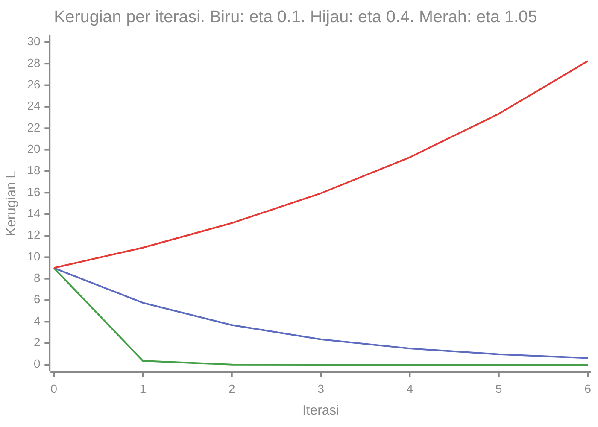
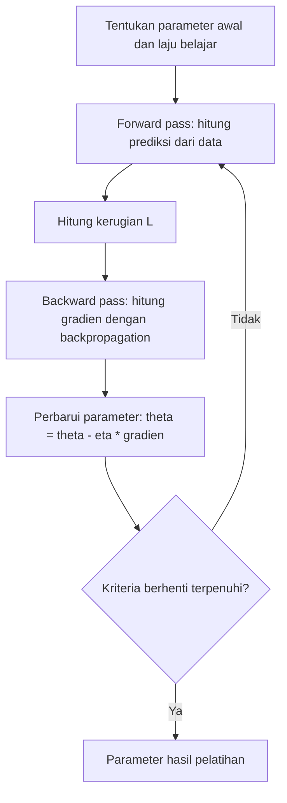

# Part 11 — Optimasi dan Gradient Descent

!!! info "Bagian pengantar"
    Part ini memperkenalkan gradient descent dengan contoh kecil yang dapat dihitung dengan tangan. Penerapannya pada regresi dan regresi logistik ada di Level 4, dan varian lanjutan seperti Momentum dan Adam ada di Level 5.

## Tujuan Pembelajaran

Setelah mempelajari bagian ini, kamu mampu:

- menjelaskan fungsi kerugian (*loss function*) dan masalah optimasi "cari parameter yang membuat kerugian sekecil mungkin";
- menjelaskan titik minimum lewat turunan pertama dan turunan kedua secara intuitif;
- menuliskan dan menghitung pembaruan gradient descent $\theta \leftarrow \theta - \eta\,\nabla L(\theta)$ langkah demi langkah;
- menjelaskan pengaruh laju belajar (*learning rate*) yang terlalu kecil, pas, dan terlalu besar, termasuk batas kestabilan;
- menjalankan gradient descent untuk dua parameter pada data regresi dan membandingkannya dengan solusi persamaan normal;
- menyebut kapan iterasi dihentikan dan membedakan batch, stochastic, dan mini-batch secara pengantar.

## Prasyarat

[Part 7 — Turunan](07-turunan.md) (titik kritis, turunan kedua), [Part 8 — Turunan Parsial dan Gradien](08-turunan-parsial-dan-gradien.md) ($-\nabla L$ adalah arah penurunan tercuram; data dan gradien MSE yang sama dipakai di sini), dan [Part 9 — Chain Rule dan Backpropagation](09-chain-rule-dan-backpropagation.md) (cara gradien dihitung pada jaringan, bersifat pelengkap). Bagian akhir juga memakai [Part 4](04-sistem-persamaan-linear-matriks.md) dan [Part 3](03-matriks.md) untuk persamaan normal.

## Mengapa Materi Ini Penting?

"Melatih model" berarti mencari parameter terbaik. Untuk model sederhana kadang ada rumus langsung, tetapi untuk model besar tidak ada. Gradient descent adalah cara umum yang bekerja untuk hampir semua model: mulai dari tebakan, lihat ke arah mana kerugian turun paling cepat, melangkah sedikit ke sana, lalu ulangi. Hampir seluruh pelatihan jaringan saraf adalah variasi dari prosedur sederhana ini.

## Konsep Dasar dengan Bahasa Sederhana

### 1. Fungsi Kerugian dan Masalah Optimasi

**Fungsi kerugian** (*loss function*) $L(\theta)$ mengukur seberapa buruk model dengan parameter $\theta$ terhadap data. Makin kecil, makin baik. Kerugian bergantung pada parameter, bukan pada data (data dianggap tetap).

Contoh yang sudah kita kenal (Part 8): data $(1, 5)$, $(3, 9)$, $(2, 8)$ dan model $\hat{y} = wx + b$ dengan kerugian rata-rata kuadrat (MSE):

$$
L(w, b) = \frac{1}{3}\sum_{i=1}^{3} (w x_i + b - y_i)^2
$$

**Masalah optimasi:** cari parameter yang membuat kerugian minimum.

$$
\theta^{*} = \arg\min_{\theta} L(\theta)
$$

Notasi $\arg\min$ dibaca "argumen yang meminimalkan": nilai $\theta$ (bukan nilai $L$) tempat $L$ paling kecil. Bintang $\theta^{*}$ menandai parameter terbaik.

### 2. Minimum dan Turunan Kedua

Dari Part 7: di titik minimum, turunan pertama nol, dan kurva cekung ke atas.

- **Satu parameter:** $L'(w) = 0$ dan $L''(w) > 0$.
- **Banyak parameter:** $\nabla L = \mathbf{0}$, dan kurva "mangkuk" ke segala arah.

Contoh $L(w) = (w - 3)^2$: $L'(w) = 2(w - 3) = 0$ memberi $w = 3$, $L''(w) = 2 > 0$, jadi minimum dengan $L(3) = 0$. Fungsi ini membentuk mangkuk dengan satu dasar. Pada MSE regresi linear, bentuknya juga mangkuk (cekung ke atas di setiap arah), sehingga hanya ada **satu minimum**.

**Turunan kedua sebagai kelengkungan.** $L''$ menyatakan seberapa melengkung mangkuk itu: $L''$ besar berarti mangkuk sempit dan curam; $L''$ kecil berarti lebar dan landai. Nilai ini memengaruhi seberapa besar langkah yang aman (bagian 4).

### 3. Gradient Descent

**Ide:** bayangkan berdiri di lereng gunung berkabut dan ingin turun ke lembah. Kamu hanya merasakan kemiringan tanah di bawah kakimu. Langkah masuk akal: melangkah sedikit ke arah turun paling curam, lalu ulangi. Dari Part 8, arah turun paling curam adalah $-\nabla L$.

**Aturan pembaruan:**

$$
\theta \leftarrow \theta - \eta\,\nabla L(\theta)
$$

Dibaca: "$\theta$ yang baru adalah $\theta$ yang lama dikurangi $\eta$ kali gradien". Tanda panah $\leftarrow$ berarti "diganti dengan". $\eta$ (huruf Yunani eta) adalah **laju belajar** (*learning rate*), bilangan positif kecil yang mengatur besar langkah. Satu pembaruan disebut satu **iterasi** (atau langkah).

**Contoh satu parameter.** $L(w) = (w - 3)^2$, $L'(w) = 2(w - 3)$. Mulai dari $w_0 = 0$ dengan $\eta = 0{,}1$.

| Iterasi $t$ | $w_t$ | $L'(w_t)$ | $w_{t+1} = w_t - 0{,}1\,L'(w_t)$ | $L(w_t)$ |
|---|---|---|---|---|
| 0 | $0$ | $-6$ | $0 + 0{,}6 = 0{,}6$ | $9$ |
| 1 | $0{,}6$ | $-4{,}8$ | $0{,}6 + 0{,}48 = 1{,}08$ | $5{,}76$ |
| 2 | $1{,}08$ | $-3{,}84$ | $1{,}08 + 0{,}384 = 1{,}464$ | $3{,}6864$ |
| 3 | $1{,}464$ | $-3{,}072$ | $1{,}7712$ | $2{,}3593$ |
| 4 | $1{,}7712$ | $-2{,}4576$ | $2{,}01696$ | $1{,}5099$ |

Setiap langkah mendekat ke $w = 3$ dan kerugian menurun. Ada pola: jarak ke minimum dikali $1 - 2\eta = 0{,}8$ setiap langkah, sehingga $w_t = 3 - 3 \cdot 0{,}8^t$ dan $L(w_t) = 9 \cdot 0{,}64^t$. Langkah makin kecil mendekati dasar karena gradiennya mengecil.

### 4. Laju Belajar

Untuk $L(w) = (w - 3)^2$, satu pembaruan mengubah jarak ke minimum menjadi $(1 - 2\eta)$ kali jarak semula. Maka:

| $\eta$ | Faktor $1 - 2\eta$ | Perilaku | $w$ setelah 6 langkah (mulai 0) |
|---|---|---|---|
| $0{,}01$ | $0{,}98$ | sangat lambat | $0{,}3425$ |
| $0{,}1$ | $0{,}8$ | mendekat stabil | $2{,}2136$ |
| $0{,}4$ | $0{,}2$ | cepat | $2{,}9998$ |
| $0{,}5$ | $0$ | tepat sasaran dalam satu langkah | $3$ |
| $0{,}9$ | $-0{,}8$ | melompat bolak-balik tetapi menyempit | $2{,}2136$ |
| $1{,}05$ | $-1{,}1$ | **menjauh (divergen)** | $-2{,}3147$ |
| $1{,}1$ | $-1{,}2$ | **menjauh (divergen)** | $-5{,}958$ |

Aturan pada contoh ini: pembaruan **konvergen** jika $\lvert 1 - 2\eta \rvert < 1$, yaitu $0 < \eta < 1$. Angka 1 itu berasal dari $\dfrac{2}{L''} = \dfrac{2}{2}$. Secara umum untuk fungsi kuadrat dengan turunan kedua $L''$: konvergen jika **$0 < \eta < \dfrac{2}{L''}$**, dan langkah paling cepat (tepat sasaran dalam satu langkah pada fungsi kuadrat satu variabel) adalah $\eta = \dfrac{1}{L''}$. Inilah peran turunan kedua: mangkuk yang lebih sempit ($L''$ lebih besar) menuntut laju belajar yang lebih kecil.

Grafik kerugian terhadap iterasi untuk tiga laju belajar:



Cara membaca: garis biru ($\eta = 0{,}1$) turun mulus tetapi masih jauh dari 0 setelah enam iterasi. Garis hijau ($\eta = 0{,}4$) turun hampir ke 0 dalam tiga iterasi. Garis merah ($\eta = 1{,}05$) **naik**: langkah terlalu besar melompati dasar lembah dan mendarat di sisi seberang yang lebih tinggi, lalu makin parah.

**Kesimpulan praktis:** laju belajar terlalu kecil menyebabkan pelatihan lambat; terlalu besar menyebabkan kerugian naik atau berosilasi. Memilihnya adalah salah satu pekerjaan utama dalam melatih model.

### 5. Gradient Descent untuk Dua Parameter

Untuk banyak parameter, aturannya sama dengan vektor: parameter tunggal $\theta$ diganti vektor $\mathbf{w}$ dan gradien berisi satu elemen per parameter.

$$
\begin{bmatrix} w \\ b \end{bmatrix}
\leftarrow
\begin{bmatrix} w \\ b \end{bmatrix}
- \eta
\begin{bmatrix} \partial L / \partial w \\ \partial L / \partial b \end{bmatrix}
$$

Pakai data $(1, 5)$, $(3, 9)$, $(2, 8)$, mulai dari $(w, b) = (0, 0)$ dengan $\eta = 0{,}05$. Gradien MSE (Part 8): $\dfrac{\partial L}{\partial w} = \tfrac{2}{3}\sum (w x_i + b - y_i)x_i$ dan $\dfrac{\partial L}{\partial b} = \tfrac{2}{3}\sum (w x_i + b - y_i)$.

**Iterasi pertama.** Di $(0, 0)$: gradien $(-32;\ -14{,}67)$ (Part 8).

- $w \leftarrow 0 - 0{,}05(-32) = 1{,}6$.
- $b \leftarrow 0 - 0{,}05(-14{,}67) = 0{,}7333$.
- Kerugian turun dari $56{,}67$ menjadi $11{,}89$.

**Iterasi kedua.** Di $(1{,}6;\ 0{,}7333)$: selisih prediksi dan data $= -2{,}667;\ -3{,}467;\ -4{,}067$. $\dfrac{\partial L}{\partial w} = \tfrac{2}{3}(-2{,}667 \cdot 1 - 3{,}467 \cdot 3 - 4{,}067 \cdot 2) = \tfrac{2}{3}(-21{,}2) = -14{,}13$ dan $\dfrac{\partial L}{\partial b} = \tfrac{2}{3}(-10{,}2) = -6{,}8$.

- $w \leftarrow 1{,}6 + 0{,}05(14{,}13) = 2{,}3067$ dan $b \leftarrow 0{,}7333 + 0{,}05(6{,}8) = 1{,}0733$.
- Kerugian turun menjadi $2{,}996$.

Hasil lebih lanjut (dari menjalankan prosedur yang sama):

| Iterasi | $w$ | $b$ | Kerugian | Gradien $(\partial_w L,\ \partial_b L)$ |
|---|---|---|---|---|
| 0 | $0$ | $0$ | $56{,}667$ | $(-32;\ -14{,}667)$ |
| 1 | $1{,}6$ | $0{,}7333$ | $11{,}889$ | $(-14{,}13;\ -6{,}8)$ |
| 2 | $2{,}3067$ | $1{,}0733$ | $2{,}996$ | $(-6{,}18;\ -3{,}29)$ |
| 3 | $2{,}6156$ | $1{,}238$ | $1{,}222$ | $(-2{,}64;\ -1{,}73)$ |
| 10 | $2{,}8004$ | $1{,}5114$ | $0{,}698$ | $(0{,}18;\ -0{,}44)$ |
| 50 | $2{,}494$ | $2{,}2103$ | $0{,}403$ | $(0{,}12;\ -0{,}27)$ |
| 200 | $2{,}0805$ | $3{,}1503$ | $0{,}227$ | $(0{,}019;\ -0{,}044)$ |
| 500 | $2{,}0021$ | $3{,}3285$ | $0{,}2222$ | $(0{,}0005;\ -0{,}0012)$ |
| 1000 | $2{,}0000$ | $3{,}3333$ | $0{,}2222$ | $(0{,}0;\ 0{,}0)$ |

Parameter menuju $(w, b) = (2;\ 3{,}3333)$ dengan kerugian minimum $0{,}2222$ (bukan nol, karena ketiga titik tidak segaris, seperti di Level 1). Dua pengamatan:

- **Mulanya cepat, lalu melambat.** Gradien mengecil mendekati dasar. Perubahan $b$ lebih lambat daripada $w$: mangkuk ini landai ke satu arah dan curam ke arah lain (kelengkungannya sekitar $11{,}09$ dan $0{,}24$ di dua arah utama). Kelengkungan terbesar membatasi laju belajar aman ($\eta < \tfrac{2}{11{,}09} \approx 0{,}18$), sedangkan kelengkungan terkecil menentukan kelambatan di akhir.
- **Solusi tepat dari persamaan normal.** Untuk model linear, parameter terbaik juga memenuhi $(X^{\top}X)\mathbf{w} = X^{\top}\mathbf{y}$ (Part 4), yaitu $14w + 6b = 48$ dan $6w + 3b = 22$. Dari persamaan kedua, $b = \tfrac{22 - 6w}{3}$. Substitusi: $14w + 2(22 - 6w) = 48$, jadi $2w = 4$, $w = 2$, dan $b = \tfrac{10}{3} \approx 3{,}3333$. Gradient descent menemukan jawaban yang sama secara bertahap, tanpa perlu menyelesaikan sistem. Keunggulannya baru terasa pada model tanpa rumus langsung.

### 6. Kapan Iterasi Dihentikan

Beberapa kriteria yang umum dipakai (sering digabung):

- **Gradien kecil:** $\lVert \nabla L \rVert_2 < \varepsilon$ untuk ambang kecil $\varepsilon$ (misalnya $0{,}01$). Pada tabel di atas, norma gradien di iterasi 200 adalah $\sqrt{0{,}019^2 + 0{,}044^2} \approx 0{,}048$ (belum), dan di iterasi 500 sekitar $0{,}0013$ (sudah).
- **Kerugian hampir tak berubah** antara dua iterasi.
- **Jumlah iterasi maksimum**, agar proses tidak berjalan tanpa akhir.
- **Kerugian pada data validasi mulai naik** (*early stopping*, dibahas di level berikutnya).

### 7. Varian: Batch, Stochastic, dan Mini-batch (Pengantar)

Gradien MSE di atas dihitung dari **seluruh** data pada setiap langkah (*batch gradient descent*). Untuk jutaan data, itu mahal. Alternatif:

| Varian | Data yang dipakai per langkah | Ciri |
|---|---|---|
| Batch | semua data | gradien tepat, tetapi mahal per langkah |
| Stochastic (SGD) | satu data acak | murah dan bising, arahnya berfluktuasi |
| Mini-batch | sekelompok kecil data acak (mis. 32) | kompromi; paling umum dipakai |

Gradien dari sebagian data adalah perkiraan gradien sebenarnya; rata-rata arahnya benar meskipun tiap langkah agak berliku. Rinciannya dibahas di level berikutnya.

### 8. Bentuk Lanskap Kerugian

- **Konveks (mangkuk tunggal)**, seperti MSE regresi linear: hanya ada satu minimum, sehingga gradient descent yang stabil pasti menuju ke sana.
- **Tidak konveks**, seperti jaringan saraf: ada banyak lembah (*minimum lokal*), dataran, dan titik pelana (Part 8). Gradient descent berhenti di titik tempat gradien nol, yang belum tentu minimum terbaik. Dalam praktik, jaringan besar tetap dapat dilatih dengan baik; ini topik penelitian aktif dan dibahas di level lanjut.

### 9. Siklus Pelatihan



Diagram menunjukkan satu iterasi (B sampai E) yang diulang sampai berhenti. Untuk regresi linear, langkah D dihitung dengan rumus Part 8. Untuk jaringan saraf, dihitung oleh backpropagation (Part 9).

## Istilah yang Perlu Dipahami

| Istilah | Arti sederhana | Contoh |
|---|---|---|
| Fungsi kerugian (*loss*) | ukuran kesalahan model terhadap data | MSE |
| Optimasi | mencari parameter yang meminimalkan kerugian | $\arg\min L$ |
| Minimum | titik terendah fungsi | $w = 3$ untuk $(w-3)^2$ |
| Minimum lokal / global | terendah di sekitar / terendah di seluruh daerah | |
| Konveks | berbentuk mangkuk tunggal | MSE linear |
| Gradient descent | pembaruan berulang melawan arah gradien | $\theta \leftarrow \theta - \eta\nabla L$ |
| Laju belajar $\eta$ | besar langkah pembaruan | $0{,}1$ |
| Iterasi | satu kali pembaruan parameter | |
| Konvergen / divergen | mendekati / menjauhi minimum | $\eta = 0{,}1$ / $\eta = 1{,}1$ |
| Kriteria berhenti | syarat menghentikan iterasi | $\lVert \nabla L \rVert < \varepsilon$ |
| Batch / SGD / mini-batch | seluruh / satu / sekelompok data per langkah | |
| Persamaan normal | $(X^{\top}X)\mathbf{w} = X^{\top}\mathbf{y}$ | solusi langsung regresi linear |

## Rumus dan Penjelasan Setiap Simbol

**Masalah optimasi:** $\theta^{*} = \arg\min_{\theta} L(\theta)$.

**Pembaruan gradient descent:**

$$
\theta_{t+1} = \theta_t - \eta\,\nabla L(\theta_t)
$$

- $\theta_t$ parameter pada iterasi ke-$t$ (vektor bila parameter banyak); $\nabla L(\theta_t)$ gradien kerugian di titik itu; $\eta > 0$ laju belajar.

**Satu parameter pada kuadrat** $L(w) = \tfrac{a}{2}(w - c)^2$ (dengan $L'' = a$): $w_{t+1} - c = (1 - \eta a)(w_t - c)$. Konvergen bila $0 < \eta < \dfrac{2}{a}$; tepat sasaran dalam satu langkah bila $\eta = \dfrac{1}{a}$.

**Gradien MSE linear:** $\nabla L = \dfrac{2}{n}X^{\top}(X\mathbf{w} - \mathbf{y})$ (Part 8).

**Persamaan normal:** $(X^{\top}X)\mathbf{w} = X^{\top}\mathbf{y}$, solusi tepat bila $X^{\top}X$ punya invers.

## Penjelasan Langkah demi Langkah

**Menjalankan gradient descent:**

1. Pilih nilai awal $\theta_0$ (misalnya nol atau acak kecil) dan laju belajar $\eta$.
2. Hitung kerugian $L(\theta_t)$ dan gradien $\nabla L(\theta_t)$.
3. Perbarui: $\theta_{t+1} = \theta_t - \eta\,\nabla L(\theta_t)$.
4. Periksa kriteria berhenti. Jika belum, kembali ke langkah 2.
5. **Pantau kerugian**: seharusnya turun. Jika naik, kecilkan $\eta$.
6. Setelah berhenti, periksa gradien (hampir nol) dan bandingkan dengan solusi lain jika tersedia.

## Contoh Soal dan Pembahasan

### Contoh 1 — Satu parameter

Jalankan 3 iterasi untuk $L(w) = w^2 - 4w + 5$ dari $w_0 = 0$ dengan $\eta = 0{,}25$.

1. $L'(w) = 2w - 4$, $L''(w) = 2$. Minimum di $w = 2$ dengan $L(2) = 1$.
2. $t = 0$: $L'(0) = -4$, $w_1 = 0 - 0{,}25(-4) = 1$.
3. $t = 1$: $L'(1) = -2$, $w_2 = 1 + 0{,}5 = 1{,}5$.
4. $t = 2$: $L'(1{,}5) = -1$, $w_3 = 1{,}5 + 0{,}25 = 1{,}75$.
5. Jarak ke minimum: $2, 1, 0{,}5, 0{,}25$. Setiap langkah separuhnya, sesuai $1 - \eta L'' = 1 - 0{,}5 = 0{,}5$.

### Contoh 2 — Pengaruh laju belajar

Untuk $L(w) = (w - 3)^2$ dari $w_0 = 0$, hitung tiga langkah untuk $\eta = 0{,}5$ dan $\eta = 1{,}1$.

1. $\eta = 0{,}5$: $w_1 = 0 - 0{,}5(-6) = 3$. Gradien di $w = 3$ adalah $0$, jadi $w_2 = w_3 = 3$. Tepat sasaran.
2. $\eta = 1{,}1$: $w_1 = 0 - 1{,}1(-6) = 6{,}6$. $L'(6{,}6) = 7{,}2$, $w_2 = 6{,}6 - 7{,}92 = -1{,}32$. $L'(-1{,}32) = -8{,}64$, $w_3 = -1{,}32 + 9{,}504 = 8{,}184$.
3. Jaraknya ke minimum: $3, 3{,}6, 4{,}32, 5{,}184$, membesar $1{,}2$ kali setiap langkah. Divergen.

### Contoh 3 — Dua iterasi pada regresi

Dengan data $(1, 5)$, $(3, 9)$, $(2, 8)$, mulai $(0, 0)$, $\eta = 0{,}05$: hitung kerugian setelah iterasi pertama.

1. Gradien di $(0, 0)$: $(-32;\ -14{,}67)$.
2. $w_1 = 1{,}6$ dan $b_1 = 0{,}7333$.
3. Prediksi: $1{,}6 + 0{,}7333 = 2{,}3333$; $4{,}8 + 0{,}7333 = 5{,}5333$; $3{,}2 + 0{,}7333 = 3{,}9333$.
4. Selisih dengan $y$: $-2{,}6667;\ -3{,}4667;\ -4{,}0667$. Kuadrat: $7{,}1111;\ 12{,}0178;\ 16{,}5378$. Rata-rata: $\dfrac{35{,}6667}{3} = 11{,}889$.
5. Kerugian turun dari $56{,}67$ menjadi $11{,}89$.

### Contoh 4 — Laju belajar dari kelengkungan

$L(w) = 5(w - 2)^2$. Tentukan rentang $\eta$ yang konvergen dan $\eta$ tepat sasaran. Buktikan dengan $w_0 = 7$.

1. $L'(w) = 10(w - 2)$ dan $L'' = 10$.
2. Konvergen: $0 < \eta < \dfrac{2}{10} = 0{,}2$. Tepat sasaran: $\eta = \dfrac{1}{10} = 0{,}1$.
3. $w_0 = 7$: $L'(7) = 50$. $w_1 = 7 - 0{,}1 \times 50 = 2$. Tepat di minimum.
4. Bandingkan dengan contoh $(w - 3)^2$ ($L'' = 2$, $\eta$ ideal $0{,}5$): mangkuk lima kali lebih sempit membutuhkan laju belajar lima kali lebih kecil.

## Contoh Tambahan dengan Kesulitan Bertahap

**Mudah.** Pada $w = 5$ untuk $L(w) = (w - 3)^2$: $L'(5) = 4 > 0$, jadi turunkan $w$. Dengan $\eta = 0{,}1$: $w = 5 - 0{,}4 = 4{,}6$.

**Sedang.** Berapa iterasi agar jarak ke minimum pada $L(w) = (w - 3)^2$ ($\eta = 0{,}1$, $w_0 = 0$) kurang dari $0{,}1$? Jarak $= 3 \cdot 0{,}8^t < 0{,}1$ memberi $t \geq 16$ ($3 \cdot 0{,}8^{16} \approx 0{,}0845$; $3 \cdot 0{,}8^{15} \approx 0{,}1055$).

**Sedang.** Kerugian $L(w, b) = (w - 1)^2 + 4(b - 2)^2$: gradien $\bigl(2(w - 1),\ 8(b - 2)\bigr)$. Turunan kedua $2$ dan $8$; $\eta$ aman $< \dfrac{2}{8} = 0{,}25$. Dengan $\eta = 0{,}2$: $w$ mendekat dengan faktor $1 - 0{,}4 = 0{,}6$ dan $b$ dengan faktor $1 - 1{,}6 = -0{,}6$ (berosilasi tetapi mengecil).

**Menantang.** Mengapa solusi persamaan normal dan gradient descent sama pada contoh data? Karena keduanya mencari titik tempat $\nabla L = \mathbf{0}$: persamaan normal menyelesaikannya langsung, gradient descent mendekatinya bertahap. Pada data $(1, 5), (3, 9), (2, 8)$ keduanya memberi $(w, b) = (2;\ 3{,}3333)$.

## Visualisasi atau Interpretasi Grafik

- **Mangkuk dan bola:** gradient descent seperti bola yang menggelinding ke dasar mangkuk dengan langkah-langkah diskret.
- **Peta kontur** (Part 8): lintasan parameter menyilang kontur tegak lurus ke arah dalam; pada mangkuk memanjang, lintasan bisa zig-zag dan lambat.
- **Kurva kerugian terhadap iterasi** (bagian 4): turun mulus (baik), turun lambat (η kecil), atau naik (η terlalu besar).
- **Perbandingan kelengkungan:** mangkuk sempit butuh langkah kecil, mangkuk lebar boleh langkah besar.

## Kesalahan Umum

| Kesalahan | Mengapa salah | Yang benar |
|---|---|---|
| Menambah gradien: $\theta + \eta\nabla L$ | itu menaikkan kerugian | $\theta - \eta\nabla L$ |
| Memakai $\eta$ besar agar "cepat" | bisa divergen | $0 < \eta < 2/L''$ pada kuadrat; pantau kerugian |
| Menyimpulkan model rusak karena kerugian tidak nol | kerugian minimum bisa positif ($0{,}2222$) | bandingkan dengan nilai minimum yang mungkin |
| Berhenti terlalu cepat karena gradien mengecil | di dataran landai gradien kecil walau masih jauh | gunakan beberapa kriteria |
| Salah menghitung gradien lalu memperbarui | kerugian tidak turun | periksa gradien secara numerik (Part 7) |
| Memperbarui parameter satu per satu memakai gradien lama | harus memakai gradien pada titik yang sama untuk semua parameter | hitung semua gradien dulu, lalu perbarui bersama |
| Mengira gradient descent menjamin minimum global | hanya pada fungsi konveks | pada jaringan saraf bisa terjebak |
| Menyamakan "kerugian turun" dengan "model benar" | kerugian rendah pada data latih belum tentu baik pada data baru | evaluasi dengan data validasi (level berikutnya) |
| Lupa menyimpan nilai awal $\theta_0$ yang sama untuk membandingkan | hasil tidak terbanding | catat nilai awal |
| Mengira laju belajar harus sama untuk semua model | bergantung pada kelengkungan | sesuaikan |

## Hubungan dengan Machine Learning

- **Mesin pelatihan.** Hampir semua model modern dilatih dengan gradient descent atau variannya: regresi, regresi logistik, jaringan saraf.
- **Backpropagation menyediakan gradien**, gradient descent memakainya untuk memperbarui parameter. Keduanya bekerja berpasangan (Part 9).
- **Laju belajar adalah hiperparameter utama.** Memilihnya dengan hati-hati (dan sering menurunkannya selama pelatihan) sangat memengaruhi hasil.
- **Normalisasi fitur** membuat mangkuk lebih bulat sehingga konvergensi lebih cepat dan lebih stabil. Di contoh kita, fitur yang tidak dipusatkan membuat mangkuk memanjang dan lambat di akhir.
- **Varian modern** (Momentum, Adam) menyesuaikan langkah per parameter, dibahas di Level 5.
- **Pelatihan dapat gagal secara diam-diam:** kerugian naik, melonjak, atau macet. Memantau kurva kerugian adalah kebiasaan dasar.

### Python: gradient descent satu dan dua parameter

Satu parameter: fungsi menerima turunan, nilai awal, laju belajar, dan banyak langkah.

```python
def gd_1d(turunan, w0, eta, langkah):
    w = w0
    riwayat = [w]
    for _ in range(langkah):
        w = w - eta * turunan(w)
        riwayat.append(w)
    return riwayat

dL = lambda w: 2 * (w - 3)          # turunan (w - 3)**2
L = lambda w: (w - 3) ** 2

print([round(v, 5) for v in gd_1d(dL, 0, 0.1, 5)])
# [0, 0.6, 1.08, 1.464, 1.7712, 2.01696]
print([round(L(v), 4) for v in gd_1d(dL, 0, 0.1, 6)])
# [9, 5.76, 3.6864, 2.3593, 1.5099, 0.9664, 0.6185]
```

Pengaruh laju belajar (nilai $w$ setelah 6 langkah):

```python
for eta in (0.01, 0.1, 0.4, 0.5, 0.9, 1.05, 1.1):
    w6 = gd_1d(dL, 0, eta, 6)[-1]
    print(eta, round(w6, 4))
# 0.01 0.3425
# 0.1 2.2136
# 0.4 2.9998
# 0.5 3.0
# 0.9 2.2136
# 1.05 -2.3147
# 1.1 -5.958
```

Contoh $L(w) = w^2 - 4w + 5$ dan contoh kelengkungan $5(w - 2)^2$:

```python
print(gd_1d(lambda w: 2 * w - 4, 0, 0.25, 3))      # [0, 1.0, 1.5, 1.75]
print(gd_1d(lambda w: 10 * (w - 2), 7, 0.1, 1))    # [7, 2.0], tepat sasaran
```

Dua parameter pada data regresi:

```python
data = [(1, 5), (3, 9), (2, 8)]

def kerugian(w, b):
    return sum((w * x + b - y) ** 2 for x, y in data) / len(data)

def gradien(w, b):
    n = len(data)
    r = [w * x + b - y for x, y in data]
    dw = 2 / n * sum(ri * x for ri, (x, y) in zip(r, data))
    db = 2 / n * sum(r)
    return dw, db

w, b, eta = 0.0, 0.0, 0.05
for t in range(1001):
    if t in (0, 1, 2, 3, 10, 50, 200, 500, 1000):
        print(t, round(w, 4), round(b, 4), round(kerugian(w, b), 4))
    dw, db = gradien(w, b)
    w = w - eta * dw
    b = b - eta * db
# 0 0.0 0.0 56.6667
# 1 1.6 0.7333 11.8889
# 2 2.3067 1.0733 2.9964
# 3 2.6156 1.238 1.2217
# 10 2.8004 1.5114 0.6982
# 50 2.494 2.2103 0.4031
# 200 2.0805 3.1503 0.227
# 500 2.0021 3.3285 0.2222
# 1000 2.0 3.3333 0.2222
```

Perhatikan bahwa `dw` dan `db` dihitung dulu dari titik yang sama, baru kedua parameter diperbarui. Bandingkan dengan solusi persamaan normal untuk sistem $14w + 6b = 48$ dan $6w + 3b = 22$:

```python
from fractions import Fraction

# (X^T X) w = X^T y  ->  [[14, 6], [6, 3]] [w, b] = [48, 22]
a11, a12, a21, a22 = 14, 6, 6, 3
c1, c2 = 48, 22
D = a11 * a22 - a12 * a21
w_tepat = Fraction(c1 * a22 - c2 * a12, D)
b_tepat = Fraction(a11 * c2 - a21 * c1, D)
print(w_tepat, b_tepat, float(b_tepat))      # 2 10/3 3.3333333333333335
print(round(kerugian(2, 10 / 3), 4))         # 0.2222
```

Laju belajar terlalu besar pada data regresi menyebabkan divergen:

```python
w, b = 0.0, 0.0
for t in range(8):
    dw, db = gradien(w, b)
    w, b = w - 0.25 * dw, b - 0.25 * db
print(round(kerugian(w, b), 1) > 1000)       # True, kerugian meledak
```

Batas kestabilan sekitar $\eta < 0{,}18$ untuk data ini; $\eta = 0{,}25$ melewatinya.

## Latihan Mandiri

1. Untuk $L(w) = (w - 3)^2$, $w_0 = 0$, $\eta = 0{,}1$: hitung $w_1$, $w_2$, $w_3$ dan kerugian tiap langkah.
2. Dari rumus $w_t = 3 - 3 \cdot 0{,}8^t$: hitung $w_5$ dan berapa iterasi minimal agar jarak ke minimum kurang dari $0{,}1$.
3. Untuk $L(w) = (w - 3)^2$ dari $w_0 = 0$: hitung 3 langkah untuk $\eta = 0{,}5$ dan untuk $\eta = 1{,}1$. Apa yang terjadi?
4. Jalankan 3 iterasi untuk $L(w) = w^2 - 4w + 5$ dari $w_0 = 0$ dengan $\eta = 0{,}25$. Berapa minimumnya dan jaraknya tiap iterasi?
5. Data $(1, 5)$, $(3, 9)$, $(2, 8)$, mulai $(0, 0)$, $\eta = 0{,}05$: hitung $(w, b)$ setelah iterasi pertama dan kerugiannya.
6. Hitung gradien di $(1{,}6;\ 0{,}7333)$ dan $(w, b)$ setelah iterasi kedua.
7. Selesaikan $14w + 6b = 48$ dan $6w + 3b = 22$. Bandingkan dengan hasil gradient descent setelah 1000 iterasi, dan hitung kerugian minimum.
8. $L(w) = 5(w - 2)^2$: tentukan $L''$, rentang $\eta$ yang konvergen, dan $\eta$ yang tepat sasaran. Buktikan dengan $w_0 = 7$.
9. Pada $w = 5$ untuk $L(w) = (w - 3)^2$, apa tanda gradien dan ke arah mana $w$ digeser? Hitung $w$ baru dengan $\eta = 0{,}1$.
10. Pada tabel gradient descent dua parameter, iterasi 200 memiliki gradien $(0{,}0194;\ -0{,}0440)$ dan iterasi 500 memiliki $(0{,}0005;\ -0{,}0012)$. Hitung normanya dan tentukan iterasi mana yang memenuhi kriteria $\lVert \nabla L \rVert_2 < 0{,}01$.

## Kunci Jawaban dan Pembahasan

??? success "Soal 1"
    $w_1 = 0 - 0{,}1(-6) = 0{,}6$; $w_2 = 0{,}6 + 0{,}48 = 1{,}08$; $w_3 = 1{,}08 + 0{,}384 = 1{,}464$. Kerugian: $L(0) = 9$; $L(0{,}6) = 5{,}76$; $L(1{,}08) = 3{,}6864$; $L(1{,}464) = 2{,}3593$. Turun setiap langkah.

??? success "Soal 2"
    $w_5 = 3 - 3 \cdot 0{,}8^5 = 3 - 0{,}98304 = 2{,}01696$. Jarak $3 \cdot 0{,}8^t < 0{,}1$: $t = 15$ memberi $0{,}1055$ (belum) dan $t = 16$ memberi $0{,}0845$ (sudah). Minimal **16 iterasi**.

??? success "Soal 3"
    $\eta = 0{,}5$: $w_1 = 3$, $w_2 = 3$, $w_3 = 3$ (tepat sasaran, gradien nol). $\eta = 1{,}1$: $w_1 = 6{,}6$, $w_2 = -1{,}32$, $w_3 = 8{,}184$. Jarak ke minimum $3, 3{,}6, 4{,}32, 5{,}184$ membesar: divergen.

??? success "Soal 4"
    $L' = 2w - 4$. $w_1 = 1$, $w_2 = 1{,}5$, $w_3 = 1{,}75$. Minimum di $w = 2$ ($L = 1$). Jarak: $2, 1, 0{,}5, 0{,}25$ (separuh tiap langkah).

??? success "Soal 5"
    Gradien $(-32;\ -14{,}67)$. $w_1 = 1{,}6$, $b_1 = 0{,}7333$. Prediksi $2{,}3333;\ 5{,}5333;\ 3{,}9333$; selisih $-2{,}6667;\ -3{,}4667;\ -4{,}0667$; $L = \dfrac{7{,}1111 + 12{,}0178 + 16{,}5378}{3} = 11{,}889$.

??? success "Soal 6"
    $\dfrac{\partial L}{\partial w} = \tfrac{2}{3}(-2{,}6667 - 10{,}4 - 8{,}1333) = \tfrac{2}{3}(-21{,}2) = -14{,}133$ dan $\dfrac{\partial L}{\partial b} = \tfrac{2}{3}(-10{,}2) = -6{,}8$. $w_2 = 1{,}6 + 0{,}7067 = 2{,}3067$; $b_2 = 0{,}7333 + 0{,}34 = 1{,}0733$. Kerugian $2{,}996$.

??? success "Soal 7"
    Dari $6w + 3b = 22$: $b = \tfrac{22 - 6w}{3}$. Substitusi ke $14w + 6b = 48$: $14w + 44 - 12w = 48$, $w = 2$, $b = \tfrac{10}{3} \approx 3{,}3333$. Gradient descent setelah 1000 iterasi: $(2{,}0000;\ 3{,}3333)$. Kerugian minimum $= \tfrac{0{,}1111 + 0{,}1111 + 0{,}4444}{3} = 0{,}2222$.

??? success "Soal 8"
    $L' = 10(w - 2)$, $L'' = 10$. Konvergen untuk $0 < \eta < 0{,}2$; tepat sasaran $\eta = 0{,}1$. Dengan $w_0 = 7$: $L'(7) = 50$ dan $w_1 = 7 - 0{,}1 \cdot 50 = 2$.

??? success "Soal 9"
    $L'(5) = 2(5 - 3) = 4 > 0$: kerugian naik bila $w$ naik, jadi $w$ **diturunkan**. $w_{\text{baru}} = 5 - 0{,}1 \times 4 = 4{,}6$.

??? success "Soal 10"
    Iterasi 200: $\sqrt{0{,}0194^2 + 0{,}0440^2} \approx 0{,}0481$ (tidak memenuhi, karena $\geq 0{,}01$). Iterasi 500: $\sqrt{0{,}0005^2 + 0{,}0012^2} \approx 0{,}0013$ (memenuhi). Jadi iterasi 500 memenuhi kriteria, iterasi 200 belum.

## Ringkasan Materi

- Optimasi: cari parameter yang meminimalkan fungsi kerugian, $\theta^{*} = \arg\min L(\theta)$. Titik minimum memenuhi $\nabla L = \mathbf{0}$ dan lengkungan cekung ke atas.
- Gradient descent: $\theta \leftarrow \theta - \eta\,\nabla L(\theta)$; langkah searah penurunan tercuram, makin kecil mendekati dasar.
- Laju belajar $\eta$: terlalu kecil lambat, pas cepat, terlalu besar osilasi atau divergen. Pada kuadrat dengan turunan kedua $L''$: konvergen bila $0 < \eta < \dfrac{2}{L''}$, tepat sasaran bila $\eta = \dfrac{1}{L''}$.
- Dua parameter: pembaruan vektor memakai gradien Part 8. Pada data contoh, menuju $(2;\ 3{,}3333)$ dengan kerugian $0{,}2222$, sama dengan solusi persamaan normal.
- Berhenti saat gradien kecil, kerugian hampir tidak berubah, atau iterasi maksimum tercapai.
- Batch memakai semua data per langkah, stochastic satu data, mini-batch sekelompok kecil.
- MSE regresi linear konveks; jaringan saraf tidak konveks.

## Checklist Penguasaan

- [ ] Menjelaskan fungsi kerugian dan arti $\arg\min$.
- [ ] Menghitung beberapa iterasi gradient descent satu parameter dengan tangan.
- [ ] Menjelaskan efek laju belajar kecil, pas, dan terlalu besar.
- [ ] Menyatakan hubungan laju belajar dengan turunan kedua (kelengkungan).
- [ ] Menghitung iterasi gradient descent untuk dua parameter pada data regresi.
- [ ] Membandingkan hasil gradient descent dengan persamaan normal.
- [ ] Menyebut dua kriteria berhenti dan perbedaan batch, SGD, mini-batch.

## Prasyarat untuk Materi Berikutnya

[Part 12 — Integrasi dan Evaluasi Level 2](12-integrasi-dan-evaluasi.md) menggabungkan seluruh materi Level 2 dan memakai contoh regresi dan gradient descent dari bagian ini. Level 4 memakai gradient descent untuk regresi dan regresi logistik; Level 5 membahas varian lanjutan.
