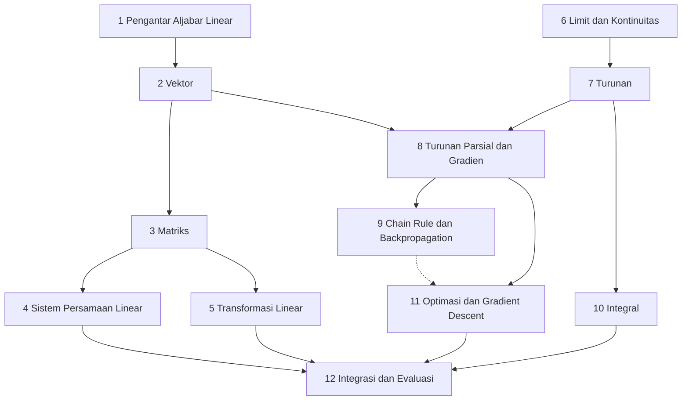

# Level 2 — Aljabar Linear dan Kalkulus

Level ini memperkenalkan dua cabang matematika yang menjadi tulang punggung Machine Learning. **Aljabar linear** adalah bahasa untuk data dan model yang melibatkan banyak angka sekaligus (vektor dan matriks). **Kalkulus** adalah alat untuk mengukur perubahan, dan dari situ lahir cara model belajar: turunan, gradien, dan gradient descent.

!!! success "Status materi"
    Level 2 **tersedia lengkap** (Part 1 sampai 12). [Level 3](../level-3-probabilitas-dan-statistika/index.md), [Level 4](../level-4-matematika-ml-klasik/index.md), dan [Level 5](../level-5-matematika-lanjutan-deep-learning/index.md) sudah tersedia.

## Prasyarat

Level 1 — Aljabar Dasar dan Fungsi, terutama [sistem persamaan linear dan bentuk matriksnya](../level-1-aljabar-dasar-dan-fungsi/06-sistem-persamaan-linear.md), [konsep fungsi](../level-1-aljabar-dasar-dan-fungsi/07-konsep-fungsi.md), [fungsi linear dan slope](../level-1-aljabar-dasar-dan-fungsi/08-fungsi-linear.md), [fungsi kuadrat](../level-1-aljabar-dasar-dan-fungsi/09-fungsi-kuadrat-dan-polinomial.md), serta [eksponensial dan logaritma](../level-1-aljabar-dasar-dan-fungsi/10-fungsi-eksponensial-dan-logaritma.md). Kosinus dari [Part 11 Level 1](../level-1-aljabar-dasar-dan-fungsi/11-pengantar-trigonometri.md) membantu, tetapi Level 2 memuat ringkasan singkatnya.

## Tujuan Level 2

Setelah menyelesaikan Level 2, kamu mampu:

- membaca dan menghitung dengan vektor dan matriks, termasuk dot product, norma, jarak, dan perkalian matriks;
- menyelesaikan sistem persamaan linear dengan eliminasi Gauss dan menafsirkan jenis solusinya;
- menjelaskan transformasi linear, kombinasi linear, dan independensi linear;
- menjelaskan limit dan kontinuitas, lalu turunan sebagai laju perubahan sesaat;
- menghitung turunan dengan aturan dasar dan chain rule, serta turunan parsial dan gradien;
- menjelaskan ide backpropagation, integral, dan gradient descent beserta langkah pembaruannya.

## Daftar materi

| Part | Materi | Jenis | Status |
|---|---|---|---|
| 1 | [Pengantar Aljabar Linear](01-pengantar-aljabar-linear.md) | esensial | Tersedia |
| 2 | [Vektor](02-vektor.md) | esensial | Tersedia |
| 3 | [Matriks](03-matriks.md) | esensial | Tersedia |
| 4 | [Sistem Persamaan Linear (Bentuk Matriks)](04-sistem-persamaan-linear-matriks.md) | esensial | Tersedia |
| 5 | [Transformasi Linear](05-transformasi-linear.md) | esensial (nilai eigen dan vektor eigen: pengayaan) | Tersedia |
| 6 | [Limit dan Kontinuitas](06-limit-dan-kontinuitas.md) | esensial | Tersedia |
| 7 | [Turunan](07-turunan.md) | esensial | Tersedia |
| 8 | [Turunan Parsial dan Gradien](08-turunan-parsial-dan-gradien.md) | esensial | Tersedia |
| 9 | [Chain Rule dan Backpropagation](09-chain-rule-dan-backpropagation.md) | esensial (pengantar) | Tersedia |
| 10 | [Integral](10-integral.md) | esensial (terutama untuk Level 3) | Tersedia |
| 11 | [Optimasi dan Gradient Descent](11-optimasi-dan-gradient-descent.md) | esensial (pengantar) | Tersedia |
| 12 | [Integrasi dan Evaluasi Level 2](12-integrasi-dan-evaluasi.md) | evaluasi | Tersedia |

**Esensial** berarti dibutuhkan oleh level berikutnya. **Pengayaan** berarti berguna sebagai pengetahuan pendukung tetapi bukan syarat. **Pengantar** berarti konsepnya diperkenalkan dengan contoh sederhana; bentuk lengkapnya ada di level lanjutan.

!!! note "Pembagian dengan level lain"
    Level 2 memperkenalkan backpropagation dan gradient descent dengan **konsep dan contoh sederhana (berbasis angka tunggal)**. Penerapan pada regresi dan regresi logistik ada di Level 4, sedangkan bentuk matriks, Jacobian, dan optimizer lanjutan ada di Level 5. Turunan kedua diperkenalkan di Part 7 karena dibutuhkan di Part 11.

## Hubungan antarpart

Level ini punya dua jalur. Jalur **aljabar linear** (Part 1 sampai 5) membahas vektor dan matriks. Jalur **kalkulus** (Part 6 sampai 11) membahas perubahan. Keduanya bertemu di Part 8, karena gradien adalah vektor. Panah putus-putus menandai hubungan yang berguna tetapi tidak wajib: gradient descent dapat dipelajari tanpa backpropagation, tetapi backpropagation adalah cara gradien dihitung pada jaringan saraf.

## Notasi yang dipakai di Level 2

Notasi berikut konsisten di seluruh Level 2:

| Objek | Notasi | Contoh |
|---|---|---|
| Skalar (satu bilangan) | huruf miring biasa | $a$, $x$ |
| Vektor | huruf kecil **tebal**; elemen ber-subskrip; secara default vektor kolom | $\mathbf{v}$, elemen $v_i$ |
| Matriks | huruf kapital biasa; elemen dengan dua subskrip | $A$, elemen $a_{ij}$ |
| Dot product | titik di antara dua vektor tebal | $\mathbf{a} \cdot \mathbf{b}$ |
| Norma (panjang) vektor | garis ganda | $\lVert \mathbf{v} \rVert_2$ |
| Turunan | tanda petik atau pecahan $d$ | $f'(x)$, $\dfrac{df}{dx}$ |
| Turunan parsial | simbol $\partial$ | $\dfrac{\partial f}{\partial x}$ |
| Gradien | simbol nabla | $\nabla f$ |

## Cara belajar

Baca berurutan sesuai nomor part. Kerjakan latihan sebelum membuka kunci jawaban, dan perhitungan manual lebih penting daripada kode. Lanjut setelah checklist penguasaan terpenuhi.
