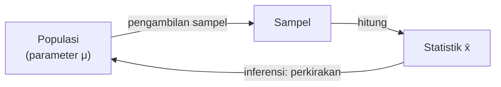

# Part 1 — Pengantar Statistika

## Tujuan Pembelajaran

Setelah mempelajari bagian ini, kamu mampu:

- menjelaskan apa itu statistika dan perannya dalam Machine Learning;
- membedakan data, observasi, dan variabel;
- membedakan populasi dan sampel, serta parameter dan statistik;
- mengenali jenis data (kategorik dan numerik) dan skala pengukuran (nominal, ordinal, interval, rasio);
- menjelaskan beberapa metode sampling dan mengenali sumber bias;
- menjelaskan mengapa nilai statistik dari sampel berbeda-beda;
- menghubungkan semua istilah ini dengan dataset, fitur, label, dan pembagian data latih dan uji.

## Prasyarat

[Level 0 — Part 4](../level-0-fondasi-matematika/04-persentase-rasio-proporsi.md) (persentase dan proporsi) dan [Level 0 — Part 8](../level-0-fondasi-matematika/08-notasi-matematika-dasar.md) (notasi $\sum$ dan rata-rata). Tidak ada pengetahuan statistika yang diasumsikan.

## Mengapa Materi Ini Penting?

Hampir semua keputusan berbasis data dibuat dari **sebagian** data, bukan semuanya. Survei kepuasan hanya menanyai sebagian pelanggan. Model Machine Learning hanya dilatih dari sebagian contoh yang pernah ada, lalu dipakai pada data yang belum pernah dilihat. Statistika adalah ilmu tentang cara mengambil kesimpulan yang masuk akal dari data yang terbatas, sambil jujur tentang seberapa yakin kita.

Part ini membangun kosakata dasarnya. Tanpa kosakata ini, istilah seperti "data latih", "data uji", "bias", dan "generalisasi" akan terasa kabur.

## Konsep Dasar dengan Bahasa Sederhana

### 1. Apa Itu Statistika?

**Statistika** (*statistics*) adalah cabang ilmu yang mempelajari cara **mengumpulkan, meringkas, menyajikan, dan menafsirkan data**. Dua tugas utamanya:

- **Statistika deskriptif:** meringkas data yang kita punya (rata-rata, grafik). Dibahas di Part 2 dan 3.
- **Statistika inferensial:** menarik kesimpulan tentang kelompok yang lebih besar dari data yang terbatas. Dibahas di Part 9 dan 10.

Kata "statistik" punya dua arti. Sebagai ilmu, ia disebut statistika. Sebagai angka ringkasan yang dihitung dari sampel (misalnya rata-rata sampel), ia disebut **statistik**. Part ini membedakan keduanya dengan jelas.

### 2. Data, Observasi, dan Variabel

- **Observasi** (*observation*) adalah satu pengamatan atau satu baris data, misalnya satu pelanggan atau satu rumah.
- **Variabel** (*variable*) adalah satu ciri yang diukur pada setiap observasi, misalnya umur, kota, atau harga.
- **Data** adalah kumpulan nilai variabel dari banyak observasi.

Sebuah dataset biasanya berbentuk tabel:

| Pelanggan | Umur (tahun) | Kota | Jumlah anak | Membeli |
|---|---|---|---|---|
| 1 | 25 | Bandung | 0 | ya |
| 2 | 41 | Medan | 2 | tidak |
| 3 | 33 | Bandung | 1 | ya |

Tabel ini punya **3 observasi** (baris) dan **4 variabel** (kolom), tidak menghitung kolom nomor pelanggan yang hanya berfungsi sebagai pengenal.

### 3. Populasi dan Sampel

- **Populasi** (*population*) adalah **seluruh** kelompok yang ingin kita pelajari. Contoh: semua 1.200 siswa di sebuah sekolah.
- **Sampel** (*sample*) adalah **sebagian** populasi yang benar-benar kita amati. Contoh: 100 siswa yang ikut survei.

Kita memakai sampel karena meneliti seluruh populasi sering terlalu mahal, terlalu lama, atau mustahil. Namun sampel hanya berguna jika ia **mewakili** populasi. Sampel yang tidak mewakili menghasilkan kesimpulan yang menyesatkan.

!!! note "Populasi bergantung pada pertanyaan"
    Populasi bukan ditentukan oleh data, melainkan oleh **pertanyaan**. Jika pertanyaannya "berapa rata-rata uang saku siswa sekolah ini?", populasinya semua siswa sekolah itu. Jika pertanyaannya "bagaimana model ini bekerja pada pengguna masa depan?", populasinya pengguna masa depan, yang belum bisa diamati sama sekali.

### 4. Parameter dan Statistik

- **Parameter** (*parameter*) adalah angka ringkasan **populasi**. Biasanya tidak diketahui. Dilambangkan huruf Yunani, misalnya $\mu$ (rata-rata populasi).
- **Statistik** (*statistic*) adalah angka ringkasan yang dihitung dari **sampel**. Dilambangkan huruf Latin, misalnya $\bar{x}$ (rata-rata sampel).

| | Dihitung dari | Nilainya | Lambang rata-rata |
|---|---|---|---|
| Parameter | populasi | tetap, biasanya tidak diketahui | $\mu$ |
| Statistik | sampel | berubah mengikuti sampel yang terambil | $\bar{x}$ |

Tujuan utama inferensi: memakai statistik yang kita **bisa hitung** untuk memperkirakan parameter yang kita **ingin tahu**.



### 5. Jenis Data

Variabel dibedakan menurut sifat nilainya:

| Jenis | Arti | Contoh |
|---|---|---|
| **Kategorik** (*categorical*) | nilai berupa kelompok atau label | kota, golongan darah, membeli (ya/tidak) |
| **Numerik** (*numerical*) | nilai berupa angka yang bermakna | umur, tinggi, harga |

Masing-masing punya dua cabang:

| Cabang | Arti | Contoh |
|---|---|---|
| Kategorik **nominal** | kelompok tanpa urutan | kota, warna, golongan darah |
| Kategorik **ordinal** | kelompok dengan urutan | tingkat pendidikan (SD, SMP, SMA), ukuran baju (S, M, L) |
| Numerik **diskret** | hasil menghitung, bernilai bulat | jumlah anak, jumlah klik |
| Numerik **kontinu** | hasil mengukur, bisa berupa pecahan | tinggi badan, suhu, waktu |

Angka belum tentu berarti numerik. Nomor kode pos, nomor telepon, dan nomor pelanggan berupa angka, tetapi hanya berfungsi sebagai **label**. Menghitung rata-rata kode pos tidak bermakna.

### 6. Skala Pengukuran

**Skala pengukuran** (*level of measurement*) menyatakan operasi apa yang bermakna pada suatu variabel:

| Skala | Yang bermakna | Contoh | Operasi yang masuk akal |
|---|---|---|---|
| **Nominal** | sama atau berbeda | kota, golongan darah | menghitung frekuensi, modus |
| **Ordinal** | urutan (lebih tinggi atau rendah) | peringkat, tingkat pendidikan | + median, kuartil |
| **Interval** | selisih bermakna, nol tidak mutlak | suhu °C, tahun kalender | + rata-rata, selisih |
| **Rasio** | selisih dan perbandingan bermakna, nol mutlak | tinggi, berat, harga, suhu Kelvin | + rasio ("dua kali lipat") |

Perbedaan interval dan rasio: suhu 40 °C **bukan** "dua kali lebih panas" daripada 20 °C, karena 0 °C bukan berarti tanpa panas. Berat 40 kg memang dua kali berat 20 kg, karena 0 kg berarti tanpa berat.

!!! note "Skala ordinal yang sering diperlakukan numerik"
    Skala ulasan 1 sampai 5 bintang bersifat ordinal: kita tahu 5 lebih baik daripada 4, tetapi belum tentu jarak 4 ke 5 sama dengan jarak 1 ke 2. Dalam praktik ia sering dihitung rata-ratanya. Itu boleh sebagai pendekatan, asalkan kita sadar asumsinya.

### 7. Cara Mengambil Sampel (Sampling)

| Metode | Cara kerja | Contoh |
|---|---|---|
| **Acak sederhana** (*simple random*) | setiap anggota punya peluang sama untuk terpilih | mengundi 30 nomor dari 300 |
| **Sistematis** | memilih setiap anggota ke-$k$ dari daftar | setiap siswa ke-10 |
| **Berstrata** (*stratified*) | membagi populasi menjadi kelompok (strata), lalu mengambil acak dari tiap kelompok | 20 siswa dari tiap angkatan |
| **Klaster** (*cluster*) | memilih kelompok utuh secara acak, lalu mengamati semua anggotanya | 3 dari 12 kelas dipilih acak, semua siswanya disurvei |
| **Kemudahan** (*convenience*) | mengambil yang paling mudah dijangkau | mewawancarai orang yang kebetulan lewat |

Empat metode pertama memakai **pengacakan** dan dapat dipertanggungjawabkan secara statistik. Metode kemudahan tidak, dan rawan bias.

Pada pengambilan sampel berstrata proporsional, jumlah sampel tiap strata sebanding dengan ukuran strata:

$$
n_k = n \times \frac{N_k}{N}
$$

- $n_k$: jumlah sampel dari strata ke-$k$;
- $n$: jumlah sampel total;
- $N_k$: ukuran strata ke-$k$ dalam populasi;
- $N$: ukuran populasi total.

Dibaca: "jumlah sampel strata = jumlah sampel total dikali proporsi strata di populasi".

### 8. Bias Sampling

**Bias** (*bias*) berarti kesalahan yang **sistematis**: selalu menyimpang ke arah yang sama, bukan sekadar kebetulan. Beberapa sumbernya:

- **Bias seleksi:** cara memilih sampel membuat kelompok tertentu lebih mungkin terpilih. Contoh: survei lewat telepon rumah melewatkan orang yang hanya memakai ponsel.
- **Bias memilih sendiri / tidak menjawab** (*self-selection / non-response*): yang menjawab berbeda dari yang tidak menjawab. Contoh: ulasan produk lebih banyak ditulis oleh pelanggan yang sangat puas atau sangat kecewa.
- **Bias kelangsungan hidup** (*survivorship*): hanya melihat yang "bertahan". Contoh: menilai strategi bisnis hanya dari perusahaan yang masih ada.

Dua hal penting:

1. **Menambah ukuran sampel tidak memperbaiki bias.** Sampel besar yang bias tetap bias, hanya lebih meyakinkan secara keliru.
2. **Kesalahan acak** (kebetulan) dan **bias** berbeda. Kesalahan acak mengecil dengan sampel lebih besar (dibahas di Part 9); bias tidak.

### 9. Mengapa Statistik Berubah dari Sampel ke Sampel?

Jika kita mengambil sampel yang berbeda dari populasi yang sama, nilai statistiknya (misalnya rata-rata) hampir selalu berbeda. Itu bukan kesalahan hitung, melainkan sifat alami pengambilan sampel yang disebut **variasi sampling** (*sampling variability*). Gagasan inilah yang membuat inferensi butuh ukuran ketidakpastian, dan menjadi dasar Part 9.

## Istilah yang Perlu Dipahami

| Istilah | Arti sederhana |
|---|---|
| Statistika | ilmu mengolah dan menafsirkan data |
| Observasi | satu pengamatan (satu baris data) |
| Variabel | satu ciri yang diukur (satu kolom data) |
| Populasi | seluruh kelompok yang ingin dipelajari |
| Sampel | sebagian populasi yang diamati |
| Parameter | angka ringkasan populasi, tetap tetapi biasanya tidak diketahui |
| Statistik | angka ringkasan sampel, berubah mengikuti sampel |
| Kategorik / numerik | data berupa kelompok / berupa angka bermakna |
| Nominal, ordinal, interval, rasio | empat skala pengukuran |
| Sampling | proses mengambil sampel |
| Bias | penyimpangan yang sistematis |
| Variasi sampling | perbedaan statistik antar sampel karena kebetulan |

## Rumus dan Penjelasan Setiap Simbol

**Rata-rata populasi dan rata-rata sampel:**

$$
\mu = \frac{1}{N}\sum_{i=1}^{N} x_i
\qquad\qquad
\bar{x} = \frac{1}{n}\sum_{i=1}^{n} x_i
$$

| Simbol | Arti | Jenis |
|---|---|---|
| $\mu$ | rata-rata populasi (parameter) | bilangan |
| $\bar{x}$ | rata-rata sampel (statistik), dibaca "x bar" | bilangan |
| $N$ | banyak anggota populasi | bilangan bulat positif |
| $n$ | banyak anggota sampel | bilangan bulat positif, $n \leq N$ |
| $x_i$ | nilai ke-$i$ | bilangan |
| $\sum$ | jumlahkan | operator |

Dibaca: "jumlahkan semua nilai lalu bagi banyaknya nilai". Rumusnya sama; yang berbeda adalah kelompok yang dihitung dan lambangnya.

**Alokasi sampel berstrata proporsional:** $n_k = n \cdot \dfrac{N_k}{N}$ (dijelaskan di bagian 7). Syarat: $\sum_k N_k = N$. Jika hasilnya bukan bilangan bulat, dibulatkan sambil menjaga jumlah total tetap $n$.

## Penjelasan Langkah demi Langkah

**Mengidentifikasi soal statistika:**

1. Tulis **pertanyaannya**. Apa yang ingin diketahui?
2. Tentukan **populasi** yang relevan dengan pertanyaan itu.
3. Tentukan **sampel**: siapa atau apa yang benar-benar diamati, dan bagaimana cara memilihnya.
4. Tentukan **variabel** beserta jenis dan skalanya.
5. Tentukan **ringkasan** yang dihitung (statistik) dan **ringkasan** yang ingin diperkirakan (parameter).
6. Tanyakan: adakah kemungkinan **bias** dalam cara sampel diambil?

## Contoh Soal dan Pembahasan

### Contoh 1 — Mengenali jenis variabel

Tentukan jenis dan skala: (a) golongan darah, (b) jumlah anak, (c) tinggi badan, (d) tingkat pendidikan, (e) suhu ruangan dalam °C.

1. Golongan darah: kategorik **nominal**, tidak ada urutan.
2. Jumlah anak: numerik **diskret** (hasil menghitung), skala **rasio** (0 anak berarti tidak ada).
3. Tinggi badan: numerik **kontinu**, skala **rasio**.
4. Tingkat pendidikan: kategorik **ordinal** (SD < SMP < SMA).
5. Suhu °C: numerik **kontinu**, skala **interval** (nol bukan nol mutlak).

### Contoh 2 — Populasi, sampel, parameter, statistik

Sebuah sekolah punya 1.200 siswa. Panitia menanyai 100 siswa dan mendapat rata-rata uang saku Rp15.000 per hari. Mereka ingin tahu rata-rata uang saku seluruh siswa.

1. Populasi: seluruh 1.200 siswa ($N = 1200$).
2. Sampel: 100 siswa yang ditanyai ($n = 100$).
3. Variabel: uang saku per hari (numerik kontinu, rasio).
4. Statistik: $\bar{x} = 15\,000$, bisa dihitung.
5. Parameter: $\mu$, rata-rata seluruh siswa, tidak diketahui. $\bar{x}$ dipakai sebagai perkiraan $\mu$.

Jika sampel kebetulan hanya terdiri dari siswa kelas XII yang uang sakunya lebih besar, $\bar{x}$ akan menyimpang secara sistematis dari $\mu$. Itu bias seleksi.

### Contoh 3 — Variasi sampling dengan angka

Populasinya 10 nilai ujian: $60, 65, 70, 70, 75, 80, 80, 85, 90, 95$.

1. Jumlah: $60 + 65 + 70 + 70 + 75 + 80 + 80 + 85 + 90 + 95 = 770$.
2. Parameter: $\mu = \dfrac{770}{10} = 77$.

Ambil empat sampel berukuran $n = 4$ (dengan memilih posisi berbeda):

| Sampel | Isi | $\bar{x}$ | Selisih terhadap $\mu = 77$ |
|---|---|---|---|
| A (posisi 1, 4, 7, 10) | 60, 70, 80, 95 | $\dfrac{305}{4} = 76{,}25$ | $-0{,}75$ |
| B (empat pertama) | 60, 65, 70, 70 | $\dfrac{265}{4} = 66{,}25$ | $-10{,}75$ |
| C (empat terakhir) | 80, 85, 90, 95 | $\dfrac{350}{4} = 87{,}5$ | $+10{,}5$ |
| D (posisi 3, 5, 6, 9) | 70, 75, 80, 90 | $\dfrac{315}{4} = 78{,}75$ | $+1{,}75$ |

Interpretasi: empat sampel dari populasi yang sama memberi empat nilai $\bar{x}$ berbeda. Sampel B dan C memakai pengambilan "empat pertama" dan "empat terakhir" dari data yang terurut, jadi **sistematis menyimpang**, itulah bias. Sampel A dan D lebih dekat karena mewakili seluruh rentang.

### Contoh 4 — Sampel berstrata proporsional

Sebuah kota punya 600 pelanggan laki-laki dan 400 pelanggan perempuan. Kita ingin sampel berstrata berukuran $n = 50$.

1. $N = 600 + 400 = 1000$.
2. Laki-laki: $n_1 = 50 \times \dfrac{600}{1000} = 30$.
3. Perempuan: $n_2 = 50 \times \dfrac{400}{1000} = 20$.
4. Periksa: $30 + 20 = 50$. Sesuai.

Dengan cara ini komposisi sampel (60% dan 40%) sama dengan komposisi populasi.

## Contoh Tambahan dengan Kesulitan Bertahap

**Mudah.** Dalam tabel dengan 200 baris dan 6 kolom (satu kolom adalah nomor baris), ada 200 observasi dan 5 variabel.

**Sedang.** Hasil survei "puas / netral / tidak puas" adalah kategorik ordinal. Jika dikodekan 3, 2, 1, angka itu hanya menandai urutan. Rata-rata kode 2,4 tidak berarti "agak puas" secara tepat.

**Sedang.** Sebuah toko menilai kualitas produk dari 50 ulasan, dan semuanya ditulis oleh pelanggan yang memberi bintang 1 atau 5. Statistiknya bias oleh pemilihan sendiri. Menambah ulasan sejenis tidak memperbaiki gambaran.

**Menantang.** Data kesehatan dikumpulkan dari rumah sakit rujukan, tempat pasiennya rata-rata lebih parah daripada penduduk umum. Jika model dilatih dari data itu dan dipakai untuk menyaring penduduk umum, populasi pelatihan dan populasi penggunaan berbeda, sehingga hasilnya dapat menyesatkan.

## Visualisasi atau Interpretasi Grafik

Bayangkan 210 kemungkinan sampel berukuran 4 dari populasi Contoh 3. Masing-masing punya $\bar{x}$ sendiri. Rata-rata dari ke-210 nilai $\bar{x}$ itu tepat $77$, sama dengan $\mu$, tetapi nilainya tersebar antara $66{,}25$ dan $87{,}5$. Artinya: **sampel acak tidak bias secara rata-rata, tetapi satu sampel saja bisa meleset**. Besarnya sebaran inilah yang diukur di Part 9. Kode di bawah menghitungnya.

## Kesalahan Umum

| Kesalahan | Mengapa salah | Yang benar |
|---|---|---|
| Menyamakan parameter dengan statistik | satu tidak diketahui, satu dihitung | $\mu$ dari populasi, $\bar{x}$ dari sampel |
| Menganggap angka selalu berarti numerik | kode pos dan ID hanya label | lihat apakah operasi hitung bermakna |
| Menghitung rata-rata data nominal | tidak bermakna | pakai frekuensi dan modus |
| Mengira sampel besar pasti benar | bias tidak hilang karena sampel besar | perbaiki cara pengambilan sampel |
| Menyebut 40 °C "dua kali lebih panas" dari 20 °C | skala interval, nol tidak mutlak | perbandingan hanya untuk skala rasio |
| Mengambil sampel yang mudah saja | rawan bias seleksi | gunakan pengacakan |
| Menganggap satu sampel mewakili sempurna | ada variasi sampling | laporkan ketidakpastian |
| Lupa mendefinisikan populasi | kesimpulan menjadi tidak jelas | tulis populasi sesuai pertanyaan |

## Hubungan dengan Machine Learning

- **Dataset sebagai sampel.** Dataset pelatihan hampir selalu hanyalah sampel dari "populasi" situasi nyata. Model yang bagus di dataset belum tentu bagus pada data baru jika sampelnya tidak mewakili.
- **Fitur dan label.** Kolom yang dipakai untuk memprediksi disebut **fitur**; kolom yang diprediksi disebut **label** (target). Keduanya adalah variabel, dengan jenis dan skala masing-masing.
- **Jenis data menentukan perlakuan.** Variabel nominal biasanya diubah menjadi bentuk numerik tanpa urutan palsu, misalnya *one-hot encoding*. Memberi kode 0, 1, 2 pada kota lalu memakainya sebagai angka dapat menyiratkan urutan dan jarak yang tidak ada, terutama pada model berbasis jarak atau bobot linear. Beberapa model (misalnya pohon keputusan) kurang sensitif terhadap hal ini.
- **Pembagian data latih dan uji.** Membagi dataset secara acak menjadi data latih dan data uji adalah pengambilan sampel. Untuk kelas yang sangat tidak seimbang, pembagian **berstrata** menjaga proporsi kelas di kedua bagian.
- **Bias data menjadi bias model.** Model belajar dari data. Jika sampel pelatihan bias (misalnya hanya mencakup kelompok tertentu), model cenderung bekerja buruk pada kelompok yang kurang terwakili.
- **Pengenal bukan fitur.** Kolom seperti ID pelanggan biasanya dikeluarkan dari fitur karena hanya label dan dapat membuat model "menghafal".

### Python: sampel, variasi, dan strata

Hanya pustaka standar. Seed dipakai agar hasil dapat diulang; hasil di bawah dijalankan dengan Python 3.14.

```python
import random
from itertools import combinations
from statistics import mean

populasi = [60, 65, 70, 70, 75, 80, 80, 85, 90, 95]
mu = sum(populasi) / len(populasi)
print(len(populasi), sum(populasi), mu)       # 10 770 77.0
```

Satu sampel acak berukuran 4:

```python
rng = random.Random(42)
sampel = rng.sample(populasi, 4)
print(sampel, sum(sampel) / len(sampel))      # [65, 60, 75, 95] 73.75
```

Semua kemungkinan sampel berukuran 4 (ada $\binom{10}{4} = 210$):

```python
semua = [mean(c) for c in combinations(populasi, 4)]
print(len(semua), round(mean(semua), 4), min(semua), max(semua))
# 210 77.0 66.25 87.5

dekat = sum(1 for m in semua if abs(m - mu) <= 5)
print(dekat, round(dekat / len(semua), 4))    # 155 0.7381
```

Interpretasi: rata-rata dari semua rata-rata sampel sama dengan $\mu$ (tidak bias), tetapi rata-rata satu sampel bisa berkisar dari $66{,}25$ sampai $87{,}5$. Sekitar 74% sampel menghasilkan $\bar{x}$ dalam jarak 5 dari $\mu$.

Sampel acak dari data yang tidak seimbang (10% spam):

```python
email = ["spam"] * 10 + ["bukan"] * 90
rng = random.Random(7)
nol = 0
for _ in range(10000):
    if "spam" not in rng.sample(email, 10):
        nol += 1
print(nol / 10000)                            # 0.3285
```

Sekitar sepertiga sampel acak berukuran 10 tidak memuat satu pun spam. Perhitungan eksak lewat pencacahan (Part 4) memberi $\binom{90}{10}/\binom{100}{10} \approx 0{,}3305$, dekat dengan hasil simulasi. Pengambilan berstrata menjamin tepat satu spam dalam sampel 10 email ini ($10 \times 10\% = 1$).

## Latihan Mandiri

1. Tentukan jenis (kategorik atau numerik) dan skala: (a) golongan darah, (b) jumlah klik iklan, (c) suhu dalam °C, (d) rating bintang 1 sampai 5, (e) tinggi badan, (f) kota asal.
2. Sekolah berisi 1.200 siswa. Panitia menyurvei 100 siswa dan mendapat rata-rata uang saku Rp15.000. Sebutkan populasi, sampel, variabel, statistik, dan parameter, beserta lambangnya.
3. Tentukan apakah angka berikut parameter atau statistik: (a) rata-rata tinggi dari seluruh 500 karyawan sebuah perusahaan yang semuanya diukur, bila pertanyaannya tentang perusahaan itu; (b) proporsi 40 dari 200 pengguna yang diwawancarai menyukai suatu fitur; (c) akurasi sebuah model pada 1.000 data uji, bila yang ingin diketahui adalah akurasinya pada semua data masa depan.
4. Tentukan skala (nominal, ordinal, interval, rasio): (a) nomor punggung pemain, (b) peringkat lomba, (c) tahun kalender, (d) berat badan, (e) suhu Kelvin. Dari soal ini, mana yang boleh dikatakan "dua kali lipat"?
5. Sebutkan metode sampling: (a) mengundi 30 dari 300 nomor induk; (b) setiap siswa ke-10 pada daftar; (c) 3 dari 12 kelas dipilih acak lalu semua siswanya disurvei; (d) 20 siswa dari tiap angkatan; (e) mewawancarai siapa saja yang lewat di depan kantin.
6. Jelaskan sumber bias: (a) survei kepuasan lewat e-mail yang sebagian besar dijawab pelanggan yang marah; (b) model deteksi penyakit dilatih hanya dari pasien rumah sakit rujukan. Apakah menambah jumlah sampel memperbaikinya?
7. Dari populasi pada Contoh 3, sebuah sampel berisi $65, 70, 85, 90$. Hitung $\bar{x}$ dan selisihnya dari $\mu = 77$. Apakah $\bar{x} = \mu$ pasti terjadi untuk sampel acak?
8. Sebuah populasi terdiri dari 500 siswa kelas A dan 300 siswa kelas B. Tentukan jumlah sampel tiap kelas untuk sampel berstrata proporsional berukuran 40.
9. Tabel memiliki kolom: ID pelanggan, umur, kota, pendapatan, membeli (ya/tidak). Jika tujuannya memprediksi apakah pelanggan membeli, tentukan label, fitur yang layak dipakai, kolom yang sebaiknya dikeluarkan, serta jenis dan skala tiap kolom.
10. Dari 1.000 e-mail, 50 adalah spam (5%). Dua puluh e-mail diambil acak. Berapa kira-kira peluang sampel itu tidak memuat spam? Berapa spam dan bukan-spam yang diambil jika memakai sampel berstrata proporsional?

## Kunci Jawaban dan Pembahasan

??? success "Soal 1"
    (a) kategorik nominal. (b) numerik diskret, rasio. (c) numerik kontinu, interval. (d) kategorik ordinal (sering dihitung rata-ratanya sebagai pendekatan). (e) numerik kontinu, rasio. (f) kategorik nominal.

??? success "Soal 2"
    Populasi: 1.200 siswa ($N = 1200$). Sampel: 100 siswa ($n = 100$). Variabel: uang saku per hari. Statistik: $\bar{x} = 15\,000$. Parameter: $\mu$, rata-rata uang saku seluruh siswa, tidak diketahui.

??? success "Soal 3"
    (a) **Parameter**, karena seluruh populasi (karyawan perusahaan itu) diukur. (b) **Statistik**, karena hanya 200 pengguna yang diwawancarai; proporsi sampelnya $\hat{p} = 40/200 = 0{,}2$ dipakai memperkirakan proporsi seluruh pengguna. (c) **Statistik**, karena 1.000 data uji hanyalah sampel dari semua data masa depan; akurasi sebenarnya adalah parameter yang tidak diketahui.

??? success "Soal 4"
    (a) nominal. (b) ordinal. (c) interval. (d) rasio. (e) rasio. Hanya (d) dan (e) yang mendukung "dua kali lipat", karena nolnya mutlak.

??? success "Soal 5"
    (a) acak sederhana. (b) sistematis. (c) klaster. (d) berstrata. (e) kemudahan (*convenience*).

??? success "Soal 6"
    (a) bias memilih sendiri / tidak menjawab: mereka yang menjawab tidak mewakili semua pelanggan. (b) bias seleksi: pasien rumah sakit rujukan tidak mewakili populasi umum. Menambah jumlah sampel **tidak** memperbaikinya, karena kesalahannya sistematis, bukan kebetulan.

??? success "Soal 7"
    $\bar{x} = \dfrac{65 + 70 + 85 + 90}{4} = \dfrac{310}{4} = 77{,}5$. Selisihnya dari $\mu$: $77{,}5 - 77 = 0{,}5$. Tidak: sampel acak yang berbeda memberi $\bar{x}$ yang berbeda, dan sangat jarang tepat sama dengan $\mu$. Yang berlaku hanyalah bahwa rata-rata dari semua kemungkinan $\bar{x}$ sama dengan $\mu$ (lihat bagian Visualisasi dan kode Python).

??? success "Soal 8"
    $N = 800$. Kelas A: $40 \times \dfrac{500}{800} = 25$. Kelas B: $40 \times \dfrac{300}{800} = 15$. Total $25 + 15 = 40$.

??? success "Soal 9"
    Label: membeli (kategorik nominal, biner). Fitur yang layak: umur (numerik, rasio), kota (nominal, diubah dengan *one-hot encoding*), pendapatan (numerik, rasio). ID pelanggan (nominal) biasanya dikeluarkan karena hanya pengenal dan dapat membuat model menghafal.

??? success "Soal 10"
    Peluang tak memuat spam, bila diambil 20 dari 1.000 tanpa pengembalian, sekitar $\dfrac{\binom{950}{20}}{\binom{1000}{20}} \approx 0{,}355$, yaitu sekitar 35%. (Aproksimasi kasar $0{,}95^{20} \approx 0{,}358$ hampir sama.) Sampel berstrata proporsional: spam $20 \times 0{,}05 = 1$, bukan-spam $20 \times 0{,}95 = 19$.

## Ringkasan Materi

- Statistika mengolah dan menafsirkan data; **deskriptif** meringkas, **inferensial** menarik kesimpulan tentang kelompok yang lebih besar.
- **Observasi** adalah baris, **variabel** adalah kolom. **Populasi** adalah seluruh kelompok, **sampel** adalah sebagiannya.
- **Parameter** ($\mu$) milik populasi dan tetap; **statistik** ($\bar{x}$) milik sampel dan berubah dari sampel ke sampel.
- Jenis data: kategorik (nominal, ordinal) dan numerik (diskret, kontinu). Skala: nominal, ordinal, interval, rasio, yang menentukan operasi yang bermakna.
- Sampling berpengacakan (acak sederhana, sistematis, berstrata, klaster) lebih dapat dipercaya daripada sampling kemudahan.
- **Bias** adalah kesalahan sistematis dan tidak hilang dengan sampel yang lebih besar.
- Dalam ML, dataset adalah sampel; jenis variabel menentukan pengodean; pembagian latih dan uji adalah pengambilan sampel, dan bias data menjadi bias model.

## Checklist Penguasaan

- [ ] Membedakan observasi, variabel, populasi, dan sampel.
- [ ] Membedakan parameter ($\mu$) dan statistik ($\bar{x}$).
- [ ] Menentukan jenis dan skala suatu variabel.
- [ ] Menyebut metode sampling dan menghitung alokasi sampel berstrata proporsional.
- [ ] Mengenali sumber bias dan menjelaskan mengapa sampel besar tidak menyembuhkannya.
- [ ] Menjelaskan mengapa statistik berubah antar sampel.
- [ ] Mengaitkan istilah-istilah ini dengan fitur, label, dan pembagian data latih/uji.

## Prasyarat untuk Materi Berikutnya

[Part 2 — Statistik Deskriptif](02-statistik-deskriptif.md) mulai meringkas data dengan angka: rata-rata, median, modus, kuartil, varians, dan simpangan baku. Pastikan istilah populasi, sampel, parameter, dan statistik sudah jelas, karena Part 2 membedakan rumus populasi dan sampel.
