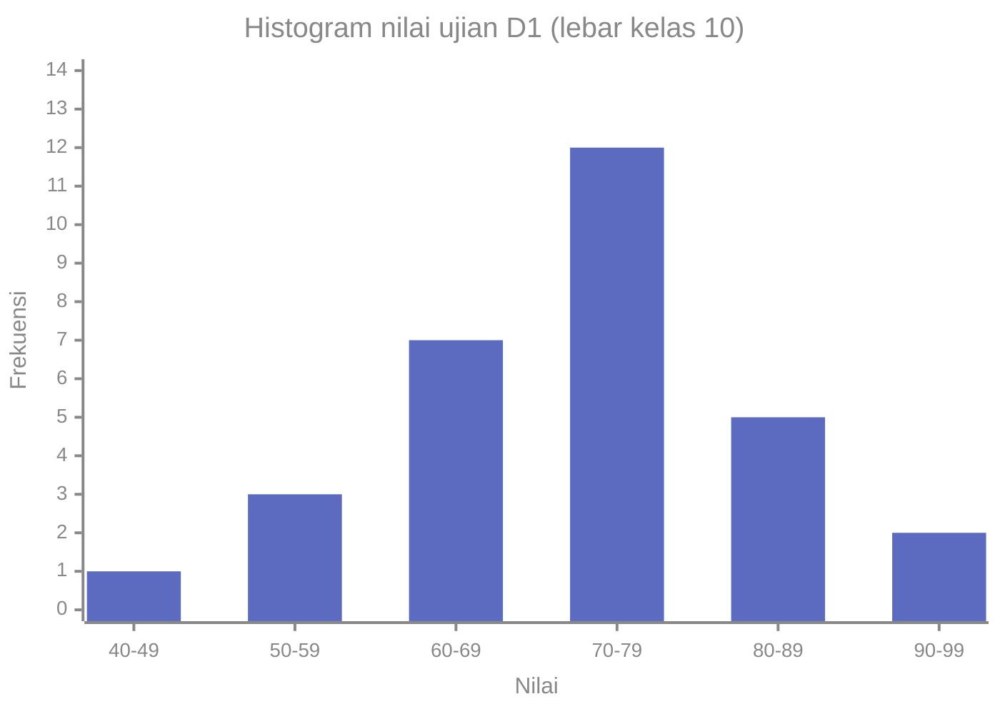
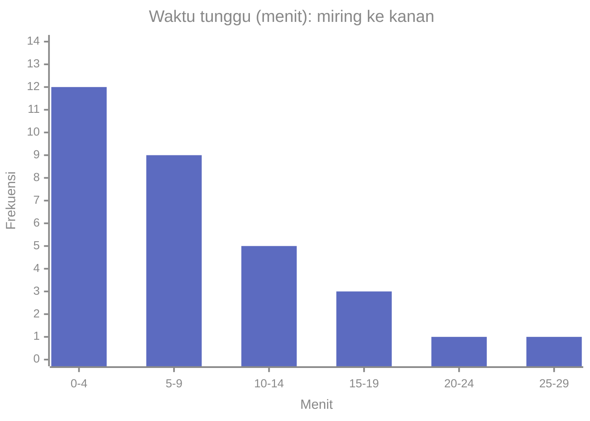
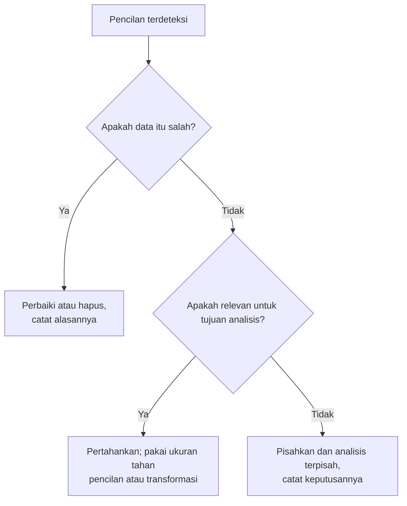

# Part 3 — Visualisasi dan Distribusi Data

## Tujuan Pembelajaran

Setelah mempelajari bagian ini, kamu mampu:

- menyusun tabel frekuensi (frekuensi, frekuensi relatif, frekuensi kumulatif) dari data;
- membaca dan menafsirkan histogram, dan membedakannya dari diagram batang;
- membuat dan membaca boxplot, termasuk aturan pagar 1,5 × IQR untuk menandai pencilan;
- menjelaskan bentuk distribusi (simetris, miring kanan, miring kiri, satu puncak atau lebih);
- menghitung dan menafsirkan koefisien kemiringan (*skewness*);
- memutuskan secara bertanggung jawab apa yang dilakukan pada pencilan;
- menjelaskan kapan transformasi logaritma membantu data yang miring ke kanan;
- menghubungkan visualisasi dengan pemeriksaan fitur sebelum melatih model.

## Prasyarat

[Part 2 — Statistik Deskriptif](02-statistik-deskriptif.md) (rata-rata, median, kuartil, IQR, simpangan baku) dan [Level 1 — Part 10](../level-1-aljabar-dasar-dan-fungsi/10-fungsi-eksponensial-dan-logaritma.md) ($\ln x$, untuk bagian transformasi).

## Mengapa Materi Ini Penting?

Angka ringkasan menyembunyikan bentuk data. Dua dataset bisa punya rata-rata dan simpangan baku yang hampir sama, tetapi satu berbentuk lonceng dan yang lain punya dua puncak atau satu pencilan ekstrem. Contoh klasik, **kuartet Anscombe**, terdiri dari empat dataset kecil dengan rata-rata, varians, korelasi, dan garis regresi yang hampir identik, padahal grafiknya sama sekali berbeda. Karena itu kebiasaan baik dalam analisis data adalah: **lihat datanya sebelum percaya pada angkanya**.

Dalam Machine Learning, bentuk distribusi fitur memengaruhi pilihan praproses, deteksi pencilan, dan cara membaca hasil model.

## Konsep Dasar dengan Bahasa Sederhana

Bagian ini memakai dua dataset.

**Data D1:** nilai ujian 30 mahasiswa:

$$
45, 52, 55, 58, 60, 62, 63, 65, 65, 67, 68, 70, 70, 71, 72, 72, 73, 74, 75, 75, 76, 78, 78, 80, 82, 83, 85, 88, 90, 95
$$

Rata-rata $\bar{x} = \dfrac{2147}{30} \approx 71{,}57$, median $= 72$, simpangan baku sampel $s \approx 11{,}38$.

**Data D2:** harga makanan per porsi (ribu rupiah) di 12 kedai:

$$
12, 14, 15, 15, 16, 18, 18, 19, 20, 22, 24, 60
$$

### 1. Tabel Frekuensi

**Tabel frekuensi** menghitung berapa kali nilai (atau rentang nilai) muncul. Tiga kolom yang lazim:

- **Frekuensi** $f$: banyak data di kelas itu.
- **Frekuensi relatif** $f/n$: bagian dari seluruh data (bisa dinyatakan sebagai persen).
- **Frekuensi kumulatif**: jumlah frekuensi dari kelas pertama sampai kelas itu.

Untuk data numerik yang banyak nilai berbeda, kita mengelompokkan data ke dalam **kelas** (*bin*). Aturan: kelas tidak tumpang tindih, mencakup seluruh data, dan lebarnya sama. Untuk D1 dengan lebar 10:

| Kelas | $f$ | $f/n$ | Kumulatif | Kumulatif relatif |
|---|---|---|---|---|
| 40–49 | 1 | 0,0333 | 1 | 0,0333 |
| 50–59 | 3 | 0,1000 | 4 | 0,1333 |
| 60–69 | 7 | 0,2333 | 11 | 0,3667 |
| 70–79 | 12 | 0,4000 | 23 | 0,7667 |
| 80–89 | 5 | 0,1667 | 28 | 0,9333 |
| 90–99 | 2 | 0,0667 | 30 | 1,0000 |

Pemeriksaan: jumlah $f$ harus sama dengan $n = 30$, dan jumlah frekuensi relatif harus $1$.

### 2. Histogram

**Histogram** adalah grafik batang dari tabel frekuensi data **numerik**. Tinggi batang menunjukkan frekuensi kelas, dan batang-batangnya **berdampingan tanpa celah** karena sumbu horizontal adalah garis bilangan yang menyambung.



Cara membaca: puncaknya di kelas 70–79 (12 mahasiswa), dan data menyebar kira-kira seimbang ke kiri dan kanan puncak. Bentuknya mendekati simetris dengan satu puncak.

**Histogram berbeda dari diagram batang.** Diagram batang (*bar chart*) untuk data **kategorik** (misalnya jumlah pengguna per kota), batangnya boleh diberi celah dan urutannya bebas. Histogram untuk data numerik, urutan kelasnya tetap.

**Lebar kelas memengaruhi tampilan.** Data D1 yang sama dengan lebar kelas berbeda:

| Lebar kelas | Frekuensi per kelas (dari kecil ke besar) |
|---|---|
| 5 (mulai 45) | 1, 1, 2, 3, 4, 7, 5, 3, 2, 1, 1 |
| 10 (mulai 40) | 1, 3, 7, 12, 5, 2 |
| 20 (mulai 40) | 4, 19, 7 |

Lebar terlalu kecil membuat grafik bergerigi dan penuh derau, sedangkan lebar terlalu besar menyembunyikan bentuknya. Tidak ada satu lebar yang selalu benar; cobalah beberapa dan lihat apakah kesimpulannya stabil.

**Rata-rata dari tabel kelas (perkiraan).** Jika data mentah tidak ada, pakai **titik tengah** kelas sebagai wakil: $\bar{x} \approx \dfrac{\sum f_i m_i}{\sum f_i}$. Untuk D1, titik tengah $44{,}5;\ 54{,}5;\ \dots;\ 94{,}5$ memberi $\dfrac{2165}{30} \approx 72{,}17$, sedikit berbeda dari rata-rata sebenarnya $71{,}57$. Selisih itu terjadi karena kita kehilangan nilai asli di dalam kelas.

### 3. Boxplot

**Boxplot** (diagram kotak-garis) meringkas data lewat ringkasan lima angka:

- **Kotak** membentang dari $Q_1$ sampai $Q_3$ (panjangnya IQR), dengan garis di dalamnya pada median.
- **Kumis** (*whiskers*) memanjang dari kotak ke nilai terjauh yang masih berada dalam pagar.
- **Pagar** (*fences*) menurut aturan Tukey: batas bawah $Q_1 - 1{,}5\,\text{IQR}$ dan batas atas $Q_3 + 1{,}5\,\text{IQR}$.
- Nilai di luar pagar digambar sebagai titik terpisah dan disebut **pencilan** menurut aturan ini.

Untuk D2 ($n = 12$): $Q_1 = 15$, median $= 18$, $Q_3 = 20{,}5$, $\text{IQR} = 5{,}5$. Pagar bawah $= 15 - 1{,}5(5{,}5) = 6{,}75$ dan pagar atas $= 20{,}5 + 1{,}5(5{,}5) = 28{,}75$. Nilai $60$ melewati pagar atas, jadi ia ditandai sebagai pencilan. Kumis atas berhenti di $24$ (nilai terbesar yang masih $\leq 28{,}75$) dan kumis bawah di $12$.

<div style="max-width:460px;margin:1rem auto"><svg viewBox="0 0 460 170" width="100%" role="img" aria-labelledby="bp-t bp-d" xmlns="http://www.w3.org/2000/svg" style="color:inherit;font-family:inherit;font-size:11px"><title id="bp-t">Boxplot harga makanan</title><desc id="bp-d">Boxplot 12 harga makanan: kotak dari Q1 15 sampai Q3 20,5 dengan median 18, kumis dari 12 sampai 24, pagar bawah 6,75 dan pagar atas 28,75, satu pencilan di 60.</desc>
<g stroke="currentColor" stroke-width="1.3" fill="none">
<line x1="86.67" y1="70" x2="106.67" y2="70"/><line x1="143.33" y1="70" x2="166.67" y2="70"/>
<line x1="86.67" y1="60" x2="86.67" y2="80"/><line x1="166.67" y1="60" x2="166.67" y2="80"/>
</g>
<rect x="106.67" y="48" width="36.66" height="44" fill="#5c6bc0" fill-opacity="0.2" stroke="#5c6bc0" stroke-width="1.8"/>
<line x1="126.67" y1="48" x2="126.67" y2="92" stroke="#5c6bc0" stroke-width="3"/>
<g stroke="#e53935" stroke-width="1.2" stroke-dasharray="4 3"><line x1="51.67" y1="38" x2="51.67" y2="102"/><line x1="198.33" y1="38" x2="198.33" y2="102"/></g>
<circle cx="406.67" cy="70" r="4.5" fill="#e53935"/>
<text x="126.67" y="40" text-anchor="middle" fill="currentColor">median 18</text>
<text x="104.67" y="108" text-anchor="end" fill="currentColor">Q1 15</text>
<text x="145.33" y="108" text-anchor="start" fill="currentColor">Q3 20,5</text>
<text x="51.67" y="32" text-anchor="start" fill="#e53935">pagar bawah 6,75</text>
<text x="198.33" y="32" text-anchor="start" fill="#e53935">pagar atas 28,75</text>
<text x="406.67" y="55" text-anchor="middle" fill="#e53935">pencilan 60</text>
<g stroke="currentColor"><line x1="40" y1="125" x2="440" y2="125"/>
<line x1="73.33" y1="125" x2="73.33" y2="130"/><line x1="140.0" y1="125" x2="140.0" y2="130"/><line x1="206.67" y1="125" x2="206.67" y2="130"/><line x1="273.33" y1="125" x2="273.33" y2="130"/><line x1="340.0" y1="125" x2="340.0" y2="130"/><line x1="406.67" y1="125" x2="406.67" y2="130"/></g>
<text x="73.33" y="144" text-anchor="middle" fill="currentColor">10</text><text x="140.0" y="144" text-anchor="middle" fill="currentColor">20</text><text x="206.67" y="144" text-anchor="middle" fill="currentColor">30</text><text x="273.33" y="144" text-anchor="middle" fill="currentColor">40</text><text x="340.0" y="144" text-anchor="middle" fill="currentColor">50</text><text x="406.67" y="144" text-anchor="middle" fill="currentColor">60</text>
<text x="240" y="162" text-anchor="middle" fill="currentColor">harga per porsi (ribu rupiah)</text></svg></div>

Aturan $1{,}5 \times \text{IQR}$ adalah **konvensi praktis**, bukan hukum alam. Ia menandai kandidat yang perlu diperiksa, bukan nilai yang pasti salah.

### 4. Bentuk Distribusi

**Distribusi** data adalah gambaran tentang nilai apa saja yang muncul dan seberapa sering. Beberapa cara menggambarkannya:

| Bentuk | Ciri | Contoh |
|---|---|---|
| **Simetris** | sisi kiri dan kanan puncak kira-kira cermin | tinggi badan orang dewasa satu kelompok |
| **Miring ke kanan** (*positively skewed*) | ekor panjang di kanan; sedikit nilai sangat besar | pendapatan, harga, waktu tunggu |
| **Miring ke kiri** (*negatively skewed*) | ekor panjang di kiri; sedikit nilai sangat kecil | nilai ujian yang mudah (banyak nilai tinggi) |
| **Unimodal** | satu puncak | nilai D1 |
| **Bimodal** | dua puncak; sering berarti dua kelompok tercampur | tinggi badan campuran pria dan wanita |
| **Seragam** (*uniform*) | batang kira-kira sama tinggi | hasil lemparan dadu |

Contoh data fiktif yang miring ke kanan: waktu tunggu (menit) di loket, 31 pelanggan.



Sebagian besar pelanggan menunggu sebentar, tetapi beberapa menunggu sangat lama. Ekor di kanan itulah yang menarik rata-rata ke kanan.

**Hubungan rata-rata dan median (petunjuk, bukan aturan).** Pada data miring ke kanan, rata-rata cenderung **lebih besar** dari median karena nilai-nilai besar menariknya. Pada data miring ke kiri, rata-rata cenderung lebih kecil. D2: rata-rata $21{,}08 >$ median $18$ (miring kanan). D1: rata-rata $71{,}57 <$ median $72$ (sedikit miring kiri). Pola ini tidak selalu berlaku, jadi jangan dijadikan satu-satunya bukti.

### 5. Koefisien Kemiringan (*Skewness*)

Kemiringan dapat dinyatakan dengan satu angka. Salah satu rumus yang umum (koefisien momen):

$$
g_1 = \frac{\dfrac{1}{n}\displaystyle\sum_{i=1}^{n}(x_i - \bar{x})^3}{\left(\dfrac{1}{n}\displaystyle\sum_{i=1}^{n}(x_i - \bar{x})^2\right)^{3/2}}
$$

- Pembilang: rata-rata **pangkat tiga** deviasi. Pangkat tiga mempertahankan tanda, sehingga deviasi besar positif (ekor kanan) mendorong nilainya positif.
- Penyebut: rata-rata kuadrat deviasi (bagi dengan $n$) dipangkatkan $3/2$, agar $g_1$ tidak bergantung pada satuan.
- $g_1 > 0$: miring kanan. $g_1 \approx 0$: kira-kira simetris. $g_1 < 0$: miring kiri.

Nilai: D1 $g_1 \approx -0{,}17$ (hampir simetris, sedikit ke kiri); D2 $g_1 \approx 2{,}64$ (sangat miring kanan). Tanpa pencilan $60$, D2 turun menjadi $g_1 \approx 0{,}28$: satu nilai ekstrem mengubah kemiringan secara besar.

!!! note "Beberapa pustaka memakai rumus berbeda"
    Ada versi koreksi sampel kecil dari kemiringan yang hasilnya sedikit berbeda dari $g_1$ di atas. Selalu cek rumus yang dipakai pustaka. Tidak ada batas baku untuk "cukup miring"; lihat juga grafiknya.

### 6. Pencilan: Apa yang Dilakukan?

Pencilan bisa muncul karena:

- **kesalahan data** (salah ketik, sensor rusak, satuan berbeda);
- **kejadian nyata namun jarang** (gaji direktur, transaksi penipuan);
- **bagian dari populasi lain** yang tercampur.

Menghapus pencilan secara otomatis adalah kebiasaan buruk, karena pencilan nyata sering justru informasi penting. Alur berpikir yang disarankan:



Apa pun keputusannya, **catat** dan **laporkan** agar analisis dapat diperiksa orang lain.

### 7. Transformasi Logaritma untuk Data Miring Kanan

Jika data positif, miring kanan, dan rentangnya sangat lebar, mengambil logaritma $\ln x$ menekan nilai-nilai besar lebih kuat daripada nilai kecil. Contoh pendapatan (juta rupiah) 10 orang: $3, 4, 4, 5, 6, 7, 9, 12, 20, 50$.

| | Rata-rata | Median | $g_1$ |
|---|---|---|---|
| Data asli | 12 | 6,5 | 2,13 |
| Setelah $\ln x$ | 2,08 | 1,87 | 0,97 |

Kemiringan berkurang tajam (dari $2{,}13$ menjadi $0{,}97$), tetapi masih positif. Transformasi mengurangi kemiringan, bukan selalu menghilangkannya. Ia hanya untuk data yang **positif** karena $\ln x$ tidak terdefinisi untuk $x \leq 0$.

## Istilah yang Perlu Dipahami

| Istilah | Arti sederhana |
|---|---|
| Distribusi | gambaran nilai apa yang muncul dan seberapa sering |
| Tabel frekuensi | tabel banyaknya data per nilai atau kelas |
| Frekuensi relatif | frekuensi dibagi banyak data |
| Frekuensi kumulatif | jumlah frekuensi sampai kelas tertentu |
| Kelas (*bin*) | rentang nilai pada satu batang histogram |
| Histogram | grafik batang berdampingan untuk data numerik |
| Boxplot | grafik ringkasan lima angka |
| Kumis, pagar | batas kumis boxplot; batas deteksi pencilan |
| Pencilan | nilai yang jauh dari sebagian besar data |
| Skewness | ukuran kemiringan distribusi |
| Unimodal / bimodal | satu puncak / dua puncak |

## Rumus dan Penjelasan Setiap Simbol

| Ukuran | Rumus | Arti simbol |
|---|---|---|
| Frekuensi relatif | $\dfrac{f_i}{n}$ | $f_i$ frekuensi kelas ke-$i$, $n$ banyak data |
| Rata-rata dari kelas | $\bar{x} \approx \dfrac{\sum f_i m_i}{\sum f_i}$ | $m_i$ titik tengah kelas ke-$i$ |
| Pagar bawah | $Q_1 - 1{,}5\,\text{IQR}$ | $Q_1$ kuartil pertama |
| Pagar atas | $Q_3 + 1{,}5\,\text{IQR}$ | $Q_3$ kuartil ketiga, $\text{IQR} = Q_3 - Q_1$ |
| Koefisien kemiringan | $g_1 = \dfrac{\frac{1}{n}\sum (x_i - \bar{x})^3}{\left(\frac{1}{n}\sum (x_i - \bar{x})^2\right)^{3/2}}$ | $x_i$ nilai data, $\bar{x}$ rata-rata, $n \geq 2$ |

Syarat: kuartil dihitung dengan metode yang sama seperti di Part 2 (interpolasi linear), dan $g_1$ hanya terdefinisi jika datanya tidak semuanya sama (penyebut tidak nol).

## Penjelasan Langkah demi Langkah

**Memeriksa distribusi satu variabel numerik:**

1. Urutkan data dan hitung ringkasan lima angka serta rata-rata.
2. Bandingkan rata-rata dengan median sebagai petunjuk awal kemiringan.
3. Buat histogram dengan beberapa lebar kelas, lalu tentukan bentuknya (puncak, kemiringan).
4. Buat boxplot dan tandai nilai di luar pagar.
5. Hitung $g_1$ untuk menguatkan kesan visual.
6. Selidiki pencilan sebelum memutuskan apa pun.
7. Jika perlu, pertimbangkan transformasi (misalnya $\ln x$ untuk data positif miring kanan).

## Contoh Soal dan Pembahasan

### Contoh 1 — Tabel frekuensi

Dari D1 dengan lebar kelas 10, tentukan banyak mahasiswa bernilai di bawah 70 dan persentase yang bernilai 80 atau lebih.

1. Dari tabel: kelas di bawah 70 adalah 40–49, 50–59, 60–69. Frekuensi kumulatif sampai 60–69 $= 11$.
2. Persentase di bawah 70: $\dfrac{11}{30} \approx 0{,}3667 = 36{,}7\%$.
3. Nilai 80 atau lebih: kelas 80–89 dan 90–99, $5 + 2 = 7$ mahasiswa.
4. Persentasenya: $\dfrac{7}{30} \approx 23{,}3\%$.

### Contoh 2 — Membaca histogram

Dari histogram D1, kelas mana yang paling umum dan seberapa besar bagian data di tengah?

1. Kelas dengan batang tertinggi: 70–79 dengan $12$ mahasiswa.
2. Bagian data di kelas itu: $\dfrac{12}{30} = 0{,}4 = 40\%$.
3. Kelas 60–69 dan 70–79 bersama: $\dfrac{7 + 12}{30} = \dfrac{19}{30} \approx 63{,}3\%$.
4. Bentuk: satu puncak, dengan ekor kiri (40–59, 4 orang) sedikit lebih panjang daripada ekor kanan (90–99, 2 orang). Ini cocok dengan $g_1 = -0{,}17$ dan rata-rata $71{,}57$ yang sedikit di bawah median $72$.

### Contoh 3 — Boxplot dan pagar

Tentukan pencilan pada D2.

1. Urutkan: $12, 14, 15, 15, 16, 18, 18, 19, 20, 22, 24, 60$ ($n = 12$).
2. $Q_1$: $r = 1 + 11(0{,}25) = 3{,}75$. Nilai ke-3 dan ke-4 sama-sama $15$, jadi $Q_1 = 15$.
3. Median: $r = 6{,}5$, nilai ke-6 dan ke-7 sama-sama $18$, jadi $18$.
4. $Q_3$: $r = 1 + 11(0{,}75) = 9{,}25$. Nilai ke-9 $= 20$, ke-10 $= 22$. $Q_3 = 20 + 0{,}25(2) = 20{,}5$.
5. $\text{IQR} = 20{,}5 - 15 = 5{,}5$; $1{,}5 \times 5{,}5 = 8{,}25$.
6. Pagar: bawah $15 - 8{,}25 = 6{,}75$; atas $20{,}5 + 8{,}25 = 28{,}75$.
7. Nilai di luar pagar: hanya $60$.

Kesimpulan: kedai dengan harga $60$ ribu ditandai. Ia mungkin kedai restoran mewah (nyata namun berbeda kategori) atau salah ketik; perlu dicek.

### Contoh 4 — Menghitung kemiringan dengan angka kecil

Hitung $g_1$ untuk data $1, 2, 3, 10$.

1. $\bar{x} = \dfrac{16}{4} = 4$.
2. Deviasi: $-3, -2, -1, 6$.
3. Kuadrat: $9, 4, 1, 36$, jumlah $50$; rata-rata $\dfrac{50}{4} = 12{,}5$.
4. Pangkat tiga: $-27, -8, -1, 216$, jumlah $180$; rata-rata $\dfrac{180}{4} = 45$.
5. $g_1 = \dfrac{45}{12{,}5^{3/2}} = \dfrac{45}{44{,}19} \approx 1{,}018$.

Positif: nilai $10$ membentuk ekor ke kanan.

### Contoh 5 — Efek transformasi logaritma

Pendapatan $3, 4, 4, 5, 6, 7, 9, 12, 20, 50$ (juta). Mengapa rata-rata dan median jauh berbeda, dan apa yang terjadi setelah $\ln$?

1. Rata-rata $= \dfrac{120}{10} = 12$, median $= \dfrac{6 + 7}{2} = 6{,}5$. Nilai $50$ dan $20$ menarik rata-rata ke atas.
2. Setelah $\ln$: nilainya $1{,}10;\ 1{,}39;\ 1{,}39;\ 1{,}61;\ 1{,}79;\ 1{,}95;\ 2{,}20;\ 2{,}48;\ 3{,}00;\ 3{,}91$. Rata-rata $\approx 2{,}08$, median $\approx 1{,}87$, selisihnya jauh lebih kecil.
3. $g_1$ turun dari $2{,}13$ ke $0{,}97$: ekor kanan mengecil, tetapi belum hilang.

## Contoh Tambahan dengan Kesulitan Bertahap

**Mudah.** Tabel frekuensi harus menjumlah ke $n$. Jika $f = 2, 5, 9, 4$, maka $n = 20$, dan frekuensi relatif $0{,}10;\ 0{,}25;\ 0{,}45;\ 0{,}20$ menjumlah $1$.

**Sedang.** Data $2, 4, 4, 5, 5, 6, 6, 7, 30$: median $5$, rata-rata $\dfrac{69}{9} \approx 7{,}67$. Rata-rata jauh di atas median: curigai pencilan ($30$) dan ekor kanan.

**Sedang.** Dua kelas punya rata-rata nilai $70$. Boxplot kelas A kotaknya sempit dan kelas B lebar. Rata-ratanya sama, tetapi kelas B jauh lebih beragam.

**Menantang.** Histogram tinggi badan sebuah sampel punya dua puncak. Rata-rata jatuh di lembah di antara dua puncak, tempat hampir tidak ada data. Ini contoh angka tunggal yang menyesatkan; lebih baik pisahkan kelompoknya (misalnya menurut jenis kelamin) lalu ringkas masing-masing.

## Visualisasi atau Interpretasi Grafik

Panduan cepat membaca grafik distribusi:

1. **Pusat:** di mana puncaknya atau di mana median berada?
2. **Sebaran:** seberapa lebar histogram atau seberapa panjang kotak boxplot?
3. **Bentuk:** simetris, miring, satu atau dua puncak?
4. **Keanehan:** ada celah, pencilan, atau lonjakan pada nilai tertentu (misalnya nilai bulat karena pembulatan)?

Jawab keempatnya dengan kalimat sebelum menghitung apa pun yang lebih lanjut.

## Kesalahan Umum

| Kesalahan | Mengapa salah | Yang benar |
|---|---|---|
| Memakai diagram batang bercelah untuk data numerik kontinu | menyiratkan kategori terpisah | histogram dengan batang berdampingan |
| Kelas tumpang tindih atau lebar tidak sama | frekuensi menjadi ambigu | kelas bersambung, lebar sama |
| Menyimpulkan bentuk dari satu lebar kelas | bentuk bisa berubah | coba beberapa lebar |
| Menyebut semua titik di luar pagar "salah" | bisa nilai nyata | selidiki penyebabnya |
| Menghapus pencilan tanpa mencatat | analisis tidak dapat diperiksa | catat dan laporkan |
| Menganggap rata-rata > median pasti miring kanan | hanya petunjuk | periksa grafik dan $g_1$ |
| Memakai $\ln x$ untuk nilai nol atau negatif | tidak terdefinisi | hanya untuk data positif |
| Mengira transformasi log selalu membuat data simetris | hanya mengurangi kemiringan | periksa ulang hasilnya |
| Hanya melihat rata-rata pada data bimodal | rata-rata jatuh di tempat tanpa data | pisahkan kelompok |

## Hubungan dengan Machine Learning

- **Eksplorasi fitur.** Histogram dan boxplot tiap fitur adalah langkah awal sebelum melatih model: apakah ada pencilan, nilai mustahil, atau distribusi yang sangat miring.
- **Transformasi fitur.** Fitur positif yang sangat miring ke kanan (pendapatan, harga, jumlah pembelian) sering ditransformasi dengan logaritma. Ini kadang membantu model yang sensitif terhadap skala dan pencilan, misalnya regresi linear. Model berbasis pohon keputusan tidak terpengaruh oleh transformasi monoton seperti $\ln$, jadi transformasi itu tidak selalu perlu.
- **Pencilan dan model.** Fungsi kerugian kuadrat (MSE) membuat pencilan berpengaruh besar pada regresi. Pencilan bisa berupa kesalahan input atau kejadian penting (misalnya penipuan); keputusan menanganinya harus berdasarkan pemahaman data, bukan otomatis.
- **Distribusi label.** Diagram batang label kelas langsung menunjukkan ketidakseimbangan kelas, yang memengaruhi cara membagi data dan memilih metrik evaluasi.
- **Pergeseran data.** Membandingkan histogram fitur antara data latih dan data baru dapat memperlihatkan bahwa data baru berasal dari distribusi yang berbeda sehingga model mungkin tidak lagi cocok.
- **Tidak semua fitur harus berdistribusi Normal.** Banyak model tidak mensyaratkannya. Bentuk distribusi dilihat untuk memahami data, bukan untuk memaksa semuanya menjadi simetris.

### Python: tabel frekuensi, pagar boxplot, dan kemiringan

Hanya pustaka standar. Histogram teks sederhana:

```python
import math
from collections import Counter
from statistics import mean, median

nilai = [45, 52, 55, 58, 60, 62, 63, 65, 65, 67, 68, 70, 70, 71, 72,
         72, 73, 74, 75, 75, 76, 78, 78, 80, 82, 83, 85, 88, 90, 95]
n = len(nilai)

hitung = Counter((x // 10) * 10 for x in nilai)   # kelas 40-49, 50-59, ...
kum = 0
for awal in range(40, 100, 10):
    f = hitung.get(awal, 0)
    kum += f
    print(f"{awal}-{awal + 9}  f={f:2d}  rel={f / n:.4f}  kum={kum:2d}  {'#' * f}")
```

Keluaran:

```text
40-49  f= 1  rel=0.0333  kum= 1  #
50-59  f= 3  rel=0.1000  kum= 4  ###
60-69  f= 7  rel=0.2333  kum=11  #######
70-79  f=12  rel=0.4000  kum=23  ############
80-89  f= 5  rel=0.1667  kum=28  #####
90-99  f= 2  rel=0.0667  kum=30  ##
```

Pagar boxplot dan kemiringan:

```python
def persentil(data, p):
    d = sorted(data)
    r = (len(d) - 1) * p
    b = math.floor(r)
    a = min(b + 1, len(d) - 1)
    return d[b] + (r - b) * (d[a] - d[b])

def skewness(data):
    m = mean(data)
    m2 = sum((x - m) ** 2 for x in data) / len(data)
    m3 = sum((x - m) ** 3 for x in data) / len(data)
    return m3 / m2 ** 1.5

harga = [12, 14, 15, 15, 16, 18, 18, 19, 20, 22, 24, 60]
q1, q2, q3 = (persentil(harga, p) for p in (0.25, 0.5, 0.75))
iqr = q3 - q1
bawah, atas = q1 - 1.5 * iqr, q3 + 1.5 * iqr
print(q1, q2, q3, iqr)                                  # 15.0 18.0 20.5 5.5
print(bawah, atas)                                      # 6.75 28.75
print([x for x in harga if x < bawah or x > atas])      # [60]
print(round(mean(harga), 4), median(harga), round(skewness(harga), 4))
# 21.0833 18.0 2.6369
print(round(skewness([x for x in harga if x != 60]), 4))   # 0.2806
```

Transformasi logaritma dan perkiraan rata-rata dari kelas:

```python
pendapatan = [3, 4, 4, 5, 6, 7, 9, 12, 20, 50]
log_p = [math.log(x) for x in pendapatan]
print(round(mean(pendapatan), 2), median(pendapatan), round(skewness(pendapatan), 4))
# 12 6.5 2.1272
print(round(mean(log_p), 4), round(median(log_p), 4), round(skewness(log_p), 4))
# 2.0808 1.8688 0.9699

titik_tengah = [44.5, 54.5, 64.5, 74.5, 84.5, 94.5]
f = [1, 3, 7, 12, 5, 2]
print(sum(t * k for t, k in zip(titik_tengah, f)) / sum(f), mean(nilai))
# 72.16666666666667 71.56666666666666
print(round(skewness(nilai), 4))                        # -0.1692
```

Interpretasi: kodenya menegaskan hitungan manual. Ia tidak menggantikan pemahaman: kamu tetap perlu melihat grafiknya dan menalar penyebab pencilan.

## Latihan Mandiri

1. Data $2, 3, 3, 4, 5, 5, 5, 6, 7, 9$. Buat tabel frekuensi dengan kelas 1–3, 4–6, 7–9: frekuensi, frekuensi relatif, dan kumulatif.
2. Dari tabel D1 (lebar kelas 10), berapa persen mahasiswa bernilai 70 sampai 89? Kelas mana yang menjadi modus kelas?
3. Untuk data $3, 7, 8, 5, 12, 14, 21, 13, 18$ tentukan ringkasan lima angka, pagar, dan apakah ada pencilan.
4. Untuk data $2, 4, 4, 5, 5, 6, 6, 7, 30$ tentukan $Q_1$, median, $Q_3$, pagar, pencilan, dan bandingkan rata-rata dengan median.
5. Tentukan arah kemiringan yang paling mungkin: (a) pendapatan rumah tangga, (b) nilai ujian yang sangat mudah sehingga banyak yang mendapat nilai mendekati 100, (c) tinggi badan pria dewasa.
6. Hitung $g_1$ untuk $1, 2, 3, 10$ dan jelaskan tandanya.
7. Data D1 digambar dengan lebar kelas 20 memberi frekuensi $4, 19, 7$. Apa kelebihan dan kekurangan tampilan ini dibanding lebar 10?
8. Sebuah kedai berharga 60 ribu tampil sebagai pencilan pada data harga makanan. Tuliskan langkah yang kamu ambil sebelum memutuskan memakainya atau tidak.
9. Terapkan $\log_{10}$ pada $1, 10, 100, 1000$. Apa yang terjadi pada jarak antar nilai, dan mengapa transformasi ini cocok untuk data berskala kelipatan?
10. Sebuah fitur "jumlah pembelian" memiliki ekor kanan sangat panjang dengan beberapa nilai 100 kali lipat nilai tipikal, dan kamu memakai regresi linear. Apa saja yang kamu periksa dan pertimbangkan?

## Kunci Jawaban dan Pembahasan

??? success "Soal 1"
    Kelas 1–3: data $2, 3, 3$, jadi $f = 3$. Kelas 4–6: $4, 5, 5, 5, 6$, jadi $f = 5$. Kelas 7–9: $7, 9$, jadi $f = 2$. Frekuensi relatif: $0{,}3;\ 0{,}5;\ 0{,}2$ (jumlah $1$). Kumulatif: $3, 8, 10$.

??? success "Soal 2"
    Kelas 70–79 ($12$) dan 80–89 ($5$): $\dfrac{12 + 5}{30} = \dfrac{17}{30} \approx 56{,}7\%$. Kelas modus adalah 70–79 (frekuensi terbesar, $12$).

??? success "Soal 3"
    Diurutkan: $3, 5, 7, 8, 12, 13, 14, 18, 21$. Minimum $3$, $Q_1 = 7$, median $12$, $Q_3 = 14$, maksimum $21$. $\text{IQR} = 7$; $1{,}5 \times 7 = 10{,}5$. Pagar bawah $7 - 10{,}5 = -3{,}5$, pagar atas $14 + 10{,}5 = 24{,}5$. Semua data berada di dalam pagar, jadi tidak ada pencilan; kumis menjangkau $3$ dan $21$.

??? success "Soal 4"
    $n = 9$. $Q_1$: $r = 1 + 8(0{,}25) = 3$, nilai ke-3 $= 4$. Median $= 5$. $Q_3$: $r = 7$, nilai ke-7 $= 6$. $\text{IQR} = 2$; $1{,}5 \times 2 = 3$. Pagar bawah $4 - 3 = 1$, pagar atas $6 + 3 = 9$. Pencilan: $30$. Rata-rata $= \dfrac{69}{9} \approx 7{,}67$ jauh di atas median $5$, tanda ekor kanan akibat satu nilai ekstrem.

??? success "Soal 5"
    (a) miring ke kanan (sedikit rumah tangga berpendapatan sangat besar). (b) miring ke kiri (ekor panjang ke nilai rendah, banyak nilai menumpuk di dekat 100). (c) kira-kira simetris.

??? success "Soal 6"
    $\bar{x} = 4$. Deviasi $-3, -2, -1, 6$. Kuadrat rata-rata $= \dfrac{50}{4} = 12{,}5$. Pangkat tiga rata-rata $= \dfrac{-27 - 8 - 1 + 216}{4} = 45$. $g_1 = \dfrac{45}{12{,}5^{1{,}5}} \approx 1{,}018$. Positif karena nilai $10$ membentuk ekor di kanan.

??? success "Soal 7"
    Kelebihan: ringkas dan stabil, kesan "kebanyakan nilai di tengah" jelas. Kekurangan: banyak informasi hilang; puncak di sekitar 70–79 tidak lagi terlihat dan kelas 60–79 berisi $19$ dari $30$ mahasiswa tanpa rincian. Sebaiknya coba beberapa lebar kelas.

??? success "Soal 8"
    Contoh langkah: (1) periksa apakah itu salah ketik atau satuan yang keliru; (2) periksa apakah kedai itu berasal dari kategori berbeda (misalnya restoran mewah); (3) jika salah, perbaiki atau hapus dan catat; (4) jika nyata dan relevan, pertahankan dan gunakan ukuran tahan pencilan (median, IQR) atau transformasi; (5) jika nyata tetapi tidak relevan dengan pertanyaan, analisis terpisah; (6) catat keputusan dan alasannya.

??? success "Soal 9"
    $\log_{10}$ memberi $0, 1, 2, 3$. Jarak antar nilai asli ($9, 90, 900$) menjadi jarak sama ($1, 1, 1$). Transformasi ini mengubah perbandingan kelipatan menjadi selisih tetap, sehingga cocok untuk data yang rentangnya berlipat-lipat dan miring kanan.

??? success "Soal 10"
    Contoh jawaban: (1) lihat histogram dan boxplot fitur; (2) periksa apakah nilai ekstrem itu kesalahan atau nyata; (3) pertimbangkan transformasi logaritma (data positif; pembelian $0$ perlu penanganan khusus, misalnya $\ln(1 + x)$); (4) ingat bahwa MSE membuat pencilan berpengaruh besar pada regresi linear; (5) bandingkan hasil model dengan dan tanpa transformasi atau pencilan pada data uji; (6) catat keputusan. Transformasi tidak selalu wajib dan bergantung pada model.

## Ringkasan Materi

- **Tabel frekuensi:** frekuensi, relatif, kumulatif; kelas tidak tumpang tindih dan berlebar sama.
- **Histogram:** untuk data numerik, batang berdampingan; lebar kelas memengaruhi tampilan, jadi coba beberapa.
- **Boxplot:** ringkasan lima angka; pagar $Q_1 - 1{,}5\,\text{IQR}$ dan $Q_3 + 1{,}5\,\text{IQR}$ menandai kandidat pencilan.
- **Bentuk distribusi:** simetris, miring kanan, miring kiri, unimodal, bimodal; $g_1$ mengukur kemiringan.
- **Pencilan:** selidiki penyebabnya, jangan dihapus otomatis, dan catat keputusannya.
- $\ln x$ mengurangi kemiringan kanan pada data positif, tetapi tidak selalu menghilangkannya.
- Dalam ML: eksplorasi fitur, transformasi, pengaruh pencilan pada MSE, ketidakseimbangan kelas, dan pergeseran data. Tidak semua model memerlukan data simetris atau berdistribusi Normal.

## Checklist Penguasaan

- [ ] Menyusun tabel frekuensi (frekuensi, relatif, kumulatif).
- [ ] Membaca histogram dan membedakannya dari diagram batang.
- [ ] Menghitung pagar boxplot dan menandai pencilan.
- [ ] Menyebut bentuk distribusi dan menafsirkan tanda $g_1$.
- [ ] Menjelaskan langkah menangani pencilan secara bertanggung jawab.
- [ ] Menjelaskan kapan dan mengapa $\ln x$ dipakai, dan batasannya.
- [ ] Mengaitkan visualisasi dengan pemeriksaan fitur dalam ML.

## Prasyarat untuk Materi Berikutnya

[Part 4 — Dasar Probabilitas](04-dasar-probabilitas.md) pindah dari meringkas data yang ada ke mengukur ketidakpastian. Frekuensi relatif yang kamu pelajari di sini adalah dasar gagasan peluang sebagai frekuensi jangka panjang.
