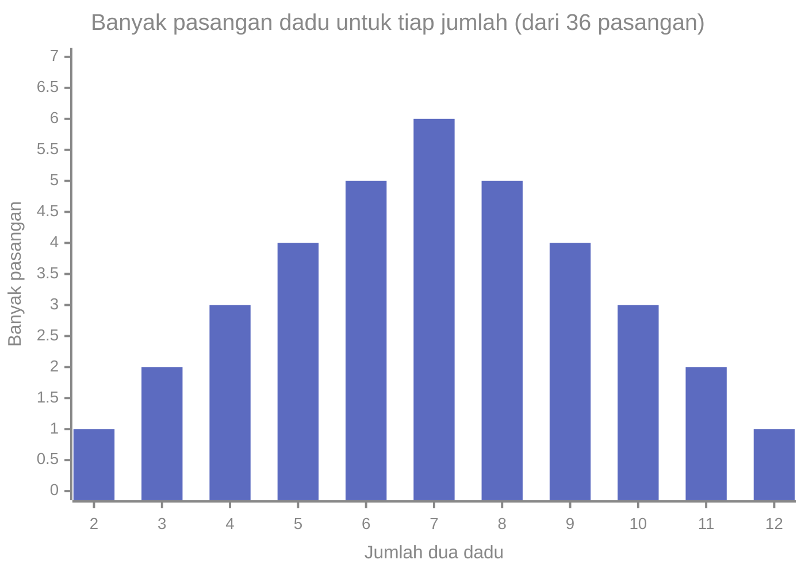

# Part 4 — Dasar Probabilitas

## Tujuan Pembelajaran

Setelah mempelajari bagian ini, kamu mampu:

- membedakan eksperimen acak, hasil, ruang sampel, dan kejadian;
- menghitung peluang klasik $P(A) = \dfrac{n(A)}{n(S)}$ bila semua hasil sama mungkin;
- menjelaskan peluang sebagai frekuensi relatif jangka panjang;
- menyebut dan memakai aturan dasar peluang: batas 0 sampai 1, komplemen, dan penjumlahan;
- membedakan gabungan ($\cup$, "atau"), irisan ($\cap$, "dan"), dan kejadian saling lepas;
- menghitung peluang gabungan dengan aturan penjumlahan umum;
- memakai prinsip perkalian, faktorial, permutasi, dan kombinasi untuk menghitung banyak hasil;
- menyelesaikan soal "minimal satu" dengan trik komplemen;
- menghubungkan peluang dengan frekuensi data dan keluaran model klasifikasi.

## Prasyarat

[Part 1 — Pengantar Statistika](01-pengantar-statistika.md) (sampel acak), [Part 3 — Visualisasi dan Distribusi Data](03-visualisasi-dan-distribusi-data.md) (frekuensi relatif), serta [Level 0 — Part 3](../level-0-fondasi-matematika/03-pecahan-dan-desimal.md) dan [Part 4](../level-0-fondasi-matematika/04-persentase-rasio-proporsi.md) (pecahan, desimal, persen).

## Mengapa Materi Ini Penting?

Statistika menjawab "apa yang terjadi pada data yang sudah ada". Probabilitas menjawab sebaliknya: "jika kita tahu aturan mainnya, apa yang mungkin terjadi?". Keduanya saling terhubung: peluang adalah bahasa yang dipakai untuk menyatakan seberapa yakin kita pada sebuah prediksi.

Dalam Machine Learning, hampir semua model klasifikasi menghasilkan nilai antara 0 dan 1 yang ditafsirkan sebagai peluang. Aturan dalam part ini, seperti peluang komplemen dan penjumlahan, adalah fondasi bagi probabilitas bersyarat, Teorema Bayes, dan distribusi di part berikutnya.

## Konsep Dasar dengan Bahasa Sederhana

### 1. Eksperimen Acak, Ruang Sampel, dan Kejadian

- **Eksperimen acak** (*random experiment*) adalah proses yang hasilnya tidak pasti sebelum dilakukan, tetapi himpunan semua hasil yang mungkin diketahui. Contoh: melempar koin, melempar dadu, memilih satu e-mail secara acak.
- **Hasil** (*outcome*) adalah satu kemungkinan yang muncul dari eksperimen.
- **Ruang sampel** (*sample space*) $S$ adalah himpunan semua hasil yang mungkin.
- **Kejadian** (*event*) adalah himpunan bagian dari $S$: kumpulan hasil yang kita pedulikan.

Contoh: lempar satu dadu. $S = \{1, 2, 3, 4, 5, 6\}$. Kejadian "muncul angka genap" adalah $A = \{2, 4, 6\}$. Kejadian "muncul angka lebih dari 6" adalah himpunan kosong $\emptyset$ (mustahil), sedangkan "muncul angka 1 sampai 6" adalah $S$ itu sendiri (pasti).

Banyak anggota himpunan ditulis $n(\cdot)$. Di contoh ini $n(S) = 6$ dan $n(A) = 3$.

### 2. Apa Itu Peluang?

**Peluang** (*probability*) suatu kejadian adalah bilangan antara $0$ dan $1$ yang mengukur seberapa mungkin kejadian itu terjadi. $0$ berarti mustahil, $1$ berarti pasti. Ada tiga cara memandangnya:

**a. Peluang klasik.** Jika semua hasil di $S$ **sama mungkin**, maka:

$$
P(A) = \frac{n(A)}{n(S)}
$$

Dibaca: "peluang $A$ = banyak hasil yang mendukung $A$ dibagi banyak semua hasil". Contoh: $P(\text{genap}) = \dfrac{3}{6} = 0{,}5$.

Syarat penting: **semua hasil sama mungkin**. Rumus ini keliru jika syaratnya tidak terpenuhi (lihat contoh jumlah dua dadu di bawah).

**b. Frekuensi relatif (peluang empiris).** Ulangi eksperimen berkali-kali, lalu hitung bagian kejadian $A$ muncul:

$$
\text{frekuensi relatif} = \frac{\text{banyak kali } A \text{ terjadi}}{\text{banyak percobaan}}
$$

Makin banyak percobaan, frekuensi relatif cenderung mendekati peluang sebenarnya. Gagasan ini disebut **Hukum Bilangan Besar** (*Law of Large Numbers*) secara intuitif. Contoh simulasi lempar koin yang adil (hasil di bagian Python):

| Banyak lemparan | Banyak kepala | Frekuensi relatif |
|---|---|---|
| 10 | 6 | 0,6000 |
| 100 | 61 | 0,6100 |
| 1.000 | 502 | 0,5020 |
| 100.000 | 50.141 | 0,5014 |

Pada 10 lemparan, hasilnya $0{,}6$ cukup jauh dari $0{,}5$. Pada 100.000 lemparan, hasilnya sangat dekat. Perhatikan juga bahwa selisih tidak selalu mengecil secara mulus: pada 100 lemparan selisihnya lebih besar daripada pada 10 lemparan.

**c. Peluang subjektif.** Derajat keyakinan seseorang atas suatu kejadian yang tidak bisa diulang, misalnya "peluang tim ini menang besok". Pendekatan ini penting dalam statistika Bayes (Part 6), tetapi part ini fokus pada dua cara pertama.

!!! warning "Hukum Bilangan Besar bukan 'hukum keseimbangan'"
    Jika koin yang adil muncul kepala 5 kali berturut-turut, lemparan berikutnya **tetap** memiliki peluang kepala $0{,}5$. Koin tidak "ingat" dan tidak "berutang" ekor. Hukum bilangan besar berbicara tentang **frekuensi relatif** untuk jumlah percobaan sangat banyak, bukan tentang pengimbangan hasil berikutnya. Anggapan bahwa hasil harus "diimbangi" disebut kekeliruan penjudi (*gambler's fallacy*).

### 3. Aturan Dasar Peluang

Untuk setiap kejadian $A$ dan $B$ pada ruang sampel $S$:

1. $0 \leq P(A) \leq 1$.
2. $P(S) = 1$ dan $P(\emptyset) = 0$.
3. Jika $A$ dan $B$ **saling lepas** (tidak mungkin terjadi bersamaan), maka $P(A \cup B) = P(A) + P(B)$.

Dari aturan ini diturunkan aturan lain di bagian berikutnya.

### 4. Operasi pada Kejadian

| Operasi | Lambang | Arti | Contoh (dadu) |
|---|---|---|---|
| Komplemen | $A^c$ | $A$ tidak terjadi | $A = \{2,4,6\}$, $A^c = \{1,3,5\}$ |
| Gabungan | $A \cup B$ | $A$ **atau** $B$ (atau keduanya) | $\{2,4,6\} \cup \{4,5,6\} = \{2,4,5,6\}$ |
| Irisan | $A \cap B$ | $A$ **dan** $B$ sekaligus | $\{2,4,6\} \cap \{4,5,6\} = \{4,6\}$ |

Dua kejadian **saling lepas** (*mutually exclusive*) jika $A \cap B = \emptyset$, yaitu tidak punya hasil bersama. Contoh: "genap" dan "ganjil".

**Aturan komplemen:**

$$
P(A^c) = 1 - P(A)
$$

Karena $A$ dan $A^c$ saling lepas dan gabungannya adalah $S$, maka $P(A) + P(A^c) = 1$.

**Aturan penjumlahan umum:**

$$
P(A \cup B) = P(A) + P(B) - P(A \cap B)
$$

Mengapa dikurangi $P(A \cap B)$? Karena hasil yang berada di $A$ **dan** $B$ terhitung dua kali bila kita menjumlahkan $P(A) + P(B)$. Jika $A$ dan $B$ saling lepas, $P(A \cap B) = 0$ dan rumusnya kembali ke aturan 3.

**Contoh dengan tabel hitungan.** Dari 100 siswa, 60 suka kopi ($A$), 45 suka teh ($B$), dan 25 suka keduanya.

| | Suka teh | Tidak suka teh | Jumlah |
|---|---|---|---|
| **Suka kopi** | 25 | 35 | 60 |
| **Tidak suka kopi** | 20 | 20 | 40 |
| **Jumlah** | 45 | 55 | 100 |

Siswa yang suka kopi atau teh: $35 + 25 + 20 = 80$, jadi $P(A \cup B) = 0{,}8$. Cocok dengan rumus: $0{,}6 + 0{,}45 - 0{,}25 = 0{,}8$.

### 5. Menghitung Banyak Hasil (Pencacahan)

Untuk peluang klasik kita perlu menghitung $n(A)$ dan $n(S)$. Alat yang sering dipakai:

**Prinsip perkalian.** Jika langkah pertama punya $a$ cara dan langkah kedua punya $b$ cara, maka keduanya punya $a \times b$ cara. Contoh: kata sandi 3 digit (0–9): $10 \times 10 \times 10 = 1000$.

**Faktorial.** $n! = n \times (n-1) \times \dots \times 2 \times 1$, dengan $0! = 1$. $5! = 120$ adalah banyak cara menyusun 5 benda berbeda berurutan.

**Permutasi** (*urutan penting*): banyak cara memilih dan menyusun $r$ dari $n$ benda berbeda.

$$
P(n, r) = \frac{n!}{(n - r)!}
$$

Contoh: menyusun 3 dari 5 buku di rak: $\dfrac{5!}{2!} = \dfrac{120}{2} = 60$.

**Kombinasi** (*urutan tidak penting*): banyak cara memilih $r$ dari $n$ benda berbeda.

$$
\binom{n}{r} = \frac{n!}{r!\,(n - r)!}
$$

Contoh: memilih 2 dari 5 e-mail: $\dbinom{5}{2} = \dfrac{120}{2 \times 6} = 10$.

Perbedaannya: kombinasi menghitung "kelompok", permutasi menghitung "urutan". Setiap kelompok berisi $r$ benda dapat disusun dalam $r!$ urutan, sehingga $P(n, r) = \binom{n}{r}\,r!$.

!!! note "Simbol $P$ punya dua arti"
    Di part ini $P(A)$ adalah peluang kejadian (argumennya himpunan), sedangkan $P(n, r)$ adalah permutasi (argumennya dua bilangan). Konteksnya biasanya jelas; pada soal pencacahan permutasi sering ditulis dengan kata "permutasi".

### 6. Trik Komplemen: "Minimal Satu"

Menghitung "minimal satu" langsung sering rumit, karena ada banyak kasus (satu, dua, tiga, ...). Lebih mudah menghitung kebalikannya, "tidak ada sama sekali", lalu memakai komplemen:

$$
P(\text{minimal satu}) = 1 - P(\text{tidak ada})
$$

### 7. Jumlah Dua Dadu: Hasilnya Tidak Sama Mungkin

Jika dua dadu dilempar, ruang sampel hasil **berpasangan** $(a, b)$ punya $6 \times 6 = 36$ hasil yang sama mungkin. Tetapi **jumlahnya** (2 sampai 12) tidak sama mungkin, karena jumlah 7 dapat terjadi dengan 6 pasangan sedangkan jumlah 2 hanya dengan 1 pasangan, yaitu $(1,1)$.



Karena itu $P(\text{jumlah} = 7) = \dfrac{6}{36} = \dfrac{1}{6}$, bukan $\dfrac{1}{11}$. Menganggap 11 jumlah yang mungkin sama mungkin adalah kesalahan klasik.

## Istilah yang Perlu Dipahami

| Istilah | Arti sederhana |
|---|---|
| Eksperimen acak | proses dengan hasil tidak pasti |
| Hasil | satu kemungkinan dari eksperimen |
| Ruang sampel $S$ | himpunan semua hasil yang mungkin |
| Kejadian | himpunan bagian dari $S$ |
| Peluang $P(A)$ | ukuran seberapa mungkin $A$ terjadi, antara 0 dan 1 |
| Komplemen $A^c$ | $A$ tidak terjadi |
| Gabungan $A \cup B$ | $A$ atau $B$ |
| Irisan $A \cap B$ | $A$ dan $B$ |
| Saling lepas | tidak mungkin terjadi bersamaan |
| Faktorial $n!$ | hasil kali $n$ sampai $1$ |
| Permutasi | pemilihan dengan urutan penting |
| Kombinasi | pemilihan tanpa urutan |

## Rumus dan Penjelasan Setiap Simbol

| Rumus | Arti simbol dan syarat |
|---|---|
| $P(A) = \dfrac{n(A)}{n(S)}$ | $n(A)$ banyak hasil di $A$; $n(S)$ banyak hasil di $S$. **Syarat: semua hasil sama mungkin.** |
| $0 \leq P(A) \leq 1$ | peluang selalu di antara 0 dan 1 |
| $P(A^c) = 1 - P(A)$ | $A^c$ komplemen $A$ |
| $P(A \cup B) = P(A) + P(B) - P(A \cap B)$ | $\cup$ "atau", $\cap$ "dan"; berlaku untuk semua $A, B$ |
| $P(A \cup B) = P(A) + P(B)$ | hanya jika $A, B$ saling lepas |
| $n! = n(n-1)\cdots 1$ | $n$ bilangan bulat tak negatif, $0! = 1$ |
| $P(n, r) = \dfrac{n!}{(n-r)!}$ | $0 \leq r \leq n$, urutan penting |
| $\dbinom{n}{r} = \dfrac{n!}{r!\,(n-r)!}$ | $0 \leq r \leq n$, urutan tidak penting |

## Penjelasan Langkah demi Langkah

**Menghitung peluang suatu kejadian:**

1. Tulis eksperimennya dan tentukan ruang sampel $S$. Jelas apakah hasilnya sama mungkin.
2. Tulis kejadian yang ditanyakan sebagai himpunan bagian dari $S$.
3. Hitung $n(A)$ dan $n(S)$ dengan mendaftar atau dengan pencacahan.
4. Bagi: $P(A) = n(A)/n(S)$. Jika "atau", ingat mengurangi irisan; jika "minimal satu", coba komplemen.
5. Periksa: hasilnya di antara 0 dan 1? Jumlah peluang semua hasil yang saling lepas dan lengkap sama dengan 1?
6. Tafsirkan dalam kalimat.

## Contoh Soal dan Pembahasan

### Contoh 1 — Tiga lemparan koin

Sebuah koin yang adil dilempar tiga kali. Hitung peluang (a) minimal satu kepala, (b) tepat dua kepala.

1. Ruang sampel: setiap lemparan punya 2 hasil, jadi $n(S) = 2 \times 2 \times 2 = 8$: $HHH, HHT, HTH, HTT, THH, THT, TTH, TTT$.
2. (a) Komplemen: "tidak ada kepala" hanya $TTT$, jadi $P = \dfrac{1}{8}$. Maka $P(\text{minimal satu kepala}) = 1 - \dfrac{1}{8} = \dfrac{7}{8}$.
3. (b) Tepat dua kepala: $HHT, HTH, THH$, jadi $n(A) = 3$. $P = \dfrac{3}{8} = 0{,}375$.
4. Periksa (b) dengan kombinasi: memilih 2 dari 3 posisi untuk kepala $= \dbinom{3}{2} = 3$. Cocok.

### Contoh 2 — Dua dadu

Dua dadu dilempar. Hitung peluang (a) jumlah 7, (b) jumlah minimal 10, (c) kedua dadu sama (ganda), (d) jumlah genap.

1. $n(S) = 36$.
2. (a) Jumlah 7: $(1,6), (2,5), (3,4), (4,3), (5,2), (6,1)$, yaitu $6$ pasangan. $P = \dfrac{6}{36} = \dfrac{1}{6}$.
3. (b) Jumlah 10: $3$ pasangan; 11: $2$; 12: $1$. Total $6$, jadi $P = \dfrac{6}{36} = \dfrac{1}{6}$.
4. (c) Ganda: $(1,1), \dots, (6,6)$, yaitu $6$, jadi $P = \dfrac{1}{6}$.
5. (d) Jumlah genap terjadi bila kedua dadu sama paritas (genap-genap atau ganjil-ganjil): $3 \times 3 + 3 \times 3 = 18$. $P = \dfrac{18}{36} = \dfrac{1}{2}$.

### Contoh 3 — Gabungan pada kartu

Satu kartu diambil acak dari 52 kartu (13 skop, 4 raja). Hitung peluang kartu itu skop atau raja.

1. $A$ = skop: $P(A) = \dfrac{13}{52}$. $B$ = raja: $P(B) = \dfrac{4}{52}$.
2. Irisan: raja skop, hanya $1$ kartu: $P(A \cap B) = \dfrac{1}{52}$.
3. $P(A \cup B) = \dfrac{13}{52} + \dfrac{4}{52} - \dfrac{1}{52} = \dfrac{16}{52} = \dfrac{4}{13} \approx 0{,}3077$.

Jika irisan tidak dikurangi, jawabannya $\dfrac{17}{52}$ dan raja skop terhitung dua kali.

### Contoh 4 — Survei dengan tabel

Dari tabel survei kopi-teh di bagian 4, hitung peluang siswa yang dipilih acak (a) suka kopi saja, (b) tidak suka keduanya, (c) suka paling sedikit satu.

1. (a) Suka kopi saja (tidak suka teh): $\dfrac{35}{100} = 0{,}35$.
2. (b) Tidak suka keduanya: $\dfrac{20}{100} = 0{,}2$.
3. (c) $1 - 0{,}2 = 0{,}8$, atau $P(A) + P(B) - P(A \cap B) = 0{,}6 + 0{,}45 - 0{,}25 = 0{,}8$.

Kedua cara memberi hasil sama, bukti bahwa tabel dan rumus saling cocok.

### Contoh 5 — Memilih dengan kombinasi

Dari 5 e-mail, 2 adalah spam. Dua e-mail dipilih acak (tanpa pengembalian). Hitung peluang (a) keduanya spam, (b) tidak ada spam, (c) tepat satu spam.

1. Banyak cara memilih 2 dari 5: $n(S) = \dbinom{5}{2} = 10$.
2. (a) Keduanya spam: $\dbinom{2}{2} = 1$ cara, $P = \dfrac{1}{10}$.
3. (b) Tidak ada spam (dua dari 3 non-spam): $\dbinom{3}{2} = 3$, $P = \dfrac{3}{10}$.
4. (c) Tepat satu spam: satu dari 2 spam dan satu dari 3 non-spam: $\dbinom{2}{1}\dbinom{3}{1} = 6$, $P = \dfrac{6}{10} = \dfrac{3}{5}$.
5. Periksa: $\dfrac{1}{10} + \dfrac{3}{10} + \dfrac{6}{10} = 1$. Ketiga kejadian saling lepas dan lengkap.

## Contoh Tambahan dengan Kesulitan Bertahap

**Mudah.** Peluang hujan $0{,}3$. Peluang tidak hujan $= 1 - 0{,}3 = 0{,}7$.

**Sedang.** $P(A) = 0{,}4$, $P(B) = 0{,}5$, $P(A \cap B) = 0{,}2$. Maka $P(A \cup B) = 0{,}4 + 0{,}5 - 0{,}2 = 0{,}7$ dan peluang tidak satu pun terjadi $= 0{,}3$. Peluang hanya $A$ saja $= 0{,}4 - 0{,}2 = 0{,}2$.

**Sedang.** Minimal satu angka enam dalam 4 lemparan dadu. Peluang tidak ada enam di satu lemparan $= \dfrac{5}{6}$. Untuk 4 lemparan (hasil tiap lemparan tidak memengaruhi yang lain): $\left(\dfrac{5}{6}\right)^4 = \dfrac{625}{1296}$. Jadi $P(\text{minimal satu enam}) = 1 - \dfrac{625}{1296} = \dfrac{671}{1296} \approx 0{,}5177$. (Mengalikan peluang untuk lemparan yang saling tidak memengaruhi dibahas lebih lengkap di Part 5.)

**Menantang.** Dalam sebuah ruangan berisi 23 orang, peluang minimal dua orang berulang tahun pada tanggal yang sama sekitar $0{,}507$, lebih dari separuh. Perhitungannya memakai komplemen: peluang semua ulang tahun berbeda $= \dfrac{365}{365} \times \dfrac{364}{365} \times \dots \times \dfrac{343}{365}$, lalu dikurangkan dari 1 (dengan asumsi 365 hari sama mungkin dan tidak ada tahun kabisat). Hasil yang mengejutkan ini terjadi karena yang dihitung adalah semua pasangan orang ($\binom{23}{2} = 253$ pasangan), bukan satu orang tertentu.

## Visualisasi atau Interpretasi Grafik

Tabel hitungan dua arah (seperti survei kopi-teh) adalah cara visual paling sederhana untuk peluang gabungan dan irisan: sel di dalam tabel adalah irisan, jumlah baris dan kolom adalah peluang tunggal, dan jumlah total selalu $1$ (atau $100\%$). Diagram batang jumlah dua dadu di atas menunjukkan bahwa hasil tidak sama mungkin harus dicacah, bukan diperlakukan seragam.

## Kesalahan Umum

| Kesalahan | Mengapa salah | Yang benar |
|---|---|---|
| Memakai $n(A)/n(S)$ saat hasil tidak sama mungkin | rumus klasik butuh hasil sama mungkin | cacah hasil yang sama mungkin dahulu (misalnya pasangan dadu) |
| $P(A \cup B) = P(A) + P(B)$ tanpa syarat | irisan terhitung dua kali | kurangi $P(A \cap B)$ bila tidak saling lepas |
| Peluang lebih dari 1 atau negatif | di luar batas | periksa hasil: harus di antara 0 dan 1 |
| Mengira kejadian saling lepas berarti saling tidak memengaruhi | itu dua hal berbeda (independensi dibahas di Part 5) | saling lepas: tidak bisa bersamaan |
| Kekeliruan penjudi | koin tidak "berutang" | peluang lemparan baru tetap sama |
| Memakai permutasi untuk "memilih kelompok" | urutan tidak penting | pakai kombinasi |
| Menghitung "minimal satu" dengan menjumlah banyak kasus | rawan lupa kasus | pakai $1 - P(\text{tidak ada})$ |
| Menyamakan frekuensi relatif sampel kecil dengan peluang sebenarnya | sampel kecil bervariasi | gunakan sampel besar atau laporkan ketidakpastian |

## Hubungan dengan Machine Learning

- **Keluaran klasifikasi.** Model klasifikasi sering menghasilkan angka antara 0 dan 1 untuk setiap kelas. Agar dapat ditafsirkan sebagai peluang, angka itu harus tak negatif dan jumlah seluruh kelas harus $1$ (aturan dasar di atas). Apakah angka itu benar-benar **terkalibrasi** (misalnya "80%" memang benar sekitar 80% kali) adalah pertanyaan terpisah.
- **Peluang dari frekuensi.** Peluang kelas pada dataset diperkirakan dari frekuensi relatif. Jika 14 dari 200 transaksi adalah penipuan, perkiraan peluang penipuan $\approx 0{,}07$. Ini hanya perkiraan dari sampel: dataset lain bisa memberi angka berbeda.
- **Ketidakseimbangan kelas.** Peluang kelas minoritas yang kecil berarti sampel acak kecil mudah tidak memuat kelas itu sama sekali (misalnya hitungan di Part 1). Pembagian berstrata dipakai untuk menjaganya.
- **Baseline probabilistik.** Model paling sederhana memprediksi kelas dengan peluang tertinggi. Pada data tidak seimbang, akurasinya bisa tampak tinggi tanpa informasi apa pun.
- **Fondasi bagi part berikutnya.** Komplemen, gabungan, dan irisan dipakai di probabilitas bersyarat, Teorema Bayes (dipakai Naive Bayes), dan perhitungan distribusi.

### Python: simulasi, pencacahan, dan komplemen

Hanya pustaka standar. Ruang sampel koin dan dadu:

```python
import math, random
from itertools import product
from fractions import Fraction
from collections import Counter

S = list(product("HT", repeat=3))
print(len(S), S[:3])                                   # 8 [('H', 'H', 'H'), ('H', 'H', 'T'), ('H', 'T', 'H')]
minimal_satu_H = [s for s in S if "H" in s]
persis_dua_H = [s for s in S if s.count("H") == 2]
print(Fraction(len(minimal_satu_H), len(S)), Fraction(len(persis_dua_H), len(S)))   # 7/8 3/8

D = list(product(range(1, 7), repeat=2))
print(len(D))                                          # 36
print(Fraction(sum(1 for a, b in D if a + b == 7), 36))     # 1/6
print(Fraction(sum(1 for a, b in D if a + b >= 10), 36))    # 1/6
print(Fraction(sum(1 for a, b in D if a == b), 36))         # 1/6
print(sorted(Counter(a + b for a, b in D).items()))
# [(2, 1), (3, 2), (4, 3), (5, 4), (6, 5), (7, 6), (8, 5), (9, 4), (10, 3), (11, 2), (12, 1)]
```

`Fraction` menjaga hasil sebagai pecahan eksak. Simulasi frekuensi relatif (seed tetap, Python 3.14):

```python
for n in (10, 100, 1000, 100000):
    rng = random.Random(2024)
    kepala = sum(rng.random() < 0.5 for _ in range(n))
    print(n, kepala, kepala / n)
# 10 6 0.6
# 100 61 0.61
# 1000 502 0.502
# 100000 50141 0.50141

rng = random.Random(5)
n = 100000
tujuh = sum(1 for _ in range(n) if rng.randint(1, 6) + rng.randint(1, 6) == 7)
print(tujuh / n, 1 / 6)                                # 0.16628 0.16666666666666666
```

Pencacahan, e-mail, dan komplemen:

```python
print(math.factorial(5), math.perm(5, 3), math.comb(5, 2))   # 120 60 10
total = math.comb(5, 2)
print(Fraction(math.comb(2, 2), total))                # 1/10
print(Fraction(math.comb(3, 2), total))                # 3/10
print(Fraction(math.comb(2, 1) * math.comb(3, 1), total))    # 3/5
print(round(math.comb(90, 10) / math.comb(100, 10), 4))      # 0.3305

def peluang_ulang_tahun_sama(k):
    tidak_sama = 1.0
    for i in range(k):
        tidak_sama *= (365 - i) / 365
    return 1 - tidak_sama

print(round(peluang_ulang_tahun_sama(23), 4), round(peluang_ulang_tahun_sama(50), 4))
# 0.5073 0.9704
print(Fraction(1) - Fraction(5, 6) ** 4, round(1 - (5 / 6) ** 4, 4))   # 671/1296 0.5177
```

Interpretasi: simulasi mendekati nilai eksak ($0{,}1663$ vs $\tfrac{1}{6} \approx 0{,}1667$); hasil `0.3305` adalah peluang sampel acak 10 e-mail dari 100 (10 spam) tanpa spam sama sekali, yang kita simulasikan di Part 1 (hasil $\approx 0{,}33$). `math.comb` dan `math.perm` tersedia di Python standar.

## Latihan Mandiri

1. Sebuah koin dilempar dua kali. Tuliskan ruang sampelnya dan hitung peluang minimal satu kepala.
2. Dua dadu dilempar. Hitung peluang (a) jumlah 8, (b) jumlah paling banyak 4, (c) kedua dadu bermata sama.
3. $P(A) = 0{,}4$, $P(B) = 0{,}5$, $P(A \cap B) = 0{,}2$. Hitung $P(A \cup B)$, peluang tidak satu pun terjadi, dan peluang hanya $A$ saja.
4. Jika $A$ dan $B$ saling lepas dengan $P(A) = 0{,}3$ dan $P(B) = 0{,}45$, hitung $P(A \cup B)$ dan $P(A \cap B)$. Mungkinkah dua kejadian saling lepas dengan $P(A) = 0{,}7$ dan $P(B) = 0{,}5$?
5. Satu kartu diambil dari 52 kartu. Hitung peluang kartu itu ratu atau skop.
6. Tiga dadu dilempar. Berapa peluang minimal satu mata enam?
7. Hitung: (a) banyak kata sandi 4 digit, (b) banyak cara menyusun 3 dari 6 buku di rak, (c) banyak cara memilih panitia 3 orang dari 6 orang.
8. Dari 6 e-mail, 3 adalah spam. Dua e-mail dipilih acak tanpa pengembalian. Hitung peluang keduanya spam, tepat satu spam, dan tidak ada spam.
9. Dalam dataset 200 transaksi terdapat 14 penipuan. Perkirakan peluang sebuah transaksi acak adalah penipuan. Berapa penipuan yang diharapkan di 1.000 transaksi? Apa yang perlu dihati-hati?
10. Koin yang adil muncul kepala 5 kali berturut-turut. Berapa peluang kepala pada lemparan keenam? Berapa peluang 5 kepala berturut-turut dari 5 lemparan? Jelaskan mengapa jawabannya berbeda.

## Kunci Jawaban dan Pembahasan

??? success "Soal 1"
    $S = \{HH, HT, TH, TT\}$, $n(S) = 4$. Tidak ada kepala hanya $TT$, jadi $P(\text{minimal satu kepala}) = 1 - \dfrac{1}{4} = \dfrac{3}{4}$.

??? success "Soal 2"
    (a) Jumlah 8: $(2,6), (3,5), (4,4), (5,3), (6,2)$, yaitu $5$ pasangan, $P = \dfrac{5}{36}$. (b) Jumlah $\leq 4$: jumlah 2 ($1$), 3 ($2$), 4 ($3$), total $6$, $P = \dfrac{6}{36} = \dfrac{1}{6}$. (c) Ganda: $6$ pasangan, $P = \dfrac{6}{36} = \dfrac{1}{6}$.

??? success "Soal 3"
    $P(A \cup B) = 0{,}4 + 0{,}5 - 0{,}2 = 0{,}7$. Tidak satu pun: $1 - 0{,}7 = 0{,}3$. Hanya $A$: $P(A) - P(A \cap B) = 0{,}4 - 0{,}2 = 0{,}2$.

??? success "Soal 4"
    Saling lepas: $P(A \cap B) = 0$ dan $P(A \cup B) = 0{,}3 + 0{,}45 = 0{,}75$. Tidak mungkin saling lepas dengan $P(A) = 0{,}7$ dan $P(B) = 0{,}5$, karena akan menghasilkan $P(A \cup B) = 1{,}2 > 1$.

??? success "Soal 5"
    $P(\text{ratu}) = \dfrac{4}{52}$, $P(\text{skop}) = \dfrac{13}{52}$, irisan (ratu skop) $= \dfrac{1}{52}$. $P = \dfrac{4 + 13 - 1}{52} = \dfrac{16}{52} = \dfrac{4}{13} \approx 0{,}3077$.

??? success "Soal 6"
    Peluang tidak ada enam dalam 3 lemparan $= \left(\dfrac{5}{6}\right)^3 = \dfrac{125}{216}$. $P(\text{minimal satu enam}) = 1 - \dfrac{125}{216} = \dfrac{91}{216} \approx 0{,}4213$.

??? success "Soal 7"
    (a) $10^4 = 10\,000$. (b) $\dfrac{6!}{3!} = \dfrac{720}{6} = 120$. (c) $\dbinom{6}{3} = \dfrac{720}{6 \times 6} = 20$. Selisih (b) dan (c): $120 = 20 \times 3!$.

??? success "Soal 8"
    $n(S) = \dbinom{6}{2} = 15$. Keduanya spam: $\dbinom{3}{2} = 3$, $P = \dfrac{3}{15} = \dfrac{1}{5}$. Tepat satu spam: $\dbinom{3}{1}\dbinom{3}{1} = 9$, $P = \dfrac{9}{15} = \dfrac{3}{5}$. Tidak ada spam: $\dbinom{3}{2} = 3$, $P = \dfrac{1}{5}$. Jumlah: $\dfrac{1}{5} + \dfrac{3}{5} + \dfrac{1}{5} = 1$.

??? success "Soal 9"
    Perkiraan: $\dfrac{14}{200} = 0{,}07$ (7%). Di 1.000 transaksi diharapkan sekitar $70$ penipuan. Hati-hati: ini frekuensi relatif dari sampel, sehingga hanya perkiraan; sampel lain atau periode lain bisa memberi angka berbeda, dan sampel yang bias menghasilkan perkiraan yang bias. Angka ini juga bukan jaminan jumlah tepat di 1.000 transaksi berikutnya.

??? success "Soal 10"
    Jika koinnya adil, peluang kepala pada lemparan keenam tetap $0{,}5$, karena lemparan tidak saling memengaruhi. Peluang 5 kepala berturut-turut dari 5 lemparan adalah $\left(\dfrac{1}{2}\right)^5 = \dfrac{1}{32} = 0{,}03125$. Pertanyaan pertama berbicara tentang satu lemparan baru **setelah** 5 hasil diketahui; yang kedua tentang peluang seluruh rangkaian sebelum dilempar. Perbedaan ini menjelaskan mengapa "kepala 5 kali berturut-turut" jarang, tetapi tidak membuat lemparan berikutnya lebih mungkin ekor.

## Ringkasan Materi

- **Ruang sampel $S$** memuat semua hasil; **kejadian** adalah himpunan bagiannya.
- **Peluang** berada di antara 0 dan 1. Peluang klasik: $P(A) = n(A)/n(S)$, hanya bila semua hasil sama mungkin. Peluang juga dapat dipandang sebagai frekuensi relatif jangka panjang.
- **Komplemen:** $P(A^c) = 1 - P(A)$. **Penjumlahan umum:** $P(A \cup B) = P(A) + P(B) - P(A \cap B)$.
- Pencacahan: prinsip perkalian, faktorial, permutasi (urutan penting) dan kombinasi (urutan tidak penting).
- Trik "minimal satu": $1 - P(\text{tidak ada})$.
- Hukum Bilangan Besar tidak berarti hasil akan "diimbangi"; kekeliruan penjudi adalah kesalahan umum.
- Dalam ML: keluaran klasifikasi berupa peluang, peluang diperkirakan dari frekuensi data, dan ketidakseimbangan kelas mempengaruhi pengambilan sampel dan evaluasi.

## Checklist Penguasaan

- [ ] Menuliskan ruang sampel dan kejadian untuk eksperimen sederhana.
- [ ] Menghitung peluang klasik dan memeriksa syarat hasil sama mungkin.
- [ ] Memakai aturan komplemen dan aturan penjumlahan umum.
- [ ] Membedakan saling lepas dari tidak saling memengaruhi.
- [ ] Menghitung permutasi dan kombinasi dan memilih yang tepat.
- [ ] Menyelesaikan soal "minimal satu" dengan komplemen.
- [ ] Menjelaskan Hukum Bilangan Besar dan kekeliruan penjudi.
- [ ] Mengaitkan peluang dengan frekuensi data dan keluaran model.

## Prasyarat untuk Materi Berikutnya

[Part 5 — Probabilitas Bersyarat dan Independensi](05-probabilitas-bersyarat-dan-independensi.md) membahas peluang suatu kejadian bila kita sudah mengetahui kejadian lain telah terjadi, dan kapan dua kejadian benar-benar tidak saling memengaruhi. Pastikan aturan komplemen, penjumlahan, dan pencacahan sudah lancar, serta tabel hitungan dua arah sudah dipahami, karena tabel itu menjadi alat utama di Part 5.
