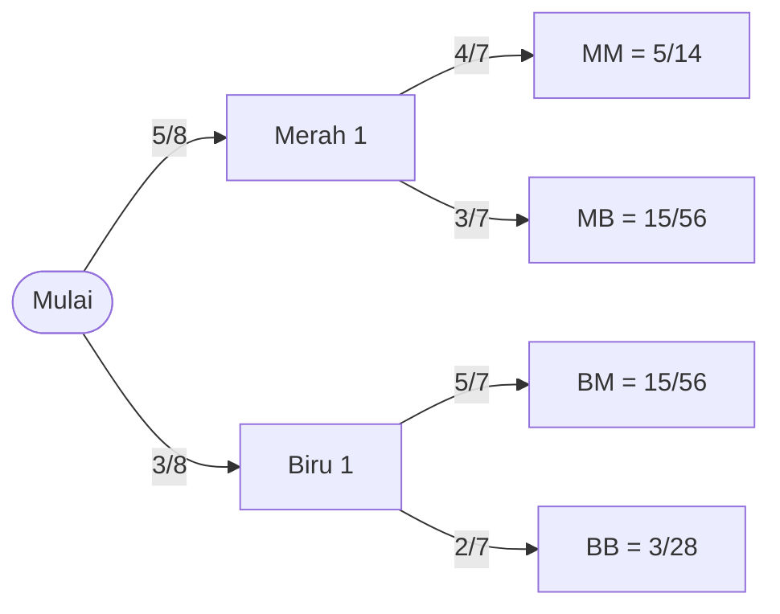

# Part 5 — Probabilitas Bersyarat dan Independensi

## Tujuan Pembelajaran

Setelah mempelajari bagian ini, kamu mampu:

- menjelaskan probabilitas bersyarat $P(A \mid B)$ dengan kata-kata sehari-hari;
- menghitung probabilitas bersyarat dari tabel kontingensi dan dari rumus;
- memakai aturan perkalian $P(A \cap B) = P(A \mid B)\,P(B)$ dan diagram pohon;
- menentukan apakah dua kejadian independen, dan membedakannya dari kejadian saling lepas;
- menghitung peluang rangkaian kejadian dengan pengembalian dan tanpa pengembalian;
- memakai hukum peluang total untuk menggabungkan beberapa kasus;
- menjelaskan mengapa $P(A \mid B)$ tidak sama dengan $P(B \mid A)$;
- menghubungkan semuanya dengan klasifikasi, asumsi independensi, dan data latih.

## Prasyarat

[Part 4 — Dasar Probabilitas](04-dasar-probabilitas.md) (ruang sampel, komplemen, gabungan, irisan, tabel hitungan dua arah). Tidak ada prasyarat lain.

## Mengapa Materi Ini Penting?

Peluang hampir selalu bergantung pada informasi yang sudah kita punya. Peluang hujan hari ini berbeda bila kita tahu langit sedang mendung. Peluang sebuah e-mail spam berbeda bila kita tahu e-mail itu memuat kata "gratis". Peluang yang dihitung **setelah** mengetahui suatu informasi disebut **probabilitas bersyarat**.

Dalam Machine Learning, inilah inti klasifikasi: model memperkirakan $P(\text{kelas} \mid \text{fitur})$, yaitu peluang sebuah kelas **diberikan** nilai-nilai fitur. Pertanyaan "apakah dua kejadian saling memengaruhi?" (independensi) juga muncul di mana-mana, misalnya pada asumsi bahwa contoh data tidak saling bergantung, dan pada Naive Bayes.

## Konsep Dasar dengan Bahasa Sederhana

### 1. Probabilitas Bersyarat

**Probabilitas bersyarat** $P(A \mid B)$ dibaca "peluang $A$ **diberikan** $B$", yaitu peluang $A$ terjadi jika kita sudah tahu $B$ terjadi.

**Intuisi: menyempitkan ruang sampel.** Mengetahui $B$ terjadi berarti kita hanya perlu melihat hasil-hasil di dalam $B$. Ruang sampel yang tadinya $S$ mengecil menjadi $B$. Di ruang yang lebih kecil itu, kita tanyakan seberapa besar bagian yang juga berisi $A$:

$$
P(A \mid B) = \frac{P(A \cap B)}{P(B)}, \qquad P(B) > 0
$$

- $P(A \cap B)$: peluang $A$ dan $B$ terjadi bersamaan;
- $P(B)$: peluang syarat $B$ terjadi, harus lebih dari 0;
- hasilnya: bagian dari $B$ yang juga berada di $A$.

Dibaca: "peluang $A$ diberikan $B$ = peluang irisan dibagi peluang syarat".

**Contoh dengan tabel kontingensi.** Dari 1.000 e-mail, kita catat apakah e-mail itu spam dan apakah memuat kata "gratis":

| | Memuat "gratis" | Tidak memuat | Jumlah |
|---|---|---|---|
| **Spam** | 240 | 60 | 300 |
| **Bukan spam** | 70 | 630 | 700 |
| **Jumlah** | 310 | 690 | 1000 |

Tabel seperti ini disebut **tabel kontingensi** (*contingency table*). Dari tabel:

- **Peluang gabungan (sel):** $P(\text{spam} \cap \text{gratis}) = \dfrac{240}{1000} = 0{,}24$.
- **Peluang marginal (jumlah baris atau kolom):** $P(\text{spam}) = \dfrac{300}{1000} = 0{,}3$ dan $P(\text{gratis}) = \dfrac{310}{1000} = 0{,}31$.
- **Peluang bersyarat:** misalkan kita tahu e-mail memuat "gratis". Ruang sampel menyempit menjadi 310 e-mail. Di antaranya 240 spam, jadi

$$
P(\text{spam} \mid \text{gratis}) = \frac{240}{310} = \frac{0{,}24}{0{,}31} \approx 0{,}7742
$$

Kedua cara (mencacah di tabel dan memakai rumus) memberi hasil sama.

**Arah syarat penting.** Peluang arah sebaliknya berbeda: $P(\text{gratis} \mid \text{spam}) = \dfrac{240}{300} = 0{,}8$. Jadi $P(\text{spam} \mid \text{gratis}) \approx 0{,}77$ tetapi $P(\text{gratis} \mid \text{spam}) = 0{,}8$. Pada umumnya $P(A \mid B) \neq P(B \mid A)$. Hubungan antara keduanya dibahas di Part 6 (Teorema Bayes).

### 2. Aturan Perkalian

Dengan mengalikan kedua ruas rumus bersyarat dengan $P(B)$:

$$
P(A \cap B) = P(A \mid B)\,P(B) = P(B \mid A)\,P(A)
$$

Dibaca: "peluang $A$ dan $B$ = peluang $B$ dikali peluang $A$ setelah $B$ diketahui". Aturan ini berguna untuk kejadian berurutan.

**Contoh: kantong bola tanpa pengembalian.** Sebuah kantong berisi 5 bola merah dan 3 bola biru. Dua bola diambil berurutan **tanpa dikembalikan**.

- $P(\text{merah pertama}) = \dfrac{5}{8}$.
- Jika pertama merah, sisa 4 merah dari 7 bola: $P(\text{merah kedua} \mid \text{merah pertama}) = \dfrac{4}{7}$.
- Maka $P(\text{merah, merah}) = \dfrac{5}{8} \times \dfrac{4}{7} = \dfrac{20}{56} = \dfrac{5}{14}$.

**Diagram pohon** menggambarkan semua jalur dan mengalikan peluang sepanjang jalur:



Jumlah keempat ujung: $\dfrac{20}{56} + \dfrac{15}{56} + \dfrac{15}{56} + \dfrac{6}{56} = \dfrac{56}{56} = 1$. Semua jalur saling lepas dan lengkap, jadi jumlahnya harus $1$.

### 3. Independensi

Dua kejadian **independen** jika mengetahui yang satu **tidak mengubah** peluang yang lain:

$$
P(A \mid B) = P(A)
\qquad \Longleftrightarrow \qquad
P(A \cap B) = P(A)\,P(B)
$$

Bentuk kedua (aturan perkalian untuk kejadian independen) lebih praktis dan simetris: dua kejadian independen **jika dan hanya jika** peluang gabungannya sama dengan hasil kali peluang masing-masing.

**Memeriksa independensi dari tabel.** Pada tabel spam di atas, $P(\text{spam})\,P(\text{gratis}) = 0{,}3 \times 0{,}31 = 0{,}093$, padahal $P(\text{spam} \cap \text{gratis}) = 0{,}24$. Tidak sama, jadi "spam" dan "memuat gratis" **tidak independen**: mengetahui adanya kata "gratis" mengubah peluang spam dari $0{,}3$ menjadi $0{,}77$. Itulah sebabnya kata tersebut berguna sebagai fitur.

**Contoh yang independen.** Dari 200 pengguna aplikasi, kita catat sistem operasi dan jenis kelamin:

| | Perempuan | Laki-laki | Jumlah |
|---|---|---|---|
| **Android** | 48 | 72 | 120 |
| **iOS** | 32 | 48 | 80 |
| **Jumlah** | 80 | 120 | 200 |

$P(\text{Android}) = 0{,}6$, $P(\text{perempuan}) = 0{,}4$, dan $P(\text{Android} \cap \text{perempuan}) = \dfrac{48}{200} = 0{,}24 = 0{,}6 \times 0{,}4$. Sama persis, jadi kedua kejadian independen. Cek lain: di antara perempuan, $\dfrac{48}{80} = 0{,}6$ memakai Android, sama dengan peluang keseluruhan.

!!! note "Data nyata hampir tidak pernah tepat independen"
    Pada tabel dari data sungguhan, hasil kali dan peluang gabungan jarang persis sama; selisih kecil bisa terjadi hanya karena kebetulan sampel. Menilai apakah selisih itu cukup besar untuk dianggap ada hubungan memerlukan inferensi statistik (Part 10).

### 4. Saling Lepas Tidak Sama dengan Independen

Kedua istilah ini sering tertukar, padahal hampir berlawanan:

| | Saling lepas | Independen |
|---|---|---|
| Definisi | $A \cap B = \emptyset$ | $P(A \cap B) = P(A)\,P(B)$ |
| Arti | tidak bisa terjadi bersamaan | mengetahui satu tidak mengubah peluang yang lain |
| $P(A \cap B)$ | $0$ | $P(A)\,P(B)$ |

Jika $A$ dan $B$ saling lepas dan masing-masing berpeluang positif, mereka **tidak** independen: mengetahui $A$ terjadi membuat $B$ **mustahil** ($P(B \mid A) = 0 \neq P(B)$). Contoh: "genap" dan "ganjil" saat melempar satu dadu saling lepas, tetapi sangat bergantung.

**Dua contoh pada dadu:**

- Dua dadu dilempar. $P(\text{jumlah} = 8) = \dfrac{5}{36}$, tetapi jika dadu pertama sudah 3, jumlah 8 hanya terjadi bila dadu kedua 5, sehingga $P(\text{jumlah} = 8 \mid d_1 = 3) = \dfrac{1}{6}$. Berbeda dari $\dfrac{5}{36}$: **tidak independen**.
- Tetapi $P(d_1 = 3 \mid \text{jumlah} = 7) = \dfrac{1}{6} = P(d_1 = 3)$, jadi "dadu pertama 3" dan "jumlah 7" **independen**. Hasil ini sedikit mengejutkan dan menunjukkan bahwa independensi harus diperiksa dengan angka, bukan ditebak dari perasaan.

### 5. Dengan dan Tanpa Pengembalian

Dari 52 kartu (4 as), ambil dua kartu berurutan.

- **Dengan pengembalian** (kartu pertama dikembalikan dan dikocok): pengambilan **independen**, $P(\text{dua as}) = \dfrac{4}{52} \times \dfrac{4}{52} = \dfrac{1}{169} \approx 0{,}00592$.
- **Tanpa pengembalian**: pengambilan kedua bergantung pada yang pertama, $P(\text{dua as}) = \dfrac{4}{52} \times \dfrac{3}{51} = \dfrac{1}{221} \approx 0{,}00452$.

Untuk populasi yang sangat besar dibanding jumlah yang diambil, perbedaan keduanya kecil. Ini sebabnya sampel kecil dari populasi besar sering dianggap kira-kira independen.

### 6. Beberapa Kejadian Independen

Untuk kejadian $A_1, A_2, \dots, A_n$ yang saling independen, peluang semuanya terjadi:

$$
P(A_1 \cap A_2 \cap \dots \cap A_n) = P(A_1)\,P(A_2)\cdots P(A_n)
$$

Contoh keandalan: sebuah sistem memakai dua komponen independen dengan peluang berfungsi $0{,}9$ dan $0{,}8$.

- **Seri** (sistem berfungsi hanya jika **keduanya** berfungsi): $0{,}9 \times 0{,}8 = 0{,}72$.
- **Paralel** (sistem berfungsi jika **minimal satu** berfungsi): $1 - (1 - 0{,}9)(1 - 0{,}8) = 1 - 0{,}1 \times 0{,}2 = 0{,}98$ (trik komplemen dari Part 4).

### 7. Hukum Peluang Total

Misalkan $A_1, A_2, \dots, A_k$ membagi ruang sampel menjadi bagian-bagian yang **saling lepas** dan **lengkap** (disebut **partisi**). Maka peluang kejadian $B$ dapat dihitung dengan menjumlahkan semua kasus:

$$
P(B) = \sum_{i=1}^{k} P(B \mid A_i)\,P(A_i)
$$

Dibaca: "peluang $B$ = jumlah dari peluang $B$ dalam tiap kasus, dibobot peluang kasus itu".

**Contoh.** Tiga mesin menghasilkan 50%, 30%, dan 20% produksi pabrik. Tingkat cacatnya 2%, 3%, dan 5%.

1. $P(\text{cacat}) = 0{,}02 \times 0{,}5 + 0{,}03 \times 0{,}3 + 0{,}05 \times 0{,}2$
2. $= 0{,}010 + 0{,}009 + 0{,}010 = 0{,}029$.

Jadi 2,9% seluruh produksi cacat. Hukum peluang total menjadi penyebut (*evidence*) pada Teorema Bayes di Part 6.

## Istilah yang Perlu Dipahami

| Istilah | Arti sederhana |
|---|---|
| Probabilitas bersyarat $P(A \mid B)$ | peluang $A$ bila $B$ sudah diketahui terjadi |
| Peluang gabungan | peluang dua kejadian terjadi bersamaan, $P(A \cap B)$ |
| Peluang marginal | peluang satu kejadian saja, dari jumlah baris atau kolom |
| Tabel kontingensi | tabel hitungan dua variabel kategorik |
| Aturan perkalian | $P(A \cap B) = P(A \mid B)\,P(B)$ |
| Independen | satu kejadian tidak mengubah peluang yang lain |
| Diagram pohon | gambar jalur kejadian berurutan dengan peluang pada cabang |
| Dengan / tanpa pengembalian | hasil yang diambil dikembalikan atau tidak |
| Partisi | pembagian ruang sampel menjadi bagian saling lepas dan lengkap |
| Hukum peluang total | menjumlahkan peluang melalui semua bagian partisi |

## Rumus dan Penjelasan Setiap Simbol

| Rumus | Arti simbol dan syarat |
|---|---|
| $P(A \mid B) = \dfrac{P(A \cap B)}{P(B)}$ | $A$ yang dicari, $B$ syarat. **Syarat: $P(B) > 0$.** |
| $P(A \cap B) = P(A \mid B)\,P(B)$ | berlaku untuk semua kejadian dengan $P(B) > 0$ |
| $P(A \cap B) = P(A)\,P(B)$ | **hanya jika $A$ dan $B$ independen** |
| $P(A \mid B) = P(A)$ | bentuk lain dari independensi, dengan $P(B) > 0$ |
| $P(B) = \sum_{i=1}^{k} P(B \mid A_i)\,P(A_i)$ | $A_1, \dots, A_k$ partisi ($\sum_i P(A_i) = 1$, saling lepas) |

Catatan simbol: garis tegak `\mid` dibaca "diberikan". $A_i$ adalah kejadian ke-$i$ dari partisi, dan $k$ banyaknya kejadian dalam partisi.

## Penjelasan Langkah demi Langkah

**Menghitung peluang bersyarat dari tabel:**

1. Tentukan syaratnya ($B$): baris atau kolom yang sudah diketahui.
2. Ambil **jumlah** baris atau kolom itu sebagai penyebut (ruang sampel yang menyempit).
3. Ambil sel yang memuat $A$ **dan** $B$ sebagai pembilang.
4. Bagi, lalu tafsirkan: "di antara yang $B$, sekian bagian adalah $A$".

**Memeriksa independensi:**

1. Hitung $P(A)$, $P(B)$, dan $P(A \cap B)$.
2. Bandingkan $P(A \cap B)$ dengan $P(A)\,P(B)$. Sama berarti independen.
3. Atau bandingkan $P(A \mid B)$ dengan $P(A)$.
4. Untuk data sampel, perlakukan selisih kecil dengan hati-hati (lihat catatan di bagian 3).

**Menghitung rangkaian kejadian:**

1. Gambar diagram pohon atau tulis urutan kejadian.
2. Peluang tiap cabang = peluang bersyarat berdasarkan jalur sebelumnya.
3. Kalikan sepanjang jalur; jumlahkan jalur-jalur yang termasuk kejadian yang ditanyakan.
4. Periksa bahwa semua jalur menjumlah $1$.

## Contoh Soal dan Pembahasan

### Contoh 1 — Probabilitas bersyarat dari tabel

Dari tabel spam, hitung (a) $P(\text{spam} \mid \text{tidak memuat gratis})$, (b) $P(\text{tidak memuat gratis} \mid \text{bukan spam})$.

1. (a) Syarat: tidak memuat "gratis", jumlah kolom $= 690$. Di antaranya spam $= 60$. $P = \dfrac{60}{690} = \dfrac{2}{23} \approx 0{,}0870$.
2. (b) Syarat: bukan spam, jumlah baris $= 700$. Di antaranya tidak memuat "gratis" $= 630$. $P = \dfrac{630}{700} = 0{,}9$.
3. Bandingkan dengan $P(\text{spam}) = 0{,}3$: tanpa kata "gratis", peluang spam turun menjadi $0{,}087$; dengan kata "gratis", naik menjadi $0{,}774$.

### Contoh 2 — Aturan perkalian tanpa pengembalian

Dari kantong 5 merah dan 3 biru, hitung peluang bola kedua merah.

1. Jalur "merah lalu merah": $\dfrac{5}{8} \times \dfrac{4}{7} = \dfrac{20}{56}$.
2. Jalur "biru lalu merah": $\dfrac{3}{8} \times \dfrac{5}{7} = \dfrac{15}{56}$.
3. Kedua jalur saling lepas, jadi $P(\text{kedua merah}) = \dfrac{20}{56} + \dfrac{15}{56} = \dfrac{35}{56} = \dfrac{5}{8}$.

Hasilnya sama dengan peluang bola **pertama** merah ($\dfrac{5}{8}$). Ini wajar karena tanpa informasi apa pun tentang bola pertama, posisi kedua sama "acaknya" dengan posisi pertama.

### Contoh 3 — Memeriksa independensi

Pada tabel Android-perempuan, apakah "Android" dan "perempuan" independen?

1. $P(\text{Android}) = \dfrac{120}{200} = 0{,}6$, $P(\text{perempuan}) = \dfrac{80}{200} = 0{,}4$.
2. $P(\text{Android} \cap \text{perempuan}) = \dfrac{48}{200} = 0{,}24$.
3. $0{,}6 \times 0{,}4 = 0{,}24$. Sama, jadi independen.
4. Pemeriksaan kedua: $P(\text{Android} \mid \text{perempuan}) = \dfrac{48}{80} = 0{,}6 = P(\text{Android})$.

### Contoh 4 — Keandalan sistem

Dua komponen independen berfungsi dengan peluang $0{,}9$ dan $0{,}8$. Bandingkan susunan seri dan paralel.

1. Seri (keduanya harus berfungsi): $0{,}9 \times 0{,}8 = 0{,}72$.
2. Paralel (cukup satu): peluang keduanya gagal $= (1 - 0{,}9)(1 - 0{,}8) = 0{,}1 \times 0{,}2 = 0{,}02$, sehingga $P = 1 - 0{,}02 = 0{,}98$.
3. Paralel jauh lebih andal. Namun perhitungan ini mengandalkan asumsi **independen**. Jika kedua komponen bisa rusak karena sebab yang sama (misalnya listrik padam), asumsi itu keliru dan hasilnya terlalu optimistis.

### Contoh 5 — Hukum peluang total

Pada pabrik dengan tiga mesin di atas, berapa peluang sebuah produk acak cacat, dan berapa peluang cacat dari mesin pertama sekaligus?

1. $P(\text{cacat}) = 0{,}029$ (dihitung di bagian 7).
2. $P(\text{mesin 1} \cap \text{cacat}) = P(\text{cacat} \mid \text{mesin 1})\,P(\text{mesin 1}) = 0{,}02 \times 0{,}5 = 0{,}01$.
3. Bagian dari seluruh cacat yang berasal dari mesin 1 adalah $\dfrac{0{,}01}{0{,}029} \approx 0{,}345$. Ini adalah pertanyaan arah terbalik, dan Part 6 membahasnya secara sistematis.

## Contoh Tambahan dengan Kesulitan Bertahap

**Mudah.** $P(A \cap B) = 0{,}12$ dan $P(B) = 0{,}4$. Maka $P(A \mid B) = \dfrac{0{,}12}{0{,}4} = 0{,}3$.

**Sedang.** Dua koin adil dilempar. Diketahui paling tidak satu kepala. Berapa peluang keduanya kepala? Ruang sampel menyempit menjadi $\{HH, HT, TH\}$, jadi peluangnya $\dfrac{1}{3}$, bukan $\dfrac{1}{2}$. Bandingkan dengan "diketahui koin pertama kepala": ruang sampelnya $\{HH, HT\}$, peluangnya $\dfrac{1}{2}$.

**Sedang.** Tiga lemparan dadu yang independen: peluang ketiganya genap $= \left(\dfrac{1}{2}\right)^3 = \dfrac{1}{8}$.

**Menantang.** Dua kartu diambil dari 52 tanpa pengembalian. Peluang keduanya hati: $\dfrac{13}{52} \times \dfrac{12}{51} = \dfrac{156}{2652} = \dfrac{1}{17} \approx 0{,}0588$. Tiga kartu hati berturut-turut: $\dfrac{13}{52} \times \dfrac{12}{51} \times \dfrac{11}{50} = \dfrac{1716}{132600} = \dfrac{11}{850} \approx 0{,}0129$.

## Visualisasi atau Interpretasi Grafik

Dua alat visual yang dipakai di part ini:

- **Tabel kontingensi:** peluang bersyarat adalah sel dibagi jumlah baris (atau kolom) syaratnya. Independensi berarti semua baris punya proporsi kolom yang sama.
- **Diagram pohon:** setiap cabang diberi peluang bersyarat; ujung pohon adalah irisan, dan jumlah seluruh ujung harus $1$.

## Kesalahan Umum

| Kesalahan | Mengapa salah | Yang benar |
|---|---|---|
| Menyamakan $P(A \mid B)$ dengan $P(B \mid A)$ | arah syarat berbeda | hitung dari tabel atau pakai Bayes (Part 6) |
| Mengalikan $P(A)\,P(B)$ untuk kejadian yang bergantung | hanya benar bila independen | pakai $P(A \mid B)\,P(B)$ |
| Menyamakan saling lepas dengan independen | hampir berlawanan | periksa dengan $P(A \cap B)$ |
| Memakai penyebut seluruh data pada peluang bersyarat | ruang sampel sudah menyempit | penyebut = jumlah baris/kolom syarat |
| Menganggap "dengan pengembalian" sama dengan "tanpa pengembalian" | peluang berubah | sesuaikan pembilang dan penyebut |
| Menganggap tabel hampir independen berarti pasti independen | selisih kecil bisa kebetulan | gunakan inferensi (Part 10) |
| Menganggap kejadian tak terkait secara logika pasti independen | independensi diukur dengan angka | hitung $P(A \cap B)$ |
| Lupa memeriksa $P(B) > 0$ | pembagian oleh nol | pastikan syarat mungkin terjadi |

## Hubungan dengan Machine Learning

- **Klasifikasi.** Banyak model klasifikasi memperkirakan $P(\text{kelas} \mid \text{fitur})$: peluang kelas, diberikan nilai fitur. Peluang bersyarat adalah bahasa dasarnya.
- **Fitur informatif.** Fitur berguna bila **tidak independen** dengan label. Pada contoh spam, adanya kata "gratis" menaikkan peluang spam dari $0{,}3$ menjadi $0{,}77$. Fitur yang independen terhadap label tidak membantu prediksi.
- **Asumsi independensi pada data.** Banyak teori dan praktik pelatihan mengasumsikan contoh data diambil secara **independen** dari distribusi yang sama (*i.i.d.*, *independent and identically distributed*). Asumsi ini dilanggar bila ada data duplikat, pengamatan berulang dari pengguna yang sama, atau data deret waktu. Akibatnya, pembagian latih-uji yang acak bisa membuat kinerja tampak lebih baik dari kenyataan (kebocoran informasi).
- **Naive Bayes.** Algoritma ini menyederhanakan banyak fitur dengan mengasumsikan fitur **independen bersyarat** pada kelas. Asumsi ini jarang benar persis, tetapi algoritmanya tetap sering bekerja cukup baik. Dibahas di Part 6.
- **Hukum peluang total.** Dipakai untuk menggabungkan beberapa kemungkinan, misalnya peluang prediksi positif dari semua kelas, atau penyebut pada Teorema Bayes.
- **Pengembalian dan sampling.** Pengambilan sampel mini-batch atau pembagian data dengan atau tanpa pengembalian (*bootstrap*) berkaitan dengan perbedaan independen dan tidak independen di atas.

### Python: tabel kontingensi dan independensi

Hanya pustaka standar. Tabel spam:

```python
from fractions import Fraction as F
from itertools import product

SG, SnG, nSG, nSnG = 240, 60, 70, 630     # spam/bukan x gratis/tidak
N = SG + SnG + nSG + nSnG
P_S = F(SG + SnG, N)
P_G = F(SG + nSG, N)
P_SG = F(SG, N)
print(N, P_S, P_G, P_SG)                        # 1000 3/10 31/100 6/25
print(P_SG / P_G, float(P_SG / P_G))            # 24/31 0.7741935483870968
print(P_SG / P_S)                               # 4/5
print(P_S * P_G, P_SG == P_S * P_G)             # 93/1000 False
```

Peluang bersyarat pada dua dadu dengan mencacah ruang sampel yang menyempit:

```python
D = list(product(range(1, 7), repeat=2))

def kondisional(A, B):
    sempit = [d for d in D if B(d)]             # ruang sampel menyempit ke B
    return F(sum(1 for d in sempit if A(d)), len(sempit))

print(kondisional(lambda d: sum(d) == 8, lambda d: d[0] == 3))   # 1/6
print(F(sum(1 for d in D if sum(d) == 8), 36))                    # 5/36
print(kondisional(lambda d: d[0] == 3, lambda d: sum(d) == 7))   # 1/6
print(F(sum(1 for d in D if d[0] == 3), 36))                      # 1/6
```

Kantong bola, kartu, dan hukum peluang total:

```python
p = {"MM": F(5, 8) * F(4, 7), "MB": F(5, 8) * F(3, 7),
     "BM": F(3, 8) * F(5, 7), "BB": F(3, 8) * F(2, 7)}
print({k: str(v) for k, v in p.items()}, sum(p.values()))
# {'MM': '5/14', 'MB': '15/56', 'BM': '15/56', 'BB': '3/28'} 1
print(p["MM"] + p["BM"])                        # 5/8

print(F(4, 52) * F(3, 51), float(F(4, 52) * F(3, 51)))   # 1/221 0.004524886877828055
print(F(1, 13) ** 2, float(F(1, 13) ** 2))                # 1/169 0.005917159763313609

pabrik = {"A": (F(1, 2), F(2, 100)), "B": (F(3, 10), F(3, 100)), "C": (F(1, 5), F(5, 100))}
cacat = sum(p_mesin * p_cacat for p_mesin, p_cacat in pabrik.values())
print(cacat, float(cacat))                      # 29/1000 0.029
```

Interpretasi: hitungan di tabel, hasil pada dadu, dan jalur pada pohon semuanya cocok dengan perhitungan manual. Pada dadu, "jumlah 7" dan "dadu pertama 3" terbukti independen (`1/6` sama dengan `1/6`), sedangkan "jumlah 8" dan "dadu pertama 3" tidak (`1/6` berbeda dari `5/36`).

## Latihan Mandiri

1. Dari tabel spam, hitung $P(\text{bukan spam} \mid \text{memuat gratis})$ dan $P(\text{memuat gratis} \mid \text{spam})$. Mengapa keduanya berbeda?
2. Diketahui $P(A \cap B) = 0{,}15$ dan $P(B) = 0{,}5$. Hitung $P(A \mid B)$. Jika $P(A) = 0{,}3$, apakah $A$ dan $B$ independen?
3. Sebuah kantong berisi 4 bola merah dan 6 bola biru. Dua bola diambil berurutan **tanpa** pengembalian. Hitung peluang (a) keduanya merah, (b) bola kedua biru.
4. Soal 3 diulang **dengan** pengembalian. Hitung peluang keduanya merah. Mengapa hasilnya berbeda dari soal 3(a)?
5. Dua koin adil dilempar. Diketahui paling tidak satu kepala. Hitung peluang kedua koin kepala.
6. Dua komponen independen berfungsi dengan peluang $0{,}95$ dan $0{,}90$. Hitung peluang sistem berfungsi bila disusun (a) seri, (b) paralel.
7. Dari tabel berikut, tentukan apakah "perokok" dan "sakit paru" independen.

    | | Sakit paru | Tidak | Jumlah |
    |---|---|---|---|
    | Perokok | 30 | 70 | 100 |
    | Bukan perokok | 20 | 180 | 200 |
    | Jumlah | 50 | 250 | 300 |

8. Tiga mesin memproduksi 50%, 30%, dan 20% barang dengan tingkat cacat 2%, 3%, dan 5%. Hitung peluang barang acak cacat, dan peluang barang cacat itu berasal dari mesin 3.
9. Jelaskan dengan kalimat sendiri mengapa dua kejadian saling lepas yang masing-masing berpeluang positif tidak mungkin independen.
10. Sebuah dataset berisi banyak foto dari pasien yang sama (beberapa foto per pasien). Jika foto diacak ke data latih dan data uji, apa masalah terkait independensi yang bisa muncul?

## Kunci Jawaban dan Pembahasan

??? success "Soal 1"
    $P(\text{bukan spam} \mid \text{gratis}) = \dfrac{70}{310} \approx 0{,}2258$ (ruang sampel: 310 e-mail yang memuat gratis). $P(\text{gratis} \mid \text{spam}) = \dfrac{240}{300} = 0{,}8$ (ruang sampel: 300 e-mail spam). Berbeda karena syarat dan ruang sampelnya berbeda; keduanya menjawab pertanyaan yang berbeda.

??? success "Soal 2"
    $P(A \mid B) = \dfrac{0{,}15}{0{,}5} = 0{,}3$. Karena $P(A \mid B) = 0{,}3 = P(A)$, $A$ dan $B$ independen. Pemeriksaan kedua: $P(A)\,P(B) = 0{,}3 \times 0{,}5 = 0{,}15 = P(A \cap B)$.

??? success "Soal 3"
    (a) $\dfrac{4}{10} \times \dfrac{3}{9} = \dfrac{12}{90} = \dfrac{2}{15} \approx 0{,}1333$. (b) Merah-biru: $\dfrac{4}{10} \times \dfrac{6}{9} = \dfrac{24}{90}$. Biru-biru: $\dfrac{6}{10} \times \dfrac{5}{9} = \dfrac{30}{90}$. Jumlah $= \dfrac{54}{90} = \dfrac{3}{5} = 0{,}6$, sama dengan peluang bola pertama biru.

??? success "Soal 4"
    Dengan pengembalian: $\dfrac{4}{10} \times \dfrac{4}{10} = 0{,}16$. Lebih besar dari $0{,}1333$ karena tanpa pengembalian, setelah satu bola merah diambil, tersisa lebih sedikit bola merah, sehingga pengambilan kedua tidak independen.

??? success "Soal 5"
    Ruang sampel menyempit ke $\{HH, HT, TH\}$ (tiga hasil sama mungkin). Peluang $HH$ adalah $\dfrac{1}{3}$.

??? success "Soal 6"
    (a) Seri: $0{,}95 \times 0{,}90 = 0{,}855$. (b) Paralel: $1 - (0{,}05)(0{,}10) = 1 - 0{,}005 = 0{,}995$.

??? success "Soal 7"
    $P(\text{perokok}) = \dfrac{100}{300} = \dfrac{1}{3}$, $P(\text{sakit paru}) = \dfrac{50}{300} = \dfrac{1}{6}$. Hasil kali $= \dfrac{1}{18} \approx 0{,}0556$. $P(\text{perokok} \cap \text{sakit}) = \dfrac{30}{300} = 0{,}1$. Tidak sama, jadi **tidak independen**. Cek lain: $P(\text{sakit} \mid \text{perokok}) = \dfrac{30}{100} = 0{,}3$ sedangkan $P(\text{sakit} \mid \text{bukan perokok}) = \dfrac{20}{200} = 0{,}1$. (Data ini hanya contoh latihan; hubungan sebab-akibat tidak dapat disimpulkan dari tabel saja.)

??? success "Soal 8"
    $P(\text{cacat}) = 0{,}5(0{,}02) + 0{,}3(0{,}03) + 0{,}2(0{,}05) = 0{,}01 + 0{,}009 + 0{,}01 = 0{,}029$. Cacat dan mesin 3: $0{,}2 \times 0{,}05 = 0{,}01$. Bagian cacat dari mesin 3 adalah $\dfrac{0{,}01}{0{,}029} \approx 0{,}345$.

??? success "Soal 9"
    Jika $A$ dan $B$ saling lepas, $P(A \cap B) = 0$. Independen membutuhkan $P(A \cap B) = P(A)\,P(B)$, yang positif bila kedua peluang positif. Nol tidak sama dengan bilangan positif, jadi tidak mungkin independen. Secara intuitif: mengetahui $A$ terjadi membuat $B$ mustahil, sehingga informasi itu jelas mengubah peluang $B$.

??? success "Soal 10"
    Foto dari pasien yang sama sangat mirip dan tidak independen. Jika foto diacak, foto pasien yang sama bisa masuk ke data latih sekaligus data uji, sehingga model "mengenali pasien" dan bukan penyakitnya, dan kinerja pada data uji tampak lebih baik dari yang sebenarnya (kebocoran informasi). Solusi: pisahkan data berdasarkan pasien (semua foto satu pasien masuk satu bagian).

## Ringkasan Materi

- **Probabilitas bersyarat:** $P(A \mid B) = \dfrac{P(A \cap B)}{P(B)}$ dengan $P(B) > 0$; ruang sampel menyempit ke $B$.
- **Tabel kontingensi:** sel adalah peluang gabungan, jumlah baris/kolom adalah peluang marginal, dan peluang bersyarat adalah sel dibagi jumlah syaratnya.
- **Aturan perkalian:** $P(A \cap B) = P(A \mid B)\,P(B)$; diagram pohon mengalikan peluang sepanjang jalur.
- **Independen:** $P(A \cap B) = P(A)\,P(B)$ atau $P(A \mid B) = P(A)$. Saling lepas dan independen adalah dua hal berbeda.
- **Hukum peluang total:** $P(B) = \sum P(B \mid A_i)\,P(A_i)$ untuk partisi $A_i$.
- Pada umumnya $P(A \mid B) \neq P(B \mid A)$.
- Dalam ML: klasifikasi memperkirakan $P(\text{kelas} \mid \text{fitur})$; asumsi i.i.d. dan independensi bersyarat (Naive Bayes) harus dipakai dengan sadar; data yang saling bergantung dapat menyebabkan kebocoran informasi.

## Checklist Penguasaan

- [ ] Menghitung probabilitas bersyarat dari tabel kontingensi dan dari rumus.
- [ ] Menjelaskan "menyempitkan ruang sampel".
- [ ] Memakai aturan perkalian dan diagram pohon.
- [ ] Memeriksa independensi dengan dua cara.
- [ ] Membedakan saling lepas dari independen.
- [ ] Memakai hukum peluang total.
- [ ] Menjelaskan mengapa $P(A \mid B) \neq P(B \mid A)$.
- [ ] Mengaitkan konsep ini dengan klasifikasi dan asumsi i.i.d.

## Prasyarat untuk Materi Berikutnya

[Part 6 — Teorema Bayes](06-teorema-bayes.md) memakai probabilitas bersyarat, aturan perkalian, dan hukum peluang total untuk membalik arah syarat, yaitu dari $P(B \mid A)$ ke $P(A \mid B)$. Pastikan tabel kontingensi dan diagram pohon sudah lancar.
