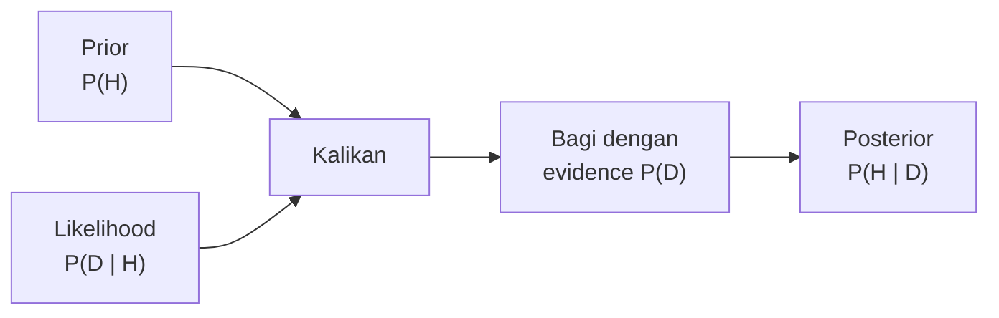
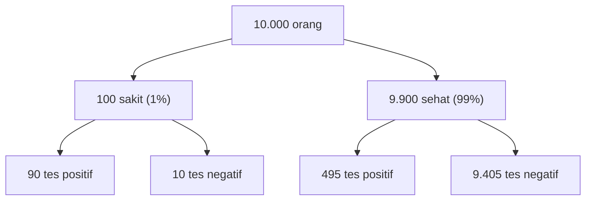

# Part 6 — Teorema Bayes

## Tujuan Pembelajaran

Setelah mempelajari bagian ini, kamu mampu:

- menjelaskan mengapa $P(A \mid B)$ dan $P(B \mid A)$ berbeda, dan bagaimana Teorema Bayes menghubungkan keduanya;
- menurunkan Teorema Bayes dari aturan perkalian;
- menyebut dan menjelaskan peran prior, likelihood, evidence, dan posterior;
- menghitung posterior dengan rumus dan dengan frekuensi alami (tabel atau pohon);
- menjelaskan kekeliruan mengabaikan tingkat dasar (*base rate*);
- menghitung sensitivitas, spesifisitas, dan nilai prediksi positif (presisi);
- memperbarui keyakinan secara berurutan dengan bukti baru, beserta syaratnya;
- menjelaskan ide Naive Bayes, asumsi independensi bersyaratnya, dan perlunya *smoothing*.

## Prasyarat

[Part 5 — Probabilitas Bersyarat dan Independensi](05-probabilitas-bersyarat-dan-independensi.md): terutama peluang bersyarat, aturan perkalian, tabel kontingensi, dan hukum peluang total.

## Mengapa Materi Ini Penting?

Sering kali kita tahu peluang dalam satu arah, tetapi butuh peluang dalam arah sebaliknya. Dokter tahu "jika pasien sakit, tes positif dengan peluang 90%", tetapi pasien bertanya "jika tesku positif, berapa peluang aku sakit?". Dua pertanyaan itu berbeda, dan jawaban keduanya bisa sangat berbeda. Teorema Bayes adalah jembatan antara keduanya.

Dalam Machine Learning, teorema ini adalah dasar klasifikasi Naive Bayes dan cara berpikir tentang **precision** (presisi) pada data tidak seimbang. Ia juga menjadi dasar statistika Bayes, yaitu cara memperbarui keyakinan ketika bukti baru datang.

## Konsep Dasar dengan Bahasa Sederhana

### 1. Dari Aturan Perkalian ke Teorema Bayes

Dari Part 5, irisan dapat dihitung dari dua arah:

$$
P(A \cap B) = P(B \mid A)\,P(A) = P(A \mid B)\,P(B)
$$

Bagi kedua sisi dengan $P(B)$, diperoleh **Teorema Bayes**:

$$
P(A \mid B) = \frac{P(B \mid A)\,P(A)}{P(B)}, \qquad P(B) > 0
$$

Penyebutnya dapat dihitung dengan hukum peluang total. Jika $A$ dan $A^c$ membagi ruang sampel:

$$
P(B) = P(B \mid A)\,P(A) + P(B \mid A^c)\,P(A^c)
$$

Teorema Bayes adalah teorema matematika yang berlaku bagi semua pendekatan probabilitas, bukan "pandangan tertentu". Yang berbeda-beda antar pendekatan adalah bagaimana peluangnya ditafsirkan.

### 2. Empat Peran: Prior, Likelihood, Evidence, Posterior

Misalkan $H$ adalah **hipotesis** (misalnya "pasien sakit") dan $D$ adalah **data atau bukti** (misalnya "tes positif"):

$$
\underbrace{P(H \mid D)}_{\text{posterior}} = \frac{\overbrace{P(D \mid H)}^{\text{likelihood}} \times \overbrace{P(H)}^{\text{prior}}}{\underbrace{P(D)}_{\text{evidence}}}
$$

| Nama | Lambang | Arti |
|---|---|---|
| **Prior** | $P(H)$ | keyakinan awal tentang $H$ sebelum melihat data |
| **Likelihood** | $P(D \mid H)$ | seberapa mungkin data muncul bila $H$ benar |
| **Evidence** | $P(D)$ | peluang data muncul secara keseluruhan |
| **Posterior** | $P(H \mid D)$ | keyakinan tentang $H$ setelah melihat data |

Dibaca: "keyakinan setelah melihat data sebanding dengan keyakinan awal dikali seberapa cocok data dengan hipotesis, lalu dinormalkan".

!!! note "Likelihood bukan peluang hipotesis"
    $P(D \mid H)$ adalah peluang **data** bila hipotesis benar. Ia bukan peluang bahwa hipotesis itu benar. Mencampuradukkan $P(D \mid H)$ dan $P(H \mid D)$ adalah kesalahan penalaran yang sangat umum dan akan terlihat jelas pada contoh berikut.



### 3. Contoh Utama: Tes Medis

Sebuah penyakit diderita 1% populasi. Sebuah tes punya:

- **Sensitivitas** 90%: jika seseorang sakit, tes positif dengan peluang $0{,}9$. Jadi $P(+ \mid \text{sakit}) = 0{,}9$.
- **Tingkat positif palsu** 5%: jika seseorang sehat, tes tetap positif dengan peluang $0{,}05$. Jadi $P(+ \mid \text{sehat}) = 0{,}05$.

Seseorang diuji dan hasilnya **positif**. Berapa peluang ia benar-benar sakit?

**Dengan rumus:**

1. Prior: $P(\text{sakit}) = 0{,}01$ dan $P(\text{sehat}) = 0{,}99$.
2. Evidence: $P(+) = 0{,}9 \times 0{,}01 + 0{,}05 \times 0{,}99 = 0{,}009 + 0{,}0495 = 0{,}0585$.
3. Posterior: $P(\text{sakit} \mid +) = \dfrac{0{,}009}{0{,}0585} \approx 0{,}1538$.

Hanya sekitar **15,4%**, jauh dari 90% yang dipikirkan banyak orang pada awalnya.

**Dengan frekuensi alami** (lebih mudah dibayangkan). Bayangkan 10.000 orang:



Total yang tes positif: $90 + 495 = 585$. Di antaranya yang benar-benar sakit: $90$. Maka peluang sakit bila positif $= \dfrac{90}{585} \approx 0{,}1538$. Penyebab hasil yang mengejutkan: orang sehat jauh lebih banyak, sehingga 5% dari 9.900 orang sehat (495 orang) mengalahkan 90% dari 100 orang sakit (90 orang).

### 4. Kekeliruan Mengabaikan Tingkat Dasar

**Tingkat dasar** (*base rate*) adalah prior: seberapa umum kejadian itu sebelum ada bukti. Mengabaikannya disebut *base rate neglect*. Pengaruh prior terhadap posterior, dengan tes yang sama (sensitivitas 90%, positif palsu 5%):

| Prevalensi (prior) | $P(+)$ | Posterior $P(\text{sakit} \mid +)$ |
|---|---|---|
| 0,1% | 0,0509 | 1,77% |
| 1% | 0,0585 | 15,38% |
| 10% | 0,1350 | 66,67% |
| 50% | 0,4750 | 94,74% |

Tes yang sama menghasilkan kesimpulan yang sangat berbeda bergantung pada seberapa umum penyakitnya. Untuk kejadian langka, bahkan tes yang tampak akurat menghasilkan banyak positif palsu.

### 5. Sensitivitas, Spesifisitas, dan Presisi

| Istilah | Definisi | Arti |
|---|---|---|
| Sensitivitas (*recall*, TPR) | $P(+ \mid \text{sakit})$ | bagian yang sakit yang terdeteksi |
| Spesifisitas | $P(- \mid \text{sehat})$ | bagian yang sehat yang dinyatakan negatif |
| Tingkat positif palsu (FPR) | $P(+ \mid \text{sehat}) = 1 - \text{spesifisitas}$ | bagian yang sehat salah dinyatakan positif |
| Nilai prediksi positif (*precision*, PPV) | $P(\text{sakit} \mid +)$ | bagian yang positif yang benar-benar sakit |
| Nilai prediksi negatif (NPV) | $P(\text{sehat} \mid -)$ | bagian yang negatif yang benar-benar sehat |

Sensitivitas dan spesifisitas adalah sifat **tes**, relatif tidak bergantung pada prevalensi. Presisi (PPV) adalah **posterior**, dan sangat bergantung pada prevalensi. Pada contoh di atas, sensitivitas $0{,}9$ dan spesifisitas $0{,}95$, tetapi presisi hanya $0{,}1538$ pada prevalensi 1%. Untuk NPV pada contoh yang sama: $\dfrac{0{,}99 \times 0{,}95}{0{,}99 \times 0{,}95 + 0{,}01 \times 0{,}1} \approx 0{,}9989$, yaitu hasil negatif sangat meyakinkan.

### 6. Bentuk Odds

**Odds** adalah perbandingan peluang suatu kejadian dengan peluang kebalikannya: $\text{odds} = \dfrac{p}{1 - p}$. Teorema Bayes dalam bentuk odds menjadi perkalian sederhana:

$$
\underbrace{\frac{P(H \mid D)}{P(H^c \mid D)}}_{\text{odds posterior}} = \underbrace{\frac{P(H)}{P(H^c)}}_{\text{odds prior}} \times \underbrace{\frac{P(D \mid H)}{P(D \mid H^c)}}_{\text{rasio likelihood}}
$$

Pada contoh tes: odds prior $= \dfrac{0{,}01}{0{,}99} \approx 0{,}0101$. Rasio likelihood $= \dfrac{0{,}9}{0{,}05} = 18$. Odds posterior $\approx 0{,}0101 \times 18 = 0{,}1818$. Mengubah odds ke peluang: $\dfrac{0{,}1818}{1 + 0{,}1818} \approx 0{,}1538$. Hasil sama dengan sebelumnya.

### 7. Memperbarui Secara Berurutan

Posterior setelah satu bukti dapat dipakai sebagai prior untuk bukti berikutnya. Misalkan orang tadi dites lagi dengan tes yang sama dan hasilnya positif lagi:

- Prior baru $= 0{,}1538$.
- $P(+) = 0{,}9(0{,}1538) + 0{,}05(0{,}8462) = 0{,}1385 + 0{,}0423 = 0{,}1808$.
- Posterior $= \dfrac{0{,}1385}{0{,}1808} \approx 0{,}766$.

Peluang sakit naik dari $15{,}4\%$ ke $76{,}6\%$. **Syaratnya penting:** perhitungan ini mengasumsikan hasil kedua tes **independen bersyarat** pada status penyakit. Jika tes yang diulang punya kesalahan yang berulang (misalnya kesalahan karena prosedur yang sama), asumsi itu keliru dan posterior terlalu tinggi.

### 8. Pengantar Naive Bayes

Dalam klasifikasi kita ingin $P(C \mid x_1, x_2, \dots, x_k)$: peluang kelas $C$ diberikan banyak fitur. Menurut Bayes:

$$
P(C \mid x_1, \dots, x_k) \;\propto\; P(C)\,P(x_1, \dots, x_k \mid C)
$$

Simbol $\propto$ berarti "sebanding dengan" (penyebut $P(x_1, \dots, x_k)$ sama untuk semua kelas, sehingga tidak memengaruhi kelas mana yang terbesar). Menaksir $P(x_1, \dots, x_k \mid C)$ langsung sulit karena kombinasi fitur sangat banyak. **Naive Bayes** menyederhanakannya dengan asumsi bahwa fitur-fitur **independen bersyarat** pada kelas:

$$
P(x_1, \dots, x_k \mid C) = \prod_{j=1}^{k} P(x_j \mid C)
\qquad\Rightarrow\qquad
P(C \mid x_1, \dots, x_k) \;\propto\; P(C)\prod_{j=1}^{k} P(x_j \mid C)
$$

Prediksinya adalah kelas dengan nilai terbesar. Asumsi ini disebut "naif" karena jarang benar sepenuhnya (kata "gratis" dan "menang" cenderung muncul bersama). Namun algoritmanya sederhana, cepat, dan sering cukup baik untuk klasifikasi teks.

**Contoh kecil: filter spam.** Data latih 10 e-mail (4 spam, 6 ham) dengan dua fitur biner: memuat "gratis" dan memuat "menang":

| | Jumlah | Memuat "gratis" | Memuat "menang" |
|---|---|---|---|
| Spam | 4 | 3 | 2 |
| Ham | 6 | 1 | 0 |

Prior: $P(\text{spam}) = 0{,}4$ dan $P(\text{ham}) = 0{,}6$. Sebuah e-mail baru memuat **kedua** kata.

**Masalah frekuensi nol.** Tidak ada ham yang memuat "menang", jadi $P(\text{menang} \mid \text{ham}) = \dfrac{0}{6} = 0$. Skor ham menjadi $0$ dan posterior spam menjadi tepat $1$, padahal itu terlalu yakin hanya karena kata itu belum pernah terlihat di ham pada 6 contoh. Solusinya **Laplace smoothing**: tambahkan $1$ pada setiap hitungan, dan $2$ pada penyebut untuk fitur biner:

$$
P(x_j = 1 \mid C) = \frac{n_{j,C} + 1}{n_C + 2}
$$

dengan $n_{j,C}$ banyak e-mail kelas $C$ yang memuat fitur $j$ dan $n_C$ banyak e-mail kelas $C$.

Dengan smoothing:

- $P(\text{gratis} \mid \text{spam}) = \dfrac{3 + 1}{4 + 2} = \dfrac{4}{6}$, $P(\text{menang} \mid \text{spam}) = \dfrac{2 + 1}{4 + 2} = \dfrac{3}{6}$.
- $P(\text{gratis} \mid \text{ham}) = \dfrac{1 + 1}{6 + 2} = \dfrac{2}{8}$, $P(\text{menang} \mid \text{ham}) = \dfrac{0 + 1}{6 + 2} = \dfrac{1}{8}$.

Skor spam $= 0{,}4 \times \dfrac{4}{6} \times \dfrac{3}{6} = 0{,}1333$. Skor ham $= 0{,}6 \times \dfrac{2}{8} \times \dfrac{1}{8} = 0{,}01875$. Normalisasi: $\dfrac{0{,}1333}{0{,}1333 + 0{,}01875} \approx 0{,}8767$. E-mail itu diprediksi spam dengan skor sekitar $87{,}7\%$.

!!! note "Skor Naive Bayes bukan selalu peluang yang akurat"
    Karena asumsi independensinya, angka posterior Naive Bayes sering kurang terkalibrasi (terlalu ekstrem). Untuk **membandingkan kelas**, ia sering cukup baik; sebagai estimasi peluang yang dapat dipercaya, perlu diperiksa. Pada praktiknya, perkalian banyak peluang kecil bisa menghasilkan angka yang terlalu kecil untuk komputer, jadi dipakai penjumlahan logaritma: $\ln P(C) + \sum_j \ln P(x_j \mid C)$.

## Istilah yang Perlu Dipahami

| Istilah | Arti sederhana |
|---|---|
| Teorema Bayes | rumus membalik arah syarat |
| Hipotesis $H$, data $D$ | dugaan yang diuji, bukti yang diamati |
| Prior | keyakinan awal sebelum melihat data |
| Likelihood | peluang data bila hipotesis benar |
| Evidence | peluang data secara keseluruhan |
| Posterior | keyakinan setelah melihat data |
| Tingkat dasar (*base rate*) | seberapa umum kejadian itu pada awalnya |
| Sensitivitas / recall | bagian yang positif sebenarnya yang terdeteksi |
| Spesifisitas | bagian yang negatif sebenarnya yang dinyatakan negatif |
| Presisi / PPV | bagian prediksi positif yang benar |
| Odds | $p/(1-p)$ |
| Independen bersyarat | independen bila kelas sudah diketahui |
| Naive Bayes | klasifikasi dengan asumsi fitur independen bersyarat |
| Laplace smoothing | menambah hitungan agar tidak ada peluang nol |

## Rumus dan Penjelasan Setiap Simbol

| Rumus | Arti simbol dan syarat |
|---|---|
| $P(A \mid B) = \dfrac{P(B \mid A)\,P(A)}{P(B)}$ | $P(B) > 0$. $A$ hipotesis, $B$ data. |
| $P(B) = P(B \mid A)P(A) + P(B \mid A^c)P(A^c)$ | evidence untuk dua kasus; untuk $k$ kasus jumlahkan semua |
| $P(A_i \mid B) = \dfrac{P(B \mid A_i)\,P(A_i)}{\sum_{j} P(B \mid A_j)\,P(A_j)}$ | $A_1, \dots, A_k$ partisi, $P(B) > 0$ |
| odds posterior = odds prior $\times$ rasio likelihood | $\text{odds} = p/(1-p)$, rasio likelihood $= P(D \mid H)/P(D \mid H^c)$ |
| $P(C \mid x_1, \dots, x_k) \propto P(C)\prod_j P(x_j \mid C)$ | Naive Bayes; mensyaratkan fitur independen bersyarat pada kelas |
| $P(x_j = 1 \mid C) = \dfrac{n_{j,C} + 1}{n_C + 2}$ | Laplace smoothing untuk fitur biner |

## Penjelasan Langkah demi Langkah

**Menyelesaikan soal Bayes:**

1. Tulis hipotesis $H$ dan data $D$. Pertanyaan biasanya berbentuk $P(H \mid D)$.
2. Catat yang diketahui: prior $P(H)$, likelihood $P(D \mid H)$, dan $P(D \mid H^c)$. Perhatikan arah syaratnya.
3. Hitung evidence $P(D)$ dengan hukum peluang total.
4. Hitung posterior $= \dfrac{\text{likelihood} \times \text{prior}}{\text{evidence}}$.
5. Periksa dengan frekuensi alami: bayangkan 10.000 orang dan hitung jumlah di tiap cabang.
6. Tafsirkan dalam kalimat, dan bandingkan dengan prior untuk melihat seberapa besar bukti mengubah keyakinan.

## Contoh Soal dan Pembahasan

### Contoh 1 — Tes medis (rumus)

Prevalensi 2%, sensitivitas 95%, tingkat positif palsu 10%. Peluang sakit jika tes positif?

1. Prior: $P(\text{sakit}) = 0{,}02$, $P(\text{sehat}) = 0{,}98$.
2. Evidence: $P(+) = 0{,}95 \times 0{,}02 + 0{,}10 \times 0{,}98 = 0{,}019 + 0{,}098 = 0{,}117$.
3. Posterior: $\dfrac{0{,}019}{0{,}117} \approx 0{,}1624$.

Sekitar 16,2%: positif palsu (0,098) jauh lebih banyak daripada positif benar (0,019).

### Contoh 2 — Frekuensi alami

Prevalensi 5%, sensitivitas 80%, positif palsu 10%. Hitung presisi dengan 1.000 orang.

1. Sakit: $1000 \times 0{,}05 = 50$. Positif benar: $50 \times 0{,}8 = 40$.
2. Sehat: $950$. Positif palsu: $950 \times 0{,}1 = 95$.
3. Semua positif: $40 + 95 = 135$.
4. Presisi: $\dfrac{40}{135} \approx 0{,}2963$.

Cek dengan rumus: $\dfrac{0{,}05 \times 0{,}8}{0{,}05 \times 0{,}8 + 0{,}95 \times 0{,}1} = \dfrac{0{,}04}{0{,}135} \approx 0{,}2963$. Sama.

### Contoh 3 — Filter spam dari tabel

Dari tabel Part 5: $P(\text{spam}) = 0{,}3$, $P(\text{gratis} \mid \text{spam}) = \dfrac{240}{300} = 0{,}8$, $P(\text{gratis} \mid \text{bukan spam}) = \dfrac{70}{700} = 0{,}1$. Hitung $P(\text{spam} \mid \text{gratis})$.

1. Evidence: $0{,}8 \times 0{,}3 + 0{,}1 \times 0{,}7 = 0{,}24 + 0{,}07 = 0{,}31$.
2. Posterior: $\dfrac{0{,}24}{0{,}31} \approx 0{,}7742$.
3. Sama dengan hitungan langsung dari tabel di Part 5 ($\dfrac{240}{310}$). Teorema Bayes memberi hasil yang sama, tetapi berguna ketika yang diketahui hanya peluang dalam arah sebaliknya.

### Contoh 4 — Mesin pabrik

Dari soal Part 5: mesin 1, 2, 3 memproduksi 50%, 30%, 20% dengan tingkat cacat 2%, 3%, 5%. Sebuah barang ternyata cacat. Dari mesin mana kemungkinan asalnya?

1. Evidence: $P(\text{cacat}) = 0{,}029$.
2. Mesin 1: $\dfrac{0{,}02 \times 0{,}5}{0{,}029} = \dfrac{0{,}010}{0{,}029} \approx 0{,}3448$.
3. Mesin 2: $\dfrac{0{,}03 \times 0{,}3}{0{,}029} = \dfrac{0{,}009}{0{,}029} \approx 0{,}3103$.
4. Mesin 3: $\dfrac{0{,}05 \times 0{,}2}{0{,}029} = \dfrac{0{,}010}{0{,}029} \approx 0{,}3448$.
5. Jumlah $= 1$ (periksa). Meski mesin 3 hanya memproduksi 20%, ia menyumbang sekitar 34,5% barang cacat karena tingkat cacatnya paling tinggi. Mesin 1 menghasilkan separuh produksi tetapi juga sekitar 34,5% barang cacat.

### Contoh 5 — Naive Bayes dengan smoothing

Pakai data latih di bagian 8. Klasifikasikan e-mail yang memuat "gratis" tetapi **tidak** memuat "menang".

1. Spam: $0{,}4 \times \dfrac{4}{6} \times \left(1 - \dfrac{3}{6}\right) = 0{,}4 \times 0{,}6667 \times 0{,}5 = 0{,}1333$.
2. Ham: $0{,}6 \times \dfrac{2}{8} \times \left(1 - \dfrac{1}{8}\right) = 0{,}6 \times 0{,}25 \times 0{,}875 = 0{,}13125$.
3. Posterior spam $= \dfrac{0{,}1333}{0{,}1333 + 0{,}13125} \approx 0{,}5039$.

Hampir sama dengan $0{,}5$: bukti dari dua fitur ini tidak cukup meyakinkan ke salah satu arah. Berbeda dengan e-mail yang memuat keduanya kata ($0{,}877$ untuk spam).

## Contoh Tambahan dengan Kesulitan Bertahap

**Mudah.** $P(B \mid A) = 0{,}8$, $P(A) = 0{,}5$, $P(B) = 0{,}6$. $P(A \mid B) = \dfrac{0{,}8 \times 0{,}5}{0{,}6} \approx 0{,}6667$.

**Sedang.** Penipuan: 0,5% transaksi adalah penipuan. Sebuah model mendeteksi 90% penipuan (recall 0,9) tetapi salah menandai 2% transaksi sah. Presisi $= \dfrac{0{,}005 \times 0{,}9}{0{,}005 \times 0{,}9 + 0{,}995 \times 0{,}02} = \dfrac{0{,}0045}{0{,}0045 + 0{,}0199} \approx 0{,}1844$. Hanya sekitar 18% transaksi yang ditandai benar-benar penipuan, walaupun model tampak "akurat".

**Sedang.** Rasio likelihood: jika rasio likelihood $= 18$ dan odds prior $= 1/99$, odds posterior $= \dfrac{18}{99} \approx 0{,}1818$, atau peluang $\approx 0{,}1538$.

**Menantang.** Penyakit sangat langka: prevalensi 0,1%, sensitivitas 99%, FPR 1%. $P(+) = 0{,}00099 + 0{,}00999 = 0{,}01098$, posterior $\approx 0{,}0902$. Walaupun tes sangat baik, hanya sekitar 9% yang positif benar-benar sakit karena penyakitnya sangat langka.

## Visualisasi atau Interpretasi Grafik

Dua gambar di atas menjawab dua pertanyaan: diagram alir "Prior × Likelihood ÷ Evidence = Posterior" menunjukkan **apa** yang dikalikan, sedangkan pohon frekuensi alami menunjukkan **mengapa** hasilnya kecil: kelompok sehat yang besar menghasilkan banyak positif palsu. Saat ragu, gambar pohon dengan 10.000 orang hampir selalu memberi jawaban yang benar.

## Kesalahan Umum

| Kesalahan | Mengapa salah | Yang benar |
|---|---|---|
| Menyamakan $P(A \mid B)$ dengan $P(B \mid A)$ | arah syarat berbeda ("kekeliruan jaksa") | pakai Bayes |
| Mengabaikan prior (*base rate neglect*) | posterior dipengaruhi seberapa umum kejadiannya | masukkan prior |
| Mengira akurasi tes tinggi berarti hasil positif pasti benar | presisi bergantung prevalensi | hitung PPV |
| Menjumlahkan alih-alih mengalikan prior dan likelihood | rumus Bayes perkalian | kalikan lalu normalkan |
| Lupa evidence atau salah menghitungnya | posterior tidak berjumlah 1 | jumlahkan semua kasus dengan hukum peluang total |
| Memakai posterior sebagai prior tanpa memeriksa independensi bukti | bukti yang berkorelasi dihitung dua kali | pastikan independen bersyarat |
| Prior $0$ atau $1$ | tidak dapat diubah oleh bukti apa pun | hindari prior ekstrem tanpa alasan kuat |
| Memercayai skor Naive Bayes sebagai peluang akurat | independensi bersyarat jarang benar | pakai untuk peringkat, periksa kalibrasi |
| Tidak memakai smoothing | satu hitungan nol membuat seluruh skor nol | tambahkan Laplace smoothing |

## Hubungan dengan Machine Learning

- **Naive Bayes.** Menerapkan Teorema Bayes dengan asumsi independensi bersyarat; cepat dan sering kuat untuk klasifikasi teks (filter spam, pengelompokan dokumen). Variannya memakai distribusi berbeda untuk fitur berbeda: fitur biner atau cacah, atau fitur kontinu dengan distribusi Normal (dibahas di Part 8).
- **Presisi dan recall pada data tidak seimbang.** Presisi adalah posterior $P(\text{positif sebenarnya} \mid \text{prediksi positif})$, recall adalah likelihood $P(\text{prediksi positif} \mid \text{positif sebenarnya})$. Contoh penipuan menunjukkan bahwa model dengan recall 90% dan positif palsu 2% tetap bisa menghasilkan presisi rendah bila kelas positifnya langka. Akurasi saja tidak cukup untuk menilai model pada data tidak seimbang.
- **Prior dari frekuensi data.** $P(C)$ pada Naive Bayes biasanya diperkirakan dari proporsi kelas di data latih. Jika proporsi di data latih berbeda dari kondisi nyata (misalnya karena sampel diseimbangkan), prior perlu disesuaikan atau hasilnya bias.
- **Pemikiran Bayes.** Statistika Bayes memperlakukan parameter model sebagai kuantitas yang keyakinannya diperbarui oleh data (prior menjadi posterior). Itu pendekatan yang luas dan di luar cakupan level ini; yang dipelajari di sini adalah teorema dasarnya dan penerapan pada klasifikasi.
- **Kalibrasi.** Skor yang dihasilkan model, termasuk Naive Bayes, tidak otomatis merupakan peluang yang benar. Perlu dibandingkan dengan frekuensi sebenarnya.

### Python: Teorema Bayes dan Naive Bayes mini

Hanya pustaka standar. Fungsi Bayes untuk tes medis:

```python
def bayes(prior, sens, fpr):
    evidence = prior * sens + (1 - prior) * fpr
    return prior * sens / evidence, evidence

post, ev = bayes(0.01, 0.9, 0.05)
print(round(ev, 4), round(post, 4))          # 0.0585 0.1538
for prior in (0.001, 0.01, 0.1, 0.5):
    post, ev = bayes(prior, 0.9, 0.05)
    print(prior, round(post, 4))
# 0.001 0.0177
# 0.01 0.1538
# 0.1 0.6667
# 0.5 0.9474

p1, _ = bayes(0.01, 0.9, 0.05)
p2, _ = bayes(p1, 0.9, 0.05)                 # asumsi: dua tes independen bersyarat
print(round(p1, 4), round(p2, 4))            # 0.1538 0.766
```

Naive Bayes mini (dua fitur biner) dengan dan tanpa smoothing:

```python
latih = [(1, 1, "spam"), (1, 1, "spam"), (1, 0, "spam"), (0, 0, "spam"),
         (1, 0, "ham"), (0, 0, "ham"), (0, 0, "ham"), (0, 0, "ham"), (0, 0, "ham"), (0, 0, "ham")]

def skor(fitur, kelas, smoothing=1):
    baris = [r for r in latih if r[2] == kelas]
    s = len(baris) / len(latih)                          # prior kelas
    for j, nilai in enumerate(fitur):
        ada = sum(r[j] for r in baris)
        p1 = (ada + smoothing) / (len(baris) + 2 * smoothing)   # P(fitur j = 1 | kelas)
        s *= p1 if nilai == 1 else 1 - p1
    return s

def posterior_spam(fitur, smoothing=1):
    s, h = skor(fitur, "spam", smoothing), skor(fitur, "ham", smoothing)
    return round(s, 5), round(h, 5), round(s / (s + h), 4)

print(posterior_spam((1, 1)))                 # (0.13333, 0.01875, 0.8767)
print(posterior_spam((1, 1), smoothing=0))    # (0.15, 0.0, 1.0)
print(posterior_spam((1, 0)))                 # (0.13333, 0.13125, 0.5039)
print(posterior_spam((0, 1)))                 # (0.06667, 0.05625, 0.5424)
print(posterior_spam((0, 0)))                 # (0.06667, 0.39375, 0.1448)
```

Interpretasi: tanpa smoothing, skor ham untuk e-mail dengan kata "menang" menjadi `0.0` dan posterior spam persis `1.0`, hasil yang terlalu yakin dari data yang sedikit. Dengan smoothing, nilainya `0.8767`. Kode ini hanya mengilustrasikan mekanismenya; pustaka ML sungguhan menangani banyak fitur, logaritma, dan kalibrasi.

## Latihan Mandiri

1. Prevalensi 2%, sensitivitas 95%, tingkat positif palsu 10%. Hitung peluang sakit bila tes positif.
2. Pada soal 1, orang tersebut dites lagi dengan tes yang sama dan positif lagi. Dengan asumsi independen bersyarat, hitung posterior baru. Sebutkan satu alasan asumsi itu bisa keliru.
3. Mesin 1, 2, 3 memproduksi 50%, 30%, 20% barang dengan tingkat cacat 2%, 3%, 5%. Barang acak ternyata cacat. Hitung peluang berasal dari tiap mesin.
4. Dari tabel spam: $P(\text{spam}) = 0{,}3$, $P(\text{gratis} \mid \text{spam}) = 0{,}8$, $P(\text{gratis} \mid \text{bukan spam}) = 0{,}1$. Hitung $P(\text{spam} \mid \text{gratis})$ dengan Bayes dan bandingkan dengan hitungan dari tabel.
5. Prevalensi 5%, sensitivitas 80%, positif palsu 10%. Hitung presisi memakai 1.000 orang (frekuensi alami).
6. Sebuah model deteksi penipuan: penipuan 0,5% transaksi, recall 90%, positif palsu 2%. Hitung presisi dan jelaskan mengapa rendah.
7. Dengan sensitivitas 90%, positif palsu 5%, dan prevalensi 1%, hitung NPV: peluang sehat bila tes negatif.
8. Gunakan bentuk odds: odds prior $\dfrac{1}{99}$ dan rasio likelihood $18$. Hitung odds posterior dan ubah menjadi peluang.
9. Pada data latih Naive Bayes di bagian 8, hitung posterior spam untuk e-mail yang memuat "menang" tetapi tidak memuat "gratis" (dengan smoothing).
10. Mengapa nol pada $P(\text{menang} \mid \text{ham})$ berbahaya pada Naive Bayes, dan bagaimana Laplace smoothing mengatasinya? Apa yang tidak diselesaikan oleh smoothing?

## Kunci Jawaban dan Pembahasan

??? success "Soal 1"
    $P(+) = 0{,}95(0{,}02) + 0{,}10(0{,}98) = 0{,}019 + 0{,}098 = 0{,}117$. Posterior $= \dfrac{0{,}019}{0{,}117} \approx 0{,}1624$.

??? success "Soal 2"
    Prior baru $= 0{,}1624$. $P(+) = 0{,}95(0{,}1624) + 0{,}10(0{,}8376) = 0{,}1543 + 0{,}0838 = 0{,}2381$. Posterior $= \dfrac{0{,}1543}{0{,}2381} \approx 0{,}648$. Asumsi bisa keliru bila kedua tes memakai prosedur atau sampel yang sama sehingga kesalahannya berulang (tidak independen bersyarat); posterior sebenarnya akan lebih rendah daripada $0{,}648$.

??? success "Soal 3"
    $P(\text{cacat}) = 0{,}029$. Mesin 1: $\dfrac{0{,}010}{0{,}029} \approx 0{,}345$. Mesin 2: $\dfrac{0{,}009}{0{,}029} \approx 0{,}310$. Mesin 3: $\dfrac{0{,}010}{0{,}029} \approx 0{,}345$. Jumlah $= 1$.

??? success "Soal 4"
    $P(\text{gratis}) = 0{,}8(0{,}3) + 0{,}1(0{,}7) = 0{,}31$. $P(\text{spam} \mid \text{gratis}) = \dfrac{0{,}24}{0{,}31} \approx 0{,}7742$. Dari tabel: $\dfrac{240}{310} \approx 0{,}7742$. Sama.

??? success "Soal 5"
    Sakit: $50$; positif benar: $40$. Sehat: $950$; positif palsu: $95$. Presisi $= \dfrac{40}{135} \approx 0{,}2963$.

??? success "Soal 6"
    Presisi $= \dfrac{0{,}005 \times 0{,}9}{0{,}005 \times 0{,}9 + 0{,}995 \times 0{,}02} = \dfrac{0{,}0045}{0{,}0244} \approx 0{,}1844$. Rendah karena transaksi sah jauh lebih banyak (99,5%), sehingga 2% positif palsu dari jumlah yang sangat besar melampaui 90% penipuan dari jumlah yang kecil.

??? success "Soal 7"
    Negatif dan sehat: $0{,}95 \times 0{,}99 = 0{,}9405$. Negatif dan sakit: $0{,}10 \times 0{,}01 = 0{,}001$. NPV $= \dfrac{0{,}9405}{0{,}9405 + 0{,}001} \approx 0{,}9989$.

??? success "Soal 8"
    Odds posterior $= \dfrac{1}{99} \times 18 = \dfrac{18}{99} \approx 0{,}1818$. Peluang $= \dfrac{0{,}1818}{1 + 0{,}1818} \approx 0{,}1538$.

??? success "Soal 9"
    Spam: $0{,}4 \times \left(1 - \dfrac{4}{6}\right) \times \dfrac{3}{6} = 0{,}4 \times 0{,}3333 \times 0{,}5 = 0{,}0667$. Ham: $0{,}6 \times \left(1 - \dfrac{2}{8}\right) \times \dfrac{1}{8} = 0{,}6 \times 0{,}75 \times 0{,}125 = 0{,}05625$. Posterior spam $= \dfrac{0{,}0667}{0{,}0667 + 0{,}05625} \approx 0{,}5424$.

??? success "Soal 10"
    Satu hitungan nol membuat seluruh perkalian bernilai nol, sehingga satu kata yang belum pernah terlihat di kelas itu "meniadakan" semua bukti dari fitur lain dan menghasilkan keyakinan ekstrem. Smoothing menambah hitungan sehingga tak ada peluang yang nol. Yang tidak diselesaikan smoothing: asumsi independensi bersyarat yang mungkin keliru, dan fakta bahwa peluang yang dihasilkan tetap bisa tidak terkalibrasi.

## Ringkasan Materi

- **Teorema Bayes:** $P(A \mid B) = \dfrac{P(B \mid A)\,P(A)}{P(B)}$, diturunkan dari aturan perkalian, dengan $P(B)$ dari hukum peluang total.
- Posterior $\propto$ likelihood $\times$ prior; evidence menormalkan hasilnya.
- **Mengabaikan prior** (tingkat dasar) menyebabkan salah tafsir: tes akurat pada kejadian langka tetap menghasilkan banyak positif palsu. Frekuensi alami (pohon 10.000 orang) membantu melihatnya.
- Sensitivitas, spesifisitas, dan FPR adalah sifat tes; **presisi (PPV)** adalah posterior dan bergantung pada prevalensi.
- Bentuk odds: odds posterior = odds prior $\times$ rasio likelihood. Pembaruan berurutan membutuhkan independensi bersyarat bukti.
- **Naive Bayes:** $P(C \mid x) \propto P(C)\prod_j P(x_j \mid C)$ dengan asumsi fitur independen bersyarat; pakai Laplace smoothing untuk menghindari peluang nol. Skornya tidak selalu terkalibrasi.
- Dalam ML: Naive Bayes, presisi dan recall pada data tidak seimbang, prior dari frekuensi data, dan pentingnya kalibrasi.

## Checklist Penguasaan

- [ ] Menurunkan Teorema Bayes dari aturan perkalian.
- [ ] Menyebut prior, likelihood, evidence, dan posterior.
- [ ] Menyelesaikan soal Bayes dengan rumus dan dengan frekuensi alami.
- [ ] Menjelaskan kekeliruan mengabaikan tingkat dasar.
- [ ] Membedakan sensitivitas, spesifisitas, dan presisi.
- [ ] Menjelaskan syarat memakai posterior sebagai prior berikutnya.
- [ ] Menghitung klasifikasi Naive Bayes sederhana dengan smoothing.
- [ ] Menjelaskan batas Naive Bayes dan masalah kalibrasi.

## Prasyarat untuk Materi Berikutnya

[Part 7 — Variabel Acak dan Distribusi](07-variabel-acak-dan-distribusi.md) mengubah kejadian menjadi bilangan dan memperkenalkan fungsi massa dan kepadatan peluang, nilai harapan, dan varians peubah acak. Pastikan konsep peluang bersyarat dan hukum peluang total sudah jelas, serta ingat integral sebagai luas dari [Level 2 — Part 10](../level-2-aljabar-linear-dan-kalkulus/10-integral.md) untuk peubah kontinu.
