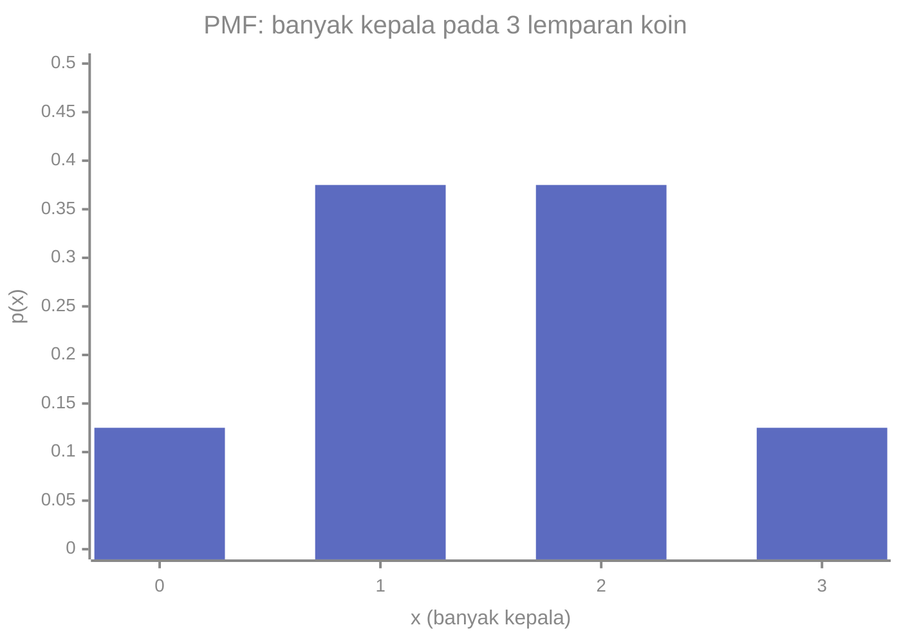
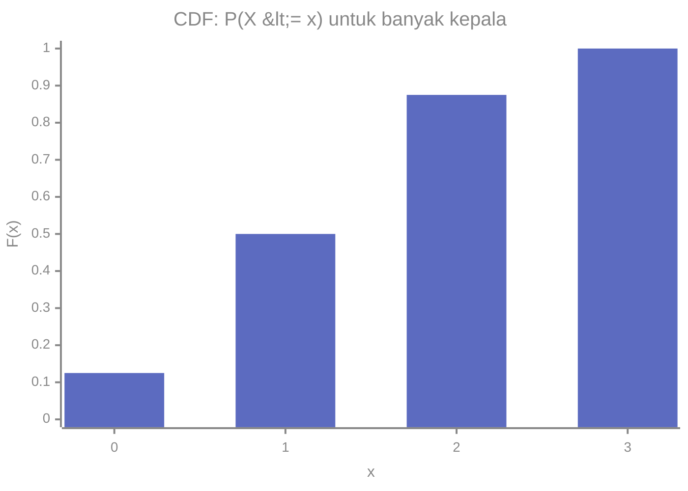
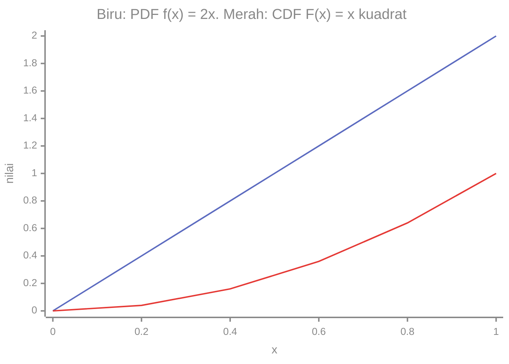

# Part 7 — Variabel Acak dan Distribusi

## Tujuan Pembelajaran

Setelah mempelajari bagian ini, kamu mampu:

- menjelaskan variabel acak (*random variable*) dan membedakan yang diskret dari yang kontinu;
- menyusun dan memakai fungsi massa peluang (PMF) untuk variabel diskret;
- menjelaskan fungsi kepadatan peluang (PDF) dan mengapa peluang di satu titik sama dengan nol;
- menghitung dan menafsirkan fungsi distribusi kumulatif (CDF);
- menghitung nilai harapan (*expected value*) dan varians variabel acak;
- memakai sifat linear nilai harapan dan sifat varians terhadap $aX + b$;
- menghubungkan PMF, PDF, nilai harapan, dan varians dengan statistik deskriptif dan dengan Machine Learning.

## Prasyarat

[Part 4 — Dasar Probabilitas](04-dasar-probabilitas.md), [Part 2 — Statistik Deskriptif](02-statistik-deskriptif.md) (rata-rata dan varians dari tabel frekuensi), dan [Level 2 — Part 10](../level-2-aljabar-linear-dan-kalkulus/10-integral.md) (integral sebagai luas, dan pratinjau fungsi kepadatan). Untuk bagian kontinu, integral sederhana $\int x^n\,dx$ cukup.

## Mengapa Materi Ini Penting?

Sejauh ini kita bicara tentang kejadian ("muncul kepala", "e-mail spam"). Untuk menghitung rata-rata, sebaran, dan membangun model, kita butuh **bilangan**. Variabel acak mengubah hasil eksperimen menjadi bilangan, sehingga seluruh alat dari Part 2 (rata-rata, varians) dapat dipakai pada dunia peluang.

Dalam Machine Learning, label, fitur, dan nilai kerugian dapat dipandang sebagai variabel acak. Model memperkirakan distribusinya, pelatihan meminimalkan nilai harapan kerugian, dan banyak ukuran kinerja adalah nilai harapan atau varians.

## Konsep Dasar dengan Bahasa Sederhana

### 1. Apa Itu Variabel Acak?

**Variabel acak** adalah aturan yang memberi **sebuah bilangan** pada setiap hasil eksperimen acak. Ia ditulis dengan huruf kapital ($X$, $Y$), sedangkan nilai yang mungkin ditulis dengan huruf kecil ($x$, $y$).

Contoh: lempar koin adil tiga kali. Misalkan $X$ adalah **banyak kepala**. Hasil $HHT$ diberi nilai $X = 2$; hasil $TTT$ diberi $X = 0$. Pernyataan $X = 2$ adalah **kejadian**: himpunan hasil $\{HHT, HTH, THH\}$. Karena itu $P(X = 2) = \dfrac{3}{8}$.

Dua jenis variabel acak:

| Jenis | Nilai | Contoh |
|---|---|---|
| **Diskret** | dapat dicacah (0, 1, 2, ...) | banyak kepala, banyak klik, hasil dadu |
| **Kontinu** | seluruh nilai pada suatu rentang | tinggi badan, waktu tunggu, suhu |

Nama "variabel acak" agak menyesatkan: ia bukan variabel biasa, melainkan fungsi dari hasil ke bilangan.

### 2. Fungsi Massa Peluang (PMF)

Untuk variabel diskret, **fungsi massa peluang** (*probability mass function*, PMF) memberi peluang tiap nilai:

$$
p(x) = P(X = x)
$$

Syarat PMF yang sah: $p(x) \geq 0$ untuk setiap $x$, dan jumlah semua peluang $= 1$:

$$
\sum_{x} p(x) = 1
$$

**Contoh: banyak kepala pada tiga lemparan koin.**

| $x$ | 0 | 1 | 2 | 3 |
|---|---|---|---|---|
| $p(x)$ | $\dfrac{1}{8}$ | $\dfrac{3}{8}$ | $\dfrac{3}{8}$ | $\dfrac{1}{8}$ |

Jumlahnya $\dfrac{1 + 3 + 3 + 1}{8} = 1$. Ini mirip tabel frekuensi relatif di Part 3: PMF adalah **frekuensi relatif ideal** yang kita harapkan dari pengulangan eksperimen yang sangat banyak.



### 3. Fungsi Distribusi Kumulatif (CDF)

**Fungsi distribusi kumulatif** (*cumulative distribution function*, CDF) memberi peluang nilai **paling banyak** $x$:

$$
F(x) = P(X \leq x)
$$

Untuk variabel diskret, $F(x)$ diperoleh dengan menjumlahkan PMF dari nilai terkecil sampai $x$. Pada contoh koin: $F(0) = \dfrac{1}{8}$, $F(1) = \dfrac{1}{2}$, $F(2) = \dfrac{7}{8}$, $F(3) = 1$.



Sifat CDF: tidak pernah turun, nilainya antara $0$ dan $1$, mendekati $0$ di ujung kiri dan mencapai $1$ di ujung kanan. CDF berguna untuk menghitung peluang rentang:

$$
P(a < X \leq b) = F(b) - F(a)
$$

Contoh: $P(1 < X \leq 3) = F(3) - F(1) = 1 - \dfrac{1}{2} = \dfrac{1}{2}$. Cek langsung: $P(X = 2) + P(X = 3) = \dfrac{3}{8} + \dfrac{1}{8} = \dfrac{1}{2}$.

### 4. Variabel Kontinu: Fungsi Kepadatan Peluang (PDF)

Pada variabel kontinu, nilai yang mungkin tak terhingga banyaknya, dan peluang satu nilai tepat adalah nol: $P(X = x) = 0$. (Peluang waktu tunggu **tepat** 3,000000... menit adalah nol; yang bermakna adalah peluang berada **di antara** dua nilai.) Karena itu kita memakai **fungsi kepadatan peluang** (*probability density function*, PDF) $f(x)$, dan peluang berupa **luas** di bawah kurva:

$$
P(a \leq X \leq b) = \int_a^b f(x)\,dx
$$

Syarat PDF yang sah: $f(x) \geq 0$ untuk semua $x$, dan luas total $= 1$:

$$
\int_{-\infty}^{\infty} f(x)\,dx = 1
$$

**Dua hal yang sering salah:**

- $f(x)$ **bukan** peluang. Nilainya boleh lebih dari $1$ (misalnya $f(x) = 4$ pada $[0, 0{,}25]$ punya luas $4 \times 0{,}25 = 1$). Yang harus $\leq 1$ adalah **luas**.
- Karena $P(X = x) = 0$, peluang $P(a \leq X \leq b)$ dan $P(a < X < b)$ sama.

**Contoh.** $f(x) = 2x$ untuk $0 \leq x \leq 1$ (dan $0$ di tempat lain). Luas total: $\int_0^1 2x\,dx = \bigl[x^2\bigr]_0^1 = 1$, jadi sah. Peluang $0{,}5 \leq X \leq 1$: $\bigl[x^2\bigr]_{0{,}5}^{1} = 1 - 0{,}25 = 0{,}75$.

CDF-nya, untuk $0 \leq x \leq 1$: $F(x) = \int_0^x 2t\,dt = x^2$. Sebaliknya, PDF adalah turunan CDF: $f(x) = F'(x) = 2x$.



Kurva merah (CDF) selalu naik dan berakhir di $1$. Kurva biru (PDF) mencapai $2$, lebih dari $1$, tidak masalah karena luasnya yang bernilai $1$.

### 5. Nilai Harapan (*Expected Value*)

**Nilai harapan** $E[X]$ adalah rata-rata yang diharapkan jika eksperimen diulang sangat banyak kali, atau "pusat" distribusi. Untuk variabel diskret:

$$
E[X] = \mu = \sum_{x} x\,p(x)
$$

Dibaca: "jumlahkan setiap nilai dikali peluangnya". Ini adalah **rata-rata berbobot**, dengan peluang sebagai bobot, persis seperti rata-rata dari tabel frekuensi di Part 2 yang bobotnya frekuensi relatif $f_i/n$.

Untuk banyak kepala pada tiga lemparan: $E[X] = 0\left(\dfrac{1}{8}\right) + 1\left(\dfrac{3}{8}\right) + 2\left(\dfrac{3}{8}\right) + 3\left(\dfrac{1}{8}\right) = \dfrac{12}{8} = 1{,}5$.

Nilai harapan **tidak harus** merupakan nilai yang mungkin muncul. Satu kali tiga lemparan tidak bisa menghasilkan 1,5 kepala; angka 1,5 adalah rata-rata jangka panjang.

Untuk variabel kontinu, jumlah diganti integral:

$$
E[X] = \int_{-\infty}^{\infty} x\,f(x)\,dx
$$

Untuk $f(x) = 2x$ pada $[0, 1]$: $E[X] = \int_0^1 x \cdot 2x\,dx = \int_0^1 2x^2\,dx = \left[\dfrac{2x^3}{3}\right]_0^1 = \dfrac{2}{3}$. Masuk akal: kepadatan lebih besar di dekat $1$, jadi pusatnya lebih dari $0{,}5$.

**Nilai harapan suatu fungsi.** Untuk fungsi $g(X)$, kita cukup mengganti $x$ dengan $g(x)$:

$$
E[g(X)] = \sum_x g(x)\,p(x)
\qquad\text{atau}\qquad
\int g(x)\,f(x)\,dx
$$

Ini dipakai misalnya untuk $E[X^2]$ dan untuk nilai harapan kerugian.

**Sifat linear.** Untuk konstanta $a$, $b$ dan variabel acak $X$, $Y$:

$$
E[aX + b] = a\,E[X] + b
\qquad\qquad
E[X + Y] = E[X] + E[Y]
$$

Sifat kedua berlaku **selalu**, tanpa syarat independensi.

### 6. Varians dan Simpangan Baku

**Varians** variabel acak mengukur seberapa jauh nilainya biasanya dari $\mu$, sebagai nilai harapan kuadrat deviasi:

$$
\mathrm{Var}(X) = \sigma^2 = E\bigl[(X - \mu)^2\bigr] = E[X^2] - \mu^2
$$

Rumus kedua (**rumus hitung**) sering lebih mudah. Simpangan baku $\sigma = \sqrt{\mathrm{Var}(X)}$. Ini sejalan dengan varians populasi dari Part 2, hanya saja bobotnya peluang.

Untuk banyak kepala (tiga lemparan): $E[X^2] = 0\left(\dfrac{1}{8}\right) + 1\left(\dfrac{3}{8}\right) + 4\left(\dfrac{3}{8}\right) + 9\left(\dfrac{1}{8}\right) = \dfrac{24}{8} = 3$. Maka $\mathrm{Var}(X) = 3 - 1{,}5^2 = 3 - 2{,}25 = 0{,}75$ dan $\sigma \approx 0{,}866$.

Untuk satu dadu: $E[X] = \dfrac{7}{2} = 3{,}5$, $E[X^2] = \dfrac{91}{6}$, $\mathrm{Var}(X) = \dfrac{91}{6} - \dfrac{49}{4} = \dfrac{35}{12} \approx 2{,}9167$, $\sigma \approx 1{,}708$.

Untuk $f(x) = 2x$: $E[X^2] = \int_0^1 x^2 \cdot 2x\,dx = \left[\dfrac{x^4}{2}\right]_0^1 = \dfrac{1}{2}$, sehingga $\mathrm{Var}(X) = \dfrac{1}{2} - \left(\dfrac{2}{3}\right)^2 = \dfrac{1}{2} - \dfrac{4}{9} = \dfrac{1}{18} \approx 0{,}0556$.

**Sifat varians:**

$$
\mathrm{Var}(aX + b) = a^2\,\mathrm{Var}(X)
$$

Menambah konstanta tidak mengubah sebaran; mengalikan dengan $a$ mengalikan varians dengan $a^2$ (simpangan baku dengan $\lvert a \rvert$). Ini sama dengan sifat transformasi di Part 2. Jika $X$ dan $Y$ **independen**, $\mathrm{Var}(X + Y) = \mathrm{Var}(X) + \mathrm{Var}(Y)$. (Tanpa independensi rumusnya perlu suku kovarians, dibahas di Part 11.)

### 7. Hubungan dengan Statistik Deskriptif

| Statistik dari data (Part 2) | Padanan untuk variabel acak |
|---|---|
| frekuensi relatif $f_i/n$ | peluang $p(x_i)$ |
| rata-rata $\bar{x} = \sum x_i \,(f_i/n)$ | nilai harapan $E[X] = \sum x\,p(x)$ |
| varians $\frac{1}{n}\sum (x_i - \bar{x})^2$ | $\mathrm{Var}(X) = E[(X - \mu)^2]$ |
| histogram | PDF (kurva mulus yang luasnya 1) |
| frekuensi kumulatif relatif | CDF |

Statistik dari sampel adalah **perkiraan** dari ukuran populasi atau distribusi yang sesuai. Itulah dasar inferensi di Part 9 dan 10.

## Istilah yang Perlu Dipahami

| Istilah | Arti sederhana |
|---|---|
| Variabel acak $X$ | aturan yang memberi bilangan pada tiap hasil |
| Diskret / kontinu | nilai dapat dicacah / mengisi suatu rentang |
| PMF $p(x)$ | peluang tiap nilai (diskret) |
| PDF $f(x)$ | kepadatan peluang; luas di bawahnya adalah peluang (kontinu) |
| CDF $F(x)$ | $P(X \leq x)$ |
| Nilai harapan $E[X]$ | rata-rata berbobot peluang, pusat distribusi |
| Varians, simpangan baku | sebaran di sekitar $\mu$ |
| Distribusi | PMF atau PDF (atau CDF) suatu variabel acak |

## Rumus dan Penjelasan Setiap Simbol

| Rumus | Arti simbol dan syarat |
|---|---|
| $p(x) = P(X = x)$, $\sum p(x) = 1$ | PMF; $p(x) \geq 0$ |
| $F(x) = P(X \leq x)$ | CDF, tak turun, dari 0 sampai 1 |
| $P(a < X \leq b) = F(b) - F(a)$ | peluang rentang dari CDF |
| $P(a \leq X \leq b) = \int_a^b f(x)\,dx$ | PDF; $f(x) \geq 0$, $\int f = 1$ |
| $f(x) = F'(x)$, $F(x) = \int_{-\infty}^x f(t)\,dt$ | hubungan PDF dan CDF |
| $E[X] = \sum x\,p(x)$ atau $\int x\,f(x)\,dx$ | $\mu$, pusat distribusi |
| $E[g(X)] = \sum g(x)\,p(x)$ atau $\int g(x)\,f(x)\,dx$ | nilai harapan fungsi $g$ |
| $E[aX + b] = aE[X] + b$ | linear, $a, b$ konstanta |
| $\mathrm{Var}(X) = E[(X - \mu)^2] = E[X^2] - \mu^2$ | $\sigma = \sqrt{\mathrm{Var}(X)}$ |
| $\mathrm{Var}(aX + b) = a^2\,\mathrm{Var}(X)$ | $b$ tidak berpengaruh |

## Penjelasan Langkah demi Langkah

**Menghitung $E[X]$ dan $\mathrm{Var}(X)$ untuk variabel diskret:**

1. Tulis tabel PMF dan periksa jumlahnya $1$.
2. Hitung $E[X] = \sum x\,p(x)$.
3. Hitung $E[X^2] = \sum x^2\,p(x)$.
4. $\mathrm{Var}(X) = E[X^2] - (E[X])^2$.
5. $\sigma = \sqrt{\mathrm{Var}(X)}$, lalu tafsirkan dengan satuan yang benar.

**Untuk variabel kontinu:** ganti jumlah dengan integral, dan periksa dahulu bahwa $f(x) \geq 0$ dan luas totalnya $1$.

## Contoh Soal dan Pembahasan

### Contoh 1 — PMF dan nilai harapan

Distribusi $X$: $p(1) = 0{,}2$, $p(2) = 0{,}5$, $p(3) = c$, $p(4) = 0{,}1$. Tentukan $c$, $E[X]$, dan $\mathrm{Var}(X)$.

1. Jumlah $= 1$: $0{,}2 + 0{,}5 + c + 0{,}1 = 1$, jadi $c = 0{,}2$.
2. $E[X] = 1(0{,}2) + 2(0{,}5) + 3(0{,}2) + 4(0{,}1) = 0{,}2 + 1 + 0{,}6 + 0{,}4 = 2{,}2$.
3. $E[X^2] = 1(0{,}2) + 4(0{,}5) + 9(0{,}2) + 16(0{,}1) = 0{,}2 + 2 + 1{,}8 + 1{,}6 = 5{,}6$.
4. $\mathrm{Var}(X) = 5{,}6 - 2{,}2^2 = 5{,}6 - 4{,}84 = 0{,}76$, $\sigma \approx 0{,}872$.

### Contoh 2 — CDF dari PMF

Dari Contoh 1, hitung $F(x)$ dan $P(1 < X \leq 3)$.

1. $F(1) = 0{,}2$; $F(2) = 0{,}2 + 0{,}5 = 0{,}7$; $F(3) = 0{,}7 + 0{,}2 = 0{,}9$; $F(4) = 1$.
2. $P(1 < X \leq 3) = F(3) - F(1) = 0{,}9 - 0{,}2 = 0{,}7$.
3. Cek: $p(2) + p(3) = 0{,}5 + 0{,}2 = 0{,}7$.

### Contoh 3 — Nilai harapan sebagai keputusan

Sebuah permainan: bayar Rp5.000, lempar satu dadu, dan terima hadiah (dalam ribu rupiah) sebesar angka dadu. Apakah permainan ini menguntungkan?

1. Hadiah $X$ (ribu rupiah) mempunyai $E[X] = 3{,}5$.
2. Keuntungan bersih $Y = X - 5$ memiliki $E[Y] = E[X] - 5 = 3{,}5 - 5 = -1{,}5$.
3. Rata-rata jangka panjang, pemain **rugi** Rp1.500 per permainan, meskipun sesekali menang (angka 6 memberi untung Rp1.000).

### Contoh 4 — Variabel kontinu

Untuk $f(x) = 3x^2$ pada $[0, 1]$: periksa PDF, hitung $E[X]$ dan $\mathrm{Var}(X)$.

1. Luas: $\int_0^1 3x^2\,dx = \bigl[x^3\bigr]_0^1 = 1$. Sah.
2. $E[X] = \int_0^1 x \cdot 3x^2\,dx = \left[\dfrac{3x^4}{4}\right]_0^1 = \dfrac{3}{4}$.
3. $E[X^2] = \int_0^1 3x^4\,dx = \left[\dfrac{3x^5}{5}\right]_0^1 = \dfrac{3}{5}$.
4. $\mathrm{Var}(X) = \dfrac{3}{5} - \left(\dfrac{3}{4}\right)^2 = \dfrac{3}{5} - \dfrac{9}{16} = \dfrac{48 - 45}{80} = \dfrac{3}{80} = 0{,}0375$.

### Contoh 5 — Transformasi linear

Dengan $X$ dari Contoh 1, misalkan $Y = 3X - 1$. Hitung $E[Y]$, $\mathrm{Var}(Y)$, dan $\sigma_Y$.

1. $E[Y] = 3E[X] - 1 = 3(2{,}2) - 1 = 5{,}6$.
2. $\mathrm{Var}(Y) = 3^2 \mathrm{Var}(X) = 9(0{,}76) = 6{,}84$.
3. $\sigma_Y = \sqrt{6{,}84} \approx 2{,}615 = 3 \times 0{,}872$. Konstanta $-1$ tidak berpengaruh pada sebaran.

## Contoh Tambahan dengan Kesulitan Bertahap

**Mudah.** Satu koin adil, $X = 1$ untuk kepala dan $0$ untuk ekor. $E[X] = 0{,}5$, $E[X^2] = 0{,}5$, $\mathrm{Var}(X) = 0{,}5 - 0{,}25 = 0{,}25$.

**Sedang.** Jumlah dua dadu: $E[X + Y] = 3{,}5 + 3{,}5 = 7$, dan karena kedua dadu independen, $\mathrm{Var}(X + Y) = 2 \times \dfrac{35}{12} = \dfrac{35}{6} \approx 5{,}83$.

**Sedang.** Densitas $f(x) = 4$ pada $[0, 0{,}25]$: $f(x) > 1$, tetapi luas $= 4 \times 0{,}25 = 1$. PDF sah.

**Menantang.** Bukti bahwa $E[X^2] - \mu^2$ sama dengan $E[(X - \mu)^2]$: $E[(X - \mu)^2] = E[X^2 - 2\mu X + \mu^2] = E[X^2] - 2\mu E[X] + \mu^2 = E[X^2] - 2\mu^2 + \mu^2 = E[X^2] - \mu^2$. Langkah ini memakai sifat linear nilai harapan.

## Visualisasi atau Interpretasi Grafik

- **PMF:** batang-batang yang tingginya peluang; jumlah tinggi semua batang $= 1$.
- **CDF:** naik dan berakhir di $1$. Pada variabel diskret berbentuk tangga; selisih antar anak tangga adalah PMF.
- **PDF:** kurva yang luasnya $1$; peluang suatu rentang adalah luas bagian kurva di atas rentang itu.

## Kesalahan Umum

| Kesalahan | Mengapa salah | Yang benar |
|---|---|---|
| Menganggap $f(x)$ adalah peluang | PDF bisa lebih dari 1 | peluang adalah luas |
| Mengira $P(X = x) > 0$ untuk variabel kontinu | nol untuk satu titik | hitung peluang rentang |
| Jumlah PMF tidak sama dengan 1 | bukan distribusi sah | periksa dan normalkan |
| Mengira $E[X]$ harus nilai yang mungkin | itu rata-rata jangka panjang | tafsirkan sebagai pusat |
| $\mathrm{Var}(aX + b) = a\,\mathrm{Var}(X)$ | varians dikuadratkan | $a^2\,\mathrm{Var}(X)$ |
| Menambah varians variabel yang tidak independen | rumus butuh independensi | gunakan kovarians (Part 11) |
| Menyamakan $E[X^2]$ dengan $(E[X])^2$ | berbeda; selisihnya adalah varians | hitung keduanya |
| Lupa mengakarkan varians | satuan kuadrat | $\sigma = \sqrt{\mathrm{Var}}$ |

## Hubungan dengan Machine Learning

- **Label dan fitur sebagai variabel acak.** Dalam kerangka probabilistik, pasangan (fitur, label) diperlakukan sebagai variabel acak dengan suatu distribusi yang tidak diketahui. Data latih adalah sampel dari distribusi itu.
- **Distribusi atas kelas.** Untuk klasifikasi multikelas, banyak model menghasilkan vektor yang tak negatif dan berjumlah $1$ (misalnya keluaran *softmax*). Vektor itu berperan sebagai PMF atas kelas. Apakah angkanya benar-benar terkalibrasi adalah pertanyaan terpisah.
- **Nilai harapan kerugian.** Tujuan pelatihan adalah meminimalkan nilai harapan kerugian $E[L]$ pada data baru. Karena distribusinya tidak diketahui, kita meminimalkan **rata-rata kerugian pada data latih**, yaitu perkiraan sampel dari $E[L]$. Itu sebabnya kerugian seperti MSE ditulis sebagai rata-rata.
- **Bias dan varians.** Varians prediksi dan nilai harapan galat adalah bahasa umum untuk membahas kualitas model; pembahasan lebih lanjut ada di level berikutnya.
- **Transformasi linear.** $E[aX + b]$ dan $\mathrm{Var}(aX + b)$ adalah dasar standardisasi fitur (Part 11).
- **Densitas bukan peluang.** Keluaran model kontinu, seperti kepadatan yang diperkirakan model generatif, dapat bernilai lebih dari $1$ tanpa salah.

### Python: PMF, nilai harapan, varians, dan integrasi numerik

Hanya pustaka standar. PMF dan CDF eksak:

```python
from fractions import Fraction as F
import random, math
from statistics import mean, pvariance

pmf = {0: F(1, 8), 1: F(3, 8), 2: F(3, 8), 3: F(1, 8)}
print(sum(pmf.values()))                    # 1
E = sum(x * p for x, p in pmf.items())
E2 = sum(x * x * p for x, p in pmf.items())
print(E, E2, E2 - E ** 2)                   # 3/2 3 3/4

kum = 0
for x, p in pmf.items():
    kum += p
    print(x, kum)
# 0 1/8
# 1 1/2
# 2 7/8
# 3 1
```

Satu dadu, hitungan eksak dan simulasi (seed tetap, Python 3.14):

```python
dadu = {x: F(1, 6) for x in range(1, 7)}
E = sum(x * p for x, p in dadu.items())
V = sum(x * x * p for x, p in dadu.items()) - E ** 2
print(E, V, float(V), math.sqrt(V))         # 7/2 35/12 2.9166666666666665 1.707825127659933

rng = random.Random(1)
sampel = [rng.randint(1, 6) for _ in range(100000)]
print(round(mean(sampel), 4), round(pvariance(sampel), 4))   # 3.4995 2.9098
```

Variabel kontinu: aproksimasi integral dengan jumlah persegi panjang (seperti di Level 2 Part 10) untuk $f(x) = 2x$:

```python
n = 100000
h = 1 / n
titik = [(i + 0.5) * h for i in range(n)]    # titik tengah tiap persegi panjang
f = lambda x: 2 * x
luas = sum(f(x) * h for x in titik)
Ex = sum(x * f(x) * h for x in titik)
Ex2 = sum(x * x * f(x) * h for x in titik)
print(round(luas, 4), round(Ex, 4), round(Ex2, 4), round(Ex2 - Ex ** 2, 4))
# 1.0 0.6667 0.5 0.0556
```

Interpretasi: hasil eksak ($E = 3{,}5$, $\mathrm{Var} = 2{,}9167$) dan simulasi 100.000 lemparan ($3{,}4995$ dan $2{,}9098$) hampir sama. Integrasi numerik memberi $\dfrac{2}{3}$, $\dfrac{1}{2}$, dan $\dfrac{1}{18}$, sama dengan hitungan manual.

## Latihan Mandiri

1. Dua koin adil dilempar dan $X$ adalah banyak kepala. Tulis PMF, hitung $E[X]$ dan $\mathrm{Var}(X)$.
2. Distribusi $X$: $p(1) = 0{,}2$, $p(2) = 0{,}5$, $p(3) = c$, $p(4) = 0{,}1$. Hitung $c$, $E[X]$, $\mathrm{Var}(X)$, dan $\sigma$.
3. Permainan: bayar Rp5.000, lempar satu dadu, terima hadiah dalam ribu rupiah sebesar angka dadu. Hitung keuntungan bersih harapan.
4. Dengan PMF soal 2, hitung CDF $F(1), \dots, F(4)$ dan $P(1 < X \leq 3)$.
5. Dengan $X$ dari soal 2, misalkan $Y = 3X - 1$. Hitung $E[Y]$, $\mathrm{Var}(Y)$, dan $\sigma_Y$.
6. $f(x) = 2x$ pada $[0, 1]$. Hitung $P(0{,}2 \leq X \leq 0{,}6)$ dan CDF $F(x)$.
7. $f(x) = 3x^2$ pada $[0, 1]$. Periksa bahwa ia PDF sah, lalu hitung $E[X]$ dan $\mathrm{Var}(X)$.
8. $f(x) = \dfrac{x}{2}$ pada $[0, 2]$. Periksa sebagai PDF, hitung $P(X \leq 1)$ dan $E[X]$.
9. Jelaskan mengapa $P(X = 0{,}5) = 0$ untuk variabel kontinu padahal $0{,}5$ nilai yang mungkin, dan mengapa PDF boleh bernilai lebih dari 1.
10. Dataset 1.000 e-mail terdiri dari kelas "primer" 500, "sosial" 300, "promosi" 200. Tulis PMF yang diperkirakan dari data, dan jelaskan mengapa ia hanya perkiraan. Jika kerugian per contoh adalah $L$, apa hubungan rata-rata $L$ pada data latih dengan $E[L]$?

## Kunci Jawaban dan Pembahasan

??? success "Soal 1"
    PMF: $p(0) = \dfrac{1}{4}$, $p(1) = \dfrac{1}{2}$, $p(2) = \dfrac{1}{4}$. $E[X] = 0 + \dfrac{1}{2} + \dfrac{2}{4} = 1$. $E[X^2] = 0 + \dfrac{1}{2} + \dfrac{4}{4} = 1{,}5$. $\mathrm{Var}(X) = 1{,}5 - 1 = 0{,}5$.

??? success "Soal 2"
    $c = 1 - (0{,}2 + 0{,}5 + 0{,}1) = 0{,}2$. $E[X] = 2{,}2$. $E[X^2] = 5{,}6$. $\mathrm{Var}(X) = 5{,}6 - 4{,}84 = 0{,}76$. $\sigma \approx 0{,}872$.

??? success "Soal 3"
    Hadiah rata-rata $= 3{,}5$ ribu; biaya $5$ ribu. Keuntungan bersih harapan $= 3{,}5 - 5 = -1{,}5$ ribu, yaitu rugi Rp1.500 per permainan.

??? success "Soal 4"
    $F(1) = 0{,}2$, $F(2) = 0{,}7$, $F(3) = 0{,}9$, $F(4) = 1$. $P(1 < X \leq 3) = 0{,}9 - 0{,}2 = 0{,}7$.

??? success "Soal 5"
    $E[Y] = 3(2{,}2) - 1 = 5{,}6$. $\mathrm{Var}(Y) = 9(0{,}76) = 6{,}84$. $\sigma_Y = \sqrt{6{,}84} \approx 2{,}615$.

??? success "Soal 6"
    $P(0{,}2 \leq X \leq 0{,}6) = \bigl[x^2\bigr]_{0{,}2}^{0{,}6} = 0{,}36 - 0{,}04 = 0{,}32$. CDF: $F(x) = x^2$ untuk $0 \leq x \leq 1$ (dan $0$ untuk $x < 0$, $1$ untuk $x > 1$).

??? success "Soal 7"
    $\int_0^1 3x^2\,dx = 1$, dan $f \geq 0$, jadi sah. $E[X] = \dfrac{3}{4}$. $E[X^2] = \dfrac{3}{5}$. $\mathrm{Var}(X) = \dfrac{3}{5} - \dfrac{9}{16} = \dfrac{3}{80} = 0{,}0375$.

??? success "Soal 8"
    $f(x) = \dfrac{x}{2} \geq 0$ pada $[0, 2]$ dan $\int_0^2 \dfrac{x}{2}\,dx = \left[\dfrac{x^2}{4}\right]_0^2 = 1$. Sah. $P(X \leq 1) = \left[\dfrac{x^2}{4}\right]_0^1 = \dfrac{1}{4}$. $E[X] = \int_0^2 x \cdot \dfrac{x}{2}\,dx = \left[\dfrac{x^3}{6}\right]_0^2 = \dfrac{8}{6} = \dfrac{4}{3}$.

??? success "Soal 9"
    Peluang adalah luas di bawah PDF, dan luas di atas satu titik (lebar nol) adalah nol, walaupun titik itu mungkin muncul; yang bermakna adalah peluang rentang. PDF adalah kepadatan, yaitu peluang per satuan panjang, bukan peluang itu sendiri. Pada rentang yang sempit, kepadatan bisa besar (misalnya $4$ pada $[0, 0{,}25]$) selama luas total tetap $1$.

??? success "Soal 10"
    PMF perkiraan: $p(\text{primer}) = 0{,}5$, $p(\text{sosial}) = 0{,}3$, $p(\text{promosi}) = 0{,}2$ (jumlah $1$). Ini perkiraan dari sampel; dataset lain bisa memberi angka berbeda, dan sampel yang bias menghasilkan perkiraan yang bias. Rata-rata $L$ pada data latih adalah perkiraan sampel dari $E[L]$; pelatihan meminimalkan perkiraan itu karena distribusi sebenarnya tidak diketahui.

## Ringkasan Materi

- **Variabel acak** memberi bilangan pada hasil eksperimen; ia diskret atau kontinu.
- **PMF** $p(x) = P(X = x)$ (jumlah 1) untuk diskret; **PDF** $f(x)$ (luas 1, peluang = luas) untuk kontinu; $P(X = x) = 0$ pada kontinu dan PDF bisa lebih dari 1.
- **CDF** $F(x) = P(X \leq x)$ tak turun dari 0 ke 1; $P(a < X \leq b) = F(b) - F(a)$; $f = F'$.
- **Nilai harapan** $E[X] = \sum x\,p(x)$ atau $\int x f$: rata-rata berbobot jangka panjang. $E[aX + b] = aE[X] + b$.
- **Varians** $E[X^2] - \mu^2$; $\mathrm{Var}(aX + b) = a^2\,\mathrm{Var}(X)$.
- PMF adalah frekuensi relatif ideal; $E[X]$ dan $\mathrm{Var}(X)$ adalah padanan rata-rata dan varians populasi.
- Dalam ML: label dan fitur sebagai variabel acak, keluaran klasifikasi sebagai PMF, dan pelatihan sebagai perkiraan sampel dari nilai harapan kerugian.

## Checklist Penguasaan

- [ ] Membedakan variabel diskret dan kontinu.
- [ ] Memeriksa dan menggunakan PMF dan CDF.
- [ ] Menjelaskan PDF, luas sebagai peluang, dan mengapa $P(X = x) = 0$.
- [ ] Menghitung $E[X]$ dan $\mathrm{Var}(X)$ (diskret dan kontinu sederhana).
- [ ] Memakai $E[aX + b]$ dan $\mathrm{Var}(aX + b)$.
- [ ] Menghubungkan nilai harapan dan varians dengan statistik deskriptif.
- [ ] Menjelaskan arti $E[L]$ dalam pelatihan model.

## Prasyarat untuk Materi Berikutnya

[Part 8 — Distribusi Probabilitas Umum](08-distribusi-probabilitas-umum.md) memperkenalkan distribusi yang paling sering dipakai (Bernoulli, Binomial, Uniform, Normal, Poisson) beserta rumus nilai harapan dan variansnya. Pastikan PMF, PDF, CDF, $E[X]$, dan $\mathrm{Var}(X)$ sudah lancar.
