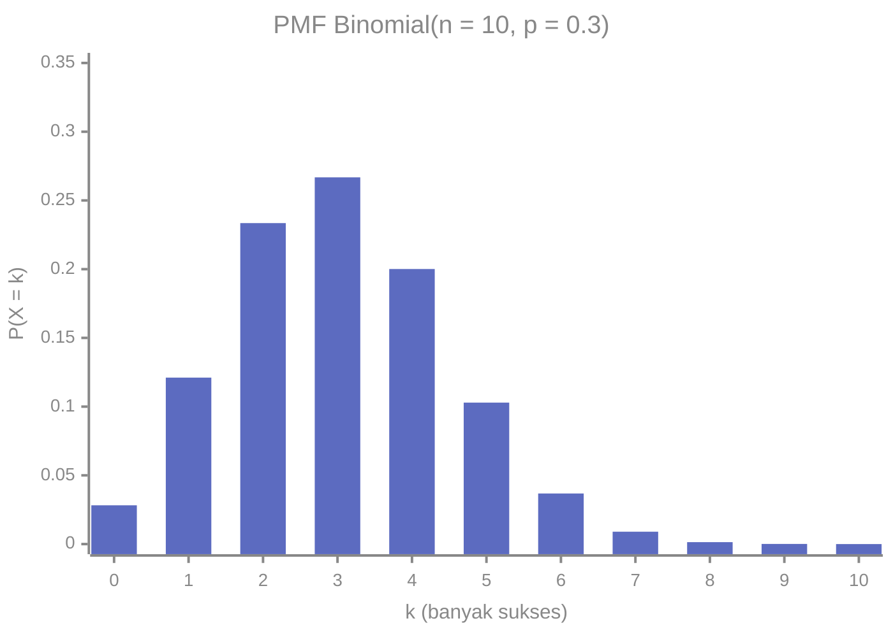
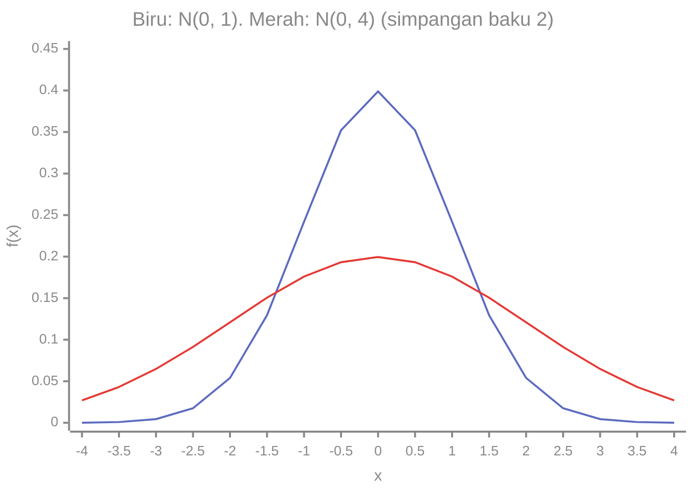
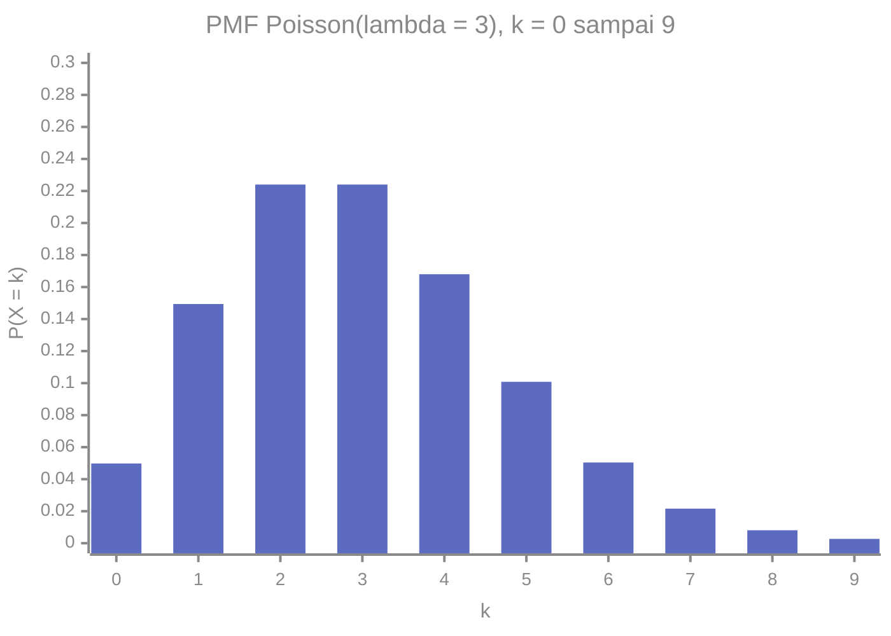

# Part 8 — Distribusi Probabilitas Umum

## Tujuan Pembelajaran

Setelah mempelajari bagian ini, kamu mampu:

- mengenali situasi yang cocok untuk distribusi Bernoulli, Binomial, Uniform, Normal, dan Poisson;
- menyebut parameter, rumus PMF atau PDF, nilai harapan, dan varians tiap distribusi;
- menghitung peluang Binomial dan Poisson dengan rumus;
- menghitung peluang Normal dengan standardisasi ($z$-score) dan membaca aturan 68-95-99,7;
- memeriksa syarat pemakaian tiap distribusi dan menyadari batasnya;
- menghubungkan distribusi-distribusi ini dengan tugas dalam Machine Learning, tanpa menganggap semua data harus Normal.

## Prasyarat

[Part 7 — Variabel Acak dan Distribusi](07-variabel-acak-dan-distribusi.md) (PMF, PDF, CDF, $E[X]$, $\mathrm{Var}(X)$), [Part 4](04-dasar-probabilitas.md) (kombinasi $\binom{n}{k}$), [Part 5](05-probabilitas-bersyarat-dan-independensi.md) (independensi), dan [Level 1 — Part 10](../level-1-aljabar-dasar-dan-fungsi/10-fungsi-eksponensial-dan-logaritma.md) ($e^x$).

## Mengapa Materi Ini Penting?

Banyak situasi berbeda ternyata memiliki **pola peluang yang sama**. Menghitung berapa pelanggan yang membeli dari 50 yang melihat iklan, berapa soal yang benar dari 10 tebakan, dan berapa transaksi yang gagal dari 1.000 percobaan, semuanya memakai pola yang sama (Binomial). Dengan mengenali polanya, kita tidak perlu menurunkan rumus dari awal setiap kali.

Dalam Machine Learning, distribusi-distribusi ini muncul sebagai model label (Bernoulli), hitungan keberhasilan (Binomial), data hitungan (Poisson), inisialisasi acak (Uniform dan Normal), dan asumsi tentang galat atau fitur (Normal).

## Konsep Dasar dengan Bahasa Sederhana

### 1. Distribusi Bernoulli

**Satu percobaan** dengan dua hasil: "sukses" ($1$) dengan peluang $p$ dan "gagal" ($0$) dengan peluang $1 - p$. Contoh: satu pengguna mengklik iklan atau tidak, satu e-mail spam atau bukan.

$$
P(X = 1) = p, \qquad P(X = 0) = 1 - p
$$

Atau dalam satu rumus: $P(X = x) = p^x (1 - p)^{1 - x}$ untuk $x \in \{0, 1\}$.

- Nilai harapan: $E[X] = p$.
- Varians: $\mathrm{Var}(X) = p(1 - p)$.

Penurunan: $E[X] = 0(1 - p) + 1(p) = p$, dan $E[X^2] = p$ (karena $0^2 = 0$ dan $1^2 = 1$), sehingga $\mathrm{Var}(X) = p - p^2 = p(1 - p)$. Variansnya terbesar ($0{,}25$) saat $p = 0{,}5$ dan mengecil mendekati $0$ saat $p$ mendekati $0$ atau $1$ (hasil makin pasti).

### 2. Distribusi Binomial

**Banyak sukses** dalam $n$ percobaan Bernoulli yang identik dan independen. Notasi: $X \sim \mathrm{Binomial}(n, p)$.

Syarat penggunaan (semuanya harus terpenuhi):

1. Banyak percobaan $n$ tetap dan diketahui.
2. Setiap percobaan hanya punya dua hasil (sukses atau gagal).
3. Peluang sukses $p$ sama untuk setiap percobaan.
4. Percobaan **saling independen**.

$$
P(X = k) = \binom{n}{k}\,p^k\,(1 - p)^{n - k}, \qquad k = 0, 1, \dots, n
$$

Penjelasan: ada $\binom{n}{k}$ cara memilih percobaan mana yang sukses; setiap susunan tertentu berpeluang $p^k (1-p)^{n-k}$ (sukses $k$ kali, gagal $n - k$ kali, karena independen).

- Nilai harapan: $E[X] = np$.
- Varians: $\mathrm{Var}(X) = np(1 - p)$.

Alasannya: $X$ adalah jumlah $n$ variabel Bernoulli independen, sehingga nilai harapan dan varians (karena independen) dijumlahkan.

**Contoh: $n = 10$, $p = 0{,}3$.** Misalkan 10 pengguna masing-masing mengklik iklan dengan peluang $0{,}3$ secara independen.



- $P(X = 3) = \dbinom{10}{3}(0{,}3)^3(0{,}7)^7 = 120 \times 0{,}027 \times 0{,}0823543 \approx 0{,}2668$.
- Peluang minimal satu klik: $1 - 0{,}7^{10} \approx 0{,}9718$ (trik komplemen).
- $E[X] = 10 \times 0{,}3 = 3$, $\mathrm{Var}(X) = 10 \times 0{,}3 \times 0{,}7 = 2{,}1$, $\sigma \approx 1{,}449$.

### 3. Distribusi Uniform (Seragam)

Semua nilai dalam rentang $[a, b]$ **sama kepadatannya**. Notasi: $X \sim \mathrm{Uniform}(a, b)$.

$$
f(x) = \frac{1}{b - a}\quad (a \leq x \leq b), \qquad f(x) = 0 \text{ di luar rentang}
$$

Tinggi $\dfrac{1}{b - a}$ dipilih agar luas persegi panjang (lebar $b - a$) sama dengan $1$.

- CDF: $F(x) = \dfrac{x - a}{b - a}$ untuk $a \leq x \leq b$.
- Nilai harapan: $E[X] = \dfrac{a + b}{2}$ (titik tengah).
- Varians: $\mathrm{Var}(X) = \dfrac{(b - a)^2}{12}$.

**Contoh.** Waktu tunggu bus seragam antara $0$ dan $10$ menit. $f(x) = \dfrac{1}{10}$. $P(X > 7) = \dfrac{10 - 7}{10} = 0{,}3$. $E[X] = 5$, $\mathrm{Var}(X) = \dfrac{100}{12} \approx 8{,}33$, $\sigma \approx 2{,}887$.

(Versi diskretnya, misalnya satu dadu, memberi peluang sama pada tiap nilai.)

### 4. Distribusi Normal

**Distribusi Normal** (atau Gauss) berbentuk lonceng simetris. Notasi: $X \sim \mathcal{N}(\mu, \sigma^2)$, dengan dua parameter:

- $\mu$: rata-rata, pusat lonceng;
- $\sigma^2$: varians, atau $\sigma$ simpangan baku (lebar lonceng). Hati-hati: sebagian pustaka (termasuk `statistics.NormalDist` di Python) meminta $\sigma$, bukan $\sigma^2$.

$$
f(x) = \frac{1}{\sigma\sqrt{2\pi}}\;\exp\!\left(-\frac{(x - \mu)^2}{2\sigma^2}\right)
$$

Arti simbol: $\pi \approx 3{,}14159$; $\exp(u) = e^u$ dengan $e \approx 2{,}71828$; $(x - \mu)^2$ jarak kuadrat dari pusat. Karena eksponennya negatif, kepadatan terbesar di $x = \mu$ dan menurun simetris ke kedua sisi.

Sifat penting:

- Simetris terhadap $\mu$; rata-rata, median, dan modus sama dengan $\mu$.
- Tinggi puncak $\dfrac{1}{\sigma\sqrt{2\pi}} \approx \dfrac{0{,}3989}{\sigma}$. $\sigma$ lebih besar membuat lonceng lebih lebar dan lebih rendah (luas tetap $1$).
- Ekornya mendekati $0$ tetapi tidak pernah tepat $0$.
- Nilai harapan $\mu$ dan varians $\sigma^2$.



Kurva biru ($\sigma = 1$) tinggi dan sempit; kurva merah ($\sigma = 2$) rendah dan lebar, tetapi luas keduanya sama-sama $1$.

**Aturan 68-95-99,7** (*empirical rule*). Untuk distribusi Normal, peluang nilai berada dalam $k$ simpangan baku dari rata-rata:

| Rentang | Peluang |
|---|---|
| $\mu \pm 1\sigma$ | $\approx 0{,}6827$ (sekitar 68%) |
| $\mu \pm 2\sigma$ | $\approx 0{,}9545$ (sekitar 95%) |
| $\mu \pm 3\sigma$ | $\approx 0{,}9973$ (sekitar 99,7%) |

**Standardisasi dan $z$-score.** Untuk menghitung peluang pada distribusi Normal apa pun, kita ubah nilai $x$ menjadi **$z$-score**, yaitu berapa simpangan baku nilai itu dari rata-rata:

$$
z = \frac{x - \mu}{\sigma}
$$

Jika $X \sim \mathcal{N}(\mu, \sigma^2)$, maka $Z = \dfrac{X - \mu}{\sigma} \sim \mathcal{N}(0, 1)$, yang disebut **Normal baku** (*standard normal*). $z = 1$ berarti satu simpangan baku di atas rata-rata; $z = -2$ berarti dua simpangan baku di bawah.

CDF Normal baku, ditulis $\Phi(z) = P(Z \leq z)$, **tidak punya rumus sederhana** (integral $\int e^{-t^2/2}\,dt$ tidak dapat ditulis dengan fungsi dasar, seperti disebut di Level 2). Nilainya diambil dari tabel atau pustaka (`NormalDist().cdf(z)` di Python). Nilai penting: $\Phi(1) \approx 0{,}8413$, $\Phi(2) \approx 0{,}9772$, $\Phi(0) = 0{,}5$, dan $\Phi(-z) = 1 - \Phi(z)$ karena simetri.

**Contoh.** Tinggi badan $X \sim \mathcal{N}(170, 8^2)$ (satuan cm).

- $P(X < 178)$: $z = \dfrac{178 - 170}{8} = 1$, jadi $\Phi(1) \approx 0{,}8413$.
- $P(X > 186)$: $z = \dfrac{186 - 170}{8} = 2$, jadi $1 - \Phi(2) \approx 0{,}0228$.
- $P(162 < X < 178)$: $z$ dari $-1$ sampai $1$, jadi $\Phi(1) - \Phi(-1) \approx 0{,}6827$.
- Persentil ke-90: $z_{0{,}90} \approx 1{,}2816$, sehingga $x = 170 + 1{,}2816 \times 8 \approx 180{,}25$ cm.

!!! warning "$z$-score bukan bukti data berdistribusi Normal"
    Menghitung $z = (x - \mu)/\sigma$ selalu dapat dilakukan pada data apa pun sebagai ukuran jarak dari rata-rata. Tetapi menafsirkan $z$ lewat $\Phi$ ("$z = 2$ berarti hanya 2,3% yang lebih tinggi") hanya benar bila data memang kira-kira Normal. Standardisasi tidak membuat data menjadi Normal; ia hanya menggeser dan menskalakan. Part 11 membahas standardisasi untuk praproses.

!!! note "Mengapa Normal begitu sering dipakai?"
    Salah satu alasannya adalah Teorema Limit Pusat (Part 9): rata-rata dari banyak pengamatan cenderung mendekati bentuk Normal. Itu bukan berarti **semua** data berdistribusi Normal; banyak data (pendapatan, waktu tunggu, hitungan) jelas miring.

### 5. Distribusi Poisson

**Banyak kejadian** dalam suatu interval waktu atau ruang tetap, dengan kejadian yang terjadi satu per satu dan saling independen pada laju rata-rata konstan. Notasi: $X \sim \mathrm{Poisson}(\lambda)$, dengan $\lambda > 0$ banyak kejadian **rata-rata** per interval.

$$
P(X = k) = \frac{e^{-\lambda}\,\lambda^k}{k!}, \qquad k = 0, 1, 2, \dots
$$

- Nilai harapan: $E[X] = \lambda$.
- Varians: $\mathrm{Var}(X) = \lambda$ (nilai harapan dan varians sama).

Contoh umum: banyak e-mail masuk per jam, banyak cacat per meter kain, banyak klik per menit.

**Contoh: $\lambda = 3$ e-mail per jam.**



- $P(X = 0) = e^{-3} \approx 0{,}0498$.
- $P(X = 2) = \dfrac{e^{-3} \cdot 3^2}{2!} = \dfrac{9e^{-3}}{2} \approx 0{,}2240$.
- $P(X \geq 1) = 1 - e^{-3} \approx 0{,}9502$.

**Hubungan dengan Binomial.** Untuk $n$ besar dan $p$ kecil, $\mathrm{Binomial}(n, p)$ mendekati $\mathrm{Poisson}(\lambda = np)$. Contoh: $n = 1000$, $p = 0{,}003$ ($\lambda = 3$): $P(X = 2)$ Binomial $\approx 0{,}2242$, Poisson $\approx 0{,}2240$.

### 6. Memilih Distribusi

| Situasi | Distribusi | Parameter |
|---|---|---|
| satu percobaan, dua hasil | Bernoulli | $p$ |
| banyak sukses dari $n$ percobaan independen | Binomial | $n, p$ |
| nilai kontinu merata pada rentang | Uniform | $a, b$ |
| nilai kontinu berbentuk lonceng simetris | Normal | $\mu, \sigma$ |
| banyak kejadian per interval pada laju tetap | Poisson | $\lambda$ |

Ini adalah **model**: penyederhanaan realitas. Selalu periksa apakah syaratnya masuk akal (misalnya apakah klik benar-benar independen, atau laju kedatangan benar-benar tetap), dan bandingkan dengan data nyata.

## Istilah yang Perlu Dipahami

| Istilah | Arti sederhana |
|---|---|
| Percobaan Bernoulli | satu percobaan dengan dua hasil |
| Binomial | banyak sukses dalam $n$ percobaan Bernoulli independen |
| Uniform | semua nilai dalam rentang berkepadatan sama |
| Normal / Gauss | distribusi lonceng simetris dengan parameter $\mu, \sigma$ |
| Normal baku | Normal dengan $\mu = 0$, $\sigma = 1$ |
| $z$-score | $(x - \mu)/\sigma$, jarak dari rata-rata dalam satuan simpangan baku |
| $\Phi(z)$ | CDF Normal baku |
| Poisson | banyak kejadian per interval pada laju tetap |
| Laju $\lambda$ | rata-rata kejadian per interval |
| Parameter | bilangan yang menentukan bentuk distribusi |

## Rumus dan Penjelasan Setiap Simbol

| Distribusi | PMF / PDF | $E[X]$ | $\mathrm{Var}(X)$ |
|---|---|---|---|
| Bernoulli($p$) | $p^x(1 - p)^{1 - x}$, $x \in \{0, 1\}$ | $p$ | $p(1 - p)$ |
| Binomial($n, p$) | $\dbinom{n}{k}p^k(1 - p)^{n - k}$, $k = 0, \dots, n$ | $np$ | $np(1 - p)$ |
| Uniform($a, b$) | $\dfrac{1}{b - a}$, $a \leq x \leq b$ | $\dfrac{a + b}{2}$ | $\dfrac{(b - a)^2}{12}$ |
| Normal($\mu, \sigma^2$) | $\dfrac{1}{\sigma\sqrt{2\pi}}e^{-(x - \mu)^2/(2\sigma^2)}$ | $\mu$ | $\sigma^2$ |
| Poisson($\lambda$) | $\dfrac{e^{-\lambda}\lambda^k}{k!}$, $k = 0, 1, 2, \dots$ | $\lambda$ | $\lambda$ |

Syarat parameter: $0 \leq p \leq 1$; $n$ bilangan bulat positif; $a < b$; $\sigma > 0$; $\lambda > 0$. Standardisasi: $z = (x - \mu)/\sigma$ dan $P(X \leq x) = \Phi(z)$ bila $X$ Normal.

## Penjelasan Langkah demi Langkah

**Menyelesaikan soal distribusi:**

1. Identifikasi **apa yang dihitung** (banyak sukses? waktu? banyak kejadian?).
2. Pilih distribusi dan tulis parameternya. **Periksa syarat** (independen, $p$ tetap, laju tetap, dan seterusnya).
3. Tulis peluang yang ditanyakan ($P(X = k)$, $P(X \leq k)$, $P(X > x)$, ...).
4. Hitung dengan rumus, komplemen, atau standardisasi (untuk Normal).
5. Periksa kewajaran: peluang di antara 0 dan 1, dan sesuai $E[X]$ yang diharapkan.
6. Tafsirkan dalam kalimat dan sebut asumsi yang dipakai.

## Contoh Soal dan Pembahasan

### Contoh 1 — Binomial

Sebuah klasifikasi biner benar dengan peluang $0{,}8$ pada setiap contoh (anggap independen). Pada 5 contoh, berapa peluang tepat 4 benar, dan berapa nilai harapan dan simpangan bakunya?

1. $X \sim \mathrm{Binomial}(5, 0{,}8)$.
2. $P(X = 4) = \dbinom{5}{4}(0{,}8)^4(0{,}2)^1 = 5 \times 0{,}4096 \times 0{,}2 = 0{,}4096$.
3. $E[X] = 5 \times 0{,}8 = 4$; $\mathrm{Var}(X) = 5 \times 0{,}8 \times 0{,}2 = 0{,}8$; $\sigma \approx 0{,}894$.

### Contoh 2 — Poisson

Rata-rata 3 e-mail masuk per jam. Berapa peluang tidak ada e-mail dalam satu jam, tepat dua, dan minimal satu?

1. $X \sim \mathrm{Poisson}(3)$.
2. $P(X = 0) = e^{-3} \approx 0{,}0498$.
3. $P(X = 2) = \dfrac{e^{-3} \times 9}{2} \approx 0{,}2240$.
4. $P(X \geq 1) = 1 - 0{,}0498 = 0{,}9502$.

Asumsi: kedatangan independen dengan laju tetap. Jika ada jam sibuk dan jam sepi, asumsi itu tidak benar untuk seluruh hari.

### Contoh 3 — Uniform

Waktu tunggu seragam pada $[0, 10]$ menit. Hitung $P(3 < X < 7)$ dan $E[X]$.

1. Tinggi $f = \dfrac{1}{10}$.
2. $P(3 < X < 7) = \dfrac{7 - 3}{10} = 0{,}4$ (lebar kali tinggi).
3. $E[X] = \dfrac{0 + 10}{2} = 5$ menit.

### Contoh 4 — Normal dengan standardisasi

Nilai ujian $X \sim \mathcal{N}(70, 10^2)$. Hitung peluang nilai di atas 85 dan nilai 90 persentil ke berapa.

1. $z = \dfrac{85 - 70}{10} = 1{,}5$.
2. $\Phi(1{,}5) \approx 0{,}9332$, jadi $P(X > 85) = 1 - 0{,}9332 = 0{,}0668$ (sekitar 6,7%).
3. Untuk nilai 90: $z = \dfrac{90 - 70}{10} = 2$, $\Phi(2) \approx 0{,}9772$, jadi sekitar persentil ke-97,7.

### Contoh 5 — Membandingkan dengan $z$-score

Rina mendapat 80 pada ujian A ($\mu = 70$, $\sigma = 10$). Budi mendapat 78 pada ujian B ($\mu = 70$, $\sigma = 4$). Siapa yang relatif lebih unggul?

1. Rina: $z = \dfrac{80 - 70}{10} = 1$.
2. Budi: $z = \dfrac{78 - 70}{4} = 2$.
3. Budi lebih unggul secara relatif (2 simpangan baku di atas rata-rata ujiannya, dibanding 1 simpangan baku untuk Rina), walaupun nilai mentahnya (78) lebih rendah dari nilai Rina (80). Ujian B nilainya jauh lebih seragam ($\sigma$ kecil), sehingga selisih 8 poin dari rata-rata sangat menonjol.

$z$-score memungkinkan perbandingan antar skala yang berbeda.

## Contoh Tambahan dengan Kesulitan Bertahap

**Mudah.** Satu koin adil dilempar tiga kali, $X$ banyak kepala: $X \sim \mathrm{Binomial}(3, 0{,}5)$. $P(X = 2) = 3 \times 0{,}125 = 0{,}375$, $E[X] = 1{,}5$, sesuai Part 7.

**Sedang.** Menebak 10 soal pilihan ganda berempat opsi secara acak ($p = 0{,}25$). Peluang benar minimal 8: $\dbinom{10}{8}0{,}25^8 0{,}75^2 + \dbinom{10}{9}0{,}25^9 0{,}75 + 0{,}25^{10} \approx 0{,}000416$, kurang dari $0{,}05\%$. Nilai tinggi dari tebakan sangat jarang.

**Sedang.** Binomial $n = 100$, $p = 0{,}8$: $E[X] = 80$, $\sigma = \sqrt{100 \times 0{,}8 \times 0{,}2} = 4$. Jumlah benar biasanya berada dalam kira-kira $80 \pm 8$ (dua simpangan baku, pendekatan Normal, bila contoh independen).

**Menantang.** Poisson dengan $\lambda = 4$: $P(X \leq 2) = e^{-4}\left(1 + 4 + \dfrac{16}{2}\right) = 13e^{-4} \approx 0{,}2381$.

## Visualisasi atau Interpretasi Grafik

- **Binomial** berbentuk batang diskret, puncaknya dekat $np$, dan makin simetris bila $np$ dan $n(1-p)$ sama-sama besar.
- **Poisson** miring ke kanan untuk $\lambda$ kecil dan makin simetris bila $\lambda$ besar.
- **Normal** berbentuk lonceng; $\mu$ menggeser kurva, $\sigma$ melebarkannya.
- **Uniform** berbentuk persegi panjang.

Pada semuanya, luas (atau jumlah) total sama dengan $1$.

## Kesalahan Umum

| Kesalahan | Mengapa salah | Yang benar |
|---|---|---|
| Memakai Binomial tanpa memeriksa independensi dan $p$ tetap | rumusnya butuh syarat itu | periksa syaratnya |
| Mencampur $\sigma$ dan $\sigma^2$ pada Normal | $\mathcal{N}(\mu, \sigma^2)$ memakai varians; pustaka sering memakai $\sigma$ | baca dokumentasi |
| Menganggap $P(X = x)$ bernilai positif pada Normal | variabel kontinu | hitung peluang rentang |
| Menganggap $f(x)$ Normal adalah peluang | ia kepadatan | peluang adalah luas |
| Memakai tabel $\Phi$ pada data yang jelas tidak Normal | hasilnya menyesatkan | periksa bentuk distribusi dahulu |
| Mengira $z$-score membuat data Normal | hanya menggeser dan menskalakan | bentuk distribusi tidak berubah |
| Memakai Poisson untuk kejadian dengan laju berubah-ubah | laju harus kira-kira tetap | pecah per periode atau gunakan model lain |
| Lupa bahwa nilai harapan tidak harus nilai yang mungkin | rata-rata jangka panjang | tafsirkan sebagai pusat |
| Menganggap semua data harus Normal | banyak data miring | pilih model sesuai data |

## Hubungan dengan Machine Learning

- **Bernoulli untuk label biner.** Klasifikasi biner dapat dipandang sebagai memperkirakan parameter $p$ distribusi Bernoulli untuk setiap contoh. Keluaran sigmoid pada regresi logistik berperan sebagai $p$ itu.
- **Binomial untuk kinerja.** Jumlah prediksi benar pada $n$ contoh uji yang independen berdistribusi Binomial($n$, $p$) dengan $p$ akurasi sebenarnya. Akurasi uji dari satu sampel hanyalah perkiraan; bila akurasi sebenarnya $0{,}8$ dan $n = 100$, jumlah benar biasanya $80 \pm 8$. Itu sebabnya selisih akurasi kecil pada data uji kecil belum tentu berarti. (Dibahas lebih lanjut di Part 9 dan 10.)
- **Normal sebagai model galat.** Regresi sering memakai asumsi bahwa galat acak berbentuk Normal di sekitar prediksi. Dengan asumsi itu, meminimalkan rata-rata kuadrat galat (MSE) setara dengan memilih parameter yang paling masuk akal. Itu **asumsi pemodelan**, bukan syarat agar regresi dapat dijalankan, dan ia dapat dilanggar.
- **Normal untuk fitur.** Varian Naive Bayes (Gaussian Naive Bayes) memakai Normal untuk fitur kontinu per kelas, dengan $\mu$ dan $\sigma$ diperkirakan dari data latih.
- **Inisialisasi acak.** Bobot jaringan sering diinisialisasi dari distribusi Uniform atau Normal dengan skala tertentu. Pilihan skala berpengaruh pada kecepatan pelatihan.
- **Poisson untuk data hitungan.** Banyak klik, kunjungan, atau cacat per periode sering dimodelkan dengan Poisson (misalnya pada regresi Poisson).
- **$z$-score dalam praproses.** Standardisasi fitur memakai $z = (x - \bar{x})/s$ dari data latih (Part 11). Ini tidak wajib untuk semua algoritma dan tidak mengubah bentuk distribusi.
- **Tidak semua data Normal.** Mengasumsikan Normal tanpa memeriksa dapat menghasilkan kesimpulan keliru; lihat histogram dan boxplot (Part 3).

### Python: distribusi dengan pustaka standar

Hanya pustaka standar (`math`, `statistics.NormalDist`, `random`). Binomial dan Poisson dari rumus:

```python
import math, random
from statistics import NormalDist, mean, pvariance, pstdev

def binom_pmf(n, k, p):
    return math.comb(n, k) * p ** k * (1 - p) ** (n - k)

print([round(binom_pmf(10, k, 0.3), 4) for k in range(11)])
# [0.0282, 0.1211, 0.2335, 0.2668, 0.2001, 0.1029, 0.0368, 0.009, 0.0014, 0.0001, 0.0]
print(round(binom_pmf(10, 3, 0.3), 4), round(1 - 0.7 ** 10, 4),
      round(binom_pmf(10, 0, 0.3) + binom_pmf(10, 1, 0.3), 4))   # 0.2668 0.9718 0.1493
print(sum(binom_pmf(10, k, 0.25) for k in range(8, 11)))         # 0.000415802001953125

def pois_pmf(k, lam):
    return math.exp(-lam) * lam ** k / math.factorial(k)

print([round(pois_pmf(k, 3), 4) for k in range(10)])
# [0.0498, 0.1494, 0.224, 0.224, 0.168, 0.1008, 0.0504, 0.0216, 0.0081, 0.0027]
print(round(pois_pmf(0, 3), 4), round(pois_pmf(2, 3), 4), round(1 - pois_pmf(0, 3), 4))
# 0.0498 0.224 0.9502
print(round(binom_pmf(1000, 2, 0.003), 4), round(pois_pmf(2, 3), 4))   # 0.2242 0.224
```

Normal dengan `NormalDist`:

```python
N = NormalDist(mu=170, sigma=8)
print(round(N.cdf(178), 4), round(1 - N.cdf(186), 4), round(N.cdf(178) - N.cdf(162), 4))
# 0.8413 0.0228 0.6827
print(round(N.inv_cdf(0.9), 3))                                  # 180.252
Z = NormalDist()                                                  # Normal baku
print([round(Z.cdf(k) - Z.cdf(-k), 4) for k in (1, 2, 3)])       # [0.6827, 0.9545, 0.9973]
```

Simulasi untuk memeriksa rumus (seed tetap, Python 3.14):

```python
rng = random.Random(7)
x = [rng.gauss(170, 8) for _ in range(100000)]
print(round(mean(x), 2), round(pstdev(x), 2))                    # 170.02 7.99
dalam = lambda k: sum(1 for v in x if abs(v - 170) <= k * 8) / len(x)
print([round(dalam(k), 4) for k in (1, 2, 3)])                   # [0.6824, 0.9551, 0.9976]

rng = random.Random(11)
b = [sum(rng.random() < 0.3 for _ in range(10)) for _ in range(100000)]
print(round(mean(b), 3), round(pvariance(b), 3))                 # 3.006 2.108
```

Interpretasi: hasil rumus dan simulasi hampir sama (aturan 68-95-99,7 muncul pada simulasi, dan Binomial(10, 0,3) memberi rata-rata sekitar $3$ dan varians sekitar $2{,}1$). Kode memeriksa hitungan; yang penting tetap memahami syarat tiap distribusi.

## Latihan Mandiri

1. $X \sim \mathrm{Bernoulli}(0{,}2)$. Hitung $E[X]$ dan $\mathrm{Var}(X)$. Pada $p$ berapa variansnya terbesar?
2. $X \sim \mathrm{Binomial}(5, 0{,}5)$. Tulis seluruh PMF dan hitung $P(X \geq 4)$.
3. $X \sim \mathrm{Binomial}(10, 0{,}3)$. Hitung $P(X = 3)$, $P(X \leq 1)$, $E[X]$, dan $\mathrm{Var}(X)$.
4. Seorang siswa menebak 10 soal pilihan ganda berempat opsi. Berapa peluang benar minimal 8 soal?
5. Waktu tunggu seragam pada $[0, 10]$ menit. Hitung $P(3 < X < 7)$, $E[X]$, dan $\sigma$.
6. Tinggi badan $X \sim \mathcal{N}(170, 8^2)$. Hitung $P(X < 178)$, $P(X > 186)$, dan $P(162 < X < 178)$.
7. Ujian A: $\mu = 70$, $\sigma = 10$, nilai Rina 80. Ujian B: $\mu = 70$, $\sigma = 4$, nilai Budi 78. Bandingkan dengan $z$-score dan jelaskan mengapa nilai mentah saja menyesatkan.
8. Skor $X \sim \mathcal{N}(100, 15^2)$. Berapa nilai persentil ke-90? (Gunakan $z_{0{,}90} \approx 1{,}2816$.)
9. $X \sim \mathrm{Poisson}(4)$. Hitung $P(X = 0)$, $P(X \leq 2)$, dan $P(X \geq 1)$.
10. Pilih distribusi yang cocok dan jelaskan syaratnya: (a) banyak klik dari 50 tayangan iklan yang masing-masing diklik dengan peluang 3%; (b) banyak e-mail masuk per jam dengan rata-rata 6; (c) tinggi badan orang dewasa; (d) satu pengguna berlangganan atau tidak; (e) bilangan acak antara 0 dan 1.

## Kunci Jawaban dan Pembahasan

??? success "Soal 1"
    $E[X] = 0{,}2$, $\mathrm{Var}(X) = 0{,}2 \times 0{,}8 = 0{,}16$. Variansnya $p(1 - p)$ terbesar pada $p = 0{,}5$ (nilai $0{,}25$), karena saat itu hasilnya paling tak pasti.

??? success "Soal 2"
    $P(X = k) = \dbinom{5}{k}\dfrac{1}{32}$: $k = 0$: $\dfrac{1}{32}$; $1$: $\dfrac{5}{32}$; $2$: $\dfrac{10}{32}$; $3$: $\dfrac{10}{32}$; $4$: $\dfrac{5}{32}$; $5$: $\dfrac{1}{32}$. $P(X \geq 4) = \dfrac{5 + 1}{32} = \dfrac{6}{32} = 0{,}1875$.

??? success "Soal 3"
    $P(X = 3) = 120(0{,}3)^3(0{,}7)^7 \approx 0{,}2668$. $P(X \leq 1) = 0{,}7^{10} + 10(0{,}3)(0{,}7)^9 \approx 0{,}0282 + 0{,}1211 = 0{,}1493$. $E[X] = 3$, $\mathrm{Var}(X) = 2{,}1$.

??? success "Soal 4"
    $X \sim \mathrm{Binomial}(10, 0{,}25)$. $P(X \geq 8) = P(8) + P(9) + P(10) \approx 0{,}000416$, kurang dari $0{,}05\%$. Nilai tinggi dari menebak hampir tak mungkin.

??? success "Soal 5"
    $P(3 < X < 7) = \dfrac{4}{10} = 0{,}4$. $E[X] = 5$. $\sigma = \sqrt{\dfrac{100}{12}} \approx 2{,}887$.

??? success "Soal 6"
    $z = 1$: $P(X < 178) = \Phi(1) \approx 0{,}8413$. $z = 2$: $P(X > 186) = 1 - \Phi(2) \approx 0{,}0228$. $P(162 < X < 178) = \Phi(1) - \Phi(-1) \approx 0{,}6827$.

??? success "Soal 7"
    Rina: $z = 1$. Budi: $z = \dfrac{78 - 70}{4} = 2$. Meskipun nilai mentah Budi (78) lebih rendah dari Rina (80), secara relatif terhadap ujiannya masing-masing Budi lebih unggul, karena sebaran ujian B jauh lebih kecil.

??? success "Soal 8"
    $x = 100 + 1{,}2816 \times 15 \approx 119{,}22$.

??? success "Soal 9"
    $P(X = 0) = e^{-4} \approx 0{,}0183$. $P(X \leq 2) = e^{-4}(1 + 4 + 8) = 13e^{-4} \approx 0{,}2381$. $P(X \geq 1) = 1 - 0{,}0183 = 0{,}9817$.

??? success "Soal 10"
    (a) Binomial($50$, $0{,}03$): $n$ tetap, dua hasil, $p$ sama, klik diasumsikan independen. (b) Poisson($6$): kejadian per interval pada laju rata-rata tetap. (c) Normal (pendekatan): berbentuk lonceng simetris, dengan catatan harus diperiksa pada data. (d) Bernoulli($p$): satu percobaan dua hasil. (e) Uniform($0, 1$): semua nilai berkepadatan sama.

## Ringkasan Materi

- **Bernoulli($p$):** satu percobaan sukses atau gagal; $E = p$, $\mathrm{Var} = p(1 - p)$.
- **Binomial($n, p$):** banyak sukses dalam $n$ percobaan independen dengan $p$ tetap; $E = np$, $\mathrm{Var} = np(1 - p)$.
- **Uniform($a, b$):** kepadatan seragam; $E = (a + b)/2$, $\mathrm{Var} = (b - a)^2/12$.
- **Normal($\mu, \sigma^2$):** lonceng simetris; $z = (x - \mu)/\sigma$ mengubahnya ke Normal baku; aturan 68-95-99,7; CDF dari tabel atau pustaka.
- **Poisson($\lambda$):** banyak kejadian per interval pada laju tetap; $E = \mathrm{Var} = \lambda$; mendekati Binomial untuk $n$ besar dan $p$ kecil.
- $z$-score mengukur jarak dari rata-rata dalam simpangan baku dan tidak mengubah bentuk distribusi.
- Dalam ML: Bernoulli untuk label biner, Binomial untuk kinerja, Normal sebagai asumsi galat dan fitur, Poisson untuk hitungan. Tidak semua data atau algoritma bergantung pada Normal.

## Checklist Penguasaan

- [ ] Menyebut situasi dan syarat tiap distribusi.
- [ ] Menghitung peluang Binomial dan Poisson.
- [ ] Menghitung $E[X]$ dan $\mathrm{Var}(X)$ tiap distribusi.
- [ ] Menghitung peluang Normal dengan standardisasi dan membaca aturan 68-95-99,7.
- [ ] Membandingkan nilai dari skala berbeda dengan $z$-score.
- [ ] Menjelaskan bahwa $z$-score tidak membuat data Normal.
- [ ] Menghubungkan tiap distribusi dengan penggunaannya dalam ML.

## Prasyarat untuk Materi Berikutnya

[Part 9 — Distribusi Sampling dan Central Limit Theorem](09-distribusi-sampling-dan-clt.md) membahas bagaimana statistik seperti rata-rata sampel sendiri berdistribusi. Distribusi Normal, nilai harapan, dan varians dari part ini menjadi bahan utamanya, dan simulasi dengan `random` seperti di atas akan dipakai lagi.
