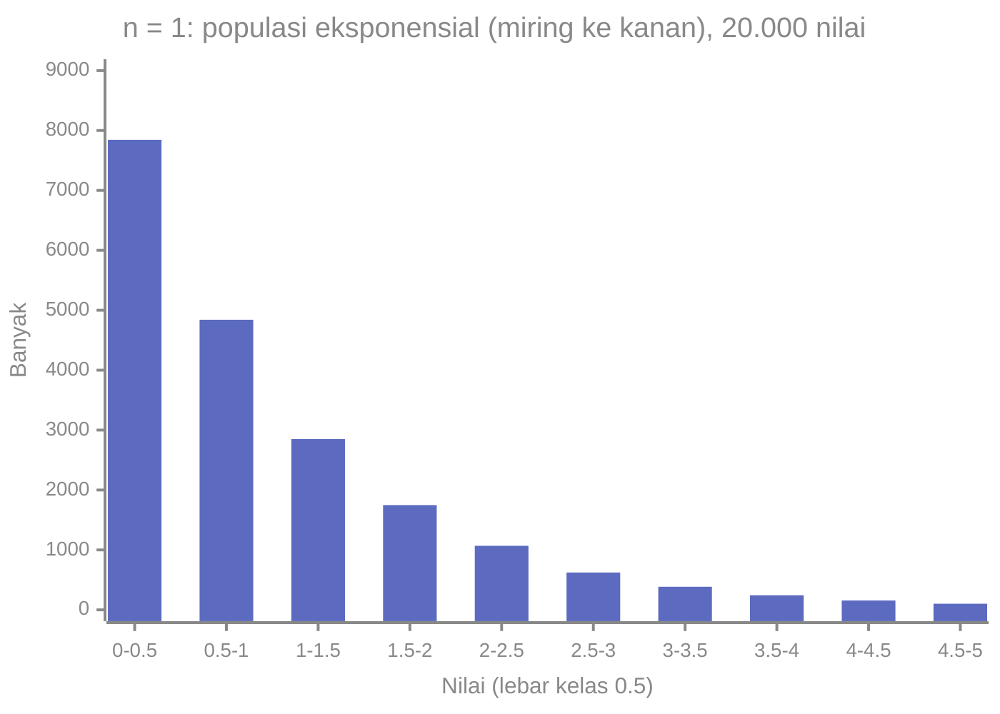
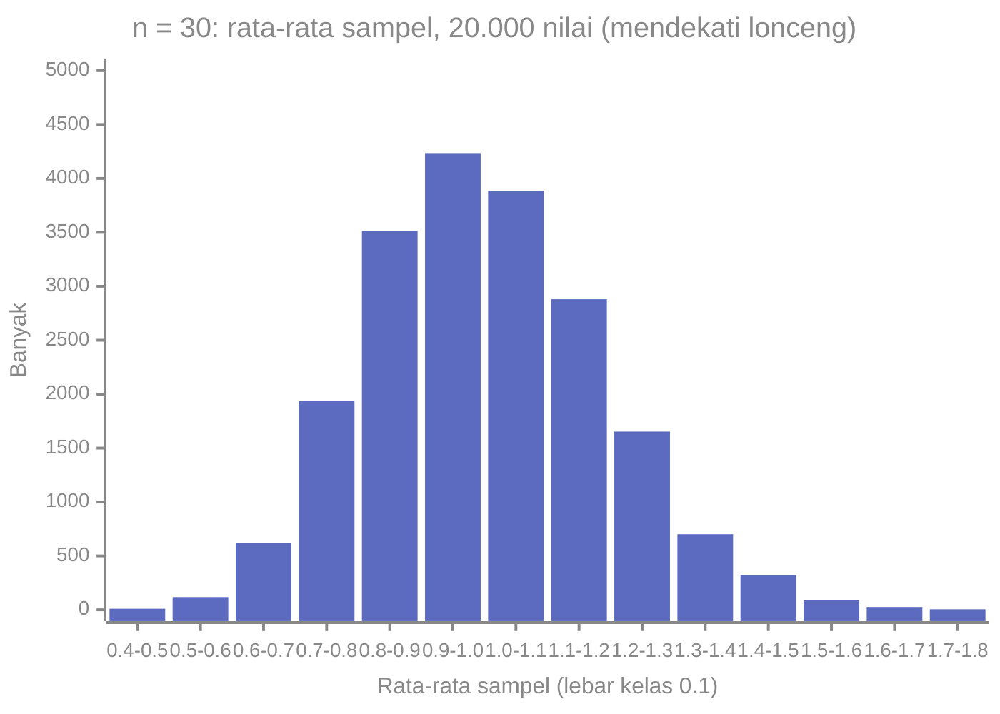

# Part 9 — Distribusi Sampling dan Central Limit Theorem

## Tujuan Pembelajaran

Setelah mempelajari bagian ini, kamu mampu:

- menjelaskan bahwa statistik sampel (misalnya rata-rata sampel) adalah variabel acak yang punya distribusi sendiri;
- menjelaskan distribusi sampling dari rata-rata sampel dan menghitung nilai harapan dan galat bakunya;
- membedakan simpangan baku data dari galat baku (*standard error*);
- menjelaskan hukum akar $n$: mengapa menggandakan ketelitian membutuhkan empat kali lipat data;
- menyatakan Teorema Limit Pusat (*Central Limit Theorem*, CLT) beserta syarat dan batasnya;
- menghitung peluang untuk rata-rata sampel dan proporsi sampel dengan pendekatan Normal;
- memahami bootstrap sebagai cara memperkirakan distribusi sampling dari data;
- menghubungkan semuanya dengan ketidakpastian pada akurasi model dan pada gradien mini-batch.

## Prasyarat

[Part 1 — Pengantar Statistika](01-pengantar-statistika.md) (variasi sampling), [Part 7 — Variabel Acak dan Distribusi](07-variabel-acak-dan-distribusi.md) ($E[X]$ dan $\mathrm{Var}(X)$, sifat $\mathrm{Var}(aX + b)$), dan [Part 8 — Distribusi Probabilitas Umum](08-distribusi-probabilitas-umum.md) (Normal, $z$-score, Binomial).

## Mengapa Materi Ini Penting?

Di Part 1 kita melihat bahwa rata-rata dua sampel berbeda hampir selalu berbeda. Satu pertanyaan tersisa: **seberapa besar** perbedaan itu biasanya, dan bagaimana ia mengecil bila sampel diperbesar? Jawabannya memberi dasar untuk semua kesimpulan statistik: tanpa tahu seberapa goyah sebuah statistik, kita tidak bisa menyatakan seberapa yakin kita pada perkiraan dari satu sampel.

Dalam Machine Learning, ini langsung terpakai: akurasi pada data uji hanyalah satu angka dari satu sampel, dan gradien dari satu mini-batch hanyalah perkiraan yang bergoyang dari gradien seluruh data.

## Konsep Dasar dengan Bahasa Sederhana

### 1. Statistik adalah Variabel Acak

Sebelum sampel diambil, rata-rata sampel $\bar{X}$ belum diketahui nilainya, dan nilainya bergantung pada sampel yang kebetulan terambil. Karena itu $\bar{X}$ adalah **variabel acak**, dan ia mempunyai distribusi, yang disebut **distribusi sampling** (*sampling distribution*): distribusi nilai statistik itu pada seluruh kemungkinan sampel berukuran $n$.

(Notasi: $\bar{X}$ huruf kapital untuk variabel acak sebelum sampel diambil, $\bar{x}$ huruf kecil untuk nilai yang dihitung dari sampel tertentu.)

**Contoh eksak.** Pakai populasi 10 nilai dari Part 1: $60, 65, 70, 70, 75, 80, 80, 85, 90, 95$. Rata-rata populasi $\mu = 77$ dan simpangan baku populasi $\sigma = \sqrt{111} \approx 10{,}536$.

Ambil sampel berukuran $n = 4$ **dengan pengembalian** (setiap nilai bisa terpilih lebih dari sekali). Ada $10^4 = 10\,000$ kemungkinan sampel berurutan. Menghitung rata-rata ke-10.000 sampel itu:

- rata-rata dari semua $\bar{x}$ adalah **tepat $77$**, sama dengan $\mu$;
- simpangan baku dari semua $\bar{x}$ adalah $5{,}2678$, yang tepat sama dengan $\dfrac{\sigma}{\sqrt{n}} = \dfrac{10{,}5357}{\sqrt{4}} = 5{,}2678$.

Jadi rata-rata sampel **tidak bias** (rata-ratanya sama dengan $\mu$) dan sebarannya mengikuti rumus sederhana yang akan kita nyatakan sebentar lagi.

Jika sampel diambil **tanpa pengembalian** dari populasi kecil ini (210 sampel), simpangan baku $\bar{x}$ adalah $4{,}3012$, sedikit **lebih kecil** daripada $\sigma/\sqrt{n} = 5{,}2678$. Faktor koreksinya $\sqrt{\dfrac{N - n}{N - 1}} = \sqrt{\dfrac{6}{9}} \approx 0{,}8165$ (*finite population correction*), dan $5{,}2678 \times 0{,}8165 = 4{,}3012$. Bila sampel hanya bagian kecil dari populasi besar ($n \ll N$), faktor ini mendekati $1$ dan dapat diabaikan.

### 2. Nilai Harapan dan Galat Baku Rata-rata Sampel

Misalkan $X_1, \dots, X_n$ adalah sampel yang **independen** dan berasal dari populasi dengan rata-rata $\mu$ dan varians $\sigma^2$, dan $\bar{X} = \dfrac{1}{n}\sum_{i=1}^{n} X_i$. Dengan sifat dari Part 7:

$$
E[\bar{X}] = \frac{1}{n}\sum E[X_i] = \frac{1}{n}\,(n\mu) = \mu
$$

$$
\mathrm{Var}(\bar{X}) = \frac{1}{n^2}\sum \mathrm{Var}(X_i) = \frac{1}{n^2}\,(n\sigma^2) = \frac{\sigma^2}{n}
$$

(Langkah kedua memakai $\mathrm{Var}(aX) = a^2\mathrm{Var}(X)$ dengan $a = 1/n$, dan bahwa varians jumlah variabel independen adalah jumlah variansnya.) Akar dari varians ini disebut **galat baku** (*standard error*, SE):

$$
\mathrm{SE}(\bar{X}) = \frac{\sigma}{\sqrt{n}}
$$

Dibaca: "sebaran rata-rata sampel = sebaran data dibagi akar banyak data". Karena $\sigma$ biasanya tidak diketahui, kita memperkirakan SE dengan $s/\sqrt{n}$ dari sampel.

!!! warning "Simpangan baku data berbeda dari galat baku"
    - **Simpangan baku** $\sigma$ (atau $s$) menggambarkan sebaran **individu** dalam data.
    - **Galat baku** $\sigma/\sqrt{n}$ (atau $s/\sqrt{n}$) menggambarkan sebaran **rata-rata sampel** dari sampel ke sampel.

    Menambah data **tidak** mengecilkan $\sigma$ (individu tetap bervariasi), tetapi mengecilkan SE (rata-rata makin teliti).

**Hukum akar $n$.** Karena SE sebanding dengan $1/\sqrt{n}$, mengecilkan SE menjadi setengah membutuhkan **empat kali** lebih banyak data; membuatnya sepuluh kali lebih kecil membutuhkan seratus kali lebih banyak data. Pengembalian yang berkurang ini sering membuat pengumpulan data makin mahal untuk tiap tambahan ketelitian.

### 3. Jika Populasi Normal

Jika $X_i \sim \mathcal{N}(\mu, \sigma^2)$ dan independen, maka rata-rata sampel **tepat** berdistribusi Normal:

$$
\bar{X} \sim \mathcal{N}\!\left(\mu,\ \frac{\sigma^2}{n}\right)
$$

untuk ukuran sampel $n$ berapa pun. Karena itu $z = \dfrac{\bar{x} - \mu}{\sigma/\sqrt{n}}$ berdistribusi Normal baku.

### 4. Teorema Limit Pusat (CLT)

Bagaimana bila populasinya **bukan** Normal? **Teorema Limit Pusat** menyatakan: jika $X_1, \dots, X_n$ independen, berdistribusi sama dengan rata-rata $\mu$ dan varians $\sigma^2$ yang terhingga, maka untuk $n$ yang cukup besar $\bar{X}$ **kira-kira** berdistribusi Normal:

$$
\bar{X} \;\approx\; \mathcal{N}\!\left(\mu,\ \frac{\sigma^2}{n}\right)
$$

**walaupun** distribusi populasinya tidak Normal (miring, bimodal, dan sebagainya). Semakin besar $n$, semakin baik pendekatannya.

**Simulasi.** Populasi eksponensial (waktu tunggu): sangat miring ke kanan, dengan $\mu = 1$ dan $\sigma = 1$. Untuk tiap $n$, kita ambil 20.000 sampel berukuran $n$ dan menghitung rata-rata tiap sampel (seed tetap, Python 3.14; kodenya ada di bagian Python):

| $n$ | Rata-rata dari $\bar{x}$ | SD dari $\bar{x}$ (simulasi) | $\sigma/\sqrt{n}$ (teori) | Kemiringan $\bar{x}$ (simulasi) | Kemiringan teori $2/\sqrt{n}$ |
|---|---|---|---|---|---|
| 1 | 1,0029 | 1,0079 | 1,0000 | 2,015 | 2,000 |
| 2 | 1,0039 | 0,7124 | 0,7071 | 1,400 | 1,414 |
| 5 | 1,0037 | 0,4500 | 0,4472 | 0,862 | 0,894 |
| 30 | 1,0004 | 0,1826 | 0,1826 | 0,312 | 0,365 |
| 100 | 1,0001 | 0,0995 | 0,1000 | 0,189 | 0,200 |

Pengamatan: (1) rata-rata dari $\bar{x}$ tetap $\approx \mu = 1$ pada semua $n$; (2) sebarannya mengikuti $\sigma/\sqrt{n}$; (3) kemiringan menyusut menuju $0$ seiring $n$ membesar, artinya bentuknya makin mendekati lonceng simetris.

Histogram satu amatan ($n = 1$) dan rata-rata 30 amatan ($n = 30$) dari simulasi yang sama:





Populasi yang sangat miring menghasilkan rata-rata sampel yang jauh lebih simetris dan sempit. Perhatikan masih ada sedikit ekor kanan (kemiringan $\approx 0{,}31$) pada $n = 30$.

**Seberapa besar $n$ yang "cukup"?** Tidak ada angka ajaib. Pedoman kasar $n \geq 30$ sering dikutip, tetapi:

- untuk populasi yang sudah mendekati simetris, $n$ yang jauh lebih kecil sudah cukup;
- untuk populasi yang sangat miring atau berekor berat, dibutuhkan $n$ yang jauh lebih besar (lihat kemiringan $0{,}31$ pada $n = 30$ di atas);
- CLT membutuhkan **independensi** dan **varians terhingga**. Data yang saling bergantung (deret waktu, pengamatan berulang pada orang yang sama) membuat galat baku sebenarnya lebih besar dari $\sigma/\sqrt{n}$. Distribusi dengan ekor sangat berat (misalnya Cauchy) tidak punya varians terhingga, dan CLT tidak berlaku.

### 5. Proporsi Sampel

Untuk data biner (sukses = 1), rata-rata sampel adalah **proporsi sampel** $\hat{p} = \dfrac{\text{banyak sukses}}{n}$. Satu observasi Bernoulli punya rata-rata $p$ dan varians $p(1 - p)$ (Part 8), sehingga:

$$
E[\hat{p}] = p, \qquad \mathrm{SE}(\hat{p}) = \sqrt{\frac{p(1 - p)}{n}}
$$

Dan menurut CLT, bila $np$ dan $n(1 - p)$ keduanya cukup besar (pedoman umum: sekurang-kurangnya $10$), $\hat{p} \approx \mathcal{N}\!\left(p,\ \dfrac{p(1 - p)}{n}\right)$.

**Contoh.** Model dengan akurasi sebenarnya $p = 0{,}8$ diuji pada $n = 100$ contoh independen. $\mathrm{SE} = \sqrt{\dfrac{0{,}8 \times 0{,}2}{100}} = 0{,}04$. Dengan aturan 68-95-99,7, akurasi uji biasanya berada di $0{,}8 \pm 2(0{,}04)$, yaitu antara $0{,}72$ dan $0{,}88$. Pada $n = 1000$: $\mathrm{SE} = 0{,}0126$, rentangnya $0{,}775$ sampai $0{,}825$. Jadi selisih akurasi dua model sebesar 2 poin pada data uji berukuran 100 belum tentu berarti apa-apa.

### 6. Hukum Bilangan Besar dan CLT: Dua Hal Berbeda

| | Hukum Bilangan Besar | Teorema Limit Pusat |
|---|---|---|
| Yang dinyatakan | $\bar{X}$ mendekati $\mu$ bila $n$ membesar | **bentuk** fluktuasi $\bar{X}$ di sekitar $\mu$ mendekati Normal |
| Menjawab | "ke mana rata-rata menuju?" | "seberapa besar dan bagaimana sebarannya?" |
| Dipakai untuk | konsistensi estimator | peluang, interval kepercayaan, uji hipotesis |

### 7. Bootstrap (Pengantar)

Bila kita tidak mau mengandalkan rumus, kita dapat **memperkirakan distribusi sampling dari data itu sendiri** dengan **bootstrap**: ambil sampel berukuran $n$ **dengan pengembalian** dari data yang ada, hitung statistiknya, ulangi ribuan kali, lalu lihat sebaran hasilnya. Bagi Data A dari Part 2 ($n = 8$, $\bar{x} = 14{,}75$, $s = 3{,}0119$), rumus memberi $s/\sqrt{n} = 1{,}0649$, dan 10.000 sampel bootstrap memberi simpangan baku rata-rata sekitar $0{,}995$. Hasilnya dekat (sedikit lebih kecil karena bootstrap memakai pembagi $n$ dan sampel sekecil ini kurang informatif). Keunggulan bootstrap: dapat dipakai untuk statistik yang tidak punya rumus galat baku sederhana (median, akurasi, dan sebagainya). Batasan: ia tetap bergantung pada seberapa baik sampel mewakili populasi.

## Istilah yang Perlu Dipahami

| Istilah | Arti sederhana |
|---|---|
| Distribusi sampling | distribusi nilai suatu statistik pada semua sampel berukuran $n$ |
| Galat baku (SE) | simpangan baku dari distribusi sampling suatu statistik |
| $\bar{X}$ vs $\bar{x}$ | variabel acak sebelum sampel diambil vs nilai terhitung |
| Penaksir tak bias | rata-rata nilainya sama dengan parameter |
| Teorema Limit Pusat | rata-rata sampel mendekati Normal bila $n$ besar |
| Proporsi sampel $\hat{p}$ | rata-rata dari data biner |
| Faktor koreksi populasi hingga | pengali $\sqrt{(N - n)/(N - 1)}$ untuk sampel tanpa pengembalian |
| Bootstrap | memperkirakan distribusi sampling dengan sampel ulang dari data |
| i.i.d. | independen dan berdistribusi sama |

## Rumus dan Penjelasan Setiap Simbol

| Rumus | Arti simbol dan syarat |
|---|---|
| $E[\bar{X}] = \mu$ | $\mu$ rata-rata populasi |
| $\mathrm{Var}(\bar{X}) = \dfrac{\sigma^2}{n}$ | $\sigma^2$ varians populasi; sampel independen |
| $\mathrm{SE}(\bar{X}) = \dfrac{\sigma}{\sqrt{n}}$, diperkirakan $\dfrac{s}{\sqrt{n}}$ | $n$ ukuran sampel |
| $\bar{X} \sim \mathcal{N}\!\left(\mu, \dfrac{\sigma^2}{n}\right)$ | tepat jika populasi Normal; kira-kira (CLT) jika $n$ besar |
| $z = \dfrac{\bar{x} - \mu}{\sigma/\sqrt{n}}$ | standardisasi rata-rata sampel |
| $\mathrm{SE}(\hat{p}) = \sqrt{\dfrac{p(1 - p)}{n}}$ | $p$ proporsi populasi; pendekatan Normal bila $np, n(1 - p) \geq 10$ |
| koreksi populasi hingga: $\times\sqrt{\dfrac{N - n}{N - 1}}$ | sampel tanpa pengembalian dari populasi berukuran $N$ |

## Penjelasan Langkah demi Langkah

**Menghitung peluang untuk rata-rata sampel:**

1. Tentukan $\mu$, $\sigma$, dan $n$.
2. Hitung $\mathrm{SE} = \sigma/\sqrt{n}$.
3. Periksa kelayakan pendekatan Normal: populasi Normal, atau $n$ cukup besar dan data independen.
4. Ubah ke $z = \dfrac{\bar{x} - \mu}{\mathrm{SE}}$.
5. Cari peluang dengan $\Phi$ (tabel atau pustaka).
6. Tafsirkan: ini peluang untuk **rata-rata sampel**, bukan untuk individu.

## Contoh Soal dan Pembahasan

### Contoh 1 — Galat baku dan hukum akar $n$

Simpangan baku populasi $\sigma = 15$. Hitung SE untuk $n = 100$ dan $n = 400$.

1. $n = 100$: $\mathrm{SE} = \dfrac{15}{\sqrt{100}} = \dfrac{15}{10} = 1{,}5$.
2. $n = 400$: $\mathrm{SE} = \dfrac{15}{\sqrt{400}} = \dfrac{15}{20} = 0{,}75$.
3. Data empat kali lebih banyak mengecilkan SE separuhnya. Simpangan baku data $\sigma = 15$ tidak berubah.

### Contoh 2 — Peluang rata-rata sampel

Tinggi badan $X \sim \mathcal{N}(170, 8^2)$. Untuk sampel acak $n = 16$, berapa peluang rata-rata sampel lebih dari $172$? Bandingkan dengan peluang satu orang lebih dari $172$.

1. $\mathrm{SE} = \dfrac{8}{\sqrt{16}} = 2$.
2. $z = \dfrac{172 - 170}{2} = 1$, jadi $P(\bar{X} > 172) = 1 - \Phi(1) \approx 0{,}1587$.
3. Untuk satu orang: $z = \dfrac{172 - 170}{8} = 0{,}25$, $P(X > 172) = 1 - \Phi(0{,}25) \approx 0{,}4013$.
4. Rata-rata sampel jauh lebih jarang menyimpang dari $\mu$ daripada individu. Dengan $n = 64$: $\mathrm{SE} = 1$, $z = 2$, peluangnya hanya $\approx 0{,}0228$.

### Contoh 3 — Proporsi sampel

Akurasi sebenarnya model $p = 0{,}8$, diuji pada $n = 100$ contoh independen. Berapa peluang akurasi uji paling sedikit $0{,}75$?

1. Periksa syarat: $np = 80 \geq 10$ dan $n(1 - p) = 20 \geq 10$. Pendekatan Normal wajar.
2. $\mathrm{SE} = \sqrt{\dfrac{0{,}8 \times 0{,}2}{100}} = 0{,}04$.
3. $z = \dfrac{0{,}75 - 0{,}8}{0{,}04} = -1{,}25$.
4. $P(\hat{p} \geq 0{,}75) = 1 - \Phi(-1{,}25) = \Phi(1{,}25) \approx 0{,}8944$.

Meskipun model sebenarnya $80\%$ akurat, ada sekitar $10{,}6\%$ kemungkinan akurasi uji berada di bawah $75\%$ hanya karena variasi sampling.

### Contoh 4 — Distribusi sampling dihitung langsung

Populasi $\{2, 4, 6\}$. Ambil sampel $n = 2$ dengan pengembalian. Tentukan distribusi $\bar{X}$, nilai harapan, dan variansnya.

1. Sembilan sampel berurutan dan rata-ratanya: $(2,2) \to 2$, $(2,4) \to 3$, $(2,6) \to 4$, $(4,2) \to 3$, $(4,4) \to 4$, $(4,6) \to 5$, $(6,2) \to 4$, $(6,4) \to 5$, $(6,6) \to 6$.
2. Distribusi $\bar{X}$: $P(2) = \dfrac{1}{9}$, $P(3) = \dfrac{2}{9}$, $P(4) = \dfrac{3}{9}$, $P(5) = \dfrac{2}{9}$, $P(6) = \dfrac{1}{9}$.
3. $E[\bar{X}] = \dfrac{2 + 6 + 12 + 10 + 6}{9} = \dfrac{36}{9} = 4 = \mu$.
4. Deviasi dari $4$: $-2, -1, 0, -1, 0, 1, 0, 1, 2$; kuadrat: $4, 1, 0, 1, 0, 1, 0, 1, 4$, jumlah $12$; $\mathrm{Var}(\bar{X}) = \dfrac{12}{9} = \dfrac{4}{3}$.
5. Cek dengan rumus: $\sigma^2 = \dfrac{8}{3}$, jadi $\dfrac{\sigma^2}{n} = \dfrac{8/3}{2} = \dfrac{4}{3}$. Cocok.

Bahkan dengan populasi hanya tiga nilai dan $n = 2$, distribusi $\bar{X}$ sudah berbentuk segitiga simetris, awal dari bentuk lonceng.

### Contoh 5 — Menentukan ukuran sampel

Berapa contoh uji yang dibutuhkan agar galat baku akurasi paling besar $0{,}01$ (anggap $p \approx 0{,}5$, kasus terburuk karena $p(1 - p)$ terbesar)?

1. $\mathrm{SE} = \sqrt{\dfrac{p(1 - p)}{n}} \leq 0{,}01$, dengan $p(1 - p) = 0{,}25$.
2. $\sqrt{\dfrac{0{,}25}{n}} \leq 0{,}01 \Rightarrow \dfrac{0{,}25}{n} \leq 0{,}0001 \Rightarrow n \geq 2500$.
3. Dibutuhkan $2500$ contoh uji. Untuk $\mathrm{SE} = 0{,}005$ dibutuhkan $10\,000$, yaitu empat kali lipat.

## Contoh Tambahan dengan Kesulitan Bertahap

**Mudah.** $\sigma = 20$, $n = 25$: $\mathrm{SE} = \dfrac{20}{5} = 4$.

**Sedang.** Nilai ujian seluruh siswa punya $\mu = 70$ dan $\sigma = 12$. Sampel $n = 36$: $\mathrm{SE} = 2$. Peluang rata-rata sampel antara $68$ dan $72$ (dalam $\pm 1\,\mathrm{SE}$) kira-kira $0{,}68$ bila pendekatan Normal berlaku.

**Sedang.** Estimasi galat baku dari data: sampel $n = 36$ dengan $s = 12$ memberi $\widehat{\mathrm{SE}} = \dfrac{12}{6} = 2$.

**Menantang.** Pada populasi eksponensial, kemiringan rata-rata sampel $\approx \dfrac{2}{\sqrt{n}}$: $0{,}894$ pada $n = 5$, $0{,}365$ pada $n = 30$, $0{,}200$ pada $n = 100$. Jadi pedoman "$n \geq 30$" tidak menjamin bentuk simetris pada populasi yang sangat miring.

## Visualisasi atau Interpretasi Grafik

Dua histogram di atas adalah inti CLT: yang satu menunjukkan populasi miring, yang lain menunjukkan rata-rata dari 30 nilai yang sudah mendekati lonceng dan jauh lebih sempit (rentang sekitar $0{,}5$ sampai $1{,}7$ dibanding $0$ sampai lebih dari $5$). Ketika membaca grafik distribusi sampling, tanyakan tiga hal: di mana pusatnya (harus $\approx \mu$), seberapa lebar (SE), dan bagaimana bentuknya (Normal atau masih miring).

## Kesalahan Umum

| Kesalahan | Mengapa salah | Yang benar |
|---|---|---|
| Menyamakan $\sigma$ dengan SE | satu untuk individu, satu untuk rata-rata | $\mathrm{SE} = \sigma/\sqrt{n}$ |
| Mengira data lebih banyak mengecilkan $\sigma$ | sebaran individu tetap | hanya SE yang mengecil |
| Mengira data harus Normal agar CLT berlaku | CLT justru berlaku untuk banyak distribusi | yang perlu: independen, varians terhingga, $n$ cukup besar |
| Menganggap $n \geq 30$ selalu cukup | bergantung bentuk populasi | periksa kemiringan dan gunakan simulasi |
| Memakai CLT pada data yang saling bergantung | SE sebenarnya lebih besar | perhitungkan ketergantungan |
| Memakai peluang untuk $\bar{X}$ seolah peluang individu | sebaran berbeda | pakai SE untuk rata-rata, $\sigma$ untuk individu |
| Memakai pendekatan Normal untuk $\hat{p}$ saat $np$ atau $n(1 - p)$ kecil | pendekatan buruk | gunakan Binomial langsung |
| Menyamakan hukum bilangan besar dengan CLT | menjawab pertanyaan berbeda | LLN: ke mana; CLT: bagaimana sebarannya |
| Mengabaikan ketidakpastian akurasi uji | akurasi satu sampel bergoyang | laporkan galat baku atau interval |

## Hubungan dengan Machine Learning

- **Ketidakpastian akurasi uji.** Akurasi pada data uji adalah proporsi sampel $\hat{p}$ dengan galat baku $\sqrt{p(1 - p)/n}$. Pada $n = 100$ ia bisa berbeda beberapa poin dari akurasi sebenarnya. Selisih kecil antar model pada data uji kecil belum cukup sebagai bukti bahwa satu model lebih baik. Untuk membandingkan model dengan benar diperlukan inferensi (Part 10).
- **Mini-batch gradient descent.** Gradien dari satu mini-batch adalah **rata-rata** gradien per contoh, jadi ia adalah rata-rata sampel dengan galat baku $\propto 1/\sqrt{\text{ukuran batch}}$. Batch 128 memberi perkiraan gradien yang kira-kira dua kali lebih tenang daripada batch 32 (akar dari empat). Ini salah satu alasan ukuran batch memengaruhi kebisingan pelatihan.
- **Ketergantungan data.** Bila contoh uji tidak independen (misalnya banyak foto dari pasien yang sama, Part 5), galat baku sebenarnya lebih besar daripada rumusnya, dan akurasi tampak lebih meyakinkan daripada seharusnya.
- **Menjalankan ulang dengan seed berbeda.** Rata-rata kinerja dari beberapa kali pelatihan (seed berbeda) lebih stabil daripada satu kali, dengan sebaran yang mengecil kira-kira $\propto 1/\sqrt{\text{banyak ulangan}}$.
- **Validasi silang** menghasilkan beberapa nilai kinerja yang dirata-ratakan; kebergantungan antar lipatan membuat galat baku nyata lebih besar daripada rumus sederhana.
- **Bootstrap** dipakai untuk memperkirakan ketidakpastian metrik yang tidak punya rumus galat baku sederhana.
- **Bukan semua berdistribusi Normal.** CLT berbicara tentang rata-rata sampel, bukan tentang distribusi fitur individu. Data fitur boleh sangat miring dan CLT tetap berlaku untuk rata-ratanya.

### Python: simulasi distribusi sampling dan bootstrap

Hanya pustaka standar (`random`, `math`, `statistics`, `itertools`). Seed tetap, Python 3.14.

Distribusi sampling eksak dari populasi 10 nilai:

```python
import math, random
from itertools import product, combinations
from statistics import mean, pstdev

populasi = [60, 65, 70, 70, 75, 80, 80, 85, 90, 95]
mu, sigma = mean(populasi), pstdev(populasi)
print(mu, round(sigma, 4), round(sigma ** 2, 1))            # 77 10.5357 111.0

m = [mean(s) for s in product(populasi, repeat=4)]          # dengan pengembalian
print(len(m), mean(m), round(pstdev(m), 4), round(sigma / 2, 4))
# 10000 77.0 5.2678 5.2678

m2 = [mean(c) for c in combinations(populasi, 4)]           # tanpa pengembalian
koreksi = math.sqrt((10 - 4) / (10 - 1))
print(len(m2), mean(m2), round(pstdev(m2), 4), round(sigma / 2 * koreksi, 4))
# 210 77.0 4.3012 4.3012
```

Simulasi CLT dari populasi eksponensial:

```python
def rata_rata_sampel(n, ulang=20000, seed=1):
    rng = random.Random(seed)
    return [mean(rng.expovariate(1.0) for _ in range(n)) for _ in range(ulang)]

for n in (1, 2, 5, 30, 100):
    xs = rata_rata_sampel(n)
    m, sd = mean(xs), pstdev(xs)
    kemiringan = sum((x - m) ** 3 for x in xs) / len(xs) / sd ** 3
    print(n, round(m, 4), round(sd, 4), round(1 / math.sqrt(n), 4), round(kemiringan, 3))
# 1 1.0029 1.0079 1.0 2.015
# 2 1.0039 0.7124 0.7071 1.4
# 5 1.0037 0.45 0.4472 0.862
# 30 1.0004 0.1826 0.1826 0.312
# 100 1.0001 0.0995 0.1 0.189
```

Kolom ketiga adalah $\sigma/\sqrt{n}$ (karena $\sigma = 1$). Contoh peluang dan bootstrap:

```python
from statistics import NormalDist, stdev
Z = NormalDist()
print(round(1 - Z.cdf((172 - 170) / (8 / 4)), 4), round(1 - Z.cdf((172 - 170) / 8), 4))   # 0.1587 0.4013
print(round(1 - Z.cdf((0.75 - 0.8) / math.sqrt(0.8 * 0.2 / 100)), 4))                      # 0.8944

A = [12, 15, 11, 18, 15, 14, 20, 13]
rng = random.Random(5)
boot = [mean(rng.choices(A, k=len(A))) for _ in range(10000)]
print(round(mean(boot), 4), round(pstdev(boot), 4), round(stdev(A) / math.sqrt(len(A)), 4))
# 14.7444 0.9949 1.0649
```

Interpretasi: pada distribusi sampling eksak, rata-rata dari $\bar{x}$ sama dengan $\mu$ dan sebarannya sama dengan $\sigma/\sqrt{n}$ (atau lebih kecil untuk sampel tanpa pengembalian). Simulasi CLT memperlihatkan kemiringan menyusut ketika $n$ membesar. Bootstrap memberi galat baku sekitar $0{,}995$, dekat dengan $s/\sqrt{n} = 1{,}065$.

## Latihan Mandiri

1. Simpangan baku populasi $\sigma = 20$. Hitung galat baku rata-rata sampel untuk $n = 25$ dan $n = 100$. Berapa $n$ agar galat baku menjadi $1$?
2. Tinggi badan $\mathcal{N}(170, 8^2)$. Untuk sampel $n = 16$, hitung $P(\bar{X} > 172)$ dan bandingkan dengan peluang satu orang lebih dari $172$.
3. Ulangi soal 2 dengan $n = 64$. Apa kesimpulanmu tentang pengaruh $n$?
4. Model punya akurasi sebenarnya $0{,}8$ dan diuji pada $n = 100$ contoh independen. Periksa syarat pendekatan Normal, hitung galat baku, dan hitung $P(\hat{p} \geq 0{,}75)$.
5. Pada soal 4, bandingkan rentang akurasi uji "$\pm 2$ galat baku" untuk $n = 100$ dan $n = 1000$. Apa artinya bagi perbandingan dua model yang selisih akurasinya 2 poin?
6. Berapa contoh uji yang dibutuhkan agar galat baku akurasi paling besar $0{,}01$ (anggap $p \approx 0{,}5$)?
7. Sebuah sampel $n = 36$ memberi $s = 12$. Hitung perkiraan galat baku rata-rata. Jelaskan perbedaan antara $s$ dan galat baku ini dengan kalimatmu sendiri.
8. Populasi $\{2, 4, 6\}$, sampel $n = 2$ dengan pengembalian. Tentukan distribusi $\bar{X}$, $E[\bar{X}]$, dan $\mathrm{Var}(\bar{X})$, lalu cek dengan $\sigma^2/n$.
9. Pada populasi eksponensial, kemiringan rata-rata sampel kira-kira $2/\sqrt{n}$. Hitung untuk $n = 5$ dan $n = 100$ dan jelaskan mengapa $n = 5$ belum cukup untuk bentuk Normal.
10. Dalam pelatihan, ukuran mini-batch dinaikkan dari 32 menjadi 128. Berapa kali lipat galat baku perkiraan gradien berubah (anggap contoh independen), dan apa artinya?

## Kunci Jawaban dan Pembahasan

??? success "Soal 1"
    $n = 25$: $\mathrm{SE} = \dfrac{20}{5} = 4$. $n = 100$: $\dfrac{20}{10} = 2$. Untuk $\mathrm{SE} = 1$: $\dfrac{20}{\sqrt{n}} = 1 \Rightarrow \sqrt{n} = 20 \Rightarrow n = 400$.

??? success "Soal 2"
    $\mathrm{SE} = \dfrac{8}{4} = 2$; $z = \dfrac{172 - 170}{2} = 1$; $P(\bar{X} > 172) = 1 - \Phi(1) \approx 0{,}1587$. Satu orang: $z = 0{,}25$, $P = 1 - \Phi(0{,}25) \approx 0{,}4013$.

??? success "Soal 3"
    $\mathrm{SE} = \dfrac{8}{8} = 1$; $z = 2$; $P = 1 - \Phi(2) \approx 0{,}0228$. Makin besar $n$, rata-rata sampel makin terkonsentrasi di sekitar $\mu$, sehingga peluang menyimpang jauh makin kecil, sedangkan peluang individu tidak berubah.

??? success "Soal 4"
    $np = 80 \geq 10$ dan $n(1 - p) = 20 \geq 10$: wajar. $\mathrm{SE} = \sqrt{\dfrac{0{,}16}{100}} = 0{,}04$. $z = \dfrac{0{,}75 - 0{,}8}{0{,}04} = -1{,}25$. $P(\hat{p} \geq 0{,}75) = \Phi(1{,}25) \approx 0{,}8944$.

??? success "Soal 5"
    $n = 100$: $0{,}8 \pm 0{,}08$, yaitu $0{,}72$ sampai $0{,}88$. $n = 1000$: $\mathrm{SE} = 0{,}0126$, jadi $0{,}8 \pm 0{,}025$, yaitu $0{,}775$ sampai $0{,}825$. Pada $n = 100$, selisih 2 poin jauh lebih kecil daripada rentang kebisingan sehingga tidak berarti; pada $n = 1000$ selisih 2 poin lebih mendekati batas kebisingan, tetapi tetap perlu uji yang tepat, termasuk memperhitungkan bahwa kedua model diuji pada contoh yang sama.

??? success "Soal 6"
    $\sqrt{\dfrac{0{,}25}{n}} \leq 0{,}01 \Rightarrow n \geq \dfrac{0{,}25}{0{,}0001} = 2500$.

??? success "Soal 7"
    $\widehat{\mathrm{SE}} = \dfrac{12}{\sqrt{36}} = 2$. $s = 12$ menggambarkan sebaran **individu** dalam sampel; galat baku $2$ menggambarkan seberapa teliti **rata-rata sampel** memperkirakan $\mu$. Menambah data tidak banyak mengubah $s$, tetapi mengecilkan galat baku.

??? success "Soal 8"
    Rata-rata sampel: $2, 3, 4, 3, 4, 5, 4, 5, 6$. $P(2) = \dfrac{1}{9}$, $P(3) = \dfrac{2}{9}$, $P(4) = \dfrac{3}{9}$, $P(5) = \dfrac{2}{9}$, $P(6) = \dfrac{1}{9}$. $E[\bar{X}] = 4$. $\mathrm{Var}(\bar{X}) = \dfrac{12}{9} = \dfrac{4}{3}$. Cek: $\sigma^2 = \dfrac{(4 + 0 + 4)}{3} = \dfrac{8}{3}$ sehingga $\dfrac{\sigma^2}{2} = \dfrac{4}{3}$.

??? success "Soal 9"
    $n = 5$: $\dfrac{2}{\sqrt{5}} \approx 0{,}894$. $n = 100$: $\dfrac{2}{10} = 0{,}2$. Pada $n = 5$ kemiringan masih $0{,}894$, jadi distribusi rata-rata masih jelas miring ke kanan dan belum menyerupai lonceng simetris; pada $n = 100$ kemiringan turun menjadi $0{,}2$.

??? success "Soal 10"
    Galat baku sebanding dengan $\dfrac{1}{\sqrt{\text{batch}}}$. Dari 32 ke 128 (empat kali), galat baku menjadi $\dfrac{1}{\sqrt{4}} = \dfrac{1}{2}$ kali, yaitu separuhnya. Perkiraan gradien lebih tenang (kurang bergoyang), tetapi biaya hitung per langkah naik empat kali lipat.

## Ringkasan Materi

- Statistik sampel adalah variabel acak; **distribusi sampling** menggambarkan nilainya pada semua kemungkinan sampel.
- Untuk rata-rata sampel (sampel independen): $E[\bar{X}] = \mu$ dan $\mathrm{SE} = \sigma/\sqrt{n}$; diperkirakan dengan $s/\sqrt{n}$.
- **Galat baku** berbeda dari simpangan baku data; menambah data mengecilkan SE (hukum akar $n$) tetapi tidak $\sigma$.
- Jika populasi Normal, $\bar{X}$ tepat Normal. Menurut **CLT**, untuk $n$ besar $\bar{X}$ kira-kira Normal walaupun populasinya tidak, dengan syarat independen dan varians terhingga; seberapa besar $n$ yang cukup bergantung bentuk populasi.
- Proporsi sampel: $\mathrm{SE}(\hat{p}) = \sqrt{p(1 - p)/n}$, pendekatan Normal bila $np, n(1 - p) \geq 10$.
- LLN menjawab "ke mana", CLT menjawab "bagaimana sebarannya".
- **Bootstrap** memperkirakan distribusi sampling dari data.
- Dalam ML: ketidakpastian akurasi uji, kebisingan gradien mini-batch, pengaruh ketergantungan data, dan penggunaan bootstrap.

## Checklist Penguasaan

- [ ] Menjelaskan distribusi sampling dan mengapa statistik adalah variabel acak.
- [ ] Menghitung galat baku rata-rata dan proporsi sampel.
- [ ] Membedakan simpangan baku dari galat baku.
- [ ] Menjelaskan hukum akar $n$.
- [ ] Menyatakan CLT beserta syarat dan batasnya.
- [ ] Menghitung peluang untuk rata-rata sampel dan proporsi sampel.
- [ ] Menjelaskan bootstrap secara garis besar.
- [ ] Mengaitkan galat baku dengan akurasi uji dan gradien mini-batch.

## Prasyarat untuk Materi Berikutnya

[Part 10 — Inferensi Statistik](10-inferensi-statistik.md) memakai distribusi sampling untuk membangun interval kepercayaan dan uji hipotesis: dari sebuah sampel, bagaimana menyatakan seberapa yakin kita pada perkiraan parameter. Pastikan galat baku, standardisasi $z$, dan CLT sudah lancar.
