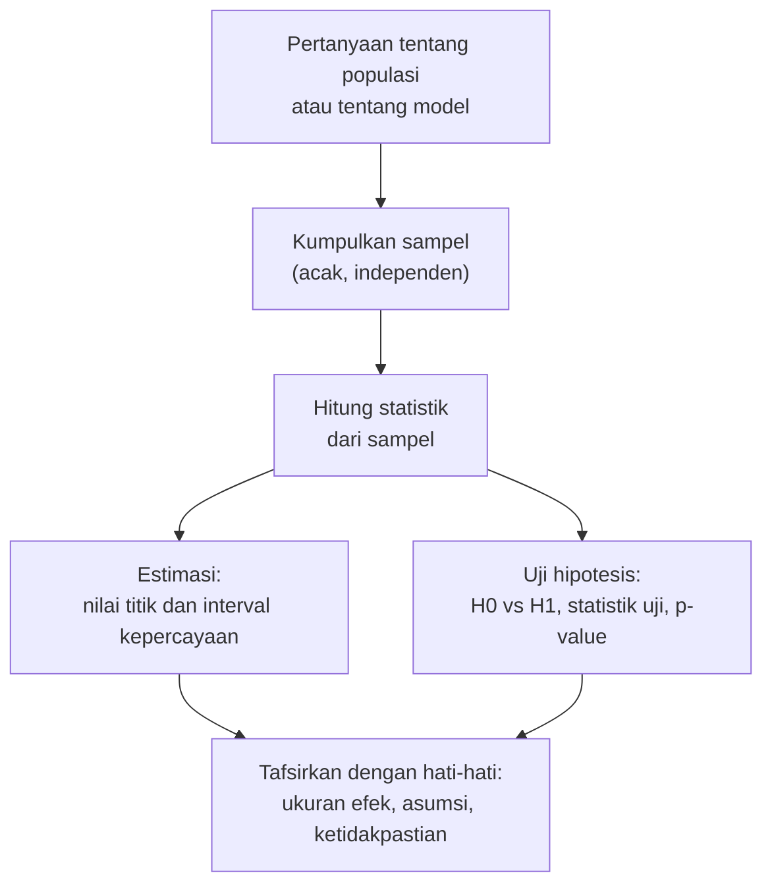

# Part 10 — Inferensi Statistik

## Tujuan Pembelajaran

Setelah mempelajari bagian ini, kamu mampu:

- membedakan estimasi titik dan estimasi interval, serta estimator dan nilai estimasi;
- menjelaskan secara intuitif gagasan estimasi kemungkinan maksimum (*maximum likelihood*) pada contoh Bernoulli;
- menghitung interval kepercayaan untuk rata-rata (dengan $z$ dan $t$) dan untuk proporsi;
- menyatakan tafsir interval kepercayaan yang **benar** dan mengenali tafsir yang keliru;
- merumuskan hipotesis nol ($H_0$) dan hipotesis alternatif ($H_1$), serta menjalankan uji $z$, uji $t$, dan uji proporsi secara dasar;
- menyatakan arti **p-value** yang tepat dan menghindari salah tafsir yang umum;
- menjelaskan tingkat signifikansi $\alpha$, kesalahan Tipe I dan Tipe II, dan kuasa uji;
- membedakan signifikansi statistik dari kepentingan praktis, dan mengenali bahaya banyak pengujian;
- menghubungkan inferensi dengan perbandingan model dan pengujian A/B.

## Prasyarat

[Part 9 — Distribusi Sampling dan Central Limit Theorem](09-distribusi-sampling-dan-clt.md) (galat baku, CLT), [Part 8](08-distribusi-probabilitas-umum.md) (Normal, $z$-score, Binomial), [Part 4](04-dasar-probabilitas.md) (komplemen), dan sedikit [Level 2 — Part 7](../level-2-aljabar-linear-dan-kalkulus/07-turunan.md) (turunan dan titik kritis, untuk bagian pengantar kemungkinan maksimum).

## Mengapa Materi Ini Penting?

Kita jarang tertarik pada sampel itu sendiri; kita ingin tahu tentang populasi atau tentang kinerja model pada data yang belum pernah dilihat. **Inferensi statistik** adalah seperangkat cara yang jujur untuk beranjak dari sampel ke kesimpulan tentang populasi, **beserta ukuran seberapa yakin kita**.

Dalam Machine Learning, inferensi dipakai untuk menjawab pertanyaan seperti: "apakah model B benar-benar lebih baik dari model A, atau hanya kebetulan pada data uji ini?" dan "berapa rentang wajar akurasi sebenarnya?". Sayangnya, inferensi juga merupakan topik yang paling sering disalahpahami; part ini sengaja menekankan tafsir yang tepat.

## Konsep Dasar dengan Bahasa Sederhana



Dua tugas utama inferensi: **estimasi** (berapa nilai parameter?) dan **uji hipotesis** (apakah data konsisten dengan suatu klaim?). Keduanya bertumpu pada distribusi sampling (Part 9).

### 1. Estimasi Titik

- **Estimator** adalah aturan (rumus) untuk memperkirakan parameter dari sampel, misalnya $\bar{X}$ untuk $\mu$. Sebagai fungsi dari sampel acak, ia berupa variabel acak.
- **Estimasi** (nilai estimasi) adalah angka yang dihasilkan dari sampel tertentu, misalnya $\bar{x} = 14{,}75$.

| Parameter | Estimator | Catatan |
|---|---|---|
| rata-rata $\mu$ | $\bar{X}$ | tak bias (Part 9) |
| varians $\sigma^2$ | $S^2$ dengan pembagi $n - 1$ | tak bias (Part 2) |
| proporsi $p$ | $\hat{p}$ = bagian sukses | tak bias (Part 9) |

Estimator yang baik umumnya **tak bias** (rata-ratanya sama dengan parameter) dan **konsisten** (mendekati parameter bila $n$ membesar). Estimasi titik saja tidak menyatakan seberapa yakin kita; itu tugas interval.

### 2. Pengantar Estimasi Kemungkinan Maksimum

Salah satu cara umum membangun estimator adalah **kemungkinan maksimum** (*maximum likelihood*): pilih nilai parameter yang **membuat data yang diamati paling mungkin**. Ini hanya pengantar intuitif; pembahasan lengkap ada di Level 4.

**Contoh Bernoulli.** Pada 10 percobaan kita mengamati $k = 7$ sukses. Jika peluang sukses sebenarnya $p$, peluang urutan hasil tertentu dengan 7 sukses dan 3 gagal adalah:

$$
L(p) = p^7\,(1 - p)^3
$$

$L(p)$ disebut **fungsi likelihood**: peluang data **sebagai fungsi dari parameter**. Mencoba beberapa nilai $p$:

| $p$ | $L(p) = p^7(1 - p)^3$ | $\ln L(p)$ |
|---|---|---|
| 0,3 | 0,000075 | $-9{,}4978$ |
| 0,5 | 0,000977 | $-6{,}9315$ |
| 0,6 | 0,001792 | $-6{,}3247$ |
| **0,7** | **0,002224** | **$-6{,}1086$** |
| 0,8 | 0,001678 | $-6{,}3903$ |
| 0,9 | 0,000478 | $-7{,}6453$ |

Nilai terbesar ada di $p = 0{,}7 = 7/10$, yaitu proporsi sampel. Secara umum, dengan $k$ sukses dari $n$, logaritma likelihood adalah $\ell(p) = k\ln p + (n - k)\ln(1 - p)$. Menyamakan turunannya dengan nol (titik kritis, Level 2):

$$
\ell'(p) = \frac{k}{p} - \frac{n - k}{1 - p} = 0
\quad\Longrightarrow\quad
\hat{p} = \frac{k}{n}
$$

Jadi estimator kemungkinan maksimum untuk $p$ adalah proporsi sampel, yang cocok dengan intuisi. Logaritma dipakai karena mengubah perkalian menjadi penjumlahan dan tidak mengubah lokasi nilai maksimum.

!!! note "Koneksi ke Machine Learning"
    Negatif dari log-likelihood Bernoulli, $-[y\ln p + (1 - y)\ln(1 - p)]$, adalah fungsi kerugian *binary cross-entropy* pada klasifikasi biner. Melatih model dengan kerugian itu setara dengan mencari parameter dengan kemungkinan maksimum. Penjabarannya ada di level lanjutan.

### 3. Interval Kepercayaan

**Interval kepercayaan** (*confidence interval*, CI) memberi rentang nilai wajar bagi parameter, bukan hanya satu angka. Bentuk umum:

$$
\text{estimasi} \;\pm\; (\text{nilai kritis}) \times \text{galat baku}
$$

**Rata-rata, $\sigma$ diketahui** (atau $n$ besar):

$$
\bar{x} \;\pm\; z^{*}\,\frac{\sigma}{\sqrt{n}}
$$

Nilai kritis $z^{*}$ untuk tingkat kepercayaan:

| Tingkat | $z^{*}$ |
|---|---|
| 90% | 1,645 |
| 95% | 1,960 |
| 99% | 2,576 |

**Rata-rata, $\sigma$ tidak diketahui** (kasus umum): pakai $s$ sebagai pengganti $\sigma$ dan ganti $z^{*}$ dengan nilai kritis dari **distribusi $t$** dengan $n - 1$ derajat kebebasan:

$$
\bar{x} \;\pm\; t^{*}_{n-1}\,\frac{s}{\sqrt{n}}
$$

Distribusi $t$ mirip Normal tetapi berekor lebih berat, untuk memperhitungkan ketidakpastian tambahan karena $\sigma$ diperkirakan oleh $s$. Untuk $n$ kecil, $t^{*}$ lebih besar dari $z^{*}$; untuk $n$ besar keduanya hampir sama. Nilai kritis $t$ untuk tingkat 95% (dua sisi):

| Derajat kebebasan | 1 | 2 | 3 | 5 | 7 | 10 | 20 | 30 | 60 | tak hingga |
|---|---|---|---|---|---|---|---|---|---|---|
| $t^{*}$ | 12,706 | 4,303 | 3,182 | 2,571 | 2,365 | 2,228 | 2,086 | 2,042 | 2,000 | 1,960 |

(Derajat kebebasan = $n - 1$ untuk satu sampel. Syarat: data kira-kira Normal, atau $n$ cukup besar menurut CLT.)

**Contoh: Data A dari Part 2** ($n = 8$, $\bar{x} = 14{,}75$, $s = 3{,}0119$). Galat baku $= \dfrac{3{,}0119}{\sqrt{8}} = 1{,}0649$. Dengan $t^{*}_7 = 2{,}365$: margin $= 2{,}365 \times 1{,}0649 = 2{,}518$, sehingga CI 95% $= [12{,}23;\ 17{,}27]$ jam per minggu. Bila memakai $z^{*} = 1{,}96$ secara keliru, rentangnya $[12{,}66;\ 16{,}84]$: **terlalu sempit** untuk sampel sekecil ini.

**Interval kepercayaan untuk proporsi** (pendekatan Normal):

$$
\hat{p} \;\pm\; z^{*}\sqrt{\frac{\hat{p}\,(1 - \hat{p})}{n}}
$$

Syarat: $n\hat{p}$ dan $n(1 - \hat{p})$ sekurang-kurangnya sekitar $10$. Untuk $n$ kecil atau $\hat{p}$ dekat $0$ atau $1$ pendekatan ini kurang baik dan tersedia metode yang lebih akurat (misalnya interval Wilson). Contoh: akurasi $\hat{p} = 0{,}8$ pada $n = 100$: galat baku $0{,}04$, CI 95% $= [0{,}722;\ 0{,}878]$. Pada $n = 1000$: $[0{,}775;\ 0{,}825]$.

**Apa yang memengaruhi lebar interval?** Lebar $\propto \dfrac{\text{nilai kritis} \times \text{sebaran}}{\sqrt{n}}$: lebih sempit bila $n$ besar atau data kurang bervariasi; lebih lebar bila tingkat kepercayaan dinaikkan (99% lebih lebar dari 95%).

**Tafsir yang benar.** Pernyataan "kepercayaan 95%" menyangkut **prosedurnya**: jika kita mengulang pengambilan sampel dan membangun interval dengan cara yang sama berkali-kali, sekitar 95% interval yang terbentuk akan memuat parameter yang sebenarnya. Untuk **satu** interval yang sudah dihitung, parameter sebenarnya (yang tetap) berada di dalamnya atau tidak; kita tidak tahu yang mana.

Simulasi untuk melihatnya: sampel $n = 25$ dari $\mathcal{N}(50, 10^2)$, interval $\bar{x} \pm 1{,}96 \times 2$ ($\mathrm{SE} = 10/\sqrt{25} = 2$). Dalam 10.000 pengulangan, interval memuat $\mu = 50$ pada $94{,}75\%$ kali, sangat dekat dengan 95%.

!!! warning "Tafsir yang keliru"
    "Ada peluang 95% bahwa $\mu$ berada di antara 12,23 dan 17,27" **bukan** tafsir yang tepat dalam kerangka klasik di sini, karena $\mu$ dianggap tetap, bukan variabel acak. Yang acak adalah intervalnya. Tafsir yang tepat: "interval ini dihasilkan oleh prosedur yang memuat parameter pada 95% pengulangan". Juga keliru: "95% data berada dalam interval ini" (interval kepercayaan membicarakan parameter, bukan data individu).

### 4. Uji Hipotesis

**Uji hipotesis** adalah cara memutuskan apakah data cukup bertentangan dengan suatu klaim.

- **Hipotesis nol $H_0$:** klaim "tidak ada efek / tidak ada beda" yang kita uji, misalnya $\mu = 50$.
- **Hipotesis alternatif $H_1$:** apa yang kita curigai bila $H_0$ salah. **Dua sisi**: $\mu \neq 50$. **Satu sisi**: $\mu > 50$ atau $\mu < 50$.
- **Statistik uji:** angka dari sampel yang mengukur seberapa jauh data dari $H_0$, dalam satuan galat baku:

$$
\text{statistik uji} = \frac{\text{estimasi} - \text{nilai di } H_0}{\text{galat baku}}
$$

Untuk rata-rata: $z = \dfrac{\bar{x} - \mu_0}{\sigma/\sqrt{n}}$ (uji $z$, $\sigma$ diketahui) atau $t = \dfrac{\bar{x} - \mu_0}{s/\sqrt{n}}$ (uji $t$, dengan $n - 1$ derajat kebebasan).

**Nilai-p (*p-value*).** Nilai-p adalah:

> peluang memperoleh hasil **sekurang-kurangnya seekstrem** yang kita amati, **dengan anggapan $H_0$ benar**.

Semakin kecil nilai-p, semakin sulit data menjelaskan diri dengan kebetulan saja jika $H_0$ benar. Nilai-p dihitung dari distribusi statistik uji di bawah $H_0$.

**Tingkat signifikansi $\alpha$** adalah ambang yang ditetapkan **sebelum** melihat data (lazim $0{,}05$):

- jika nilai-p $\leq \alpha$: **tolak $H_0$** (hasil "signifikan secara statistik");
- jika nilai-p $> \alpha$: **gagal menolak $H_0$**.

Perhatikan kata "gagal menolak", bukan "menerima $H_0$": data yang tidak cukup kuat bukan bukti bahwa $H_0$ benar; boleh jadi sampelnya terlalu kecil.

!!! warning "Apa yang BUKAN nilai-p"
    Nilai-p **bukan**:

    - peluang bahwa $H_0$ benar (nilai-p menganggap $H_0$ benar, bukan menghitung peluangnya);
    - peluang bahwa hasil terjadi "hanya karena kebetulan";
    - peluang bahwa kita keliru bila menolak $H_0$;
    - ukuran besar atau pentingnya efek.

    Untuk menghitung peluang $H_0$ benar diperlukan prior dan Teorema Bayes (Part 6), dan itu pertanyaan yang berbeda.

**Contoh uji $z$.** Klaim: rata-rata $\mu_0 = 50$. Sampel $n = 36$, $\bar{x} = 52{,}4$, $\sigma = 9$ (diketahui). $H_0: \mu = 50$ lawan $H_1: \mu \neq 50$.

- $\mathrm{SE} = \dfrac{9}{6} = 1{,}5$; $z = \dfrac{52{,}4 - 50}{1{,}5} = 1{,}6$.
- Nilai-p dua sisi $= 2\,[1 - \Phi(1{,}6)] = 2(0{,}0548) \approx 0{,}1096$.
- Karena $0{,}1096 > 0{,}05$: **gagal menolak** $H_0$. Data **tidak cukup** meyakinkan bahwa $\mu \neq 50$.
- CI 95% yang sesuai: $52{,}4 \pm 1{,}96(1{,}5) = [49{,}46;\ 55{,}34]$ memuat $50$, konsisten dengan keputusan itu.

**Hubungan CI dan uji dua sisi.** Pada uji $z$ atau $t$ dua sisi dengan $\alpha = 0{,}05$, $H_0: \mu = \mu_0$ ditolak **jika dan hanya jika** CI 95% **tidak** memuat $\mu_0$. CI lebih informatif karena sekaligus menunjukkan **rentang** nilai yang masuk akal, bukan sekadar keputusan ya-atau-tidak.

**Contoh uji $t$ (satu sisi).** Klaim: rata-rata waktu belajar lebih dari 12 jam. $H_0: \mu = 12$ lawan $H_1: \mu > 12$. Data A ($n = 8$, $\bar{x} = 14{,}75$, $s = 3{,}0119$):

- $t = \dfrac{14{,}75 - 12}{1{,}0649} \approx 2{,}582$ dengan $7$ derajat kebebasan.
- Nilai kritis satu sisi pada $\alpha = 0{,}05$: $t^{*}_{0{,}95;\,7} = 1{,}895$. Karena $2{,}582 > 1{,}895$, tolak $H_0$.
- Nilai-p satu sisi $\approx 0{,}018$ (dihitung dengan perangkat lunak statistik, SciPy; bukan dependensi buku ini). Dua sisi $\approx 0{,}036$.
- Kesimpulan: data memberi bukti yang cukup kuat (pada $\alpha = 0{,}05$) bahwa rata-rata waktu belajar lebih dari 12 jam. Dengan $n = 8$ saja, asumsi kenormalan data perlu diperiksa.

**Contoh uji proporsi.** Koin dilempar 100 kali, muncul kepala 60 kali. $H_0: p = 0{,}5$ lawan $H_1: p \neq 0{,}5$.

- Dengan pendekatan Normal: $z = \dfrac{0{,}6 - 0{,}5}{\sqrt{0{,}25/100}} = \dfrac{0{,}1}{0{,}05} = 2{,}0$, nilai-p $= 2[1 - \Phi(2)] \approx 0{,}0455$. Kesimpulan: tolak $H_0$ pada $\alpha = 0{,}05$.
- Dengan perhitungan **eksak** Binomial: $P(X \geq 60) = 0{,}0284$, dua sisi $= 0{,}0569$. Kesimpulan: **gagal menolak** $H_0$.
- Dengan koreksi kontinuitas ($z = 1{,}9$): nilai-p $\approx 0{,}0574$, dekat dengan hasil eksak.

Dua metode berbeda melintasi ambang $0{,}05$. Pelajarannya: (1) pendekatan Normal untuk data diskret bisa sedikit meleset; (2) hasil yang jatuh dekat ambang sebaiknya tidak ditafsirkan sebagai "ya-atau-tidak" yang tegas; (3) $\alpha = 0{,}05$ adalah **konvensi**, bukan batas alam.

**Contoh uji dua proporsi (pengujian A/B).** Versi A: 120 dari 1.000 pengguna berkonversi ($0{,}12$). Versi B: 150 dari 1.000 ($0{,}15$). $H_0$: kedua proporsi sama.

- Proporsi gabungan $= \dfrac{270}{2000} = 0{,}135$; $\mathrm{SE} = \sqrt{0{,}135 \times 0{,}865 \times \dfrac{2}{1000}} = 0{,}0153$.
- $z = \dfrac{0{,}03}{0{,}0153} = 1{,}963$; nilai-p dua sisi $\approx 0{,}0496$.
- CI 95% untuk selisih: $0{,}03 \pm 1{,}96 \times 0{,}01527$, yaitu $[0{,}0001;\ 0{,}0599]$.
- Nilai-p tepat di bawah $0{,}05$ dan CI hampir menyentuh nol. Selisih nyata mungkin hanya sangat kecil atau sampai sekitar 6 poin. Hasil seperti ini sebaiknya dibaca dengan hati-hati dan, bila perlu, diperkuat dengan data tambahan.

### 5. Kesalahan Tipe I dan Tipe II, serta Kuasa

Ada dua jenis kesalahan keputusan dalam uji hipotesis:

| | $H_0$ benar | $H_0$ salah |
|---|---|---|
| **Tolak $H_0$** | **Kesalahan Tipe I** (positif palsu), peluang $\alpha$ | keputusan benar, peluang $1 - \beta$ (**kuasa**) |
| **Gagal menolak $H_0$** | keputusan benar, peluang $1 - \alpha$ | **Kesalahan Tipe II** (negatif palsu), peluang $\beta$ |

- **$\alpha$** (tingkat signifikansi): peluang menolak $H_0$ padahal $H_0$ benar; kita yang menetapkannya.
- **$\beta$**: peluang gagal menolak $H_0$ padahal $H_0$ salah.
- **Kuasa uji** (*power*) $= 1 - \beta$: peluang mendeteksi efek yang memang ada.

Menurunkan $\alpha$ (lebih hati-hati menolak) cenderung menaikkan $\beta$, bila $n$ tetap. Cara menaikkan kuasa tanpa menaikkan $\alpha$: perbesar $n$, atau efeknya memang lebih besar, atau data kurang bervariasi.

**Contoh kuasa.** $H_0: \mu = 50$, $\sigma = 9$, $n = 36$, $\alpha = 0{,}05$ dua sisi, dan $\mu$ sebenarnya $52$. $\mathrm{SE} = 1{,}5$; $H_0$ ditolak bila $\bar{x} > 50 + 1{,}96(1{,}5) = 52{,}94$ atau $\bar{x} < 47{,}06$. Bila $\mu = 52$: $P(\bar{X} > 52{,}94) = 1 - \Phi\!\left(\dfrac{52{,}94 - 52}{1{,}5}\right) = 1 - \Phi(0{,}627) \approx 0{,}265$, ditambah bagian kiri yang hampir nol. **Kuasa hanya sekitar $26{,}6\%$**: efek 2 poin yang nyata hanya terdeteksi sekitar satu kali dari empat. Dengan $n = 100$, kuasa naik menjadi $0{,}603$; dengan $n = 159$, kuasa mencapai $0{,}80$.

Uji dengan kuasa rendah sering gagal menolak $H_0$ padahal efeknya ada; kegagalan menolak pada sampel kecil tidak berarti "tidak ada efek".

### 6. Banyak Pengujian

Jika kita menjalankan banyak uji, peluang mendapatkan **minimal satu** hasil "signifikan" hanya karena kebetulan membesar. Dengan 20 uji independen pada $\alpha = 0{,}05$ dan seluruh $H_0$ benar, trik komplemen (Part 4) memberi:

$$
P(\text{minimal satu positif palsu}) = 1 - (1 - 0{,}05)^{20} \approx 0{,}6415
$$

Artinya, kira-kira dua dari tiga kali kita akan "menemukan" sesuatu yang signifikan padahal tidak ada apa-apa. Mencoba banyak analisis lalu hanya melaporkan yang signifikan disebut ***p-hacking***. Penanganannya antara lain menetapkan hipotesis sebelum melihat data, melaporkan semua uji, dan memakai koreksi seperti Bonferroni (memakai $\alpha/m$ untuk $m$ uji, sehingga $0{,}05/20 = 0{,}0025$ per uji).

### 7. Signifikansi Statistik versus Kepentingan Praktis

Hasil yang **signifikan secara statistik** belum tentu **penting secara praktis**. Dengan $n$ sangat besar, selisih yang sangat kecil pun dapat menghasilkan nilai-p kecil. Sebaliknya, efek yang penting dapat gagal signifikan pada $n$ kecil. Karena itu laporkan juga **ukuran efek** (misalnya selisih rata-rata) dan **interval kepercayaannya**, bukan hanya nilai-p.

## Istilah yang Perlu Dipahami

| Istilah | Arti sederhana |
|---|---|
| Estimator / estimasi | rumus penaksir / angka hasilnya |
| Kemungkinan maksimum | pilih parameter yang membuat data paling mungkin |
| Likelihood | peluang data sebagai fungsi parameter |
| Interval kepercayaan | rentang nilai wajar bagi parameter dari sebuah prosedur |
| Nilai kritis | batas dari distribusi acuan ($z^{*}$ atau $t^{*}$) |
| Derajat kebebasan | $n - 1$ untuk uji $t$ satu sampel |
| $H_0$, $H_1$ | hipotesis nol dan alternatif |
| Statistik uji | ukuran jarak data dari $H_0$ dalam satuan galat baku |
| Nilai-p | peluang hasil seekstrem itu bila $H_0$ benar |
| $\alpha$ | tingkat signifikansi, ambang keputusan |
| Kesalahan Tipe I / II | menolak $H_0$ yang benar / gagal menolak $H_0$ yang salah |
| Kuasa uji | $1 - \beta$, peluang mendeteksi efek yang ada |
| Ukuran efek | besarnya selisih atau hubungan yang diamati |
| *p-hacking* | mencoba banyak analisis dan melaporkan yang signifikan saja |

## Rumus dan Penjelasan Setiap Simbol

| Prosedur | Rumus | Syarat dan arti simbol |
|---|---|---|
| CI rata-rata ($\sigma$ diketahui) | $\bar{x} \pm z^{*}\,\dfrac{\sigma}{\sqrt{n}}$ | sampel independen; populasi Normal atau $n$ besar |
| CI rata-rata ($\sigma$ tidak diketahui) | $\bar{x} \pm t^{*}_{n-1}\,\dfrac{s}{\sqrt{n}}$ | $t^{*}$ dari distribusi $t$ dengan $n - 1$ derajat kebebasan |
| CI proporsi | $\hat{p} \pm z^{*}\sqrt{\dfrac{\hat{p}(1 - \hat{p})}{n}}$ | $n\hat{p}, n(1 - \hat{p}) \gtrsim 10$ |
| Uji $z$ (rata-rata) | $z = \dfrac{\bar{x} - \mu_0}{\sigma/\sqrt{n}}$ | $\mu_0$ nilai di $H_0$ |
| Uji $t$ (rata-rata) | $t = \dfrac{\bar{x} - \mu_0}{s/\sqrt{n}}$ | $n - 1$ derajat kebebasan |
| Uji proporsi | $z = \dfrac{\hat{p} - p_0}{\sqrt{p_0(1 - p_0)/n}}$ | $p_0$ nilai di $H_0$ |
| Uji dua proporsi | $z = \dfrac{\hat{p}_B - \hat{p}_A}{\sqrt{\hat{p}(1 - \hat{p})(1/n_A + 1/n_B)}}$ | $\hat{p}$ proporsi gabungan di bawah $H_0$ |
| Peluang positif palsu pada $m$ uji | $1 - (1 - \alpha)^m$ | uji independen, semua $H_0$ benar |
| Likelihood Bernoulli | $L(p) = p^k(1 - p)^{n - k}$, $\hat{p} = k/n$ | $k$ sukses dari $n$ percobaan |

## Penjelasan Langkah demi Langkah

**Menyelesaikan uji hipotesis:**

1. Tulis pertanyaan dan **rumuskan $H_0$ dan $H_1$** (satu atau dua sisi) **sebelum** melihat hasil.
2. Tetapkan $\alpha$ (misalnya $0{,}05$).
3. Pilih uji dan **periksa asumsi** (independen, kira-kira Normal atau $n$ besar, $\sigma$ diketahui atau tidak).
4. Hitung statistik uji.
5. Hitung nilai-p (atau bandingkan dengan nilai kritis).
6. Putuskan: tolak atau gagal menolak $H_0$.
7. **Tafsirkan** dalam konteks, laporkan ukuran efek dan interval kepercayaan, dan sebut batasan (asumsi, ukuran sampel, banyaknya uji).

**Membuat interval kepercayaan:** hitung estimasi dan galat baku, pilih tingkat kepercayaan, ambil nilai kritis yang sesuai ($z^{*}$ atau $t^{*}$), lalu hitung estimasi $\pm$ nilai kritis $\times$ galat baku.

## Contoh Soal dan Pembahasan

### Contoh 1 — CI dengan distribusi $t$

Data $10, 12, 9, 11, 13, 10, 12, 11$. Hitung CI 95% untuk rata-rata.

1. $n = 8$, $\bar{x} = \dfrac{88}{8} = 11$.
2. Deviasi: $-1, 1, -2, 0, 2, -1, 1, 0$; kuadrat: $1, 1, 4, 0, 4, 1, 1, 0$; jumlah $12$. $s^2 = \dfrac{12}{7} \approx 1{,}714$, $s \approx 1{,}309$.
3. $\mathrm{SE} = \dfrac{1{,}309}{\sqrt{8}} \approx 0{,}4629$.
4. $t^{*}_7 = 2{,}365$; margin $= 2{,}365 \times 0{,}4629 \approx 1{,}095$.
5. CI 95% $= 11 \pm 1{,}095 = [9{,}905;\ 12{,}095]$.

### Contoh 2 — CI dengan $z$ dan tingkat kepercayaan berbeda

Sampel $n = 64$, $\bar{x} = 50$, $s = 8$ ($n$ besar, pakai $z$). Hitung CI 95% dan 99%.

1. $\mathrm{SE} = \dfrac{8}{8} = 1$.
2. 95%: $50 \pm 1{,}96(1) = [48{,}04;\ 51{,}96]$.
3. 99%: $50 \pm 2{,}576(1) = [47{,}42;\ 52{,}58]$.
4. Interval 99% lebih lebar: kepastian lebih tinggi dibayar dengan presisi lebih rendah.

### Contoh 3 — Uji $z$ dua sisi

$H_0: \mu = 100$, $\sigma = 14$, $n = 49$, $\bar{x} = 104$. Uji pada $\alpha = 0{,}05$.

1. $\mathrm{SE} = \dfrac{14}{7} = 2$; $z = \dfrac{104 - 100}{2} = 2$.
2. Nilai-p $= 2[1 - \Phi(2)] = 2(0{,}0228) \approx 0{,}0455$.
3. $0{,}0455 < 0{,}05$: tolak $H_0$.
4. CI 95%: $104 \pm 1{,}96(2) = [100{,}08;\ 107{,}92]$. Tidak memuat $100$ (tipis), konsisten dengan penolakan.

### Contoh 4 — Pengaruh ukuran sampel pada keputusan

Selisih yang sama ($\bar{x} - \mu_0 = 4$, $\sigma = 14$) tetapi $n = 16$.

1. $\mathrm{SE} = \dfrac{14}{4} = 3{,}5$; $z = \dfrac{4}{3{,}5} \approx 1{,}143$.
2. Nilai-p dua sisi $\approx 0{,}253$: **gagal menolak** $H_0$.
3. Selisih yang sama menghasilkan kesimpulan berbeda karena galat baku lebih besar. Gagal menolak $H_0$ di sini tidak berarti $\mu = 100$; ia berarti data kurang untuk memutuskan.

### Contoh 5 — Perbandingan dua model

Model A akurasi $85{,}0\%$ dan model B $86{,}5\%$, masing-masing diuji pada 1.000 contoh **terpisah**. Apakah B terbukti lebih baik?

1. $\hat{p}_A = 0{,}85$, $\hat{p}_B = 0{,}865$; selisih $0{,}015$. Proporsi gabungan $0{,}8575$.
2. $\mathrm{SE} = \sqrt{0{,}8575 \times 0{,}1425 \times \dfrac{2}{1000}} \approx 0{,}01563$.
3. $z = \dfrac{0{,}015}{0{,}01563} \approx 0{,}960$; nilai-p dua sisi $\approx 0{,}337$.
4. Gagal menolak $H_0$: selisih 1,5 poin tidak dapat dibedakan dari variasi sampling pada data uji sebesar ini.
5. Catatan: bila kedua model diuji pada **contoh yang sama**, pengujian berpasangan lebih tepat dan lebih peka daripada uji dua proporsi independen ini.

## Contoh Tambahan dengan Kesulitan Bertahap

**Mudah.** Nilai-p $= 0{,}03$ dan $\alpha = 0{,}05$: tolak $H_0$. Nilai-p $= 0{,}08$: gagal menolak.

**Sedang.** CI proporsi: 60 dari 200 pengguna mengklik. $\hat{p} = 0{,}3$, $\mathrm{SE} = \sqrt{\dfrac{0{,}3 \times 0{,}7}{200}} = 0{,}0324$, CI 95% $= [0{,}236;\ 0{,}364]$.

**Sedang.** Dalam kerangka klasik, benar: "prosedur yang menghasilkan interval ini memuat parameter pada 95% pengulangan". Keliru: "peluang parameter ada di interval ini adalah 95%" dan "nilai-p $= 0{,}03$ berarti peluang $H_0$ benar adalah 3%".

**Menantang.** Bila $\alpha$ diturunkan dari $0{,}05$ ke $0{,}01$ dengan $n$ tetap, kuasa menurun karena batas penolakan menjadi lebih ketat. Untuk mempertahankan kuasa yang sama pada $\alpha$ lebih kecil, $n$ harus diperbesar.

## Visualisasi atau Interpretasi Grafik

- **Distribusi statistik uji di bawah $H_0$** berbentuk lonceng. Nilai-p adalah luas ekor (satu atau dua sisi) di luar nilai yang teramati; wilayah penolakan adalah ekor dengan luas total $\alpha$.
- **Interval kepercayaan** digambar sebagai garis dengan titik estimasi di tengah. Garis yang melewati nilai $H_0$ berarti $H_0$ tidak ditolak.
- **Pengulangan interval:** bila kita menggambar 100 interval 95% dari 100 sampel, sekitar 95 menutup parameter dan sekitar 5 tidak (simulasi 100 sampel dengan seed 8 memberi 94 yang menutup).

## Kesalahan Umum

| Kesalahan | Mengapa salah | Yang benar |
|---|---|---|
| Menyebut nilai-p sebagai peluang $H_0$ benar | nilai-p dihitung dengan menganggap $H_0$ benar | nilai-p = peluang hasil seekstrem itu bila $H_0$ benar |
| Mengatakan "menerima $H_0$" | tidak menolak bukan bukti $H_0$ benar | "gagal menolak $H_0$" |
| "Peluang 95% parameter ada di interval ini" | parameter tetap, intervalnya yang acak | tafsir prosedur: 95% pengulangan memuat parameter |
| Mengira "95% data ada di interval kepercayaan" | CI membicarakan parameter | gunakan rentang sebaran data untuk itu |
| Memakai $z^{*}$ pada sampel kecil dengan $\sigma$ tidak diketahui | interval terlalu sempit | pakai $t^{*}$ |
| Menganggap signifikan berarti penting | $n$ besar menjadikan efek kecil signifikan | laporkan ukuran efek dan CI |
| Menganggap tidak signifikan berarti tidak ada efek | kuasa bisa rendah | periksa $n$ dan CI |
| Menetapkan $H_1$ atau $\alpha$ setelah melihat data | menggelembungkan positif palsu | tetapkan sebelum melihat hasil |
| Menjalankan banyak uji lalu melaporkan yang signifikan | kebetulan menghasilkan positif palsu | koreksi atau laporkan semua uji |
| Mengabaikan asumsi (independen, Normal/n besar) | hasil tidak sah | periksa asumsi |
| Menganggap $\alpha = 0{,}05$ batas keras | itu konvensi | tafsirkan nilai-p secara kontinu bersama CI |

## Hubungan dengan Machine Learning

- **Membandingkan model.** Selisih akurasi dua model pada data uji adalah selisih dua estimasi yang masing-masing bergoyang. Uji hipotesis dan interval kepercayaan menyatakan apakah selisih itu melebihi kebisingan. Untuk model yang diuji pada contoh yang sama, uji berpasangan (misalnya terhadap contoh yang diprediksi berbeda) lebih sesuai.
- **Pengujian A/B.** Mengukur apakah versi baru produk atau model memberi konversi yang berbeda memakai uji dua proporsi atau uji rata-rata. Praktik baik: tetapkan ukuran sampel dan hipotesis sebelum percobaan, jangan berhenti saat nilai-p kebetulan di bawah $0{,}05$, dan perhatikan banyaknya metrik yang diuji.
- **Selang ketidakpastian metrik.** Melaporkan akurasi bersama interval kepercayaan (atau interval bootstrap) lebih jujur daripada satu angka.
- **Positif palsu dan negatif palsu.** Kesalahan Tipe I dan II pada uji hipotesis punya analogi dengan positif palsu dan negatif palsu pada klasifikasi, dan trade-off ambangnya mirip. Namun keduanya konsep yang berbeda (satu tentang keputusan atas hipotesis, satu tentang prediksi per contoh).
- **Banyak eksperimen.** Menyetel banyak hiperparameter dan memilih yang terbaik pada data uji yang sama menaikkan peluang hasil terbaik hanyalah kebetulan, mirip *p-hacking*. Data uji sebaiknya hanya dipakai sekali di akhir.
- **Kemungkinan maksimum.** Banyak fungsi kerugian (misalnya cross-entropy) adalah negatif log-likelihood; melatih model sering setara dengan estimasi kemungkinan maksimum atas suatu asumsi distribusi.
- **Asumsi independensi.** Seluruh perhitungan di atas mengandalkan contoh yang independen. Data yang saling bergantung (Part 5 dan 9) membuat interval terlalu sempit dan nilai-p terlalu kecil.

### Python: interval, uji, kuasa, dan simulasi cakupan

Hanya pustaka standar (`math`, `random`, `statistics.NormalDist`). Nilai kritis $t$ diambil dari tabel di atas karena pustaka standar tidak menyediakan distribusi $t$.

```python
import math, random
from statistics import mean, stdev, NormalDist
Z = NormalDist()

A = [12, 15, 11, 18, 15, 14, 20, 13]
n, xbar, s = len(A), mean(A), stdev(A)
se = s / math.sqrt(n)
print(n, xbar, round(s, 4), round(se, 4))                     # 8 14.75 3.0119 1.0649
t_kritis_7 = 2.365                                            # t(0,975; db = 7) dari tabel
print(round(xbar - t_kritis_7 * se, 3), round(xbar + t_kritis_7 * se, 3))   # 12.232 17.268
print(round(xbar - 1.96 * se, 3), round(xbar + 1.96 * se, 3))               # 12.663 16.837
print([round(Z.inv_cdf(q), 4) for q in (0.95, 0.975, 0.995)])               # [1.6449, 1.96, 2.5758]
print(round((xbar - 12) / se, 3))                             # 2.582  (kritis satu sisi t(0,95; db = 7) = 1.895)
```

Uji $z$, uji proporsi (pendekatan dan eksak), dan uji dua proporsi:

```python
z = (52.4 - 50) / (9 / math.sqrt(36))
print(round(z, 3), round(2 * (1 - Z.cdf(abs(z))), 4))        # 1.6 0.1096

z_koin = (0.6 - 0.5) / math.sqrt(0.5 * 0.5 / 100)
print(round(z_koin, 2), round(2 * (1 - Z.cdf(z_koin)), 4))   # 2.0 0.0455
ekor = sum(math.comb(100, k) for k in range(60, 101)) / 2 ** 100
print(round(ekor, 4), round(2 * ekor, 4))                    # 0.0284 0.0569

pa, pb, n_ab = 120 / 1000, 150 / 1000, 1000
p_gab = (120 + 150) / 2000
se_gab = math.sqrt(p_gab * (1 - p_gab) * (2 / n_ab))
z_ab = (pb - pa) / se_gab
print(round(p_gab, 3), round(se_gab, 4), round(z_ab, 3), round(2 * (1 - Z.cdf(z_ab)), 4))
# 0.135 0.0153 1.963 0.0496
se_beda = math.sqrt(pa * (1 - pa) / n_ab + pb * (1 - pb) / n_ab)
print(round(0.03 - 1.96 * se_beda, 4), round(0.03 + 1.96 * se_beda, 4))   # 0.0001 0.0599
```

Kuasa uji, banyak pengujian, dan cakupan interval kepercayaan (seed tetap, Python 3.14):

```python
def kuasa(mu_benar, mu0=50, sigma=9, n=36):
    se = sigma / math.sqrt(n)
    atas, bawah = mu0 + 1.96 * se, mu0 - 1.96 * se
    return (1 - Z.cdf((atas - mu_benar) / se)) + Z.cdf((bawah - mu_benar) / se)

for n in (36, 100, 159, 200):
    print(n, round(kuasa(52, n=n), 4))
# 36 0.2659
# 100 0.6034
# 159 0.8001
# 200 0.8815

print(round(1 - 0.95 ** 20, 4), round(1 - 0.95 ** 5, 4))     # 0.6415 0.2262

rng = random.Random(2024)
ulang, tutup = 10000, 0
for _ in range(ulang):
    m = mean(rng.gauss(50, 10) for _ in range(25))
    if m - 1.96 * 2 <= 50 <= m + 1.96 * 2:
        tutup += 1
print(tutup / ulang)                                          # 0.9475
```

Interpretasi: CI $t$ lebih lebar daripada CI $z$ untuk $n = 8$; uji koin memberi nilai-p $0{,}0455$ dengan pendekatan Normal tetapi $0{,}0569$ secara eksak (berbeda keputusan pada $\alpha = 0{,}05$); kuasa $26{,}6\%$ pada $n = 36$ naik menjadi $80\%$ pada $n = 159$; dan simulasi cakupan menunjukkan interval "95%" benar-benar memuat parameter pada kira-kira $95\%$ pengulangan. Kode hanya menjalankan hitungan; tafsir dan pemeriksaan asumsi tetap tugas kita.

## Latihan Mandiri

1. Data $10, 12, 9, 11, 13, 10, 12, 11$. Hitung CI 95% untuk rata-rata memakai distribusi $t$ ($t^{*}_7 = 2{,}365$).
2. Sampel $n = 64$ dengan $\bar{x} = 50$ dan $s = 8$. Hitung CI 95% dan 99% dengan $z$. Mana yang lebih lebar dan mengapa?
3. Seseorang berkata "CI 95% saya $[48, 52]$, jadi ada peluang 95% bahwa $\mu$ berada di antara 48 dan 52." Koreksi pernyataan ini.
4. Dari 200 pengguna, 60 mengklik iklan. Hitung CI 95% untuk proporsi klik dan periksa syaratnya.
5. $H_0: \mu = 100$, $\sigma = 14$, $n = 49$, $\bar{x} = 104$. Hitung $z$, nilai-p dua sisi, dan keputusan pada $\alpha = 0{,}05$. Periksa dengan CI 95%.
6. Ulangi soal 5 dengan $n = 16$ (selisih tetap). Apa yang berubah dan mengapa?
7. Sebuah filter spam memakai $H_0$: "e-mail ini bukan spam". Jelaskan arti kesalahan Tipe I dan Tipe II, dan apa dampaknya bila $\alpha$ diturunkan.
8. $H_0: \mu = 50$, $\sigma = 9$, $\alpha = 0{,}05$ dua sisi, $\mu$ sebenarnya $52$. Hitung kuasa untuk $n = 100$. Kira-kira berapa $n$ yang dibutuhkan untuk kuasa $0{,}8$?
9. Dua puluh uji independen dijalankan pada $\alpha = 0{,}05$ dan semua $H_0$ benar. Berapa peluang minimal satu positif palsu? Apa yang dilakukan koreksi Bonferroni?
10. Model A 85,0% dan model B 86,5% pada masing-masing 1.000 contoh uji terpisah. Hitung $z$ dan nilai-p dua sisi untuk selisihnya, dan tafsirkan.

## Kunci Jawaban dan Pembahasan

??? success "Soal 1"
    $\bar{x} = 11$, $s \approx 1{,}309$, $\mathrm{SE} \approx 0{,}4629$, margin $= 2{,}365 \times 0{,}4629 \approx 1{,}095$. CI 95% $= [9{,}905;\ 12{,}095]$.

??? success "Soal 2"
    $\mathrm{SE} = 1$. 95%: $50 \pm 1{,}96 = [48{,}04;\ 51{,}96]$. 99%: $50 \pm 2{,}576 = [47{,}42;\ 52{,}58]$. Interval 99% lebih lebar karena untuk lebih yakin menangkap parameter kita perlu rentang yang lebih besar.

??? success "Soal 3"
    Dalam kerangka klasik, $\mu$ adalah konstanta, bukan variabel acak; yang acak adalah interval. Pernyataan yang tepat: "interval ini dibangun dengan prosedur yang memuat $\mu$ pada sekitar 95% pengulangan; untuk interval ini saja kita tidak tahu apakah ia memuat $\mu$".

??? success "Soal 4"
    $\hat{p} = 0{,}3$; $n\hat{p} = 60 \geq 10$ dan $n(1 - \hat{p}) = 140 \geq 10$. $\mathrm{SE} = \sqrt{\dfrac{0{,}3 \times 0{,}7}{200}} = 0{,}0324$. CI $= 0{,}3 \pm 1{,}96(0{,}0324) = [0{,}236;\ 0{,}364]$.

??? success "Soal 5"
    $\mathrm{SE} = 2$, $z = 2$, nilai-p $= 2(1 - 0{,}9772) \approx 0{,}0455 < 0{,}05$: tolak $H_0$. CI $= 104 \pm 3{,}92 = [100{,}08;\ 107{,}92]$ tidak memuat 100, konsisten.

??? success "Soal 6"
    $\mathrm{SE} = \dfrac{14}{4} = 3{,}5$, $z \approx 1{,}143$, nilai-p $\approx 0{,}253 > 0{,}05$: gagal menolak $H_0$. Selisih sama, tetapi galat baku lebih besar karena sampel lebih kecil, sehingga data kurang meyakinkan. Ini bukan bukti bahwa $\mu = 100$.

??? success "Soal 7"
    Tipe I: menolak $H_0$ padahal benar, yaitu menandai e-mail sah sebagai spam (positif palsu). Tipe II: gagal menolak $H_0$ padahal salah, yaitu spam lolos. Menurunkan $\alpha$ membuat filter lebih jarang menandai e-mail sah, tetapi lebih banyak spam lolos (Tipe II naik).

??? success "Soal 8"
    $\mathrm{SE} = \dfrac{9}{10} = 0{,}9$. $H_0$ ditolak bila $\bar{x} > 50 + 1{,}96(0{,}9) = 51{,}764$ atau $\bar{x} < 48{,}236$. Kuasa $= 1 - \Phi\!\left(\dfrac{51{,}764 - 52}{0{,}9}\right) + \Phi\!\left(\dfrac{48{,}236 - 52}{0{,}9}\right) = 1 - \Phi(-0{,}262) + \Phi(-4{,}18) \approx 0{,}603$. Untuk kuasa $0{,}8$ dibutuhkan $n \approx \dfrac{(1{,}96 + 0{,}8416)^2 \times 81}{4} \approx 159$.

??? success "Soal 9"
    $1 - 0{,}95^{20} \approx 0{,}6415$. Koreksi Bonferroni memakai $\alpha/m = 0{,}05/20 = 0{,}0025$ untuk tiap uji, sehingga peluang minimal satu positif palsu menjadi sekitar $1 - 0{,}9975^{20} \approx 0{,}049$.

??? success "Soal 10"
    Selisih $0{,}015$. Proporsi gabungan $0{,}8575$, $\mathrm{SE} = \sqrt{0{,}8575 \times 0{,}1425 \times 0{,}002} \approx 0{,}01563$. $z \approx 0{,}960$, nilai-p dua sisi $\approx 0{,}337$. Gagal menolak $H_0$: selisih 1,5 poin dapat dijelaskan oleh variasi sampling pada data uji sebesar ini, jadi belum ada bukti yang kuat bahwa B lebih baik. Itu bukan bukti bahwa kedua model sama baiknya.

## Ringkasan Materi

- **Estimasi titik** memberi satu angka (estimator tak bias dan konsisten); **kemungkinan maksimum** memilih parameter yang membuat data paling mungkin (pada Bernoulli: $\hat{p} = k/n$).
- **Interval kepercayaan** $=$ estimasi $\pm$ nilai kritis $\times$ galat baku; pakai $t$ bila $\sigma$ tidak diketahui. Tafsir tepat: prosedurnya memuat parameter pada tingkat kepercayaan itu dalam pengulangan; bukan "peluang parameter ada di interval ini".
- **Uji hipotesis:** rumuskan $H_0$ dan $H_1$ sebelum melihat data, hitung statistik uji, nilai-p, bandingkan dengan $\alpha$; hasilnya "tolak" atau "gagal menolak $H_0$" (bukan "menerima").
- **Nilai-p** adalah peluang hasil seekstrem itu bila $H_0$ benar; **bukan** peluang $H_0$ benar dan bukan ukuran besarnya efek.
- **Kesalahan Tipe I ($\alpha$) dan Tipe II ($\beta$)**; kuasa $1 - \beta$ naik dengan $n$ yang lebih besar dan efek yang lebih besar.
- Banyak pengujian menaikkan peluang positif palsu ($1 - (1 - \alpha)^m$); *p-hacking* harus dihindari.
- Signifikan secara statistik tidak sama dengan penting secara praktis; laporkan ukuran efek dan CI.
- Dalam ML: membandingkan model, pengujian A/B, ketidakpastian metrik, bahaya memilih dari banyak percobaan, dan hubungan kemungkinan maksimum dengan fungsi kerugian.

## Checklist Penguasaan

- [ ] Menjelaskan estimator dan estimasi, serta ide kemungkinan maksimum pada Bernoulli.
- [ ] Menghitung CI untuk rata-rata ($z$ dan $t$) dan untuk proporsi.
- [ ] Menyatakan tafsir CI yang benar dan menolak tafsir yang keliru.
- [ ] Merumuskan $H_0$ dan $H_1$, serta menjalankan uji $z$, $t$, dan proporsi dasar.
- [ ] Menyatakan arti nilai-p yang tepat dan tiga hal yang bukan nilai-p.
- [ ] Menjelaskan Tipe I, Tipe II, kuasa, dan hubungannya dengan $n$ dan $\alpha$.
- [ ] Menjelaskan bahaya banyak pengujian dan perbedaan signifikan versus penting.
- [ ] Mengaitkan inferensi dengan perbandingan model dan pengujian A/B.

## Prasyarat untuk Materi Berikutnya

[Part 11 — Korelasi, Kovarians, dan Standardisasi](11-korelasi-kovarians-dan-standardisasi.md) kembali ke hubungan antar variabel dan menyiapkan fitur untuk model. Konsep $z$-score, rata-rata, dan simpangan baku dari Part 2 dan 8 akan dipakai lagi; kehati-hatian menafsirkan hasil (hubungan bukan sebab-akibat) akan menjadi tema yang sama dengan part ini.
