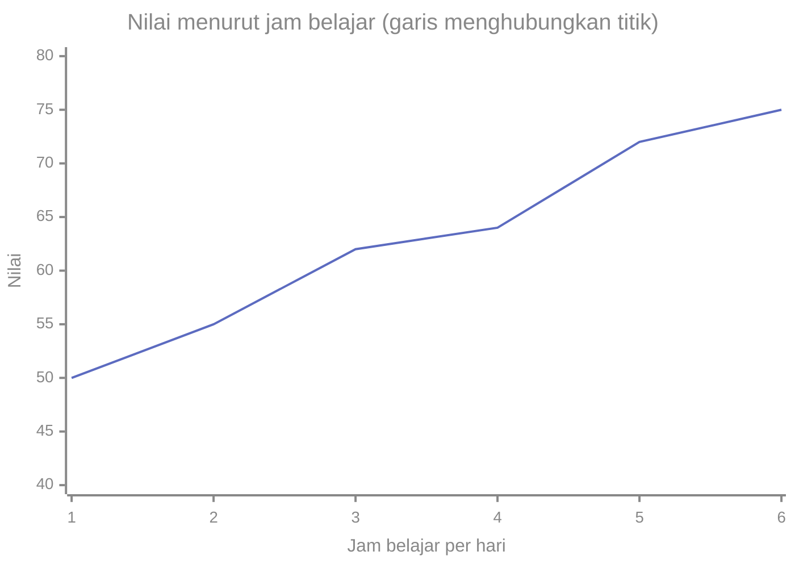
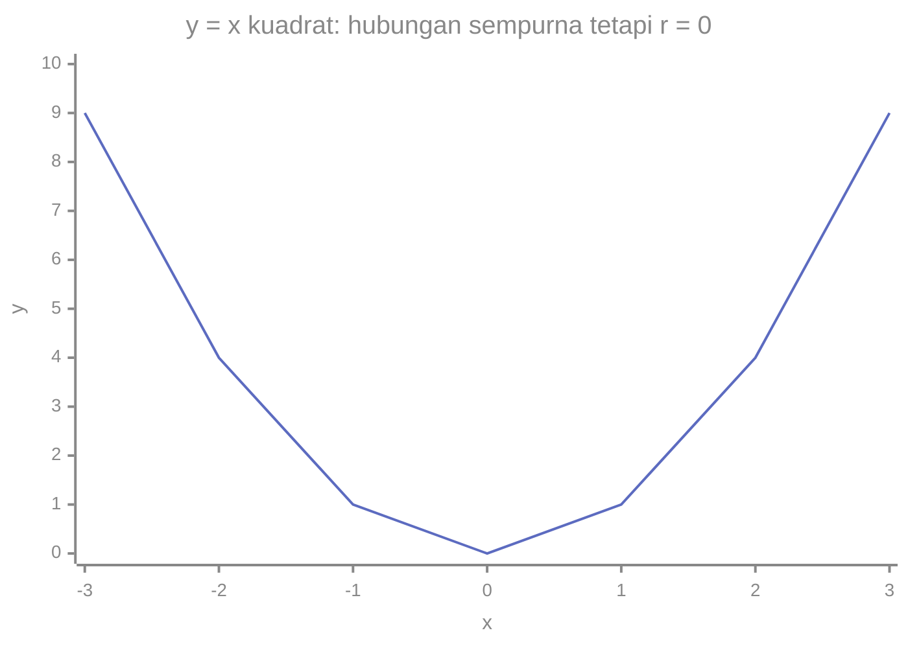

# Part 11 — Korelasi, Kovarians, dan Standardisasi

## Tujuan Pembelajaran

Setelah mempelajari bagian ini, kamu mampu:

- menghitung dan menafsirkan kovarians antara dua variabel;
- menghitung koefisien korelasi Pearson dan menafsirkan tanda, besar, dan $r^2$;
- menjelaskan keterbatasan korelasi: hanya hubungan linear, peka pencilan, dan bukan sebab-akibat;
- mengenali bahwa korelasi sama dengan kosinus sudut antara dua vektor yang sudah dipusatkan;
- menyusun matriks kovarians dan matriks korelasi;
- melakukan standardisasi ($z$-score) dan normalisasi Min-Max, serta membedakan tujuan dan kelemahannya;
- memakai statistik dari data latih saja saat menyiapkan data uji;
- menyebut kapan penskalaan fitur membantu dan kapan tidak diperlukan.

## Prasyarat

[Part 2 — Statistik Deskriptif](02-statistik-deskriptif.md) (rata-rata, varians, simpangan baku, pengaruh $ax + b$), [Part 7 — Variabel Acak dan Distribusi](07-variabel-acak-dan-distribusi.md) (nilai harapan, varians), [Part 8](08-distribusi-probabilitas-umum.md) ($z$-score), serta [Level 2 — Part 2](../level-2-aljabar-linear-dan-kalkulus/02-vektor.md) dan [Part 3](../level-2-aljabar-linear-dan-kalkulus/03-matriks.md) (dot product, kosinus, norma, perkalian matriks).

## Mengapa Materi Ini Penting?

Sampai sekarang kita meneliti satu variabel pada satu waktu. Dalam praktik kita hampir selalu bertanya tentang **hubungan**: apakah jam belajar berkaitan dengan nilai? Apakah dua fitur membawa informasi yang sama? Korelasi dan kovarians adalah ukuran kuantitatif hubungan itu.

Dalam Machine Learning, kovarians dan korelasi dipakai untuk menjelajahi fitur, mendeteksi fitur yang redundan, dan menjadi dasar PCA. Sementara itu **standardisasi** dan **normalisasi** adalah langkah praproses paling umum untuk menyamakan skala fitur agar algoritma tertentu bekerja dengan baik.

## Konsep Dasar dengan Bahasa Sederhana

Bagian ini memakai data enam mahasiswa: jam belajar per hari $x$ dan nilai ujian $y$.

| Mahasiswa | 1 | 2 | 3 | 4 | 5 | 6 |
|---|---|---|---|---|---|---|
| $x$ (jam) | 1 | 2 | 3 | 4 | 5 | 6 |
| $y$ (nilai) | 50 | 55 | 62 | 64 | 72 | 75 |



(Diagram ini menghubungkan titik dengan garis supaya mudah digambar dengan alat yang tersedia. Pada analisis nyata, hubungan dua variabel biasanya digambar sebagai **diagram pencar** (*scatter plot*) tanpa garis penghubung.)

Nilai cenderung naik bersama jam belajar. Pertanyaannya: bagaimana mengukurnya dengan satu angka?

### 1. Kovarians

**Kovarians** mengukur apakah dua variabel cenderung bergerak **bersama**. Untuk sampel:

$$
s_{xy} = \frac{1}{n - 1}\sum_{i=1}^{n}(x_i - \bar{x})(y_i - \bar{y})
$$

Untuk populasi (variabel acak): $\mathrm{Cov}(X, Y) = E\bigl[(X - \mu_X)(Y - \mu_Y)\bigr]$.

Arti: untuk tiap pasangan, kalikan deviasi $x$ dengan deviasi $y$.

- Bila $x$ di atas rata-rata **dan** $y$ di atas rata-rata (keduanya positif), atau keduanya di bawah rata-rata (keduanya negatif), hasil kali **positif**.
- Bila yang satu di atas dan yang lain di bawah rata-rata, hasil kali **negatif**.
- Jumlahnya positif berarti keduanya cenderung naik dan turun bersama; negatif berarti berlawanan; mendekati nol berarti tidak ada kecenderungan linear.

**Menghitung untuk data kita.** $\bar{x} = 3{,}5$, $\bar{y} = 63$.

| $x_i$ | $y_i$ | $x_i - \bar{x}$ | $y_i - \bar{y}$ | hasil kali |
|---|---|---|---|---|
| 1 | 50 | $-2{,}5$ | $-13$ | $32{,}5$ |
| 2 | 55 | $-1{,}5$ | $-8$ | $12{,}0$ |
| 3 | 62 | $-0{,}5$ | $-1$ | $0{,}5$ |
| 4 | 64 | $0{,}5$ | $1$ | $0{,}5$ |
| 5 | 72 | $1{,}5$ | $9$ | $13{,}5$ |
| 6 | 75 | $2{,}5$ | $12$ | $30{,}0$ |
| Jumlah | | | | $89{,}0$ |

$s_{xy} = \dfrac{89}{5} = 17{,}8$. Positif, sesuai pola data.

**Sifat kovarians:**

- $\mathrm{Cov}(X, X) = \mathrm{Var}(X)$: kovarians variabel dengan dirinya sendiri adalah variansnya.
- $\mathrm{Cov}(X, Y) = \mathrm{Cov}(Y, X)$.
- Satuannya adalah satuan $x$ dikali satuan $y$ (di sini jam $\times$ nilai), sehingga **sulit ditafsirkan besarnya**: mengganti jam menjadi menit mengalikan kovarians dengan 60 ($17{,}8 \to 1068$) padahal hubungannya tidak berubah.
- $\mathrm{Var}(X + Y) = \mathrm{Var}(X) + \mathrm{Var}(Y) + 2\,\mathrm{Cov}(X, Y)$. Cek: varians $x$ adalah $3{,}5$, varians $y$ adalah $92$, jadi $3{,}5 + 92 + 2(17{,}8) = 131{,}1$, tepat sama dengan varians langsung dari $x + y$. Bila $X$ dan $Y$ independen, $\mathrm{Cov}(X, Y) = 0$ dan rumusnya kembali ke aturan penjumlahan varians di Part 7.
- Independen $\Rightarrow$ kovarians nol, tetapi kovarians nol **tidak** berarti independen (lihat hubungan nonlinear di bawah).

### 2. Korelasi Pearson

Untuk menghilangkan masalah satuan, kita bagi kovarians dengan kedua simpangan baku. Hasilnya **koefisien korelasi Pearson**:

$$
r = \frac{s_{xy}}{s_x\,s_y} = \frac{\sum (x_i - \bar{x})(y_i - \bar{y})}{\sqrt{\sum (x_i - \bar{x})^2}\;\sqrt{\sum (y_i - \bar{y})^2}}
$$

(Populasi: $\rho = \dfrac{\mathrm{Cov}(X, Y)}{\sigma_X\,\sigma_Y}$.) Sifat penting:

- $-1 \leq r \leq 1$ dan **tanpa satuan**.
- $r > 0$: hubungan linear positif; $r < 0$: negatif; $r$ mendekati $0$: tidak ada hubungan **linear**.
- $r = \pm 1$ hanya bila titik-titik tepat berada pada satu garis lurus.
- Tidak berubah bila $x$ atau $y$ diubah dengan $ax + b$ dengan $a > 0$ (menukar satuan, menggeser). Jika $a < 0$, hanya tandanya yang berbalik.

**Menghitung untuk data kita.** $s_x^2 = \dfrac{17{,}5}{5} = 3{,}5$, jadi $s_x = 1{,}8708$; $s_y^2 = \dfrac{460}{5} = 92$, jadi $s_y = 9{,}5917$. Maka:

$$
r = \frac{17{,}8}{1{,}8708 \times 9{,}5917} = \frac{17{,}8}{17{,}9444} \approx 0{,}9920
$$

**Menafsirkan besar $r$.** Pedoman kasar (bukan aturan baku): $\lvert r \rvert$ di bawah sekitar $0{,}3$ lemah, antara $0{,}3$ dan $0{,}7$ sedang, di atas $0{,}7$ kuat. Pemaknaannya bergantung bidang dan tujuan.

**Koefisien determinasi $r^2$.** Kuadrat $r$ menyatakan bagian variasi $y$ yang dapat dijelaskan oleh hubungan **linear** sederhana dengan $x$. Di sini $r^2 \approx 0{,}984$: sekitar 98,4% variasi nilai terkait dengan garis lurus terhadap jam belajar. (Ini ukuran kecocokan, bukan jaminan sebab-akibat.)

### 3. Keterbatasan Korelasi

**a. Hanya mengukur hubungan linear.** Contoh: $x = -2, -1, 0, 1, 2$ dan $y = x^2 = 4, 1, 0, 1, 4$. Hubungannya sempurna ($y$ ditentukan penuh oleh $x$), tetapi $r = 0$ karena sisi kiri dan kanan saling meniadakan.



**b. Peka terhadap pencilan.** Pada data jam belajar, tambahkan satu mahasiswa yang belajar 7 jam tetapi nilainya 30. Korelasi turun dari $r = 0{,}992$ menjadi $r = -0{,}051$, satu titik mengubahnya dari hubungan sangat kuat menjadi nyaris nol. Selalu lihat diagram pencar.

**c. Monoton tetapi tidak linear.** Untuk $y = 2, 4, 8, 16, 32$ terhadap $x = 1, \dots, 5$, hubungannya selalu naik, tetapi $r = 0{,}9333$ (bukan $1$). **Korelasi peringkat Spearman** mengubah data menjadi peringkat dulu lalu menghitung Pearson pada peringkat itu; hasilnya $1$ untuk hubungan monoton sempurna, dan lebih tahan terhadap pencilan.

**d. Korelasi bukan sebab-akibat.** Dua variabel berkorelasi dapat terjadi karena: $x$ menyebabkan $y$; $y$ menyebabkan $x$; ada **faktor pengganggu** (*confounder*) yang memengaruhi keduanya; atau kebetulan. Contoh klasik: penjualan es krim dan kasus tenggelam berkorelasi positif, bukan karena es krim membuat orang tenggelam, melainkan karena musim panas meningkatkan keduanya. Untuk menyimpulkan sebab-akibat diperlukan desain percobaan (misalnya percobaan terkontrol acak), bukan korelasi saja. Selain itu, korelasi dalam data gabungan bisa berbalik bila data dipisah per kelompok (disebut paradoks Simpson), jadi struktur kelompok perlu diperiksa.

### 4. Korelasi sebagai Kosinus

Pusatkan data dengan mengurangkan rata-rata, sehingga kita punya dua vektor $\tilde{\mathbf{x}} = (x_i - \bar{x})$ dan $\tilde{\mathbf{y}} = (y_i - \bar{y})$. Maka

$$
r = \frac{\tilde{\mathbf{x}} \cdot \tilde{\mathbf{y}}}{\lVert \tilde{\mathbf{x}} \rVert_2\,\lVert \tilde{\mathbf{y}} \rVert_2} = \cos\theta
$$

yaitu **kosinus sudut** antara dua vektor yang sudah dipusatkan (kesamaan kosinus dari Level 2 Part 2). Untuk data kita: $\tilde{\mathbf{x}} \cdot \tilde{\mathbf{y}} = 89$, $\lVert \tilde{\mathbf{x}} \rVert_2 = \sqrt{17{,}5}$, $\lVert \tilde{\mathbf{y}} \rVert_2 = \sqrt{460}$, sehingga $\cos\theta = \dfrac{89}{\sqrt{17{,}5 \times 460}} \approx 0{,}9920$. Korelasi $+1$ berarti kedua vektor searah, $0$ tegak lurus, dan $-1$ berlawanan arah. Ini menjelaskan mengapa $r$ selalu di antara $-1$ dan $1$.

### 5. Matriks Kovarians dan Matriks Korelasi

Untuk $d$ fitur, kita susun semua kovarians dalam satu **matriks kovarians** berukuran $d \times d$. Pada data kita ($d = 2$):

$$
\Sigma = \begin{bmatrix} s_x^2 & s_{xy} \\ s_{xy} & s_y^2 \end{bmatrix} = \begin{bmatrix} 3{,}5 & 17{,}8 \\ 17{,}8 & 92 \end{bmatrix}
$$

Diagonal adalah varians tiap fitur, dan elemen lain adalah kovarians antar pasangan fitur. Matriks ini **simetris**. Jika $X_c$ adalah matriks data yang sudah dipusatkan ($n$ baris, $d$ kolom), maka $\Sigma = \dfrac{1}{n - 1}X_c^{\top}X_c$, memakai perkalian matriks dari Level 2.

**Matriks korelasi** memuat korelasi antar pasangan fitur; diagonalnya selalu $1$. Pada data kita: $\begin{bmatrix} 1 & 0{,}992 \\ 0{,}992 & 1 \end{bmatrix}$. Ia sama dengan matriks kovarians dari data yang sudah distandardisasi (bagian 6).

Matriks kovarians adalah bahan utama PCA di Level 4.

### 6. Standardisasi dan Normalisasi

Fitur sering berskala sangat berbeda: umur dalam puluhan, pendapatan dalam jutaan. Algoritma yang memakai **jarak** atau **gradien** bisa terlalu dipengaruhi fitur berskala besar. Dua cara menyamakan skala:

**Standardisasi ($z$-score).**

$$
z_i = \frac{x_i - \bar{x}}{s}
$$

Hasilnya punya rata-rata $0$ dan simpangan baku $1$. Nilai $z$ menyatakan "berapa simpangan baku dari rata-rata" (Part 8). Standardisasi hanya menggeser dan menskalakan; **bentuk distribusi tidak berubah** (miring tetap miring), dan korelasi tidak berubah.

**Normalisasi Min-Max.**

$$
x'_i = \frac{x_i - x_{\min}}{x_{\max} - x_{\min}}
$$

Hasilnya berada di $[0, 1]$ (pada data yang dipakai menghitungnya). Mudah ditafsirkan, tetapi sangat **peka pencilan**: satu nilai ekstrem memampatkan semua nilai lain ke rentang sempit. Contoh harga makanan dari Part 3 ($12, \dots, 24, 60$): nilai $12$ sampai $24$ semuanya berada di $[0, 0{,}25]$ karena $60$ menarik maksimum.

| | Standardisasi | Min-Max |
|---|---|---|
| Rumus | $(x - \bar{x})/s$ | $(x - x_{\min})/(x_{\max} - x_{\min})$ |
| Hasil | rata-rata 0, SD 1; tak terbatas | rentang $[0, 1]$ pada data latih |
| Peka pencilan | cukup (lewat $\bar{x}$ dan $s$) | sangat |
| Cocok bila | ingin memusatkan dan menyamakan sebaran | butuh rentang tetap |
| Mengubah bentuk distribusi | tidak | tidak |

(Ada juga penskalaan *robust* yang memakai median dan IQR sebagai pengganti rata-rata dan simpangan baku, kurang terpengaruh pencilan.)

**Contoh Data A dari Part 2.** $\bar{x} = 14{,}75$, $s = 3{,}0119$. Standardisasi: $12 \to \dfrac{12 - 14{,}75}{3{,}0119} = -0{,}913$; $20 \to 1{,}743$. Seluruh delapan nilai: $-0{,}913;\ 0{,}083;\ -1{,}245;\ 1{,}079;\ 0{,}083;\ -0{,}249;\ 1{,}743;\ -0{,}581$, rata-ratanya $0$ dan simpangan baku $1$. Min-Max (min $11$, maks $20$): $12 \to \dfrac{1}{9} = 0{,}1111$; $20 \to 1$.

**Mengapa penskalaan penting untuk jarak.** Tiga orang dengan (umur, pendapatan dalam rupiah): $P_1 = (25;\ 4\,000\,000)$, $P_2 = (60;\ 4\,100\,000)$, $P_3 = (26;\ 6\,000\,000)$.

- Jarak mentah: $d(P_1, P_2) \approx 100\,000{,}006$, $d(P_1, P_3) \approx 2\,000\,000$, $d(P_2, P_3) \approx 1\,900\,000$. Selisih umur $35$ tahun hampir tidak berpengaruh dibanding selisih pendapatan; jarak praktis ditentukan pendapatan saja.
- Setelah standardisasi tiap kolom (rata-rata kolom $37$ dan $4\,700\,000$; simpangan baku $19{,}92$ dan $1\,126\,943$): $d(P_1, P_2) \approx 1{,}759$, $d(P_1, P_3) \approx 1{,}775$, $d(P_2, P_3) \approx 2{,}399$. Kini selisih umur dan pendapatan sama-sama berperan.

### 7. Hati-hati: Hitung Statistik dari Data Latih Saja

Parameter penskalaan ($\bar{x}$, $s$, $x_{\min}$, $x_{\max}$) harus dihitung **hanya dari data latih**, lalu dipakai pada data latih **dan** data uji. Menghitungnya dari seluruh data (termasuk data uji) membocorkan informasi data uji ke proses pelatihan (*data leakage*) dan membuat kinerja tampak lebih baik dari kenyataan.

Contoh: data latih $50, 55, 60, 65, 70$ memberi $\bar{x} = 60$, $s = 7{,}906$. Dua data uji $75$ dan $40$ distandardisasi dengan **statistik latih**: $\dfrac{75 - 60}{7{,}906} = 1{,}897$ dan $\dfrac{40 - 60}{7{,}906} = -2{,}530$. Dengan Min-Max (min $50$, maks $70$) hasilnya $1{,}25$ dan $-0{,}5$: **di luar** $[0, 1]$, hal yang wajar dan perlu diantisipasi oleh model.

## Istilah yang Perlu Dipahami

| Istilah | Arti sederhana |
|---|---|
| Kovarians | rata-rata hasil kali deviasi dua variabel |
| Korelasi Pearson $r$ | kovarians dibagi hasil kali simpangan baku; tanpa satuan |
| $r^2$ (koefisien determinasi) | bagian variasi yang terkait dengan hubungan linear |
| Korelasi Spearman | korelasi pada peringkat; tangkap hubungan monoton |
| Faktor pengganggu (*confounder*) | variabel ketiga yang memengaruhi keduanya |
| Matriks kovarians | matriks semua kovarians antar fitur |
| Standardisasi ($z$-score) | mengubah ke rata-rata 0 dan SD 1 |
| Normalisasi Min-Max | mengubah ke rentang $[0, 1]$ |
| Kebocoran data | informasi data uji masuk ke proses pelatihan |

## Rumus dan Penjelasan Setiap Simbol

| Ukuran | Rumus | Arti simbol dan syarat |
|---|---|---|
| Kovarians sampel | $s_{xy} = \dfrac{1}{n - 1}\sum (x_i - \bar{x})(y_i - \bar{y})$ | $n \geq 2$ |
| Kovarians populasi | $\mathrm{Cov}(X, Y) = E[(X - \mu_X)(Y - \mu_Y)]$ | $\mathrm{Cov}(X, X) = \mathrm{Var}(X)$ |
| Korelasi Pearson | $r = \dfrac{s_{xy}}{s_x s_y}$ | $s_x, s_y > 0$; $-1 \leq r \leq 1$ |
| Varians jumlah | $\mathrm{Var}(X + Y) = \mathrm{Var}(X) + \mathrm{Var}(Y) + 2\mathrm{Cov}(X, Y)$ | berlaku selalu |
| Matriks kovarians | $\Sigma = \dfrac{1}{n - 1}X_c^{\top}X_c$ | $X_c$ data terpusat, $n \times d$ |
| Standardisasi | $z = (x - \bar{x})/s$ | $s > 0$ |
| Min-Max | $x' = (x - x_{\min})/(x_{\max} - x_{\min})$ | $x_{\max} \neq x_{\min}$ |
| Efek $ax + b$ | $\bar{y} = a\bar{x} + b$, $s_y = \lvert a \rvert s_x$, $r$ tetap (untuk $a > 0$) | $a \neq 0$ |

## Penjelasan Langkah demi Langkah

**Menghitung korelasi dua variabel:**

1. Gambar diagram pencar dan periksa apakah polanya kira-kira linear dan adakah pencilan.
2. Hitung $\bar{x}$ dan $\bar{y}$, lalu deviasi $x_i - \bar{x}$ dan $y_i - \bar{y}$.
3. Hitung jumlah hasil kali deviasi, lalu bagi $n - 1$ untuk $s_{xy}$.
4. Hitung $s_x$ dan $s_y$.
5. $r = s_{xy}/(s_x s_y)$, dan periksa bahwa hasilnya di antara $-1$ dan $1$.
6. Tafsirkan tanda dan besar, sebut keterbatasan (linear saja, pencilan), dan jangan menyimpulkan sebab-akibat.

**Menstandardisasi fitur untuk model:** hitung $\bar{x}$ dan $s$ dari data latih, ubah data latih, lalu ubah data uji dengan $\bar{x}$ dan $s$ yang sama.

## Contoh Soal dan Pembahasan

### Contoh 1 — Kovarians dan korelasi

Data $x = 1, 2, 3, 4, 5$ dan $y = 2, 4, 5, 4, 5$. Hitung $s_{xy}$ dan $r$.

1. $\bar{x} = 3$, $\bar{y} = 4$. Deviasi $x$: $-2, -1, 0, 1, 2$. Deviasi $y$: $-2, 0, 1, 0, 1$.
2. Hasil kali: $4, 0, 0, 0, 2$, jumlah $6$. $s_{xy} = \dfrac{6}{4} = 1{,}5$.
3. $s_x^2 = \dfrac{10}{4} = 2{,}5$; $s_y^2 = \dfrac{6}{4} = 1{,}5$.
4. $r = \dfrac{1{,}5}{\sqrt{2{,}5 \times 1{,}5}} = \dfrac{1{,}5}{1{,}9365} \approx 0{,}7746$.
5. Korelasi positif dan kuat; $r^2 \approx 0{,}60$.

### Contoh 2 — Korelasi tidak berubah oleh skala

Pada data jam belajar, ubah $x$ menjadi menit ($\times 60$). Apa yang terjadi pada kovarians dan korelasi?

1. Kovarians: $17{,}8 \times 60 = 1068$.
2. Simpangan baku $x$ juga dikali $60$.
3. $r = \dfrac{1068}{(60 \times 1{,}8708)(9{,}5917)} = \dfrac{1068}{1076{,}7} \approx 0{,}9920$, tidak berubah.
4. Karena itu korelasi, bukan kovarians, dipakai untuk membandingkan kekuatan hubungan antar pasangan variabel yang satuannya berbeda.

### Contoh 3 — Satu pencilan mengubah korelasi

Tambahkan titik $(7, 30)$ ke data jam belajar. Hitung ulang $r$.

1. Dengan titik tambahan, $r \approx -0{,}051$ (dari $0{,}992$).
2. Satu titik yang jauh dari pola mengubah kesimpulan dari "sangat kuat" menjadi "tidak ada hubungan linear".
3. Pelajaran: gambar diagram pencar, selidiki titik itu (apakah kesalahan data?), dan pertimbangkan ukuran yang tahan pencilan seperti korelasi Spearman.

### Contoh 4 — Standardisasi dan Min-Max

Untuk Data A, hitung $z$ dan Min-Max untuk nilai $15$.

1. $z = \dfrac{15 - 14{,}75}{3{,}0119} = 0{,}083$.
2. Min-Max: $\dfrac{15 - 11}{20 - 11} = \dfrac{4}{9} = 0{,}4444$.
3. Keduanya memberi posisi relatif nilai $15$: sedikit di atas rata-rata (pada $z$), dan sekitar 44% dari rentang minimum-maksimum.

### Contoh 5 — Menstandardisasi data uji dengan statistik latih

Data latih $50, 55, 60, 65, 70$; data uji $75$. Standardisasi nilai uji dengan benar.

1. Dari data latih: $\bar{x} = 60$, $s = \sqrt{\dfrac{250}{4}} = \sqrt{62{,}5} \approx 7{,}906$.
2. $z = \dfrac{75 - 60}{7{,}906} \approx 1{,}897$.
3. Bila rata-rata dihitung dari semua data termasuk data uji, hasilnya bergeser dan itu kebocoran data.

## Contoh Tambahan dengan Kesulitan Bertahap

**Mudah.** $r = 0{,}85$ berarti hubungan linear positif kuat; $r^2 = 0{,}7225$, sekitar 72% variasi terkait hubungan linear.

**Sedang.** Penjualan es krim dan kasus tenggelam berkorelasi $r = 0{,}8$. Faktor pengganggu yang masuk akal: suhu atau musim. Melarang es krim tidak akan mengurangi tenggelam.

**Sedang.** Nilai min-max pada data $10, 20, 30, 50, 90$: $30 \to \dfrac{20}{80} = 0{,}25$. Bila $90$ diganti $1000$: $30 \to \dfrac{20}{990} = 0{,}0202$, nilai yang sama menciut karena satu pencilan.

**Menantang.** Dua fitur dengan korelasi $r = 0{,}98$ membawa hampir informasi yang sama. Pada regresi linear, fitur yang sangat berkorelasi (*multikolinearitas*) membuat koefisien tidak stabil: banyak kombinasi koefisien memberi prediksi hampir sama. Ini analog dengan kolom yang hampir bergantung linear di Level 2.

## Visualisasi atau Interpretasi Grafik

- **Diagram pencar** menunjukkan arah (naik atau turun), kekuatan (seberapa rapat ke satu garis), bentuk (linear atau melengkung), dan pencilan. Selalu lihat sebelum percaya pada $r$.
- Titik-titik rapat di sepanjang garis naik: $r$ dekat $+1$. Awan tanpa pola: $r$ dekat $0$. Pola melengkung seperti parabola: $r$ dekat $0$ walaupun hubungannya kuat.
- Setelah standardisasi, diagram pencar tidak berubah bentuk, hanya sumbunya yang bergeser dan diskalakan.

## Kesalahan Umum

| Kesalahan | Mengapa salah | Yang benar |
|---|---|---|
| Menyimpulkan sebab-akibat dari korelasi | confounder, arah terbalik, kebetulan | butuh desain percobaan atau argumen kausal |
| Mengira $r = 0$ berarti tidak ada hubungan | hanya hubungan linear | lihat diagram pencar |
| Menghitung $r$ tanpa melihat pencilan | satu titik dapat mengubahnya drastis | periksa pencilan, pertimbangkan Spearman |
| Membandingkan kovarians antar pasangan berbeda satuan | tergantung satuan | bandingkan korelasi |
| Mengira standardisasi membuat data berdistribusi Normal | hanya menggeser dan menskalakan | bentuk distribusi tidak berubah |
| Menghitung rata-rata dan SD dari seluruh data sebelum membagi latih/uji | kebocoran data | hitung dari data latih saja |
| Memakai Min-Max pada data berpencilan | nilai lain termampatkan | pertimbangkan standardisasi atau penskalaan *robust* |
| Menganggap semua algoritma memerlukan penskalaan | tidak selalu | lihat bagian ML di bawah |
| Memakai $r$ untuk data kategorik nominal | tidak bermakna | pakai ukuran asosiasi yang sesuai |
| Lupa bahwa $r$ adalah statistik sampel | ia berubah dari sampel ke sampel | laporkan ketidakpastian (inferensi, Part 10) |

## Hubungan dengan Machine Learning

- **Eksplorasi fitur.** Matriks korelasi antar fitur dan antara fitur dan label adalah pemeriksaan cepat: fitur yang sangat berkorelasi dengan label mungkin informatif (hanya untuk hubungan linear), dan fitur yang sangat berkorelasi satu sama lain mungkin redundan.
- **Multikolinearitas.** Pada model linear, fitur yang saling sangat berkorelasi membuat koefisien tidak stabil dan sulit ditafsirkan.
- **Bukan sebab-akibat.** Model memanfaatkan korelasi, termasuk korelasi yang kebetulan atau yang disebabkan faktor pengganggu. Model yang mengandalkan korelasi semacam itu bisa gagal ketika kondisi berubah.
- **PCA.** Analisis komponen utama (Level 4) bertumpu pada matriks kovarians dan vektor eigennya (Level 2).
- **Kapan penskalaan membantu.** Algoritma berbasis **jarak** (k-NN, k-means), model yang dilatih dengan **gradient descent** (regresi dengan regularisasi, jaringan saraf), PCA, dan SVM umumnya terbantu oleh penskalaan karena fitur berskala besar akan mendominasi jarak atau gradien, dan optimasi lebih mudah bila fitur sebanding.
- **Kapan penskalaan tidak diperlukan.** Model berbasis pohon keputusan (termasuk hutan acak) tidak terpengaruh oleh penskalaan monoton fitur. Naive Bayes Gaussian memodelkan tiap fitur secara terpisah sehingga juga tidak peka terhadap skala. Jadi standardisasi **bukan** langkah wajib untuk semua algoritma.
- **Kebocoran data.** Statistik penskalaan harus dihitung dari data latih saja dan diterapkan ke data uji; dalam validasi silang, hitung ulang di setiap lipatan.
- **Pencilan.** Pilihan antara standardisasi, Min-Max, atau penskalaan robust bergantung pada keberadaan pencilan.

### Python: kovarians, korelasi, dan penskalaan

Hanya pustaka standar. Kovarians dan korelasi data jam belajar:

```python
import math
from statistics import mean, stdev, variance

x = [1, 2, 3, 4, 5, 6]
y = [50, 55, 62, 64, 72, 75]
mx, my = mean(x), mean(y)
dx = [a - mx for a in x]
dy = [b - my for b in y]
print(mx, my)                                          # 3.5 63
print(sum(a * b for a, b in zip(dx, dy)))              # 89.0
s_xy = sum(a * b for a, b in zip(dx, dy)) / (len(x) - 1)
print(s_xy, variance(x), variance(y))                  # 17.8 3.5 92
r = s_xy / (stdev(x) * stdev(y))
print(round(r, 4), round(r * r, 4))                    # 0.992 0.984

kos = sum(a * b for a, b in zip(dx, dy)) / (math.sqrt(sum(a * a for a in dx)) * math.sqrt(sum(b * b for b in dy)))
print(round(kos, 4))                                   # 0.992  (kosinus vektor terpusat)
print(variance([a + b for a, b in zip(x, y)]), 3.5 + 92 + 2 * 17.8)    # 131.1 131.1
```

Keterbatasan korelasi:

```python
def pearson(a, b):
    ma, mb = mean(a), mean(b)
    return sum((p - ma) * (q - mb) for p, q in zip(a, b)) / math.sqrt(
        sum((p - ma) ** 2 for p in a) * sum((q - mb) ** 2 for q in b))

def peringkat(v):
    urut = sorted(v)
    return [urut.index(a) + 1 for a in v]      # hanya benar bila tidak ada nilai kembar

print(round(pearson(x + [7], y + [30]), 4))                       # -0.0506
print(round(pearson([-2, -1, 0, 1, 2], [4, 1, 0, 1, 4]), 4))      # 0.0
print(round(pearson([1, 2, 3, 4, 5], [2, 4, 8, 16, 32]), 4))      # 0.9333
print(round(pearson(peringkat([1, 2, 3, 4, 5]), peringkat([2, 4, 8, 16, 32])), 4))   # 1.0
print(round(pearson([a * 60 for a in x], y), 4), (89 / 5) * 60)   # 0.992 1068.0
```

Matriks kovarians dan korelasi, serta standardisasi:

```python
n = len(x)
C = [[sum(a * b for a, b in zip(u, v)) / (n - 1) for v in (dx, dy)] for u in (dx, dy)]
print(C)                                               # [[3.5, 17.8], [17.8, 92.0]]
zx = [a / stdev(x) for a in dx]
zy = [b / stdev(y) for b in dy]
R = [[round(sum(a * b for a, b in zip(u, v)) / (n - 1), 4) for v in (zx, zy)] for u in (zx, zy)]
print(R)                                               # [[1.0, 0.992], [0.992, 1.0]]

A = [12, 15, 11, 18, 15, 14, 20, 13]
z = [(a - mean(A)) / stdev(A) for a in A]
print([round(v, 3) for v in z])        # [-0.913, 0.083, -1.245, 1.079, 0.083, -0.249, 1.743, -0.581]
print(round(mean(z), 10) + 0.0, round(stdev(z), 4))    # 0.0 1.0
mn, mk = min(A), max(A)
print([round((a - mn) / (mk - mn), 4) for a in A])     # [0.1111, 0.4444, 0.0, 0.7778, 0.4444, 0.3333, 1.0, 0.2222]
```

Penskalaan untuk jarak dan statistik dari data latih saja:

```python
P = [(25, 4_000_000), (60, 4_100_000), (26, 6_000_000)]
def jarak(a, b):
    return math.sqrt(sum((p - q) ** 2 for p, q in zip(a, b)))
pasangan = ((0, 1), (0, 2), (1, 2))
print([round(jarak(P[i], P[j]), 3) for i, j in pasangan])      # [100000.006, 2000000.0, 1900000.0]
kolom = list(zip(*P))
ms, ss = [mean(c) for c in kolom], [stdev(c) for c in kolom]
Zp = [tuple((v - m) / s for v, m, s in zip(p, ms, ss)) for p in P]
print([round(jarak(Zp[i], Zp[j]), 3) for i, j in pasangan])    # [1.759, 1.775, 2.399]

latih, uji = [50, 55, 60, 65, 70], [75, 40]
m, s = mean(latih), stdev(latih)
print(m, round(s, 3), [round((v - m) / s, 3) for v in uji])    # 60 7.906 [1.897, -2.53]
print([(v - min(latih)) / (max(latih) - min(latih)) for v in uji])   # [1.25, -0.5]
```

Interpretasi: korelasi $0{,}992$ untuk data jam belajar sama dengan kosinus vektor terpusat; satu pencilan mengubahnya menjadi $-0{,}051$; hubungan parabola menghasilkan $0$; dan standardisasi menjadikan matriks kovarians sama dengan matriks korelasi. Kode ini hanya mengilustrasikan hitungan; keputusan kapan menskalakan bergantung pada algoritma yang dipakai.

## Latihan Mandiri

1. Data $x = 1, 2, 3, 4, 5$ dan $y = 2, 4, 5, 4, 5$. Hitung $s_{xy}$, $s_x$, $s_y$, dan $r$.
2. Tafsirkan: (a) $r = 0{,}85$, (b) $r = -0{,}6$, (c) $r = 0{,}02$, (d) $r = 1$. Berapa $r^2$ pada (a)?
3. Pada data jam belajar $s_{xy} = 17{,}8$. Jika jam diubah menjadi menit, berapa kovarians baru dan berapa korelasinya?
4. Data $x = -2, -1, 0, 1, 2$ dan $y = x^2$. Hitung $r$ dan jelaskan mengapa tidak berarti $x$ dan $y$ tidak berhubungan.
5. Pada data jam belajar, penambahan titik $(7, 30)$ mengubah $r$ dari $0{,}992$ menjadi $-0{,}051$. Jelaskan penyebabnya dan apa yang kamu lakukan.
6. Penjualan es krim dan kasus tenggelam berkorelasi $r = 0{,}8$. Berikan penjelasan alternatif selain "es krim menyebabkan tenggelam". Mengapa ini penting bagi model prediksi?
7. Data $12, 15, 11, 18, 15, 14, 20, 13$ memiliki $\bar{x} = 14{,}75$ dan $s = 3{,}0119$. Hitung $z$ untuk nilai $20$ dan nilai Min-Max untuk nilai $13$.
8. Data $10, 20, 30, 50, 90$. Hitung nilai Min-Max untuk $30$. Berapa nilainya bila $90$ diganti $1000$, dan apa pelajarannya?
9. Data latih $50, 55, 60, 65, 70$ memberi $\bar{x} = 60$, $s = 7{,}906$. Standardisasi nilai uji $65$. Mengapa statistik harus dari data latih saja?
10. Tentukan apakah penskalaan fitur umumnya membantu atau tidak diperlukan, dan jelaskan: (a) k-NN, (b) pohon keputusan, (c) k-means, (d) Naive Bayes Gaussian, (e) jaringan saraf dengan gradient descent.

## Kunci Jawaban dan Pembahasan

??? success "Soal 1"
    $\bar{x} = 3$, $\bar{y} = 4$. Jumlah hasil kali deviasi $= 4 + 0 + 0 + 0 + 2 = 6$, jadi $s_{xy} = \dfrac{6}{4} = 1{,}5$. $s_x = \sqrt{2{,}5} \approx 1{,}581$, $s_y = \sqrt{1{,}5} \approx 1{,}225$. $r = \dfrac{1{,}5}{1{,}581 \times 1{,}225} \approx 0{,}7746$.

??? success "Soal 2"
    (a) hubungan linear positif kuat; $r^2 = 0{,}7225$ (sekitar 72% variasi terkait hubungan linear). (b) negatif sedang. (c) hampir tidak ada hubungan linear. (d) hubungan linear sempurna, semua titik tepat pada satu garis naik.

??? success "Soal 3"
    Kovarians baru $= 17{,}8 \times 60 = 1068$. Korelasi tetap $\approx 0{,}992$, karena simpangan baku $x$ juga dikali $60$ dan membatalkannya.

??? success "Soal 4"
    $\bar{x} = 0$, $\bar{y} = 2$. Deviasi $y$: $2, -1, -2, -1, 2$. Hasil kali dengan deviasi $x$ ($-2, -1, 0, 1, 2$): $-4, 1, 0, -1, 4$, jumlah $0$. Maka $s_{xy} = 0$ dan $r = 0$. Tetapi $y$ ditentukan penuh oleh $x$; korelasi hanya menangkap hubungan **linear**, sedangkan hubungan ini melengkung.

??? success "Soal 5"
    Titik $(7, 30)$ jauh dari pola (jam belajar tinggi, nilai rendah) dan menarik korelasi ke nol karena korelasi peka pencilan. Langkah: gambar diagram pencar, selidiki apakah titik itu salah data atau kasus nyata yang perlu dipahami, dan pertimbangkan korelasi Spearman atau analisis dengan dan tanpa titik itu, lalu laporkan keputusannya.

??? success "Soal 6"
    Penjelasan alternatif: faktor pengganggu, yaitu musim panas atau suhu yang meningkatkan penjualan es krim **dan** jumlah orang berenang (sehingga tenggelam). Bagi model prediksi, korelasi dapat dimanfaatkan untuk prediksi selama kondisinya sama, tetapi tidak boleh dijadikan dasar intervensi, dan model bisa gagal bila kondisinya berubah.

??? success "Soal 7"
    $z = \dfrac{20 - 14{,}75}{3{,}0119} \approx 1{,}743$. Min-Max (min $11$, maks $20$) untuk $13$: $\dfrac{13 - 11}{9} = 0{,}2222$.

??? success "Soal 8"
    Min $= 10$, maks $= 90$: $\dfrac{30 - 10}{80} = 0{,}25$. Bila $90 \to 1000$: $\dfrac{30 - 10}{1000 - 10} = \dfrac{20}{990} \approx 0{,}0202$. Satu pencilan memampatkan semua nilai lain ke dekat $0$; Min-Max sangat peka pencilan.

??? success "Soal 9"
    $z = \dfrac{65 - 60}{7{,}906} \approx 0{,}632$. Statistik dari data latih saja agar tidak ada informasi data uji yang masuk ke pelatihan (kebocoran data), dan agar penskalaan meniru kondisi nyata, ketika data baru dinormalkan memakai statistik yang sudah ditetapkan.

??? success "Soal 10"
    (a) k-NN: membantu (jarak). (b) pohon keputusan: umumnya tidak diperlukan (keputusan berdasarkan urutan nilai). (c) k-means: membantu (jarak). (d) Naive Bayes Gaussian: tidak diperlukan karena tiap fitur dimodelkan terpisah dengan parameternya sendiri. (e) jaringan saraf dengan gradient descent: umumnya membantu optimasi karena gradien lebih seimbang antar fitur.

## Ringkasan Materi

- **Kovarians** $s_{xy}$ mengukur gerak bersama dua variabel, tetapi bergantung satuan; $\mathrm{Cov}(X, X) = \mathrm{Var}(X)$.
- **Korelasi Pearson** $r = s_{xy}/(s_x s_y)$ tanpa satuan, di $[-1, 1]$; $r^2$ adalah bagian variasi yang terkait hubungan linear; $r$ sama dengan kosinus vektor yang dipusatkan.
- Keterbatasan: hanya linear, peka pencilan, dan **bukan sebab-akibat**; gambar diagram pencar.
- **Matriks kovarians** $\Sigma = \frac{1}{n - 1}X_c^{\top}X_c$ simetris; matriks korelasi adalah kovarians dari data terstandardisasi.
- **Standardisasi** $(x - \bar{x})/s$ dan **Min-Max** $(x - x_{\min})/(x_{\max} - x_{\min})$ menyamakan skala tanpa mengubah bentuk distribusi; Min-Max peka pencilan.
- Hitung statistik penskalaan dari data latih saja untuk menghindari kebocoran data.
- Penskalaan membantu algoritma berbasis jarak dan gradien, tetapi tidak diperlukan untuk semua algoritma (misalnya pohon keputusan).

## Checklist Penguasaan

- [ ] Menghitung kovarians dan korelasi Pearson dengan langkah lengkap.
- [ ] Menafsirkan tanda, besar, dan $r^2$.
- [ ] Menjelaskan tiga keterbatasan korelasi, termasuk bahwa korelasi bukan sebab-akibat.
- [ ] Menjelaskan korelasi sebagai kosinus vektor terpusat.
- [ ] Menyusun matriks kovarians dan korelasi.
- [ ] Menghitung $z$-score dan Min-Max, serta membandingkan keduanya.
- [ ] Menerapkan statistik data latih pada data uji.
- [ ] Menyebut kapan penskalaan membantu dan kapan tidak perlu.

## Prasyarat untuk Materi Berikutnya

[Part 12 — Integrasi dan Evaluasi Level 3](12-integrasi-dan-evaluasi.md) menyatukan seluruh level: statistik deskriptif, probabilitas, distribusi, inferensi, dan korelasi dalam satu studi kasus evaluasi model, disertai latihan bertingkat dan evaluasi akhir.
