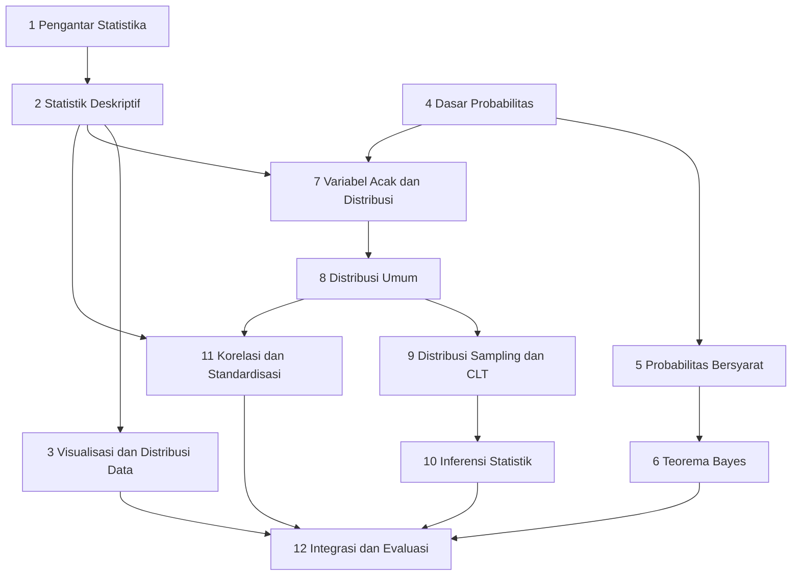

# Level 3 — Probabilitas dan Statistika

Level ini memperkenalkan dua cabang yang saling melengkapi. **Statistika** membantu kita memahami dan meringkas data. **Probabilitas** (peluang) memberi bahasa untuk ketidakpastian. Machine Learning memakai keduanya: data harus dipahami sebelum dipakai, dan hampir setiap prediksi mengandung ketidakpastian.

!!! success "Status materi"
    Level 3 **tersedia lengkap** (Part 1 sampai 12). [Level 4](../level-4-matematika-ml-klasik/index.md) dan [Level 5](../level-5-matematika-lanjutan-deep-learning/index.md) sudah tersedia.

## Prasyarat

- [Level 0 Part 8 — Notasi Matematika Dasar](../level-0-fondasi-matematika/08-notasi-matematika-dasar.md): notasi $\sum$, indeks, dan rata-rata.
- [Level 0 Part 3 — Pecahan dan Desimal](../level-0-fondasi-matematika/03-pecahan-dan-desimal.md) dan [Part 4 — Persentase, Rasio, Proporsi](../level-0-fondasi-matematika/04-persentase-rasio-proporsi.md): peluang ditulis sebagai pecahan, desimal, dan persen.
- [Level 0 Part 5 — Pangkat dan Akar](../level-0-fondasi-matematika/05-pangkat-dan-akar.md): simpangan baku memakai akar.
- [Level 1 Part 10 — Fungsi Eksponensial dan Logaritma](../level-1-aljabar-dasar-dan-fungsi/10-fungsi-eksponensial-dan-logaritma.md): $e^x$ muncul pada distribusi Normal dan Poisson.
- [Level 2 Part 7 — Turunan](../level-2-aljabar-linear-dan-kalkulus/07-turunan.md) dan [Part 10 — Integral](../level-2-aljabar-linear-dan-kalkulus/10-integral.md): integral sebagai luas dipakai untuk peluang peubah kontinu, dan titik kritis untuk pengantar estimasi.

## Tujuan Level 3

Setelah menyelesaikan Level 3, kamu mampu:

- membedakan data, populasi, sampel, dan jenis variabel;
- menghitung dan menafsirkan statistik deskriptif;
- menghitung peluang, peluang bersyarat, dan memakai Teorema Bayes;
- menjelaskan peubah acak dan distribusi probabilitas yang umum;
- menjelaskan distribusi sampling, Teorema Limit Pusat, interval kepercayaan, dan p-value dengan tafsir yang tepat;
- menghitung kovarians, korelasi, dan standardisasi;
- menghubungkan konsep tersebut dengan Machine Learning, misalnya Naive Bayes, praproses data, dan pembacaan hasil eksperimen.

## Daftar materi

| Part | Materi | Jenis | Status |
|---|---|---|---|
| 1 | [Pengantar Statistika](01-pengantar-statistika.md) | esensial | Tersedia |
| 2 | [Statistik Deskriptif](02-statistik-deskriptif.md) | esensial | Tersedia |
| 3 | [Visualisasi dan Distribusi Data](03-visualisasi-dan-distribusi-data.md) | esensial | Tersedia |
| 4 | [Dasar Probabilitas](04-dasar-probabilitas.md) | esensial | Tersedia |
| 5 | [Probabilitas Bersyarat dan Independensi](05-probabilitas-bersyarat-dan-independensi.md) | esensial | Tersedia |
| 6 | [Teorema Bayes](06-teorema-bayes.md) | esensial | Tersedia |
| 7 | [Variabel Acak dan Distribusi](07-variabel-acak-dan-distribusi.md) | esensial | Tersedia |
| 8 | [Distribusi Probabilitas Umum](08-distribusi-probabilitas-umum.md) | esensial | Tersedia |
| 9 | [Distribusi Sampling dan Central Limit Theorem](09-distribusi-sampling-dan-clt.md) | esensial (pengantar) | Tersedia |
| 10 | [Inferensi Statistik](10-inferensi-statistik.md) | esensial (pengantar) | Tersedia |
| 11 | [Korelasi, Kovarians, dan Standardisasi](11-korelasi-kovarians-dan-standardisasi.md) | esensial | Tersedia |
| 12 | [Integrasi dan Evaluasi Level 3](12-integrasi-dan-evaluasi.md) | evaluasi | Tersedia |

**Esensial** berarti dibutuhkan oleh level berikutnya. **Pengantar** berarti konsepnya diperkenalkan secara intuitif dengan contoh sederhana; pembahasan yang lebih dalam ada di level lanjutan.

!!! note "Batas cakupan"
    - **Estimasi kemungkinan maksimum** (*maximum likelihood*) hanya diperkenalkan secara intuitif di Part 10, dengan contoh Bernoulli sederhana. Pembahasan penuhnya ada di Level 4.
    - **Z-score** diperkenalkan di Part 8 untuk membaca distribusi Normal, lalu diperluas ke praproses data di Part 11.
    - Python hanya memakai pustaka standar (`statistics`, `math`, `random`, `fractions`). Simulasi memakai seed tetap supaya hasilnya dapat diulang.

## Hubungan antarpart

Level ini punya dua jalur yang bertemu di Part 7. Jalur **statistika** (Part 1 sampai 3) meringkas data yang sudah ada. Jalur **probabilitas** (Part 4 sampai 6) menghitung peluang kejadian. Dari Part 7 sampai 10 keduanya dipakai bersama untuk memodelkan data dan menarik kesimpulan dari sampel.

## Notasi yang dipakai di Level 3

Notasi berikut dipakai konsisten di seluruh Level 3 dan diperkenalkan ulang saat pertama kali muncul:

| Objek | Notasi | Contoh |
|---|---|---|
| Ruang sampel, kejadian | huruf kapital | $S$, $A$, $B$ |
| Komplemen, gabungan, irisan | pangkat $c$, $\cup$, $\cap$ | $A^c$, $A \cup B$, $A \cap B$ |
| Peluang kejadian | $P(\cdot)$ | $P(A)$ |
| Peluang bersyarat (A jika B terjadi) | garis tegak `\mid` | $P(A \mid B)$ |
| Peubah acak (nama) dan nilainya | kapital dan kecil, miring | $X$ dan $x$ |
| Nilai harapan, varians | $E[X]$, $\mathrm{Var}(X)$ | $E[X] = \mu$ |
| Rata-rata dan simpangan baku populasi | huruf Yunani | $\mu$, $\sigma$ |
| Rata-rata dan simpangan baku sampel | huruf Latin | $\bar{x}$, $s$ |
| Distribusi Normal | $\mathcal{N}(\mu, \sigma^2)$ | $X \sim \mathcal{N}(0, 1)$ |
| Kovarians, korelasi | $\mathrm{Cov}(X, Y)$, $r$ | $r = 0{,}8$ |
| Z-score | $z$ | $z = \dfrac{x - \mu}{\sigma}$ |

## Cara belajar

Baca berurutan sesuai nomor part. Kerjakan latihan sebelum membuka kunci jawaban, dan perhitungan manual lebih penting daripada kode. Lanjut setelah checklist penguasaan terpenuhi. Di Level ini ketepatan tafsir sama pentingnya dengan ketepatan hitungan, jadi baca bagian "Kesalahan Umum" dengan teliti.
