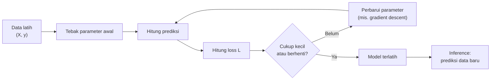
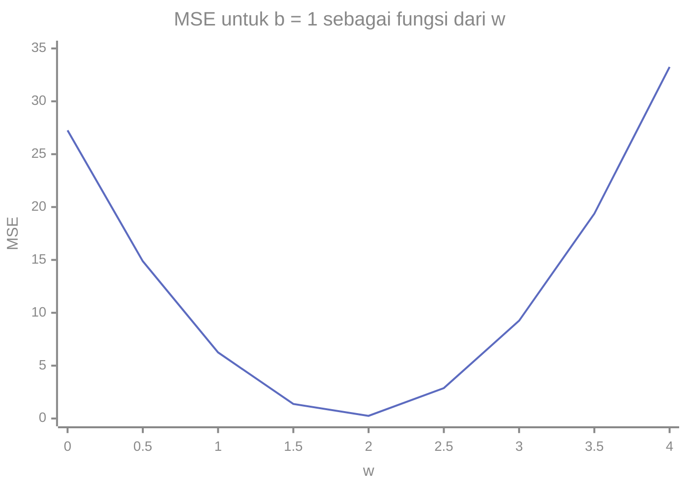

# Part 1 — Pengantar Matematika ML

## Tujuan Pembelajaran

Setelah mempelajari bagian ini, kamu mampu:

- menjelaskan masalah yang ingin diselesaikan Machine Learning (ML) dengan bahasa sehari-hari;
- membedakan fitur, target, parameter, hiperparameter, prediksi, dan loss;
- menjelaskan model sebagai fungsi berparameter dan *training* sebagai pencarian parameter yang meminimalkan loss;
- membedakan *training* dari *inference*, serta data latih, validasi, dan uji;
- membedakan skor, probabilitas, dan keputusan kelas pada klasifikasi;
- menghitung residual, loss per contoh, dan rata-rata loss pada contoh kecil;
- menjelaskan *overfitting* dan *underfitting* secara intuitif dengan angka;
- memetakan algoritma Level 4 ke jenis tugas, parameter, dan loss-nya.

## Prasyarat

[Level 2 Part 11 — Optimasi dan Gradient Descent](../level-2-aljabar-linear-dan-kalkulus/11-optimasi-dan-gradient-descent.md) (loss, minimum, pembaruan parameter), [Level 2 Part 2 — Vektor](../level-2-aljabar-linear-dan-kalkulus/02-vektor.md) (dot product), dan [Level 3 Part 1 — Pengantar Statistika](../level-3-probabilitas-dan-statistika/01-pengantar-statistika.md) (sampel, populasi, bias). Konsep penting diingatkan singkat saat dibutuhkan.

## Masalah yang Ingin Diselesaikan

Banyak masalah praktis sulit ditulis sebagai aturan eksplisit. Bagaimana menulis aturan yang tepat untuk "apakah pesan ini darurat?" atau "berapa harga rumah ini?" Daripada menulis aturan tangan, kita memberi komputer **contoh** lalu membiarkannya **menemukan pola** sendiri. Itulah inti Machine Learning:

> belajar suatu fungsi dari contoh, supaya fungsi itu dapat dipakai pada contoh baru yang belum pernah dilihat.

Matematika berperan di tiga tempat: (1) **menyatakan** data dan model sebagai vektor, matriks, dan fungsi; (2) **mengukur** seberapa buruk model lewat loss; dan (3) **mencari** parameter yang memperbaikinya lewat optimasi dan peluang.

## Intuisi dan Istilah Penting

### 1. Fitur, Target, dan Contoh

- **Contoh** (*example*, *sample*, *instance*) adalah satu baris data, misalnya satu rumah atau satu pesan.
- **Fitur** (*feature*) adalah ciri yang diukur pada contoh, misalnya luas rumah, jumlah kamar, atau kehadiran kata "tolong" dalam pesan. Untuk satu contoh, semua fiturnya disusun menjadi **vektor fitur** $\mathbf{x} = (x_1, x_2, \dots, x_d)$ dengan $d$ fitur.
- **Target** atau **label** (*target*, *label*) adalah yang ingin diprediksi, ditulis $y$.

Seluruh dataset berisi $n$ contoh. Contoh ke-$i$ ditulis $\mathbf{x}^{(i)}$ dengan targetnya $y^{(i)}$ (superskrip dalam kurung menandai nomor contoh, supaya tidak bentrok dengan subskrip nomor fitur). Semua vektor fitur ditumpuk menjadi **matriks data** $X$ berukuran $n \times d$: baris adalah contoh, kolom adalah fitur. Ini matriks yang sama dengan Level 2.

### 2. Jenis Tugas

| Jenis | Ada target? | Tujuan | Contoh |
|---|---|---|---|
| **Regresi** (*supervised*) | ya, bilangan kontinu | memprediksi angka | harga rumah dari luas dan kamar |
| **Klasifikasi** (*supervised*) | ya, kategori | memprediksi kelas | pesan darurat atau bukan |
| **Klasterisasi** (*unsupervised*) | tidak | mengelompokkan contoh yang mirip | mengelompokkan pelanggan |
| **Reduksi dimensi** (*unsupervised*) | tidak | meringkas banyak fitur menjadi sedikit | PCA |

Pada pembelajaran **terawasi** (*supervised*), setiap contoh latih punya target yang benar. Pada **tak terawasi** (*unsupervised*), model hanya melihat fitur dan mencari struktur sendiri.

### 3. Model, Parameter, dan Hiperparameter

**Model** adalah fungsi yang memetakan fitur ke prediksi:

$$
\hat{y} = f(\mathbf{x};\ \theta)
$$

$\hat{y}$ (dibaca "y topi") adalah **prediksi**, dan $\theta$ adalah semua **parameter** model. Contoh paling sederhana adalah garis lurus untuk satu fitur: $\hat{y} = w\,x + b$, dengan $\theta = (w, b)$ berupa **bobot** $w$ dan **bias** $b$. Untuk banyak fitur: $\hat{y} = \mathbf{w}\cdot\mathbf{x} + b$.

Bedakan dua hal yang sering tertukar:

| | Parameter | Hiperparameter |
|---|---|---|
| Siapa yang menentukan | **dipelajari** dari data saat *training* | **dipilih** oleh kita sebelum *training* |
| Contoh | $\mathbf{w}$, $b$, centroid $\mathbf{c}_k$ | $K$ pada KNN, kedalaman pohon, $\alpha$ regularisasi, $C$ pada SVM, jumlah klaster, *learning rate* $\eta$ |
| Cara menentukan | optimasi (meminimalkan loss) | percobaan pada data validasi |

### 4. Prediksi, Residual, dan Loss

Setelah model memberi prediksi $\hat{y}^{(i)}$, kita bandingkan dengan target sebenarnya $y^{(i)}$.

- **Residual** (galat) satu contoh: $r^{(i)} = \hat{y}^{(i)} - y^{(i)}$. Bertanda: positif bila prediksi terlalu tinggi, negatif bila terlalu rendah.
- **Loss per contoh** $\ell^{(i)}$: bilangan tak negatif yang mengukur seberapa buruk prediksi satu contoh, dihitung dari residual (atau dari prediksi dan target). Contoh: kuadrat residual $(r^{(i)})^2$ atau nilai mutlak $\lvert r^{(i)} \rvert$.
- **Rata-rata loss** (fungsi biaya) pada seluruh data latih:

$$
L(\theta) = \frac{1}{n}\sum_{i=1}^{n} \ell^{(i)}
$$

Ketiganya berbeda: residual punya tanda, loss per contoh tidak, dan $L$ adalah satu angka untuk seluruh model. Dua loss yang sering dipakai pada regresi (dibahas lengkap di Part 3):

$$
\mathrm{MSE} = \frac{1}{n}\sum_i \bigl(r^{(i)}\bigr)^2, \qquad
\mathrm{MAE} = \frac{1}{n}\sum_i \bigl\lvert r^{(i)} \bigr\rvert
$$

### 5. *Training* dan *Inference*

- ***Training*** (pelatihan): mencari parameter $\theta$ yang membuat $L(\theta)$ sekecil mungkin pada data latih. Ini masalah **optimasi**: bisa dengan rumus langsung (misalnya persamaan normal, Part 3) atau bertahap dengan *gradient descent* (Level 2).
- ***Inference*** (inferensi atau prediksi): memakai model yang sudah dilatih, dengan parameter tetap, untuk memprediksi contoh baru.



### 6. Data Latih, Validasi, dan Uji

Tujuan akhir ML bukan menghafal data latih, melainkan **generalisasi**: bekerja baik pada data baru. Karena itu data dibagi:

| Bagian | Dipakai untuk | Catatan |
|---|---|---|
| **Latih** (*train*) | mencari parameter | model "melihat" bagian ini |
| **Validasi** | memilih hiperparameter dan model | model dipilih berdasarkan ini |
| **Uji** (*test*) | menilai akhir secara jujur | disentuh sekali di akhir |

Statistik apa pun yang dipakai di praproses (misalnya rata-rata untuk standardisasi) harus dihitung dari data latih saja (kebocoran data, Level 3 Part 11 dan Part 2 di bawah).

### 7. Skor, Probabilitas, dan Keputusan pada Klasifikasi

Pada klasifikasi biner, tiga hal ini berbeda dan sering dicampuradukkan:

1. **Skor** $s$: bilangan nyata apa pun yang dihasilkan model, misalnya $s = \mathbf{w}\cdot\mathbf{x} + b$.
2. **Probabilitas** $p = P(y = 1 \mid \mathbf{x})$: skor yang diubah ke rentang $[0, 1]$, misalnya dengan fungsi sigmoid $\sigma(s) = \dfrac{1}{1 + e^{-s}}$ (Part 4).
3. **Keputusan kelas** $\hat{y} \in \{0, 1\}$: hasil membandingkan $p$ dengan **ambang** (*threshold*), misalnya $\hat{y} = 1$ bila $p \geq 0{,}5$.

Contoh: $s = 1{,}2$ memberi $p = \sigma(1{,}2) = \dfrac{1}{1 + e^{-1{,}2}} \approx 0{,}7685$. Dengan ambang $0{,}5$ keputusannya kelas $1$; dengan ambang $0{,}8$ keputusannya kelas $0$. Ambang adalah pilihan kita, terpisah dari model, dan mengubahnya menggeser keseimbangan antara kesalahan jenis berbeda (Part 4 dan 11).

Mengapa tidak melatih langsung dengan "jumlah keputusan salah" (*0-1 loss*)? Karena fungsi itu berupa tangga: turunannya nol hampir di mana-mana, sehingga *gradient descent* tidak mendapat petunjuk arah. Karena itu klasifikasi memakai loss yang mulus (misalnya *log loss*, Part 4) atau tujuan lain (misalnya margin pada SVM, Part 9).

### 8. *Overfitting* dan *Underfitting*

- ***Underfitting***: model terlalu sederhana, loss tinggi baik pada data latih maupun uji.
- ***Overfitting***: model terlalu menyesuaikan diri dengan data latih (termasuk derau), loss latih sangat rendah tetapi loss uji tinggi.

Ilustrasi dengan angka (data kecil buatan, bukan hasil eksperimen): data latih $x = 1, 2, 3, 4$ dan $y = 3, 5, 6, 9$, dengan data uji $(2{,}4;\ 5{,}6)$ dan $(5;\ 10{,}4)$.

| Model | Loss latih (MSE) | Prediksi uji | Loss uji (MSE) |
|---|---|---|---|
| Garis $\hat{y} = 1{,}9x + 1$ | $0{,}175$ | $5{,}56$ dan $10{,}5$ | $0{,}0058$ |
| Menghafal (tetangga terdekat) | $0$ | $5$ dan $9$ | $1{,}16$ |

Model yang menghafal punya loss latih sempurna tetapi loss uji jauh lebih buruk. **Loss latih yang kecil bukan bukti model baik**; yang penting adalah loss pada data baru.

### 9. Peta Algoritma Level 4

| Part | Algoritma | Tugas | Yang dipelajari (parameter) | Ukuran kesalahan atau tujuan |
|---|---|---|---|---|
| 3 | Regresi linear | regresi | $\mathbf{w}$, $b$ | MSE (atau MAE) |
| 4 | Regresi logistik | klasifikasi | $\mathbf{w}$, $b$ | *log loss* |
| 5 | KNN | keduanya | hampir tidak ada (menyimpan data); hiperparameter $K$ | jarak ke tetangga |
| 6 | Naive Bayes | klasifikasi | peluang kelas dan peluang fitur per kelas | peluang posterior |
| 7 | Pohon keputusan (Decision Tree) | keduanya | aturan pemisah (fitur dan ambang) | *entropy* atau Gini |
| 8 | Random Forest | keduanya | banyak pohon | rata-rata atau suara pohon |
| 9 | SVM | klasifikasi | $\mathbf{w}$, $b$ | margin dan *hinge loss* |
| 10 | K-Means | klasterisasi | centroid $\mathbf{c}_k$ | jumlah kuadrat jarak ke centroid |
| 12 | Ridge, Lasso, PCA | regularisasi, reduksi dimensi | $\mathbf{w}$ dengan penalti; komponen utama | loss + penalti; varians terjaga |

Setiap part berikutnya menjawab pertanyaan yang sama: *apa yang dipelajari model, bagaimana kesalahan diukur, dan bagaimana parameternya dicari*.

## Rumus dan Penjelasan Setiap Simbol

| Rumus | Arti simbol dan syarat |
|---|---|
| $\hat{y} = f(\mathbf{x};\ \theta)$ | $\mathbf{x}$ vektor fitur ($d$ elemen), $\theta$ parameter, $\hat{y}$ prediksi |
| $\hat{y} = \mathbf{w}\cdot\mathbf{x} + b$ | $\mathbf{w} \in \mathbb{R}^d$ bobot, $b \in \mathbb{R}$ bias, dot product dari Level 2 |
| $r^{(i)} = \hat{y}^{(i)} - y^{(i)}$ | residual contoh ke-$i$, bertanda |
| $L(\theta) = \dfrac{1}{n}\sum_{i=1}^{n}\ell^{(i)}$ | $n$ banyak contoh latih, $\ell^{(i)} \geq 0$ loss per contoh |
| $\mathrm{MSE} = \dfrac{1}{n}\sum (r^{(i)})^2$ | rata-rata kuadrat residual |
| $\mathrm{MAE} = \dfrac{1}{n}\sum \lvert r^{(i)} \rvert$ | rata-rata nilai mutlak residual |
| $\sigma(s) = \dfrac{1}{1 + e^{-s}}$ | sigmoid: skor $s \in \mathbb{R}$ menjadi $\sigma(s) \in (0, 1)$ |
| $\hat{y} = 1$ jika $p \geq \tau$ | $\tau$ ambang keputusan (lazim $0{,}5$) |

## Contoh Numerik Langkah demi Langkah

### Contoh 1 — Loss untuk beberapa pilihan parameter

Data latih: $x = 1, 2, 3, 4$ dan $y = 3, 5, 6, 9$. Bandingkan beberapa pilihan $(w, b)$ pada model $\hat{y} = wx + b$.

**Pilihan A: $(w, b) = (1, 0)$.**

1. Prediksi: $1, 2, 3, 4$.
2. Residual $\hat{y} - y$: $-2, -3, -3, -5$.
3. MSE $= \dfrac{4 + 9 + 9 + 25}{4} = \dfrac{47}{4} = 11{,}75$. MAE $= \dfrac{2 + 3 + 3 + 5}{4} = 3{,}25$.

**Pilihan B: $(w, b) = (2, 1)$.**

1. Prediksi: $3, 5, 7, 9$.
2. Residual: $0, 0, 1, 0$.
3. MSE $= \dfrac{1}{4} = 0{,}25$. MAE $= 0{,}25$.

**Pilihan C: $(w, b) = (1{,}9;\ 1)$.**

1. Prediksi: $2{,}9;\ 4{,}8;\ 6{,}7;\ 8{,}6$.
2. Residual: $-0{,}1;\ -0{,}2;\ 0{,}7;\ -0{,}4$.
3. Kuadrat: $0{,}01;\ 0{,}04;\ 0{,}49;\ 0{,}16$, jumlah $0{,}70$; MSE $= \dfrac{0{,}70}{4} = 0{,}175$. MAE $= \dfrac{0{,}1 + 0{,}2 + 0{,}7 + 0{,}4}{4} = 0{,}35$.

**Model "konstan" $(w, b) = (0;\ 5{,}75)$** (selalu memprediksi rata-rata target): residual $2{,}75;\ 0{,}75;\ -0{,}25;\ -3{,}25$, MSE $= 4{,}6875$.

| Pilihan $(w, b)$ | MSE | MAE |
|---|---|---|
| $(1, 0)$ | $11{,}75$ | $3{,}25$ |
| $(0;\ 5{,}75)$ | $4{,}6875$ | $1{,}75$ |
| $(2, 1)$ | $0{,}25$ | $0{,}25$ |
| $(1{,}9;\ 1)$ | $0{,}175$ | $0{,}35$ |

Interpretasi: *training* berarti memilih pasangan dengan loss terkecil. Menurut MSE, pilihan C terbaik; menurut MAE, pilihan B lebih baik. Ukuran kesalahan yang berbeda dapat memilih parameter yang berbeda, hal yang dibahas di Part 3.

### Contoh 2 — Loss sebagai fungsi satu parameter

Tetapkan $b = 1$ dan ubah hanya $w$. MSE berubah mengikuti bentuk mangkuk (parabola), seperti di Level 2 Part 11:



Titik terendah ada di sekitar $w = 2$ (lebih tepatnya $w = 1{,}9$ bila $b$ juga disesuaikan). *Training* adalah proses menuruni mangkuk itu sampai dasar, secara langsung atau dengan *gradient descent*.

### Contoh 3 — Skor, probabilitas, dan keputusan

Sebuah model klasifikasi menghasilkan skor $s = 1{,}2$ untuk sebuah pesan.

1. Probabilitas: $p = \sigma(1{,}2) = \dfrac{1}{1 + e^{-1{,}2}} = \dfrac{1}{1 + 0{,}3012} \approx 0{,}7685$.
2. Ambang $0{,}5$: $p \geq 0{,}5$, jadi $\hat{y} = 1$.
3. Ambang $0{,}8$: $p < 0{,}8$, jadi $\hat{y} = 0$.
4. Skor, probabilitas, dan keputusan adalah tiga besaran berbeda. Pesan yang sama dapat masuk kelas berbeda hanya karena ambang berbeda.

### Contoh 4 — Loss latih rendah, loss uji tinggi

Pakai data dan dua model di bagian 8.

1. Garis $\hat{y} = 1{,}9x + 1$: pada data uji $x = 2{,}4$ memberi $5{,}56$ (target $5{,}6$), $x = 5$ memberi $10{,}5$ (target $10{,}4$). Residual $-0{,}04$ dan $0{,}1$; MSE uji $= \dfrac{0{,}0016 + 0{,}01}{2} = 0{,}0058$.
2. Model menghafal: untuk $x = 2{,}4$ tetangga terdekat adalah $x = 2$ ($y = 5$), untuk $x = 5$ tetangga terdekat adalah $x = 4$ ($y = 9$). Residual $-0{,}6$ dan $-1{,}4$; MSE uji $= \dfrac{0{,}36 + 1{,}96}{2} = 1{,}16$.
3. Garis lebih baik pada data baru walaupun MSE latihnya ($0{,}175$) lebih besar dari model hafalan ($0$). Itu ciri *overfitting*.

## Interpretasi, Asumsi, dan Keterbatasan

- **Asumsi dasar:** data latih dan data yang akan datang kira-kira berasal dari distribusi yang sama, dan contohnya independen (Level 3 Part 5 dan 9). Bila asumsi ini dilanggar (misalnya data berubah dari waktu ke waktu atau ada duplikat antar bagian), kinerja pada data uji dapat menyesatkan.
- **Loss tergantung tujuan.** Tidak ada satu loss yang "benar" untuk semua masalah; pilihan loss mengubah parameter terbaik (Contoh 1).
- **Model tidak otomatis sebab-akibat.** ML mempelajari pola dari data, bukan alasan di baliknya (Level 3 Part 11).
- **Tidak ada algoritma yang selalu unggul.** Kinerja bergantung pada data, jumlah contoh, dan asumsi algoritma. Itu sebabnya level ini membahas asumsi tiap algoritma.

## Hubungan dengan ML dan NLP

- **Klasifikasi teks.** Contoh berulang di level ini: klasifikasi biner pesan menjadi **Emergency** vs **Non-Emergency**. Tiap pesan diubah menjadi vektor fitur (Part 2), model memberi skor lalu probabilitas, dan keputusan diambil dengan ambang. Semua data NLP di level ini adalah **data simulasi**, bukan hasil eksperimen nyata.
- **Kelas tidak seimbang.** Pada pesan darurat, kelas "darurat" biasanya jauh lebih jarang. Ambang, metrik, dan loss perlu dipilih dengan sadar (Part 4 dan 11), seperti pada contoh presisi di Level 3.
- **Baseline.** Sebelum model rumit, bandingkan dengan model sederhana (misalnya selalu memprediksi kelas mayoritas atau rata-rata target). Pada Contoh 1, model konstan menghasilkan MSE $4{,}6875$; model berguna hanya jika jauh lebih rendah.

### Python: loss, pencarian parameter, dan perbandingan latih-uji

Hanya pustaka standar.

```python
import math

x = [1, 2, 3, 4]
y = [3, 5, 6, 9]

def prediksi(w, b, x):
    return [w * a + b for a in x]

def mse(w, b, x, y):
    return sum((p - t) ** 2 for p, t in zip(prediksi(w, b, x), y)) / len(y)

def mae(w, b, x, y):
    return sum(abs(p - t) for p, t in zip(prediksi(w, b, x), y)) / len(y)

for w, b in [(1, 0), (0, 5.75), (2, 1), (1.9, 1.0)]:
    print(w, b, round(mse(w, b, x, y), 4), round(mae(w, b, x, y), 4))
# 1 0 11.75 3.25
# 0 5.75 4.6875 1.75
# 2 1 0.25 0.25
# 1.9 1.0 0.175 0.35
```

Pencarian parameter terbaik dengan mencoba semua pasangan pada kisi $(w, b)$ dengan langkah $0{,}1$ (cara paling sederhana untuk "training"):

```python
terbaik = min((mse(w / 10, b / 10, x, y), w / 10, b / 10)
              for w in range(0, 41) for b in range(0, 31))
print(tuple(round(v, 4) for v in terbaik))     # (0.175, 1.9, 1.0)
```

Perbandingan model pada data uji, dan skor menjadi probabilitas dan keputusan:

```python
x_uji, y_uji = [2.4, 5.0], [5.6, 10.4]
print(round(mse(1.9, 1.0, x_uji, y_uji), 4))               # 0.0058

def satu_tetangga(q):                                      # model "menghafal"
    i = min(range(len(x)), key=lambda j: abs(x[j] - q))
    return y[i]

pred = [satu_tetangga(q) for q in x_uji]
print(pred, round(sum((p - t) ** 2 for p, t in zip(pred, y_uji)) / 2, 4))   # [5, 9] 1.16

s = 1.2
p = 1 / (1 + math.exp(-s))
print(round(p, 4), int(p >= 0.5), int(p >= 0.8))           # 0.7685 1 0
```

**Opsional: bandingkan dengan scikit-learn.** Blok ini membutuhkan scikit-learn dan NumPy, yang **tidak** dipasang oleh proyek ini dan tidak dijalankan oleh situs. Keluaran di bawah dijalankan dengan scikit-learn 1.9.0 pada Python 3.14.

```python
import numpy as np
from sklearn.linear_model import LinearRegression

X = np.array([[1], [2], [3], [4]])
y_arr = np.array([3, 5, 6, 9])
m = LinearRegression().fit(X, y_arr)
print(m.coef_, m.intercept_)                               # [1.9] 1.0000000000000018
print(m.predict(np.array([[2.4], [5.0]])))                 # [ 5.56 10.5 ]
```

Interpretasi: `LinearRegression` menemukan $w = 1{,}9$ dan $b = 1$ (angka $1{,}0000000000000018$ adalah galat pembulatan komputer), tepat seperti pencarian kisi kita; kita akan menurunkannya dengan rumus di Part 3. Prediksi `5.56` dan `10.5` sama dengan hitungan manual.

## Kesalahan Umum

| Kesalahan | Mengapa salah | Yang benar |
|---|---|---|
| Menyamakan parameter dengan hiperparameter | satu dipelajari, satu dipilih | parameter dari optimasi, hiperparameter dari validasi |
| Menyamakan residual, loss per contoh, dan rata-rata loss | berbeda: bertanda, tak negatif, satu angka | tulis satu per satu |
| Menilai model dari loss latih saja | model hafalan bisa punya loss latih nol | nilai pada data validasi atau uji |
| Menyamakan skor, probabilitas, dan keputusan | tiga besaran berbeda | skor $\to$ probabilitas $\to$ keputusan (dengan ambang) |
| Menganggap ambang $0{,}5$ selalu tepat | bergantung biaya kesalahan dan kelas | pilih ambang sesuai masalah |
| Memakai data uji untuk memilih model berulang kali | data uji tidak lagi independen | pakai data validasi |
| Menghitung statistik praproses dari seluruh data | kebocoran data | dari data latih saja |
| Menganggap satu algoritma terbaik untuk semua | bergantung data dan asumsi | bandingkan secara jujur dengan baseline |

## Latihan Mandiri

1. Tentukan fitur, target, dan jenis tugas (regresi, klasifikasi, atau klasterisasi): (a) memprediksi harga rumah dari luas dan jumlah kamar; (b) menentukan apakah sebuah pesan darurat; (c) mengelompokkan pelanggan berdasarkan kebiasaan belanja tanpa label.
2. Golongkan sebagai parameter atau hiperparameter: $\mathbf{w}$, $K$ pada KNN, $b$, $\alpha$ regularisasi, kedalaman maksimum pohon, centroid $\mathbf{c}_k$, *learning rate* $\eta$, jumlah klaster.
3. Data $x = 1, 2, 3$ dan $y = 3, 5, 7$. Hitung MSE dan MAE untuk $(w, b) = (2, 1)$, $(1, 1)$, dan $(0, 5)$.
4. Untuk $(w, b) = (1, 1)$ pada soal 3, tulis residual, loss kuadrat per contoh, dan rata-rata loss.
5. Untuk $b = 0$ dan data soal 3, rata-rata loss $L(w) = \frac{1}{3}\sum (w x - y)^2$. Hitung gradien $\dfrac{dL}{dw}$ di $w = 0$ lalu satu langkah *gradient descent* dengan $\eta = 0{,}01$ (rumus: $\dfrac{dL}{dw} = \dfrac{2}{n}\sum x(wx - y)$).
6. Sebuah model punya MSE latih $0{,}1$ dan MSE uji $2{,}0$. Model lain punya MSE latih $3{,}0$ dan MSE uji $3{,}1$. Diagnosis masing-masing.
7. Skor model $s = 1{,}2$. Hitung probabilitas $\sigma(s)$ dan keputusan untuk ambang $0{,}5$ dan $0{,}8$.
8. Mana yang termasuk *training* dan mana *inference*: (a) menghitung gradien dan memperbarui $\mathbf{w}$; (b) memberi label pada pesan baru memakai $\mathbf{w}$ yang sudah tetap; (c) memilih $K$ terbaik pada data validasi?
9. Sebutkan dua bentuk kebocoran data pada skenario: "kami menstandardisasi seluruh dataset, lalu membagi latih dan uji" dan "kami memakai fitur 'status ditutup' untuk memprediksi apakah laporan darurat".
10. Untuk setiap algoritma (regresi linear, regresi logistik, K-Means, KNN) sebutkan apa yang dipelajari (parameter) dan bagaimana kesalahan atau tujuannya diukur, berdasarkan peta di bagian 9.

## Kunci Jawaban dan Pembahasan

??? success "Soal 1"
    (a) Fitur: luas dan jumlah kamar; target: harga (kontinu); **regresi**. (b) Fitur: kata atau ciri pesan; target: darurat atau bukan (kategori); **klasifikasi** biner. (c) Fitur: kebiasaan belanja; tidak ada target; **klasterisasi** (*unsupervised*).

??? success "Soal 2"
    Parameter (dipelajari): $\mathbf{w}$, $b$, centroid $\mathbf{c}_k$. Hiperparameter (dipilih): $K$ pada KNN, $\alpha$, kedalaman maksimum pohon, $\eta$, jumlah klaster.

??? success "Soal 3"
    $(2, 1)$: prediksi $3, 5, 7$, residual $0, 0, 0$; MSE $= 0$, MAE $= 0$. $(1, 1)$: prediksi $2, 3, 4$, residual $-1, -2, -3$; MSE $= \dfrac{1 + 4 + 9}{3} = \dfrac{14}{3} \approx 4{,}667$; MAE $= \dfrac{1 + 2 + 3}{3} = 2$. $(0, 5)$: prediksi $5, 5, 5$, residual $2, 0, -2$; MSE $= \dfrac{4 + 0 + 4}{3} = \dfrac{8}{3} \approx 2{,}667$; MAE $= \dfrac{2 + 0 + 2}{3} = \dfrac{4}{3} \approx 1{,}333$.

??? success "Soal 4"
    Residual: $-1, -2, -3$ (bertanda). Loss kuadrat per contoh: $1, 4, 9$. Rata-rata loss $= \dfrac{14}{3} \approx 4{,}667$.

??? success "Soal 5"
    $\dfrac{dL}{dw}\Big|_{w=0} = \dfrac{2}{3}\bigl[1(0 - 3) + 2(0 - 5) + 3(0 - 7)\bigr] = \dfrac{2}{3}(-3 - 10 - 21) = \dfrac{2}{3}(-34) \approx -22{,}667$. Langkah: $w_{\text{baru}} = 0 - 0{,}01 \times (-22{,}667) = 0{,}2267$. Gradien negatif berarti menaikkan $w$ menurunkan loss.

??? success "Soal 6"
    Model pertama: latih jauh lebih rendah dari uji, tanda *overfitting* (menyesuaikan diri dengan data latih). Model kedua: latih dan uji sama-sama tinggi dan dekat, tanda *underfitting* (terlalu sederhana).

??? success "Soal 7"
    $p = \sigma(1{,}2) = \dfrac{1}{1 + e^{-1{,}2}} \approx 0{,}7685$. Ambang $0{,}5$: kelas $1$. Ambang $0{,}8$: kelas $0$ karena $0{,}7685 < 0{,}8$.

??? success "Soal 8"
    (a) *training*. (b) *inference*. (c) bukan keduanya persis: memilih $K$ adalah penyetelan hiperparameter pada data validasi, yang melibatkan beberapa kali *training* dan evaluasi.

??? success "Soal 9"
    Skenario pertama: statistik standardisasi (rata-rata, simpangan baku) dihitung dari seluruh data termasuk data uji, sehingga informasi data uji bocor ke praproses; seharusnya dari data latih saja. Skenario kedua: "status ditutup" diketahui setelah hasilnya ada, sehingga fitur itu membocorkan target; fitur harus hanya memakai informasi yang tersedia saat prediksi dibuat.

??? success "Soal 10"
    Regresi linear: parameter $\mathbf{w}, b$; MSE (atau MAE). Regresi logistik: $\mathbf{w}, b$; *log loss*. K-Means: centroid $\mathbf{c}_k$; jumlah kuadrat jarak ke centroid. KNN: hampir tidak ada parameter (menyimpan data), hiperparameter $K$; kedekatan diukur dengan jarak.

## Ringkasan Materi

- ML belajar fungsi dari contoh agar dapat dipakai pada contoh baru; matematika dipakai untuk menyatakan, mengukur, dan mencari.
- **Fitur** $\mathbf{x}$ membentuk matriks data $X$ ($n \times d$); **target** $y$; model $\hat{y} = f(\mathbf{x}; \theta)$ dengan **parameter** (dipelajari) dan **hiperparameter** (dipilih).
- **Residual** (bertanda), **loss per contoh** (tak negatif), dan **rata-rata loss** $L$ adalah tiga hal berbeda; MSE dan MAE adalah dua contoh.
- ***Training*** meminimalkan $L$ pada data latih (rumus langsung atau *gradient descent*); ***inference*** memakai parameter tetap pada data baru.
- Data dibagi latih, validasi, dan uji; statistik praproses dari data latih saja.
- Skor, probabilitas, dan keputusan kelas berbeda; ambang adalah pilihan kita.
- Loss latih rendah belum berarti model baik: *overfitting* dan *underfitting* terlihat dari perbandingan loss latih dan uji.
- Tidak ada algoritma yang selalu unggul; asumsi dan karakteristik data menentukan.

## Checklist Penguasaan

- [ ] Membedakan fitur, target, parameter, hiperparameter, prediksi, dan loss.
- [ ] Menghitung residual, MSE, dan MAE pada contoh kecil.
- [ ] Menjelaskan *training* sebagai pencarian parameter yang meminimalkan loss, dan *inference*.
- [ ] Menjelaskan fungsi data latih, validasi, dan uji.
- [ ] Membedakan skor, probabilitas, dan keputusan, serta peran ambang.
- [ ] Menjelaskan *overfitting* dan *underfitting* dengan angka.
- [ ] Memetakan algoritma Level 4 ke tugas, parameter, dan loss.

## Prasyarat untuk Materi Berikutnya

[Part 2 — Representasi Data dan Feature Engineering](02-representasi-data-dan-feature-engineering.md) menjelaskan bagaimana data tabel dan teks diubah menjadi vektor fitur dan matriks data $X$ agar bisa dipakai oleh model. Pastikan istilah fitur, target, dan matriks data sudah jelas.
