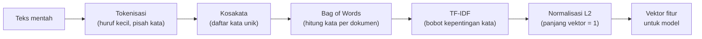

# Part 2 — Representasi Data dan Feature Engineering

## Tujuan Pembelajaran

Setelah mempelajari bagian ini, kamu mampu:

- menyusun data tabel menjadi matriks data $X$ dan vektor target $\mathbf{y}$;
- mengubah fitur kategorik menjadi angka dengan *one-hot encoding* dan pengodean ordinal, serta mengenali jebakan variabel dummy;
- menjelaskan standardisasi dan normalisasi Min-Max secara singkat dan kapan keduanya diperlukan;
- membuat fitur baru (polinomial, interaksi, logaritma, pengelompokan) dan menjelaskan mengapa model linear dapat memakainya;
- mengubah teks menjadi vektor: *bag of words* (BoW), TF-IDF, dan normalisasi L2;
- menghitung kemiripan dua dokumen dengan kosinus;
- menjelaskan kebocoran data (*data leakage*) dari sudut pandang matematika;
- menghubungkan semuanya dengan klasifikasi teks Emergency vs Non-Emergency.

## Prasyarat

[Part 1 — Pengantar Matematika ML](01-pengantar-matematika-ml.md); [Level 3 Part 11 — Korelasi, Kovarians, dan Standardisasi](../level-3-probabilitas-dan-statistika/11-korelasi-kovarians-dan-standardisasi.md) ($z$-score, Min-Max, kebocoran data); [Level 2 Part 2](../level-2-aljabar-linear-dan-kalkulus/02-vektor.md) (norma L2 dan kosinus); [Level 1 Part 10](../level-1-aljabar-dasar-dan-fungsi/10-fungsi-eksponensial-dan-logaritma.md) ($\ln x$).

## Masalah yang Ingin Diselesaikan

Model ML hanya mengerti **angka**: vektor dan matriks. Tetapi data nyata berupa tabel dengan kolom campuran (angka, kategori, tanggal) atau teks bebas. **Representasi data** adalah proses mengubah data mentah menjadi matriks $X$ yang bermakna. Cara kita merepresentasikan data sering lebih menentukan hasil daripada pilihan algoritma, karena representasi menentukan **apa yang dapat dilihat** model.

## Intuisi dan Istilah Penting

### 1. Matriks Data dan Vektor Target

Setiap baris tabel menjadi satu contoh $\mathbf{x}^{(i)}$, dan semua baris ditumpuk menjadi $X \in \mathbb{R}^{n \times d}$, dengan target dalam vektor $\mathbf{y} \in \mathbb{R}^{n}$. Contoh: lima rumah (data simulasi).

| Rumah | Luas (m²) | Kamar | Kota | Kondisi | Harga (juta) |
|---|---|---|---|---|---|
| 1 | 60 | 2 | Bandung | cukup | 500 |
| 2 | 90 | 3 | Jakarta | baru | 900 |
| 3 | 45 | 1 | Medan | lama | 250 |
| 4 | 120 | 4 | Jakarta | cukup | 1100 |
| 5 | 70 | 2 | Bandung | baru | 650 |

Kolom **harga** adalah target $\mathbf{y}$. Empat kolom lain adalah fitur, tetapi **Kota** dan **Kondisi** belum berupa angka yang bermakna.

### 2. Mengodekan Fitur Kategorik

**Fitur numerik** (luas, kamar) dipakai apa adanya (mungkin setelah diskalakan). **Fitur kategorik** perlu diubah:

**Pengodean ordinal** (*ordinal encoding*) untuk kategori **berurutan**: lama $= 0$, cukup $= 1$, baru $= 2$. Cocok bila jarak antar tingkat kira-kira wajar; bila tidak, hubungan nonlinear antar tingkat tidak tertangkap.

**One-hot encoding** untuk kategori **tanpa urutan** (nominal): satu kolom biner per kategori, bernilai $1$ bila contoh termasuk kategori itu dan $0$ bila tidak. Kota Bandung, Jakarta, Medan menjadi tiga kolom:

| Rumah | Kota | Bandung | Jakarta | Medan |
|---|---|---|---|---|
| 1 | Bandung | 1 | 0 | 0 |
| 2 | Jakarta | 0 | 1 | 0 |
| 3 | Medan | 0 | 0 | 1 |
| 4 | Jakarta | 0 | 1 | 0 |
| 5 | Bandung | 1 | 0 | 0 |

Mengapa tidak memberi kode $0, 1, 2$ saja pada kota? Karena itu menyiratkan **urutan dan jarak** yang tidak ada (seolah Medan "dua kali" Jakarta, dan Jakarta tepat di antara Bandung dan Medan). Model berbasis jarak atau bobot linear akan menafsirkannya secara keliru. (Model berbasis pohon lebih toleran, tetapi *one-hot* tetap aman.)

Matriks data lengkap (kolom: luas, kamar, Bandung, Jakarta, Medan, kondisi ordinal):

$$
X = \begin{bmatrix}
60 & 2 & 1 & 0 & 0 & 1 \\
90 & 3 & 0 & 1 & 0 & 2 \\
45 & 1 & 0 & 0 & 1 & 0 \\
120 & 4 & 0 & 1 & 0 & 1 \\
70 & 2 & 1 & 0 & 0 & 2
\end{bmatrix},
\qquad
\mathbf{y} = \begin{bmatrix} 500 \\ 900 \\ 250 \\ 1100 \\ 650 \end{bmatrix}
$$

**Jebakan variabel dummy.** Pada setiap baris, jumlah tiga kolom *one-hot* adalah $1$, yaitu sama dengan kolom konstan bila model memiliki bias (kolom angka 1). Berarti ada kolom yang merupakan **kombinasi linear** dari kolom lain (Level 2 Part 5: bergantung linear), sehingga $X^{\top}X$ singular dan persamaan normal tidak punya solusi tunggal (Part 3). Penanganan: buang satu kolom kategori (disebut *drop first*, sehingga $k$ kategori menjadi $k - 1$ kolom), atau tidak memakai bias, atau memakai regularisasi (Part 12).

**Nilai yang hilang** (*missing*) perlu ditangani sebelum pemodelan, misalnya diisi dengan median atau modus dari **data latih** (Level 3 Part 2) dan, bila perlu, ditambah kolom biner penanda "hilang".

### 3. Menskalakan Fitur

Dari Level 3 Part 11:

$$
z = \frac{x - \bar{x}}{s}, \qquad
x' = \frac{x - x_{\min}}{x_{\max} - x_{\min}}
$$

Standardisasi memberi rata-rata $0$ dan simpangan baku $1$; Min-Max memetakan ke $[0, 1]$. Penskalaan umumnya penting untuk algoritma berbasis **jarak** (KNN, K-Means), model berbasis **gradien** dan **regularisasi** (regresi dengan penalti, SVM, jaringan saraf), dan PCA, tetapi tidak untuk pohon keputusan (Part 7 dan 8) dan Naive Bayes Gaussian (Part 6).

**Perhatikan definisi simpangan baku.** Buku ini memakai simpangan baku **sampel** $s$ (pembagi $n - 1$). `StandardScaler` di scikit-learn memakai pembagi $n$ (simpangan baku populasi). Untuk luas rumah di atas: rata-rata $77$, $s = 29{,}07$ (pembagi 4), sedangkan `StandardScaler` memakai $26{,}0$ (pembagi 5). Hasilnya berbeda sedikit: rumah 1 menjadi $-0{,}585$ (pakai $s$) atau $-0{,}654$ (pakai pembagi $n$). Keduanya konsisten selama dipakai sama pada data latih dan uji.

### 4. Membuat Fitur Baru (*Feature Engineering*)

Model linear $\hat{y} = \mathbf{w}\cdot\mathbf{x} + b$ linear terhadap **parameter** $\mathbf{w}$, bukan harus linear terhadap fitur asli. Dengan membuat fitur baru dari fitur lama, model yang sama dapat menangkap pola lebih kaya.

**Fitur polinomial.** Tambahkan $x^2$. Untuk $x = -2, -1, 0, 1, 2$ dan $y = x^2 = 4, 1, 0, 1, 4$, korelasi $x$ dengan $y$ adalah $0$ (Level 3 Part 11), jadi model linear pada $x$ saja gagal. Tetapi dengan **peta fitur** $\varphi(x) = (x,\ x^2)$ dan model $\hat{y} = w_1 x + w_2 x^2 + b$, bobot $\mathbf{w} = (0, 1)$ dan $b = 0$ cocok **sempurna**. Gagasan memetakan fitur ke ruang baru agar data menjadi mudah dipisahkan oleh model linear ini muncul lagi pada kernel SVM (Part 9).

**Fitur interaksi.** Hasil kali dua fitur, misalnya $x_1 x_2$, menangkap bahwa pengaruh satu fitur bergantung pada nilai fitur lain.

**Transformasi logaritma.** Untuk fitur positif yang miring ke kanan (pendapatan, harga), $\ln x$ menekan nilai besar (Level 3 Part 3): $3, 12, 50 \to 1{,}0986;\ 2{,}4849;\ 3{,}9120$.

**Pengelompokan** (*binning*). Mengubah fitur numerik menjadi kategori berdasarkan rentang (misalnya umur $< 18$, $18$ sampai $60$, $> 60$), lalu di-*one-hot*. Berguna bila pengaruhnya tidak linear, dengan harga hilangnya detail.

Tiap fitur baru menambah dimensi $d$. Terlalu banyak fitur pada data sedikit memperbesar risiko *overfitting* (Part 1 dan 12).

### 5. Dari Teks ke Vektor

Teks adalah deretan kata. Untuk memasukkannya ke model, kita ubah tiap dokumen menjadi vektor bilangan.



**Korpus simulasi.** Sepuluh pesan pendek buatan untuk klasifikasi Emergency (E) vs Non-Emergency (N). Semua teks dan label adalah **data simulasi**, bukan hasil eksperimen nyata, dan korpus yang sama dipakai di beberapa part berikutnya.

| No | Pesan | Label |
|---|---|---|
| 1 | tolong ada kebakaran di gedung | E |
| 2 | kecelakaan di jalan tolong kirim ambulans | E |
| 3 | banjir naik tolong evakuasi segera | E |
| 4 | ada korban kecelakaan butuh ambulans segera | E |
| 5 | kebakaran besar tolong damkar segera | E |
| 6 | jadwal rapat besok pagi di gedung | N |
| 7 | tolong kirim catatan kuliah besok | N |
| 8 | makan siang di kantin jalan baru | N |
| 9 | kuliah besok pagi di gedung baru | N |
| 10 | ada diskon jalan sehat besok | N |

**Tokenisasi dan kosakata.** Di sini tokenisasi sederhana: huruf kecil, dipisah spasi, tanpa membuang kata umum. Kata unik diurutkan abjad menjadi **kosakata** berukuran $d = 29$: *ada, ambulans, banjir, baru, besar, besok, butuh, catatan, damkar, di, diskon, evakuasi, gedung, jadwal, jalan, kantin, kebakaran, kecelakaan, kirim, korban, kuliah, makan, naik, pagi, rapat, segera, sehat, siang, tolong*. Setiap kata mendapat satu kolom.

**Bag of Words (BoW).** Vektor dokumen berisi **jumlah kemunculan** tiap kata kosakata: $\mathrm{tf}(t, d)$ adalah berapa kali kata $t$ muncul di dokumen $d$. Pesan 1 menjadi vektor berdimensi $29$ yang hanya lima elemennya bernilai $1$ (*ada, di, gedung, kebakaran, tolong*), sisanya $0$. Seluruh korpus menjadi matriks $X \in \mathbb{R}^{10 \times 29}$ dengan jumlah semua elemen $55$ (total kata). Pada data nyata, $d$ bisa ribuan sampai ratusan ribu dan hampir semua elemen $0$ (**jarang**, *sparse*). BoW membuang urutan kata: "anjing gigit orang" dan "orang gigit anjing" menghasilkan vektor yang sama.

**TF-IDF.** Kata yang muncul di hampir semua dokumen (seperti "di") kurang informatif dibanding kata langka ("kebakaran"). TF-IDF memberi bobot lebih besar pada kata langka. Dengan $N$ dokumen dan $\mathrm{df}(t)$ banyak dokumen yang memuat kata $t$:

$$
\mathrm{idf}(t) = \ln\frac{1 + N}{1 + \mathrm{df}(t)} + 1,
\qquad
\text{tf-idf}(t, d) = \mathrm{tf}(t, d)\cdot\mathrm{idf}(t)
$$

Rumus $\mathrm{idf}$ ini adalah varian "halus" (*smooth*) yang dipakai scikit-learn secara bawaan; tambahan $1$ di dalam $\ln$ mencegah pembagian nol dan tambahan $+1$ di luar mencegah bobot nol untuk kata yang ada di semua dokumen. (Ada varian klasik $\ln(N/\mathrm{df})$.) Dengan $N = 10$:

| Kata | $\mathrm{df}$ | $\mathrm{idf}$ |
|---|---|---|
| tolong, di | 5 | $\ln\dfrac{11}{6} + 1 = 1{,}6061$ |
| ada, gedung | 3 | $\ln\dfrac{11}{4} + 1 = 2{,}0116$ |
| kebakaran, kirim, ambulans | 2 | $\ln\dfrac{11}{3} + 1 = 2{,}2993$ |
| banjir, jadwal, makan (satu dokumen) | 1 | $\ln\dfrac{11}{2} + 1 = 2{,}7047$ |

Kata "tolong" muncul di 5 dari 10 pesan, termasuk pesan Non-Emergency (nomor 7), sehingga tidak istimewa seperti "kebakaran" atau "ambulans".

**Normalisasi L2.** Dokumen panjang punya vektor lebih besar. Untuk membandingkan dokumen secara adil, vektor TF-IDF dibagi dengan panjangnya (norma L2):

$$
\tilde{\mathbf{v}} = \frac{\mathbf{v}}{\lVert\mathbf{v}\rVert_2}
$$

sehingga $\lVert\tilde{\mathbf{v}}\rVert_2 = 1$. Setelah ini, **kosinus** antara dua dokumen sama dengan dot product mereka (Level 2 Part 2): $\cos\theta = \tilde{\mathbf{a}}\cdot\tilde{\mathbf{b}}$. Nilainya antara $0$ (tidak berbagi kata) dan $1$ (arah sama).

### 6. Kebocoran Data dari Sudut Pandang Matematika

Penskalaan, imputasi, dan $\mathrm{idf}$ semuanya **menaksir parameter** dari data ($\bar{x}$, $s$, $\mathrm{df}$). Sebuah transformasi $T$ yang dipelajari harus ditaksir dari **data latih saja**, lalu diterapkan ke data uji:

$$
T = T_{\text{latih}}, \qquad X_{\text{uji}}' = T_{\text{latih}}(X_{\text{uji}})
$$

Bila $T$ ditaksir dari seluruh data, nilai $X'_{\text{uji}}$ bergantung pada data uji itu sendiri. Itu melanggar sifat bahwa data uji adalah data baru yang tak terlihat, sehingga kinerja uji menjadi terlalu optimistis.

**Contoh.** Data latih $10, 12, 14, 16$ dan satu data uji $40$.

- Benar (statistik latih saja): rata-rata $13$, $s = 2{,}582$. Nilai uji $z = \dfrac{40 - 13}{2{,}582} = 10{,}46$, yaitu sangat jauh di luar sebaran latih, sehingga pergeseran distribusi terlihat jelas.
- Bocor (seluruh data): rata-rata $18{,}4$, $s = 12{,}28$. Nilai uji $z = \dfrac{40 - 18{,}4}{12{,}28} = 1{,}76$, tampak wajar. Pencilan data uji menyembunyikan dirinya sendiri.

Bentuk kebocoran lain: fitur yang dihitung dari target atau dari informasi yang baru diketahui setelah hasilnya ada; duplikat antar bagian latih dan uji; dan pembagian acak pada data berurutan waktu. Untuk teks, hitung kosakata dan $\mathrm{idf}$ dari korpus latih saja; kata yang hanya muncul di data uji diabaikan.

## Rumus dan Penjelasan Setiap Simbol

| Konsep | Rumus | Arti simbol dan syarat |
|---|---|---|
| Matriks data | $X \in \mathbb{R}^{n \times d}$ | $n$ contoh (baris), $d$ fitur (kolom) |
| Standardisasi | $z = (x - \bar{x})/s$ | $\bar{x}, s$ dari data latih; $s > 0$ |
| Min-Max | $x' = (x - x_{\min})/(x_{\max} - x_{\min})$ | min dan maks dari data latih |
| Peta fitur | $\varphi(\mathbf{x}) = (x_1, \dots, x_1^2, x_1 x_2, \dots)$ | fitur baru dari fitur lama |
| TF | $\mathrm{tf}(t, d)$ | jumlah kemunculan kata $t$ di dokumen $d$ |
| DF | $\mathrm{df}(t)$ | banyak dokumen yang memuat $t$ |
| IDF (halus) | $\mathrm{idf}(t) = \ln\dfrac{1 + N}{1 + \mathrm{df}(t)} + 1$ | $N$ banyak dokumen latih |
| TF-IDF | $\mathrm{tf}\cdot\mathrm{idf}$ | bobot kata $t$ pada dokumen $d$ |
| Normalisasi L2 | $\tilde{\mathbf{v}} = \mathbf{v}/\lVert\mathbf{v}\rVert_2$ | $\mathbf{v} \neq \mathbf{0}$ |
| Kosinus | $\cos\theta = \dfrac{\mathbf{a}\cdot\mathbf{b}}{\lVert\mathbf{a}\rVert_2\lVert\mathbf{b}\rVert_2}$ | sama dengan $\tilde{\mathbf{a}}\cdot\tilde{\mathbf{b}}$ bila sudah dinormalisasi |

## Contoh Numerik Langkah demi Langkah

### Contoh 1 — Membangun $X$ dari tabel

Dari tabel rumah, bentuk baris $\mathbf{x}^{(2)}$ untuk rumah 2.

1. Luas $= 90$ dan kamar $= 3$ dipakai apa adanya.
2. Kota Jakarta: kolom (Bandung, Jakarta, Medan) $= (0, 1, 0)$.
3. Kondisi baru: ordinal $= 2$.
4. $\mathbf{x}^{(2)} = (90, 3, 0, 1, 0, 2)$, sesuai baris kedua $X$ di atas. $y^{(2)} = 900$.

### Contoh 2 — Jebakan variabel dummy

Buktikan bahwa kolom konstan, Bandung, Jakarta, dan Medan bergantung linear.

1. Susun matriks dengan kolom (konstan, Bandung, Jakarta, Medan) untuk rumah 1, 2, 3: baris $(1, 1, 0, 0)$, $(1, 0, 1, 0)$, $(1, 0, 0, 1)$.
2. Kolom konstan sama dengan jumlah kolom Bandung, Jakarta, dan Medan: pada setiap baris, $1 = 1 + 0 + 0 = 0 + 1 + 0 = 0 + 0 + 1$.
3. Satu kolom adalah jumlah tiga kolom lain, jadi kolom-kolom bergantung linear. $X^{\top}X$ singular (determinan nol), seperti pada Level 2 Part 5.
4. Perbaikan: buang kolom Medan (kategori acuan). Dua kolom sisanya cukup, karena Medan terwakili oleh $(0, 0)$.

### Contoh 3 — Fitur polinomial membuat model linear cocok

Data $x = -2, -1, 0, 1, 2$ dan $y = 4, 1, 0, 1, 4$.

1. Peta fitur $\varphi(x) = (x, x^2)$: $(-2, 4), (-1, 1), (0, 0), (1, 1), (2, 4)$.
2. Model $\hat{y} = 0\cdot x + 1\cdot x^2 + 0$ memberi $4, 1, 0, 1, 4$.
3. Residual semuanya nol, MSE $= 0$. Pada $x$ saja korelasi $0$ membuat model linear tidak lebih baik dari rata-rata ($y$ rata-rata $2$).

### Contoh 4 — Menghitung TF-IDF untuk satu dokumen

Hitung vektor TF-IDF ternormalisasi untuk pesan 1, "tolong ada kebakaran di gedung".

1. Kata unik dan $\mathrm{tf}$: tolong, ada, kebakaran, di, gedung, masing-masing $1$.
2. $\mathrm{idf}$ (dari tabel): tolong $1{,}6061$, ada $2{,}0116$, kebakaran $2{,}2993$, di $1{,}6061$, gedung $2{,}0116$. Karena $\mathrm{tf} = 1$, nilai TF-IDF mentah sama dengan $\mathrm{idf}$.
3. Norma: $\lVert\mathbf{v}\rVert_2 = \sqrt{1{,}6061^2 + 2{,}0116^2 + 2{,}2993^2 + 1{,}6061^2 + 2{,}0116^2}$ $= \sqrt{2{,}5796 + 4{,}0465 + 5{,}2868 + 2{,}5796 + 4{,}0465} = \sqrt{18{,}539} \approx 4{,}3057$.
4. Bagi tiap elemen dengan norma: tolong $0{,}3730$, ada $0{,}4672$, kebakaran $0{,}5340$, di $0{,}3730$, gedung $0{,}4672$.
5. Periksa panjang: $0{,}373^2 \cdot 2 + 0{,}4672^2 \cdot 2 + 0{,}534^2 = 0{,}2783 + 0{,}4366 + 0{,}2852 = 1{,}000$.

Perhatikan: "kebakaran" (langka, $\mathrm{df} = 2$) mendapat bobot terbesar ($0{,}534$), sedangkan "tolong" dan "di" (umum, $\mathrm{df} = 5$) bobotnya paling kecil ($0{,}373$).

### Contoh 5 — Kemiripan dua dokumen dengan kosinus

Hitung kosinus antara pesan 1 (Emergency) dan pesan 6, "jadwal rapat besok pagi di gedung" (Non-Emergency), lalu dengan pesan 5, "kebakaran besar tolong damkar segera" (Emergency).

1. Vektor pesan 1 (dari Contoh 4): tolong $0{,}3730$, ada $0{,}4672$, kebakaran $0{,}5340$, di $0{,}3730$, gedung $0{,}4672$.
2. Pesan 6, TF-IDF mentah: jadwal $2{,}7047$, rapat $2{,}7047$, besok $1{,}7885$, pagi $2{,}2993$, di $1{,}6061$, gedung $2{,}0116$. Norma $\approx 5{,}4537$. Ternormalisasi: jadwal $0{,}4959$, rapat $0{,}4959$, besok $0{,}3279$, pagi $0{,}4216$, di $0{,}2945$, gedung $0{,}3689$.
3. Kata bersama pesan 1 dan 6: **di** dan **gedung**. $\cos\theta = 0{,}3730 \times 0{,}2945 + 0{,}4672 \times 0{,}3689 = 0{,}1099 + 0{,}1724 = 0{,}2822$.
4. Dengan pesan 5: kata bersama **tolong** dan **kebakaran**; hasilnya $\cos\theta \approx 0{,}3546$.
5. Pesan 1 lebih mirip pesan 5 (satu kelas) daripada pesan 6, walaupun nilainya tidak besar: hanya sedikit kata dipakai, dan kata umum seperti "di" menyumbang kemiripan yang menyesatkan. Inilah alasan TF-IDF menurunkan bobot kata umum, dan mengapa perlu fitur yang lebih banyak daripada sepuluh contoh.

## Interpretasi, Asumsi, dan Keterbatasan

- **BoW dan TF-IDF membuang urutan kata** dan makna kata. "Tidak ada kebakaran" dan "ada kebakaran" memiliki kata hampir sama. Representasi yang lebih kaya (*n-gram*, penanda negasi, atau model bahasa) ada di luar cakupan level ini.
- **Dimensi tinggi dan jarang.** Pada teks nyata $d \gg n$ sering terjadi. Beberapa algoritma tahan terhadap ini (Naive Bayes, regresi logistik atau SVM linear dengan regularisasi), sedangkan yang lain (KNN murni dengan jarak Euclidean) menderita karena jarak menjadi kurang membedakan di dimensi tinggi.
- **Pilihan praproses berpengaruh.** Membuang kata umum (*stop words*), mengubah huruf, dan memilih $\mathrm{idf}$ varian mengubah vektor. Catat dan terapkan sama pada data latih dan uji.
- **Pengodean ordinal vs one-hot** bukan keputusan netral: ordinal mengasumsikan urutan dan jarak wajar.
- **Contoh di sini sangat kecil.** Sepuluh pesan simulasi hanya untuk memperlihatkan perhitungan; kesimpulan kinerja tidak dapat ditarik darinya.

## Hubungan dengan ML dan NLP

- **Klasifikasi teks.** Matriks TF-IDF ($n \times d$, jarang) adalah masukan umum untuk regresi logistik (Part 4), Naive Bayes (Part 6, yang memakai hitungan BoW), SVM linear (Part 9), dan KNN dengan kosinus (Part 5).
- **Kosinus untuk teks.** Karena dokumen berbeda panjang, kosinus (yang mengabaikan panjang) sering lebih cocok daripada jarak Euclidean untuk membandingkan dokumen.
- **Kebocoran pada teks.** $\mathrm{idf}$ dan kosakata harus dihitung dari data latih saja; fitur yang menyiratkan label (misalnya kata "[DARURAT]" yang ditambahkan petugas setelah klasifikasi) adalah kebocoran.
- **Kelas tidak seimbang.** Pesan darurat biasanya jauh lebih jarang daripada non-darurat. Pembagian data berstrata dan pemilihan metrik (Part 11) harus mempertimbangkannya.
- **Penskalaan setelah representasi.** TF-IDF dengan normalisasi L2 sudah memberi skala seragam antar dokumen; fitur numerik tambahan (misalnya panjang pesan) tetap perlu distandardisasi bila model peka skala.

### Python: tabel, penskalaan, dan TF-IDF dari nol

Hanya pustaka standar. Korpus (teks dan label) sama dengan tabel di atas.

```python
import math
from collections import Counter
from statistics import mean, stdev, pstdev

korpus = [
    ("tolong ada kebakaran di gedung", "E"),
    ("kecelakaan di jalan tolong kirim ambulans", "E"),
    ("banjir naik tolong evakuasi segera", "E"),
    ("ada korban kecelakaan butuh ambulans segera", "E"),
    ("kebakaran besar tolong damkar segera", "E"),
    ("jadwal rapat besok pagi di gedung", "N"),
    ("tolong kirim catatan kuliah besok", "N"),
    ("makan siang di kantin jalan baru", "N"),
    ("kuliah besok pagi di gedung baru", "N"),
    ("ada diskon jalan sehat besok", "N"),
]
dokumen = [teks.split() for teks, _ in korpus]
kosakata = sorted(set(k for d in dokumen for k in d))
N = len(dokumen)
print(N, len(kosakata), sum(len(d) for d in dokumen))      # 10 29 55

df = {k: sum(1 for d in dokumen if k in d) for k in kosakata}
print(df["tolong"], df["di"], df["kebakaran"], df["gedung"], df["ada"])   # 5 5 2 3 3

def idf(k):
    return math.log((1 + N) / (1 + df[k])) + 1

print([round(idf(k), 4) for k in ("tolong", "ada", "kebakaran", "di", "gedung")])
# [1.6061, 2.0116, 2.2993, 1.6061, 2.0116]
```

Vektor TF-IDF ternormalisasi dan kosinus:

```python
def tfidf(d):
    c = Counter(d)
    v = {k: c[k] * idf(k) for k in c}
    norma = math.sqrt(sum(a * a for a in v.values()))
    return {k: a / norma for k, a in v.items()}, norma

def kosinus(a, b):
    return sum(a[k] * b[k] for k in a if k in b)

v1, norma1 = tfidf(dokumen[0])
print(round(norma1, 4), {k: round(a, 4) for k, a in v1.items()})
# 4.3057 {'tolong': 0.373, 'ada': 0.4672, 'kebakaran': 0.534, 'di': 0.373, 'gedung': 0.4672}
v6, _ = tfidf(dokumen[5])
v5, _ = tfidf(dokumen[4])
print(round(kosinus(v1, v6), 4), round(kosinus(v1, v5), 4))        # 0.2822 0.3546
```

Penskalaan dan kebocoran:

```python
luas = [60, 90, 45, 120, 70]
print(mean(luas), round(stdev(luas), 4), pstdev(luas))             # 77 29.0689 26.0
print([round((a - mean(luas)) / stdev(luas), 3) for a in luas])    # [-0.585, 0.447, -1.101, 1.479, -0.241]

latih, uji = [10, 12, 14, 16], 40
print(round((uji - mean(latih)) / stdev(latih), 3))                # 10.457
semua = latih + [uji]
print(round((uji - mean(semua)) / stdev(semua), 3))                # 1.759
```

**Opsional: bandingkan dengan scikit-learn.** Blok ini membutuhkan scikit-learn dan NumPy, yang **tidak** dipasang oleh proyek ini dan tidak dijalankan oleh situs. Keluaran di bawah dijalankan dengan scikit-learn 1.9.0 pada Python 3.14.

```python
import numpy as np
from sklearn.feature_extraction.text import CountVectorizer, TfidfVectorizer
from sklearn.preprocessing import StandardScaler, OneHotEncoder

teks = [t for t, _ in korpus]
tf = TfidfVectorizer()                      # idf halus dan normalisasi L2 secara bawaan
M = tf.fit_transform(teks)
print(M.shape)                              # (10, 29)
kosa = tf.get_feature_names_out()
print({k: round(float(v), 4) for k, v in zip(kosa, M[0].toarray()[0]) if v > 0})
# {'ada': 0.4672, 'di': 0.373, 'gedung': 0.4672, 'kebakaran': 0.534, 'tolong': 0.373}
print(round(float((M[0] @ M[5].T).toarray()[0, 0]), 4), round(float((M[0] @ M[4].T).toarray()[0, 0]), 4))
# 0.2822 0.3546
print(CountVectorizer().fit_transform(teks).sum())    # 55

sc = StandardScaler()
print(sc.fit_transform(np.array([[60], [90], [45], [120], [70]])).ravel().round(3), sc.scale_[0])
# [-0.654  0.5   -1.231  1.654 -0.269] 26.0

oh = OneHotEncoder(sparse_output=False).fit(np.array([["Bandung"], ["Jakarta"], ["Medan"], ["Jakarta"], ["Bandung"]]))
print(oh.categories_[0])                    # ['Bandung' 'Jakarta' 'Medan']
```

Interpretasi: vektor TF-IDF dan kosinus dari hitungan manual sama persis dengan keluaran `TfidfVectorizer`. `StandardScaler` memberi nilai berbeda dari hitungan kita karena memakai pembagi $n$ ($26{,}0$), bukan $n - 1$ ($29{,}07$): kedua versi valid, asalkan konsisten.

## Kesalahan Umum

| Kesalahan | Mengapa salah | Yang benar |
|---|---|---|
| Memberi kode $0, 1, 2$ pada kategori nominal | menyiratkan urutan dan jarak palsu | *one-hot encoding* |
| Memakai semua kolom *one-hot* bersama bias pada model linear | kolom bergantung linear, $X^{\top}X$ singular | buang satu kolom atau regularisasi |
| Menaksir rata-rata, simpangan baku, kosakata, atau $\mathrm{idf}$ dari seluruh data | kebocoran data | dari data latih saja |
| Mengira `StandardScaler` dan $s$ buku ini identik | pembagi $n$ vs $n - 1$ | periksa definisi, konsisten |
| Menganggap TF-IDF menangkap makna atau urutan kata | hanya bobot kemunculan | sadari keterbatasan |
| Membandingkan dokumen berbeda panjang dengan jarak Euclidean pada hitungan mentah | dokumen panjang tampak jauh | normalisasi atau kosinus |
| Menskalakan fitur untuk algoritma yang tidak memerlukannya lalu menganggapnya wajib | tidak selalu perlu | pahami algoritmanya (Part 5 sampai 10) |
| Menambah banyak fitur tanpa kontrol | memperbesar risiko *overfitting* | validasi dan regularisasi |
| Membuang kata "tolong" hanya karena umum tanpa melihat pengaruhnya | bisa membuang sinyal | uji pada data validasi |

## Latihan Mandiri

1. Dari tabel rumah, tulis baris $X$ dan $y$ untuk rumah 3 (kolom: luas, kamar, Bandung, Jakarta, Medan, kondisi ordinal dengan lama $= 0$, cukup $= 1$, baru $= 2$).
2. Tunjukkan bahwa kolom konstan sama dengan jumlah tiga kolom *one-hot* kota pada rumah 1 sampai 3. Apa akibatnya bagi $X^{\top}X$, dan bagaimana memperbaikinya?
3. Dengan kosakata $\{\text{ambulans, kirim, segera, tolong}\}$, tulis vektor BoW untuk "tolong tolong kirim ambulans segera".
4. Hitung $\mathrm{idf}$ (varian halus) dengan $N = 10$ untuk kata dengan $\mathrm{df} = 1$, $\mathrm{df} = 5$, dan $\mathrm{df} = 10$. Apa yang terjadi pada kata yang muncul di semua dokumen?
5. Hitung vektor TF-IDF ternormalisasi untuk pesan 9, "kuliah besok pagi di gedung baru" (gunakan tabel $\mathrm{df}$: kuliah 2, besok 4, pagi 2, di 5, gedung 3, baru 2).
6. Hitung kosinus antara pesan 6 ("jadwal rapat besok pagi di gedung") dan pesan 9, memakai vektor ternormalisasi masing-masing. Mengapa nilainya lebih besar daripada kosinus pesan 1 dengan pesan 6?
7. Data latih $10, 12, 14, 16$ dan data uji $40$. Hitung $z$ untuk data uji dengan statistik latih saja dan dengan seluruh data, lalu jelaskan perbedaannya.
8. Untuk $x = -2, -1, 0, 1, 2$ dan $y = x^2$, tulis peta fitur $\varphi(x) = (x, x^2)$ dan tunjukkan bobot yang membuat MSE nol.
9. Hitung $\ln$ untuk $x = 3, 12, 50$. Pada jenis fitur apa transformasi logaritma membantu, dan kapan tidak boleh dipakai?
10. Tentukan pengodean (numerik apa adanya, ordinal, *one-hot*) dan apakah perlu penskalaan untuk model berbasis jarak: (a) tinggi badan, (b) tingkat pendidikan (SD, SMP, SMA), (c) kota, (d) jumlah kata dalam pesan.

## Kunci Jawaban dan Pembahasan

??? success "Soal 1"
    Rumah 3: luas $45$, kamar $1$, kota Medan $(0, 0, 1)$, kondisi lama $= 0$. Jadi $\mathbf{x}^{(3)} = (45, 1, 0, 0, 1, 0)$ dan $y^{(3)} = 250$.

??? success "Soal 2"
    Kolom (konstan, Bandung, Jakarta, Medan): rumah 1 $(1, 1, 0, 0)$, rumah 2 $(1, 0, 1, 0)$, rumah 3 $(1, 0, 0, 1)$. Pada tiap baris, nilai kolom konstan ($1$) sama dengan jumlah nilai kolom Bandung, Jakarta, dan Medan, jadi kolom konstan adalah kombinasi linear tiga kolom lain. Maka kolom-kolomnya bergantung linear, $X^{\top}X$ singular (tidak punya invers) dan persamaan normal tidak punya solusi tunggal. Perbaikan: buang satu kolom kota (kategori acuan), atau gunakan regularisasi.

??? success "Soal 3"
    Urutan (ambulans, kirim, segera, tolong): ambulans $1$, kirim $1$, segera $1$, tolong $2$. Vektor BoW: $(1, 1, 1, 2)$.

??? success "Soal 4"
    $\mathrm{df} = 1$: $\ln\dfrac{11}{2} + 1 = 2{,}7047$. $\mathrm{df} = 5$: $\ln\dfrac{11}{6} + 1 = 1{,}6061$. $\mathrm{df} = 10$: $\ln\dfrac{11}{11} + 1 = 1$. Kata yang ada di semua dokumen mendapat $\mathrm{idf}$ minimum $1$ (tidak nol, berkat varian halus), yaitu bobot terendah: kata itu tidak membedakan dokumen.

??? success "Soal 5"
    Mentah: kuliah $2{,}2993$, besok $1{,}7885$, pagi $2{,}2993$, di $1{,}6061$, gedung $2{,}0116$, baru $2{,}2993$. Kuadrat: $5{,}2868;\ 3{,}1988;\ 5{,}2868;\ 2{,}5796;\ 4{,}0465;\ 5{,}2868$, jumlah $25{,}6853$, norma $5{,}0680$. Ternormalisasi: kuliah $0{,}4537$, besok $0{,}3529$, pagi $0{,}4537$, di $0{,}3169$, gedung $0{,}3969$, baru $0{,}4537$.

??? success "Soal 6"
    Pesan 6 (ternormalisasi): jadwal $0{,}4959$, rapat $0{,}4959$, besok $0{,}3279$, pagi $0{,}4216$, di $0{,}2945$, gedung $0{,}3689$. Kata bersama dengan pesan 9: besok, pagi, di, gedung. $\cos\theta = 0{,}3279 \times 0{,}3529 + 0{,}4216 \times 0{,}4537 + 0{,}2945 \times 0{,}3169 + 0{,}3689 \times 0{,}3969 = 0{,}1157 + 0{,}1913 + 0{,}0933 + 0{,}1464 = 0{,}5467$. Lebih besar dari $0{,}2822$ (pesan 1 dengan 6) karena pesan 6 dan 9 berbagi empat kata (termasuk "besok" dan "pagi" yang cukup langka), sedangkan pesan 1 dan 6 hanya berbagi "di" dan "gedung".

??? success "Soal 7"
    Statistik latih: rata-rata $13$, $s = 2{,}582$, jadi $z = \dfrac{40 - 13}{2{,}582} = 10{,}46$. Seluruh data: rata-rata $18{,}4$, $s = 12{,}28$, jadi $z = 1{,}76$. Dengan statistik latih, nilai uji terlihat sangat ekstrem (pergeseran distribusi terdeteksi). Dengan seluruh data, nilai uji ikut menggeser rata-rata dan menaikkan $s$ sehingga ia tampak biasa: kebocoran yang menyembunyikan masalah.

??? success "Soal 8"
    $\varphi(x)$: $(-2, 4), (-1, 1), (0, 0), (1, 1), (2, 4)$. Bobot $\mathbf{w} = (0, 1)$ dan $b = 0$ memberi $\hat{y} = x^2 = y$ pada semua titik, jadi MSE $= 0$.

??? success "Soal 9"
    $\ln 3 = 1{,}0986$, $\ln 12 = 2{,}4849$, $\ln 50 = 3{,}9120$. Membantu untuk fitur positif yang miring ke kanan dengan rentang lebar (pendapatan, harga). Tidak boleh dipakai langsung bila ada nilai nol atau negatif ($\ln$ tidak terdefinisi); untuk nol lazim dipakai $\ln(1 + x)$.

??? success "Soal 10"
    (a) numerik apa adanya; perlu penskalaan untuk model berbasis jarak. (b) ordinal ($0, 1, 2$), karena berurutan; penskalaan membantu bila jarak antar tingkat dianggap wajar. (c) *one-hot* (nominal), tidak perlu penskalaan tambahan karena sudah biner. (d) numerik apa adanya (hitungan); perlu penskalaan karena rentangnya jauh berbeda dari fitur biner atau terstandardisasi lain.

## Ringkasan Materi

- Data diubah menjadi matriks $X$ ($n \times d$) dan vektor target $\mathbf{y}$; fitur kategorik nominal di-*one-hot*, ordinal dikodekan berurutan, dan nilai hilang ditangani dari statistik latih.
- Jebakan dummy: kolom *one-hot* dan bias bergantung linear; buang satu kolom atau regularisasi.
- Penskalaan ($z$-score atau Min-Max) penting untuk model berbasis jarak, gradien, dan regularisasi, tetapi tidak wajib untuk semua algoritma. Perhatikan definisi simpangan baku ($n$ vs $n - 1$).
- *Feature engineering* (polinomial, interaksi, $\ln$, pengelompokan) memungkinkan model linear menangkap pola nonlinear; model tetap linear terhadap parameter.
- Teks menjadi vektor lewat BoW dan TF-IDF: $\mathrm{idf}(t) = \ln\frac{1 + N}{1 + \mathrm{df}(t)} + 1$; normalisasi L2 membuat kosinus sama dengan dot product.
- Kebocoran data: parameter transformasi harus ditaksir dari data latih saja; kosakata dan $\mathrm{idf}$ juga.
- Semua data NLP di sini adalah data simulasi.

## Checklist Penguasaan

- [ ] Menyusun matriks $X$ dan vektor $\mathbf{y}$ dari tabel campuran.
- [ ] Memilih dan menerapkan *one-hot* atau pengodean ordinal, serta menjelaskan jebakan dummy.
- [ ] Menjelaskan kapan penskalaan diperlukan dan perbedaan $n$ vs $n - 1$ pada simpangan baku.
- [ ] Membuat fitur polinomial, interaksi, dan logaritma, serta menjelaskan mengapa model tetap linear terhadap parameter.
- [ ] Menghitung BoW, $\mathrm{idf}$, TF-IDF ternormalisasi, dan kosinus secara manual.
- [ ] Menjelaskan kebocoran data secara matematis dan pada teks.
- [ ] Menghubungkan representasi dengan klasifikasi teks dan kelas tidak seimbang.

## Prasyarat untuk Materi Berikutnya

[Part 3 — Matematika Regresi Linear](03-regresi-linear.md) memakai matriks $X$ dan vektor $\mathbf{y}$ dari part ini untuk menurunkan bobot terbaik, baik dengan persamaan normal maupun *gradient descent*. Pastikan $X$, kolom bias, dan jebakan dummy sudah jelas.
