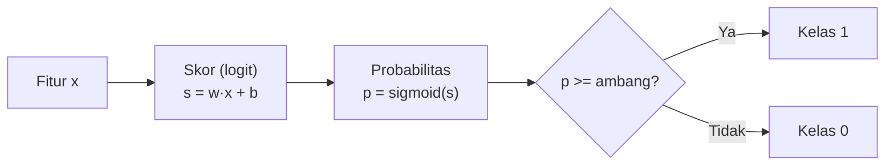
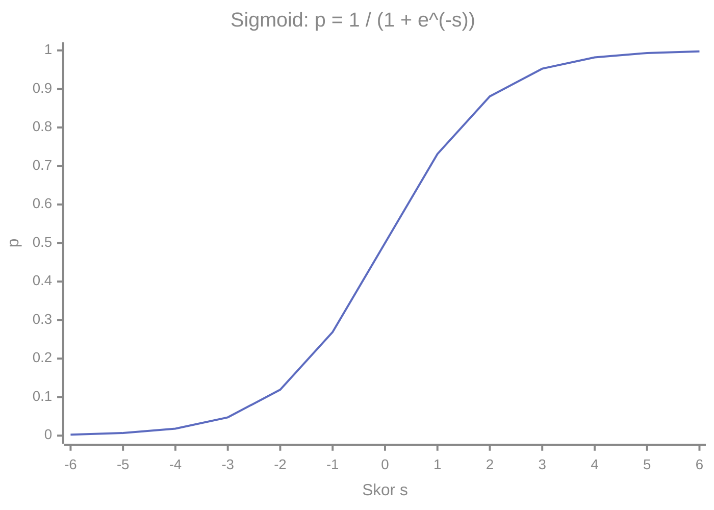
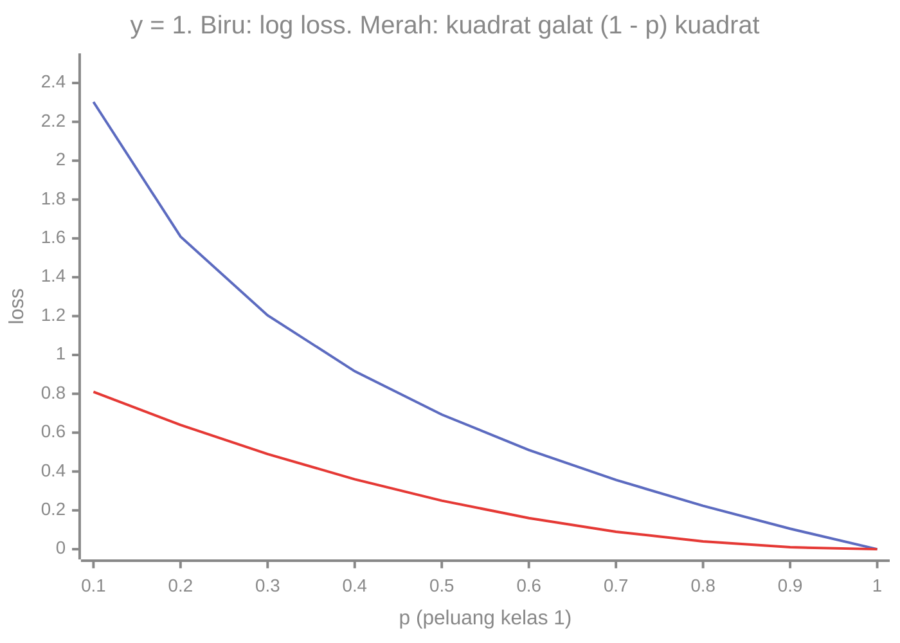

# Part 4 — Matematika Regresi Logistik

## Tujuan Pembelajaran

Setelah mempelajari bagian ini, kamu mampu:

- menjelaskan mengapa klasifikasi biner tidak cocok memakai regresi linear langsung;
- menulis model regresi logistik: skor linear, sigmoid, probabilitas, dan keputusan dengan ambang;
- menjelaskan odds, logit, dan menafsirkan koefisien sebagai perubahan log-odds dan rasio odds;
- menentukan batas keputusan dan menjelaskan bahwa ia berupa garis atau bidang datar;
- menurunkan *binary cross-entropy* (*log loss*) dari kemungkinan maksimum Bernoulli dan menghitungnya;
- menjelaskan mengapa MSE tidak dipakai pada klasifikasi dengan sigmoid;
- menurunkan gradien $\nabla L = \frac{1}{n}X^{\top}(\mathbf{p} - \mathbf{y})$ dan menjalankan *gradient descent* secara manual;
- menjelaskan pengaruh ambang pada kesalahan dan masalah data yang terpisah sempurna.

## Prasyarat

[Part 3 — Regresi Linear](03-regresi-linear.md); [Level 2 Part 7](../level-2-aljabar-linear-dan-kalkulus/07-turunan.md) dan [Part 9](../level-2-aljabar-linear-dan-kalkulus/09-chain-rule-dan-backpropagation.md) (turunan sigmoid dan aturan rantai); [Level 3 Part 8](../level-3-probabilitas-dan-statistika/08-distribusi-probabilitas-umum.md) (Bernoulli) dan [Part 10](../level-3-probabilitas-dan-statistika/10-inferensi-statistik.md) (kemungkinan maksimum).

## Masalah yang Ingin Diselesaikan

Kita ingin memprediksi **kelas biner** $y \in \{0, 1\}$ (misalnya darurat atau bukan) dan, lebih baik lagi, **peluang** bahwa contoh termasuk kelas $1$. Model kita harus menghasilkan angka di antara $0$ dan $1$.

**Mengapa tidak regresi linear pada label 0/1?** Regresi linear dapat menghasilkan prediksi negatif atau di atas $1$, yang tidak masuk akal sebagai peluang. Selain itu, MSE pada label biner menghukum contoh yang "terlalu pasti benar" dan sangat dipengaruhi pencilan fitur. Regresi logistik memecahkan ini dengan melewatkan skor linear melalui fungsi yang menekan nilai ke $(0, 1)$.

## Intuisi dan Istilah Penting

### 1. Skor, Sigmoid, dan Probabilitas

Model menghitung **skor** (disebut juga **logit**) $s = \mathbf{w}\cdot\mathbf{x} + b$, bilangan nyata apa pun, lalu mengubahnya menjadi **probabilitas** dengan **fungsi sigmoid**:

$$
p = P(y = 1 \mid \mathbf{x}) = \sigma(s) = \frac{1}{1 + e^{-s}}
$$

Lalu **keputusan kelas** diambil dengan **ambang** $\tau$ (lazim $0{,}5$): $\hat{y} = 1$ bila $p \geq \tau$, selain itu $\hat{y} = 0$.



Tiga besaran berbeda: **skor** $s \in \mathbb{R}$, **probabilitas** $p \in (0, 1)$, dan **keputusan** $\hat{y} \in \{0, 1\}$. Sigmoid:



Sifat sigmoid (Level 2 Part 7): $\sigma(0) = 0{,}5$; $\sigma(-s) = 1 - \sigma(s)$ (simetris); $\sigma(s) \to 1$ bila $s \to \infty$ dan $\to 0$ bila $s \to -\infty$; turunannya $\sigma'(s) = \sigma(s)\bigl(1 - \sigma(s)\bigr)$.

### 2. Odds dan Logit: Cara Menafsirkan Koefisien

**Odds** suatu kejadian dengan peluang $p$ adalah $\dfrac{p}{1 - p}$ (Level 3 Part 6). **Logit** adalah logaritma natural odds: $\mathrm{logit}(p) = \ln\dfrac{p}{1 - p}$. Fungsi logit adalah **invers** dari sigmoid: bila $p = \sigma(s)$, maka $\mathrm{logit}(p) = s$. Jadi

$$
\ln\frac{P(y = 1 \mid \mathbf{x})}{P(y = 0 \mid \mathbf{x})} = \mathbf{w}\cdot\mathbf{x} + b
$$

**Model linear terhadap log-odds**, bukan terhadap peluang. Akibatnya:

- $w_j$ adalah perubahan **log-odds** bila $x_j$ naik $1$ satuan dengan fitur lain tetap.
- $e^{w_j}$ adalah **rasio odds**: odds dikalikan $e^{w_j}$ untuk kenaikan $1$ satuan. Contoh: $w_j = 0{,}7$ memberi $e^{0{,}7} \approx 2{,}01$ (odds naik dua kali lipat), dan $w_j = -0{,}7$ memberi $e^{-0{,}7} \approx 0{,}497$ (odds turun kira-kira separuh).
- Pengaruh pada **peluang** tidak konstan: bergantung posisi pada kurva sigmoid (lebih besar di tengah, lebih kecil di ujung).

### 3. Batas Keputusan

Dengan ambang $\tau = 0{,}5$: $p \geq 0{,}5 \iff s \geq 0 \iff \mathbf{w}\cdot\mathbf{x} + b \geq 0$. **Batas keputusan** adalah himpunan titik dengan $\mathbf{w}\cdot\mathbf{x} + b = 0$: garis untuk dua fitur, bidang datar (*hyperplane*) untuk lebih banyak fitur. Vektor $\mathbf{w}$ tegak lurus terhadap batas itu dan menunjuk ke sisi kelas $1$. Untuk ambang lain $\tau$, batasnya tetap datar tetapi bergeser: $s \geq \mathrm{logit}(\tau)$. Karena batasnya datar, regresi logistik **linear**: tidak dapat memisahkan data yang hanya terpisah oleh batas lengkung kecuali fitur ditambah (Part 2).

### 4. *Log Loss* (*Binary Cross-Entropy*)

Bila model memberi $p = P(y = 1 \mid \mathbf{x})$, peluang model terhadap label sebenarnya $y$ (Bernoulli, Level 3 Part 8) adalah $p^{y}(1 - p)^{1 - y}$. Kemungkinan maksimum (Level 3 Part 10) memilih parameter yang memaksimalkan peluang seluruh data; dengan logaritma negatif, ini menjadi meminimalkan:

$$
\ell(y, p) = -\bigl[\,y\ln p + (1 - y)\ln(1 - p)\,\bigr], \qquad
L = \frac{1}{n}\sum_{i=1}^{n}\ell\bigl(y^{(i)}, p^{(i)}\bigr)
$$

Artinya: bila $y = 1$, $\ell = -\ln p$; bila $y = 0$, $\ell = -\ln(1 - p)$. Loss kecil bila peluang yang diberikan pada kelas **yang benar** besar, dan menuju tak hingga bila model sangat yakin tetapi salah:

| $p$ (peluang kelas 1) | $y = 1$: $-\ln p$ | $y = 0$: $-\ln(1 - p)$ |
|---|---|---|
| 0,9 | 0,1054 | 2,3026 |
| 0,5 | 0,6931 | 0,6931 |
| 0,1 | 2,3026 | 0,1054 |
| 0,01 | 4,6052 | 0,0101 |

Untuk perbandingan, kuadrat galat $(1 - p)^2$ pada $y = 1$ tidak pernah melebihi $1$:



### 5. Mengapa Bukan MSE?

Gradien terhadap skor $s$ menentukan seberapa kuat model dikoreksi. Untuk $y = 1$ dan skor $s = -4$ (model yakin **salah**, $p = 0{,}018$):

| Loss | Gradien terhadap $s$ | Nilai |
|---|---|---|
| *log loss* $-\ln p$ | $p - y$ | $-0{,}982$ |
| MSE $(p - y)^2$ | $2(p - y)\,p(1 - p)$ | $-0{,}0347$ |

Dengan MSE, faktor $p(1 - p)$ dari turunan sigmoid hampir nol ketika $p$ jenuh, sehingga model yang sangat salah hampir **tidak dikoreksi** (gradien menghilang). Dengan *log loss* faktor itu saling meniadakan sehingga gradiennya tetap besar (hampir $28$ kali lebih besar di sini). Selain itu, MSE dengan sigmoid tidak berbentuk mangkuk terhadap $\mathbf{w}$ (non-konveks), sedangkan *log loss* konveks.

### 6. Gradien dan Pelatihan

Dengan $p = \sigma(s)$ dan $\dfrac{dp}{ds} = p(1 - p)$, aturan rantai (Level 2 Part 9):

$$
\frac{d\ell}{ds} = -\frac{y}{p}\,p(1 - p) + \frac{1 - y}{1 - p}\,p(1 - p) = -y(1 - p) + (1 - y)p = p - y
$$

Karena $s = \mathbf{w}\cdot\mathbf{x} + b$, maka $\dfrac{\partial s}{\partial w_j} = x_j$ dan $\dfrac{\partial s}{\partial b} = 1$, sehingga:

$$
\frac{\partial \ell}{\partial w_j} = (p - y)\,x_j, \qquad
\frac{\partial \ell}{\partial b} = p - y
$$

Untuk seluruh data, dengan $\mathbf{p} = \sigma(X\mathbf{w} + b)$ elemen demi elemen:

$$
\nabla_{\mathbf{w}} L = \frac{1}{n}X^{\top}(\mathbf{p} - \mathbf{y}), \qquad
\frac{\partial L}{\partial b} = \frac{1}{n}\sum_i \bigl(p^{(i)} - y^{(i)}\bigr)
$$

Bentuknya serupa dengan regresi linear ($X^{\top}$ dikali galat), hanya galatnya kini $p - y$. Tidak ada rumus tertutup untuk $\mathbf{w}$ (persamaan nonlinear), jadi dipakai *gradient descent* atau variannya (Level 2 Part 11).

Kita pakai pembaruan $\mathbf{w} \leftarrow \mathbf{w} - \eta\nabla_{\mathbf{w}}L$ dan $b \leftarrow b - \eta\,\partial L/\partial b$.

### 7. Data yang Terpisah Sempurna

Bila ada batas datar yang memisahkan kedua kelas **sempurna** pada data latih, *log loss* dapat terus diperkecil dengan memperbesar $\lVert\mathbf{w}\rVert$ (sigmoid makin curam), tanpa pernah mencapai minimum: bobot tumbuh tanpa batas. Solusi: regularisasi (Part 12) atau berhenti lebih awal. Pada teks dengan banyak fitur dan sedikit contoh, hal ini sangat umum.

## Rumus dan Penjelasan Setiap Simbol

| Konsep | Rumus | Arti simbol dan syarat |
|---|---|---|
| Skor | $s = \mathbf{w}\cdot\mathbf{x} + b$ | $\mathbf{w} \in \mathbb{R}^d$, $b \in \mathbb{R}$ |
| Sigmoid | $\sigma(s) = \dfrac{1}{1 + e^{-s}}$ | hasil di $(0, 1)$ |
| Probabilitas | $p = P(y = 1 \mid \mathbf{x}) = \sigma(s)$ | $P(y = 0 \mid \mathbf{x}) = 1 - p$ |
| Logit | $\ln\dfrac{p}{1 - p} = s$ | invers sigmoid |
| Rasio odds | $e^{w_j}$ | odds dikalikan ini per kenaikan 1 satuan $x_j$ |
| Keputusan | $\hat{y} = 1$ jika $p \geq \tau$ | $\tau$ ambang, setara $s \geq \mathrm{logit}(\tau)$ |
| *Log loss* | $\ell = -[y\ln p + (1 - y)\ln(1 - p)]$ | $y \in \{0, 1\}$, $p \in (0, 1)$ |
| Gradien | $\nabla_{\mathbf{w}}L = \frac{1}{n}X^{\top}(\mathbf{p} - \mathbf{y})$ | $\mathbf{p}$ vektor peluang, $\mathbf{y}$ vektor label |
| Turunan terhadap skor | $d\ell/ds = p - y$ | gradien tidak menghilang saat salah yakin |

## Contoh Numerik Langkah demi Langkah

### Contoh 1 — Dari skor ke keputusan

Model: $\mathbf{w} = (2, -1)$, $b = -3$. Klasifikasikan titik $(3, 1)$ dan $(1, 2)$.

1. Titik $(3, 1)$: $s = 2(3) - 1(1) - 3 = 2$. $p = \sigma(2) = \dfrac{1}{1 + e^{-2}} \approx 0{,}8808$. Dengan ambang $0{,}5$: kelas $1$.
2. Titik $(1, 2)$: $s = 2(1) - 1(2) - 3 = -3$. $p = \sigma(-3) \approx 0{,}0474$. Kelas $0$.
3. Batas keputusan: $2x_1 - x_2 - 3 = 0$, yaitu garis $x_2 = 2x_1 - 3$. Titik $(3, 1)$ berada di sisi $s > 0$ dan titik $(1, 2)$ di sisi $s < 0$.

### Contoh 2 — Menghitung *log loss*

Prediksi peluang kelas $1$: $0{,}9;\ 0{,}2;\ 0{,}6;\ 0{,}4$ dengan label sebenarnya $1, 0, 1, 1$.

1. Contoh 1: $y = 1$, $p = 0{,}9$: $-\ln 0{,}9 = 0{,}1054$.
2. Contoh 2: $y = 0$, $p = 0{,}2$: $-\ln(1 - 0{,}2) = -\ln 0{,}8 = 0{,}2231$.
3. Contoh 3: $y = 1$, $p = 0{,}6$: $-\ln 0{,}6 = 0{,}5108$.
4. Contoh 4: $y = 1$, $p = 0{,}4$: $-\ln 0{,}4 = 0{,}9163$.
5. Rata-rata: $\dfrac{0{,}1054 + 0{,}2231 + 0{,}5108 + 0{,}9163}{4} = \dfrac{1{,}7556}{4} \approx 0{,}4389$.

Contoh 4 (peluang $0{,}4$ untuk kelas yang benar) menyumbang loss terbesar.

### Contoh 3 — Melatih model dengan *gradient descent*

Data simulasi satu fitur: jam belajar $x = 1, 2, 3, 4, 5, 6$ dan hasil lulus $y = 0, 0, 1, 0, 1, 1$ (tidak terpisah sempurna). Mulai dari $w = b = 0$, $\eta = 0{,}3$.

**Iterasi 1.**

1. Semua skor $0$, jadi semua $p = 0{,}5$. $p - y = 0{,}5;\ 0{,}5;\ -0{,}5;\ 0{,}5;\ -0{,}5;\ -0{,}5$.
2. $\dfrac{\partial L}{\partial w} = \dfrac{1}{6}\sum (p - y)x = \dfrac{0{,}5 + 1 - 1{,}5 + 2 - 2{,}5 - 3}{6} = \dfrac{-3{,}5}{6} = -0{,}5833$.
3. $\dfrac{\partial L}{\partial b} = \dfrac{1}{6}\sum (p - y) = 0$.
4. Pembaruan: $w = 0 - 0{,}3(-0{,}5833) = 0{,}175$, $b = 0$.
5. Loss awal $\ln 2 = 0{,}6931$; setelah pembaruan $0{,}6474$.

**Iterasi 2.**

1. $p = \sigma(0{,}175x)$ untuk $x = 1, \dots, 6$: $0{,}5436;\ 0{,}5866;\ 0{,}6283;\ 0{,}6682;\ 0{,}7058;\ 0{,}7408$.
2. $p - y$: $0{,}5436;\ 0{,}5866;\ -0{,}3717;\ 0{,}6682;\ -0{,}2942;\ -0{,}2592$.
3. $\sum (p - y)x = 0{,}5436 + 1{,}1732 - 1{,}1151 + 2{,}6728 - 1{,}471 - 1{,}5552 = 0{,}2483$, jadi $\dfrac{\partial L}{\partial w} = 0{,}0414$. $\sum (p - y) = 0{,}8733$, jadi $\dfrac{\partial L}{\partial b} = 0{,}1456$.
4. Pembaruan: $w = 0{,}175 - 0{,}3(0{,}0414) = 0{,}1626$, $b = 0 - 0{,}3(0{,}1456) = -0{,}0437$. Loss $0{,}6414$.

Iterasi berlanjut dan perlahan (karena $x$ tidak distandardisasi, Part 3):

| Iterasi | $w$ | $b$ | Loss |
|---|---|---|---|
| 0 | 0 | 0 | 0,6931 |
| 1 | 0,1750 | 0,0000 | 0,6474 |
| 2 | 0,1626 | $-0{,}0437$ | 0,6414 |
| 10 | 0,2329 | $-0{,}3337$ | 0,6045 |
| 100 | 0,7010 | $-2{,}2276$ | 0,4525 |
| 1000 | 1,2051 | $-4{,}2143$ | 0,4130 |
| 4000 | 1,2140 | $-4{,}2491$ | 0,4130 |

**Hasil dan interpretasi.** Model akhir $w \approx 1{,}214$ dan $b \approx -4{,}249$:

- Batas keputusan ($s = 0$): $x = -b/w = 3{,}5$ jam.
- Rasio odds: $e^{1{,}214} \approx 3{,}37$, yaitu tiap tambahan 1 jam belajar menggandakan odds lulus lebih dari tiga kali.
- Peluang untuk $x = 1, \dots, 6$: $0{,}0459;\ 0{,}1393;\ 0{,}3527;\ 0{,}6473;\ 0{,}8607;\ 0{,}9541$.
- Catatan: data ini hanya enam titik; peluang yang dihasilkan sangat tidak pasti.

### Contoh 4 — Pengaruh ambang pada kesalahan

Dengan peluang model akhir di atas dan label $y = 0, 0, 1, 0, 1, 1$:

| Ambang $\tau$ | Prediksi ($x = 1..6$) | TP | FP | FN | TN | Presisi | Recall |
|---|---|---|---|---|---|---|---|
| 0,5 | 0, 0, 0, 1, 1, 1 | 2 | 1 | 1 | 2 | $2/3$ | $2/3$ |
| 0,3 | 0, 0, 1, 1, 1, 1 | 3 | 1 | 0 | 2 | $3/4$ | $1$ |
| 0,7 | 0, 0, 0, 0, 1, 1 | 2 | 0 | 1 | 3 | $1$ | $2/3$ |

Menurunkan ambang menangkap lebih banyak kasus positif (recall naik) dengan harga lebih banyak positif palsu; menaikkannya sebaliknya. Pemilihan ambang bergantung biaya kesalahan (misalnya melewatkan pesan darurat jauh lebih mahal), dan dibahas di Part 11.

### Contoh 5 — Mengapa MSE gagal pada prediksi yang yakin salah

Untuk $y = 1$ dan skor $s = -4$ ($p = 0{,}018$): *log loss* $= 4{,}0181$ dengan gradien terhadap skor $-0{,}982$; MSE $= 0{,}9644$ dengan gradien $2(-0{,}982)(0{,}018)(0{,}982) = -0{,}0347$. Pada $s = -2$: gradien *log loss* $-0{,}8808$ vs MSE $-0{,}185$; pada $s = 2$ (benar): $-0{,}1192$ vs $-0{,}025$. Untuk kesalahan paling parah, koreksi MSE paling lemah.

## Interpretasi, Asumsi, dan Keterbatasan

- **Linear terhadap log-odds.** Model mengasumsikan log-odds berubah linear terhadap fitur. Hubungan lain membutuhkan fitur tambahan.
- **Probabilitas yang dihasilkan belum tentu terkalibrasi.** Hasilnya wajar bila model sesuai dan data cukup; kalibrasi perlu diperiksa pada data validasi (Part 11).
- **Contoh independen** dan fitur tidak berkolinear ekstrem; kolinearitas membuat koefisien tidak stabil.
- **Terpisah sempurna** membuat bobot tak terbatas tanpa regularisasi.
- **Penskalaan fitur** memengaruhi kecepatan *gradient descent* dan arti regularisasi (Part 3 dan 12).
- **Koefisien bukan sebab-akibat**, dan $e^{w_j}$ adalah rasio odds, bukan rasio peluang.
- **Hanya dua kelas.** Untuk banyak kelas dipakai perluasan (*softmax*), yang dibahas di level lanjutan.

## Hubungan dengan ML dan NLP

- **Baseline klasifikasi teks.** Regresi logistik pada fitur TF-IDF (Part 2) adalah baseline kuat dan mudah ditafsirkan: bobot positif menaikkan peluang Emergency, bobot negatif menurunkannya.
- **Contoh simulasi dengan dua kata.** Dari korpus simulasi di Part 2, pakai dua fitur biner: $x_1 = 1$ bila pesan memuat "tolong" dan $x_2 = 1$ bila memuat "besok". Dilatih dengan regularisasi L2 bawaan scikit-learn ($C = 1$, dijelaskan di Part 12), diperoleh $w_1 \approx 0{,}781$, $w_2 \approx -1{,}168$, $b \approx 0{,}066$. Peluang Emergency: tanpa kedua kata $p = \sigma(0{,}066) = 0{,}516$; hanya "tolong" $\sigma(0{,}847) = 0{,}700$; hanya "besok" $\sigma(-1{,}103) = 0{,}249$; keduanya $\sigma(-0{,}321) = 0{,}420$. Rasio odds: $e^{0{,}781} = 2{,}18$ untuk "tolong" dan $e^{-1{,}168} = 0{,}311$ untuk "besok". Semua angka ini simulasi pada 10 pesan: ia memperlihatkan mekanisme, bukan kinerja nyata. Perhatikan bahwa pesan yang hanya memuat "tolong" (4 dari 4 Emergency pada data latih) hanya mendapat $p = 0{,}70$ karena regularisasi menahan bobot.
- **Kelas tidak seimbang.** Pesan darurat jarang. Ambang, bobot kelas, dan metrik (Part 11) lebih penting daripada akurasi.
- **Dimensi tinggi.** Pada teks, fitur bisa lebih banyak dari contoh sehingga data mudah terpisah sempurna; regularisasi hampir selalu dipakai.
- **Hubungan dengan jaringan saraf.** Regresi logistik adalah satu neuron dengan aktivasi sigmoid (Level 2 Part 9).

### Python: sigmoid, *log loss*, dan pelatihan

Hanya pustaka standar.

```python
import math

def sigmoid(s):
    return 1 / (1 + math.exp(-s))

print([round(sigmoid(s), 4) for s in (-4, -2, 0, 2, 4)])      # [0.018, 0.1192, 0.5, 0.8808, 0.982]
print(round(math.log(0.8 / 0.2), 4), round(math.exp(0.7), 4), round(math.exp(-0.7), 4))
# 1.3863 2.0138 0.4966

# skor menjadi probabilitas dan keputusan (Contoh 1)
for x1, x2 in ((3, 1), (1, 2)):
    s = 2 * x1 - 1 * x2 - 3
    print(s, round(sigmoid(s), 4), int(sigmoid(s) >= 0.5))    # 2 0.8808 1  /  -3 0.0474 0

# log loss (Contoh 2)
p = [0.9, 0.2, 0.6, 0.4]
y_benar = [1, 0, 1, 1]
rugi = [-(t * math.log(q) + (1 - t) * math.log(1 - q)) for q, t in zip(p, y_benar)]
print([round(v, 4) for v in rugi], round(sum(rugi) / 4, 4))   # [0.1054, 0.2231, 0.5108, 0.9163] 0.4389

# gradien terhadap skor: log loss vs MSE (Contoh 5)
for s in (-4, -2, 2):
    q = sigmoid(s)
    print(s, round(q - 1, 4), round(2 * (q - 1) * q * (1 - q), 4))
# -4 -0.982 -0.0347
# -2 -0.8808 -0.185
# 2 -0.1192 -0.025
```

Melatih regresi logistik satu fitur dengan *gradient descent* (Contoh 3):

```python
x = [1, 2, 3, 4, 5, 6]
y = [0, 0, 1, 0, 1, 1]

def log_loss(w, b):
    t = 0
    for a, c in zip(x, y):
        q = sigmoid(w * a + b)
        t += -(c * math.log(q) + (1 - c) * math.log(1 - q))
    return t / len(x)

def gradien(w, b):
    n = len(x)
    gw = sum((sigmoid(w * a + b) - c) * a for a, c in zip(x, y)) / n
    gb = sum(sigmoid(w * a + b) - c for a, c in zip(x, y)) / n
    return gw, gb

w = b = 0.0
for t in range(1, 4001):
    gw, gb = gradien(w, b)
    w, b = w - 0.3 * gw, b - 0.3 * gb
    if t in (1, 2, 10, 100, 1000, 4000):
        print(t, round(w, 4), round(b, 4), round(log_loss(w, b), 4))
# 1 0.175 0.0 0.6474
# 2 0.1626 -0.0437 0.6414
# 10 0.2329 -0.3337 0.6045
# 100 0.701 -2.2276 0.4525
# 1000 1.2051 -4.2143 0.413
# 4000 1.214 -4.2491 0.413

print(round(-b / w, 4), round(math.exp(w), 3))                # 3.5 3.367
ps = [sigmoid(w * a + b) for a in x]
print([round(q, 4) for q in ps])    # [0.0459, 0.1393, 0.3527, 0.6473, 0.8607, 0.9541]
for tau in (0.5, 0.3, 0.7):
    pred = [int(q >= tau) for q in ps]
    tp = sum(1 for u, c in zip(pred, y) if u == 1 and c == 1)
    fp = sum(1 for u, c in zip(pred, y) if u == 1 and c == 0)
    fn = sum(1 for u, c in zip(pred, y) if u == 0 and c == 1)
    print(tau, pred, tp, fp, fn, 6 - tp - fp - fn)
# 0.5 [0, 0, 0, 1, 1, 1] 2 1 1 2
# 0.3 [0, 0, 1, 1, 1, 1] 3 1 0 2
# 0.7 [0, 0, 0, 0, 1, 1] 2 0 1 3
```

**Opsional: bandingkan dengan scikit-learn.** Blok ini membutuhkan scikit-learn dan NumPy, yang **tidak** dipasang oleh proyek ini dan tidak dijalankan oleh situs. Keluaran dijalankan dengan scikit-learn 1.9.0 pada Python 3.14. `C` besar berarti regularisasi hampir nol sehingga hasilnya mendekati pelatihan tanpa penalti.

```python
import numpy as np
from sklearn.linear_model import LogisticRegression

m = LogisticRegression(C=1e6, max_iter=10000).fit(np.array(x).reshape(-1, 1), y)
print(m.coef_.round(4), m.intercept_.round(4))                # [[1.2141]] [-4.2493]

A = [1, 1, 1, 0, 1, 0, 1, 0, 0, 0]      # memuat "tolong"
B = [0, 0, 0, 0, 0, 1, 1, 0, 1, 1]      # memuat "besok"
label = [1, 1, 1, 1, 1, 0, 0, 0, 0, 0]  # 1 = Emergency (data simulasi)
m2 = LogisticRegression().fit(np.column_stack([A, B]), label)   # C = 1 (bawaan)
print(m2.coef_.round(4), m2.intercept_.round(4))              # [[ 0.7809 -1.1683]] [0.0656]
for a, c in ((0, 0), (1, 0), (0, 1), (1, 1)):
    print(a, c, round(float(m2.predict_proba([[a, c]])[0, 1]), 4))
# 0 0 0.5164
# 1 0 0.6998
# 0 1 0.2492
# 1 1 0.4202
```

Interpretasi: hasil *gradient descent* manual ($w = 1{,}214$, $b = -4{,}249$) sama dengan `LogisticRegression` yang hampir tanpa regularisasi. Pada contoh teks, regularisasi bawaan ($C = 1$) menyusutkan bobot sehingga peluangnya jauh dari $0$ atau $1$ walaupun data latih terpisah rapi.

## Kesalahan Umum

| Kesalahan | Mengapa salah | Yang benar |
|---|---|---|
| Menyamakan skor, probabilitas, dan keputusan | tiga besaran berbeda | skor $\to$ sigmoid $\to$ ambang |
| Menafsirkan $w_j$ sebagai perubahan peluang | $w_j$ adalah perubahan log-odds | pakai $e^{w_j}$ sebagai rasio odds |
| Memakai MSE pada keluaran sigmoid | gradien hilang, non-konveks | pakai *log loss* |
| Menganggap $0{,}5$ ambang yang selalu tepat | bergantung biaya dan kelas | pilih ambang pada data validasi |
| Menganggap probabilitas model pasti terkalibrasi | bisa terlalu yakin atau ragu | periksa kalibrasi |
| Melatih pada data terpisah sempurna tanpa regularisasi | bobot tumbuh tanpa batas | regularisasi |
| Tidak menskalakan fitur numerik | konvergensi lambat, regularisasi tidak adil | standardisasi |
| Menyimpulkan sebab-akibat dari koefisien | asosiasi bukan kausal | hati-hati |
| Menganggap regresi logistik bisa batas lengkung | batasnya datar | tambah fitur nonlinear |

## Latihan Mandiri

1. Hitung $\sigma(0)$, $\sigma(2)$, dan $\sigma(-2)$, lalu periksa bahwa $\sigma(-2) = 1 - \sigma(2)$.
2. Hitung $\mathrm{logit}(0{,}8)$ dan $\mathrm{logit}(0{,}5)$. Apa arti $\mathrm{logit}(0{,}5)$?
3. Koefisien $w_j = 0{,}7$ dan $w_k = -0{,}7$. Hitung rasio odds masing-masing dan jelaskan artinya dalam kalimat.
4. Model $\mathbf{w} = (2, -1)$, $b = -3$. Hitung skor, probabilitas, dan kelas (ambang $0{,}5$) untuk $(3, 1)$ dan $(1, 2)$, dan tulis persamaan batas keputusan.
5. Hitung *log loss* untuk $p = 0{,}9$ dengan $y = 1$ dan dengan $y = 0$. Apa yang ditunjukkan perbedaannya?
6. Prediksi peluang kelas 1: $0{,}9;\ 0{,}2;\ 0{,}6;\ 0{,}4$ dengan label $1, 0, 1, 1$. Hitung rata-rata *log loss*.
7. Satu contoh $x = 2$, $y = 1$, mulai $w = b = 0$, $\eta = 0{,}5$. Hitung $p$, gradien terhadap $w$ dan $b$, dan parameter baru.
8. Untuk $y = 1$ dan skor $s = -4$, bandingkan gradien terhadap skor dari *log loss* dan MSE. Apa kesimpulannya?
9. Peluang model $0{,}9;\ 0{,}7;\ 0{,}4;\ 0{,}2$ dengan label $1, 0, 1, 0$. Hitung TP, FP, FN, TN, presisi, dan recall pada ambang $0{,}5$ dan $0{,}3$.
10. Data $x = 1, 2, 3, 4$ dan $y = 0, 0, 1, 1$ terpisah sempurna. Apa yang terjadi pada $w$ bila *gradient descent* tanpa regularisasi dijalankan lama? Apa solusinya?

## Kunci Jawaban dan Pembahasan

??? success "Soal 1"
    $\sigma(0) = 0{,}5$. $\sigma(2) = \dfrac{1}{1 + e^{-2}} \approx 0{,}8808$. $\sigma(-2) = \dfrac{1}{1 + e^{2}} \approx 0{,}1192$. Jumlahnya $0{,}8808 + 0{,}1192 = 1$, jadi $\sigma(-2) = 1 - \sigma(2)$.

??? success "Soal 2"
    $\mathrm{logit}(0{,}8) = \ln\dfrac{0{,}8}{0{,}2} = \ln 4 \approx 1{,}3863$. $\mathrm{logit}(0{,}5) = \ln 1 = 0$: peluang $0{,}5$ berarti odds $1:1$ dan skor $0$ (tepat di batas keputusan).

??? success "Soal 3"
    $e^{0{,}7} \approx 2{,}014$: tiap kenaikan 1 satuan $x_j$ menggandakan odds kelas 1 (dengan fitur lain tetap). $e^{-0{,}7} \approx 0{,}497$: tiap kenaikan 1 satuan $x_k$ menurunkan odds sekitar separuh.

??? success "Soal 4"
    $(3, 1)$: $s = 6 - 1 - 3 = 2$, $p = 0{,}8808$, kelas $1$. $(1, 2)$: $s = 2 - 2 - 3 = -3$, $p = 0{,}0474$, kelas $0$. Batas: $2x_1 - x_2 - 3 = 0$, yaitu $x_2 = 2x_1 - 3$.

??? success "Soal 5"
    $y = 1$: $-\ln 0{,}9 = 0{,}1054$. $y = 0$: $-\ln 0{,}1 = 2{,}3026$. Model yang yakin (peluang $0{,}9$) hanya dihukum ringan bila benar, tetapi dihukum jauh lebih berat (sekitar 22 kali) bila salah.

??? success "Soal 6"
    Loss: $-\ln 0{,}9 = 0{,}1054$; $-\ln 0{,}8 = 0{,}2231$; $-\ln 0{,}6 = 0{,}5108$; $-\ln 0{,}4 = 0{,}9163$. Rata-rata $= \dfrac{1{,}7556}{4} \approx 0{,}4389$.

??? success "Soal 7"
    $s = 0$, $p = 0{,}5$. $\dfrac{\partial\ell}{\partial w} = (p - y)x = (0{,}5 - 1)(2) = -1$. $\dfrac{\partial\ell}{\partial b} = p - y = -0{,}5$. Pembaruan: $w = 0 - 0{,}5(-1) = 0{,}5$, $b = 0 - 0{,}5(-0{,}5) = 0{,}25$.

??? success "Soal 8"
    $p = \sigma(-4) \approx 0{,}018$. *Log loss*: gradien terhadap skor $p - y = -0{,}982$. MSE: $2(p - y)p(1 - p) = 2(-0{,}982)(0{,}018)(0{,}982) \approx -0{,}0347$. Gradien *log loss* hampir 28 kali lebih besar. MSE hampir tidak mengoreksi model yang yakin salah (gradien menghilang karena faktor $p(1 - p)$), sedangkan *log loss* mengoreksinya dengan kuat.

??? success "Soal 9"
    Ambang $0{,}5$: prediksi $1, 1, 0, 0$ untuk label $1, 0, 1, 0$: TP $= 1$, FP $= 1$, FN $= 1$, TN $= 1$; presisi $\frac{1}{2}$, recall $\frac{1}{2}$. Ambang $0{,}3$: prediksi $1, 1, 1, 0$: TP $= 2$, FP $= 1$, FN $= 0$, TN $= 1$; presisi $\frac{2}{3}$, recall $1$. Menurunkan ambang menaikkan recall dan (di sini) presisi, dengan risiko positif palsu.

??? success "Soal 10"
    Karena data terpisah sempurna (batas di $x \approx 2{,}5$), *log loss* dapat terus turun dengan memperbesar $w$. Pada $\eta = 0{,}5$: $w \approx 4{,}58$ setelah 1000 iterasi, $8{,}93$ setelah 10.000, $13{,}54$ setelah 100.000, dan loss mendekati $0$ tanpa pernah berhenti. Solusi: regularisasi (Part 12), berhenti lebih awal, atau lebih banyak data yang tidak terpisah sempurna.

## Ringkasan Materi

- Regresi logistik: skor linear $s = \mathbf{w}\cdot\mathbf{x} + b$, probabilitas $p = \sigma(s)$, keputusan dengan ambang. Skor, probabilitas, dan keputusan adalah tiga besaran berbeda.
- Model linear terhadap **log-odds**: $\ln\frac{p}{1 - p} = s$; $e^{w_j}$ adalah rasio odds.
- Batas keputusan $\mathbf{w}\cdot\mathbf{x} + b = \mathrm{logit}(\tau)$ berupa garis atau bidang datar.
- *Log loss* $-[y\ln p + (1 - y)\ln(1 - p)]$ berasal dari kemungkinan maksimum Bernoulli; menghukum berat prediksi yang yakin salah.
- MSE pada sigmoid menyebabkan gradien menghilang; *log loss* memberi gradien $p - y$.
- $\nabla_{\mathbf{w}}L = \frac{1}{n}X^{\top}(\mathbf{p} - \mathbf{y})$; dilatih dengan *gradient descent* karena tidak ada rumus tertutup.
- Ambang menggeser keseimbangan presisi dan recall; data yang terpisah sempurna membuat bobot tak terbatas tanpa regularisasi.
- Pada NLP, regresi logistik atas TF-IDF adalah baseline yang mudah ditafsirkan; angka contoh adalah simulasi.

## Checklist Penguasaan

- [ ] Menjelaskan mengapa regresi linear tidak cocok untuk klasifikasi biner.
- [ ] Menghitung skor, probabilitas, dan keputusan dari model yang diberikan.
- [ ] Menafsirkan koefisien sebagai log-odds dan rasio odds.
- [ ] Menentukan batas keputusan dan pengaruh ambang.
- [ ] Menghitung *log loss* dan menjelaskan mengapa bukan MSE.
- [ ] Menurunkan gradien $p - y$ dan menjalankan *gradient descent* manual.
- [ ] Menjelaskan masalah data terpisah sempurna dan perlunya regularisasi.

## Prasyarat untuk Materi Berikutnya

[Part 5 — Matematika K-Nearest Neighbors](05-k-nearest-neighbors.md) memakai jarak untuk mengklasifikasi tanpa mempelajari bobot sama sekali. Pastikan norma dan jarak dari Level 2 serta pentingnya skala fitur dari Part 2 sudah jelas.
