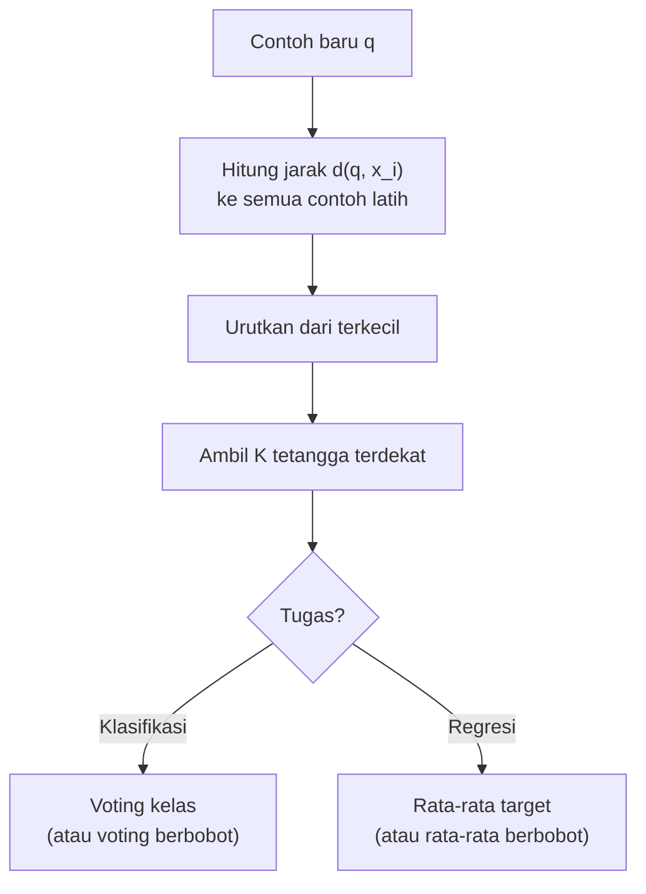
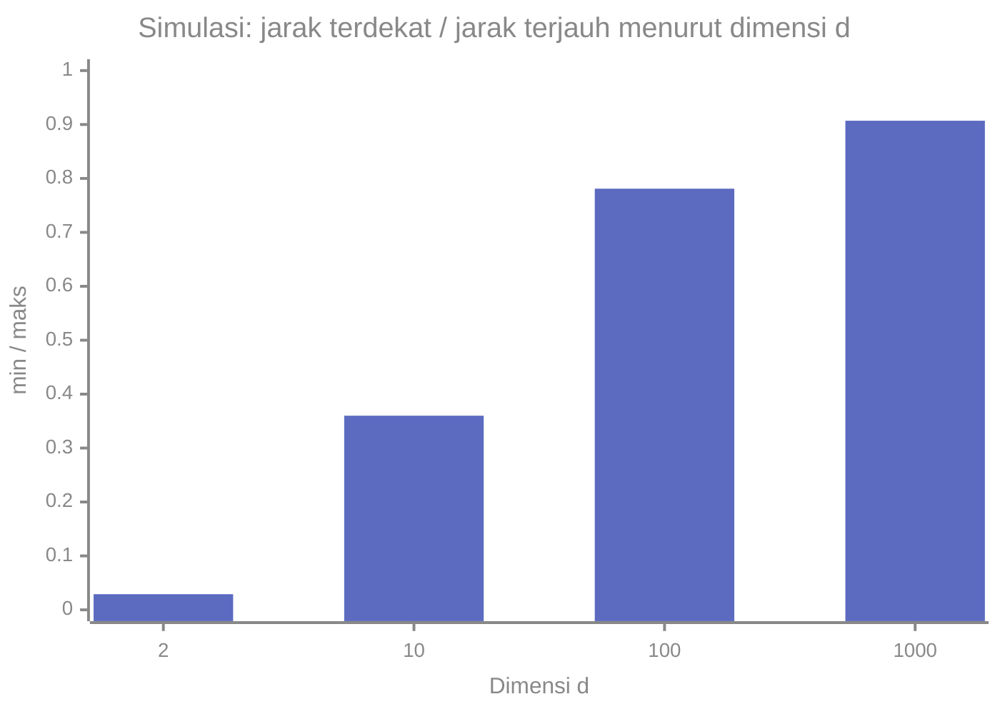

# Part 5 — Matematika K-Nearest Neighbors (KNN)

## Tujuan Pembelajaran

Setelah mempelajari bagian ini, kamu mampu:

- menjelaskan ide KNN: memprediksi dari $K$ contoh latih terdekat;
- menghitung jarak Euclidean, Manhattan, dan Minkowski, serta jarak kosinus untuk teks;
- menjalankan KNN secara manual: hitung jarak, urutkan, ambil $K$ tetangga, lalu voting atau rata-rata;
- menjelaskan pengaruh $K$ terhadap *overfitting* dan *underfitting*, dan cara memilihnya;
- menghitung KNN berbobot (*weighted KNN*) dan menjelaskan kapan hasilnya berbeda;
- menunjukkan bahwa skala fitur dapat mengubah tetangga terdekat dan hasil prediksi;
- menjelaskan kutukan dimensi (*curse of dimensionality*) secara intuitif;
- menerapkan KNN dengan kosinus pada vektor TF-IDF untuk klasifikasi teks.

## Prasyarat

[Part 2 — Representasi Data dan Feature Engineering](02-representasi-data-dan-feature-engineering.md) (penskalaan, TF-IDF, kosinus); [Level 2 Part 2 — Vektor](../level-2-aljabar-linear-dan-kalkulus/02-vektor.md) (norma, jarak, dot product, kosinus); [Part 1](01-pengantar-matematika-ml.md) (hiperparameter, *overfitting*).

## Masalah yang Ingin Diselesaikan

Kita ingin memprediksi kelas (atau nilai) contoh baru **tanpa membangun persamaan**. Gagasan KNN sangat langsung: *"contoh yang mirip cenderung punya label yang sama."* Untuk contoh baru $\mathbf{q}$, cari $K$ contoh latih paling mirip (paling dekat), lalu pinjam label mereka.

KNN tidak "belajar" parameter. Tahap *training*-nya hanyalah **menyimpan** data latih; seluruh pekerjaan dilakukan saat prediksi (karena itu disebut *lazy learning*). Satu-satunya yang dipilih adalah hiperparameter $K$ dan ukuran jarak.



## Intuisi dan Istilah Penting

### 1. Ukuran Jarak

Untuk dua vektor fitur $\mathbf{a}, \mathbf{b} \in \mathbb{R}^d$ (Level 2 Part 2):

| Jarak | Rumus | Intuisi |
|---|---|---|
| **Euclidean** ($L_2$) | $d_2(\mathbf{a}, \mathbf{b}) = \sqrt{\sum_{j=1}^{d}(a_j - b_j)^2}$ | garis lurus ("jarak gagak terbang") |
| **Manhattan** ($L_1$) | $d_1(\mathbf{a}, \mathbf{b}) = \sum_{j=1}^{d}\lvert a_j - b_j \rvert$ | jumlah selisih per fitur ("jarak kota berpetak") |
| **Minkowski** ($L_p$) | $d_p(\mathbf{a}, \mathbf{b}) = \Bigl(\sum_{j=1}^{d}\lvert a_j - b_j \rvert^{p}\Bigr)^{1/p}$ | bentuk umum; $p = 1$ Manhattan, $p = 2$ Euclidean |
| **Chebyshev** ($p \to \infty$) | $\max_j \lvert a_j - b_j \rvert$ | selisih terbesar pada satu fitur |
| **Kosinus** | $1 - \cos\theta = 1 - \dfrac{\mathbf{a}\cdot\mathbf{b}}{\lVert\mathbf{a}\rVert_2\lVert\mathbf{b}\rVert_2}$ | beda **arah**, mengabaikan panjang |

Contoh: $\mathbf{a} = (1, 2, 3)$ dan $\mathbf{b} = (4, 6, 3)$ memberi selisih $(3, 4, 0)$: Euclidean $\sqrt{9 + 16 + 0} = 5$; Manhattan $3 + 4 + 0 = 7$; Minkowski $p = 3$: $(27 + 64 + 0)^{1/3} = 91^{1/3} \approx 4{,}498$. Untuk selisih yang sama, makin besar $p$ makin besar bobot yang diberikan pada selisih terbesar, dan jarak berkurang mendekati $\max = 4$.

Syarat sebuah ukuran jarak yang sah: tak negatif, nol hanya untuk titik yang sama, simetris, dan memenuhi ketidaksamaan segitiga. Jarak kosinus ($1 - \cos\theta$) tidak memenuhi ketidaksamaan segitiga secara ketat, tetapi dipakai luas untuk teks. Untuk vektor yang sudah dinormalisasi L2 (seperti TF-IDF di Part 2), jarak Euclidean berhubungan langsung dengannya: $d_2 = \sqrt{2(1 - \cos\theta)}$, sehingga urutan tetangga terdekat sama.

### 2. Algoritma KNN

Misalkan $\mathcal{N}_K(\mathbf{q})$ adalah himpunan $K$ contoh latih terdekat dari $\mathbf{q}$.

**Klasifikasi (voting).** Kelas yang paling banyak muncul di antara tetangga:

$$
\hat{y}(\mathbf{q}) = \arg\max_{c}\ \sum_{i \in \mathcal{N}_K(\mathbf{q})} \mathbb{1}\bigl[y^{(i)} = c\bigr]
$$

$\mathbb{1}[\cdot]$ bernilai $1$ bila pernyataan benar dan $0$ bila salah. Bila ada kelas yang imbang, pecahkan dengan aturan tetap (misalnya pilih tetangga terdekat, atau kelas yang lebih sering di data latih). Pada klasifikasi biner, memilih $K$ ganjil menghindari imbang.

**Regresi (rata-rata).** $\hat{y}(\mathbf{q}) = \dfrac{1}{K}\sum_{i \in \mathcal{N}_K(\mathbf{q})} y^{(i)}$.

**Peluang kasar.** Proporsi tetangga kelas $c$, $\dfrac{1}{K}\sum \mathbb{1}[y^{(i)} = c]$, sering dilaporkan sebagai perkiraan peluang, tetapi nilainya kasar (hanya kelipatan $1/K$) dan belum tentu terkalibrasi.

### 3. KNN Berbobot

Tetangga yang lebih dekat sebaiknya lebih berpengaruh. Beri bobot $w_i = \dfrac{1}{d(\mathbf{q}, \mathbf{x}^{(i)})}$ (atau $1/d^2$) dan jumlahkan bobot per kelas:

$$
\hat{y}(\mathbf{q}) = \arg\max_{c}\ \sum_{i \in \mathcal{N}_K(\mathbf{q})} w_i\,\mathbb{1}\bigl[y^{(i)} = c\bigr]
$$

Untuk regresi: $\hat{y} = \dfrac{\sum w_i y^{(i)}}{\sum w_i}$. Bila ada tetangga dengan jarak $0$ (titik persis sama), bobot $1/d$ tak terdefinisi: kasus itu ditangani terpisah (ambil labelnya langsung).

### 4. Memilih $K$

| $K$ | Perilaku | Risiko |
|---|---|---|
| Sangat kecil ($K = 1$) | batas keputusan sangat lekuk, mengikuti setiap contoh | *overfitting*: peka terhadap derau dan pencilan; galat latih $= 0$ (setiap titik adalah tetangga terdekat dirinya sendiri) |
| Sangat besar ($K \to n$) | batas sangat halus; prediksi mendekati kelas mayoritas | *underfitting*; kelas minoritas tertelan |
| Sedang | keseimbangan | dipilih lewat validasi |

$K$ adalah **hiperparameter**: dipilih dengan mencoba beberapa nilai dan memilih yang terbaik pada **data validasi** (atau validasi silang, Part 11), bukan pada data latih. Pada data tidak seimbang, $K$ besar membuat kelas minoritas hampir selalu kalah voting.

### 5. Skala Fitur

KNN seluruhnya bergantung pada jarak, sehingga fitur dengan rentang besar mendominasi. Standardisasi (Part 2), dengan statistik **data latih**, hampir selalu diperlukan untuk fitur numerik berskala berbeda.

### 6. Kutukan Dimensi

Pada ruang berdimensi tinggi, jarak antar titik cenderung **mirip satu sama lain**: titik terdekat dan titik terjauh hampir sama jauhnya, sehingga "terdekat" kehilangan makna. Simulasi (data acak seragam, 200 titik, satu query, seed tetap):



Pada $d = 2$ titik terdekat hanya $2{,}9\%$ sejauh titik terjauh; pada $d = 1000$ sudah $90{,}7\%$. Fitur yang tidak relevan menambah dimensi dan "derau jarak". Pada teks, vektor TF-IDF berdimensi tinggi tetapi sangat jarang, dan kosinus lebih tahan daripada Euclidean pada hitungan mentah karena mengabaikan panjang dokumen.

## Rumus dan Penjelasan Setiap Simbol

| Konsep | Rumus | Arti simbol dan syarat |
|---|---|---|
| Jarak Euclidean | $d_2 = \sqrt{\sum_j (a_j - b_j)^2}$ | $\mathbf{a}, \mathbf{b} \in \mathbb{R}^d$ |
| Jarak Manhattan | $d_1 = \sum_j \lvert a_j - b_j \rvert$ | |
| Jarak Minkowski | $d_p = (\sum_j \lvert a_j - b_j \rvert^p)^{1/p}$ | $p \geq 1$ |
| Jarak kosinus | $1 - \cos\theta$ | vektor bukan nol |
| Tetangga | $\mathcal{N}_K(\mathbf{q})$ | $K$ contoh latih terdekat, $1 \leq K \leq n$ |
| Voting | $\arg\max_c \sum_{i \in \mathcal{N}_K}\mathbb{1}[y^{(i)} = c]$ | $\mathbb{1}[\cdot]$ fungsi indikator |
| Bobot | $w_i = 1/d(\mathbf{q}, \mathbf{x}^{(i)})$ | $d > 0$ |
| Regresi KNN | $\frac{1}{K}\sum y^{(i)}$ atau $\frac{\sum w_i y^{(i)}}{\sum w_i}$ | rata-rata (berbobot) target tetangga |

## Contoh Numerik Langkah demi Langkah

### Contoh 1 — KNN dan pengaruh $K$ (data simulasi dua fitur)

Enam titik latih (dua kelas A dan B) dan query $\mathbf{q} = (4, 4)$:

| Titik | Koordinat | Kelas | $d_2(\mathbf{q}, \cdot)$ | $d_1(\mathbf{q}, \cdot)$ |
|---|---|---|---|---|
| 1 | $(4;\ 4{,}5)$ | B | $0{,}5000$ | $0{,}5$ |
| 2 | $(3, 3)$ | A | $\sqrt{2} = 1{,}4142$ | $2$ |
| 3 | $(6, 4)$ | A | $2{,}0000$ | $2$ |
| 4 | $(5, 6)$ | B | $\sqrt{5} = 2{,}2361$ | $3$ |
| 5 | $(2, 2)$ | A | $\sqrt{8} = 2{,}8284$ | $4$ |
| 6 | $(7, 7)$ | B | $\sqrt{18} = 4{,}2426$ | $6$ |

(Contoh jarak: titik 2: selisih $(-1, -1)$, jadi $\sqrt{1 + 1} = 1{,}4142$ dan $1 + 1 = 2$.) Urutan tetangga dari yang terdekat: titik 1 (B), 2 (A), 3 (A), 4 (B), 5 (A), 6 (B).

| $K$ | Tetangga | Voting | Hasil |
|---|---|---|---|
| 1 | 1 | B: 1 | **B** |
| 3 | 1, 2, 3 | B: 1, A: 2 | **A** |
| 5 | 1, 2, 3, 4, 5 | B: 2, A: 3 | **A** |
| 6 | semua | B: 3, A: 3 | imbang |

Dengan $K = 1$, hasil ditentukan satu titik B yang sangat dekat; $K = 3$ dan $5$ memutuskan A. Pergantian hasil antar $K$ menunjukkan pentingnya memilih $K$ lewat validasi.

### Contoh 2 — KNN berbobot

Pada Contoh 1 dengan $K = 3$: bobot $w = 1/d_2$: titik 1: $\dfrac{1}{0{,}5} = 2$ (B); titik 2: $\dfrac{1}{1{,}4142} = 0{,}7071$ (A); titik 3: $\dfrac{1}{2} = 0{,}5$ (A).

1. Jumlah bobot kelas A: $0{,}7071 + 0{,}5 = 1{,}2071$.
2. Jumlah bobot kelas B: $2$.
3. Hasil berbobot: **B** ($2 > 1{,}2071$), berbeda dari voting tanpa bobot ($A$).

Titik B yang sangat dekat ($d = 0{,}5$) lebih berpengaruh daripada dua titik A yang lebih jauh. Pada $K = 5$ berbobot: B $= 2 + 0{,}4472 = 2{,}4472$ vs A $= 0{,}7071 + 0{,}5 + 0{,}3536 = 1{,}5607$, juga B.

### Contoh 3 — Skala fitur mengubah tetangga

Enam pelanggan (data simulasi): (umur tahun, pendapatan juta rupiah) dengan label 1 (membeli) atau 0 (tidak):

| Pelanggan | Umur | Pendapatan | Label |
|---|---|---|---|
| a | 25 | 4,0 | 0 |
| b | 30 | 9,0 | 1 |
| c | 34 | 8,0 | 1 |
| d | 45 | 5,0 | 0 |
| e | 52 | 5,3 | 0 |
| f | 58 | 11,0 | 1 |

Query $\mathbf{q} = (31;\ 5{,}2)$.

**Tanpa penskalaan.** Jarak Euclidean ke tiap titik: b: $\sqrt{1 + 14{,}44} = 3{,}929$; c: $\sqrt{9 + 7{,}84} = 4{,}104$; a: $\sqrt{36 + 1{,}44} = 6{,}119$; d: $\sqrt{196 + 0{,}04} = 14{,}001$; e: $21{,}0$; f: $27{,}616$. Tetangga terdekat: b (1), c (1), a (0). Dengan $K = 1$ dan $K = 3$ hasilnya **kelas 1**. Selisih umur (puluhan) mendominasi selisih pendapatan (beberapa juta).

**Dengan standardisasi.** Dari data latih: umur rata-rata $40{,}667$, $s = 13{,}049$; pendapatan rata-rata $7{,}05$, $s = 2{,}716$. Setelah standardisasi, jarak ke query: a: $0{,}638$; c: $1{,}056$; d: $1{,}075$; b: $1{,}401$; e: $1{,}610$; f: $2{,}974$. Tetangga terdekat: a (0), c (1), d (0). Dengan $K = 1$ hasilnya **kelas 0**, dan dengan $K = 3$ voting $0, 1, 0$ juga **kelas 0**.

Prediksi berbalik dari 1 menjadi 0 hanya karena penskalaan: pada skala asli, pendapatan hampir tidak berperan; pada skala standar, pendapatan query ($5{,}2$, dekat dengan a, d, dan e) menjadi penting. Mana yang "benar" bergantung pada seberapa relevan masing-masing fitur, tetapi memperlakukan semua fitur secara sebanding setelah standardisasi adalah titik awal yang masuk akal.

### Contoh 4 — KNN dengan kosinus pada teks (data simulasi)

Pakai korpus 10 pesan dari Part 2 (kelas E = Emergency, N = Non-Emergency). Klasifikasikan pesan baru **"tolong ada banjir di jalan"** dengan vektor TF-IDF yang dibangun dari statistik **data latih** (kata di luar kosakata diabaikan).

1. TF-IDF ternormalisasi pesan baru: tolong $0{,}3541$, ada $0{,}4436$, banjir $0{,}5964$, di $0{,}3541$, jalan $0{,}4436$ (banjir mendapat bobot terbesar karena langka: $\mathrm{df} = 1$).
2. Kosinus dengan tiap pesan latih (jarak $= 1 - \cos$), diurutkan:

| Peringkat | Pesan latih | Kelas | Kosinus | Jarak |
|---|---|---|---|---|
| 1 | 1 | E | $0{,}4714$ | $0{,}5286$ |
| 2 | 3 | E | $0{,}4082$ | $0{,}5918$ |
| 3 | 2 | E | $0{,}4054$ | $0{,}5946$ |
| 4 | 10 | N | $0{,}3505$ | $0{,}6495$ |
| 5 | 8 | N | $0{,}2511$ | $0{,}7489$ |

3. $K = 3$: tiga tetangga semuanya E, jadi hasil **Emergency**. $K = 1$: E. $K = 5$: E (3) dan N (2), tetap E, tetapi dengan selisih lebih tipis.
4. Pesan "banjir" dan "jalan" yang memuat kata langka menarik pesan Emergency 3 dan 2. Pesan 10 (Non-Emergency, "ada diskon jalan sehat besok") ikut dekat karena berbagi kata "ada" dan "jalan": contoh kata umum yang menyesatkan.
5. Perhatikan nilai kosinus tertinggi hanya $0{,}47$: bukti yang tidak kuat, wajar untuk korpus 10 pesan. Ini ilustrasi mekanisme, bukan kinerja nyata.

### Contoh 5 — KNN untuk regresi

Tiga tetangga terdekat sebuah query memiliki target $10, 12, 20$ dengan jarak $1, 2, 4$.

1. Rata-rata biasa: $\dfrac{10 + 12 + 20}{3} = 14$.
2. Bobot $1/d$: $1;\ 0{,}5;\ 0{,}25$ (jumlah $1{,}75$).
3. Rata-rata berbobot: $\dfrac{1(10) + 0{,}5(12) + 0{,}25(20)}{1{,}75} = \dfrac{10 + 6 + 5}{1{,}75} = \dfrac{21}{1{,}75} = 12$.
4. Tetangga terdekat (target 10) paling berpengaruh, sehingga prediksi berbobot lebih rendah daripada rata-rata biasa.

## Interpretasi, Asumsi, dan Keterbatasan

- **Asumsi inti:** contoh yang dekat dalam ruang fitur punya label yang mirip. Bila jarak tidak mencerminkan kemiripan yang relevan, KNN buruk.
- **Peka skala dan fitur tak relevan.** Penskalaan wajib untuk fitur numerik; fitur tidak relevan merusak jarak.
- **Biaya prediksi.** Setiap prediksi menghitung jarak ke semua $n$ contoh: waktu $O(n \cdot d)$ tanpa struktur data khusus, dan seluruh data harus disimpan.
- **Kelas tidak seimbang.** Voting mayoritas cenderung menguntungkan kelas besar; $K$ besar memperburuk. Pembobotan jarak atau bobot kelas dapat membantu.
- **Dimensi tinggi** melemahkan makna jarak (bagian 6).
- **Tidak ada model yang dapat ditafsirkan** seperti koefisien; penjelasan prediksi berupa "tetangga mana yang dipakai".
- **Kebocoran.** Standardisasi dan TF-IDF harus dihitung dari data latih; saat validasi, tetangga hanya boleh dari data latih (bukan data validasi itu sendiri).

## Hubungan dengan ML dan NLP

- **Baseline sederhana** untuk klasifikasi dan regresi, sering dipakai untuk memeriksa apakah ruang fitur masuk akal.
- **Pencarian dokumen mirip.** Kosinus pada TF-IDF adalah dasar pencarian dokumen terdekat dan rekomendasi.
- **Klasifikasi teks.** KNN dengan kosinus bekerja wajar pada teks pendek, tetapi lambat pada korpus besar dan tidak sekuat regresi logistik atau SVM linear pada TF-IDF (Part 4 dan 9) dalam banyak kasus; hasil nyata bergantung data.
- **Kelas tidak seimbang.** Pada pesan darurat yang jarang, pilihan $K$ dan pembobotan harus diuji dengan presisi dan recall (Part 11).
- **Imputasi** nilai hilang dengan rata-rata tetangga (*KNN imputation*) memakai gagasan yang sama.

### Python: KNN dari nol

Hanya pustaka standar. Data Contoh 1:

```python
import math
from collections import Counter

def euclid(a, b):
    return math.sqrt(sum((x - y) ** 2 for x, y in zip(a, b)))

def manhattan(a, b):
    return sum(abs(x - y) for x, y in zip(a, b))

print(round(euclid((1, 2, 3), (4, 6, 3)), 4), manhattan((1, 2, 3), (4, 6, 3)))   # 5.0 7
print(round((3 ** 3 + 4 ** 3) ** (1 / 3), 4))                                    # 4.4979

titik = [((4, 4.5), "B"), ((3, 3), "A"), ((6, 4), "A"), ((2, 2), "A"), ((5, 6), "B"), ((7, 7), "B")]
q = (4, 4)
urut = sorted((euclid(q, p), p, c) for p, c in titik)
for d, p, c in urut:
    print(round(d, 4), p, c)
# 0.5 (4, 4.5) B
# 1.4142 (3, 3) A
# 2.0 (6, 4) A
# 2.2361 (5, 6) B
# 2.8284 (2, 2) A
# 4.2426 (7, 7) B

for K in (1, 3, 5):
    tetangga = urut[:K]
    suara = Counter(c for _, _, c in tetangga)
    berbobot = Counter()
    for d, _, c in tetangga:
        berbobot[c] += 1 / d
    print(K, dict(suara), {k: round(v, 4) for k, v in berbobot.items()})
# 1 {'B': 1} {'B': 2.0}
# 3 {'B': 1, 'A': 2} {'B': 2.0, 'A': 1.2071}
# 5 {'B': 2, 'A': 3} {'B': 2.4472, 'A': 1.5607}
```

Pengaruh skala (Contoh 3):

```python
from statistics import mean, stdev

latih = [((25, 4.0), 0), ((30, 9.0), 1), ((34, 8.0), 1), ((45, 5.0), 0), ((52, 5.3), 0), ((58, 11.0), 1)]
qq = (31, 5.2)
mentah = sorted((euclid(qq, p), p, c) for p, c in latih)
print([(round(d, 3), c) for d, _, c in mentah[:3]])      # [(3.929, 1), (4.104, 1), (6.119, 0)]

umur = [p[0] for p, _ in latih]
gaji = [p[1] for p, _ in latih]
ms = (mean(umur), mean(gaji))
ss = (stdev(umur), stdev(gaji))
z = lambda p: tuple((v - m) / s for v, m, s in zip(p, ms, ss))
standar = sorted((euclid(z(qq), z(p)), p, c) for p, c in latih)
print([(round(d, 3), c) for d, _, c in standar[:3]])     # [(0.638, 0), (1.056, 1), (1.075, 0)]
```

KNN dengan kosinus pada TF-IDF (korpus simulasi Part 2):

```python
korpus = [("tolong ada kebakaran di gedung", "E"), ("kecelakaan di jalan tolong kirim ambulans", "E"),
          ("banjir naik tolong evakuasi segera", "E"), ("ada korban kecelakaan butuh ambulans segera", "E"),
          ("kebakaran besar tolong damkar segera", "E"), ("jadwal rapat besok pagi di gedung", "N"),
          ("tolong kirim catatan kuliah besok", "N"), ("makan siang di kantin jalan baru", "N"),
          ("kuliah besok pagi di gedung baru", "N"), ("ada diskon jalan sehat besok", "N")]
dok = [t.split() for t, _ in korpus]
N = len(dok)
df = lambda k: sum(1 for d in dok if k in d)
idf = lambda k: math.log((1 + N) / (1 + df(k))) + 1

def tfidf(d):
    c = Counter(k for k in d if df(k) > 0)             # kata di luar kosakata diabaikan
    v = {k: c[k] * idf(k) for k in c}
    norma = math.sqrt(sum(a * a for a in v.values()))
    return {k: a / norma for k, a in v.items()}

kosinus = lambda a, b: sum(a[k] * b[k] for k in a if k in b)
V = [tfidf(d) for d in dok]
q = tfidf("tolong ada banjir di jalan".split())
sims = sorted(((kosinus(q, v), i + 1, korpus[i][1]) for i, v in enumerate(V)), reverse=True)
for s, i, c in sims[:5]:
    print(round(s, 4), round(1 - s, 4), i, c)
# 0.4714 0.5286 1 E
# 0.4082 0.5918 3 E
# 0.4054 0.5946 2 E
# 0.3505 0.6495 10 N
# 0.2511 0.7489 8 N
for K in (1, 3, 5):
    print(K, dict(Counter(c for _, _, c in sims[:K])))     # 1 {'E': 1} / 3 {'E': 3} / 5 {'E': 3, 'N': 2}
```

**Opsional: bandingkan dengan scikit-learn.** Blok ini membutuhkan scikit-learn, yang **tidak** dipasang oleh proyek ini dan tidak dijalankan oleh situs. Keluaran dijalankan dengan scikit-learn 1.9.0 pada Python 3.14.

```python
from sklearn.feature_extraction.text import TfidfVectorizer
from sklearn.neighbors import KNeighborsClassifier

tf = TfidfVectorizer()
X = tf.fit_transform([t for t, _ in korpus])
y = [c for _, c in korpus]
knn = KNeighborsClassifier(n_neighbors=3, metric="cosine", algorithm="brute").fit(X, y)
Q = tf.transform(["tolong ada banjir di jalan"])
jarak, indeks = knn.kneighbors(Q)
print(jarak.round(4), indeks + 1, knn.predict(Q))
# [[0.5286 0.5918 0.5946]] [[1 3 2]] ['E']
```

Interpretasi: tiga tetangga dan jarak dari hitungan manual sama dengan keluaran `kneighbors` (nomor pesan $1, 3, 2$).

## Kesalahan Umum

| Kesalahan | Mengapa salah | Yang benar |
|---|---|---|
| Tidak menskalakan fitur numerik | fitur berskala besar mendominasi jarak | standardisasi dengan statistik latih |
| Memilih $K$ dengan data latih | $K = 1$ selalu tampak sempurna | pilih lewat validasi |
| Memakai $K$ genap pada klasifikasi biner tanpa aturan imbang | voting imbang | $K$ ganjil atau aturan tetap |
| Memakai bobot $1/d$ saat ada jarak $0$ | pembagian nol | tangani kasus itu terpisah |
| Mengira jarak Euclidean selalu terbaik | bergantung data | uji Manhattan, kosinus |
| Memakai jarak Euclidean pada hitungan kata mentah untuk teks | dokumen panjang tampak jauh | kosinus atau TF-IDF ternormalisasi |
| Menggunakan data validasi sebagai tetangga saat validasi | kebocoran | tetangga hanya dari data latih |
| Mengabaikan dimensi tinggi dan fitur tak relevan | jarak kehilangan makna | seleksi fitur, reduksi dimensi (Part 12) |
| Menganggap proporsi tetangga adalah probabilitas terkalibrasi | kasar dan tidak dijamin akurat | periksa kalibrasi |

## Latihan Mandiri

1. Hitung jarak Euclidean, Manhattan, dan Minkowski $p = 3$ antara $(1, 2, 3)$ dan $(4, 6, 3)$.
2. Query $(4, 4)$ dan data Contoh 1. Tentukan hasil KNN untuk $K = 1, 3, 5$ dengan jarak Euclidean.
3. Ulangi $K = 3$ dengan bobot $1/d$. Mengapa hasilnya berbeda dari soal 2?
4. Mengapa galat latih KNN dengan $K = 1$ selalu $0$ (bila tidak ada titik duplikat berlabel berbeda)? Mengapa itu bukan pertanda model baik?
5. Pada Contoh 3, hitung jarak Euclidean mentah dari query $(31;\ 5{,}2)$ ke pelanggan a dan b. Mengapa pelanggan b yang lebih dekat pada skala mentah?
6. Standardisasi (dengan rata-rata umur $40{,}667$, $s_{\text{umur}} = 13{,}049$, rata-rata pendapatan $7{,}05$, $s_{\text{pendapatan}} = 2{,}716$) query $(31;\ 5{,}2)$ dan pelanggan a $(25;\ 4{,}0)$, lalu hitung jarak Euclidean terstandardisasinya.
7. Dua vektor TF-IDF ternormalisasi $\mathbf{a} = (0{,}6;\ 0{,}8;\ 0)$ dan $\mathbf{b} = (0{,}8;\ 0{,}6;\ 0)$. Hitung kosinus, jarak kosinus, dan jarak Euclidean, lalu periksa hubungan $d_2 = \sqrt{2(1 - \cos\theta)}$.
8. Tiga tetangga memiliki target $10, 12, 20$ dengan jarak $1, 2, 4$. Hitung prediksi regresi KNN biasa dan berbobot $1/d$.
9. Pada simulasi, rasio jarak terdekat terhadap terjauh adalah $0{,}029$ untuk $d = 2$ dan $0{,}907$ untuk $d = 1000$. Jelaskan artinya bagi KNN.
10. Pesan baru "jadwal kuliah besok di gedung" memiliki kosinus dengan pesan latih $6, 9, 7, 1, 10$ berturut-turut $0{,}6637;\ 0{,}6296;\ 0{,}3683;\ 0{,}3250;\ 0{,}1327$. Klasifikasikan untuk $K = 3$ dan $K = 5$ (kelas pesan: 6 N, 9 N, 7 N, 1 E, 10 N).

## Kunci Jawaban dan Pembahasan

??? success "Soal 1"
    Selisih $(3, 4, 0)$. Euclidean: $\sqrt{9 + 16 + 0} = 5$. Manhattan: $3 + 4 + 0 = 7$. Minkowski $p = 3$: $(27 + 64 + 0)^{1/3} = 91^{1/3} \approx 4{,}498$.

??? success "Soal 2"
    Tetangga terurut: titik 1 (B, $0{,}5$), 2 (A, $1{,}414$), 3 (A, $2$), 4 (B, $2{,}236$), 5 (A, $2{,}828$). $K = 1$: B. $K = 3$: B 1, A 2, jadi A. $K = 5$: B 2, A 3, jadi A.

??? success "Soal 3"
    Bobot: titik 1 (B) $= 2$; titik 2 (A) $= 0{,}7071$; titik 3 (A) $= 0{,}5$. A: $1{,}2071$; B: $2$. Hasil berbobot: B. Berbeda karena titik B sangat dekat ($0{,}5$) sehingga bobotnya melampaui jumlah bobot dua titik A yang lebih jauh, sedangkan voting tanpa bobot menghitung tiap tetangga sama.

??? success "Soal 4"
    Setiap titik latih adalah tetangga terdekat bagi dirinya sendiri (jarak $0$), sehingga prediksinya selalu sama dengan labelnya sendiri: galat latih nol. Itu bukan pertanda model baik; model "menghafal" dan sangat peka derau, sehingga galat pada data baru bisa besar (*overfitting*, Part 1).

??? success "Soal 5"
    Pelanggan a $(25;\ 4{,}0)$: selisih $(6;\ 1{,}2)$, jarak $\sqrt{36 + 1{,}44} = \sqrt{37{,}44} \approx 6{,}119$. Pelanggan b $(30;\ 9{,}0)$: selisih $(1;\ 3{,}8)$, jarak $\sqrt{1 + 14{,}44} = \sqrt{15{,}44} \approx 3{,}929$. Selisih umur pada a (6) jauh lebih berpengaruh daripada selisih pendapatan karena kuadratnya (36) dibanding $1{,}44$; b hanya berbeda 1 tahun, sehingga ia lebih dekat walaupun pendapatannya berbeda $3{,}8$ juta.

??? success "Soal 6"
    Query: $z_{\text{umur}} = \dfrac{31 - 40{,}667}{13{,}049} = -0{,}741$; $z_{\text{pendapatan}} = \dfrac{5{,}2 - 7{,}05}{2{,}716} = -0{,}681$. Pelanggan a: $z_{\text{umur}} = \dfrac{25 - 40{,}667}{13{,}049} = -1{,}201$; $z_{\text{pendapatan}} = \dfrac{4 - 7{,}05}{2{,}716} = -1{,}123$. Selisih: $0{,}460$ dan $0{,}442$. Jarak $= \sqrt{0{,}2116 + 0{,}1954} = \sqrt{0{,}407} \approx 0{,}638$. Dibanding $6{,}119$ pada skala mentah: pada skala standar, a menjadi tetangga terdekat.

??? success "Soal 7"
    $\cos\theta = 0{,}6 \times 0{,}8 + 0{,}8 \times 0{,}6 + 0 = 0{,}96$. Jarak kosinus $= 1 - 0{,}96 = 0{,}04$. Jarak Euclidean $= \sqrt{(0{,}6 - 0{,}8)^2 + (0{,}8 - 0{,}6)^2} = \sqrt{0{,}08} \approx 0{,}2828$. Periksa: $\sqrt{2 \times 0{,}04} = \sqrt{0{,}08} = 0{,}2828$. Cocok.

??? success "Soal 8"
    Biasa: $\dfrac{10 + 12 + 20}{3} = 14$. Berbobot: $\dfrac{1(10) + 0{,}5(12) + 0{,}25(20)}{1{,}75} = \dfrac{21}{1{,}75} = 12$. Tetangga terdekat paling berpengaruh pada versi berbobot.

??? success "Soal 9"
    Pada $d = 2$ titik terdekat jauh lebih dekat daripada yang terjauh (rasio $0{,}029$), jadi "terdekat" bermakna. Pada $d = 1000$ rasionya $0{,}907$: titik terdekat hampir sama jauhnya dengan titik terjauh, sehingga peringkat jarak kurang membedakan dan KNN menjadi kurang andal. Perlu mengurangi dimensi atau membuang fitur tak relevan.

??? success "Soal 10"
    Urutan tetangga: pesan 6 (N), 9 (N), 7 (N), 1 (E), 10 (N). $K = 3$: N, N, N, jadi **Non-Emergency**. $K = 5$: N, N, N, E, N, jadi N (4 lawan 1). Konsisten: pesan baru tentang jadwal kuliah mirip pesan Non-Emergency.

## Ringkasan Materi

- KNN memprediksi dari $K$ tetangga terdekat: voting (klasifikasi) atau rata-rata (regresi); tidak ada parameter yang dipelajari, hanya $K$ dan ukuran jarak.
- Jarak: Euclidean ($L_2$), Manhattan ($L_1$), Minkowski ($L_p$), dan kosinus (untuk teks, mengabaikan panjang). Untuk vektor ternormalisasi L2, $d_2 = \sqrt{2(1 - \cos\theta)}$.
- $K$ kecil: lekuk dan *overfitting*; $K$ besar: halus dan *underfitting*; pilih lewat validasi.
- KNN berbobot ($w = 1/d$) memberi pengaruh lebih pada tetangga dekat dan dapat membalik hasil.
- Skala fitur sangat berpengaruh: standardisasi (statistik latih) dapat mengubah tetangga dan prediksi.
- Kutukan dimensi: pada $d$ besar jarak terdekat dan terjauh hampir sama; fitur tak relevan memperburuk.
- Pada NLP, TF-IDF dan kosinus memberi KNN yang berfungsi untuk teks pendek; angka contoh adalah simulasi.

## Checklist Penguasaan

- [ ] Menghitung jarak Euclidean, Manhattan, Minkowski, dan kosinus.
- [ ] Menjalankan KNN manual (urutkan, ambil $K$, voting) dan versi berbobot.
- [ ] Menjelaskan pengaruh $K$ terhadap *overfitting* dan *underfitting*.
- [ ] Menunjukkan pengaruh penskalaan terhadap tetangga dan prediksi.
- [ ] Menjelaskan kutukan dimensi dan alasan memakai kosinus untuk teks.
- [ ] Menghitung KNN regresi biasa dan berbobot.

## Prasyarat untuk Materi Berikutnya

[Part 6 — Matematika Naive Bayes](06-naive-bayes.md) memakai pendekatan yang sangat berbeda: mengestimasi peluang kata per kelas dan menggabungkannya dengan Teorema Bayes. Pastikan Teorema Bayes dan Laplace smoothing dari Level 3 Part 6 sudah jelas.
