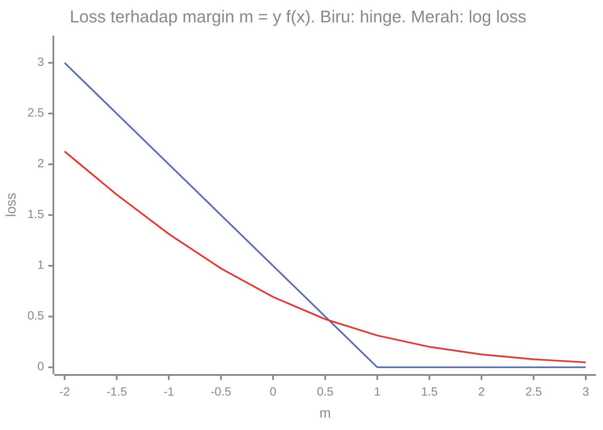

# Part 9 — Matematika Support Vector Machine (SVM)

## Tujuan Pembelajaran

Setelah mempelajari bagian ini, kamu mampu:

- menjelaskan ide SVM: memilih batas keputusan linear dengan margin terbesar;
- menghitung jarak titik ke hiperbidang dan lebar margin $2/\lVert\mathbf{w}\rVert_2$;
- menyebut masalah optimasi *hard margin* dan mengenali *support vector*;
- menghitung *hinge loss* dan menjelaskan *soft margin* dengan variabel slack dan parameter $C$;
- menjelaskan pengaruh $C$ terhadap lebar margin, jumlah *support vector*, dan *overfitting*;
- menjelaskan secara intuitif *kernel trick*, dan menghitung kernel polinomial dan RBF;
- membedakan skor SVM dari probabilitas, dan menjelaskan perlunya penskalaan fitur;
- menghubungkan Linear SVM dengan klasifikasi teks (TF-IDF).

## Prasyarat

[Part 4 — Regresi Logistik](04-regresi-logistik.md) (batas keputusan datar, loss); [Level 2 Part 2](../level-2-aljabar-linear-dan-kalkulus/02-vektor.md) (norma, dot product, jarak); [Part 2](02-representasi-data-dan-feature-engineering.md) (TF-IDF, peta fitur $\varphi$, penskalaan).

## Masalah yang Ingin Diselesaikan

Untuk dua kelas yang dapat dipisahkan oleh garis (atau bidang), biasanya ada **banyak** garis yang memisahkan data latih dengan benar. Yang mana yang dipilih? Regresi logistik memilih berdasarkan *log loss*. **SVM** memilih garis yang **paling jauh dari kedua kelas**, yaitu yang memberi **margin terbesar**: ruang kosong selebar mungkin di antara kelas. Gagasannya: batas yang jauh dari semua titik latih lebih aman terhadap derau dan titik baru.

## Intuisi dan Istilah Penting

### 1. Notasi dan Fungsi Keputusan

SVM biasanya memakai label $y \in \{-1, +1\}$ (bukan $\{0, 1\}$; konversi $y' = 2y - 1$). Model:

$$
f(\mathbf{x}) = \mathbf{w}\cdot\mathbf{x} + b, \qquad \hat{y} = \mathrm{sign}\bigl(f(\mathbf{x})\bigr)
$$

$f(\mathbf{x})$ adalah **skor** (bukan probabilitas!). Batas keputusan adalah $f(\mathbf{x}) = 0$; titik di sisi $f > 0$ diprediksi $+1$.

### 2. Jarak ke Hiperbidang dan Margin

Jarak titik $\mathbf{x}$ ke bidang $\mathbf{w}\cdot\mathbf{x} + b = 0$ adalah (Level 2 Part 2):

$$
\text{jarak} = \frac{\lvert \mathbf{w}\cdot\mathbf{x} + b \rvert}{\lVert\mathbf{w}\rVert_2}
$$

Titik terklasifikasi benar jika $y\,f(\mathbf{x}) > 0$. **Margin fungsional** $y\,f(\mathbf{x})$ bernilai positif bila benar dan makin besar bila makin yakin. Karena $(\mathbf{w}, b)$ dapat diskalakan tanpa mengubah batas, kita menetapkan skala ***kanonik***: titik terdekat ke batas memenuhi $y\,f(\mathbf{x}) = 1$. Maka dua bidang **margin** adalah $f = +1$ dan $f = -1$, dan jarak antar keduanya (lebar margin) adalah

$$
\text{lebar margin} = \frac{2}{\lVert\mathbf{w}\rVert_2}
$$

Memaksimalkan lebar margin sama dengan **meminimalkan $\lVert\mathbf{w}\rVert_2$**.

### 3. SVM *Hard Margin*

Untuk data yang dapat dipisahkan sempurna:

$$
\min_{\mathbf{w},\, b}\ \frac{1}{2}\lVert\mathbf{w}\rVert_2^2
\qquad\text{dengan syarat}\qquad
y^{(i)}\bigl(\mathbf{w}\cdot\mathbf{x}^{(i)} + b\bigr) \geq 1\ \ \text{untuk semua } i
$$

(faktor $\frac{1}{2}$ dan kuadrat hanya memudahkan perhitungan). **Support vector** adalah titik yang tepat berada di bidang margin ($y\,f = 1$): **hanya** titik-titik inilah yang menentukan solusi. Menghapus titik lain yang jauh tidak mengubah garis, dan itu membedakan SVM dari model yang memakai semua titik.

### 4. SVM *Soft Margin* dan *Hinge Loss*

Data nyata sering tidak dapat dipisahkan sempurna atau punya derau. *Soft margin* mengizinkan pelanggaran dengan **variabel slack** $\xi_i \geq 0$:

$$
\min_{\mathbf{w},\, b,\, \xi_1,\dots,\xi_n}\ \frac{1}{2}\lVert\mathbf{w}\rVert_2^2 + C\sum_{i=1}^{n}\xi_i
\qquad\text{dengan}\qquad
y^{(i)}f\bigl(\mathbf{x}^{(i)}\bigr) \geq 1 - \xi_i,\ \ \xi_i \geq 0
$$

Slack terkecil yang mungkin untuk titik $i$ adalah $\xi_i = \max\bigl(0,\ 1 - y^{(i)}f(\mathbf{x}^{(i)})\bigr)$, disebut ***hinge loss***. Jadi SVM sama dengan meminimalkan

$$
\frac{1}{2}\lVert\mathbf{w}\rVert_2^2 + C\sum_{i=1}^{n}\max\bigl(0,\ 1 - y^{(i)}f(\mathbf{x}^{(i)})\bigr)
$$

Suku pertama menjaga margin lebar (juga berperan sebagai regularisasi L2, Part 12); suku kedua menghukum titik yang melanggar margin. **Hinge loss** dalam terminologi margin fungsional $m = y\,f(\mathbf{x})$:

| $m$ | $-2$ | $-1$ | $0$ | $0{,}5$ | $1$ | $2$ |
|---|---|---|---|---|---|---|
| Hinge $\max(0, 1 - m)$ | $3$ | $2$ | $1$ | $0{,}5$ | $0$ | $0$ |
| *Log loss* $\ln(1 + e^{-m})$ | $2{,}1269$ | $1{,}3133$ | $0{,}6931$ | $0{,}4741$ | $0{,}3133$ | $0{,}1269$ |

Hinge loss bernilai nol begitu titik berada di luar margin ($m \geq 1$), sedangkan *log loss* tidak pernah tepat nol (terus mendorong keyakinan). Keduanya naik bila prediksi salah ($m < 0$).



**Parameter $C$** mengatur keseimbangan:

| $C$ | Perilaku | Risiko |
|---|---|---|
| Besar | pelanggaran sangat mahal: margin menyempit agar titik latih terklasifikasi benar | *overfitting*, peka terhadap pencilan |
| Kecil | pelanggaran murah: margin lebar, banyak titik di dalam atau melewati margin | *underfitting* |

$C$ adalah **hiperparameter**, dipilih lewat validasi. (Kebalikannya dari kekuatan regularisasi $\alpha$ di Part 12: $C$ besar berarti regularisasi lemah.)

### 5. *Kernel Trick* secara Intuitif

Data yang tidak dapat dipisahkan oleh garis pada ruang asli kadang dapat dipisahkan **setelah dipetakan ke dimensi lebih tinggi** (Part 2): untuk $x = -2, -1, 0, 1, 2$ dengan kelas $+1, -1, -1, -1, +1$, tidak ada ambang pada $x$ yang memisahkannya. Dengan peta $\varphi(x) = (x, x^2)$ titik menjadi $(-2, 4), (-1, 1), (0, 0), (1, 1), (2, 4)$, dan garis $x^2 = 2{,}5$ memisahkan kelas $+1$ (di atas) dari $-1$ (di bawah).

Pelatihan SVM sebenarnya hanya memakai **hasil kali dalam** antar pasangan titik $\mathbf{x}\cdot\mathbf{z}$. **Fungsi kernel** $K(\mathbf{x}, \mathbf{z}) = \varphi(\mathbf{x})\cdot\varphi(\mathbf{z})$ menghitung hasil kali dalam di ruang berdimensi tinggi **tanpa pernah membentuk** $\varphi$ secara eksplisit. Bentuk keputusannya:

$$
f(\mathbf{x}) = \sum_{i \in \text{SV}} \alpha_i\, y^{(i)} K\bigl(\mathbf{x}^{(i)}, \mathbf{x}\bigr) + b
$$

dengan $\alpha_i > 0$ hanya untuk *support vector* (koefisien ini berasal dari bentuk dual masalah optimasi, yang tidak diturunkan di sini).

**Kernel polinomial derajat 2:** $K(\mathbf{a}, \mathbf{b}) = (\mathbf{a}\cdot\mathbf{b})^2$ untuk masukan dua dimensi sama dengan $\varphi(\mathbf{a})\cdot\varphi(\mathbf{b})$ dengan $\varphi(\mathbf{x}) = (x_1^2,\ \sqrt{2}x_1x_2,\ x_2^2)$. Contoh: $\mathbf{a} = (1, 2)$, $\mathbf{b} = (3, 1)$: $\mathbf{a}\cdot\mathbf{b} = 5$, jadi $K = 25$; sementara $\varphi(\mathbf{a}) = (1,\ 2\sqrt{2},\ 4)$, $\varphi(\mathbf{b}) = (9,\ 3\sqrt{2},\ 1)$ dan $\varphi(\mathbf{a})\cdot\varphi(\mathbf{b}) = 9 + 12 + 4 = 25$. Sama.

**Kernel RBF** (*Gaussian*): $K(\mathbf{a}, \mathbf{b}) = \exp\bigl(-\gamma\lVert\mathbf{a} - \mathbf{b}\rVert_2^2\bigr)$ adalah ukuran **kemiripan** antara $0$ dan $1$ (satu untuk titik identik, mendekati nol untuk titik jauh). Hiperparameter $\gamma > 0$ mengatur seberapa cepat kemiripan menurun: untuk $\mathbf{a} = (1, 2)$, $\mathbf{b} = (3, 1)$, $\lVert\mathbf{a} - \mathbf{b}\rVert^2 = 5$: $\gamma = 0{,}1$ memberi $K = e^{-0{,}5} = 0{,}6065$; $\gamma = 1$ memberi $K = e^{-5} = 0{,}0067$. $\gamma$ besar membuat batas sangat lekuk (*overfitting*); $\gamma$ kecil membuat batas halus.

Kernel dibutuhkan bila hubungan nonlinear; untuk teks berdimensi tinggi, kernel linear biasanya sudah cukup (bagian NLP).

### 6. Sifat dan Catatan Penting

- **Skor, bukan probabilitas.** Keluaran $f(\mathbf{x})$ adalah jarak bertanda yang diskalakan; ia tidak berada di $[0, 1]$. Untuk probabilitas diperlukan kalibrasi tambahan.
- **Peka skala fitur.** Margin dihitung di ruang fitur, sehingga fitur berskala besar mendominasi; standardisasi (Part 2) hampir selalu diperlukan untuk fitur numerik.
- **Hanya *support vector* yang menentukan model**; biaya prediksi bergantung pada jumlahnya.
- **Biaya pelatihan** dapat besar untuk data sangat banyak dengan kernel nonlinear.
- **Kelas tidak seimbang.** $C$ yang sama untuk semua kelas membuat kelas mayoritas mendominasi; bobot kelas dapat dipakai.

## Rumus dan Penjelasan Setiap Simbol

| Konsep | Rumus | Arti simbol dan syarat |
|---|---|---|
| Fungsi keputusan | $f(\mathbf{x}) = \mathbf{w}\cdot\mathbf{x} + b$ | $\hat{y} = \mathrm{sign}(f)$, $y \in \{-1, +1\}$ |
| Jarak ke bidang | $\dfrac{\lvert f(\mathbf{x}) \rvert}{\lVert\mathbf{w}\rVert_2}$ | $\mathbf{w} \neq \mathbf{0}$ |
| Lebar margin | $\dfrac{2}{\lVert\mathbf{w}\rVert_2}$ | skala kanonik $y f = 1$ di titik margin |
| *Hard margin* | $\min \frac{1}{2}\lVert\mathbf{w}\rVert^2$, s.t. $y f \geq 1$ | data harus terpisah sempurna |
| *Hinge loss* | $\max(0,\ 1 - y f)$ | nol bila di luar margin |
| *Soft margin* | $\frac{1}{2}\lVert\mathbf{w}\rVert^2 + C\sum\max(0, 1 - y f)$ | $C > 0$ hiperparameter |
| Kernel polinomial | $K(\mathbf{a}, \mathbf{b}) = (\mathbf{a}\cdot\mathbf{b} + c)^d$ | $d$ derajat |
| Kernel RBF | $K(\mathbf{a}, \mathbf{b}) = e^{-\gamma\lVert\mathbf{a} - \mathbf{b}\rVert^2}$ | $\gamma > 0$ |

## Contoh Numerik Langkah demi Langkah

### Contoh 1 — Margin maksimum pada empat titik

Data simulasi dua fitur: negatif ($y = -1$): $N_1 = (0, 0)$ dan $N_2 = (1, 0)$; positif ($y = +1$): $P_1 = (2, 2)$ dan $P_2 = (3, 2)$.

**Mencari margin maksimum.** Pasangan titik berlawanan kelas yang paling dekat adalah $N_2$ dan $P_1$, dengan jarak $\sqrt{(2 - 1)^2 + (2 - 0)^2} = \sqrt{5} = 2{,}2361$. Batas keputusan terbaik tegak lurus terhadap segmen itu dan melewati titik tengahnya.

1. Arah $\mathbf{w}$ sejajar dengan $P_1 - N_2 = (1, 2)$: $\mathbf{w} = a(1, 2)$.
2. Titik tengah $\left(\dfrac{1 + 2}{2},\ \dfrac{0 + 2}{2}\right) = (1{,}5;\ 1)$ berada di batas: $a(1{,}5 + 2) + b = 0 \Rightarrow b = -3{,}5a$.
3. Skala kanonik pada $P_1$: $y f(P_1) = a(2 + 4) - 3{,}5a = 2{,}5a = 1 \Rightarrow a = 0{,}4$.
4. Jadi $\mathbf{w} = (0{,}4;\ 0{,}8)$ dan $b = -1{,}4$.

**Memeriksa syarat** $y\,f \geq 1$:

| Titik | $f = 0{,}4x_1 + 0{,}8x_2 - 1{,}4$ | $y\,f$ | Status |
|---|---|---|---|
| $N_1 = (0, 0)$ | $-1{,}4$ | $1{,}4$ | di luar margin |
| $N_2 = (1, 0)$ | $-1{,}0$ | $1{,}0$ | ***support vector*** |
| $P_1 = (2, 2)$ | $1{,}0$ | $1{,}0$ | ***support vector*** |
| $P_2 = (3, 2)$ | $1{,}4$ | $1{,}4$ | di luar margin |

Lebar margin $= \dfrac{2}{\lVert\mathbf{w}\rVert_2} = \dfrac{2}{\sqrt{0{,}16 + 0{,}64}} = \dfrac{2}{0{,}8944} = 2{,}2361 = \sqrt{5}$, tepat sama dengan jarak $N_2$ ke $P_1$.

**Pembanding.** Garis horizontal $x_2 = 1$ ($\mathbf{w} = (0, 1)$, $b = -1$) juga memisahkan sempurna: $y f = 1$ pada keempat titik, margin $\dfrac{2}{1} = 2$, **lebih sempit** dari $2{,}2361$. Hanya $N_2$ dan $P_1$ yang menentukan margin terbaik; menghapus $N_1$ atau $P_2$ tidak mengubah garis.

### Contoh 2 — Hinge loss

Hitung *hinge loss* $\max(0, 1 - y f)$ untuk beberapa kasus.

1. $y = +1$, $f = 2$: $y f = 2$, loss $= \max(0, -1) = 0$ (benar dan di luar margin).
2. $y = +1$, $f = 0{,}5$: $y f = 0{,}5$, loss $= 0{,}5$ (benar tetapi di dalam margin).
3. $y = +1$, $f = -1$: $y f = -1$, loss $= 2$ (salah).
4. $y = -1$, $f = 0{,}3$: $y f = -0{,}3$, loss $= 1{,}3$ (salah, dekat batas).

Titik yang benar dan cukup jauh tidak menyumbang apa pun; hanya titik di dalam atau di sisi salah margin yang memengaruhi solusi.

### Contoh 3 — Pengaruh $C$ pada data satu dimensi

Data simulasi satu fitur: $x = 0, 1, 2, 2{,}5, 4, 5$ dengan label $-1, -1, -1, +1, +1, +1$. Titik $x = 2$ (negatif) dan $x = 2{,}5$ (positif) sangat berdekatan.

**Dua kandidat.** (a) Margin sempit *hard-margin*: batas di $t = 2{,}25$ dengan $w = 4$, $b = -9$: $y f$ pada $x = 2$ dan $2{,}5$ sama dengan $1$, semua $\xi_i = 0$. Nilai tujuan $\frac{1}{2}w^2 = 8$. (b) Margin lebar: batas di $t = 2{,}25$ dengan $w = 1$, $b = -2{,}25$: $f(2) = -0{,}25 \Rightarrow y f = 0{,}25$, slack $\xi = 0{,}75$; $f(2{,}5) = 0{,}25 \Rightarrow \xi = 0{,}75$; titik lain di luar margin. Tujuan $= \frac{1}{2}(1)^2 + C(1{,}5) = 0{,}5 + 1{,}5C$.

| $C$ | Tujuan (a): $8$ | Tujuan (b): $0{,}5 + 1{,}5C$ | Lebih baik |
|---|---|---|---|
| $1$ | $8$ | $2{,}0$ | (b) margin lebar |
| $5$ | $8$ | $8{,}0$ | seri |
| $10$ | $8$ | $15{,}5$ | (a) margin sempit |

$C$ kecil lebih memilih margin lebar dengan pelanggaran; $C$ besar lebih memilih tidak ada pelanggaran dengan margin sempit.

**Solusi optimum sebenarnya** (dari penyelesai SVM, scikit-learn 1.9.0): 

| $C$ | $w$ | Batas $t$ | Lebar margin | Banyak *support vector* | Nilai tujuan |
|---|---|---|---|---|---|
| $0{,}1$ | $0{,}4$ | $2{,}5$ | $5{,}0$ | $6$ | $0{,}34$ |
| $1$ | $0{,}667$ | $2{,}5$ | $3{,}0$ | $4$ | $1{,}889$ |
| $5$ | $2{,}5$ | $2{,}25$ | $0{,}8$ | $2$ | $6{,}875$ |
| $10$ | $4{,}0$ | $2{,}25$ | $0{,}5$ | $2$ | $8{,}0$ |
| $1000$ | $4{,}0$ | $2{,}25$ | $0{,}5$ | $2$ | $8{,}0$ |

Dengan $C$ naik: margin menyempit ($5{,}0 \to 0{,}5$), *support vector* berkurang, dan solusi mendekati *hard margin* ($w = 4$). Pada $C = 5$ optimumnya ($6{,}875$) lebih baik daripada kedua kandidat tangan ($8$), memakai nilai $w = 2{,}5$ di antaranya.

### Contoh 4 — *Kernel trick* dengan angka

1. Data $x = -2, -1, 0, 1, 2$ dengan kelas $+1, -1, -1, -1, +1$ tidak dapat dipisahkan oleh ambang pada $x$.
2. Peta $\varphi(x) = (x, x^2)$: titik $(-2, 4), (-1, 1), (0, 0), (1, 1), (2, 4)$.
3. Pada koordinat kedua ($x^2$), kelas $+1$ bernilai $4$ dan kelas $-1$ bernilai $\leq 1$: batas $x^2 = 2{,}5$ memisahkan sempurna. Model linear di ruang $\varphi$ ($f = x^2 - 2{,}5$) menjadi batas **kuadrat** di ruang asli.
4. Kernel: untuk $\mathbf{a} = (1, 2)$ dan $\mathbf{b} = (3, 1)$ pada kernel polinomial derajat 2: $(\mathbf{a}\cdot\mathbf{b})^2 = 25 = \varphi(\mathbf{a})\cdot\varphi(\mathbf{b})$, tanpa membentuk $\varphi$ secara eksplisit.

### Contoh 5 — Linear SVM pada teks (data simulasi)

Pada korpus simulasi 10 pesan (Part 2, TF-IDF), SVM linear dengan $C = 1$ (label E $= +1$, N $= -1$):

1. Akurasi latih $= 1{,}0$ (data terpisah linear). Skor pesan baru "tolong ada banjir di jalan" adalah $f = +0{,}4393$ (positif, jadi **Emergency**); "jadwal kuliah besok di gedung": $f = -0{,}9174$ (**Non-Emergency**). Jarak ke batas $= \lvert f \rvert/\lVert\mathbf{w}\rVert$.
2. Bobot terbesar yang mendorong ke E: *tolong* ($+0{,}768$), *kebakaran* ($+0{,}758$), *segera* ($+0{,}697$), *kecelakaan* ($+0{,}677$); ke N: *besok* ($-1{,}009$), *catatan* ($-0{,}556$), *kuliah* ($-0{,}500$), *diskon* ($-0{,}486$).
3. Pengaruh $C$ (lebar margin; banyak *support vector* dari 10): $C = 0{,}1$: $5{,}52$; $10$. $C = 1$: $0{,}756$; $10$. $C = 10$: $0{,}674$; $9$. $C = 100$: $0{,}674$; $9$. Pada data kecil dengan dimensi $29$, hampir **semua** titik menjadi *support vector*.
4. Semua angka adalah simulasi pada 10 pesan: mekanisme saja, bukan kinerja nyata.

## Interpretasi, Asumsi, dan Keterbatasan

- **Margin besar sebagai pengaturan kompleksitas.** Memaksimalkan margin bertindak sebagai regularisasi; hasilnya sering baik pada dimensi tinggi.
- **Linear atau dengan kernel.** Kernel linear menghasilkan batas datar; kernel RBF dan polinomial memungkinkan batas lekuk dengan lebih banyak hiperparameter ($\gamma$, derajat) yang harus dipilih lewat validasi.
- **Skor, bukan peluang.** Untuk keputusan berbasis biaya atau peluang diperlukan kalibrasi.
- **Peka pencilan bila $C$ besar.**
- **Penskalaan fitur penting.**
- **Data tidak dapat dipisahkan linear** tetap dapat ditangani oleh *soft margin* atau kernel, tetapi tidak ada jaminan hasil baik.
- **Tidak ada algoritma yang selalu unggul.** SVM linear sering menjadi baseline kuat untuk teks, tetapi regresi logistik atau Naive Bayes dapat sama baiknya atau lebih baik tergantung data.

## Hubungan dengan ML dan NLP

- **Klasifikasi teks.** Linear SVM pada TF-IDF adalah salah satu baseline klasik untuk klasifikasi teks: dimensi tinggi dan jarang sering membuat data hampir terpisah linear, dan margin besar membantu generalisasi.
- **Interpretasi.** Bobot $\mathbf{w}$ memberi kata mana yang mendorong ke tiap kelas, seperti pada regresi logistik.
- **Hinge vs log loss.** SVM linear dan regresi logistik sama-sama model linear; perbedaannya terutama pada loss (hinge vs *log loss*) dan keluaran (skor vs probabilitas).
- **Kelas tidak seimbang.** Pada pesan darurat yang jarang, bobot kelas ($C$ berbeda per kelas) dan ambang skor perlu diatur; evaluasi dengan presisi, recall, dan F1 (Part 11).
- **Validasi.** $C$ (dan $\gamma$ untuk RBF) dipilih lewat validasi silang.

### Python: margin, hinge loss, kernel, dan perbandingan

Hanya pustaka standar. Margin maksimum pada empat titik (Contoh 1), dicari dengan memindai arah:

```python
import math

N = [(0, 0), (1, 0)]
P = [(2, 2), (3, 2)]

w = (0.4, 0.8)
b = -1.4
f = lambda p: w[0] * p[0] + w[1] * p[1] + b
print([round(-f(p), 2) for p in N], [round(f(p), 2) for p in P])     # [1.4, 1.0] [1.0, 1.4]
print(round(math.hypot(*w), 4), round(2 / math.hypot(*w), 4), round(math.sqrt(5), 4))   # 0.8944 2.2361 2.2361

# pindai arah u = (cos t, sin t); margin(t) = min_pos u.x - max_neg u.x
terbaik = (0, None)
for sentideg in range(0, 18000):
    t = math.radians(sentideg / 100)
    u = (math.cos(t), math.sin(t))
    m = min(u[0] * p[0] + u[1] * p[1] for p in P) - max(u[0] * p[0] + u[1] * p[1] for p in N)
    if m > terbaik[0]:
        terbaik = (m, sentideg / 100, u)
m, derajat, u = terbaik
print(round(m, 4), derajat, [round(a, 4) for a in u])         # 2.2361 63.43 [0.4473, 0.8944]
print([round(2 * a / m, 3) for a in u])                       # [0.4, 0.8]  (w = 2u / margin)

alt = (0, 1)                                                  # garis horizontal x2 = 1
print(min(alt[0] * p[0] + alt[1] * p[1] for p in P) - max(alt[0] * p[0] + alt[1] * p[1] for p in N))   # 2
```

*Hinge loss*, *log loss*, dan kernel:

```python
hinge = lambda m: max(0, 1 - m)
logloss = lambda m: math.log(1 + math.exp(-m))
print([hinge(m) for m in (-2, -1, 0, 0.5, 1, 2)])             # [3, 2, 1, 0.5, 0, 0]
print([round(logloss(m), 4) for m in (-2, -1, 0, 0.5, 1, 2)]) # [2.1269, 1.3133, 0.6931, 0.4741, 0.3133, 0.1269]
print([hinge(y * f_) for y, f_ in ((1, 2), (1, 0.5), (1, -1), (-1, 0.3))])    # [0, 0.5, 2, 1.3]

a, b2 = (1, 2), (3, 1)
phi = lambda v: (v[0] ** 2, math.sqrt(2) * v[0] * v[1], v[1] ** 2)
print(round(sum(p * q for p, q in zip(phi(a), phi(b2))), 4), (a[0] * b2[0] + a[1] * b2[1]) ** 2)   # 25.0 25
sq = (a[0] - b2[0]) ** 2 + (a[1] - b2[1]) ** 2
print(round(math.exp(-0.1 * sq), 4), round(math.exp(-1 * sq), 4))        # 0.6065 0.0067
```

Tujuan *soft margin* untuk dua kandidat (Contoh 3):

```python
x1 = [0, 1, 2, 2.5, 4, 5]
y1 = [-1, -1, -1, 1, 1, 1]

def tujuan(w_, b_, C):
    slack = sum(max(0, 1 - y_ * (w_ * x_ + b_)) for x_, y_ in zip(x1, y1))
    return 0.5 * w_ ** 2 + C * slack, slack

for C in (1, 5, 10):
    print(C, tujuan(4, -9, C)[0], tujuan(1, -2.25, C)[0])
# 1 8.0 2.0
# 5 8.0 8.0
# 10 8.0 15.5
```

**Opsional: bandingkan dengan scikit-learn.** Blok ini membutuhkan scikit-learn dan NumPy, yang **tidak** dipasang oleh proyek ini dan tidak dijalankan oleh situs. Keluaran dijalankan dengan scikit-learn 1.9.0 pada Python 3.14.

```python
import numpy as np
from sklearn.svm import SVC

X = np.array([[0, 0], [1, 0], [2, 2], [3, 2]], float)
y = np.array([-1, -1, 1, 1])
svm = SVC(kernel="linear", C=1e6).fit(X, y)
print(svm.coef_, svm.intercept_, svm.support_)                # [[0.4 0.8]] [-1.4] [1 2]

for C in (0.1, 1, 5, 10, 1000):
    s = SVC(kernel="linear", C=C).fit(np.array(x1).reshape(-1, 1), y1)
    w_, b_ = s.coef_[0][0], s.intercept_[0]
    print(C, round(w_, 3), round(-b_ / w_, 3), round(2 / abs(w_), 3), len(s.support_))
# 0.1 0.4 2.5 5.0 6
# 1 0.667 2.5 3.0 4
# 5 2.5 2.25 0.8 2
# 10 4.0 2.25 0.5 2
# 1000 4.0 2.25 0.5 2
```

Interpretasi: pemindaian arah dan penyelesai SVM sama-sama menemukan $\mathbf{w} = (0{,}4;\ 0{,}8)$, $b = -1{,}4$, dengan *support vector* titik indeks $1$ dan $2$ (dimulai dari 0, yaitu $N_2$ dan $P_1$), lebar margin $2{,}2361$. Tabel $C$ pada data satu dimensi cocok dengan tabel di Contoh 3.

## Kesalahan Umum

| Kesalahan | Mengapa salah | Yang benar |
|---|---|---|
| Memakai label $\{0, 1\}$ pada rumus SVM berlabel $\{-1, +1\}$ | rumus $y f \geq 1$ mengandalkan tanda | ubah $y' = 2y - 1$ |
| Menganggap skor SVM adalah probabilitas | skor tidak dibatasi $[0, 1]$ | kalibrasi bila perlu |
| Tidak menskalakan fitur numerik | margin didominasi fitur berskala besar | standardisasi |
| Memilih $C$ dengan data latih | $C$ besar selalu tampak bagus | pilih lewat validasi |
| Mengira semua titik menentukan model | hanya *support vector* | pahami peran SV |
| Mengira kernel selalu diperlukan | pada teks berdimensi tinggi linear sering cukup | coba linear dahulu |
| Menetapkan $\gamma$ RBF terlalu besar | batas terlalu lekuk (*overfitting*) | validasi $\gamma$ dan $C$ |
| Menyamakan margin dengan akurasi | margin besar tidak otomatis akurasi tinggi | evaluasi pada data validasi |
| Mengira SVM selalu mengalahkan model lain | bergantung data | bandingkan dengan baseline |

## Latihan Mandiri

1. Hitung jarak titik $(3, 1)$ ke bidang $3x_1 + 4x_2 - 5 = 0$.
2. Untuk $\mathbf{w} = (0{,}4;\ 0{,}8)$ hitung $\lVert\mathbf{w}\rVert_2$ dan lebar margin $2/\lVert\mathbf{w}\rVert_2$.
3. Periksa bahwa $\mathbf{w} = (0{,}4;\ 0{,}8)$, $b = -1{,}4$ memenuhi $y f \geq 1$ pada keempat titik Contoh 1 dan tentukan *support vector*-nya.
4. Garis $\mathbf{w} = (0, 1)$, $b = -1$ juga memisahkan keempat titik Contoh 1. Hitung lebar margin-nya dan bandingkan.
5. Hitung *hinge loss* untuk ($y = +1$, $f = 3$), ($y = +1$, $f = 0{,}4$), ($y = -1$, $f = 0{,}7$), dan ($y = -1$, $f = -2$).
6. Pada Contoh 3, hitung nilai tujuan *soft margin* untuk kandidat $(w, b) = (1, -2{,}25)$ dan $(4, -9)$ pada $C = 2$ dan $C = 20$. Mana yang lebih baik di tiap $C$?
7. Jelaskan, tanpa rumus, pengaruh $C$ yang sangat besar dan sangat kecil pada margin dan *overfitting*.
8. Hitung kernel polinomial $(\mathbf{a}\cdot\mathbf{b})^2$ dan $\varphi(\mathbf{a})\cdot\varphi(\mathbf{b})$ untuk $\mathbf{a} = (2, 1)$, $\mathbf{b} = (1, 3)$ dengan $\varphi(\mathbf{x}) = (x_1^2, \sqrt{2}x_1x_2, x_2^2)$.
9. Hitung kernel RBF untuk $\lVert\mathbf{a} - \mathbf{b}\rVert^2 = 5$ dengan $\gamma = 0{,}1$ dan $\gamma = 1$, dan jelaskan pengaruh $\gamma$.
10. Mengapa skor SVM tidak dapat dibaca sebagai probabilitas, dan mengapa penskalaan fitur penting? Mengapa Linear SVM sering dipakai untuk teks?

## Kunci Jawaban dan Pembahasan

??? success "Soal 1"
    $f(3, 1) = 3(3) + 4(1) - 5 = 8$. $\lVert\mathbf{w}\rVert = \sqrt{9 + 16} = 5$. Jarak $= \dfrac{8}{5} = 1{,}6$.

??? success "Soal 2"
    $\lVert\mathbf{w}\rVert = \sqrt{0{,}16 + 0{,}64} = \sqrt{0{,}8} = 0{,}8944$. Lebar margin $= \dfrac{2}{0{,}8944} = 2{,}2361$.

??? success "Soal 3"
    $y f$: $N_1$: $-(-1{,}4) = 1{,}4$; $N_2$: $-(0{,}4 - 1{,}4) = 1{,}0$; $P_1$: $0{,}8 + 1{,}6 - 1{,}4 = 1{,}0$; $P_2$: $1{,}2 + 1{,}6 - 1{,}4 = 1{,}4$. Semua $\geq 1$. *Support vector*: titik dengan $y f = 1$, yaitu $N_2$ dan $P_1$.

??? success "Soal 4"
    $f = x_2 - 1$: $y f = 1$ pada semua titik ($N$: $-(0 - 1) = 1$; $P$: $2 - 1 = 1$). Lebar margin $= \dfrac{2}{\lVert(0, 1)\rVert} = 2$. Lebih sempit daripada $2{,}2361$, jadi garis di Contoh 1 lebih baik menurut kriteria margin.

??? success "Soal 5"
    ($+1$, $3$): $y f = 3$, loss $0$. ($+1$, $0{,}4$): $y f = 0{,}4$, loss $0{,}6$. ($-1$, $0{,}7$): $y f = -0{,}7$, loss $1{,}7$. ($-1$, $-2$): $y f = 2$, loss $0$.

??? success "Soal 6"
    Kandidat $(1, -2{,}25)$: $\frac{1}{2} + 1{,}5C$; kandidat $(4, -9)$: $8$. $C = 2$: $3{,}5$ vs $8$, kandidat pertama (margin lebar) lebih baik. $C = 20$: $30{,}5$ vs $8$, kandidat kedua (margin sempit) lebih baik. Pada $C = 5$ keduanya seri ($8$).

??? success "Soal 7"
    $C$ sangat besar: pelanggaran margin sangat mahal sehingga margin menyempit demi mengklasifikasikan semua titik latih dengan benar; model peka terhadap pencilan dan mudah *overfit*. $C$ sangat kecil: pelanggaran murah sehingga margin lebar dan banyak titik berada di dalam atau melewati margin; model lebih sederhana dan dapat *underfit*.

??? success "Soal 8"
    $\mathbf{a}\cdot\mathbf{b} = 2(1) + 1(3) = 5$, jadi $K = 25$. $\varphi(\mathbf{a}) = (4,\ 2\sqrt{2},\ 1)$, $\varphi(\mathbf{b}) = (1,\ 3\sqrt{2},\ 9)$; hasil kali dalam $= 4 + 2\sqrt{2}\cdot 3\sqrt{2} + 9 = 4 + 12 + 9 = 25$. Sama.

??? success "Soal 9"
    $\gamma = 0{,}1$: $e^{-0{,}5} = 0{,}6065$. $\gamma = 1$: $e^{-5} = 0{,}0067$. $\gamma$ besar membuat kemiripan menurun cepat sehingga hanya titik yang sangat dekat berpengaruh (batas sangat lekuk, risiko *overfitting*); $\gamma$ kecil membuat titik yang jauh pun masih dianggap mirip (batas lebih halus).

??? success "Soal 10"
    Skor $f(\mathbf{x})$ adalah jarak bertanda yang diskalakan dengan nilai tak terbatas, bukan peluang di $[0, 1]$; peluang membutuhkan kalibrasi tambahan. Penskalaan penting karena margin dihitung dalam ruang fitur sehingga fitur berskala besar mendominasi. Linear SVM sering dipakai untuk teks karena dimensi tinggi dan jarang membuat data sering hampir terpisah linear, margin besar membantu generalisasi, dan modelnya ringan serta dapat ditafsirkan lewat bobot kata, dengan catatan hasil akhir bergantung validasi.

## Ringkasan Materi

- SVM memilih batas linear dengan **margin terbesar**; $f(\mathbf{x}) = \mathbf{w}\cdot\mathbf{x} + b$, label $\{-1, +1\}$, jarak ke bidang $\lvert f \rvert/\lVert\mathbf{w}\rVert$, lebar margin $2/\lVert\mathbf{w}\rVert$.
- *Hard margin*: $\min \frac{1}{2}\lVert\mathbf{w}\rVert^2$ dengan $y f \geq 1$; hanya ***support vector*** (titik pada margin) yang menentukan solusi.
- *Soft margin*: $\frac{1}{2}\lVert\mathbf{w}\rVert^2 + C\sum\max(0, 1 - y f)$ (hinge loss). $C$ besar: margin sempit dan risiko *overfitting*; $C$ kecil: margin lebar dan risiko *underfitting*.
- *Kernel trick*: $K(\mathbf{a}, \mathbf{b}) = \varphi(\mathbf{a})\cdot\varphi(\mathbf{b})$ memberi batas nonlinear tanpa membentuk $\varphi$; kernel polinomial dan RBF ($\gamma$ mengatur kelekukan).
- Keluaran SVM adalah skor, bukan probabilitas; fitur numerik perlu distandardisasi.
- Pada teks, Linear SVM pada TF-IDF adalah baseline kuat; angka contoh adalah simulasi.

## Checklist Penguasaan

- [ ] Menghitung jarak titik ke hiperbidang dan lebar margin.
- [ ] Menyebut dan memeriksa syarat $y f \geq 1$ serta menentukan *support vector*.
- [ ] Menghitung *hinge loss* dan nilai tujuan *soft margin*.
- [ ] Menjelaskan pengaruh $C$ pada margin dan *overfitting*.
- [ ] Menghitung kernel polinomial dan RBF dan menjelaskan idenya.
- [ ] Menjelaskan perbedaan skor dan probabilitas serta perlunya penskalaan.

## Prasyarat untuk Materi Berikutnya

[Part 10 — Matematika K-Means Clustering](10-k-means-clustering.md) beralih ke pembelajaran tak terawasi: mengelompokkan data tanpa label dengan meminimalkan jumlah kuadrat jarak ke pusat klaster. Pastikan jarak Euclidean dan rata-rata sebagai pusat sudah jelas.
