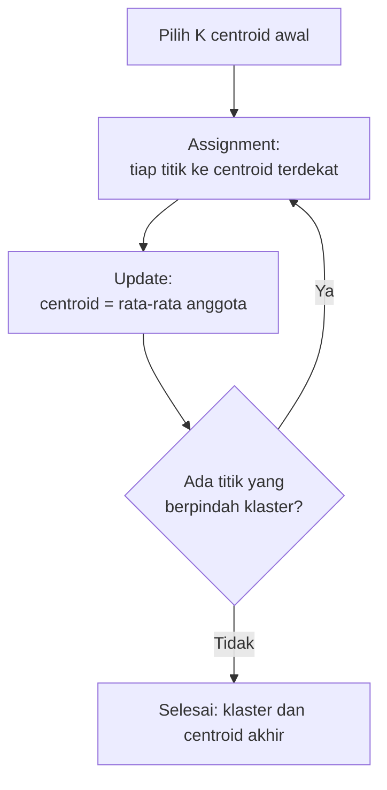

# Part 10 — Matematika K-Means Clustering

## Tujuan Pembelajaran

Setelah mempelajari bagian ini, kamu mampu:

- menjelaskan masalah klasterisasi dan perbedaannya dengan klasifikasi;
- menulis fungsi objektif K-Means (jumlah kuadrat jarak ke centroid) dan menghitungnya;
- menjalankan algoritma Lloyd: langkah *assignment* dan langkah *update* centroid;
- menjelaskan mengapa fungsi objektif tidak pernah naik dan mengapa algoritma berhenti;
- menjelaskan mengapa hasil bergantung pada inisialisasi dan bagaimana mengatasinya (*multiple restarts*, K-Means++);
- memilih $K$ dengan metode *elbow* dan memahami batasnya;
- menyebut keterbatasan K-Means (bentuk klaster, skala, pencilan);
- menerapkan K-Means pada vektor TF-IDF dan menafsirkan hasilnya dengan hati-hati.

## Prasyarat

[Part 2](02-representasi-data-dan-feature-engineering.md) (penskalaan, TF-IDF), [Part 5 — KNN](05-k-nearest-neighbors.md) (jarak Euclidean); [Level 2 Part 2](../level-2-aljabar-linear-dan-kalkulus/02-vektor.md) (norma dan jarak); [Level 3 Part 2](../level-3-probabilitas-dan-statistika/02-statistik-deskriptif.md) (rata-rata meminimalkan jumlah kuadrat deviasi).

## Masalah yang Ingin Diselesaikan

Kita punya data $\mathbf{x}^{(1)}, \dots, \mathbf{x}^{(n)}$ **tanpa label** dan ingin mengelompokkannya menjadi $K$ **klaster** sehingga anggota satu klaster **mirip** dan klaster berbeda **berbeda**. Ini pembelajaran **tak terawasi**: tidak ada jawaban benar yang dapat dibandingkan, jadi kualitas hasil dinilai lewat ukuran internal, pengetahuan domain, dan penggunaan hilirnya.

**K-Means** mewakili tiap klaster dengan **centroid** (titik rata-rata anggota) dan menugaskan tiap titik ke centroid terdekat.

## Intuisi dan Istilah Penting

### 1. Fungsi Objektif

Misalkan $S_k$ adalah himpunan titik di klaster $k$ dan $\mathbf{c}_k$ centroid-nya. K-Means meminimalkan **jumlah kuadrat jarak dalam klaster** (*within-cluster sum of squares*, WCSS, juga disebut *inertia*):

$$
J = \sum_{k=1}^{K}\ \sum_{\mathbf{x} \in S_k} \lVert \mathbf{x} - \mathbf{c}_k \rVert_2^2
$$

$J$ kecil berarti titik-titik rapat di sekitar centroid-nya.

### 2. Algoritma Lloyd

1. **Inisialisasi:** pilih $K$ centroid awal $\mathbf{c}_1, \dots, \mathbf{c}_K$ (misalnya $K$ titik data acak).
2. **Assignment:** tugaskan tiap titik ke centroid terdekat: $\mathbf{x} \to \arg\min_k \lVert \mathbf{x} - \mathbf{c}_k \rVert_2^2$.
3. **Update:** hitung ulang tiap centroid sebagai **rata-rata** anggota klasternya: $\mathbf{c}_k = \dfrac{1}{\lvert S_k \rvert}\sum_{\mathbf{x} \in S_k}\mathbf{x}$.
4. **Ulangi** langkah 2 dan 3 sampai tidak ada titik yang berpindah klaster (atau $J$ hampir tidak berubah).



Jika sebuah klaster kosong pada langkah *assignment*, centroid-nya tidak dapat dihitung; implementasi biasanya mempertahankan centroid lama atau memilih ulang titik.

### 3. Mengapa $J$ Tidak Pernah Naik dan Algoritma Berhenti

- **Langkah *assignment*** memilih, untuk centroid yang tetap, jarak terkecil bagi tiap titik, sehingga $J$ tidak naik.
- **Langkah *update*** memilih, untuk penugasan yang tetap, pusat klaster yang meminimalkan jumlah kuadrat jarak. Dari identitas Level 2 dan Level 3, $\sum_i (x_i - c)^2 = \sum_i (x_i - \bar{x})^2 + n(\bar{x} - c)^2$, sehingga minimum dicapai tepat di rata-rata $c = \bar{x}$. Jadi $J$ juga tidak naik.
- Banyak penugasan berbeda terbatas, dan $J$ tidak pernah naik, sehingga algoritma harus berhenti. Tetapi ia berhenti di **minimum lokal**, belum tentu global.

### 4. Inisialisasi dan Minimum Lokal

Hasil akhir bergantung pada centroid awal. Contoh satu dimensi: $x = 0, 2, 3, 5$ dengan $K = 2$.

| Centroid awal | Hasil klaster | $J$ |
|---|---|---|
| $(0, 5)$ | $\{0, 2\}$ dan $\{3, 5\}$ | $4{,}0$ (**global**) |
| $(0, 2)$ | $\{0\}$ dan $\{2, 3, 5\}$ | $4{,}667$ (lokal) |
| $(2, 5)$ | $\{0, 2, 3\}$ dan $\{5\}$ | $4{,}667$ (lokal) |

Penanganan:

- **Banyak percobaan** (`n_init`): jalankan K-Means dari beberapa inisialisasi acak dan simpan hasil dengan $J$ terkecil.
- **K-Means++**: pilih centroid pertama acak, lalu centroid berikutnya acak dengan peluang sebanding $D(\mathbf{x})^2$ (kuadrat jarak ke centroid terdekat yang sudah dipilih), sehingga centroid awal cenderung tersebar. Ini inisialisasi bawaan banyak pustaka.

### 5. Memilih $K$

$J$ **selalu turun** bila $K$ dinaikkan (dengan $K = n$, $J = 0$), jadi $J$ saja tidak dapat memilih $K$. **Metode *elbow***: gambar $J$ terhadap $K$ dan cari "siku" tempat penurunan mendadak melambat. Ukuran lain (misalnya *silhouette*) membandingkan jarak dalam klaster dengan jarak antar klaster. Pilihan akhir juga mempertimbangkan kegunaan hasil dan pengetahuan domain.

### 6. Keterbatasan

- **Bentuk klaster bulat.** Karena memakai jarak ke centroid, K-Means cenderung menghasilkan klaster seukuran dan berbentuk bulat; klaster memanjang, berbentuk cincin, atau berbeda kepadatan sering terbagi keliru.
- **Peka skala fitur.** Seperti KNN, fitur berskala besar mendominasi jarak; standardisasi diperlukan (Part 2).
- **Peka pencilan.** Centroid adalah rata-rata sehingga pencilan menariknya.
- **Perlu menentukan $K$** dan bergantung inisialisasi.
- **Jarak Euclidean pada dimensi tinggi** kehilangan makna (Part 5).
- **Bukan berarti klaster "nyata".** K-Means selalu menghasilkan $K$ klaster, walaupun data tidak berstruktur klaster.

## Rumus dan Penjelasan Setiap Simbol

| Konsep | Rumus | Arti simbol dan syarat |
|---|---|---|
| Fungsi objektif | $J = \sum_k\sum_{\mathbf{x} \in S_k}\lVert\mathbf{x} - \mathbf{c}_k\rVert_2^2$ | $S_k$ klaster ke-$k$, $\mathbf{c}_k$ centroid |
| *Assignment* | $\mathbf{x} \to \arg\min_k\lVert\mathbf{x} - \mathbf{c}_k\rVert_2^2$ | tie diputus dengan aturan tetap |
| *Update* | $\mathbf{c}_k = \frac{1}{\lvert S_k \rvert}\sum_{\mathbf{x} \in S_k}\mathbf{x}$ | $\lvert S_k \rvert \geq 1$ |
| Identitas | $\sum (x_i - c)^2 = \sum (x_i - \bar{x})^2 + n(\bar{x} - c)^2$ | minimum di $c = \bar{x}$ |
| Peluang K-Means++ | $P(\mathbf{x}) \propto D(\mathbf{x})^2$ | $D$ jarak ke centroid terdekat |

## Contoh Numerik Langkah demi Langkah

### Contoh 1 — K-Means satu iterasi demi satu iterasi (data simulasi)

Enam titik dua dimensi: $A = (1, 1)$, $B = (2, 1)$, $C = (1, 2)$, $D = (6, 5)$, $E = (7, 5)$, $F = (6, 6)$. $K = 2$ dengan centroid awal sengaja kurang baik: $\mathbf{c}_1 = (1, 1)$ dan $\mathbf{c}_2 = (2, 1)$.

**Iterasi 1, *assignment*.** Jarak Euclidean ke $\mathbf{c}_1$ dan $\mathbf{c}_2$:

| Titik | $d$ ke $\mathbf{c}_1$ | $d$ ke $\mathbf{c}_2$ | Klaster |
|---|---|---|---|
| $A$ | $0{,}000$ | $1{,}000$ | 1 |
| $B$ | $1{,}000$ | $0{,}000$ | 2 |
| $C$ | $1{,}000$ | $1{,}414$ | 1 |
| $D$ | $6{,}403$ | $5{,}657$ | 2 |
| $E$ | $7{,}211$ | $6{,}403$ | 2 |
| $F$ | $7{,}071$ | $6{,}403$ | 2 |

(Contoh: $D = (6, 5)$ ke $\mathbf{c}_1$: $\sqrt{25 + 16} = 6{,}403$; ke $\mathbf{c}_2$: $\sqrt{16 + 16} = 5{,}657$.) Klaster 1 $= \{A, C\}$, klaster 2 $= \{B, D, E, F\}$. Jumlah kuadrat jarak ke centroid lama: $0 + 0 + 1 + 32 + 41 + 41 = 115$.

**Iterasi 1, *update*.**
- $\mathbf{c}_1 = \dfrac{(1, 1) + (1, 2)}{2} = (1;\ 1{,}5)$.
- $\mathbf{c}_2 = \dfrac{(2, 1) + (6, 5) + (7, 5) + (6, 6)}{4} = \left(\dfrac{21}{4},\ \dfrac{17}{4}\right) = (5{,}25;\ 4{,}25)$.
- $J$ dengan centroid baru $= 30{,}0$ (turun dari $115$).

**Iterasi 2, *assignment*.** Jarak ke $\mathbf{c}_1 = (1;\ 1{,}5)$ dan $\mathbf{c}_2 = (5{,}25;\ 4{,}25)$:

| Titik | $d$ ke $\mathbf{c}_1$ | $d$ ke $\mathbf{c}_2$ | Klaster |
|---|---|---|---|
| $A$ | $0{,}500$ | $5{,}350$ | 1 |
| $B$ | $1{,}118$ | $4{,}596$ | **1** (pindah) |
| $C$ | $0{,}500$ | $4{,}809$ | 1 |
| $D$ | $6{,}103$ | $1{,}061$ | 2 |
| $E$ | $6{,}946$ | $1{,}904$ | 2 |
| $F$ | $6{,}727$ | $1{,}904$ | 2 |

Titik $B$ pindah ke klaster 1. Klaster 1 $= \{A, B, C\}$, klaster 2 $= \{D, E, F\}$. Update: $\mathbf{c}_1 = \left(\dfrac{4}{3}, \dfrac{4}{3}\right) = (1{,}333;\ 1{,}333)$, $\mathbf{c}_2 = \left(\dfrac{19}{3}, \dfrac{16}{3}\right) = (6{,}333;\ 5{,}333)$. $J = 2{,}667$.

**Iterasi 3.** Jarak ke centroid baru: $A$: $0{,}471$ vs $6{,}872$; $B$: $0{,}745$ vs $6{,}128$; $C$: $0{,}745$ vs $6{,}289$; $D$: $5{,}935$ vs $0{,}471$; $E$: $6{,}749$ vs $0{,}745$; $F$: $6{,}600$ vs $0{,}745$. Penugasan tidak berubah, centroid tidak berubah: **konvergen**. $J = 2{,}667$.

| Iterasi | $J$ (centroid sebelum *update*) | $J$ (setelah *update*) |
|---|---|---|
| 1 | $115$ | $30{,}0$ |
| 2 | $10{,}125$ | $2{,}6667$ |
| 3 | $2{,}6667$ | $2{,}6667$ |

$J$ tidak pernah naik, sesuai bagian 3.

### Contoh 2 — Minimum lokal pada data satu dimensi

Data $x = 0, 2, 3, 5$, $K = 2$, centroid awal $(0, 2)$.

1. *Assignment*: titik $0$ ke centroid $0$ (jarak $0$) sehingga masuk klaster 1; titik $2$ berjarak $2$ ke centroid $0$ dan $0$ ke centroid $2$, jadi klaster 2; titik $3$ dan $5$ lebih dekat ke centroid $2$ (jarak $1$ dan $3$) daripada ke centroid $0$ (jarak $3$ dan $5$), jadi klaster 2.
2. *Update*: $c_1 = 0$, $c_2 = \dfrac{2 + 3 + 5}{3} = 3{,}333$.
3. *Assignment* ulang: titik $2$: jarak ke $0$ adalah $2$, ke $3{,}333$ adalah $1{,}333$; tetap klaster 2. Tidak ada perubahan, algoritma berhenti.
4. $J = 0 + (2 - 3{,}333)^2 + (3 - 3{,}333)^2 + (5 - 3{,}333)^2 = 1{,}778 + 0{,}111 + 2{,}778 = 4{,}667$.

Padahal pengelompokan $\{0, 2\}$ dan $\{3, 5\}$ memberi $J = 1 + 1 + 1 + 1 = 4$, lebih kecil. K-Means berhenti di minimum lokal. Dengan centroid awal $(0, 5)$ ia menemukan $J = 4$.

### Contoh 3 — Memilih $K$ dengan *elbow*

Pada enam titik Contoh 1, nilai $J$ terbaik (dari percobaan banyak inisialisasi) untuk tiap $K$:

| $K$ | 1 | 2 | 3 | 4 | 5 |
|---|---|---|---|---|---|
| $J$ | $64{,}17$ | $2{,}67$ | $1{,}83$ | $1{,}00$ | $0{,}50$ |

Dari $K = 1$ ke $K = 2$ penurunan sangat besar ($64{,}17 \to 2{,}67$); setelah itu hanya turun kecil. "Siku" ada di $K = 2$, sesuai dengan dua kumpulan titik yang jelas. Bila datanya tidak punya struktur klaster yang jelas, kurva turun halus dan siku tidak tampak.

### Contoh 4 — Menghitung $J$ untuk penugasan tertentu

Klaster 1: $(1, 1), (2, 1), (1, 2)$; klaster 2: $(6, 5), (7, 5), (6, 6)$.

1. Centroid 1: $\left(\dfrac{4}{3}, \dfrac{4}{3}\right)$. Kuadrat jarak: $(1 - 1{,}333)^2 + (1 - 1{,}333)^2 = 0{,}2222$; $(2 - 1{,}333)^2 + (1 - 1{,}333)^2 = 0{,}4444 + 0{,}1111 = 0{,}5556$; $(1 - 1{,}333)^2 + (2 - 1{,}333)^2 = 0{,}5556$. Jumlah $= 1{,}3333$.
2. Centroid 2: $\left(\dfrac{19}{3}, \dfrac{16}{3}\right)$. Dengan cara sama jumlah $= 1{,}3333$.
3. $J = 1{,}3333 + 1{,}3333 = 2{,}6667$.

### Contoh 5 — K-Means pada teks (data simulasi)

Pakai korpus 10 pesan dari Part 2 (vektor TF-IDF ternormalisasi, 29 dimensi) dengan $K = 2$. Label E dan N **tidak dipakai** saat klasterisasi; kita hanya membandingkannya sesudahnya.

| Centroid awal (nomor pesan) | Hasil klaster | $J$ |
|---|---|---|
| pesan 1 dan 6 | $\{1, 2, 3, 4, 5, 7, 8, 10\}$ dan $\{6, 9\}$ | $6{,}5371$ |
| pesan 5 dan 6 | $\{1, 2, 3, 4, 5\}$ dan $\{6, 7, 8, 9, 10\}$ | $6{,}4786$ |

Dari $45$ kemungkinan pasangan pesan sebagai centroid awal, hasil akhir memiliki **36 nilai $J$ berbeda** (dari $6{,}4786$ sampai $6{,}9144$): banyak minimum lokal yang sangat berdekatan. Inisialisasi dari pesan 5 dan 6 menghasilkan pembagian yang tepat sama dengan label (lima E dan lima N), sedangkan inisialisasi dari pesan 1 dan 6 menghasilkan pengelompokan yang berbeda dan $J$ sedikit lebih besar. Dengan `KMeans` scikit-learn (K-Means++): `n_init = 1` memberi $J = 6{,}8014$; `n_init = 10` memberi $6{,}5135$ (pesan 10 salah satu klaster); `n_init = 100` memberi $6{,}4786$ (pembagian yang cocok dengan label).

Pelajaran: (1) selalu jalankan beberapa inisialisasi dan ambil $J$ terkecil; (2) selisih $J$ antar minimum lokal bisa kecil sehingga $J$ saja tidak membedakan klaster "bermakna" dari yang tidak; (3) pencocokan dengan label di sini kebetulan karena kata khas kelas dan data sangat kecil, bukan jaminan; (4) pada data nyata tidak ada label untuk membandingkan, sehingga hasil harus ditinjau (misalnya kata dengan bobot centroid tertinggi). Sebagai contoh membaca klaster dari centroid (hasil `n_init = 10`): tiga kata teratas klaster berisi pesan darurat adalah *tolong* ($0{,}218$), *ada* ($0{,}202$), dan *segera* ($0{,}186$); klaster lainnya *besok* ($0{,}262$), *kuliah* ($0{,}232$), dan *di* ($0{,}222$).

## Interpretasi, Asumsi, dan Keterbatasan

- **Klaster bukan kelas.** K-Means menemukan kelompok yang mirip menurut jarak yang dipakai, bukan kategori yang ada dalam kenyataan.
- **Hasil bergantung representasi dan skala.** Mengubah fitur (TF-IDF vs hitungan, standardisasi atau tidak) mengubah klaster.
- **Bukan deterministik.** Inisialisasi acak membuat hasil berubah; tetapkan *seed* dan beberapa `n_init`.
- **Bentuk bulat dan ukuran serupa** diasumsikan; pencilan menarik centroid.
- **Pemilihan $K$** tidak objektif; gunakan *elbow*, ukuran lain, dan pertimbangan kegunaan.
- **Tidak ada algoritma yang selalu unggul.** Algoritma klasterisasi lain (hierarki, berbasis kepadatan) lebih sesuai untuk bentuk klaster lain.

## Hubungan dengan ML dan NLP

- **Eksplorasi teks.** K-Means pada TF-IDF dapat mengelompokkan pesan atau dokumen bertopik mirip sebagai langkah awal sebelum memberi label (misalnya menemukan kelompok pesan yang mungkin darurat), dengan peninjauan manual terhadap kata-kata paling berbobot per klaster.
- **Kosinus vs Euclidean.** Untuk TF-IDF yang dinormalisasi L2, jarak Euclidean setara dengan jarak kosinus (Part 5), sehingga K-Means pada vektor ternormalisasi hampir sama dengan *spherical K-Means*.
- **Kuantisasi dan fitur.** Jarak ke centroid dapat dipakai sebagai fitur baru.
- **Inisialisasi bagi algoritma lain.** Klaster sering dipakai sebagai titik awal analisis lain.
- **Evaluasi.** Tanpa label, tidak ada akurasi; bila ada label cadangan (seperti di Contoh 5), kecocokan dapat dilihat, tetapi dengan hati-hati.

### Python: K-Means dari nol

Hanya pustaka standar. Enam titik Contoh 1 dengan pencetakan tiap iterasi:

```python
import math

P = {"A": (1, 1), "B": (2, 1), "C": (1, 2), "D": (6, 5), "E": (7, 5), "F": (6, 6)}
d2 = lambda a, b: sum((x - y) ** 2 for x, y in zip(a, b))

def kmeans(P, pusat, cetak=True):
    pusat = [tuple(c) for c in pusat]
    for it in range(1, 20):
        jarak = {n: [d2(p, c) for c in pusat] for n, p in P.items()}
        tugas = {n: min(range(len(pusat)), key=lambda k: jarak[n][k]) for n in P}
        j_lama = sum(jarak[n][tugas[n]] for n in P)
        baru = []
        for k in range(len(pusat)):
            anggota = [P[n] for n in P if tugas[n] == k]
            baru.append(tuple(sum(c) / len(anggota) for c in zip(*anggota)) if anggota else pusat[k])
        j_baru = sum(d2(P[n], baru[tugas[n]]) for n in P)
        if cetak:
            print(it, {n: k + 1 for n, k in tugas.items()}, round(j_lama, 4), [tuple(round(v, 3) for v in c) for c in baru], round(j_baru, 4))
        if baru == pusat:
            return tugas, pusat, j_baru
        pusat = baru

kmeans(P, [(1, 1), (2, 1)])
# 1 {'A': 1, 'B': 2, 'C': 1, 'D': 2, 'E': 2, 'F': 2} 115 [(1.0, 1.5), (5.25, 4.25)] 30.0
# 2 {'A': 1, 'B': 1, 'C': 1, 'D': 2, 'E': 2, 'F': 2} 10.125 [(1.333, 1.333), (6.333, 5.333)] 2.6667
# 3 {'A': 1, 'B': 1, 'C': 1, 'D': 2, 'E': 2, 'F': 2} 2.6667 [(1.333, 1.333), (6.333, 5.333)] 2.6667
```

Minimum lokal pada data satu dimensi, dan *elbow* dengan mencoba semua penugasan (cukup kecil untuk enam titik):

```python
def kmeans_1d(x, pusat):
    pusat = list(pusat)
    for _ in range(10):
        tugas = [min(range(len(pusat)), key=lambda k: abs(v - pusat[k])) for v in x]
        baru = [sum(v for v, a in zip(x, tugas) if a == k) / max(1, sum(1 for a in tugas if a == k))
                for k in range(len(pusat))]
        if baru == pusat:
            break
        pusat = baru
    return tugas, pusat, round(sum((v - pusat[a]) ** 2 for v, a in zip(x, tugas)), 4)

for awal in ((0, 5), (0, 2), (2, 5)):
    print(awal, kmeans_1d([0, 2, 3, 5], awal))
# (0, 5) ([0, 0, 1, 1], [1.0, 4.0], 4.0)
# (0, 2) ([0, 1, 1, 1], [0.0, 3.3333333333333335], 4.6667)
# (2, 5) ([0, 0, 0, 1], [1.6666666666666667, 5.0], 4.6667)

import itertools
titik = list(P.values())
def j_terbaik(K):
    terbaik = None
    for tugas in itertools.product(range(K), repeat=len(titik)):
        j = 0
        for k in range(K):
            anggota = [p for p, t in zip(titik, tugas) if t == k]
            if anggota:
                c = tuple(sum(v) / len(anggota) for v in zip(*anggota))
                j += sum(d2(p, c) for p in anggota)
        terbaik = j if terbaik is None else min(terbaik, j)
    return terbaik

print([round(j_terbaik(K), 4) for K in (1, 2, 3, 4, 5)])      # [64.1667, 2.6667, 1.8333, 1.0, 0.5]
```

K-Means pada TF-IDF korpus simulasi (inisialisasi dari pesan tertentu):

```python
from collections import Counter

korpus = [("tolong ada kebakaran di gedung", "E"), ("kecelakaan di jalan tolong kirim ambulans", "E"),
          ("banjir naik tolong evakuasi segera", "E"), ("ada korban kecelakaan butuh ambulans segera", "E"),
          ("kebakaran besar tolong damkar segera", "E"), ("jadwal rapat besok pagi di gedung", "N"),
          ("tolong kirim catatan kuliah besok", "N"), ("makan siang di kantin jalan baru", "N"),
          ("kuliah besok pagi di gedung baru", "N"), ("ada diskon jalan sehat besok", "N")]
dok = [t.split() for t, _ in korpus]
V = sorted(set(w for d in dok for w in d))
N = len(dok)
idf = {w: math.log((1 + N) / (1 + sum(1 for d in dok if w in d))) + 1 for w in V}

def vektor(d):
    c = Counter(d)
    v = [c[w] * idf[w] for w in V]
    norma = math.sqrt(sum(a * a for a in v))
    return [a / norma for a in v]

X = [vektor(d) for d in dok]

def kmeans_vektor(X, awal):
    pusat = [X[i] for i in awal]
    for _ in range(50):
        tugas = [min(range(len(pusat)), key=lambda k: d2(x, pusat[k])) for x in X]
        J = sum(d2(x, pusat[a]) for x, a in zip(X, tugas))
        baru = []
        for k in range(len(pusat)):
            m = [x for x, a in zip(X, tugas) if a == k]
            baru.append([sum(kol) / len(m) for kol in zip(*m)] if m else pusat[k])
        if all(max(abs(p - q) for p, q in zip(u, v)) < 1e-12 for u, v in zip(baru, pusat)):
            return tugas, round(J, 4)
        pusat = baru
    return tugas, round(J, 4)

for awal in ((0, 5), (4, 5)):      # indeks dari nol: pesan 1 dan 6; pesan 5 dan 6
    tugas, J = kmeans_vektor(X, awal)
    print([a + 1 for a in tugas], J)
# [1, 1, 1, 1, 1, 2, 1, 1, 2, 1] 6.5371
# [1, 1, 1, 1, 1, 2, 2, 2, 2, 2] 6.4786

hasil = [kmeans_vektor(X, (i, j))[1] for i, j in itertools.combinations(range(10), 2)]
print(len(hasil), len(set(hasil)), min(hasil), max(hasil))     # 45 36 6.4786 6.9144
```

**Opsional: bandingkan dengan scikit-learn.** Blok ini membutuhkan scikit-learn dan NumPy, yang **tidak** dipasang oleh proyek ini dan tidak dijalankan oleh situs. Keluaran dijalankan dengan scikit-learn 1.9.0 pada Python 3.14.

```python
import numpy as np
from sklearn.cluster import KMeans

Xa = np.array(X)
for n_init in (1, 10, 100):
    km = KMeans(n_clusters=2, n_init=n_init, random_state=0).fit(Xa)
    print(n_init, round(km.inertia_, 4), (km.labels_ + 1).tolist())
# 1 6.8014 [1, 2, 2, 1, 2, 1, 2, 1, 1, 2]
# 10 6.5135 [1, 1, 1, 1, 1, 2, 2, 2, 2, 1]
# 100 6.4786 [2, 2, 2, 2, 2, 1, 1, 1, 1, 1]
```

Interpretasi: hitungan manual untuk enam titik, minimum lokal 1D, dan K-Means pada TF-IDF dengan inisialisasi tertentu dapat dicocokkan dengan keluaran scikit-learn untuk $J$ dan pembagian. Perhatikan bahwa nomor klaster boleh tertukar (label klaster tidak bermakna), dan `n_init=100` menemukan $J = 6{,}4786$ yang sama dengan inisialisasi terbaik dari semua 45 pasangan.

## Kesalahan Umum

| Kesalahan | Mengapa salah | Yang benar |
|---|---|---|
| Menganggap hasil K-Means pasti global optimum | berhenti di minimum lokal | beberapa inisialisasi, ambil $J$ terkecil |
| Memilih $K$ dengan $J$ terkecil | $J$ selalu turun dengan $K$ | *elbow*, ukuran lain, pertimbangan domain |
| Tidak menskalakan fitur | fitur berskala besar mendominasi | standardisasi |
| Menganggap klaster sebagai kelas nyata | klaster hanya kemiripan menurut jarak | interpretasi dan validasi manual |
| Mengabaikan pencilan | rata-rata ditarik pencilan | periksa pencilan atau gunakan algoritma lain |
| Memakai K-Means untuk klaster tidak bulat | asumsi bentuk dilanggar | pertimbangkan metode lain |
| Menghitung centroid tanpa memperhatikan klaster kosong | pembagian oleh nol | tangani kasus klaster kosong |
| Membandingkan $J$ antar skala fitur atau representasi berbeda | $J$ bergantung skala | bandingkan pada representasi yang sama |
| Menganggap kecocokan dengan label adalah bukti metode benar | bisa kebetulan pada data kecil | validasi pada data lain |

## Latihan Mandiri

1. Pada data Contoh 1, klaster 1 $= \{(1, 1), (2, 1), (1, 2)\}$ dan klaster 2 $= \{(6, 5), (7, 5), (6, 6)\}$. Hitung centroid dan $J$.
2. Titik $(3, 3)$ dan centroid $\mathbf{c}_1 = (1, 1)$, $\mathbf{c}_2 = (6, 5)$. Hitung jarak Euclidean ke tiap centroid dan tentukan klasternya.
3. Klaster berisi $(2, 4), (4, 6), (6, 8)$. Hitung centroid-nya dan jumlah kuadrat jarak ke centroid.
4. Lakukan satu iterasi K-Means untuk $x = 1, 2, 3, 10, 11, 12$ dengan $K = 2$ dan centroid awal $c_1 = 1$, $c_2 = 2$. Tuliskan penugasan, centroid baru, dan $J$.
5. Untuk $x = 0, 2, 3, 5$ dan $K = 2$ dengan centroid awal $(0, 2)$, tunjukkan bahwa algoritma berhenti pada $J = 4{,}667$ walaupun $J = 4$ mungkin. Bagaimana menghindarinya?
6. Mengapa langkah *update* (mengambil rata-rata) meminimalkan jumlah kuadrat jarak untuk penugasan yang tetap? Gunakan identitas $\sum (x_i - c)^2 = \sum (x_i - \bar{x})^2 + n(\bar{x} - c)^2$.
7. Nilai $J$ untuk $K = 1, 2, 3, 4$ adalah $64{,}2;\ 2{,}7;\ 1{,}8;\ 1{,}0$. Tentukan $K$ menurut *elbow* dan jelaskan alasannya.
8. Mengapa fitur dengan skala besar mendominasi hasil K-Means? Berikan contoh dengan umur (tahun) dan pendapatan (rupiah).
9. Jelaskan cara kerja K-Means++ dan mengapa ia membantu.
10. Pada contoh teks, dengan inisialisasi pesan 1 dan 6 K-Means memberi $J = 6{,}5371$, sedangkan pesan 5 dan 6 memberi $6{,}4786$. Apa pelajarannya tentang inisialisasi dan tentang membandingkan klaster dengan label?

## Kunci Jawaban dan Pembahasan

??? success "Soal 1"
    Centroid 1 $= \left(\dfrac{4}{3}, \dfrac{4}{3}\right)$, centroid 2 $= \left(\dfrac{19}{3}, \dfrac{16}{3}\right)$. Jumlah kuadrat jarak klaster 1 $= 0{,}2222 + 0{,}5556 + 0{,}5556 = 1{,}3333$; klaster 2 $= 1{,}3333$ (lihat Contoh 4). $J = 2{,}6667$.

??? success "Soal 2"
    Ke $\mathbf{c}_1$: $\sqrt{(3 - 1)^2 + (3 - 1)^2} = \sqrt{8} = 2{,}828$. Ke $\mathbf{c}_2$: $\sqrt{(3 - 6)^2 + (3 - 5)^2} = \sqrt{13} = 3{,}606$. Klaster 1 (jarak lebih kecil).

??? success "Soal 3"
    Centroid $= \left(\dfrac{2 + 4 + 6}{3}, \dfrac{4 + 6 + 8}{3}\right) = (4, 6)$. Kuadrat jarak: $(2 - 4)^2 + (4 - 6)^2 = 8$; $0$; $8$. Jumlah $= 16$.

??? success "Soal 4"
    *Assignment*: $x = 1$ ke $c_1$ (jarak $0$ vs $1$); $x = 2$ ke $c_2$ (jarak $0$); $x = 3, 10, 11, 12$ ke $c_2$ (misalnya $3$: jarak $2$ ke $c_1$ dan $1$ ke $c_2$). Klaster 1 $= \{1\}$, klaster 2 $= \{2, 3, 10, 11, 12\}$. *Update*: $c_1 = 1$; $c_2 = \dfrac{2 + 3 + 10 + 11 + 12}{5} = 7{,}6$. $J = 0 + (2 - 7{,}6)^2 + (3 - 7{,}6)^2 + (10 - 7{,}6)^2 + (11 - 7{,}6)^2 + (12 - 7{,}6)^2 = 31{,}36 + 21{,}16 + 5{,}76 + 11{,}56 + 19{,}36 = 89{,}2$. Iterasi berikutnya akan menggeser $x = 2, 3$ ke klaster 1 dan konvergen ke $\{1, 2, 3\}$ dan $\{10, 11, 12\}$ dengan $J = 4$.

??? success "Soal 5"
    Lihat Contoh 2: *assignment* memberi $\{0\}$ dan $\{2, 3, 5\}$; centroid $0$ dan $3{,}333$; penugasan ulang tidak berubah; $J = 4{,}667$. Pengelompokan $\{0, 2\}$ dan $\{3, 5\}$ memberi $J = 4$. Penghindaran: banyak inisialisasi acak dan ambil $J$ terkecil, atau K-Means++.

??? success "Soal 6"
    Untuk penugasan tetap, $J_k = \sum_{i \in S_k}\lVert\mathbf{x}_i - \mathbf{c}\rVert^2$. Menurut identitas, $\sum (x_i - c)^2 = \sum (x_i - \bar{x})^2 + n(\bar{x} - c)^2$, dan suku kedua tak negatif, nol tepat saat $c = \bar{x}$. Maka nilai minimum dicapai di rata-rata klaster. (Identitas berlaku per koordinat untuk vektor.)

??? success "Soal 7"
    Penurunan dari $K = 1$ ke $K = 2$ sangat besar ($64{,}2 \to 2{,}7$), setelah itu kecil ($2{,}7 \to 1{,}8 \to 1{,}0$). Siku ada di $K = 2$. Menambah klaster lagi hanya sedikit memperbaiki $J$ sehingga tidak sepadan dengan kerumitan tambahan.

??? success "Soal 8"
    Jarak Euclidean menjumlahkan kuadrat selisih tiap fitur. Selisih pendapatan dalam rupiah (misalnya jutaan, kuadratnya sekitar $10^{12}$) jauh lebih besar daripada selisih umur dalam tahun (puluhan, kuadratnya ratusan), sehingga klaster hampir ditentukan pendapatan saja. Standardisasi menyamakan kontribusi kedua fitur.

??? success "Soal 9"
    K-Means++ memilih centroid pertama secara acak, lalu tiap centroid berikutnya dipilih acak dari titik data dengan peluang sebanding $D(\mathbf{x})^2$ (kuadrat jarak ke centroid terdekat yang sudah dipilih). Titik jauh dari centroid yang ada lebih mungkin dipilih, sehingga centroid awal tersebar. Ini mengurangi peluang dua centroid awal berada di klaster yang sama dan umumnya memberi $J$ lebih baik dan konvergensi lebih cepat.

??? success "Soal 10"
    Hasil bergantung inisialisasi: dua inisialisasi berbeda memberi pengelompokan berbeda dan $J$ berbeda, sehingga perlu beberapa percobaan (`n_init`) dan memilih $J$ terkecil. Selisih $J$ kecil ($6{,}5371$ vs $6{,}4786$) menunjukkan $J$ saja kurang membedakan klaster; dan kecocokan dengan label pada hasil terbaik di data sekecil ini mungkin kebetulan. Karena itu hasil klasterisasi perlu ditinjau secara manual dan divalidasi pada data lain.

## Ringkasan Materi

- K-Means mengelompokkan data tanpa label dengan meminimalkan $J = \sum_k\sum_{\mathbf{x} \in S_k}\lVert\mathbf{x} - \mathbf{c}_k\rVert^2$.
- Algoritma Lloyd: inisialisasi, *assignment* (centroid terdekat), *update* (rata-rata anggota), ulangi sampai tidak ada perubahan; $J$ tidak pernah naik, dan rata-rata adalah pusat yang meminimalkan jumlah kuadrat jarak.
- Berhenti di minimum lokal yang bergantung inisialisasi: gunakan K-Means++ dan beberapa `n_init`, ambil $J$ terkecil.
- $J$ selalu turun dengan $K$; pilih $K$ dengan *elbow* dan pertimbangan domain.
- Keterbatasan: klaster bulat dan seukuran, peka skala dan pencilan, dan klaster bukan kelas nyata.
- Pada teks, K-Means pada TF-IDF ternormalisasi mengelompokkan pesan mirip; pada 10 pesan simulasi banyak minimum lokal yang berdekatan. Semua angka contoh adalah simulasi.

## Checklist Penguasaan

- [ ] Menulis dan menghitung fungsi objektif K-Means.
- [ ] Menjalankan iterasi *assignment* dan *update* secara manual.
- [ ] Menjelaskan mengapa $J$ tidak naik dan algoritma berhenti.
- [ ] Menjelaskan minimum lokal, K-Means++, dan *multiple restarts*.
- [ ] Memilih $K$ dengan *elbow* dan menyebut batasnya.
- [ ] Menyebut keterbatasan K-Means dan perlunya penskalaan.
- [ ] Menafsirkan klaster pada teks dengan hati-hati.

## Prasyarat untuk Materi Berikutnya

[Part 11 — Evaluasi dan Pemilihan Model](11-evaluasi-dan-pemilihan-model.md) menyatukan semua algoritma dengan cara menilainya: matriks konfusi, presisi, recall, F1, metrik regresi, validasi silang, dan pemilihan metrik sesuai masalah. Pastikan matriks konfusi dan presisi dari Level 3 Part 6 dan Part 12 sudah jelas.
