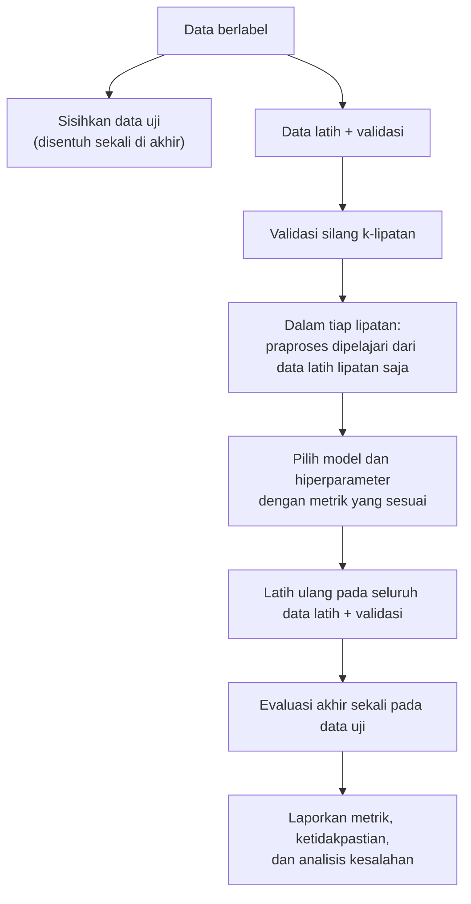
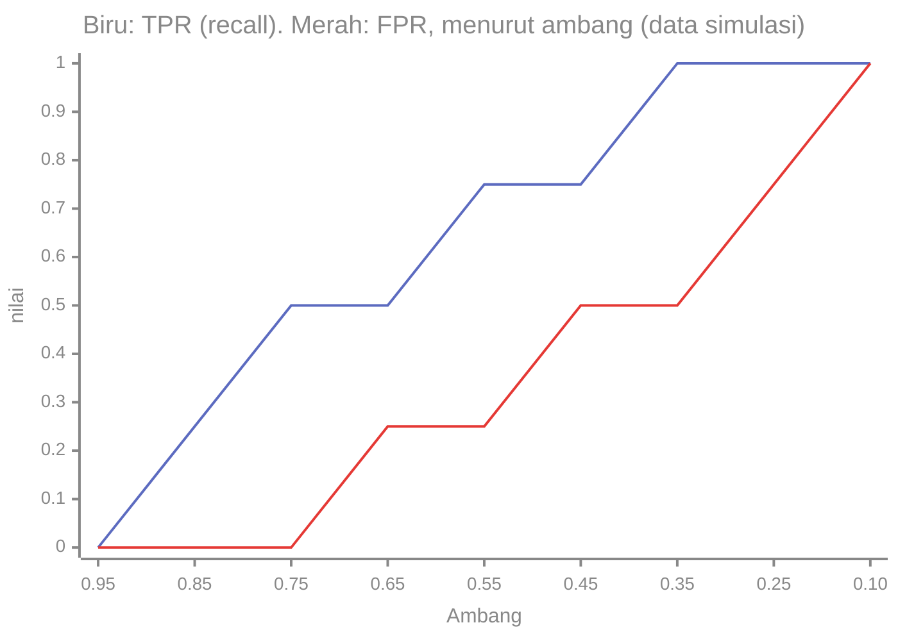

# Part 11 — Evaluasi dan Pemilihan Model

## Tujuan Pembelajaran

Setelah mempelajari bagian ini, kamu mampu:

- menyusun matriks konfusi dan menghitung akurasi, presisi, recall, spesifisitas, dan F1 (serta $F_\beta$);
- menjelaskan mengapa akurasi menyesatkan pada kelas tidak seimbang dan membandingkan model dengan baseline;
- menjelaskan hubungan ambang keputusan dengan presisi dan recall, serta membaca titik ROC dan menghitung AUC secara manual;
- menghitung MAE, MSE, RMSE, dan $R^2$ untuk regresi;
- menjalankan validasi silang $k$-lipatan dengan benar (tanpa kebocoran) dan menafsirkan hasilnya beserta ketidakpastiannya;
- memilih metrik sesuai biaya kesalahan pada masalah nyata (misalnya deteksi pesan darurat);
- merancang prosedur pemilihan model (data latih, validasi, dan uji) dan melakukan analisis kesalahan.

## Prasyarat

[Level 3 Part 6](../level-3-probabilitas-dan-statistika/06-teorema-bayes.md) dan [Part 12](../level-3-probabilitas-dan-statistika/12-integrasi-dan-evaluasi.md) (matriks konfusi, presisi dan recall, tingkat dasar), [Level 3 Part 9](../level-3-probabilitas-dan-statistika/09-distribusi-sampling-dan-clt.md) (galat baku), [Part 1](01-pengantar-matematika-ml.md) (latih, validasi, uji), dan [Part 3](03-regresi-linear.md) (MSE, MAE).

## Masalah yang Ingin Diselesaikan

Setelah beberapa algoritma tersedia, kita harus menjawab dua pertanyaan: **seberapa baik** sebuah model pada data yang belum pernah dilihat, dan **mana yang dipilih** di antara beberapa model atau hiperparameter. Jawaban yang jujur membutuhkan (1) metrik yang sesuai dengan tujuan, (2) data evaluasi yang tidak dipakai untuk melatih, dan (3) pengakuan atas ketidakpastian angka yang dihasilkan.



## Intuisi dan Istilah Penting

### 1. Matriks Konfusi dan Metrik Klasifikasi Biner

Dengan kelas positif (misalnya Emergency) dan negatif:

| | Diprediksi positif | Diprediksi negatif |
|---|---|---|
| **Sebenarnya positif** | TP (*true positive*) | FN (*false negative*) |
| **Sebenarnya negatif** | FP (*false positive*) | TN (*true negative*) |

| Metrik | Rumus | Pertanyaan yang dijawab |
|---|---|---|
| Akurasi | $\dfrac{TP + TN}{TP + TN + FP + FN}$ | seberapa sering benar secara keseluruhan? |
| Presisi (*precision*) | $\dfrac{TP}{TP + FP}$ | dari yang diprediksi positif, berapa yang benar? |
| *Recall* (sensitivitas, TPR) | $\dfrac{TP}{TP + FN}$ | dari yang sebenarnya positif, berapa yang tertangkap? |
| Spesifisitas (TNR) | $\dfrac{TN}{TN + FP}$ | dari yang sebenarnya negatif, berapa yang benar? |
| Tingkat positif palsu (FPR) | $\dfrac{FP}{FP + TN} = 1 - \text{spesifisitas}$ | dari yang negatif, berapa yang salah ditandai positif? |
| F1 | $\dfrac{2PR}{P + R} = \dfrac{2TP}{2TP + FP + FN}$ | rata-rata harmonik presisi dan recall |
| $F_\beta$ | $\dfrac{(1 + \beta^2)PR}{\beta^2 P + R}$ | $\beta > 1$ lebih menekankan recall, $\beta < 1$ presisi |
| Akurasi seimbang | $\dfrac{\text{recall} + \text{spesifisitas}}{2}$ | rata-rata kebenaran per kelas |

F1 memakai rata-rata **harmonik**, yang dekat dengan nilai yang lebih kecil: model dengan presisi $1{,}0$ tetapi recall $0{,}1$ punya F1 hanya $0{,}18$, bukan $0{,}55$. Presisi dan recall dalam bahasa peluang bersyarat (Level 3 Part 6): recall $= P(\text{prediksi positif} \mid \text{positif})$ dan presisi $= P(\text{positif} \mid \text{prediksi positif})$; presisi bergantung pada tingkat dasar, recall tidak.

### 2. Akurasi pada Kelas Tidak Seimbang

Contoh simulasi: 1.000 pesan, 5% (50) Emergency. Model memprediksi: TP $= 40$, FN $= 10$, FP $= 95$, TN $= 855$.

| Metrik | Nilai |
|---|---|
| Akurasi | $\dfrac{40 + 855}{1000} = 0{,}895$ |
| Presisi | $\dfrac{40}{135} = 0{,}2963$ |
| *Recall* | $\dfrac{40}{50} = 0{,}8$ |
| Spesifisitas | $\dfrac{855}{950} = 0{,}9$ |
| F1 | $0{,}4324$ |
| Akurasi seimbang | $0{,}85$ |

Baseline "selalu prediksi Non-Emergency" mencapai akurasi $\dfrac{950}{1000} = 0{,}95$ (recall $0$). Jadi model dengan recall $0{,}8$ justru memiliki **akurasi lebih rendah** ($0{,}895$) daripada baseline yang tidak menangkap satu pesan darurat pun. Akurasi tidak cocok untuk masalah ini. Presisi rendah ($0{,}296$) bukan kegagalan algoritma, melainkan konsekuensi tingkat dasar yang kecil, persis seperti perhitungan Bayes di Level 3 Part 6.

### 3. Ambang, Presisi-Recall, dan ROC

Model yang mengeluarkan skor atau peluang butuh **ambang** $\tau$ untuk jadi keputusan. Menurunkan $\tau$ menaikkan recall (lebih banyak positif tertangkap) tetapi menurunkan presisi (lebih banyak positif palsu) dan sebaliknya. Pemilihan $\tau$ mencerminkan biaya kesalahan.

**Kurva ROC** memplot TPR (recall) terhadap FPR pada semua ambang; **AUC** (*area under the curve*) adalah luas di bawahnya, antara $0$ dan $1$. Tafsir yang berguna: AUC adalah **peluang** sebuah contoh positif acak mendapat skor lebih tinggi daripada sebuah contoh negatif acak (selisih skor sama dihitung $\frac{1}{2}$). $\text{AUC} = 0{,}5$ sama dengan tebakan acak; $1{,}0$ memisahkan sempurna.

Contoh simulasi: skor model untuk 4 positif $= 0{,}9;\ 0{,}8;\ 0{,}6;\ 0{,}4$ dan 4 negatif $= 0{,}7;\ 0{,}5;\ 0{,}3;\ 0{,}2$.

| Ambang $\tau$ | TP | FP | TPR (recall) | FPR |
|---|---|---|---|---|
| $0{,}95$ | 0 | 0 | $0$ | $0$ |
| $0{,}85$ | 1 | 0 | $0{,}25$ | $0$ |
| $0{,}75$ | 2 | 0 | $0{,}5$ | $0$ |
| $0{,}65$ | 2 | 1 | $0{,}5$ | $0{,}25$ |
| $0{,}55$ | 3 | 1 | $0{,}75$ | $0{,}25$ |
| $0{,}45$ | 3 | 2 | $0{,}75$ | $0{,}5$ |
| $0{,}35$ | 4 | 2 | $1$ | $0{,}5$ |
| $0{,}25$ | 4 | 3 | $1$ | $0{,}75$ |
| $0{,}10$ | 4 | 4 | $1$ | $1$ |



AUC dengan definisi peluang: dari $4 \times 4 = 16$ pasangan (positif, negatif), skor positif lebih tinggi pada $13$ pasangan ($0{,}9$ dan $0{,}8$ mengalahkan keempat negatif: $8$; $0{,}6$ mengalahkan $0{,}5, 0{,}3, 0{,}2$: $3$; $0{,}4$ mengalahkan $0{,}3, 0{,}2$: $2$). $\text{AUC} = \dfrac{13}{16} = 0{,}8125$. (Luas trapesium di bawah titik ROC memberi nilai yang sama.)

**Catatan penting.** AUC mengukur kemampuan **mengurutkan** (tidak bergantung ambang tertentu), tetapi pada data yang sangat tidak seimbang AUC bisa tampak tinggi walau presisi rendah. Kurva presisi-recall lebih informatif bila kelas positif sangat jarang.

### 4. Metrik Regresi

Dengan residual $r_i = \hat{y}_i - y_i$ (Part 3):

| Metrik | Rumus | Catatan |
|---|---|---|
| MAE | $\frac{1}{n}\sum \lvert r_i \rvert$ | satuan sama dengan $y$; kurang peka pencilan |
| MSE | $\frac{1}{n}\sum r_i^2$ | satuan kuadrat; menghukum galat besar |
| RMSE | $\sqrt{\mathrm{MSE}}$ | satuan sama dengan $y$ |
| $R^2$ | $1 - \dfrac{\sum r_i^2}{\sum (y_i - \bar{y})^2}$ | $1$ bila sempurna, $0$ bila sama dengan memprediksi rata-rata, **negatif** bila lebih buruk dari rata-rata |

$R^2$ membandingkan model dengan baseline "selalu rata-rata target". Pada data uji, $R^2$ dapat negatif. Pada data latih, kenaikan $R^2$ saja tidak membuktikan model lebih baik (menambah fitur hampir tidak pernah menurunkannya).

### 5. Validasi Silang

Satu pembagian latih-validasi bisa kebetulan menguntungkan atau merugikan. **Validasi silang $k$-lipatan** (*k-fold cross-validation*): bagi data menjadi $k$ lipatan; untuk tiap lipatan $j$, latih pada $k - 1$ lipatan lain dan evaluasi pada lipatan $j$. Skor akhir adalah rata-rata skor lipatan:

$$
\text{CV} = \frac{1}{k}\sum_{j=1}^{k}s_j, \qquad
\mathrm{SE} \approx \frac{s}{\sqrt{k}}
$$

dengan $s$ simpangan baku skor antar lipatan. (Galat baku ini kasar karena skor antar lipatan tidak independen: data latihnya saling tumpang tindih.)

Praktik penting:

- **Stratifikasi:** pertahankan proporsi kelas di tiap lipatan (penting untuk kelas tidak seimbang).
- **Tanpa kebocoran:** seluruh praproses yang dipelajari dari data (standardisasi, kosakata, $\mathrm{idf}$, seleksi fitur, *resampling*) harus dihitung **di dalam tiap lipatan** dari data latih lipatan itu saja.
- **Data berurutan atau berkelompok:** jangan mengacak biasa pada deret waktu; pisahkan menurut waktu atau kelompok (misalnya semua pesan dari satu pengguna dalam lipatan yang sama).
- **Data uji terpisah** tetap disisihkan; validasi silang dipakai untuk memilih, bukan untuk laporan akhir bila ia sudah dipakai memilih.

### 6. Memilih Metrik Sesuai Masalah

| Situasi | Kesalahan yang lebih mahal | Metrik yang cocok |
|---|---|---|
| Deteksi pesan darurat | melewatkan pesan darurat (FN) | recall tinggi, tetap awasi presisi; $F_2$, kurva presisi-recall |
| Filter spam | menandai e-mail penting sebagai spam (FP) | presisi tinggi, $F_{0{,}5}$ |
| Keseimbangan kedua kelas | kedua jenis kesalahan | F1, akurasi seimbang |
| Peringkat (seberapa baik skor mengurutkan) | bergantung | AUC, presisi pada $K$ teratas |
| Regresi dengan pencilan penting | galat besar sangat merugikan | RMSE |
| Regresi dengan pencilan yang bukan kesalahan sistem | galat besar tidak terlalu penting | MAE |
| Kelas seimbang dan biaya sama | | akurasi |

Untuk **banyak kelas**: rata-rata *macro* (rata-rata metrik per kelas, tiap kelas sama penting) dan *micro* (gabungkan hitungan semua kelas, kelas besar lebih berpengaruh).

### 7. Ketidakpastian dan Analisis Kesalahan

- **Ketidakpastian.** Metrik pada data uji berukuran $n$ adalah statistik sampel (Level 3 Part 9): akurasi $\hat{p}$ punya galat baku $\sqrt{\hat{p}(1 - \hat{p})/n}$. Dengan $n$ kecil, selisih dua model bisa hanya derau. Bila 10 dari 10 benar, galat baku rumus ini nol, padahal akurasi sebenarnya masih dapat serendah $\approx 0{,}69$ (batas bawah kepercayaan eksak 95% dua sisi).
- **Analisis kesalahan.** Periksa contoh FP dan FN satu per satu: apakah ada pola (kata tertentu, panjang pesan, label yang salah)? Bandingkan kinerja per subkelompok (irisan data).
- **Baseline.** Selalu bandingkan dengan model sederhana (kelas mayoritas, rata-rata target, regresi logistik) sebelum menyimpulkan model rumit berguna.
- **Kebocoran dan pemakaian berulang data uji** menaikkan peluang hasil terbaik hanyalah kebetulan (Level 3 Part 10).

## Rumus dan Penjelasan Setiap Simbol

| Konsep | Rumus | Arti simbol dan syarat |
|---|---|---|
| Akurasi | $(TP + TN)/n$ | $n = TP + TN + FP + FN$ |
| Presisi, recall | $TP/(TP + FP)$, $TP/(TP + FN)$ | penyebut tidak nol |
| F1, $F_\beta$ | $2PR/(P + R)$, $(1 + \beta^2)PR/(\beta^2 P + R)$ | $P$ presisi, $R$ recall |
| FPR, TPR | $FP/(FP + TN)$, $TP/(TP + FN)$ | sumbu ROC |
| AUC | peluang skor positif $>$ skor negatif | sama dengan luas di bawah ROC |
| MAE, MSE, RMSE | $\frac{1}{n}\sum\lvert r\rvert$, $\frac{1}{n}\sum r^2$, $\sqrt{\mathrm{MSE}}$ | $r = \hat{y} - y$ |
| $R^2$ | $1 - \mathrm{SSE}/\mathrm{SST}$ | SST $= \sum(y - \bar{y})^2$ |
| CV | $\frac{1}{k}\sum s_j$ | $s_j$ skor lipatan ke-$j$ |

## Contoh Numerik Langkah demi Langkah

### Contoh 1 — Metrik dari matriks konfusi

Model deteksi menghasilkan TP $= 30$, FP $= 10$, FN $= 20$, TN $= 140$ ($n = 200$).

1. Akurasi $= \dfrac{30 + 140}{200} = 0{,}85$.
2. Presisi $= \dfrac{30}{40} = 0{,}75$. *Recall* $= \dfrac{30}{50} = 0{,}6$.
3. Spesifisitas $= \dfrac{140}{150} = 0{,}9333$. FPR $= 0{,}0667$.
4. F1 $= \dfrac{2 \times 30}{2 \times 30 + 10 + 20} = \dfrac{60}{90} = 0{,}6667$ (atau $\dfrac{2 \times 0{,}75 \times 0{,}6}{0{,}75 + 0{,}6} = 0{,}6667$).
5. Kelas positif 25% (50 dari 200): baseline "selalu negatif" memberi akurasi $0{,}75$. Model $0{,}85$ lebih baik, tetapi recall $0{,}6$ berarti 40% pesan positif terlewat: bergantung tujuan, itu bisa tidak dapat diterima.

### Contoh 2 — Akurasi menyesatkan, F1 dan $F_2$

Pakai kasus 5% Emergency di bagian 2 (TP $= 40$, FN $= 10$, FP $= 95$, TN $= 855$).

1. Akurasi $0{,}895$ **kurang** dari baseline $0{,}95$.
2. Presisi $0{,}2963$, recall $0{,}8$, F1 $= \dfrac{2 \times 0{,}2963 \times 0{,}8}{1{,}0963} = 0{,}4324$.
3. $F_2 = \dfrac{5 \times 0{,}2963 \times 0{,}8}{4 \times 0{,}2963 + 0{,}8} = \dfrac{1{,}1852}{1{,}9852} = 0{,}5970$ (menekankan recall). $F_{0{,}5} = 0{,}3390$ (menekankan presisi).
4. Untuk deteksi darurat, $F_2$ dan recall relevan karena melewatkan pesan darurat jauh lebih mahal daripada memeriksa beberapa pesan biasa.

### Contoh 3 — Menghitung AUC dan memilih ambang

Dari tabel ROC di bagian 3, AUC $= 0{,}8125$. Misalkan biaya melewatkan satu positif adalah 5 kali biaya satu positif palsu.

1. Biaya total pada tiap ambang $= 5 \times FN + 1 \times FP$ dengan $FN = 4 - TP$: $\tau = 0{,}95$: $5(4) + 0 = 20$; $0{,}85$: $5(3) + 0 = 15$; $0{,}75$: $5(2) + 0 = 10$; $0{,}65$: $5(2) + 1 = 11$; $0{,}55$: $5(1) + 1 = 6$; $0{,}45$: $5(1) + 2 = 7$; $0{,}35$: $0 + 2 = 2$; $0{,}25$: $0 + 3 = 3$; $0{,}10$: $0 + 4 = 4$.
2. Biaya terendah di $\tau = 0{,}35$ ($TPR = 1$, $FPR = 0{,}5$). Bila positif palsu lebih mahal, ambang terbaik akan bergeser ke atas.
3. Model yang sama, ambang berbeda, keputusan berbeda: pemilihan ambang adalah keputusan bisnis, bukan sifat model.

### Contoh 4 — Metrik regresi

Nilai sebenarnya $y = 3, 5, 7, 9$ dan prediksi $\hat{y} = 2{,}5;\ 5{,}5;\ 8;\ 7$.

1. Residual $\hat{y} - y$: $-0{,}5;\ 0{,}5;\ 1;\ -2$.
2. MAE $= \dfrac{0{,}5 + 0{,}5 + 1 + 2}{4} = 1{,}0$.
3. MSE $= \dfrac{0{,}25 + 0{,}25 + 1 + 4}{4} = 1{,}375$; RMSE $= 1{,}1726$.
4. $\bar{y} = 6$; SST $= 9 + 1 + 1 + 9 = 20$; SSE $= 5{,}5$; $R^2 = 1 - \dfrac{5{,}5}{20} = 0{,}725$.
5. Satu residual besar ($-2$) mendominasi MSE ($4$ dari $5{,}5$), sedangkan MAE memperlakukannya linear.

### Contoh 5 — Validasi silang pada korpus simulasi

Lima lipatan terstratifikasi pada 10 pesan simulasi: lipatan $j$ berisi pesan $j$ (Emergency) dan pesan $j + 5$ (Non-Emergency). Pada tiap lipatan, Multinomial Naive Bayes ($\alpha = 1$, Part 6) dilatih pada 8 pesan lain dengan **kosakata dan hitungan dari 8 pesan itu saja** (tanpa kebocoran), lalu memprediksi 2 pesan uji.

| Lipatan | Pesan uji (kelas) | Peluang E | Prediksi | Akurasi lipatan |
|---|---|---|---|---|
| 1 | 1 (E), 6 (N) | $0{,}5714$; $0{,}0400$ | E; N | $1{,}0$ |
| 2 | 2 (E), 7 (N) | $0{,}7658$; $0{,}3611$ | E; N | $1{,}0$ |
| 3 | 3 (E), 8 (N) | $0{,}8571$; $0{,}3333$ | E; N | $1{,}0$ |
| 4 | 4 (E), 9 (N) | $0{,}9287$; $0{,}0342$ | E; N | $1{,}0$ |
| 5 | 5 (E), 10 (N) | $0{,}9274$; $0{,}4441$ | E; N | $1{,}0$ |

Akurasi CV $= 1{,}0$; matriks konfusi gabungan TP $= 5$, FP $= 0$, FN $= 0$, TN $= 5$. **Namun** jangan menyimpulkan model sempurna:

1. Hanya 10 contoh: 10 benar dari 10 sesuai dengan akurasi sebenarnya serendah $\approx 0{,}69$ (batas bawah kepercayaan eksak 95%).
2. Beberapa peluang berada dekat ambang ($0{,}5714$ untuk pesan 1; $0{,}4441$ untuk pesan 10), sehingga keputusan rapuh.
3. Data simulasi dibuat dengan kata-kata khas tiap kelas; nyatanya teks bervariasi jauh lebih banyak.
4. Hasil ini hanya memperlihatkan **mekanisme** validasi silang. Pada data nyata, kita juga melaporkan simpangan baku antar lipatan.

Contoh variasi antar lipatan: skor lima lipatan $0{,}8;\ 0{,}7;\ 0{,}9;\ 0{,}75;\ 0{,}85$ memberi rata-rata $0{,}8$, simpangan baku $0{,}0791$, dan galat baku kasar $0{,}0354$: akurasi dilaporkan sebagai $0{,}80 \pm 0{,}04$ (kasar).

## Interpretasi, Asumsi, dan Keterbatasan

- **Satu angka tidak cukup.** Laporkan beberapa metrik, matriks konfusi, dan ketidakpastiannya.
- **Metrik bergantung tingkat dasar.** Presisi dan akurasi berubah bila proporsi kelas di data nyata berbeda dari data evaluasi; recall dan spesifisitas relatif stabil.
- **Asumsi data evaluasi mewakili data nyata.** Bila distribusi bergeser (data baru, topik baru), metrik tidak berlaku lagi.
- **AUC tidak menggantikan pemilihan ambang** dan dapat menyesatkan pada kelas sangat jarang.
- **Validasi silang mahal dan tidak sempurna:** lipatan saling bergantung, dan praproses yang bocor merusaknya.
- **Pemilihan berulang pada data yang sama** mengotori laporan akhir (butuh data uji terpisah atau validasi bersarang).
- **Tidak ada metrik terbaik universal.** Pilih dari biaya kesalahan nyata.

## Hubungan dengan ML dan NLP

- **Deteksi pesan darurat.** Kelas darurat jarang dan melewatkannya mahal: laporkan recall, presisi, F1 atau $F_2$ dan matriks konfusi, bukan akurasi saja; atur ambang pada data validasi.
- **Pembagian data teks.** Pisahkan pesan dari satu pengirim atau satu kejadian ke bagian yang sama; hitung kosakata dan $\mathrm{idf}$ dari data latih saja (Part 2).
- **Baseline.** Kelas mayoritas, Naive Bayes (Part 6), dan regresi logistik atau SVM linear (Part 4 dan 9) pada TF-IDF adalah baseline standar.
- **Analisis kesalahan.** Baca pesan yang salah diklasifikasikan: kata yang menyesatkan (misalnya "tolong" pada pesan non-darurat), singkatan, dan label yang ambigu.
- **Banyak kelas.** Gunakan rata-rata macro atau micro dan matriks konfusi per kelas.
- **Memilih model.** Bandingkan algoritma dengan prosedur validasi yang sama dan lihat apakah selisih melebihi derau (Level 3 Part 10).

### Python: metrik, ROC, dan validasi silang dari nol

Hanya pustaka standar. Metrik dari matriks konfusi:

```python
import math
from collections import Counter

def metrik(TP, FP, FN, TN):
    n = TP + FP + FN + TN
    P = TP / (TP + FP) if TP + FP else 0
    R = TP / (TP + FN) if TP + FN else 0
    S = TN / (TN + FP) if TN + FP else 0
    F1 = 2 * P * R / (P + R) if P + R else 0
    return (TP + TN) / n, P, R, S, F1

print([round(v, 4) for v in metrik(30, 10, 20, 140)])    # [0.85, 0.75, 0.6, 0.9333, 0.6667]
akurasi, P, R, S, F1 = metrik(40, 95, 10, 855)
print(round(akurasi, 4), round(P, 4), round(R, 4), round(S, 4), round(F1, 4), round((R + S) / 2, 2))
# 0.895 0.2963 0.8 0.9 0.4324 0.85
f_beta = lambda b: (1 + b * b) * P * R / (b * b * P + R)
print([round(f_beta(b), 4) for b in (0.5, 1, 2)])        # [0.339, 0.4324, 0.597]
```

ROC dan AUC:

```python
pos = [0.9, 0.8, 0.6, 0.4]
neg = [0.7, 0.5, 0.3, 0.2]
for t in (0.95, 0.85, 0.75, 0.65, 0.55, 0.45, 0.35, 0.25, 0.1):
    tp = sum(1 for s in pos if s >= t)
    fp = sum(1 for s in neg if s >= t)
    print(t, tp, fp, tp / 4, fp / 4)
# 0.95 0 0 0.0 0.0
# 0.85 1 0 0.25 0.0
# 0.75 2 0 0.5 0.0
# 0.65 2 1 0.5 0.25
# 0.55 3 1 0.75 0.25
# 0.45 3 2 0.75 0.5
# 0.35 4 2 1.0 0.5
# 0.25 4 3 1.0 0.75
# 0.1 4 4 1.0 1.0
auc = sum((p > q) + 0.5 * (p == q) for p in pos for q in neg) / (len(pos) * len(neg))
print(auc)                                               # 0.8125
biaya = {t: 5 * (4 - sum(1 for s in pos if s >= t)) + sum(1 for s in neg if s >= t)
         for t in (0.95, 0.85, 0.75, 0.65, 0.55, 0.45, 0.35, 0.25, 0.1)}
print(biaya)    # {0.95: 20, 0.85: 15, 0.75: 10, 0.65: 11, 0.55: 6, 0.45: 7, 0.35: 2, 0.25: 3, 0.1: 4}
```

Metrik regresi dan statistik antar lipatan:

```python
from statistics import mean, stdev

y_benar = [3, 5, 7, 9]
y_pred = [2.5, 5.5, 8, 7]
r = [a - b for a, b in zip(y_pred, y_benar)]
mse = sum(v * v for v in r) / 4
sst = sum((v - mean(y_benar)) ** 2 for v in y_benar)
print(r, sum(abs(v) for v in r) / 4, mse, round(math.sqrt(mse), 4), round(1 - sum(v * v for v in r) / sst, 3))
# [-0.5, 0.5, 1, -2] 1.0 1.375 1.1726 0.725

skor = [0.8, 0.7, 0.9, 0.75, 0.85]
print(round(mean(skor), 2), round(stdev(skor), 4), round(stdev(skor) / math.sqrt(5), 4))    # 0.8 0.0791 0.0354
```

Validasi silang terstratifikasi dengan Naive Bayes dari nol (kosakata dan hitungan hanya dari data latih lipatan):

```python
korpus = [("tolong ada kebakaran di gedung", "E"), ("kecelakaan di jalan tolong kirim ambulans", "E"),
          ("banjir naik tolong evakuasi segera", "E"), ("ada korban kecelakaan butuh ambulans segera", "E"),
          ("kebakaran besar tolong damkar segera", "E"), ("jadwal rapat besok pagi di gedung", "N"),
          ("tolong kirim catatan kuliah besok", "N"), ("makan siang di kantin jalan baru", "N"),
          ("kuliah besok pagi di gedung baru", "N"), ("ada diskon jalan sehat besok", "N")]
dok = [t.split() for t, _ in korpus]
label = [c for _, c in korpus]

def peluang_E(latih, teks, alpha=1.0):
    V = set(w for i in latih for w in dok[i])
    cE = Counter(w for i in latih if label[i] == "E" for w in dok[i])
    cN = Counter(w for i in latih if label[i] == "N" for w in dok[i])
    nE = sum(1 for i in latih if label[i] == "E")
    lE, lN = math.log(nE / len(latih)), math.log((len(latih) - nE) / len(latih))
    for w in teks:
        if w in V:
            lE += math.log((cE[w] + alpha) / (sum(cE.values()) + alpha * len(V)))
            lN += math.log((cN[w] + alpha) / (sum(cN.values()) + alpha * len(V)))
    return 1 / (1 + math.exp(lN - lE))

akurasi_lipatan, TP, FP, FN, TN = [], 0, 0, 0, 0
for j in range(5):
    uji = [j, j + 5]
    latih = [i for i in range(10) if i not in uji]
    benar = 0
    for i in uji:
        p = peluang_E(latih, dok[i])
        pred = "E" if p >= 0.5 else "N"
        benar += pred == label[i]
        TP += pred == "E" and label[i] == "E"
        FP += pred == "E" and label[i] == "N"
        FN += pred == "N" and label[i] == "E"
        TN += pred == "N" and label[i] == "N"
        print(j + 1, i + 1, label[i], round(p, 4), pred)
    akurasi_lipatan.append(benar / 2)
print(akurasi_lipatan, mean(akurasi_lipatan), TP, FP, FN, TN)
# 1 1 E 0.5714 E
# 1 6 N 0.04 N
# 2 2 E 0.7658 E
# 2 7 N 0.3611 N
# 3 3 E 0.8571 E
# 3 8 N 0.3333 N
# 4 4 E 0.9287 E
# 4 9 N 0.0342 N
# 5 5 E 0.9274 E
# 5 10 N 0.4441 N
# [1.0, 1.0, 1.0, 1.0, 1.0] 1.0 5 0 0 5
print(round(0.025 ** (1 / 10), 4))    # 0.6915  (batas bawah eksak 95% dua sisi untuk 10 dari 10)
```

**Opsional: bandingkan dengan scikit-learn.** Blok ini membutuhkan scikit-learn dan NumPy, yang **tidak** dipasang oleh proyek ini dan tidak dijalankan oleh situs. Keluaran dijalankan dengan scikit-learn 1.9.0 pada Python 3.14.

```python
from sklearn.metrics import roc_auc_score, precision_score, recall_score, f1_score, r2_score

print(roc_auc_score([1] * 4 + [0] * 4, pos + neg))                  # 0.8125
yt = [1] * 50 + [0] * 950
yp = [1] * 40 + [0] * 10 + [1] * 95 + [0] * 855
print(round(precision_score(yt, yp), 4), round(recall_score(yt, yp), 4), round(f1_score(yt, yp), 4))
# 0.2963 0.8 0.4324
print(round(r2_score(y_benar, y_pred), 3))                          # 0.725
```

Interpretasi: seluruh metrik manual sama dengan keluaran pustaka. Validasi silang manual memakai kosakata dan hitungan hanya dari data latih tiap lipatan sehingga tidak ada kebocoran; hasil sempurna pada 10 contoh tetap tidak boleh diartikan sebagai model yang sempurna.

## Kesalahan Umum

| Kesalahan | Mengapa salah | Yang benar |
|---|---|---|
| Memakai akurasi pada kelas tidak seimbang | baseline mayoritas sudah tinggi | presisi, recall, F1, baseline |
| Membandingkan model tanpa baseline | tidak tahu apakah berguna | selalu bandingkan dengan baseline |
| Menyamakan presisi dengan sifat tetap model | bergantung tingkat dasar | hitung ulang pada prevalensi nyata |
| Memakai ambang $0{,}5$ tanpa berpikir | bergantung biaya | pilih ambang pada data validasi |
| Praproses di seluruh data sebelum validasi silang | kebocoran | praproses di dalam tiap lipatan |
| Mengocok data berurutan atau berkelompok secara acak | kebocoran antar kelompok | pisahkan menurut waktu atau kelompok |
| Memakai data uji berulang untuk memilih model | uji tak lagi independen | pakai validasi dan uji terpisah |
| Melaporkan satu angka tanpa ketidakpastian | derau sampling | laporkan simpangan baku atau interval |
| Menafsirkan $R^2$ tinggi sebagai bukti model benar | bisa *overfitting* | evaluasi pada data uji |
| Mengira AUC tinggi berarti presisi tinggi | AUC mengabaikan ambang dan tingkat dasar | lihat kurva presisi-recall |

## Latihan Mandiri

1. Dari TP $= 30$, FP $= 10$, FN $= 20$, TN $= 140$, hitung akurasi, presisi, recall, spesifisitas, dan F1. Berapa akurasi baseline "selalu negatif"?
2. Dari TP $= 40$, FP $= 95$, FN $= 10$, TN $= 855$, hitung akurasi, presisi, recall, F1, dan $F_2$. Mengapa akurasi $0{,}895$ lebih rendah dari baseline $0{,}95$ dan tetap bukan ukuran terbaik?
3. Presisi $0{,}9$ dan recall $0{,}1$. Hitung F1 dan bandingkan dengan rata-rata biasa. Mengapa F1 memakai rata-rata harmonik?
4. Skor positif $= 0{,}9;\ 0{,}8;\ 0{,}6;\ 0{,}4$ dan negatif $= 0{,}7;\ 0{,}5;\ 0{,}3;\ 0{,}2$. Hitung TPR dan FPR pada ambang $0{,}65$ dan $0{,}35$, dan AUC sebagai peluang.
5. Pada soal 4, bila melewatkan satu positif 5 kali lebih mahal daripada satu positif palsu, hitung biaya total pada ambang $0{,}65$ dan $0{,}35$ dan pilih yang lebih murah.
6. $y = 3, 5, 7, 9$ dan $\hat{y} = 2{,}5;\ 5{,}5;\ 8;\ 7$. Hitung MAE, MSE, RMSE, dan $R^2$.
7. Skor lima lipatan $0{,}8;\ 0{,}7;\ 0{,}9;\ 0{,}75;\ 0{,}85$. Hitung rata-rata, simpangan baku antar lipatan, dan galat baku kasar. Mengapa galat baku ini kasar?
8. Identifikasi kebocoran pada: (a) standardisasi seluruh dataset sebelum validasi silang; (b) memilih 100 kata terbaik berdasarkan korelasi dengan label menggunakan seluruh data, lalu validasi silang; (c) membagi acak pesan dari pengguna yang sama ke latih dan uji. Bagaimana memperbaikinya?
9. Pilih metrik utama dan jelaskan: (a) deteksi pesan darurat; (b) filter spam yang tidak boleh membuang e-mail penting; (c) prediksi harga rumah dengan beberapa rumah sangat mahal yang bukan kesalahan data.
10. Sebuah model memiliki 10 dari 10 benar pada data uji. Hitung galat baku rumus akurasi dan jelaskan mengapa itu menyesatkan. Berapa batas bawah eksak kasar $0{,}025^{1/10}$?

## Kunci Jawaban dan Pembahasan

??? success "Soal 1"
    Akurasi $\dfrac{170}{200} = 0{,}85$; presisi $\dfrac{30}{40} = 0{,}75$; recall $\dfrac{30}{50} = 0{,}6$; spesifisitas $\dfrac{140}{150} = 0{,}9333$; F1 $= \dfrac{60}{90} = 0{,}6667$. Baseline "selalu negatif": $\dfrac{150}{200} = 0{,}75$.

??? success "Soal 2"
    Akurasi $\dfrac{895}{1000} = 0{,}895$; presisi $\dfrac{40}{135} = 0{,}2963$; recall $0{,}8$; F1 $= 0{,}4324$; $F_2 = \dfrac{5(0{,}2963)(0{,}8)}{4(0{,}2963) + 0{,}8} = 0{,}5970$. Baseline mayoritas memberi akurasi $0{,}95$ karena 95% data negatif, walaupun tidak menangkap satu positif pun; akurasi mencampur kelas besar dan kecil sehingga tidak mencerminkan kemampuan mendeteksi kelas jarang. Gunakan recall, presisi, F1 atau $F_2$.

??? success "Soal 3"
    F1 $= \dfrac{2(0{,}9)(0{,}1)}{1{,}0} = 0{,}18$, sedangkan rata-rata biasa $= 0{,}5$. Rata-rata harmonik dekat dengan nilai yang lebih kecil sehingga tidak "menutupi" recall yang buruk dengan presisi yang tinggi (atau sebaliknya).

??? success "Soal 4"
    Ambang $0{,}65$: positif $\geq 0{,}65$: $0{,}9; 0{,}8$ (TP $= 2$, TPR $= 0{,}5$); negatif $\geq 0{,}65$: $0{,}7$ (FP $= 1$, FPR $= 0{,}25$). Ambang $0{,}35$: TP $= 4$ (TPR $= 1$), FP $= 2$ ($0{,}7; 0{,}5$; FPR $= 0{,}5$). AUC $= \dfrac{13}{16} = 0{,}8125$ (13 dari 16 pasangan positif-negatif diurutkan benar).

??? success "Soal 5"
    $\tau = 0{,}65$: FN $= 2$, FP $= 1$: $5(2) + 1 = 11$. $\tau = 0{,}35$: FN $= 0$, FP $= 2$: $0 + 2 = 2$. Ambang $0{,}35$ jauh lebih murah.

??? success "Soal 6"
    Residual $-0{,}5; 0{,}5; 1; -2$. MAE $= 1{,}0$. MSE $= \dfrac{0{,}25 + 0{,}25 + 1 + 4}{4} = 1{,}375$. RMSE $= 1{,}1726$. $\bar{y} = 6$, SST $= 20$, SSE $= 5{,}5$: $R^2 = 1 - 0{,}275 = 0{,}725$.

??? success "Soal 7"
    Rata-rata $0{,}8$. Deviasi $0, -0{,}1, 0{,}1, -0{,}05, 0{,}05$; kuadrat jumlah $0{,}025$; varians sampel $\dfrac{0{,}025}{4} = 0{,}00625$; $s = 0{,}0791$. Galat baku kasar $\dfrac{0{,}0791}{\sqrt{5}} = 0{,}0354$. Kasar karena skor antar lipatan tidak independen (data latih tiap lipatan sebagian besar sama), sehingga galat baku sebenarnya cenderung lebih besar.

??? success "Soal 8"
    (a) rata-rata dan simpangan baku dihitung dari seluruh data, termasuk lipatan uji: hitung di dalam tiap lipatan dari data latih lipatan. (b) seleksi kata memakai label seluruh data sehingga data uji ikut menentukan fitur: lakukan seleksi di dalam tiap lipatan. (c) pesan mirip dari satu pengguna muncul di latih dan uji: pisahkan menurut pengguna (semua pesan satu pengguna dalam lipatan yang sama).

??? success "Soal 9"
    (a) recall dan $F_2$ (atau presisi-recall pada ambang yang dipilih), karena melewatkan pesan darurat mahal; awasi presisi agar petugas tidak kewalahan. (b) presisi atau $F_{0{,}5}$, karena membuang e-mail penting (FP) mahal. (c) MAE atau median galat absolut bila rumah sangat mahal bukan kesalahan dan tidak ingin dominasi mereka pada metrik; RMSE bila galat besar pada rumah mahal justru yang paling merugikan. Jawaban bergantung tujuan; yang penting alasannya eksplisit.

??? success "Soal 10"
    $\hat{p} = 1$ sehingga rumus galat baku $\sqrt{\hat{p}(1 - \hat{p})/n} = 0$, seolah tidak ada ketidakpastian. Itu menyesatkan karena pendekatan Normal tidak berlaku (data sangat sedikit, hasil ekstrem). Batas bawah eksak kasar: $0{,}025^{1/10} \approx 0{,}6915$: dengan peluang kecil ($2{,}5\%$) kita masih bisa melihat 10 dari 10 benar bila akurasi sebenarnya serendah $\approx 0{,}69$.

## Ringkasan Materi

- Matriks konfusi (TP, FP, FN, TN) menghasilkan akurasi, presisi, recall, spesifisitas, FPR, F1, dan $F_\beta$. F1 adalah rata-rata harmonik presisi dan recall.
- Akurasi menyesatkan pada kelas tidak seimbang (contoh: 0,895 vs baseline 0,95); presisi bergantung tingkat dasar sedangkan recall tidak.
- Ambang menggeser presisi dan recall; ROC memplot TPR vs FPR; AUC adalah peluang skor positif mengalahkan skor negatif (0,8125 pada contoh) dan tidak menggantikan pemilihan ambang.
- Regresi: MAE, MSE, RMSE, $R^2 = 1 - \mathrm{SSE}/\mathrm{SST}$ (dapat negatif).
- Validasi silang $k$-lipatan merata-ratakan skor lipatan; harus terstratifikasi bila perlu, tanpa kebocoran praproses, dan memperhatikan data berurutan atau berkelompok.
- Pilih metrik sesuai biaya kesalahan; laporkan ketidakpastian, bandingkan dengan baseline, dan lakukan analisis kesalahan.
- Pada contoh simulasi, 10 dari 10 benar tetap konsisten dengan akurasi sebenarnya serendah $\approx 0{,}69$.

## Checklist Penguasaan

- [ ] Menghitung metrik klasifikasi dari matriks konfusi.
- [ ] Menjelaskan mengapa akurasi menyesatkan pada kelas tidak seimbang dan memakai baseline.
- [ ] Menghitung titik ROC dan AUC secara manual, dan memilih ambang dari biaya.
- [ ] Menghitung MAE, MSE, RMSE, dan $R^2$.
- [ ] Menjalankan validasi silang tanpa kebocoran dan melaporkan ketidakpastian.
- [ ] Memilih metrik sesuai masalah dan melakukan analisis kesalahan.

## Prasyarat untuk Materi Berikutnya

[Part 12 — Regularisasi dan Reduksi Dimensi](12-regularisasi-dan-reduksi-dimensi.md) memperkenalkan cara mengendalikan *overfitting* lewat penalti (Ridge dan Lasso), trade-off bias-variance, dan PCA. Pastikan perbedaan loss latih dan loss uji dari Part 1 dan 11 sudah jelas.
