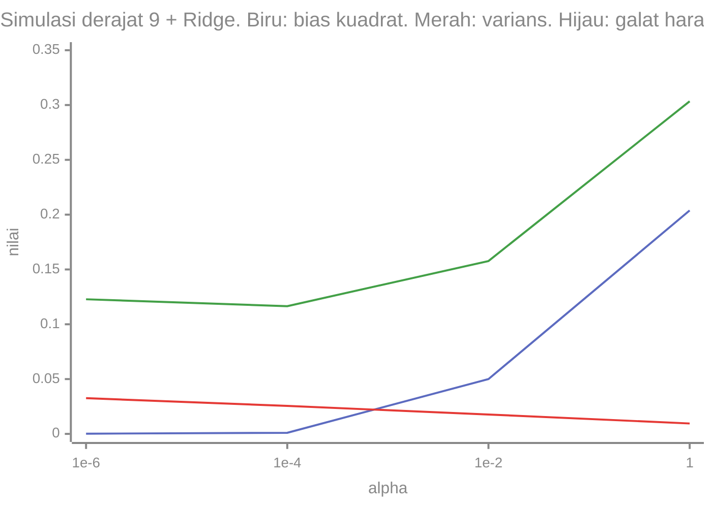

# Part 12 — Regularisasi dan Reduksi Dimensi

## Tujuan Pembelajaran

Setelah mempelajari bagian ini, kamu mampu:

- menjelaskan regularisasi sebagai penalti terhadap bobot dan menulis fungsi tujuan Ridge (L2) dan Lasso (L1);
- menghitung solusi Ridge (satu fitur dan bentuk matriks) dan menjelaskan mengapa ia menyelesaikan masalah matriks singular dan menstabilkan koefisien;
- menghitung *soft thresholding* Lasso dan menjelaskan mengapa Lasso menghasilkan bobot nol sedangkan Ridge tidak;
- menjelaskan dekomposisi bias-varians dan hubungannya dengan kekuatan regularisasi $\alpha$ dan kompleksitas model;
- menjelaskan tujuan PCA, menghitungnya secara manual untuk data dua dimensi (nilai eigen dan vektor eigen matriks kovarians), dan menghitung varians yang dijelaskan;
- memilih jumlah komponen dan menyebut keterbatasan PCA (skala, linearitas, bukan jaminan relevansi);
- menghubungkan regularisasi dan PCA dengan data teks berdimensi tinggi.

## Prasyarat

[Part 3 — Regresi Linear](03-regresi-linear.md) (persamaan normal, kolinearitas), [Part 4](04-regresi-logistik.md) dan [Part 9](09-support-vector-machine.md) (loss dan parameter $C$), [Part 11](11-evaluasi-dan-pemilihan-model.md) (validasi), [Level 2 Part 5](../level-2-aljabar-linear-dan-kalkulus/05-transformasi-linear.md) (nilai eigen dan vektor eigen $2 \times 2$), dan [Level 3 Part 11](../level-3-probabilitas-dan-statistika/11-korelasi-kovarians-dan-standardisasi.md) (matriks kovarians).

## Masalah yang Ingin Diselesaikan

Dua masalah yang saling berkaitan:

1. **Model terlalu fleksibel** untuk data yang tersedia: koefisien menjadi sangat besar dan tidak stabil, loss latih sangat rendah tetapi loss uji tinggi (*overfitting*, Part 1 dan 3). Hal ini sering muncul bila fitur berkorelasi tinggi atau fitur lebih banyak daripada contoh ($d \geq n$). **Regularisasi** menahan kompleksitas dengan menghukum bobot besar.
2. **Terlalu banyak fitur**, yang banyak di antaranya redundan atau berderau. **Reduksi dimensi** meringkas fitur menjadi sedikit dimensi baru. **PCA** mencari arah yang menyimpan sebanyak mungkin varians data.

## Intuisi dan Istilah Penting

### 1. Fungsi Tujuan dengan Penalti

Regularisasi menambahkan penalti pada loss:

$$
J(\mathbf{w}) = \underbrace{\text{loss data}}_{\text{seberapa cocok}} + \alpha\,\underbrace{R(\mathbf{w})}_{\text{penalti kompleksitas}}
$$

$\alpha \geq 0$ (hiperparameter, dipilih lewat validasi) mengatur keseimbangan: $\alpha = 0$ tanpa penalti; $\alpha$ sangat besar memaksa semua bobot mendekati nol. Bias $b$ biasanya **tidak** dihukum. Karena penalti memengaruhi bobot dengan cara yang bergantung skala fitur, **fitur harus distandardisasi** (Part 2) sebelum regularisasi.

| | Ridge (L2) | Lasso (L1) |
|---|---|---|
| Penalti $R(\mathbf{w})$ | $\lVert\mathbf{w}\rVert_2^2 = \sum_j w_j^2$ | $\lVert\mathbf{w}\rVert_1 = \sum_j \lvert w_j \rvert$ |
| Efek | mengecilkan semua bobot | mengecilkan dan **menolkan** sebagian bobot (seleksi fitur) |
| Solusi regresi linear | rumus tertutup | tidak ada rumus tertutup sederhana |

Catatan konvensi: pustaka berbeda menormalkan loss data berbeda (jumlah kuadrat, atau dibagi $n$, atau dibagi $2n$), sehingga nilai $\alpha$ yang sama belum tentu setara antar pustaka maupun antar metode. Buku ini memakai $J(\mathbf{w}) = \sum_i (\hat{y}_i - y_i)^2 + \alpha\lVert\mathbf{w}\rVert_2^2$ untuk Ridge (seperti `Ridge` di scikit-learn); untuk Lasso, angka dari scikit-learn memakai $\frac{1}{2n}\sum_i (\hat{y}_i - y_i)^2 + \alpha\lVert\mathbf{w}\rVert_1$.

### 2. Regresi Ridge

Untuk data **terpusat** (rata-rata fitur dan target dikurangi), solusinya:

$$
\mathbf{w}_{\text{ridge}} = \bigl(X^{\top}X + \alpha I\bigr)^{-1}X^{\top}\mathbf{y}
$$

Dibandingkan persamaan normal $X^{\top}X\,\mathbf{w} = X^{\top}\mathbf{y}$ (Part 3), hanya ada tambahan $\alpha I$ di diagonal. Akibatnya:

- **Selalu dapat dibalik** untuk $\alpha > 0$: bila $X^{\top}X$ punya nilai eigen $\lambda_j \geq 0$ (mungkin nol bila kolom bergantung linear), maka $X^{\top}X + \alpha I$ punya nilai eigen $\lambda_j + \alpha > 0$. Masalah singular (kolom duplikat, jebakan dummy, $d \geq n$, Part 2 dan 3) terselesaikan.
- **Penyusutan** (*shrinkage*): untuk satu fitur terpusat, $w_{\text{ridge}} = \dfrac{S_{xy}}{S_{xx} + \alpha}$, selalu lebih kecil dari $w_{\text{OLS}} = S_{xy}/S_{xx}$ dan mendekati nol bila $\alpha \to \infty$.
- **Stabilitas**: fitur yang berkorelasi berbagi bobot daripada saling meniadakan dengan koefisien besar berlawanan tanda.
- *Gradient descent*: $\nabla J = 2X^{\top}(X\mathbf{w} - \mathbf{y}) + 2\alpha\mathbf{w}$; suku $2\alpha\mathbf{w}$ menarik bobot ke nol di tiap langkah ("*weight decay*").

### 3. Regresi Lasso dan *Soft Thresholding*

Karena $\lvert w \rvert$ tidak mulus di $0$, Lasso tidak punya rumus tertutup umum dan dihitung secara iteratif. Namun bentuk satu bobot memperlihatkan perilakunya: bila $w_0$ adalah bobot tanpa penalti, minimalkan $\frac{1}{2}(w - w_0)^2 + \lambda\lvert w \rvert$ memberi

$$
w_{\text{lasso}} = \mathrm{sign}(w_0)\max\bigl(\lvert w_0 \rvert - \lambda,\ 0\bigr)
$$

(*soft thresholding*: kurangi $\lambda$ dari besar bobot; bila besarnya kurang dari $\lambda$, bobot menjadi tepat nol). Pembanding Ridge: $\frac{1}{2}(w - w_0)^2 + \frac{\lambda}{2}w^2$ memberi $w_{\text{ridge}} = \dfrac{w_0}{1 + \lambda}$ (mengecil proporsional, tidak pernah tepat nol). Untuk $\lambda = 1$:

| $w_0$ | Lasso | Ridge |
|---|---|---|
| $3$ | $2$ | $1{,}5$ |
| $1{,}5$ | $0{,}5$ | $0{,}75$ |
| $0{,}8$ | $\mathbf{0}$ | $0{,}4$ |
| $-2$ | $-1$ | $-1$ |

Bobot kecil ($0{,}8$) dinolkan oleh Lasso tetapi hanya diperkecil oleh Ridge. Secara geometris, kontur loss pertama kali menyentuh daerah penalti L1 (berbentuk belah ketupat dengan sudut di sumbu) cenderung di sudut, tempat sebagian koordinat nol, sedangkan daerah L2 (lingkaran) tidak punya sudut. Lasso berguna bila diduga hanya sebagian fitur yang relevan; Ridge bila banyak fitur berkontribusi kecil dan berkorelasi. *Elastic Net* menggabungkan keduanya. Bila beberapa fitur berkorelasi tinggi, Lasso cenderung memilih satu secara agak sewenang-wenang.

**Regularisasi pada model lain.** Regresi logistik dan SVM juga diregularisasi: pada scikit-learn, parameter $C$ adalah **kebalikan** kekuatan regularisasi (kira-kira $C \propto 1/\alpha$): $C$ kecil berarti regularisasi kuat (bobot kecil, margin lebar pada SVM, Part 9). Penalti L1 pada regresi logistik memilih kata penting pada teks.

### 4. Trade-off Bias-Varians

Untuk sebuah titik uji $\mathbf{x}$ dengan nilai sebenarnya $y = f(\mathbf{x}) + \varepsilon$ ($\mathbb{E}[\varepsilon] = 0$, $\mathrm{Var}(\varepsilon) = \sigma^2$), galat kuadrat harapan model yang dilatih pada data acak adalah (memakai nilai harapan dan varians, Level 3 Part 7):

$$
\mathbb{E}\bigl[(y - \hat{f}(\mathbf{x}))^2\bigr] = \underbrace{\bigl(\mathbb{E}[\hat{f}(\mathbf{x})] - f(\mathbf{x})\bigr)^2}_{\text{bias}^2} + \underbrace{\mathrm{Var}\bigl(\hat{f}(\mathbf{x})\bigr)}_{\text{varians}} + \underbrace{\sigma^2}_{\text{derau tak tereduksi}}
$$

- **Bias**: seberapa jauh prediksi rata-rata (pada banyak kumpulan data latih yang mungkin) dari fungsi sebenarnya: model terlalu sederhana $\Rightarrow$ bias tinggi (*underfitting*).
- **Varians**: seberapa berubah prediksi bila data latih berganti: model terlalu fleksibel $\Rightarrow$ varians tinggi (*overfitting*).
- **Derau** $\sigma^2$ tidak dapat dikurangi oleh model apa pun.

Menambah kompleksitas menurunkan bias dan menaikkan varians; regularisasi bekerja ke arah sebaliknya: $\alpha$ naik $\Rightarrow$ bias naik, varians turun. Titik terbaik adalah total terkecil, dipilih lewat validasi (Part 11).

**Simulasi.** Fungsi sebenarnya $f(x) = \sin(2\pi x)$; tiap dataset latih 15 titik pada $x = 0, \tfrac{1}{14}, \dots, 1$ dengan derau $\sigma = 0{,}3$ ($\sigma^2 = 0{,}09$); model polinomial; 200 dataset latih; bias dan varians dihitung pada 50 titik uji dan dirata-ratakan (seed tetap).

| Derajat polinomial | Bias$^2$ | Varians | Galat harapan (bias$^2$ + varians + $0{,}09$) |
|---|---|---|---|
| 1 | $0{,}2067$ | $0{,}0097$ | $0{,}3064$ (*underfit*) |
| 3 | $0{,}0055$ | $0{,}0190$ | $\mathbf{0{,}1145}$ |
| 9 | $0{,}0002$ | $0{,}0629$ | $0{,}1531$ (*overfit*) |

Derajat 9 dengan Ridge (hanya mengubah $\alpha$):

| $\alpha$ | Bias$^2$ | Varians | Galat harapan |
|---|---|---|---|
| $10^{-6}$ | $0{,}0002$ | $0{,}0326$ | $0{,}1228$ |
| $10^{-4}$ | $0{,}0010$ | $0{,}0255$ | $\mathbf{0{,}1165}$ |
| $10^{-2}$ | $0{,}0500$ | $0{,}0177$ | $0{,}1577$ |
| $1$ | $0{,}2038$ | $0{,}0095$ | $0{,}3034$ |



Regularisasi memangkas varians derajat 9 dari $0{,}0629$ (tanpa penalti) menjadi $0{,}0255$ dengan sedikit kenaikan bias: galat harapan turun dari $0{,}1531$ ke $0{,}1165$, hampir setara dengan polinomial derajat 3 yang jauh lebih sederhana ($0{,}1145$). $\alpha$ terlalu besar membuat bias mendominasi dan model kembali *underfit*. Ini data simulasi, bukan hasil eksperimen nyata.

### 5. Reduksi Dimensi dan PCA

**Analisis Komponen Utama** (*Principal Component Analysis*, PCA) mencari arah-arah ortogonal yang menangkap varians data terbanyak, lalu memproyeksikan data ke $k$ arah teratas ($k < d$). Langkah:

1. **Pusatkan** data (kurangi rata-rata tiap fitur); standardisasi bila skala fitur berbeda.
2. Hitung **matriks kovarians** $\Sigma = \dfrac{1}{n - 1}X_c^{\top}X_c$ (Level 3 Part 11), matriks simetris $d \times d$.
3. Cari **nilai eigen** $\lambda_1 \geq \lambda_2 \geq \dots \geq \lambda_d \geq 0$ dan **vektor eigen** $\mathbf{v}_1, \dots, \mathbf{v}_d$ yang saling tegak lurus dan panjangnya 1: $\Sigma\mathbf{v}_j = \lambda_j\mathbf{v}_j$ (Level 2 Part 5). $\mathbf{v}_j$ adalah **komponen utama** ke-$j$ dan $\lambda_j$ adalah **varians data sepanjang $\mathbf{v}_j$**.
4. **Proyeksikan**: skor komponen $z_j = \mathbf{v}_j\cdot(\mathbf{x} - \bar{\mathbf{x}})$.
5. **Varians yang dijelaskan** oleh komponen ke-$j$: $\dfrac{\lambda_j}{\sum_i\lambda_i}$. Pilih $k$ sehingga persentase kumulatif cukup (misalnya $\geq 90\%$).

Total varians $\sum\lambda_i$ sama dengan jumlah varians semua fitur ($=$ jejak $\Sigma$). Merekonstruksi dari $k$ komponen menyisakan galat kuadrat rata-rata sebesar jumlah nilai eigen yang dibuang.

Untuk matriks simetris $2 \times 2$, $\Sigma = \begin{bmatrix} a & b \\ b & c \end{bmatrix}$, nilai eigen dari persamaan karakteristik (Level 2 Part 5):

$$
\lambda = \frac{a + c}{2} \pm \sqrt{\left(\frac{a - c}{2}\right)^2 + b^2}
$$

dan vektor eigen untuk $\lambda$ memenuhi $(a - \lambda)v_1 + b\,v_2 = 0$, yaitu $\mathbf{v} \propto (b,\ \lambda - a)$ (bila $b \neq 0$), lalu dinormalkan.

### 6. Sifat dan Keterbatasan PCA

- **Varians bukan relevansi.** PCA tak terawasi: arah dengan varians besar belum tentu yang membedakan kelas. Fitur berderau dengan skala besar mendominasi PC1 bila tidak distandardisasi.
- **Peka skala.** Contoh pada rumah: tanpa standardisasi $\Sigma = \begin{bmatrix} 845 & 32{,}75 \\ 32{,}75 & 1{,}3 \end{bmatrix}$ dengan nilai eigen $846{,}27$ dan $0{,}0306$: PC1 menjelaskan $99{,}996\%$ dan hampir sama dengan fitur luas saja ($\mathbf{v}_1 \approx (0{,}9992;\ 0{,}0387)$) hanya karena luas berskala besar.
- **Linear.** PCA tidak menangkap struktur melengkung.
- **Komponen sulit ditafsirkan** (campuran fitur) dan tanda vektor eigen sewenang-wenang ($\mathbf{v}$ dan $-\mathbf{v}$ sama).
- **Fit pada data latih saja** (pusat, skala, dan komponen), lalu terapkan ke data uji (kebocoran, Part 2).
- **Maksimum $\min(n - 1, d)$ komponen berarti** (sisanya nol varians).
- **Bukan seleksi fitur**: komponen adalah kombinasi semua fitur.

## Rumus dan Penjelasan Setiap Simbol

| Konsep | Rumus | Arti simbol dan syarat |
|---|---|---|
| Ridge | $J = \sum(\hat{y} - y)^2 + \alpha\lVert\mathbf{w}\rVert_2^2$ | $\alpha \geq 0$, bias tidak dihukum |
| Solusi Ridge | $\mathbf{w} = (X^{\top}X + \alpha I)^{-1}X^{\top}\mathbf{y}$ | data terpusat; $\alpha > 0$ menjamin invers |
| Ridge satu fitur | $w = S_{xy}/(S_{xx} + \alpha)$ | $S_{xx}, S_{xy}$ dari Part 3 |
| Lasso | $J = \text{loss} + \alpha\lVert\mathbf{w}\rVert_1$ | konvensi skala bergantung pustaka |
| *Soft thresholding* | $\mathrm{sign}(w_0)\max(\lvert w_0 \rvert - \lambda, 0)$ | $w_0$ bobot tanpa penalti |
| Bias-varians | $\mathbb{E}[(y - \hat{f})^2] = \text{bias}^2 + \mathrm{Var} + \sigma^2$ | $\sigma^2$ derau tak tereduksi |
| Kovarians | $\Sigma = \frac{1}{n - 1}X_c^{\top}X_c$ | $X_c$ data terpusat |
| PCA | $\Sigma\mathbf{v}_j = \lambda_j\mathbf{v}_j$ | $\lVert\mathbf{v}_j\rVert = 1$, $\lambda_j$ varians sepanjang $\mathbf{v}_j$ |
| Varians dijelaskan | $\lambda_j/\sum_i\lambda_i$ | jumlah $= 1$ |
| Skor komponen | $z_j = \mathbf{v}_j\cdot(\mathbf{x} - \bar{\mathbf{x}})$ | proyeksi data terpusat |

## Contoh Numerik Langkah demi Langkah

### Contoh 1 — Ridge pada satu fitur

Pada data Part 3 ($x = 1, 2, 3, 4$; $y = 3, 5, 6, 9$): $S_{xy} = 9{,}5$ dan $S_{xx} = 5$ (data terpusat).

1. $\alpha = 0$ (kuadrat terkecil biasa): $w = \dfrac{9{,}5}{5} = 1{,}9$.
2. $\alpha = 1$: $w = \dfrac{9{,}5}{5 + 1} = 1{,}5833$.
3. $\alpha = 5$: $w = \dfrac{9{,}5}{5 + 5} = 0{,}95$.
4. Bobot menyusut dari $1{,}9$ ke $1{,}58$ dan $0{,}95$: semakin besar $\alpha$, semakin kecil, tetapi tidak pernah tepat nol.

### Contoh 2 — Ridge menstabilkan fitur berkorelasi (data simulasi rumah)

Pakai data rumah dari Part 3 (luas dan kamar, korelasi $0{,}988$), fitur distandardisasi (dengan $s$, $n - 1$) dan harga dipusatkan. Hasil $\mathbf{w}_{\text{ridge}} = (Z^{\top}Z + \alpha I)^{-1}Z^{\top}\mathbf{h}$ (satuan: juta per simpangan baku):

| $\alpha$ | Bobot (luas, kamar) | MSE latih |
|---|---|---|
| $0$ (OLS) | $150{,}60;\ 177{,}89$ | $2783{,}1$ |
| $0{,}1$ | $157{,}81;\ 166{,}60$ | $2798{,}0$ |
| $1$ | $145{,}28;\ 146{,}52$ | $3857{,}1$ |
| $5$ | $100{,}71;\ 100{,}97$ | $15\,574{,}2$ |
| $20$ | $46{,}70;\ 46{,}76$ | $46\,717{,}9$ |

Makin besar $\alpha$, bobot mengecil dan saling mendekat (kedua fitur berbagi peran), dan MSE **latih** naik (harga yang dibayar). Manfaatnya terlihat pada stabilitas: bila satu rumah dibuang dan model dihitung ulang (lima kemungkinan), rentang bobot luas dan kamar menjadi:

| $\alpha$ | Rentang bobot luas | Rentang bobot kamar |
|---|---|---|
| $0$ | $-317{,}2$ sampai $308{,}7$ | $-47{,}9$ sampai $677{,}8$ |
| $1$ | $118{,}4$ sampai $158{,}7$ | $104{,}9$ sampai $167{,}8$ |
| $5$ | $72{,}3$ sampai $102{,}8$ | $69{,}5$ sampai $104{,}7$ |

Tanpa penalti bobot melompat dari negatif ke positif besar; dengan $\alpha = 1$ ia tetap positif dan berada dalam rentang sempit. Ini data simulasi kecil (5 rumah); $\alpha$ yang tepat harus dipilih lewat validasi pada data yang lebih besar.

### Contoh 3 — Ridge menyelesaikan matriks singular

Dua kolom fitur identik $\mathbf{x}$ dengan $\sum x^2 = 10$ dan $\sum xy = 20$. $X^{\top}X = \begin{bmatrix} 10 & 10 \\ 10 & 10 \end{bmatrix}$ singular (determinan $0$): banyak solusi $w_1 + w_2 = 2$.

1. Tambahkan $\alpha I$ dengan $\alpha = 1$: $\begin{bmatrix} 11 & 10 \\ 10 & 11 \end{bmatrix}$, determinan $121 - 100 = 21 \neq 0$.
2. Sistem: $11w_1 + 10w_2 = 20$ dan $10w_1 + 11w_2 = 20$. Kurangi: $w_1 - w_2 = 0$, jadi $w_1 = w_2$; $21w_1 = 20$, $w_1 = w_2 = \dfrac{20}{21} = 0{,}9524$.
3. Ridge memilih satu solusi tunggal yang membagi bobot rata antar kolom duplikat (jumlah $1{,}905$, sedikit di bawah $2$ karena penyusutan).

### Contoh 4 — *Soft thresholding* Lasso vs Ridge

Dengan $\lambda = 1$ dan bobot tanpa penalti $w_0 = 3;\ 1{,}5;\ 0{,}8;\ -2$ (tabel di bagian 3): Lasso memberi $2;\ 0{,}5;\ 0;\ -1$ dan Ridge memberi $1{,}5;\ 0{,}75;\ 0{,}4;\ -1$. Hanya Lasso menghasilkan bobot nol (untuk $w_0 = 0{,}8$, yang besarnya kurang dari $\lambda = 1$).

**Contoh dengan data sintetis (simulasi).** 100 contoh, 10 fitur, hanya 3 yang sebenarnya berpengaruh (koefisien sebenarnya $70{,}1;\ 82{,}2;\ 88{,}3$). Setelah standardisasi, koefisien (diukur per simpangan baku fitur) dari kuadrat terkecil biasa: tiga yang besar $\approx 67{,}7;\ 84{,}4;\ 80{,}0$ dan tujuh kecil ($\lvert w \rvert \leq 2{,}2$) yang sebenarnya derau. Lasso (konvensi scikit-learn):

| $\alpha$ | Banyak bobot tak nol | Tiga bobot terbesar |
|---|---|---|
| $0{,}1$ | 10 | $67{,}6;\ 84{,}2;\ 79{,}9$ |
| $1$ | 6 | $66{,}8;\ 83{,}1;\ 78{,}8$ |
| $5$ | **3** | $62{,}8;\ 79{,}0;\ 74{,}5$ |
| $20$ | 3 | $47{,}3;\ 64{,}1;\ 58{,}5$ |

Pada $\alpha = 5$ Lasso mempertahankan tepat tiga fitur yang benar dan menolkan tujuh lainnya, dengan harga penyusutan pada tiga yang tersisa ($\alpha = 20$ menyusutkan lebih jauh). Ridge pada data yang sama tidak pernah menghasilkan bobot nol.

### Contoh 5 — PCA dua dimensi secara manual

Lima titik simulasi: $(1, 1), (2, 3), (3, 2), (4, 5), (5, 4)$.

1. Rata-rata $(3, 3)$. Data terpusat: $(-2, -2), (-1, 0), (0, -1), (1, 2), (2, 1)$.
2. $\sum x_1^2 = 4 + 1 + 0 + 1 + 4 = 10$, $\sum x_2^2 = 4 + 0 + 1 + 4 + 1 = 10$, $\sum x_1x_2 = 4 + 0 + 0 + 2 + 2 = 8$.
3. $\Sigma = \dfrac{1}{4}\begin{bmatrix} 10 & 8 \\ 8 & 10 \end{bmatrix} = \begin{bmatrix} 2{,}5 & 2 \\ 2 & 2{,}5 \end{bmatrix}$.
4. Nilai eigen: $\lambda = \dfrac{2{,}5 + 2{,}5}{2} \pm \sqrt{0^2 + 2^2} = 2{,}5 \pm 2$, yaitu $\lambda_1 = 4{,}5$ dan $\lambda_2 = 0{,}5$. Periksa: jumlah $= 5 = 2{,}5 + 2{,}5$ (jejak).
5. Vektor eigen: $\lambda_1 = 4{,}5$: $(a - \lambda)v_1 + bv_2 = -2v_1 + 2v_2 = 0 \Rightarrow v_1 = v_2$, jadi $\mathbf{v}_1 = \tfrac{1}{\sqrt{2}}(1, 1)$. $\lambda_2 = 0{,}5$: $2v_1 + 2v_2 = 0 \Rightarrow \mathbf{v}_2 = \tfrac{1}{\sqrt{2}}(1, -1)$.
6. Varians dijelaskan: PC1 $= \dfrac{4{,}5}{5} = 90\%$, PC2 $= 10\%$.
7. Skor PC1 $z_1 = \dfrac{x_1 + x_2}{\sqrt{2}}$ untuk data terpusat: $-2{,}828;\ -0{,}707;\ -0{,}707;\ 2{,}121;\ 2{,}121$. Varians skor $= \dfrac{8 + 0{,}5 + 0{,}5 + 4{,}5 + 4{,}5}{4} = 4{,}5 = \lambda_1$.
8. Skor PC2 $z_2 = \dfrac{x_1 - x_2}{\sqrt{2}}$: $0;\ -0{,}707;\ 0{,}707;\ -0{,}707;\ 0{,}707$, variansnya $\dfrac{0 + 0{,}5 + 0{,}5 + 0{,}5 + 0{,}5}{4} = 0{,}5 = \lambda_2$.
9. Menyimpan hanya PC1 (dari dua dimensi menjadi satu) menyisakan galat rekonstruksi rata-rata (dengan pembagi $n - 1$) sebesar $\lambda_2 = 0{,}5$, atau $10\%$ varians total hilang.

### Contoh 6 — PCA dengan dan tanpa standardisasi (data simulasi rumah)

Luas (m²) dan kamar dari Part 3.

1. **Tanpa standardisasi**: $\Sigma = \begin{bmatrix} 845 & 32{,}75 \\ 32{,}75 & 1{,}3 \end{bmatrix}$. Nilai eigen $846{,}27$ dan $0{,}0306$; PC1 menjelaskan $99{,}996\%$ dengan $\mathbf{v}_1 \approx (0{,}9992;\ 0{,}0387)$ (hampir seluruhnya luas, karena luas berskala jauh lebih besar).
2. **Dengan standardisasi**: matriks korelasi $\begin{bmatrix} 1 & 0{,}988 \\ 0{,}988 & 1 \end{bmatrix}$, nilai eigen $1 \pm 0{,}988 = 1{,}988$ dan $0{,}012$; PC1 menjelaskan $99{,}41\%$ dengan $\mathbf{v}_1 = \tfrac{1}{\sqrt{2}}(1, 1)$, yaitu rata-rata luas dan kamar yang distandardisasi.
3. Dalam kedua kasus PC1 hampir menjelaskan semua varians karena kedua fitur sangat berkorelasi; tetapi **maknanya berbeda**: pada kasus 1 PC1 hanya mencerminkan satuan luas, pada kasus 2 ia menggabungkan kedua fitur secara seimbang.

### Contoh 7 — PCA pada TF-IDF korpus simulasi

Korpus 10 pesan (Part 2, 29 dimensi). Varians yang dijelaskan komponen berturut-turut: $19{,}7\%;\ 15{,}2\%;\ 13{,}0\%;\ 12{,}2\%;\ 11{,}2\%;\ 10{,}8\%;\ 7{,}5\%;\ 6{,}5\%;\ 4{,}0\%$, kemudian $0\%$ (maksimum $\min(n - 1, d) = 9$ komponen berarti). Kumulatif: $19{,}7\%;\ 34{,}8\%;\ 47{,}8\%;\ 60{,}1\%;\ 71{,}3\%;\ 82{,}1\%;\ 89{,}6\%;\ 96{,}0\%;\ 100\%$.

1. Varians tersebar rata pada banyak komponen: dua komponen pertama hanya $34{,}8\%$, dan untuk $\geq 90\%$ dibutuhkan $8$ komponen dari $29$ dimensi.
2. Skor PC1 pada 10 pesan: pesan Emergency 1 sampai 5 bernilai $-0{,}005;\ -0{,}209;\ -0{,}464;\ -0{,}484;\ -0{,}469$ (negatif), pesan Non-Emergency 6 sampai 10 bernilai $0{,}579;\ 0{,}137;\ 0{,}216;\ 0{,}644;\ 0{,}056$ (positif): PC1 hampir memisahkan kedua kelas walau PCA tidak melihat label. Pesan 1 dengan skor hampir nol berada di perbatasan. Pada data sekecil ini pemisahan itu bisa kebetulan.
3. Pada teks sungguhan, PCA pada matriks TF-IDF jarang yang sangat besar mahal karena pemusatan membuatnya padat; variannya (*SVD terpotong*) dipakai dalam praktik. Kita tidak membahasnya di sini.

## Interpretasi, Asumsi, dan Keterbatasan

- **Regularisasi bukan gratis.** Ia menaikkan bias; manfaatnya hanya bila varians yang diturunkan lebih besar daripada kenaikan bias, dan $\alpha$ harus divalidasi.
- **Penskalaan wajib** untuk Ridge, Lasso, dan PCA.
- **Lasso tidak stabil bila fitur berkorelasi** (memilih salah satu secara agak sewenang-wenang) dan bobot yang tersisa menyusut (bias).
- **Dekomposisi bias-varians** adalah konsep untuk berpikir; nilai bias dan varians tidak dapat dihitung langsung pada data nyata (butuh banyak dataset), hanya pada simulasi.
- **PCA** tidak menjamin komponen berguna untuk prediksi; periksa dengan validasi. Hasilnya bergantung skala dan fit pada data latih saja.
- **Tidak ada algoritma yang selalu unggul.** Regularisasi dan PCA adalah alat, bukan jaminan peningkatan.

## Hubungan dengan ML dan NLP

- **Teks berdimensi tinggi.** Dengan ribuan kata dan sedikit contoh ($d \gg n$), model tanpa regularisasi hampir selalu *overfit* atau tidak terdefinisi. Karena itu regresi logistik dan SVM pada TF-IDF selalu diregularisasi (L2 secara bawaan; $C$ dipilih lewat validasi, Part 11).
- **Seleksi kata.** Penalti L1 pada regresi logistik memberi bobot nol pada kebanyakan kata dan menyisakan kata penting. Pada korpus simulasi 10 pesan dengan penalti L1: $C = 0{,}1$ dan $C = 1$ menolkan semua bobot (penalti terlalu kuat untuk data sekecil ini); $C = 10$ mempertahankan 10 kata (antara lain *ambulans, baru, besok, kantin, kebakaran, kecelakaan*); $C = 100$ mempertahankan 11 kata. Angka ini simulasi pada 10 pesan: ia memperlihatkan peran $C$, bukan kinerja nyata.
- **Reduksi dimensi sebelum model.** Mereduksi ke beberapa puluh komponen (PCA atau SVD terpotong) dapat mempercepat KNN dan K-Means (Part 5 dan 10), tetapi mungkin membuang sinyal yang relevan.
- **Visualisasi.** Proyeksi ke dua komponen pertama dipakai untuk melihat struktur data, dengan kehati-hatian karena hanya sebagian varians yang terlihat.
- **Pemilihan $\alpha$.** Validasi silang (Part 11) memilih $\alpha$, $C$, atau jumlah komponen; praproses (standardisasi, PCA) dipelajari di dalam tiap lipatan.

### Python: Ridge, soft thresholding, bias-varians, dan PCA dari nol

Hanya pustaka standar. Ridge pada data rumah terstandardisasi dan stabilitasnya (Contoh 2):

```python
import math, random
from statistics import mean, stdev

L = [60, 90, 45, 120, 70]
K = [2, 3, 1, 4, 2]
H = [500, 900, 250, 1100, 650]

def standar(v):
    return [(a - mean(v)) / stdev(v) for a in v]

def ridge2(l, k, h, alpha):
    Z = list(zip(standar(l), standar(k)))
    hc = [a - mean(h) for a in h]
    a11 = sum(z[0] ** 2 for z in Z) + alpha
    a22 = sum(z[1] ** 2 for z in Z) + alpha
    a12 = sum(z[0] * z[1] for z in Z)
    b1 = sum(z[0] * t for z, t in zip(Z, hc))
    b2 = sum(z[1] * t for z, t in zip(Z, hc))
    det = a11 * a22 - a12 ** 2
    w1, w2 = (b1 * a22 - a12 * b2) / det, (a11 * b2 - a12 * b1) / det
    mse = sum((w1 * z[0] + w2 * z[1] - t) ** 2 for z, t in zip(Z, hc)) / len(h)
    return round(w1, 2), round(w2, 2), round(mse, 1)

for alpha in (0, 0.1, 1, 5, 20):
    print(alpha, ridge2(L, K, H, alpha))
# 0 (150.6, 177.89, 2783.1)
# 0.1 (157.81, 166.6, 2798.0)
# 1 (145.28, 146.52, 3857.1)
# 5 (100.71, 100.97, 15574.2)
# 20 (46.7, 46.76, 46717.9)

for alpha in (0, 1, 5):
    hasil = []
    for i in range(5):                                    # buang satu rumah, hitung ulang
        sisa = [j for j in range(5) if j != i]
        hasil.append(ridge2([L[j] for j in sisa], [K[j] for j in sisa], [H[j] for j in sisa], alpha)[:2])
    print(alpha, [min(h[0] for h in hasil), max(h[0] for h in hasil)], [min(h[1] for h in hasil), max(h[1] for h in hasil)])
# 0 [-317.21, 308.67] [-47.87, 677.77]
# 1 [118.39, 158.69] [104.94, 167.83]
# 5 [72.3, 102.79] [69.53, 104.66]

print([round(9.5 / (5 + a), 4) for a in (0, 1, 5)])                                  # [1.9, 1.5833, 0.95]
lunak = lambda w0, lam: math.copysign(max(abs(w0) - lam, 0), w0)
print([(w0, lunak(w0, 1), w0 / 2) for w0 in (3, 1.5, 0.8, -2)])
# [(3, 2.0, 1.5), (1.5, 0.5, 0.75), (0.8, 0.0, 0.4), (-2, -1.0, -1.0)]
```

Simulasi bias-varians (Contoh di bagian 4):

```python
def selesaikan(A, b):
    n = len(A)
    M = [row[:] + [b[i]] for i, row in enumerate(A)]
    for i in range(n):
        p = max(range(i, n), key=lambda r: abs(M[r][i]))
        M[i], M[p] = M[p], M[i]
        for r in range(i + 1, n):
            f = M[r][i] / M[i][i]
            for c in range(i, n + 1):
                M[r][c] -= f * M[i][c]
    x = [0] * n
    for i in reversed(range(n)):
        x[i] = (M[i][n] - sum(M[i][c] * x[c] for c in range(i + 1, n))) / M[i][i]
    return x

def cocokkan(xs, ys, d, alpha=0.0):
    X = [[x ** j for j in range(d + 1)] for x in xs]
    A = [[sum(r[i] * r[j] for r in X) + (alpha if i == j and i > 0 else 0) for j in range(d + 1)]
         for i in range(d + 1)]
    b = [sum(r[i] * y for r, y in zip(X, ys)) for i in range(d + 1)]
    return selesaikan(A, b)

prediksi = lambda w, x: sum(c * x ** j for j, c in enumerate(w))
f = lambda x: math.sin(2 * math.pi * x)
xs = [i / 14 for i in range(15)]
xt = [(i + 0.5) / 50 for i in range(50)]

def simulasi(d, alpha=0.0, ulang=200, seed=0):
    rng = random.Random(seed)
    P = []
    for _ in range(ulang):
        ys = [f(x) + rng.gauss(0, 0.3) for x in xs]
        w = cocokkan(xs, ys, d, alpha)
        P.append([prediksi(w, x) for x in xt])
    rata = [sum(p[k] for p in P) / ulang for k in range(len(xt))]
    bias2 = sum((rata[k] - f(xt[k])) ** 2 for k in range(len(xt))) / len(xt)
    var = sum(sum((p[k] - rata[k]) ** 2 for p in P) / ulang for k in range(len(xt))) / len(xt)
    return round(bias2, 4), round(var, 4), round(bias2 + var + 0.09, 4)

for d in (1, 3, 9):
    print(d, simulasi(d))
# 1 (0.2067, 0.0097, 0.3064)
# 3 (0.0055, 0.019, 0.1145)
# 9 (0.0002, 0.0629, 0.1531)
for alpha in (1e-6, 1e-4, 1e-2, 1):
    print(alpha, simulasi(9, alpha))
# 1e-06 (0.0002, 0.0326, 0.1228)
# 0.0001 (0.001, 0.0255, 0.1165)
# 0.01 (0.05, 0.0177, 0.1577)
# 1 (0.2038, 0.0095, 0.3034)
```

PCA $2 \times 2$ dari nol (Contoh 5 dan 6):

```python
def pca2(titik):
    n = len(titik)
    m1, m2 = mean(p[0] for p in titik), mean(p[1] for p in titik)
    c = [(p[0] - m1, p[1] - m2) for p in titik]
    a = sum(u * u for u, _ in c) / (n - 1)
    b = sum(u * v for u, v in c) / (n - 1)
    d = sum(v * v for _, v in c) / (n - 1)
    tengah, akar = (a + d) / 2, math.sqrt(((a - d) / 2) ** 2 + b ** 2)
    l1, l2 = tengah + akar, tengah - akar
    v1 = (b, l1 - a)
    norma = math.hypot(*v1)
    v1 = (v1[0] / norma, v1[1] / norma)
    skor = [round(u * v1[0] + v * v1[1], 3) for u, v in c]
    return (a, b, d), (round(l1, 4), round(l2, 4)), (round(l1 / (l1 + l2), 4)), (round(v1[0], 4), round(v1[1], 4)), skor

print(pca2([(1, 1), (2, 3), (3, 2), (4, 5), (5, 4)]))
# ((2.5, 2.0, 2.5), (4.5, 0.5), 0.9, (0.7071, 0.7071), [-2.828, -0.707, -0.707, 2.121, 2.121])
print(pca2(list(zip(L, K)))[1:4])           # ((846.2694, 0.0306), 1.0, (0.9992, 0.0387))
Zs = list(zip(standar(L), standar(K)))
print(pca2(Zs)[1:4])                        # ((1.9881, 0.0119), 0.9941, (0.7071, 0.7071))
```

**Opsional: bandingkan dengan scikit-learn.** Blok ini membutuhkan scikit-learn dan NumPy, yang **tidak** dipasang oleh proyek ini dan tidak dijalankan oleh situs. Keluaran dijalankan dengan scikit-learn 1.9.0 pada Python 3.14.

```python
import numpy as np
from sklearn.decomposition import PCA
from sklearn.datasets import make_regression
from sklearn.linear_model import Lasso, LinearRegression
from sklearn.preprocessing import StandardScaler

p = PCA().fit(np.array([[1, 1], [2, 3], [3, 2], [4, 5], [5, 4]], float))
print(p.explained_variance_, p.explained_variance_ratio_, p.components_[0].round(4))
# [4.5 0.5] [0.9 0.1] [0.7071 0.7071]

X, y, koef = make_regression(n_samples=100, n_features=10, n_informative=3, noise=10, coef=True, random_state=0)
Xs = StandardScaler().fit_transform(X)
for a in (0.1, 1, 5, 20):
    l = Lasso(alpha=a).fit(Xs, y)
    print(a, int((l.coef_ != 0).sum()), l.coef_.round(1))
# 0.1 10 [ 0.8 -0.2 67.6 84.2  1.6  1.9 79.9 -2.  -0.6 -0.5]
# 1 6 [ 0.  -0.  66.8 83.1  0.7  0.9 78.8 -0.8 -0.  -0. ]
# 5 3 [ 0.   0.  62.8 79.   0.   0.  74.5 -0.  -0.  -0. ]
# 20 3 [ 0.   0.  47.3 64.1  0.   0.  58.5  0.   0.  -0. ]
```

Interpretasi: Ridge manual menghasilkan koefisien dan stabilitas yang sama dengan hitungan di tabel; simulasi memperlihatkan U-bentuk galat harapan terhadap kompleksitas dan $\alpha$; PCA manual dan scikit-learn sama ($\lambda = 4{,}5$ dan $0{,}5$, PC1 $= (0{,}7071;\ 0{,}7071)$); Lasso pada $\alpha = 5$ memilih tepat tiga fitur sebenarnya. (Pada keluaran `Lasso`, `-0.` adalah nol negatif akibat pembulatan.)

## Kesalahan Umum

| Kesalahan | Mengapa salah | Yang benar |
|---|---|---|
| Regularisasi tanpa standardisasi | penalti memperlakukan fitur berskala besar dan kecil tidak adil | standardisasi dahulu |
| Menghukum bias $b$ | bias tidak mengukur kompleksitas | biasanya tidak dihukum |
| Memilih $\alpha$ dengan loss latih | $\alpha = 0$ selalu terbaik pada latih | pilih lewat validasi |
| Menganggap Ridge menolkan bobot | Ridge hanya mengecilkan | pakai Lasso untuk bobot nol |
| Menafsirkan fitur yang dinolkan Lasso sebagai tidak berguna | fitur berkorelasi saling menggantikan | hati-hati |
| Membandingkan $\alpha$ antar pustaka tanpa melihat skala | konvensi loss berbeda | periksa dokumentasi |
| Menjalankan PCA tanpa memusatkan atau menstandardisasi | skala dan rata-rata mendominasi | pusatkan, standardisasi bila perlu |
| Memfit PCA atau standardisasi pada seluruh data sebelum membagi | kebocoran | fit pada data latih saja |
| Mengira komponen dengan varians besar pasti relevan untuk prediksi | PCA tak terawasi | validasi pada tugas prediksi |
| Menganggap bias dan varians dapat dihitung langsung pada data nyata | butuh banyak dataset | gunakan sebagai kerangka berpikir dan simulasi |

## Latihan Mandiri

1. Pada data Part 3 ($S_{xy} = 9{,}5$, $S_{xx} = 5$), hitung $w_{\text{ridge}} = S_{xy}/(S_{xx} + \alpha)$ untuk $\alpha = 0, 1, 5$.
2. Hitung *soft thresholding* Lasso dan penyusutan Ridge ($\lambda = 1$) untuk $w_0 = 2{,}5;\ 0{,}6;\ -1{,}8$.
3. Dua kolom fitur identik dengan $X^{\top}X = \begin{bmatrix} 10 & 10 \\ 10 & 10 \end{bmatrix}$ dan $X^{\top}\mathbf{y} = (20, 20)$. Tunjukkan bahwa $X^{\top}X$ singular, lalu selesaikan Ridge dengan $\alpha = 1$.
4. Pada simulasi bias-varians, derajat 9 dengan $\alpha = 10^{-2}$ memiliki bias$^2$ $= 0{,}0500$, varians $= 0{,}0177$, dan $\sigma^2 = 0{,}09$. Hitung galat harapan dan bandingkan dengan $\alpha = 10^{-4}$ (galat $0{,}1165$). Jelaskan hubungan $\alpha$ dengan bias dan varians.
5. Mengapa $\alpha$ yang terlalu besar menyebabkan *underfitting*? Mengapa $\alpha = 0$ dapat menyebabkan *overfitting*?
6. Hitung nilai eigen dan vektor eigen dari $\Sigma = \begin{bmatrix} 2 & 1 \\ 1 & 2 \end{bmatrix}$ dan varians yang dijelaskan tiap komponen.
7. Dari soal 6, hitung skor PC1 dan PC2 untuk titik terpusat $(1, 1)$ dan $(1, -1)$. Berapa hasil rekonstruksi dari PC1 saja?
8. Persentase varians kumulatif komponen $= 0{,}62;\ 0{,}84;\ 0{,}93;\ 0{,}98$. Berapa komponen yang diperlukan untuk menjelaskan sedikitnya $90\%$?
9. $\Sigma_{\text{mentah}} = \begin{bmatrix} 100 & 0 \\ 0 & 1 \end{bmatrix}$. Berapa persen varians dijelaskan PC1? Bagaimana bila fitur distandardisasi? Apa pelajarannya?
10. Bandingkan Ridge dan Lasso: kapan yang satu lebih cocok? Mengapa regularisasi hampir selalu dipakai pada klasifikasi teks dengan TF-IDF, dan apa keterbatasan PCA pada data teks?

## Kunci Jawaban dan Pembahasan

??? success "Soal 1"
    $\alpha = 0$: $\dfrac{9{,}5}{5} = 1{,}9$. $\alpha = 1$: $\dfrac{9{,}5}{6} = 1{,}5833$. $\alpha = 5$: $\dfrac{9{,}5}{10} = 0{,}95$.

??? success "Soal 2"
    Lasso ($\lambda = 1$): $2{,}5 \to 1{,}5$; $0{,}6 \to 0$ (karena $0{,}6 < 1$); $-1{,}8 \to -0{,}8$. Ridge ($w_0/2$): $1{,}25$; $0{,}3$; $-0{,}9$. Hanya Lasso menolkan bobot yang kecil ($0{,}6$).

??? success "Soal 3"
    Determinan $10 \cdot 10 - 10 \cdot 10 = 0$: singular. Dengan $\alpha = 1$: $\begin{bmatrix} 11 & 10 \\ 10 & 11 \end{bmatrix}$ (determinan $21$). Sistem $11w_1 + 10w_2 = 20$, $10w_1 + 11w_2 = 20$: kurangkan $\Rightarrow w_1 = w_2$, lalu $21w_1 = 20$, $w_1 = w_2 = 0{,}9524$.

??? success "Soal 4"
    Galat $= 0{,}05 + 0{,}0177 + 0{,}09 = 0{,}1577$. Lebih besar dari $0{,}1165$ ($\alpha = 10^{-4}$: bias$^2$ $0{,}0010$ dan varians $0{,}0255$). Dari $\alpha = 10^{-4}$ ke $10^{-2}$ varians turun ($0{,}0255 \to 0{,}0177$) tetapi bias naik jauh ($0{,}001 \to 0{,}05$), dan total naik: terlalu banyak regularisasi merugikan.

??? success "Soal 5"
    $\alpha$ terlalu besar menekan semua bobot mendekati nol sehingga model hampir konstan (bias tinggi): tidak dapat menangkap pola, jadi *underfitting*. $\alpha = 0$ tanpa penalti memungkinkan bobot sangat besar yang menyesuaikan derau data latih (varians tinggi), sehingga *overfitting*, terutama bila fitur berkorelasi atau $d \geq n$.

??? success "Soal 6"
    $\lambda = \dfrac{2 + 2}{2} \pm \sqrt{0 + 1^2} = 2 \pm 1$: $\lambda_1 = 3$, $\lambda_2 = 1$. Vektor eigen: $\lambda_1$: $(a - \lambda)v_1 + bv_2 = -v_1 + v_2 = 0 \Rightarrow \mathbf{v}_1 = \tfrac{1}{\sqrt{2}}(1, 1)$; $\lambda_2$: $v_1 + v_2 = 0 \Rightarrow \mathbf{v}_2 = \tfrac{1}{\sqrt{2}}(1, -1)$. Varians dijelaskan: PC1 $\dfrac{3}{4} = 75\%$, PC2 $25\%$.

??? success "Soal 7"
    Titik $(1, 1)$: $z_1 = \dfrac{1 + 1}{\sqrt{2}} = 1{,}414$, $z_2 = 0$. Titik $(1, -1)$: $z_1 = 0$, $z_2 = \dfrac{1 - (-1)}{\sqrt{2}} = 1{,}414$. Rekonstruksi dari PC1 saja: $z_1\mathbf{v}_1$: $(1, 1) \to 1{,}414 \cdot \tfrac{1}{\sqrt{2}}(1, 1) = (1, 1)$ (sempurna); $(1, -1) \to 0 \cdot \mathbf{v}_1 = (0, 0)$ (hilang total, galat $= \lVert(1, -1)\rVert = 1{,}414$).

??? success "Soal 8"
    Kumulatif $0{,}62$ (1 komponen), $0{,}84$ (2), $0{,}93$ (3). Dibutuhkan $3$ komponen untuk $\geq 90\%$.

??? success "Soal 9"
    Mentah: total varians $101$; PC1 $= \dfrac{100}{101} = 99{,}0\%$ (hanya fitur pertama). Setelah standardisasi, matriks korelasi $= I$: nilai eigen $1$ dan $1$, tiap komponen $50\%$. Pelajarannya: PCA mengikuti skala; tanpa standardisasi, satuan menentukan hasil, bukan struktur data.

??? success "Soal 10"
    Ridge cocok bila banyak fitur memberi kontribusi kecil dan berkorelasi: ia mengecilkan bobot dan menstabilkan, tanpa seleksi fitur. Lasso cocok bila diduga hanya sebagian fitur yang relevan: ia menolkan bobot lain (seleksi), tetapi tidak stabil di antara fitur yang berkorelasi tinggi. Pada TF-IDF, jumlah kata jauh melebihi jumlah dokumen ($d \gg n$) dan data hampir selalu terpisah linear, sehingga tanpa penalti bobot tumbuh sangat besar dan *overfit*; regularisasi diperlukan. Keterbatasan PCA pada teks: TF-IDF jarang menjadi padat setelah dipusatkan (mahal), varians tersebar pada banyak komponen (butuh banyak komponen), komponen sulit ditafsirkan, dan arah varians besar belum tentu membedakan kelas.

## Ringkasan Materi

- Regularisasi menambahkan penalti pada loss: $J = \text{loss} + \alpha R(\mathbf{w})$. Ridge ($L_2$, $\sum w^2$) mengecilkan bobot dengan solusi $(X^{\top}X + \alpha I)^{-1}X^{\top}\mathbf{y}$ yang selalu dapat dibalik dan menstabilkan koefisien; Lasso ($L_1$, $\sum \lvert w \rvert$) menolkan bobot lewat *soft thresholding* dan melakukan seleksi fitur.
- Standardisasi diperlukan; bias tidak dihukum; $\alpha$ (atau $C \propto 1/\alpha$) dipilih lewat validasi.
- Galat kuadrat harapan $=$ bias$^2$ $+$ varians $+$ $\sigma^2$. Kompleksitas naik: bias turun, varians naik; $\alpha$ naik: bias naik, varians turun. Titik terbaik meminimalkan total.
- PCA: pusatkan, matriks kovarians $\Sigma$, nilai eigen $\lambda_j$ (varians sepanjang komponen), vektor eigen $\mathbf{v}_j$; varians dijelaskan $\lambda_j/\sum\lambda$; pilih $k$ lewat varians kumulatif.
- PCA peka skala, linear, tak terawasi (varians bukan relevansi), dan harus di-fit pada data latih saja.
- Pada teks berdimensi tinggi, regularisasi hampir selalu diperlukan; semua angka NLP dan simulasi di sini adalah data simulasi.

## Checklist Penguasaan

- [ ] Menulis fungsi tujuan Ridge dan Lasso dan menjelaskan perbedaannya.
- [ ] Menghitung Ridge satu fitur dan memakai $(X^{\top}X + \alpha I)^{-1}X^{\top}\mathbf{y}$.
- [ ] Menghitung *soft thresholding* dan menjelaskan mengapa Lasso menolkan bobot.
- [ ] Menjelaskan dekomposisi bias-varians dan pengaruh $\alpha$ serta kompleksitas.
- [ ] Menghitung PCA $2 \times 2$: kovarians, nilai eigen, vektor eigen, varians dijelaskan, dan skor komponen.
- [ ] Menyebut keterbatasan PCA dan pentingnya standardisasi.

## Prasyarat untuk Materi Berikutnya

[Part 13 — Integrasi dan Studi Kasus](13-integrasi-dan-studi-kasus.md) menyatukan seluruh Level 4: alur eksperimen ML klasik end-to-end pada korpus simulasi, perbandingan algoritma, pemilihan metrik, dan penelusuran perhitungan. Pastikan seluruh part sebelumnya, terutama evaluasi (Part 11) dan kebocoran data (Part 2), sudah jelas.
