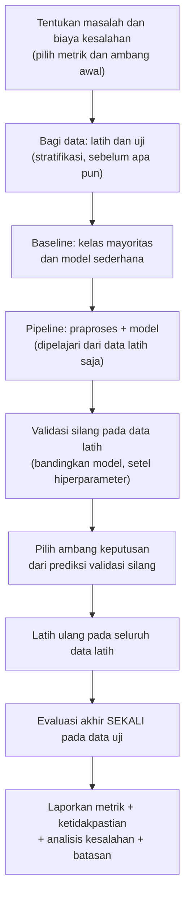

# Part 13 — Integrasi dan Studi Kasus

## Tujuan Pembelajaran

Setelah mempelajari bagian ini, kamu mampu:

- merangkum matematika setiap algoritma Level 4 (parameter, loss atau tujuan, keluaran, asumsi);
- membandingkan algoritma secara adil tanpa menyatakan satu algoritma selalu unggul;
- menelusuri satu masukan melalui beberapa model dan membedakan skor, probabilitas, suara, dan jarak;
- merancang alur eksperimen ML klasik yang benar: pembagian data, baseline, praproses tanpa kebocoran, validasi silang, pemilihan ambang, evaluasi akhir, dan ketidakpastian;
- menafsirkan hasil perbandingan model dengan memperhitungkan variasi antar sampel data;
- melakukan analisis kesalahan dan menulis laporan eksperimen yang jujur;
- menilai kesiapan untuk Level 5.

## Prasyarat

Part 1 sampai 12 Level 4, terutama [Part 2](02-representasi-data-dan-feature-engineering.md) (representasi dan kebocoran), [Part 11](11-evaluasi-dan-pemilihan-model.md) (metrik dan validasi silang), dan [Part 12](12-regularisasi-dan-reduksi-dimensi.md) (regularisasi). Dari level sebelumnya: interval kepercayaan ([Level 3 Part 10](../level-3-probabilitas-dan-statistika/10-inferensi-statistik.md)) dan galat baku ([Level 3 Part 9](../level-3-probabilitas-dan-statistika/09-distribusi-sampling-dan-clt.md)).

## Masalah yang Ingin Diselesaikan

Mempelajari tiap algoritma sendiri-sendiri belum cukup. Pertanyaan praktis adalah: *untuk masalah ini, dengan data ini, algoritma mana yang layak dipakai, bagaimana membandingkannya secara jujur, dan seberapa yakin kita pada hasilnya?* Part ini menyatukan semua alat Level 4 dalam satu studi kasus: **mengklasifikasikan pesan menjadi Emergency vs Non-Emergency**.

!!! warning "Semua data di part ini adalah simulasi"
    Korpus 600 pesan di bawah ini **dibuat oleh sebuah program** (dengan seed tetap) dan **bukan** data nyata maupun hasil eksperimen nyata. Pesan-pesan itu dibangkitkan dengan memilih kata secara acak per kelas, sehingga **sangat cocok dengan asumsi independensi Naive Bayes**. Hasil perbandingan di sini hanya memperlihatkan **cara bernalar dan mengevaluasi**, bukan algoritma mana yang lebih baik pada teks sungguhan.

## Intuisi dan Istilah Penting

### 1. Peta Matematika Level 4

| Part | Algoritma | Yang dipelajari | Tujuan atau loss | Keluaran | Peka skala fitur? | Asumsi atau keterbatasan utama |
|---|---|---|---|---|---|---|
| 3 | Regresi linear | $\mathbf{w}, b$ | MSE (atau MAE) | nilai kontinu | ya (konvergensi, regularisasi) | linear, pencilan, kolinearitas |
| 4 | Regresi logistik | $\mathbf{w}, b$ | *log loss* | **peluang** $\sigma(s)$ | ya | log-odds linear; data terpisah sempurna |
| 5 | KNN | (data); hiperparameter $K$ | jarak ke tetangga | **suara** atau proporsi tetangga | **sangat** | jarak bermakna; dimensi tinggi; prediksi mahal |
| 6 | Naive Bayes | peluang kelas dan fitur | posterior $\propto P(C)\prod P(x_j \mid C)$ | **peluang** (sering terlalu ekstrem) | tidak (Multinomial dan Gaussian per fitur) | independensi bersyarat |
| 7 | Pohon keputusan | aturan pemisah | *entropy* atau Gini | kelas atau proporsi daun | tidak | tidak stabil; mudah *overfit* |
| 8 | Random Forest | banyak pohon | rata-rata atau suara pohon | peluang kasar atau suara | tidak | mengurangi varians, bukan bias |
| 9 | SVM | $\mathbf{w}, b$ | margin dan *hinge loss* | **skor** (bukan peluang) | ya | $C$, kernel; skor perlu kalibrasi |
| 10 | K-Means | centroid | jumlah kuadrat jarak ke centroid | klaster | ya | bentuk bulat; minimum lokal |
| 12 | Ridge, Lasso, PCA | $\mathbf{w}$ dengan penalti; komponen | loss + penalti; varians terjaga | bobot kecil atau nol; koordinat baru | ya | $\alpha$ dipilih lewat validasi |

Perbedaan yang terus diulang: **probabilitas** (Naive Bayes, regresi logistik), **skor** (SVM), **jarak** (KNN, K-Means), **suara** (pohon, hutan), **loss** (angka kesalahan), **parameter** (yang dipelajari), dan **prediksi** (keputusan akhir).

### 2. Satu Pesan, Banyak Model

Pada korpus simulasi 10 pesan dari Part 2, kita latih beberapa model lalu menyuruh semuanya menilai dua pesan baru. Semua angka simulasi.

| Model | "tolong ada banjir di jalan" | "jadwal kuliah besok di gedung" | Jenis keluaran |
|---|---|---|---|
| Naive Bayes (Part 6, $\alpha = 1$) | $P(E) = 0{,}8038$ | $P(E) = 0{,}0179$ | peluang posterior |
| Regresi logistik (TF-IDF, $C = 1$) | $P(E) = 0{,}5577$ | $P(E) = 0{,}3704$ | peluang (disusutkan oleh regularisasi) |
| SVM linear (Part 9, $C = 1$) | skor $f = +0{,}4393$ | skor $f = -0{,}9174$ | skor bertanda, bukan peluang |
| KNN, $K = 3$, kosinus (Part 5) | tetangga: 3 dari 3 Emergency, proporsi $1{,}0$ | proporsi $0{,}0$ | suara tetangga |
| Pohon, entropi (Part 7) | Emergency | Non-Emergency | kelas dari daun |
| Random Forest (100 pohon) | $P(E) = 0{,}69$ | $P(E) = 0{,}14$ | rata-rata peluang pohon |

Semua model sepakat pada keputusan akhir (Emergency dan Non-Emergency), tetapi **angkanya berbeda jenis dan skala**: $0{,}8038$ dari Naive Bayes dan $0{,}5577$ dari regresi logistik tidak dapat dibandingkan sebagai "keyakinan" tanpa kalibrasi; $+0{,}4393$ dari SVM bukan peluang sama sekali; $1{,}0$ dari KNN hanyalah proporsi tiga tetangga. Pada regresi logistik, bobot terbesar adalah *segera* ($+0{,}399$), *kebakaran* ($+0{,}377$), *tolong* ($+0{,}373$) dan terendah *besok* ($-0{,}529$), *kuliah* ($-0{,}345$), *pagi* ($-0{,}308$): konsisten dengan intuisi dan dapat dibaca. Dengan hanya 10 pesan, peluang regresi logistik berkumpul dekat $0{,}5$ karena regularisasi (Part 12).

### 3. Alur Eksperimen ML Klasik yang Benar



Daftar periksa:

1. **Definisikan metrik dari biaya kesalahan**, bukan dari kebiasaan (Part 11).
2. **Bagi data dahulu** dan jangan disentuh sebelum evaluasi akhir; stratifikasi bila kelas tidak seimbang.
3. **Baseline** (kelas mayoritas, model linear sederhana) sebelum model rumit.
4. **Praproses di dalam pipeline**: kosakata, $\mathrm{idf}$, standardisasi, dan seleksi fitur dipelajari dari data latih (atau data latih tiap lipatan).
5. **Validasi silang** untuk membandingkan model dan memilih hiperparameter, dengan simpangan baku antar lipatan.
6. **Pilih ambang** dari prediksi validasi silang, bukan dari data uji.
7. **Evaluasi akhir sekali**; pemakaian berulang data uji menaikkan peluang hasil baik hanya karena kebetulan (Level 3 Part 10).
8. **Laporkan ketidakpastian** (interval kepercayaan, variasi antar sampel) dan **analisis kesalahan**.
9. **Dokumentasikan** versi pustaka, seed, dan asumsi.

## Studi Kasus: Klasifikasi Pesan Emergency vs Non-Emergency (Data Simulasi)

### 1. Data

Program pembangkit membuat 600 pesan: **72 Emergency (12%)** dan **528 Non-Emergency (88%)**. Emergency memuat 1 sampai 2 kata darurat (*kebakaran, kecelakaan, banjir, ambulans, damkar, korban, evakuasi, gempa, longsor, terjebak*), dengan peluang $0{,}7$ satu kata mendesak (*tolong, segera, cepat, bantu*), 2 sampai 3 kata umum (*di, ada, jalan, gedung, kirim, ...*), dan dengan peluang $0{,}25$ satu kata netral. Non-Emergency memuat 2 sampai 3 kata netral (*jadwal, rapat, kuliah, besok, ...*), 2 sampai 3 kata umum, dengan peluang $0{,}15$ satu kata mendesak, dan dengan peluang $0{,}06$ satu kata darurat (kasus sulit, misalnya penyebutan "longsor" yang tidak darurat). Contoh pesan: "siang di tugas kirim jalan" (N), "catatan di ada longsor evakuasi dekat" (E).

Pembagian stratifikasi 70/30 (seed tetap): **latih 420 pesan (50 Emergency)** dan **uji 180 pesan (22 Emergency)**. Dengan hanya 22 contoh positif di data uji, setiap metrik yang bergantung pada kelas positif **sangat tidak pasti** (bagian 5).

### 2. Baseline dan Naive Bayes dari Nol

- **Baseline mayoritas** ("selalu Non-Emergency"): TP $= 0$, FP $= 0$, FN $= 22$, TN $= 158$: akurasi $0{,}878$, recall $0$, F1 $0$. Akurasi tinggi tanpa menangkap satu pesan darurat pun (Part 11).
- **Naive Bayes buatan sendiri** (Part 6, $\alpha = 1$, kosakata dari data latih saja: 36 kata): TP $= 21$, FP $= 0$, FN $= 1$, TN $= 158$; akurasi $0{,}994$, presisi $1{,}0$, recall $0{,}955$, F1 $0{,}977$.

### 3. Perbandingan Model

Lima lipatan terstratifikasi pada data latih (praproses di dalam pipeline) dan evaluasi pada data uji:

| Model | F1 validasi silang (rata-rata $\pm$ SD) | TP / FP / FN / TN (uji) | Akurasi | Presisi | Recall | F1 uji |
|---|---|---|---|---|---|---|
| Baseline mayoritas | $0{,}000 \pm 0{,}000$ | 0 / 0 / 22 / 158 | $0{,}878$ | $0{,}000$ | $0{,}000$ | $0{,}000$ |
| Naive Bayes (hitungan) | $0{,}989 \pm 0{,}024$ | 21 / 0 / 1 / 158 | $0{,}994$ | $1{,}000$ | $0{,}955$ | $0{,}977$ |
| Regresi logistik | $0{,}811 \pm 0{,}144$ | 15 / 0 / 7 / 158 | $0{,}961$ | $1{,}000$ | $0{,}682$ | $0{,}811$ |
| Regresi logistik (bobot kelas) | $0{,}964 \pm 0{,}057$ | 22 / 2 / 0 / 156 | $0{,}989$ | $0{,}917$ | $1{,}000$ | $0{,}957$ |
| SVM linear | $0{,}980 \pm 0{,}045$ | 22 / 0 / 0 / 158 | $1{,}000$ | $1{,}000$ | $1{,}000$ | $1{,}000$ |
| KNN ($K = 5$, kosinus) | $0{,}880 \pm 0{,}085$ | 18 / 4 / 4 / 154 | $0{,}956$ | $0{,}818$ | $0{,}818$ | $0{,}818$ |
| Pohon (kedalaman 4) | $0{,}675 \pm 0{,}046$ | 13 / 3 / 9 / 155 | $0{,}933$ | $0{,}812$ | $0{,}591$ | $0{,}684$ |
| Random Forest (100 pohon) | $0{,}911 \pm 0{,}053$ | 20 / 7 / 2 / 151 | $0{,}950$ | $0{,}741$ | $0{,}909$ | $0{,}816$ |

Pengamatan:

1. **Akurasi hampir sama untuk hampir semua model** ($0{,}93$ sampai $1{,}0$) walaupun F1 sangat berbeda ($0{,}68$ sampai $1{,}0$): akurasi tidak membedakan model pada data tidak seimbang.
2. **Regresi logistik biasa** punya presisi sempurna tetapi recall rendah ($0{,}682$): pada kelas jarang dan regularisasi ($C = 1$), peluang kelas Emergency tertahan di bawah $0{,}5$. Dengan **bobot kelas** (kelas minoritas diberi bobot lebih), recall naik menjadi $1{,}0$ dengan 2 positif palsu.
3. **Simpangan baku antar lipatan besar** untuk beberapa model (regresi logistik $\pm 0{,}144$) karena tiap lipatan hanya memuat 10 pesan positif.
4. **Urutan di data uji tidak sama dengan urutan di validasi silang** (SVM sempurna di uji tetapi $0{,}980$ di validasi silang; Naive Bayes sebaliknya): satu pembagian data memberi hasil yang berisik.

### 4. Variasi Antar Sampel Data

Untuk melihat seberapa stabil kesimpulan, seluruh prosedur (bangkitkan data, bagi, latih, uji) diulang pada **10 dataset simulasi berbeda** (seed pembangkit 100 sampai 109). F1 uji:

| Model | Rata-rata $\pm$ SD | Min | Maks |
|---|---|---|---|
| Naive Bayes (hitungan) | $0{,}957 \pm 0{,}027$ | $0{,}905$ | $1{,}000$ |
| Regresi logistik | $0{,}797 \pm 0{,}072$ | $0{,}706$ | $0{,}900$ |
| Regresi logistik (bobot kelas) | $0{,}948 \pm 0{,}020$ | $0{,}913$ | $0{,}978$ |
| SVM linear | $0{,}981 \pm 0{,}015$ | $0{,}952$ | $1{,}000$ |
| KNN ($K = 5$) | $0{,}828 \pm 0{,}062$ | $0{,}714$ | $0{,}909$ |
| Pohon (kedalaman 4) | $0{,}579 \pm 0{,}074$ | $0{,}452$ | $0{,}683$ |
| Random Forest | $0{,}802 \pm 0{,}035$ | $0{,}757$ | $0{,}875$ |

Model terbaik pada tiap dataset: SVM linear pada 8 dari 10, Naive Bayes pada 2, regresi logistik berbobot pada 2 (jumlah lebih dari 10 karena seri). SVM melawan Naive Bayes: menang 8, seri 2, kalah 0; uji tanda eksak pada 8 dataset tak seri memberi $p = 2 \times 0{,}5^{8} = 0{,}0078$. SVM melawan regresi logistik berbobot: menang 8, kalah 2, $p \approx 0{,}109$ (dua sisi), tidak meyakinkan.

Pelajaran: (1) **tiga model teratas berselisih sangat kecil** (sekitar $0{,}03$ pada F1) dibanding variasi antar dataset; (2) keunggulan konsisten SVM atas Naive Bayes di sini kecil dan hanya berlaku untuk data simulasi ini; (3) pohon tunggal dan KNN konsisten lebih lemah di sini tetapi **bukan** karena "pohon buruk secara umum"; (4) kita tidak boleh mengambil kesimpulan tentang algoritma mana yang terbaik untuk teks sungguhan dari simulasi ini, terutama karena pembangkit data memang cocok dengan asumsi Naive Bayes.

### 5. Memilih Ambang dan Ketidakpastian

Untuk regresi logistik biasa, peluang validasi silang (di dalam data latih) digunakan untuk memilih ambang. Latih: 50 positif dan 370 negatif. Biaya melewatkan satu pesan darurat (FN) dianggap 5 kali biaya satu positif palsu (FP):

| Ambang $\tau$ | TP | FP | FN | Presisi | Recall | F1 | Biaya $5\,\text{FN} + \text{FP}$ |
|---|---|---|---|---|---|---|---|
| $0{,}5$ | 35 | 0 | 15 | $1{,}000$ | $0{,}700$ | $0{,}824$ | $75$ |
| $0{,}4$ | 46 | 0 | 4 | $1{,}000$ | $0{,}920$ | $0{,}958$ | $20$ |
| $0{,}3$ | 49 | 0 | 1 | $1{,}000$ | $0{,}980$ | $0{,}990$ | $5$ |
| $\mathbf{0{,}25}$ | 50 | 1 | 0 | $0{,}980$ | $1{,}000$ | $0{,}990$ | $\mathbf{1}$ |
| $0{,}2$ | 50 | 4 | 0 | $0{,}926$ | $1{,}000$ | $0{,}962$ | $4$ |
| $0{,}15$ | 50 | 11 | 0 | $0{,}820$ | $1{,}000$ | $0{,}901$ | $11$ |
| $0{,}1$ | 50 | 34 | 0 | $0{,}595$ | $1{,}000$ | $0{,}746$ | $34$ |

Ambang terbaik menurut biaya: $\tau = 0{,}25$. Dengan ambang itu pada **data uji**:

| Ambang | TP | FP | FN | TN | Presisi | Recall | F1 |
|---|---|---|---|---|---|---|---|
| $0{,}5$ (bawaan) | 15 | 0 | 7 | 158 | $1{,}000$ | $0{,}682$ | $0{,}811$ |
| $0{,}25$ (dipilih) | 22 | 1 | 0 | 157 | $0{,}957$ | $1{,}000$ | $0{,}978$ |

Mengubah ambang saja (model sama) menaikkan recall dari $0{,}682$ menjadi $1{,}0$ dengan hanya 1 positif palsu. Ambang dipilih dari data latih (validasi silang), bukan dari data uji, dan terbukti masuk akal di data uji.

**Ketidakpastian.** Recall adalah proporsi dari hanya 22 positif. Interval kepercayaan 95% eksak (Clopper–Pearson, dihitung dengan perhitungan peluang Binomial langsung):

| Hasil | Recall | Interval 95% |
|---|---|---|
| Regresi logistik, $\tau = 0{,}5$ | $15/22 = 0{,}682$ | $[0{,}451;\ 0{,}861]$ |
| Naive Bayes | $21/22 = 0{,}955$ | $[0{,}772;\ 0{,}999]$ |
| Regresi logistik, $\tau = 0{,}25$ | $22/22 = 1{,}0$ | $[0{,}846;\ 1{,}000]$ |

Walaupun recall $1{,}0$ tampak sempurna, batas bawah interval hanya $0{,}846$, dan interval $0{,}955$ (Naive Bayes) dan $1{,}0$ saling tumpang tindih lebar: **dengan 22 positif kita tidak dapat membedakan keduanya**. Mengumpulkan lebih banyak contoh positif jauh lebih berharga daripada menyetel model lagi.

### 6. Analisis Kesalahan

Pada ambang bawaan $0{,}5$, ada 7 Emergency yang terlewat (FN), dengan peluang model:

| Pesan simulasi | Peluang $P(E)$ |
|---|---|
| catatan damkar jalan dan bantu kirim | $0{,}327$ |
| ke segera gedung dekat gempa | $0{,}446$ |
| gedung jalan rapat ambulans cepat | $0{,}484$ |
| ke dekat evakuasi gempa besok | $0{,}488$ |
| longsor yang catatan dan | $0{,}384$ |
| pagi banjir ada di | $0{,}278$ |
| kirim korban diskon banjir yang | $0{,}423$ |

Polanya: semuanya memuat kata darurat yang jelas, tetapi peluangnya tertahan di bawah $0{,}5$ karena (a) pesan pendek dengan sedikit kata, (b) kata netral (*catatan, rapat, diskon, besok, pagi*) menarik ke Non-Emergency, dan (c) regularisasi serta prior kelas yang kecil ($12\%$). Banyak yang hanya sedikit di bawah $0{,}5$ ($0{,}484$ dan $0{,}488$): menurunkan ambang menangkapnya. Satu-satunya positif palsu pada $\tau = 0{,}25$ adalah "dan besok di catatan longsor" ($P = 0{,}266$): pesan Non-Emergency yang kebetulan menyebut *longsor* (kasus sulit dari pembangkit, mirip penyebutan kata darurat dalam konteks tidak darurat). Dari analisis ini: lebih banyak contoh positif, fitur konteks (misalnya negasi atau n-gram), dan ambang yang disetel akan berguna; menambah kompleksitas model belum tentu.

### 7. Keputusan Akhir (Contoh Argumentasi)

Di antara SVM linear, Naive Bayes, dan regresi logistik berbobot atau berambang yang disetel, kinerja di sini hampir sama. Pertimbangan memilih (bukan hanya skor): (a) **keterbacaan** (bobot kata tersedia pada ketiganya); (b) **peluang yang terkalibrasi** (regresi logistik lebih menjanjikan daripada Naive Bayes dan SVM, tetapi perlu diperiksa); (c) **kecepatan dan kesederhanaan** (Naive Bayes termurah); (d) **kemudahan mengatur ambang** (butuh skor atau peluang). Setelah dipilih, model dilatih ulang pada seluruh data latih dan dievaluasi **sekali** pada data uji, lalu laporan memuat metrik, interval, analisis kesalahan, dan catatan bahwa data berasal dari simulasi.

## Rumus dan Penjelasan Setiap Simbol

Semua rumus ada di part masing-masing. Yang dipakai bersama dalam studi kasus ini:

| Konsep | Rumus | Rujukan |
|---|---|---|
| Presisi, recall, F1 | $\frac{TP}{TP + FP}$, $\frac{TP}{TP + FN}$, $\frac{2PR}{P + R}$ | Part 11 |
| Biaya dengan bobot kesalahan | $c_{FN}\,FN + c_{FP}\,FP$ | Part 11 |
| Interval eksak recall | $p$ yang memenuhi $P(X \geq k \mid p) = 0{,}025$ dan $P(X \leq k \mid p) = 0{,}025$ | Level 3 Part 10 |
| Naive Bayes (hitungan) | $P(w \mid C) = \frac{n_{wC} + \alpha}{N_C + \alpha\lvert V \rvert}$ | Part 6 |
| TF-IDF | $\mathrm{idf} = \ln\frac{1 + N}{1 + \mathrm{df}} + 1$ | Part 2 |
| Uji tanda | $p = 2\sum_{k \geq m}\binom{n}{k}0{,}5^{n}$ | Level 3 Part 8 |

## Penjelasan Langkah demi Langkah

**Menjalankan satu eksperimen klasifikasi teks:**

1. Tulis masalah, kelas positif, dan biaya FN dan FP; pilih metrik dan ambang awal.
2. Bagi data stratifikasi menjadi latih dan uji; **jangan menyentuh uji**.
3. Hitung baseline (mayoritas) pada uji hanya untuk acuan, bukan untuk memilih apa pun.
4. Bangun pipeline: vektorisasi (kosakata dan $\mathrm{idf}$ dari data latih) lalu model.
5. Validasi silang terstratifikasi pada data latih; catat rata-rata dan simpangan baku metrik utama.
6. Untuk model berpeluang atau berskor, ambil prediksi validasi silang dan pilih ambang berdasarkan biaya.
7. Latih ulang pada seluruh data latih; evaluasi sekali pada data uji dengan ambang terpilih.
8. Hitung interval kepercayaan metrik; periksa FN dan FP satu per satu.
9. Tulis laporan: data, pembagian, metrik, hasil, ketidakpastian, batasan, dan seed serta versi pustaka.

## Contoh Numerik Langkah demi Langkah

### Contoh 1 — Memilih ambang dari biaya

Dari tabel ambang di bagian 5, hitung biaya $5\,FN + FP$ pada $\tau = 0{,}3$ dan $0{,}2$ dan pilih.

1. $\tau = 0{,}3$: FN $= 1$, FP $= 0$: biaya $5(1) + 0 = 5$.
2. $\tau = 0{,}2$: FN $= 0$, FP $= 4$: biaya $0 + 4 = 4$.
3. $\tau = 0{,}25$: FN $= 0$, FP $= 1$: biaya $1$ (terkecil).
4. Bila FN hanya 1 kali lebih mahal dari FP, biaya $FN + FP$ pada $\tau = 0{,}3$ adalah $1$ dan pada $0{,}25$ adalah $1$ (seri), sehingga pilihan ambang bergantung rasio biaya.

### Contoh 2 — Interval kepercayaan eksak untuk recall

Naive Bayes menangkap 21 dari 22 Emergency.

1. Estimasi $\hat{p} = \dfrac{21}{22} = 0{,}955$.
2. Pendekatan Normal: $\mathrm{SE} = \sqrt{\dfrac{0{,}955 \times 0{,}045}{22}} = 0{,}0442$, interval $0{,}955 \pm 0{,}087 = [0{,}868;\ 1{,}04]$. Batas atas melebihi $1$ dan syarat pendekatan ($n(1 - \hat{p}) = 1 < 10$) tidak terpenuhi: **tidak boleh dipakai**.
3. Interval eksak (Clopper–Pearson): $[0{,}772;\ 0{,}999]$. Lebih lebar dan tidak melewati $1$.
4. Kesimpulan: recall sebenarnya mungkin serendah $0{,}77$; 22 contoh positif terlalu sedikit untuk klaim presisi tinggi.

### Contoh 3 — Perbandingan dua model dengan uji tanda

Pada 10 dataset simulasi, SVM menang atas Naive Bayes pada 8, seri pada 2, kalah pada 0.

1. Buang yang seri: 8 dataset tak seri; SVM menang pada semuanya.
2. Bila keduanya sama baik, peluang SVM menang tiap dataset adalah $0{,}5$. Peluang menang pada semua 8: $0{,}5^{8} = 0{,}0039$; dua sisi $0{,}0078$.
3. Kecil, jadi pada simulasi ini SVM **konsisten** sedikit lebih baik. Tetapi selisih rata-rata F1 hanya $0{,}981 - 0{,}957 = 0{,}024$, dan ini data buatan yang cocok untuk Naive Bayes: tidak ada dasar untuk menyimpulkan hal yang sama pada data nyata.
4. SVM vs regresi logistik berbobot: menang 8, kalah 2: $P(\geq 8\text{ dari }10) = \dfrac{45 + 10 + 1}{1024} = 0{,}0547$, dua sisi $0{,}109$: tidak meyakinkan.

### Contoh 4 — Menelusuri satu pesan melalui Naive Bayes

Pesan "tolong ada banjir di jalan" pada korpus 10 pesan dengan $\alpha = 1$ (Part 6): $\ell_E = -15{,}627$, $\ell_N = -17{,}037$.

1. Selisih log-skor $\ell_E - \ell_N = 1{,}410$.
2. $P(E) = \dfrac{1}{1 + e^{-1{,}410}} = \dfrac{1}{1 + 0{,}2441} = 0{,}8038$.
3. Dengan ambang $0{,}5$: Emergency.
4. Kata yang paling menggeser ke E: "banjir" (satu kali di E, nol di N) dan "tolong"; "di" dan "jalan" sedikit menggeser ke N. Peluang $0{,}8038$ bukan peluang terkalibrasi (Part 6): ia hanya skor bahwa pesan lebih mirip E daripada N.

### Contoh 5 — Daftar laporan ringkas

Contoh isi laporan eksperimen yang jujur untuk kasus ini:

1. Data: 600 pesan simulasi (12% Emergency), dibangkitkan program dengan seed tetap; tidak mewakili teks nyata.
2. Pembagian: stratifikasi 70/30, latih 420 (50 E), uji 180 (22 E).
3. Baseline mayoritas: akurasi $0{,}878$, recall $0$.
4. Model terpilih, misalnya regresi logistik TF-IDF dengan $\tau = 0{,}25$ dari validasi silang: recall uji $22/22$ (interval 95% $[0{,}846;\ 1{,}000]$), presisi $0{,}957$.
5. Variasi antar 10 dataset simulasi: selisih model teratas kecil dibanding variasi.
6. Batasan: simulasi cocok dengan asumsi Naive Bayes; sedikit contoh positif; tidak ada konteks kalimat.

## Interpretasi, Asumsi, dan Keterbatasan

- **Simulasi bukan realitas.** Pembangkit memilih kata secara independen per kelas, jadi Naive Bayes diuntungkan; pada teks nyata kata saling bergantung, ada negasi, singkatan, dan salah ketik.
- **Satu pembagian data berisik.** Urutan model berubah antar pembagian dan dataset; laporkan variasi.
- **Jumlah contoh positif menentukan ketidakpastian**, bukan jumlah total contoh.
- **Memilih model dan ambang dari data uji** merusak kejujuran evaluasi; keduanya dipilih dari validasi.
- **Metrik dan ambang bergantung biaya** yang harus dinyatakan secara eksplisit.
- **Tidak ada algoritma yang selalu unggul.** Pilihan bergantung data, biaya kesalahan, kebutuhan keterbacaan, dan sumber daya.

## Hubungan dengan ML dan NLP

- **Praktik standar klasifikasi teks:** TF-IDF (atau hitungan) dengan Naive Bayes, regresi logistik, atau SVM linear sebagai baseline kuat; pohon dan hutan sebagai pembanding; KNN dan K-Means untuk eksplorasi.
- **Analisis kesalahan** sering menghasilkan perbaikan lebih besar daripada mengganti algoritma: membersihkan label, menambah contoh positif, menambah fitur konteks.
- **Kelas langka:** stratifikasi, bobot kelas, penyetelan ambang, dan metrik presisi, recall, F1 adalah praktik standar.
- **Kebocoran data** adalah penyebab paling umum hasil yang terlalu bagus untuk jadi nyata.
- **Level berikutnya:** representasi teks yang lebih kaya (urutan kata, *embedding*) dan model berlapis (jaringan saraf) dibahas di level lanjutan.

### Python: studi kasus end-to-end

Hanya pustaka standar. Pembangkit korpus simulasi, pembagian stratifikasi, baseline, Naive Bayes dari nol, dan interval eksak:

```python
import random, math
from collections import Counter

darurat = ["kebakaran", "kecelakaan", "banjir", "ambulans", "damkar", "korban", "evakuasi", "gempa", "longsor", "terjebak"]
mendesak = ["tolong", "segera", "cepat", "bantu"]
netral = ["jadwal", "rapat", "kuliah", "besok", "pagi", "makan", "siang", "kantin", "diskon", "baru", "catatan", "tugas"]
umum = ["di", "ada", "jalan", "gedung", "kirim", "yang", "dan", "ke", "dekat", "sekitar"]

def buat_korpus(n=600, persen_E=0.12, seed=42):
    rng = random.Random(seed)
    nE = round(n * persen_E)
    data = []
    for i in range(n):
        if i < nE:
            kata = rng.sample(darurat, rng.choice([1, 2]))
            if rng.random() < 0.7:
                kata.append(rng.choice(mendesak))
            kata += rng.sample(umum, rng.choice([2, 3]))
            if rng.random() < 0.25:
                kata.append(rng.choice(netral))
            label = 1
        else:
            kata = rng.sample(netral, rng.choice([2, 3])) + rng.sample(umum, rng.choice([2, 3]))
            if rng.random() < 0.15:
                kata.append(rng.choice(mendesak))
            if rng.random() < 0.06:
                kata.append(rng.choice(darurat))
            label = 0
        rng.shuffle(kata)
        data.append((" ".join(kata), label))
    rng.shuffle(data)
    return data

def bagi_stratifikasi(data, uji=0.3, seed=0):
    rng = random.Random(seed)
    latih, tes = [], []
    for kelas in (0, 1):
        idx = [i for i, (_, y) in enumerate(data) if y == kelas]
        rng.shuffle(idx)
        k = round(len(idx) * uji)
        tes += [data[i] for i in idx[:k]]
        latih += [data[i] for i in idx[k:]]
    rng.shuffle(latih)
    rng.shuffle(tes)
    return latih, tes

data = buat_korpus()
latih, tes = bagi_stratifikasi(data)
print(len(data), sum(y for _, y in data), len(latih), sum(y for _, y in latih), len(tes), sum(y for _, y in tes))
# 600 72 420 50 180 22
print(data[:3])
# [('gedung terjebak kantin siang besok dekat', 0), ('siang di tugas kirim jalan', 0), ('catatan kirim jalan diskon', 0)]

def metrik(prediksi, benar):
    TP = sum(1 for p, b in zip(prediksi, benar) if p == 1 and b == 1)
    FP = sum(1 for p, b in zip(prediksi, benar) if p == 1 and b == 0)
    FN = sum(1 for p, b in zip(prediksi, benar) if p == 0 and b == 1)
    TN = len(benar) - TP - FP - FN
    P = TP / (TP + FP) if TP + FP else 0.0
    R = TP / (TP + FN) if TP + FN else 0.0
    F1 = 2 * P * R / (P + R) if P + R else 0.0
    return TP, FP, FN, TN, round((TP + TN) / len(benar), 3), round(P, 3), round(R, 3), round(F1, 3)

y_tes = [y for _, y in tes]
print(metrik([0] * len(tes), y_tes))              # baseline: (0, 0, 22, 158, 0.878, 0.0, 0.0, 0.0)

def latih_nb(latih, alpha=1.0):
    hitung = {0: Counter(), 1: Counter()}
    for teks, y in latih:
        hitung[y].update(teks.split())
    V = set(hitung[0]) | set(hitung[1])
    prior = {c: sum(1 for _, y in latih if y == c) / len(latih) for c in (0, 1)}
    total = {c: sum(hitung[c].values()) for c in (0, 1)}
    def peluang_E(teks):
        skor = {c: math.log(prior[c]) for c in (0, 1)}
        for w in teks.split():
            if w in V:
                for c in (0, 1):
                    skor[c] += math.log((hitung[c][w] + alpha) / (total[c] + alpha * len(V)))
        return 1 / (1 + math.exp(skor[0] - skor[1]))
    return peluang_E, len(V)

p_E, ukuran_V = latih_nb(latih)
pred = [int(p_E(t) >= 0.5) for t, _ in tes]
print(ukuran_V, metrik(pred, y_tes))              # 36 (21, 0, 1, 158, 0.994, 1.0, 0.955, 0.977)

def cdf_binom(k, n, p):
    return sum(math.comb(n, i) * p ** i * (1 - p) ** (n - i) for i in range(k + 1))

def interval_eksak(k, n, a=0.05):
    lo, hi = 0.0, 1.0
    if k > 0:
        kiri, kanan = 0.0, 1.0
        for _ in range(60):
            m = (kiri + kanan) / 2
            kiri, kanan = (m, kanan) if 1 - cdf_binom(k - 1, n, m) < a / 2 else (kiri, m)
        lo = (kiri + kanan) / 2
    if k < n:
        kiri, kanan = 0.0, 1.0
        for _ in range(60):
            m = (kiri + kanan) / 2
            kiri, kanan = (m, kanan) if cdf_binom(k, n, m) > a / 2 else (kiri, m)
        hi = (kiri + kanan) / 2
    return round(lo, 4), round(hi, 4)

print(interval_eksak(22, 22), interval_eksak(21, 22), interval_eksak(15, 22))
# (0.8456, 1.0) (0.7716, 0.9988) (0.4513, 0.8614)
```

Uji tanda dan biaya ambang:

```python
print(round(2 * 0.5 ** 8, 4), round(sum(math.comb(10, k) for k in range(8, 11)) / 1024, 4))   # 0.0078 0.0547
biaya = {t: 5 * fn + fp for t, fp, fn in ((0.5, 0, 15), (0.4, 0, 4), (0.3, 0, 1), (0.25, 1, 0),
                                          (0.2, 4, 0), (0.15, 11, 0), (0.1, 34, 0))}
print(biaya, min(biaya, key=biaya.get))
# {0.5: 75, 0.4: 20, 0.3: 5, 0.25: 1, 0.2: 4, 0.15: 11, 0.1: 34} 0.25
```

**Opsional: perbandingan model dengan scikit-learn.** Blok ini membutuhkan scikit-learn dan NumPy, yang **tidak** dipasang oleh proyek ini dan tidak dijalankan oleh situs. Keluaran dijalankan dengan scikit-learn 1.9.0 pada Python 3.14, memakai `latih` dan `tes` dari blok di atas; semua praproses berada di dalam `Pipeline` sehingga dipelajari dari data latih (atau data latih tiap lipatan) saja.

```python
import numpy as np
from sklearn.feature_extraction.text import TfidfVectorizer, CountVectorizer
from sklearn.pipeline import make_pipeline
from sklearn.model_selection import StratifiedKFold, cross_val_score, cross_val_predict
from sklearn.naive_bayes import MultinomialNB
from sklearn.linear_model import LogisticRegression
from sklearn.svm import SVC
from sklearn.neighbors import KNeighborsClassifier
from sklearn.tree import DecisionTreeClassifier
from sklearn.ensemble import RandomForestClassifier
from sklearn.dummy import DummyClassifier
from sklearn.metrics import f1_score, precision_score, recall_score, confusion_matrix

def daftar_model():
    return {
        "Baseline mayoritas": make_pipeline(CountVectorizer(), DummyClassifier(strategy="most_frequent")),
        "Naive Bayes (hitungan)": make_pipeline(CountVectorizer(), MultinomialNB(alpha=1.0)),
        "Regresi logistik": make_pipeline(TfidfVectorizer(), LogisticRegression(C=1.0, max_iter=1000)),
        "Regresi logistik (bobot kelas)": make_pipeline(TfidfVectorizer(), LogisticRegression(C=1.0, class_weight="balanced", max_iter=1000)),
        "SVM linear": make_pipeline(TfidfVectorizer(), SVC(kernel="linear", C=1.0)),
        "KNN (K=5, kosinus)": make_pipeline(TfidfVectorizer(), KNeighborsClassifier(n_neighbors=5, metric="cosine", algorithm="brute")),
        "Pohon (kedalaman 4)": make_pipeline(CountVectorizer(binary=True), DecisionTreeClassifier(max_depth=4, random_state=0)),
        "Random Forest": make_pipeline(CountVectorizer(binary=True), RandomForestClassifier(n_estimators=100, random_state=0)),
    }

Xa = [t for t, _ in latih]; ya = np.array([y for _, y in latih])
Xb = [t for t, _ in tes]; yb = np.array([y for _, y in tes])
skf = StratifiedKFold(5, shuffle=True, random_state=0)
for nama, m in daftar_model().items():
    cv = cross_val_score(m, Xa, ya, cv=skf, scoring="f1")
    m.fit(Xa, ya)
    p = m.predict(Xb)
    tn, fp, fn, tp = confusion_matrix(yb, p).ravel()
    print(f"{nama:32s} | CV F1 {cv.mean():.3f} +- {cv.std(ddof=1):.3f} | TP{tp} FP{fp} FN{fn} TN{tn} | "
          f"acc {(tp + tn) / 180:.3f} P {precision_score(yb, p, zero_division=0):.3f} "
          f"R {recall_score(yb, p):.3f} F1 {f1_score(yb, p):.3f}")
# Baseline mayoritas               | CV F1 0.000 +- 0.000 | TP0 FP0 FN22 TN158 | acc 0.878 P 0.000 R 0.000 F1 0.000
# Naive Bayes (hitungan)           | CV F1 0.989 +- 0.024 | TP21 FP0 FN1 TN158 | acc 0.994 P 1.000 R 0.955 F1 0.977
# Regresi logistik                 | CV F1 0.811 +- 0.144 | TP15 FP0 FN7 TN158 | acc 0.961 P 1.000 R 0.682 F1 0.811
# Regresi logistik (bobot kelas)   | CV F1 0.964 +- 0.057 | TP22 FP2 FN0 TN156 | acc 0.989 P 0.917 R 1.000 F1 0.957
# SVM linear                       | CV F1 0.980 +- 0.045 | TP22 FP0 FN0 TN158 | acc 1.000 P 1.000 R 1.000 F1 1.000
# KNN (K=5, kosinus)               | CV F1 0.880 +- 0.085 | TP18 FP4 FN4 TN154 | acc 0.956 P 0.818 R 0.818 F1 0.818
# Pohon (kedalaman 4)              | CV F1 0.675 +- 0.046 | TP13 FP3 FN9 TN155 | acc 0.933 P 0.812 R 0.591 F1 0.684
# Random Forest                    | CV F1 0.911 +- 0.053 | TP20 FP7 FN2 TN151 | acc 0.950 P 0.741 R 0.909 F1 0.816
```

Variasi antar dataset simulasi dan pemilihan ambang:

```python
hasil = {k: [] for k in daftar_model()}
for s in range(10):
    d = buat_korpus(seed=100 + s)
    a, b = bagi_stratifikasi(d, seed=s)
    XA, yA = [t for t, _ in a], [y for _, y in a]
    XB, yB = [t for t, _ in b], [y for _, y in b]
    for k, m in daftar_model().items():
        m.fit(XA, yA)
        hasil[k].append(f1_score(yB, m.predict(XB), zero_division=0))
for k, v in hasil.items():
    print(f"{k:32s} {np.mean(v):.3f} +- {np.std(v, ddof=1):.3f}  min {min(v):.3f} max {max(v):.3f}")
# Baseline mayoritas               0.000 +- 0.000  min 0.000 max 0.000
# Naive Bayes (hitungan)           0.957 +- 0.027  min 0.905 max 1.000
# Regresi logistik                 0.797 +- 0.072  min 0.706 max 0.900
# Regresi logistik (bobot kelas)   0.948 +- 0.020  min 0.913 max 0.978
# SVM linear                       0.981 +- 0.015  min 0.952 max 1.000
# KNN (K=5, kosinus)               0.828 +- 0.062  min 0.714 max 0.909
# Pohon (kedalaman 4)              0.579 +- 0.074  min 0.452 max 0.683
# Random Forest                    0.802 +- 0.035  min 0.757 max 0.875

m = make_pipeline(TfidfVectorizer(), LogisticRegression(C=1.0, max_iter=1000))
pcv = cross_val_predict(m, Xa, ya, cv=skf, method="predict_proba")[:, 1]      # prediksi validasi silang
for t in (0.5, 0.4, 0.3, 0.25, 0.2, 0.15, 0.1):
    pr = (pcv >= t).astype(int)
    tp = int(((pr == 1) & (ya == 1)).sum()); fp = int(((pr == 1) & (ya == 0)).sum()); fn = int(((pr == 0) & (ya == 1)).sum())
    print(t, tp, fp, fn, round(precision_score(ya, pr, zero_division=0), 3), round(recall_score(ya, pr), 3),
          round(f1_score(ya, pr), 3), 5 * fn + fp)
# 0.5 35 0 15 1.0 0.7 0.824 75
# 0.4 46 0 4 1.0 0.92 0.958 20
# 0.3 49 0 1 1.0 0.98 0.99 5
# 0.25 50 1 0 0.98 1.0 0.99 1
# 0.2 50 4 0 0.926 1.0 0.962 4
# 0.15 50 11 0 0.82 1.0 0.901 11
# 0.1 50 34 0 0.595 1.0 0.746 34

m.fit(Xa, ya)
pt = m.predict_proba(Xb)[:, 1]
for t in (0.5, 0.25):
    pr = (pt >= t).astype(int)
    tn, fp, fn, tp = confusion_matrix(yb, pr).ravel()
    print("uji", t, tp, fp, fn, tn, round(precision_score(yb, pr), 3), round(recall_score(yb, pr), 3), round(f1_score(yb, pr), 3))
# uji 0.5 15 0 7 158 1.0 0.682 0.811
# uji 0.25 22 1 0 157 0.957 1.0 0.978
```

Interpretasi: seluruh angka di tabel bagian 3, 4, dan 5 berasal dari blok ini dan blok stdlib. Naive Bayes buatan sendiri sama dengan `MultinomialNB` pada data uji (TP 21, FN 1). Kode memakai seed tetap sehingga hasilnya dapat diulang pada versi Python dan pustaka yang disebutkan; versi lain dapat memberi selisih kecil.

## Kesalahan Umum

| Kesalahan | Mengapa salah | Yang benar |
|---|---|---|
| Menyimpulkan algoritma terbaik dari satu pembagian data | hasil berisik dan bergantung data | ulangi, laporkan variasi, bandingkan dengan baseline |
| Menyetel model dan ambang pada data uji | uji tak lagi independen | validasi silang pada data latih |
| Menghitung TF-IDF atau seleksi fitur pada seluruh data | kebocoran | di dalam pipeline |
| Melaporkan akurasi saja pada kelas tidak seimbang | baseline mayoritas sudah tinggi | presisi, recall, F1, baseline |
| Mengabaikan jumlah contoh positif | ketidakpastian ditentukan jumlah positif | laporkan interval eksak |
| Memakai pendekatan Normal untuk proporsi ekstrem pada $n$ kecil | batas di luar $[0, 1]$ | interval eksak |
| Menyamakan peluang berbagai model | skala dan kalibrasi berbeda | bandingkan jenis keluarannya |
| Menganggap hasil simulasi berlaku pada data nyata | pembangkit memilih asumsi | uji pada data nyata |
| Berhenti pada metrik tanpa analisis kesalahan | pola kesalahan memberi perbaikan | baca FN dan FP |

## Latihan Mandiri

1. Dari matriks konfusi Naive Bayes pada uji (TP $= 21$, FP $= 0$, FN $= 1$, TN $= 158$), hitung akurasi, presisi, recall, spesifisitas, dan F1. Bandingkan akurasi dengan baseline $0{,}878$.
2. Pada tabel ambang bagian 5, hitung biaya $c_{FN}\,FN + c_{FP}\,FP$ untuk $\tau = 0{,}4$, $0{,}3$, dan $0{,}25$ bila $c_{FN} = 5$ dan $c_{FP} = 1$, dan pilih ambang. Bagaimana pilihannya bila $c_{FN} = 1$ dan $c_{FP} = 1$?
3. Regresi logistik biasa memiliki presisi $1{,}0$ tetapi recall $0{,}682$ pada uji. Jelaskan dua sebab dan dua cara memperbaikinya.
4. Hitung interval pendekatan Normal untuk recall $15/22$ dan jelaskan mengapa interval eksak $[0{,}451;\ 0{,}861]$ lebih tepat.
5. Pada 10 dataset simulasi, SVM mengalahkan regresi logistik berbobot pada 8 dan kalah pada 2. Hitung peluang menang minimal 8 dari 10 bila keduanya sama baik, dan simpulkan.
6. Identifikasi tiga kebocoran pada alur: "hitung TF-IDF dari seluruh korpus, pilih ambang terbaik pada data uji, lalu laporkan hasil uji; pesan duplikat ada di latih dan uji". Perbaiki satu per satu.
7. Dari analisis kesalahan, tujuh FN pada $\tau = 0{,}5$ memiliki peluang antara $0{,}278$ dan $0{,}488$. Mengapa menurunkan ambang membantu, dan apa risikonya?
8. Pesan "jadwal kuliah besok di gedung" pada korpus 10 pesan memiliki $\ell_E = -19{,}028$ dan $\ell_N = -15{,}022$ untuk Naive Bayes. Hitung $P(E)$ dan jelaskan mengapa angka itu bukan peluang terkalibrasi.
9. Mengapa tiga model teratas pada tabel variasi tidak dapat diurutkan dengan yakin? Apa yang akan kamu lakukan untuk memilih di antara mereka?
10. Pembangkit data memilih kata independen per kelas. Mengapa ini menguntungkan Naive Bayes, dan apa yang harus diubah sebelum menarik kesimpulan untuk teks nyata?

## Kunci Jawaban dan Pembahasan

??? success "Soal 1"
    Akurasi $\dfrac{21 + 158}{180} = 0{,}994$. Presisi $\dfrac{21}{21} = 1{,}0$. Recall $\dfrac{21}{22} = 0{,}955$. Spesifisitas $\dfrac{158}{158} = 1{,}0$. F1 $= \dfrac{2 \times 21}{2 \times 21 + 0 + 1} = \dfrac{42}{43} = 0{,}977$. Baseline akurasi $0{,}878$; model lebih baik, dan yang lebih penting recall $0{,}955$ vs $0$.

??? success "Soal 2"
    $c_{FN} = 5$: $\tau = 0{,}4$: $5(4) + 0 = 20$; $\tau = 0{,}3$: $5(1) + 0 = 5$; $\tau = 0{,}25$: $5(0) + 1 = 1$. Pilih $\tau = 0{,}25$. Dengan $c_{FN} = c_{FP} = 1$: $\tau = 0{,}4$: $4$; $\tau = 0{,}3$: $1$; $\tau = 0{,}25$: $1$: seri antara $0{,}3$ dan $0{,}25$. Ambang optimal bergeser ke arah yang lebih berhati-hati terhadap FP bila FN tidak jauh lebih mahal.

??? success "Soal 3"
    Sebab: (a) kelas Emergency jarang (12%) sehingga prior kecil menekan peluang; (b) regularisasi ($C = 1$) menahan bobot sehingga peluang jarang melewati $0{,}5$ pada pesan pendek. Perbaikan: (1) turunkan ambang keputusan (dipilih dari validasi silang, mis. $0{,}25$); (2) pakai bobot kelas; (3) kurangi regularisasi (naikkan $C$); (4) tambah contoh positif atau fitur.

??? success "Soal 4"
    $\hat{p} = 0{,}682$, $\mathrm{SE} = \sqrt{\dfrac{0{,}682 \times 0{,}318}{22}} = 0{,}0993$; interval $0{,}682 \pm 1{,}96(0{,}0993) = [0{,}487;\ 0{,}877]$. Pendekatan Normal mengandalkan $n\hat{p} \geq 10$ dan $n(1 - \hat{p}) \geq 10$; di sini $n(1 - \hat{p}) = 7$ sehingga pendekatan kurang akurat (dan lebih sempit dari yang seharusnya). Interval eksak $[0{,}451;\ 0{,}861]$ lebih lebar dan tidak bergantung pendekatan.

??? success "Soal 5"
    $P(X \geq 8) = \dfrac{\binom{10}{8} + \binom{10}{9} + \binom{10}{10}}{1024} = \dfrac{45 + 10 + 1}{1024} = 0{,}0547$; dua sisi $\approx 0{,}109$. Tidak cukup meyakinkan (di atas $0{,}05$) bahwa SVM benar-benar lebih baik dari regresi logistik berbobot; perlu lebih banyak dataset atau data nyata, dan selisih praktisnya kecil.

??? success "Soal 6"
    (1) TF-IDF dari seluruh korpus: kosakata dan $\mathrm{idf}$ memakai data uji; pindahkan ke dalam pipeline dan fit hanya pada data latih. (2) Ambang dipilih pada data uji: pilih dari prediksi validasi silang pada data latih, lalu evaluasi uji sekali. (3) Duplikat antar latih dan uji: hapus duplikat atau pisahkan menurut kelompok sebelum membagi.

??? success "Soal 7"
    Banyak FN hanya sedikit di bawah $0{,}5$ (mis. $0{,}484$ dan $0{,}488$), sehingga menurunkan ambang menangkapnya (recall naik). Risikonya: lebih banyak positif palsu (pada $\tau = 0{,}1$ ada 34 FP pada data latih, presisi $0{,}595$), sehingga ambang harus dipilih dari biaya kesalahan dan validasi, bukan sembarang.

??? success "Soal 8"
    $\ell_E - \ell_N = -19{,}028 - (-15{,}022) = -4{,}006$. $P(E) = \dfrac{1}{1 + e^{4{,}006}} = \dfrac{1}{1 + 54{,}9} = 0{,}0179$. Bukan peluang terkalibrasi karena Naive Bayes mengalikan bukti kata seolah independen (Part 6) dan hanya dilatih pada 10 pesan: angkanya dapat terlalu ekstrem; ia lebih tepat dibaca sebagai skor peringkat.

??? success "Soal 9"
    Selisih rata-rata F1 hanya $0{,}03$ dibanding simpangan baku antar dataset $0{,}015$ sampai $0{,}03$, dan urutan berganti antar dataset (SVM menang 8, Naive Bayes 2, regresi logistik berbobot 2). Untuk memilih: kumpulkan lebih banyak data (terutama positif), uji pada data nyata, dan pertimbangkan faktor lain (keterbacaan, kalibrasi peluang, kecepatan, kemudahan mengatur ambang).

??? success "Soal 10"
    Naive Bayes mengasumsikan fitur independen bersyarat pada kelas; pembangkit persis memenuhi itu sehingga asumsinya benar, dan Naive Bayes mendapat keuntungan yang tidak dimiliki pada teks nyata. Sebelum menarik kesimpulan untuk teks nyata: uji pada data nyata berlabel; perhatikan kata yang saling bergantung dan konteks (negasi, n-gram); gunakan pembagian dan validasi yang menghormati pengelompokan alami (pengirim, waktu); dan evaluasi dengan metrik sesuai biaya kesalahan.

## Evaluasi Akhir Level 4

Jawab dengan kalimatmu sendiri, lalu bandingkan dengan jawaban contoh. Targetkan lancar pada minimal 8 dari 10 butir.

1. Bedakan parameter dan hiperparameter, dan berikan dua contoh untuk masing-masing dari algoritma Level 4.
2. Mengapa regresi logistik memakai *log loss* dan bukan MSE?
3. Mengapa KNN dan K-Means membutuhkan penskalaan fitur, sedangkan pohon keputusan tidak?
4. Mengapa Naive Bayes sering bekerja baik walaupun asumsi independensinya salah, dan apa akibatnya pada peluang yang dihasilkan?
5. Apa yang diukur *entropy* dan *information gain*, dan mengapa pohon yang dibiarkan tumbuh penuh *overfit*?
6. Mengapa merata-ratakan banyak pohon menurunkan varians, dan kapan penambahan pohon tidak membantu?
7. Apa arti margin pada SVM dan peran parameter $C$?
8. Mengapa akurasi menyesatkan pada kelas tidak seimbang, dan metrik apa yang lebih tepat untuk mendeteksi pesan darurat?
9. Bagaimana regularisasi (Ridge dan Lasso) mengendalikan *overfitting*, dan apa perbedaan keduanya?
10. Apa saja sumber kebocoran data pada eksperimen klasifikasi teks, dan bagaimana alur eksperimen yang benar mencegahnya?

??? success "Jawaban contoh evaluasi"
    1. Parameter dipelajari dari data (bobot $\mathbf{w}$, $b$; peluang kata pada Naive Bayes; centroid K-Means; aturan pemisah pohon). Hiperparameter dipilih sebelum pelatihan lewat validasi ($K$ pada KNN; $\alpha$ pada Ridge; $C$ pada SVM; kedalaman pohon; jumlah klaster; $\eta$).
    2. Dengan sigmoid, MSE menghasilkan gradien yang menghilang bila model yakin salah (faktor $p(1 - p)$) dan tidak konveks; *log loss* berasal dari kemungkinan maksimum Bernoulli, konveks, dan gradiennya $p - y$ tetap besar saat salah.
    3. KNN dan K-Means bertumpu pada jarak sehingga fitur berskala besar mendominasi. Pohon hanya memakai urutan nilai fitur pada tiap pemisah sehingga tidak berubah oleh penskalaan monoton.
    4. Untuk klasifikasi cukup bahwa peringkat kelas benar; independensi yang salah menghitung bukti berkorelasi berulang sehingga **peringkat** sering tetap baik, tetapi **peluang** menjadi terlalu ekstrem dan tidak terkalibrasi.
    5. *Entropy* mengukur ketidakmurnian (rata-rata jumlah pertanyaan ya-atau-tidak); *information gain* adalah penurunan *entropy* rata-rata berbobot setelah pemisah. Pohon penuh membuat daun untuk setiap kelompok kecil, termasuk derau, sehingga galat latih nol tetapi galat data baru tinggi dan pohon tidak stabil.
    6. Varians rata-rata $= \rho\sigma^2 + (1 - \rho)\sigma^2/B$: suku kedua menyusut dengan $B$ tetapi $\rho\sigma^2$ tidak; bila pohon sangat berkorelasi (atau semuanya bias), menambah pohon hampir tidak membantu. Fitur acak menurunkan $\rho$.
    7. Margin adalah jarak antara bidang pada $y f = \pm 1$, lebar $2/\lVert\mathbf{w}\rVert$; SVM memaksimalkannya. $C$ mengatur harga pelanggaran margin: besar $\Rightarrow$ margin sempit dan risiko *overfitting*; kecil $\Rightarrow$ margin lebar dan risiko *underfitting*.
    8. Akurasi dikuasai kelas mayoritas (baseline "selalu negatif" sudah tinggi). Untuk deteksi pesan darurat gunakan recall (agar tidak melewatkan), presisi, F1 atau $F_2$, kurva presisi-recall, dan ambang yang dipilih dari biaya.
    9. Penalti pada bobot menahan kompleksitas: Ridge ($\sum w^2$) mengecilkan semua bobot dan menstabilkan solusi (selalu dapat dibalik); Lasso ($\sum \lvert w \rvert$) juga menolkan sebagian bobot (seleksi fitur). Keduanya menaikkan bias dan menurunkan varians; $\alpha$ dipilih lewat validasi.
    10. TF-IDF, kosakata, atau seleksi fitur dari seluruh data; ambang atau model dipilih pada data uji; duplikat atau pesan dari sumber yang sama di latih dan uji; fitur yang bergantung pada target. Alur benar: bagi dahulu, praproses di dalam pipeline, validasi silang pada data latih, pilih ambang dari prediksi validasi silang, evaluasi uji sekali.

## Persiapan Menuju Level 5

[Level 5 — Matematika Lanjutan untuk Deep Learning](../level-5-matematika-lanjutan-deep-learning/index.md) (turunan matriks dan Jacobian, backpropagation dalam bentuk matriks, fungsi aktivasi, softmax dan cross-entropy, entropi dan KL divergence, optimizer lanjutan, mekanisme *attention*) **sekarang tersedia**. Pemetaan kesiapan:

| Dibutuhkan Level 5 | Berasal dari | Ulangi jika |
|---|---|---|
| Aturan rantai dan backpropagation satu neuron | Level 2 Part 9 | belum bisa menurunkan $\partial L/\partial w$ lewat graf komputasi |
| Gradient descent dan laju belajar | Level 2 Part 11, Part 3 dan 4 | belum paham pengaruh $\eta$ dan penskalaan |
| Log loss, sigmoid, logit | Part 4 | belum bisa menurunkan gradien $p - y$ |
| Matriks, perkalian, transpose, nilai eigen | Level 2 Part 3, 5; Part 12 | belum lancar menghitung $X\mathbf{w}$ dan PCA 2×2 |
| Probabilitas, peluang bersyarat, Bayes | Level 3 Part 5, 6; Part 6 | belum paham posterior dan independensi bersyarat |
| Entropy | Part 7 | belum bisa menghitung $H = -\sum p\log_2 p$ |
| Regularisasi dan bias-varians | Part 12 | belum paham penalti dan trade-off |
| Evaluasi yang jujur | Part 11 dan 13 | belum bisa merancang pembagian dan metrik |

**Kriteria minimal:** kuasai Part 3, 4, 6, 11, dan 12 serta alur eksperimen di part ini; jawab minimal 8 dari 10 butir evaluasi akhir.

!!! note "Yang belum dibahas di Level 4"
    Boosting (*gradient boosting*), SVD, klasifikasi banyak kelas dengan *softmax*, dekomposisi Lagrange dan bentuk dual SVM, kernel lanjutan, metode klasterisasi lain (hierarkis, berbasis kepadatan), representasi teks lanjutan (*embedding*, urutan kata), kalibrasi peluang, dan validasi bersarang tidak dibahas. Topik-topik itu dibahas di level lanjutan atau bila dibutuhkan.

## Ringkasan Materi

- Level 4 menyatukan aljabar linear, kalkulus, peluang, dan statistika pada algoritma klasik; tiap algoritma dibedakan oleh yang dipelajari (parameter), kesalahan atau tujuannya (loss), jenis keluaran (peluang, skor, suara, jarak), dan asumsinya.
- Membandingkan algoritma harus memakai alur yang benar: bagi dahulu, baseline, praproses dalam pipeline, validasi silang, ambang dari validasi, evaluasi uji sekali, laporan dengan ketidakpastian dan analisis kesalahan.
- Pada kelas tidak seimbang, akurasi menyesatkan; presisi, recall, F1, dan ambang yang dipilih dari biaya lebih relevan.
- Perbedaan antar model teratas sering kecil dibanding variasi antar sampel; jumlah contoh positif menentukan ketidakpastian.
- Data simulasi (termasuk di Part 13) memperlihatkan mekanisme, bukan kinerja nyata; pembangkit yang sesuai asumsi suatu model menguntungkan model itu.
- Tidak ada algoritma yang selalu unggul.

## Checklist Penguasaan

- [ ] Menjelaskan parameter, loss, keluaran, dan asumsi setiap algoritma Level 4.
- [ ] Membedakan peluang, skor, suara, dan jarak pada keluaran model.
- [ ] Merancang alur eksperimen tanpa kebocoran.
- [ ] Memilih ambang dari biaya dan validasi, dan menghitung interval eksak.
- [ ] Menafsirkan perbandingan model dengan memperhitungkan variasi.
- [ ] Melakukan analisis kesalahan dan menulis laporan yang jujur.
- [ ] Menjawab minimal 8 dari 10 butir evaluasi akhir.

## Prasyarat untuk Materi Berikutnya

Jika kamu memenuhi kriteria kesiapan di atas, kamu siap melanjutkan ke [Level 5 — Matematika Lanjutan untuk Deep Learning](../level-5-matematika-lanjutan-deep-learning/index.md), yang dimulai dari [Part 1](../level-5-matematika-lanjutan-deep-learning/01-fondasi-matematika-deep-learning.md).
