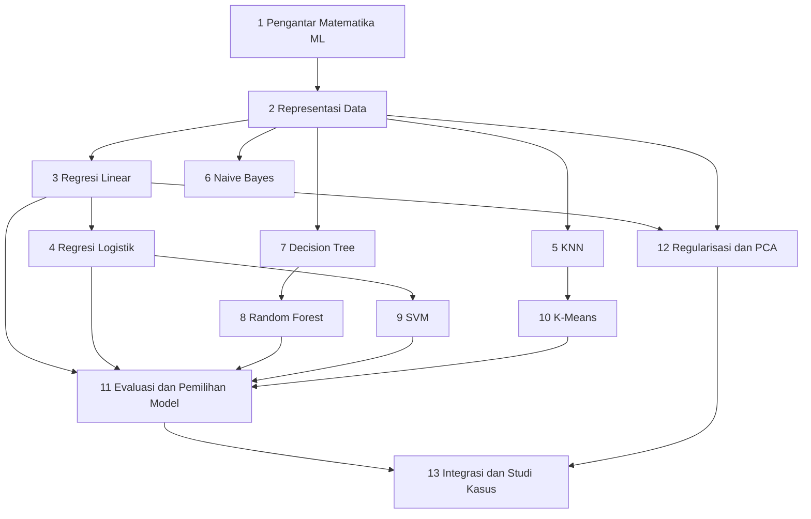

# Level 4 — Matematika untuk Machine Learning Klasik

Level ini memakai semua yang sudah dipelajari (aljabar linear, kalkulus, peluang, dan statistika) untuk memahami **matematika di balik algoritma Machine Learning klasik**: regresi linear, regresi logistik, KNN, Naive Bayes, pohon keputusan, Random Forest, SVM, dan K-Means, ditambah evaluasi model, regularisasi, dan PCA. Fokusnya pada intuisi, perhitungan manual yang bisa dilacak, dan interpretasi, bukan pada menghafal fungsi pustaka.

!!! success "Status materi"
    Level 4 **tersedia lengkap** (Part 1 sampai 13). [Level 5](../level-5-matematika-lanjutan-deep-learning/index.md) sudah tersedia.

## Prasyarat

Level 4 membangun langsung di atas level sebelumnya. Konsep penting dirangkum singkat saat dibutuhkan, tetapi bagian berikut sebaiknya sudah dikuasai:

- [Level 2 Part 2 — Vektor](../level-2-aljabar-linear-dan-kalkulus/02-vektor.md) dan [Part 3 — Matriks](../level-2-aljabar-linear-dan-kalkulus/03-matriks.md): dot product, norma, jarak, kosinus, dan perkalian matriks.
- [Level 2 Part 4](../level-2-aljabar-linear-dan-kalkulus/04-sistem-persamaan-linear-matriks.md) dan [Part 8 — Gradien](../level-2-aljabar-linear-dan-kalkulus/08-turunan-parsial-dan-gradien.md): sistem persamaan linear dan gradien.
- [Level 2 Part 11 — Optimasi dan Gradient Descent](../level-2-aljabar-linear-dan-kalkulus/11-optimasi-dan-gradient-descent.md): loss, learning rate, dan pembaruan parameter.
- [Level 1 Part 10 — Eksponensial dan Logaritma](../level-1-aljabar-dasar-dan-fungsi/10-fungsi-eksponensial-dan-logaritma.md): sigmoid, $\ln x$, dan logaritma basis 2 untuk entropy.
- [Level 3 Part 6 — Teorema Bayes](../level-3-probabilitas-dan-statistika/06-teorema-bayes.md), [Part 9 — Distribusi Sampling](../level-3-probabilitas-dan-statistika/09-distribusi-sampling-dan-clt.md), dan [Part 11 — Korelasi dan Standardisasi](../level-3-probabilitas-dan-statistika/11-korelasi-kovarians-dan-standardisasi.md): Bayes, bootstrap, matriks kovarians, dan penskalaan fitur.

## Tujuan Level 4

Setelah menyelesaikan Level 4, kamu mampu:

- menjelaskan fitur, target, parameter, prediksi, loss, *training*, dan *inference*;
- merepresentasikan data tabel dan teks sebagai vektor dan matriks (termasuk TF-IDF);
- menurunkan dan menghitung manual regresi linear dan regresi logistik beserta loss-nya;
- menghitung manual KNN, Naive Bayes, entropy dan Gini pada pohon keputusan, dan satu iterasi K-Means;
- menjelaskan ide Random Forest, margin SVM, dan kernel secara intuitif, serta pengaruh parameter pentingnya;
- menghitung dan memilih metrik evaluasi yang sesuai masalah, termasuk pada kelas tidak seimbang;
- menjelaskan regularisasi (Ridge dan Lasso), trade-off bias-variance, dan PCA;
- merancang alur eksperimen ML klasik yang benar dan membandingkan algoritma tanpa menyatakan satu algoritma selalu unggul.

## Daftar materi

| Part | Materi | Jenis | Status |
|---|---|---|---|
| 1 | [Pengantar Matematika ML](01-pengantar-matematika-ml.md) | esensial | Tersedia |
| 2 | [Representasi Data dan Feature Engineering](02-representasi-data-dan-feature-engineering.md) | esensial | Tersedia |
| 3 | [Matematika Regresi Linear](03-regresi-linear.md) | esensial | Tersedia |
| 4 | [Matematika Regresi Logistik](04-regresi-logistik.md) | esensial | Tersedia |
| 5 | [Matematika K-Nearest Neighbors](05-k-nearest-neighbors.md) | esensial | Tersedia |
| 6 | [Matematika Naive Bayes](06-naive-bayes.md) | esensial | Tersedia |
| 7 | [Matematika Decision Tree](07-decision-tree.md) | esensial | Tersedia |
| 8 | [Matematika Random Forest](08-random-forest.md) | esensial | Tersedia |
| 9 | [Matematika Support Vector Machine](09-support-vector-machine.md) | esensial (pengantar) | Tersedia |
| 10 | [Matematika K-Means Clustering](10-k-means-clustering.md) | esensial | Tersedia |
| 11 | [Evaluasi dan Pemilihan Model](11-evaluasi-dan-pemilihan-model.md) | esensial | Tersedia |
| 12 | [Regularisasi dan Reduksi Dimensi](12-regularisasi-dan-reduksi-dimensi.md) | esensial (PCA: pengantar) | Tersedia |
| 13 | [Integrasi dan Studi Kasus](13-integrasi-dan-studi-kasus.md) | evaluasi | Tersedia |

**Esensial** berarti dibutuhkan untuk memahami level berikutnya. **Pengantar** berarti konsepnya diperkenalkan dengan intuisi dan contoh kecil; pembahasan yang lebih formal ada di level lanjutan.

!!! note "Batas cakupan dan cara penyajian"
    - **Data NLP bersifat simulasi.** Contoh klasifikasi teks (Emergency vs Non-Emergency) memakai korpus mini buatan yang dipakai berulang di beberapa part. Semua angkanya adalah **data simulasi**, bukan hasil eksperimen nyata, dan diberi label begitu.
    - **Python dan scikit-learn.** Perhitungan utama dilakukan manual dan diverifikasi dengan Python pustaka standar. Blok "bandingkan dengan scikit-learn" bersifat **opsional**: ia membutuhkan paket yang tidak dipasang oleh proyek ini dan tidak dijalankan oleh situs. Keluarannya dijalankan sungguhan dengan versi yang disebutkan.
    - **Pengantar, bukan pembahasan penuh.** SVM dibahas lewat margin, hinge loss, dan parameter C tanpa penurunan dual; kernel dijelaskan secara intuitif; ROC dan AUC diperkenalkan secara singkat; PCA memakai nilai eigen matriks 2×2 sebagai pengantar, dan SVD tidak dibahas.
    - **Tidak ada algoritma yang selalu unggul.** Setiap algoritma dibahas bersama asumsi, karakteristik data, dan trade-off-nya.

## Hubungan antarpart

Part 1 dan 2 membangun kerangka dan representasi data. Part 3 sampai 10 adalah algoritma, dan masing-masing dapat dipelajari agak mandiri setelah Part 2: regresi (Part 3 dan 4) dan SVM (Part 9) berbagi gagasan loss dan margin; KNN dan K-Means (Part 5 dan 10) berbagi gagasan jarak; Decision Tree dan Random Forest (Part 7 dan 8) berbagi gagasan pemisahan dan agregasi. Part 11 sampai 13 menyatukan semuanya: evaluasi, regularisasi, dan studi kasus.

## Notasi yang dipakai di Level 4

Notasi mengikuti Level 2 dan Level 3, dengan tambahan berikut:

| Objek | Notasi | Contoh |
|---|---|---|
| Matriks data ($n$ contoh, $d$ fitur) | $X$, ukuran $n \times d$ | $X \in \mathbb{R}^{n \times d}$ |
| Contoh ke-$i$ (vektor fitur) | $\mathbf{x}^{(i)}$, superskrip dalam kurung | $\mathbf{x}^{(i)} = (x^{(i)}_1, \dots, x^{(i)}_d)$ |
| Target / label | $y$ atau $y^{(i)}$ | $y \in \{0, 1\}$ untuk klasifikasi biner |
| Bobot dan bias | $\mathbf{w}$ dan $b$ | $\hat{y} = \mathbf{w}\cdot\mathbf{x} + b$ |
| Prediksi | $\hat{y}$ (topi) | $\hat{y}^{(i)}$ |
| Probabilitas kelas | $P(y = 1 \mid \mathbf{x})$ | keluaran sigmoid |
| Loss per contoh, rata-rata loss | $\ell$ dan $L$ | $L = \frac{1}{n}\sum_i \ell^{(i)}$ |
| Kekuatan regularisasi | $\alpha$ (seperti di scikit-learn) | $L + \alpha\lVert\mathbf{w}\rVert_2^2$ |
| Nilai eigen | $\lambda$ | $A\mathbf{v} = \lambda\mathbf{v}$ |
| Jarak | $d(\mathbf{a}, \mathbf{b})$ | $\lVert\mathbf{a} - \mathbf{b}\rVert_2$ |
| Centroid klaster ke-$k$ | $\mathbf{c}_k$ | rata-rata anggota klaster |
| Entropy dan Gini | $H$ dan $G$ | impurity simpul pohon |

Pembedaan penting yang ditekankan sepanjang level ini: **probabilitas**, **skor**, **jarak**, **loss**, **parameter**, dan **prediksi** adalah hal yang berbeda, dan setiap part menyebutkan yang mana yang sedang dibahas.

## Cara belajar

Baca berurutan sampai Part 2, lalu pelajari algoritma sesuai kebutuhan sebelum Part 11 sampai 13. Kerjakan perhitungan manual sebelum melihat kode, dan bandingkan hasilnya. Kerjakan latihan sebelum membuka kunci jawaban, dan lanjut setelah checklist penguasaan terpenuhi.
