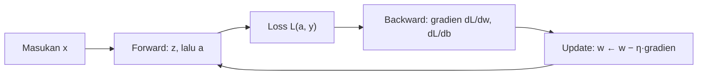

# Part 1 — Fondasi Matematika Deep Learning

## Tujuan Pembelajaran

Setelah mempelajari bagian ini, kamu mampu:

- menjelaskan bagaimana aljabar linear, fungsi, probabilitas, turunan, loss, dan optimasi bekerja bersama dalam satu langkah pelatihan jaringan;
- membedakan **nilai aktivasi**, **logit**, **probabilitas**, **loss**, **gradien**, **bobot**, **parameter**, dan **hiperparameter**;
- menelusuri satu langkah pelatihan lengkap pada satu neuron: maju (*forward*), loss, mundur (*backward*), dan pembaruan;
- menjelaskan pengaruh *learning rate* pada satu langkah pembaruan;
- membaca peta Level 5 dan mengetahui part mana yang membahas tiap bagian alur;
- memakai notasi Level 5 secara konsisten.

## Prasyarat

[Level 2 Part 3 — Matriks](../level-2-aljabar-linear-dan-kalkulus/03-matriks.md) (perkalian matriks), [Level 2 Part 9 — Chain Rule dan Backpropagation](../level-2-aljabar-linear-dan-kalkulus/09-chain-rule-dan-backpropagation.md), [Level 2 Part 11 — Optimasi dan Gradient Descent](../level-2-aljabar-linear-dan-kalkulus/11-optimasi-dan-gradient-descent.md), dan [Level 4 Part 1 — Pengantar Matematika ML](../level-4-matematika-ml-klasik/01-pengantar-matematika-ml.md). Semua konsep yang dipakai di sini diingatkan singkat.

## Masalah yang Ingin Diselesaikan

Di Level 4, setiap algoritma punya rumus sendiri: regresi linear punya rumus kuadrat terkecil, Naive Bayes punya hitungan peluang, pohon keputusan punya entropy. **Deep Learning** (pembelajaran mendalam) memakai satu resep yang sama untuk banyak sekali model:

> susun fungsi sederhana berlapis-lapis, ukur kesalahan dengan satu angka (loss), lalu perbaiki semua parameter sedikit demi sedikit memakai gradien.

Karena resepnya satu, matematika di balik jaringan kecil dengan satu neuron dan di balik model bahasa besar **pada dasarnya sama**: perkalian matriks, fungsi non-linear, turunan dengan *chain rule*, dan langkah pembaruan. Yang berbeda hanyalah ukuran dan susunannya. Karena itu, memahami satu neuron dengan sungguh-sungguh sudah memberi kerangka untuk seluruh Level 5.

## Ringkasan Prasyarat

Tabel berikut mengingatkan konsep yang akan dipakai, tanpa mengulang pembahasannya.

| Konsep | Gagasan singkat | Dibahas di | Dipakai di Level 5 |
|---|---|---|---|
| Dot product $\mathbf{w}\cdot\mathbf{x}$ | jumlah hasil kali elemen berpasangan | [Level 2 Part 2](../level-2-aljabar-linear-dan-kalkulus/02-vektor.md) | skor neuron, attention |
| Perkalian matriks | $(m\times n)(n\times p)\to(m\times p)$ | [Level 2 Part 3](../level-2-aljabar-linear-dan-kalkulus/03-matriks.md) | satu lapisan jaringan |
| Turunan dan *chain rule* | laju perubahan; turunan fungsi bersarang = hasil kali turunan | [Level 2 Part 7 dan 9](../level-2-aljabar-linear-dan-kalkulus/09-chain-rule-dan-backpropagation.md) | backpropagation |
| Gradien $\nabla L$ | vektor turunan parsial; arah naik tercepat | [Level 2 Part 8](../level-2-aljabar-linear-dan-kalkulus/08-turunan-parsial-dan-gradien.md) | memperbarui parameter |
| $e^x$, $\ln x$, sigmoid | fungsi eksponensial dan logaritma | [Level 1 Part 10](../level-1-aljabar-dasar-dan-fungsi/10-fungsi-eksponensial-dan-logaritma.md) | aktivasi, softmax, loss |
| Peluang dan distribusi | bilangan 0 sampai 1, jumlah kelas = 1 | [Level 3 Part 4 dan 7](../level-3-probabilitas-dan-statistika/07-variabel-acak-dan-distribusi.md) | probabilitas keluaran |
| Loss dan *gradient descent* | ukuran kesalahan; langkah melawan gradien | [Level 2 Part 11](../level-2-aljabar-linear-dan-kalkulus/11-optimasi-dan-gradient-descent.md), [Level 4 Part 1](../level-4-matematika-ml-klasik/01-pengantar-matematika-ml.md) | pelatihan jaringan |
| Regularisasi, *overfitting* | penalti kompleksitas; hafal vs paham | [Level 4 Part 12](../level-4-matematika-ml-klasik/12-regularisasi-dan-reduksi-dimensi.md) | Part 8 |

## Istilah yang Harus Dibedakan

Banyak kebingungan di Deep Learning berasal dari menyamakan besaran yang berbeda. Pegang tabel ini sepanjang Level 5. Untuk satu neuron dengan satu contoh:

| Besaran | Simbol | Apa itu | Contoh nilai | Dipelajari? |
|---|---|---|---|---|
| Masukan (fitur) | $x$ | data yang masuk | $2$ | tidak (diberikan) |
| Bobot | $w$ | pengali masukan | $0{,}5$ | **ya** (parameter) |
| Bias | $b$ | penggeser | $-0{,}5$ | **ya** (parameter) |
| Logit / pra-aktivasi | $z = wx + b$ | skor mentah sebelum fungsi aktivasi | $0{,}5$ | tidak (dihitung) |
| Nilai aktivasi | $a = \varphi(z)$ | keluaran setelah fungsi aktivasi $\varphi$ | $0{,}6225$ | tidak (dihitung) |
| Probabilitas | $p$ | aktivasi yang berada di 0 sampai 1 dan ditafsirkan sebagai peluang | $0{,}6225$ | tidak |
| Label | $y$ | jawaban benar | $1$ | tidak (diberikan) |
| Loss | $L$ | satu bilangan: seberapa buruk prediksi | $0{,}4741$ | tidak (dihitung) |
| Gradien | $\partial L/\partial w$ | arah dan besar perubahan loss terhadap parameter | $-0{,}7551$ | tidak (dihitung) |
| *Learning rate* | $\eta$ | ukuran langkah pembaruan | $0{,}5$ | **tidak**: hiperparameter, dipilih manusia |

Beberapa catatan agar tidak tertukar:

- **Parameter** adalah bilangan yang diperbarui selama pelatihan ($w$, $b$). **Hiperparameter** dipilih sebelum pelatihan ($\eta$, jumlah lapisan, jumlah neuron).
- **Logit** adalah skor sebelum diubah. Istilah ini paling sering dipakai untuk skor *terakhir* yang masuk ke sigmoid atau softmax. Untuk lapisan tersembunyi, istilah umumnya **pra-aktivasi** ($z$), dan hasil setelah fungsi aktivasi disebut **aktivasi** ($a$).
- **Probabilitas** hanyalah aktivasi tertentu (sigmoid atau softmax) yang kebetulan berada di antara 0 dan 1 dan berjumlah satu untuk semua kelas. Tidak semua aktivasi adalah probabilitas: ReLU bisa bernilai $2{,}35$.
- **Loss** adalah angka yang diperkecil. **Gradien** bukan loss: ia memberi tahu *ke arah mana* parameter digeser agar loss mengecil.

## Notasi Level 5

Notasi Level 5 melanjutkan Level 2 dan 4 (vektor dicetak tebal, matriks huruf kapital, contoh ke-$i$ ditulis $\mathbf{x}^{(i)}$).

| Notasi | Arti |
|---|---|
| $X \in \mathbb{R}^{n\times d}$ | matriks data: $n$ contoh (baris), $d$ fitur (kolom), sama seperti Level 4 |
| $W^{[l]}$, $\mathbf{b}^{[l]}$ | bobot dan bias lapisan ke-$l$; $W^{[l]}$ berukuran $d_{l-1}\times d_l$ |
| $Z^{[l]}$ | pra-aktivasi lapisan $l$ (disebut logit pada lapisan keluaran) |
| $A^{[l]}$ | aktivasi lapisan $l$; $A^{[0]} = X$ |
| $\varphi$ | fungsi aktivasi |
| $\hat{y}$ atau $p$ | keluaran model; $p$ bila ditafsirkan sebagai probabilitas |
| $L$ | loss; $\ell$ bila untuk satu contoh |
| $\eta$ | *learning rate* |
| $\theta$ | seluruh parameter |

Satu lapisan memakai bentuk $Z = XW + \mathbf{b}$ (setiap baris $X$ adalah satu contoh). Bentuk ini sama dengan yang dipakai pustaka Deep Learning pada umumnya, dan bentuk dimensinya akan dibahas rinci di [Part 2](02-tensor-dan-operasi-multidimensi.md) dan [Part 3](03-matematika-neural-network.md).

## Alur Satu Langkah Pelatihan

Seluruh Level 5 adalah variasi dari satu siklus berikut.



1. **Forward** (maju): hitung keluaran model dari masukan dan parameter saat ini.
2. **Loss**: bandingkan keluaran dengan label, hasilnya satu bilangan.
3. **Backward** (mundur): hitung gradien loss terhadap setiap parameter memakai *chain rule*.
4. **Update**: geser setiap parameter sedikit melawan gradiennya.
5. Ulangi dengan contoh (atau *mini-batch*) berikutnya.

Peta Level 5 mengikuti siklus ini:

| Tahap | Part yang membahas |
|---|---|
| Data sebagai tensor | [Part 2](02-tensor-dan-operasi-multidimensi.md) |
| Forward (neuron, lapisan) | [Part 3](03-matematika-neural-network.md), [Part 4](04-fungsi-aktivasi.md) |
| Loss | [Part 5](05-loss-function.md) |
| Backward | [Part 6](06-backpropagation-mendalam.md) |
| Update dan generalisasi | [Part 7](07-optimasi-deep-learning.md), [Part 8](08-regularisasi-dan-generalisasi.md) |
| Bahasa, embedding, attention, Transformer | [Part 9](09-embedding-dan-representasi-vektor.md) sampai [Part 14](14-fondasi-matematis-bert-dan-indobert.md) |

## Rumus dan Penjelasan Setiap Simbol

Untuk satu neuron dengan satu masukan, sigmoid, dan label $y\in\{0,1\}$:

$$
z = wx + b,\qquad p = \sigma(z) = \frac{1}{1+e^{-z}},\qquad L = -\bigl[\,y\ln p + (1-y)\ln(1-p)\,\bigr]
$$

- $x$ adalah masukan (skalar), $w$ bobot (skalar), $b$ bias (skalar), $z$ logit (skalar).
- $\sigma$ adalah fungsi sigmoid yang menekan bilangan apa pun menjadi nilai antara 0 dan 1; $p$ adalah probabilitas kelas 1.
- $y$ adalah label (0 atau 1), $L$ adalah *binary cross-entropy* (dibahas penuh di [Part 5](05-loss-function.md)). Untuk $y=1$ rumusnya menjadi $L=-\ln p$.

Gradien (turunan lokal dikalikan dengan *chain rule*, diturunkan di [Part 6](06-backpropagation-mendalam.md); hasil ini sudah dipakai di [Level 4 Part 4](../level-4-matematika-ml-klasik/04-regresi-logistik.md)):

$$
\frac{\partial L}{\partial z} = p - y,\qquad
\frac{\partial L}{\partial w} = (p-y)\,x,\qquad
\frac{\partial L}{\partial b} = p - y
$$

Pembaruan dengan *learning rate* $\eta$:

$$
w \leftarrow w - \eta\,\frac{\partial L}{\partial w},\qquad
b \leftarrow b - \eta\,\frac{\partial L}{\partial b}
$$

Dibaca: "geser $w$ sejauh $\eta$ kali gradien, berlawanan arah dengan gradien, karena gradien menunjuk arah naiknya loss."

## Contoh Numerik Langkah demi Langkah

**Soal.** Satu contoh $x = 2$ dengan label $y = 1$. Parameter awal $w = 0{,}5$, $b = -0{,}5$, dan $\eta = 0{,}5$. Hitung satu langkah pelatihan lengkap.

**Langkah 1 — Forward.**

$$
z = wx + b = 0{,}5\times 2 + (-0{,}5) = 0{,}5
$$

$$
p = \sigma(0{,}5) = \frac{1}{1+e^{-0{,}5}} = \frac{1}{1+0{,}6065} \approx 0{,}6225
$$

**Langkah 2 — Loss** (untuk $y=1$, $L=-\ln p$):

$$
L = -\ln 0{,}6225 \approx 0{,}4741
$$

**Langkah 3 — Backward.** Mulai dari ujung (loss) mundur ke parameter:

$$
\frac{\partial L}{\partial z} = p - y = 0{,}6225 - 1 = -0{,}3775
$$

$$
\frac{\partial L}{\partial w} = (p-y)\,x = -0{,}3775\times 2 = -0{,}7551,\qquad
\frac{\partial L}{\partial b} = p-y = -0{,}3775
$$

Gradien negatif berarti: menaikkan $w$ dan $b$ akan menurunkan loss. Itu masuk akal, karena $y=1$ dan kita ingin $p$ naik.

**Langkah 4 — Update.**

$$
w \leftarrow 0{,}5 - 0{,}5\times(-0{,}7551) = 0{,}8775,\qquad
b \leftarrow -0{,}5 - 0{,}5\times(-0{,}3775) = -0{,}3112
$$

**Langkah 5 — Periksa.** Forward lagi dengan parameter baru:

$$
z = 0{,}8775\times 2 - 0{,}3112 = 1{,}4439,\quad
p = \sigma(1{,}4439) \approx 0{,}8091,\quad
L = -\ln 0{,}8091 \approx 0{,}2119
$$

Loss turun dari $0{,}4741$ menjadi $0{,}2119$, dan probabilitas kelas yang benar naik dari $0{,}6225$ menjadi $0{,}8091$. Itulah satu langkah pelatihan.

**Interpretasi.** Perhatikan pembagian peran. $w$ dan $b$ adalah satu-satunya yang diubah. $z$, $p$, dan $L$ dihitung ulang dari mereka. Gradien tidak diubah-ubah: ia dihitung dari keadaan saat ini lalu dipakai satu kali. Jaringan besar melakukan hal yang sama dengan jutaan parameter sekaligus.

### Pengaruh *learning rate* pada satu langkah

Dengan titik awal yang sama ($w=0{,}5$, $b=-0{,}5$, gradien $-0{,}7551$ dan $-0{,}3775$):

| $\eta$ | $w$ baru | $b$ baru | Loss setelah satu langkah |
|---|---|---|---|
| $0{,}1$ | $0{,}5755$ | $-0{,}4622$ | $0{,}4069$ |
| $0{,}5$ | $0{,}8775$ | $-0{,}3112$ | $0{,}2119$ |
| $2$ | $2{,}0102$ | $0{,}2551$ | $0{,}0138$ |

$\eta$ kecil: loss turun, tetapi pelan. $\eta$ besar: pada contoh tunggal ini loss turun lebih jauh. **Jangan** menyimpulkan bahwa $\eta$ besar selalu lebih baik: ini hanya satu contoh dengan satu arah yang jelas. Pada banyak contoh atau permukaan loss yang melengkung, langkah yang terlalu besar bisa melompati minimum dan membuat loss naik (lihat soal 7 dan [Part 7](07-optimasi-deep-learning.md)).

## Interpretasi, Asumsi, dan Keterbatasan

- Contoh di atas memakai **satu** contoh dan **satu** neuron supaya setiap angka bisa dilacak. Pada data sungguhan, loss adalah rata-rata dari banyak contoh dan gradiennya adalah rata-rata gradien contoh (atau *mini-batch*).
- Loss yang turun pada satu langkah tidak menjamin model baik pada data baru; itu urusan generalisasi ([Part 8](08-regularisasi-dan-generalisasi.md)).
- Rumus gradien $p-y$ berlaku untuk pasangan sigmoid dan *binary cross-entropy*. Kombinasi aktivasi dan loss lain punya gradien berbeda (dibahas di [Part 4](04-fungsi-aktivasi.md) sampai [Part 6](06-backpropagation-mendalam.md)).
- Pelatihan jaringan umumnya tidak punya jaminan menemukan minimum global; hasil bergantung pada inisialisasi dan $\eta$.

## Hubungan dengan Deep Learning dan NLP

Pada model bahasa, "masukan" adalah vektor yang mewakili token, "bobot" adalah matriks-matriks besar, dan "label" bisa berupa kelas pesan (misalnya Emergency atau Non-Emergency pada contoh simulasi) atau token yang disembunyikan. Siklus forward-loss-backward-update tetap sama. Jadi tiap part berikutnya hanyalah memperbesar satu kotak pada diagram di atas.

## Python

Kode berikut hanya memakai pustaka standar dan mengulang contoh di atas selama beberapa langkah.

```python
import math

def sigmoid(z):
    return 1 / (1 + math.exp(-z))

x, y = 2.0, 1.0              # satu contoh: fitur dan label
w, b, eta = 0.5, -0.5, 0.5   # bobot, bias, learning rate

for langkah in range(4):
    z = w * x + b                    # logit
    p = sigmoid(z)                   # probabilitas
    loss = -math.log(p)              # binary cross-entropy untuk y = 1
    print(langkah, round(w, 4), round(b, 4), round(z, 4), round(p, 4), round(loss, 4))
    g = p - y                        # dL/dz
    w -= eta * g * x                 # dL/dw = g * x
    b -= eta * g                     # dL/db = g
```

Keluaran (kolom: langkah, $w$, $b$, $z$, $p$, loss; semuanya dicetak sebelum pembaruan langkah itu):

```text
0 0.5 -0.5 0.5 0.6225 0.4741
1 0.8775 -0.3112 1.4439 0.8091 0.2119
2 1.0685 -0.2158 1.9212 0.8723 0.1367
3 1.1962 -0.1519 2.2405 0.9038 0.1011
```

Baris 0 dan 1 sama dengan hitungan manual. Loss terus turun, tetapi makin lambat karena gradien $p-y$ mengecil saat $p$ mendekati 1. Kode ini hanya memverifikasi hitungan; yang penting adalah mengerti mengapa setiap baris berubah seperti itu.

## Kesalahan Umum

1. **Menyamakan logit dengan probabilitas.** $z=0{,}5$ bukan peluang $50\%$; peluangnya $\sigma(0{,}5)\approx 62{,}25\%$.
2. **Menyamakan loss dengan gradien.** Loss adalah angka yang diperkecil; gradien menunjukkan arah perbaikan.
3. **Menambah gradien, bukan mengurangi.** Pembaruan adalah $w \leftarrow w - \eta\,\partial L/\partial w$. Tanda yang salah menaikkan loss.
4. **Menganggap $\eta$ bagian dari parameter yang dipelajari.** $\eta$ dipilih manusia.
5. **Menganggap probabilitas keluaran pasti benar.** Model dengan $p=0{,}9$ masih bisa salah; probabilitas perlu dikalibrasi dan dievaluasi.
6. **Mencampur indeks.** $x^{(i)}$ adalah contoh ke-$i$, $W^{[l]}$ adalah lapisan ke-$l$, $x_j$ adalah fitur ke-$j$. Tiga hal berbeda.

## Latihan Mandiri

1. Golongkan masing-masing sebagai: masukan, parameter, hiperparameter, pra-aktivasi (logit), aktivasi, loss, atau gradien: $w$, $\eta$, $z$, $\sigma(z)$, $\partial L/\partial b$, $x$, $L$, $b$, jumlah neuron.
2. Satu neuron, $x=1$, $y=0$, $w=1$, $b=0$. Hitung $z$, $p=\sigma(z)$, loss untuk $y=0$ ($L=-\ln(1-p)$), $\partial L/\partial w$, $\partial L/\partial b$, lalu satu pembaruan dengan $\eta=1$.
3. Neuron linear (tanpa aktivasi) $\hat{y}=wx+b$ dengan loss $L=(\hat{y}-y)^2$. Untuk $x=3$, $y=7$, $w=1$, $b=0$: hitung $\hat y$, $L$, $\partial L/\partial w=2(\hat y-y)x$, $\partial L/\partial b=2(\hat y-y)$, dan satu pembaruan dengan $\eta=0{,}05$. Berapa $\hat{y}$ baru?
4. Hitung $\sigma(-1)$ dan $\sigma(2{,}35)$.
5. Data $X$ berukuran $100\times 3$ masuk ke satu lapisan dengan $W$ berukuran $3\times 2$ dan $\mathbf{b}$ berukuran $2$. Berapa shape $Z$ dan berapa jumlah parameter lapisan itu?
6. Loss latih terus turun tetapi loss uji naik setelah langkah ke-50. Diagnosis apa yang paling masuk akal, dan part mana yang membahasnya?
7. Loss $L(w)=w^2$ (gradien $2w$), $w=1$. Lakukan dua langkah dengan $\eta=0{,}1$ dan dua langkah dengan $\eta=1{,}5$. Apa yang terjadi?
8. Petakan: (a) *chain rule*, (b) matriks data $X$, (c) sigmoid, (d) Ridge, (e) *gradient descent* ke level asalnya.
9. Urutkan tahap satu langkah pelatihan: update, loss, forward, backward.
10. Mengapa satu contoh dengan $p=0{,}9$ untuk kelas yang benar punya loss lebih kecil daripada $p=0{,}6$? Hitung kedua loss untuk $y=1$.

## Kunci Jawaban dan Pembahasan

??? success "Soal 1"
    Parameter: $w$, $b$. Hiperparameter: $\eta$, jumlah neuron. Masukan: $x$. Pra-aktivasi (logit): $z$. Aktivasi: $\sigma(z)$. Loss: $L$. Gradien: $\partial L/\partial b$.

??? success "Soal 2"
    $z = 1\times 1 + 0 = 1$. $p=\sigma(1)\approx 0{,}7311$. Loss $=-\ln(1-0{,}7311)=-\ln 0{,}2689\approx 1{,}3133$. Gradien $p-y=0{,}7311-0=0{,}7311$; $\partial L/\partial w = 0{,}7311\times 1 = 0{,}7311$; $\partial L/\partial b=0{,}7311$. Pembaruan: $w = 1-1\times 0{,}7311 = 0{,}2689$; $b = 0-0{,}7311 = -0{,}7311$.

??? success "Soal 3"
    $\hat y = 1\times 3+0=3$; $L=(3-7)^2=16$. $\partial L/\partial w = 2(3-7)\times 3=-24$; $\partial L/\partial b = 2(3-7)=-8$. Pembaruan: $w = 1-0{,}05\times(-24)=2{,}2$; $b=0-0{,}05\times(-8)=0{,}4$. $\hat y$ baru $=2{,}2\times 3+0{,}4=7{,}0$, tepat sama dengan $y$ (loss $0$). Ini kebetulan karena $\eta=0{,}05$ pas untuk satu contoh ini, bukan sifat umum.

??? success "Soal 4"
    $\sigma(-1)=\dfrac{1}{1+e^{1}}\approx 0{,}2689$. $\sigma(2{,}35)=\dfrac{1}{1+e^{-2{,}35}}\approx 0{,}9129$.

??? success "Soal 5"
    $Z=XW+\mathbf{b}$ berukuran $100\times 2$ (dimensi dalam 3 saling menghilang, $\mathbf{b}$ ikut diperluas). Parameter: $3\times 2 + 2 = 8$.

??? success "Soal 6"
    *Overfitting*: model makin menyesuaikan diri dengan data latih tetapi memburuk pada data uji. Dibahas di [Part 8](08-regularisasi-dan-generalisasi.md) (juga [Level 4 Part 1](../level-4-matematika-ml-klasik/01-pengantar-matematika-ml.md) dan [Part 12](../level-4-matematika-ml-klasik/12-regularisasi-dan-reduksi-dimensi.md)). Penanganan umum: regularisasi atau berhenti lebih awal.

??? success "Soal 7"
    $\eta=0{,}1$: $w_1 = 1-0{,}1\times 2=0{,}8$; $w_2=0{,}8-0{,}1\times 1{,}6=0{,}64$. Mendekati 0 (minimum). $\eta=1{,}5$: $w_1=1-1{,}5\times 2=-2$; $w_2=-2-1{,}5\times(-4)=4$. Nilai $|w|$ membesar tiap langkah ($1\to 2\to 4$): langkah terlalu besar melompati minimum, pelatihan **divergen**.

??? success "Soal 8"
    (a) Level 2 Part 9. (b) Level 4 Part 1 dan 2. (c) Level 1 Part 10 dan Level 4 Part 4. (d) Level 4 Part 12. (e) Level 2 Part 11.

??? success "Soal 9"
    Forward, loss, backward, update.

??? success "Soal 10"
    $L=-\ln 0{,}9\approx 0{,}1054$ dan $L=-\ln 0{,}6\approx 0{,}5108$. Semakin besar probabilitas yang diberikan ke kelas benar, semakin kecil $-\ln p$; loss menghukum keyakinan yang salah dan meminta keyakinan yang benar.

## Ringkasan Materi

- Deep Learning memakai satu resep: **forward, loss, backward, update**, diulang-ulang pada data.
- Bedakan **bobot/bias** (parameter, dipelajari), **$\eta$** (hiperparameter), **logit/pra-aktivasi** $z$, **aktivasi** $a$, **probabilitas** $p$, **loss** $L$, dan **gradien**.
- Untuk sigmoid dengan *binary cross-entropy*: $\partial L/\partial z = p-y$, $\partial L/\partial w=(p-y)x$, $\partial L/\partial b=p-y$.
- Pembaruan: $w \leftarrow w-\eta\,\partial L/\partial w$; $\eta$ yang terlalu besar dapat membuat pelatihan divergen.
- Notasi Level 5: $X\in\mathbb{R}^{n\times d}$, $Z=XW+\mathbf{b}$, $W^{[l]}$ berukuran $d_{l-1}\times d_l$.

## Checklist Penguasaan

- [ ] Menyebutkan empat tahap satu langkah pelatihan.
- [ ] Membedakan logit, aktivasi, probabilitas, loss, gradien, dan parameter.
- [ ] Menghitung satu langkah pelatihan satu neuron dengan sigmoid dan *binary cross-entropy*.
- [ ] Menjelaskan pengaruh $\eta$ pada pembaruan dan risiko $\eta$ terlalu besar.
- [ ] Menghitung shape $Z$ dan jumlah parameter satu lapisan.
- [ ] Memetakan part Level 5 ke tahap siklus pelatihan.

## Prasyarat untuk Materi Berikutnya

[Part 2 — Tensor dan Operasi Multidimensi](02-tensor-dan-operasi-multidimensi.md) membahas cara data dan parameter disusun sebagai tensor beserta aturan shape-nya. Pastikan kamu nyaman dengan perkalian matriks $(m\times n)(n\times p)$.
