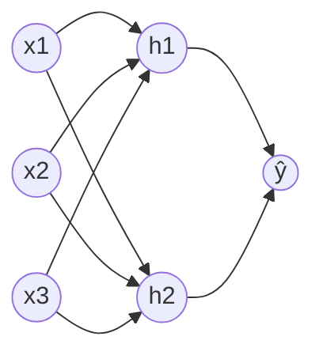

# Part 3 — Matematika Neural Network

## Tujuan Pembelajaran

Setelah mempelajari bagian ini, kamu mampu:

- menghitung **satu neuron**: *weighted sum*, bias, fungsi aktivasi, dan keluaran;
- menyusun **satu lapisan** sebagai $Z = XW + \mathbf{b}$ dan menentukan shape tiap matriksnya;
- menyusun jaringan beberapa lapisan dan menelusuri **forward propagation** beserta shape di tiap langkah;
- menghitung jumlah parameter sebuah jaringan;
- menjelaskan mengapa fungsi aktivasi **non-linear** diperlukan, dengan contoh angka;
- menjelaskan mengapa satu lapisan tersembunyi dapat menyelesaikan masalah XOR yang tidak bisa diselesaikan model linear.

## Prasyarat

[Part 1 — Fondasi Matematika Deep Learning](01-fondasi-matematika-deep-learning.md) (logit, aktivasi, parameter), [Part 2 — Tensor dan Operasi Multidimensi](02-tensor-dan-operasi-multidimensi.md) (shape, broadcasting, perkalian matriks), dan [Level 4 Part 4 — Regresi Logistik](../level-4-matematika-ml-klasik/04-regresi-logistik.md) (sigmoid pada skor linear). Satu neuron dengan sigmoid pada dasarnya adalah regresi logistik.

## Masalah yang Ingin Diselesaikan

Regresi logistik memisahkan kelas dengan satu garis (atau bidang). Banyak masalah tidak bisa dipisahkan oleh satu garis. Contoh paling kecil adalah XOR: keluaran bernilai 1 jika **tepat satu** dari dua masukan bernilai 1. Tidak ada satu garis yang memisahkan titik $(0,0)$ dan $(1,1)$ dari titik $(1,0)$ dan $(0,1)$.

Gagasan neural network: gabungkan banyak model linear kecil (neuron) dan sisipkan fungsi **non-linear** di antaranya. Neuron-neuron pada lapisan pertama membuat "fitur baru" dari masukan, dan lapisan berikutnya menggabungkan fitur baru itu. Dengan cara ini bentuk keputusan menjadi jauh lebih fleksibel.

## Intuisi dan Istilah Penting

### 1. Neuron

**Neuron** (*neuron*, *unit*) adalah fungsi kecil yang melakukan tiga hal:

1. mengalikan setiap masukan dengan **bobot** (*weight*) miliknya, lalu menjumlahkan: *weighted sum*;
2. menambahkan **bias** (*bias*): bilangan yang menggeser hasil;
3. memasukkan hasilnya ke **fungsi aktivasi** $\varphi$.

Intuisinya seperti panitia penilai: setiap masukan punya "suara" yang besarnya ditentukan bobot (bobot negatif berarti suara menentang), bias adalah kecenderungan awal panitia, dan fungsi aktivasi memutuskan keluaran akhir dari total suara.

### 2. Lapisan dan jaringan

- **Lapisan** (*layer*) adalah sekelompok neuron yang menerima masukan yang sama.
- **Lapisan masukan** adalah data itu sendiri (bukan neuron yang menghitung).
- **Lapisan tersembunyi** (*hidden layer*) adalah lapisan di tengah; nilainya tidak diamati langsung.
- **Lapisan keluaran** (*output layer*) menghasilkan prediksi.
- **Jaringan** (*network*) yang berlapis-lapis ini disebut *feed-forward* atau *multilayer perceptron* (MLP) bila setiap neuron terhubung ke semua neuron lapisan sebelumnya (*fully connected* atau *dense*).
- **Forward propagation** (propagasi maju) adalah menghitung keluaran lapisan demi lapisan dari masukan ke keluaran.

Ukuran jaringan ditulis dengan jumlah neuron tiap lapisan, misalnya $3\to2\to1$: tiga masukan, dua neuron tersembunyi, satu keluaran.

## Rumus dan Penjelasan Setiap Simbol

### Satu neuron

$$
z = \sum_{j=1}^{d} w_j x_j + b = \mathbf{w}\cdot\mathbf{x} + b,\qquad a = \varphi(z)
$$

- $\mathbf{x}=(x_1,\dots,x_d)$: vektor masukan, $d$ komponen.
- $\mathbf{w}=(w_1,\dots,w_d)$: vektor bobot; satu bobot per masukan.
- $b$: bias (skalar).
- $z$: pra-aktivasi (skalar). $\varphi$: fungsi aktivasi, diterapkan pada satu bilangan. $a$: aktivasi (keluaran neuron, skalar).

Dibaca: "jumlahkan masukan berbobot, tambahkan bias, lalu terapkan aktivasi". Bila $\varphi$ adalah sigmoid, ini regresi logistik.

### Satu lapisan

Satu lapisan dengan $d_{\text{in}}$ masukan dan $d_{\text{out}}$ neuron menyimpan bobot semua neuron dalam satu matriks $W\in\mathbb{R}^{d_{\text{in}}\times d_{\text{out}}}$: **kolom ke-$j$** adalah bobot neuron ke-$j$. Biasnya vektor $\mathbf{b}\in\mathbb{R}^{d_{\text{out}}}$. Untuk $n$ contoh yang disusun sebagai baris $X\in\mathbb{R}^{n\times d_{\text{in}}}$:

$$
Z = XW + \mathbf{b},\qquad A = \varphi(Z)
$$

- $XW$ berbentuk $(n, d_{\text{out}})$: dot product tiap contoh dengan tiap neuron.
- $\mathbf{b}$ berbentuk $(d_{\text{out}})$ dan ditambahkan ke tiap baris lewat broadcasting (Part 2).
- $\varphi$ diterapkan **elemen demi elemen** pada $Z$; $A$ berbentuk $(n, d_{\text{out}})$.

Untuk satu contoh saja, $X$ berisi satu baris, dan $\mathbf{z}=\mathbf{x}W+\mathbf{b}$ berbentuk $(1,d_{\text{out}})$.

### Jaringan berlapis

Dengan $A^{[0]}=X$ dan lapisan $l=1,\dots,L$:

$$
Z^{[l]} = A^{[l-1]}\,W^{[l]} + \mathbf{b}^{[l]},\qquad A^{[l]}=\varphi_l\!\left(Z^{[l]}\right)
$$

$W^{[l]}$ berukuran $d_{l-1}\times d_l$ ($d_l$ adalah jumlah neuron lapisan $l$, $d_0=d$). Keluaran jaringan adalah $A^{[L]}$. Aktivasi tiap lapisan boleh berbeda: misalnya ReLU pada lapisan tersembunyi dan sigmoid pada keluaran.

### Jumlah parameter

Lapisan $l$ memiliki $d_{l-1}d_l$ bobot dan $d_l$ bias. Total:

$$
\#\theta=\sum_{l=1}^{L}\bigl(d_{l-1}\,d_l + d_l\bigr)
$$

Jumlah ini tidak bergantung pada banyaknya contoh $n$.

### Aktivasi yang dipakai sementara

Fungsi aktivasi dibahas lengkap di [Part 4](04-fungsi-aktivasi.md). Untuk saat ini cukup dua:

$$
\operatorname{ReLU}(z)=\max(0,z),\qquad \sigma(z)=\frac{1}{1+e^{-z}}
$$

ReLU membiarkan nilai positif dan mengubah nilai negatif menjadi 0. Sigmoid menekan nilai ke rentang $(0,1)$.

## Contoh Numerik Langkah demi Langkah

### Contoh 1 — Satu neuron

$\mathbf{x}=(1,\,2,\,3)$, $\mathbf{w}=(0{,}5,\,-0{,}25,\,0{,}75)$, $b=0{,}1$.

**Weighted sum:**

$$
\mathbf{w}\cdot\mathbf{x}=0{,}5\cdot1+(-0{,}25)\cdot2+0{,}75\cdot3=0{,}5-0{,}5+2{,}25=2{,}25
$$

**Tambah bias:** $z=2{,}25+0{,}1=2{,}35$.

**Aktivasi:**

- ReLU: $a=\max(0,\,2{,}35)=2{,}35$.
- Sigmoid: $a=\sigma(2{,}35)=\dfrac{1}{1+e^{-2{,}35}}\approx 0{,}9129$.

Satu masukan, satu bilangan $z$, dan satu keluaran. Pilihan aktivasi mengubah makna keluaran: ReLU menghasilkan $2{,}35$ (bukan probabilitas), sedangkan sigmoid menghasilkan nilai yang dapat ditafsirkan sebagai probabilitas.

### Contoh 2 — Jaringan $3\to2\to1$ dengan batch dua contoh

Parameter (angka dipilih agar mudah dihitung, **bukan hasil pelatihan**):

$$
W^{[1]}=\begin{bmatrix}0{,}5&1\\-0{,}25&0{,}5\\0{,}75&-1\end{bmatrix},\quad
\mathbf{b}^{[1]}=[0{,}1,\,-0{,}2],\quad
W^{[2]}=\begin{bmatrix}1\\-1{,}5\end{bmatrix},\quad
\mathbf{b}^{[2]}=[0{,}3]
$$

Shape: $W^{[1]}$ adalah $(3,2)$, $\mathbf{b}^{[1]}$ adalah $(2)$, $W^{[2]}$ adalah $(2,1)$, $\mathbf{b}^{[2]}$ adalah $(1)$. Lapisan tersembunyi memakai ReLU dan keluaran memakai sigmoid.

Masukan dua contoh sebagai baris:

$$
X=\begin{bmatrix}1&2&-1\\0&1&2\end{bmatrix}\quad\text{shape }(2,3)
$$

**Lapisan 1 — pra-aktivasi** $Z^{[1]}=XW^{[1]}+\mathbf{b}^{[1]}$, shape $(2,2)$. Tiap elemen adalah dot product satu baris $X$ dengan satu kolom $W^{[1]}$:

Contoh 1, neuron 1: $1(0{,}5)+2(-0{,}25)+(-1)(0{,}75)=0{,}5-0{,}5-0{,}75=-0{,}75$; tambah bias $0{,}1$: $-0{,}65$.

Contoh 1, neuron 2: $1(1)+2(0{,}5)+(-1)(-1)=1+1+1=3$; tambah bias $-0{,}2$: $2{,}8$.

Contoh 2, neuron 1: $0(0{,}5)+1(-0{,}25)+2(0{,}75)=-0{,}25+1{,}5=1{,}25$; tambah $0{,}1$: $1{,}35$.

Contoh 2, neuron 2: $0(1)+1(0{,}5)+2(-1)=0{,}5-2=-1{,}5$; tambah $-0{,}2$: $-1{,}7$.

$$
Z^{[1]}=\begin{bmatrix}-0{,}65&2{,}8\\1{,}35&-1{,}7\end{bmatrix}
$$

**Lapisan 1 — aktivasi ReLU** (nilai negatif menjadi 0), shape $(2,2)$:

$$
A^{[1]}=\begin{bmatrix}0&2{,}8\\1{,}35&0\end{bmatrix}
$$

Pada contoh pertama neuron 1 "mati" (keluarannya 0), pada contoh kedua neuron 2 yang mati. Neuron yang sama bisa aktif untuk satu masukan dan mati untuk masukan lain.

**Lapisan 2 — pra-aktivasi** $Z^{[2]}=A^{[1]}W^{[2]}+\mathbf{b}^{[2]}$, shape $(2,1)$:

- Contoh 1: $0\cdot1+2{,}8\cdot(-1{,}5)+0{,}3=-4{,}2+0{,}3=-3{,}9$.
- Contoh 2: $1{,}35\cdot1+0\cdot(-1{,}5)+0{,}3=1{,}65$.

**Lapisan 2 — sigmoid:**

- Contoh 1: $\sigma(-3{,}9)\approx 0{,}0198$.
- Contoh 2: $\sigma(1{,}65)\approx 0{,}8389$.

Keluaran: $\hat{y}=\begin{bmatrix}0{,}0198\\0{,}8389\end{bmatrix}$, shape $(2,1)$. Karena bobot hanya contoh, angka ini tidak bermakna sebagai prediksi nyata; yang penting adalah alurnya. Bila keluaran ditafsirkan sebagai peluang kelas 1 dengan ambang $0{,}5$, contoh pertama kelas 0 dan contoh kedua kelas 1.

Ringkasan shape sepanjang alur:

| Langkah | Ekspresi | Shape |
|---|---|---|
| masukan | $X$ | $(2,3)$ |
| pra-aktivasi 1 | $XW^{[1]}+\mathbf{b}^{[1]}$ | $(2,3)(3,2)+(2)\to(2,2)$ |
| aktivasi 1 | $A^{[1]}=\operatorname{ReLU}(Z^{[1]})$ | $(2,2)$ |
| pra-aktivasi 2 | $A^{[1]}W^{[2]}+\mathbf{b}^{[2]}$ | $(2,2)(2,1)+(1)\to(2,1)$ |
| keluaran | $\sigma(Z^{[2]})$ | $(2,1)$ |

**Jumlah parameter:** $(3\cdot2+2)+(2\cdot1+1)=8+3=11$.



Setiap panah membawa satu bobot. Ada 6 panah di lapisan pertama dan 2 di lapisan kedua, ditambah 3 bias, sehingga 11 parameter.

### Contoh 3 — Tanpa aktivasi non-linear, dua lapisan sama dengan satu lapisan

Dua lapisan linear (aktivasi identitas, $\varphi(z)=z$) dengan

$$
V^{[1]}=\begin{bmatrix}1&2\\0&1\\-1&1\end{bmatrix}\ (3\times2),\qquad
V^{[2]}=\begin{bmatrix}2\\1\end{bmatrix}\ (2\times1)
$$

(bias dilewati agar sederhana). Untuk $\mathbf{x}=(1,2,3)$:

1. Lapisan 1: $\mathbf{x}V^{[1]}=[1\cdot1+2\cdot0+3\cdot(-1),\ 1\cdot2+2\cdot1+3\cdot1]=[-2,\ 7]$.
2. Lapisan 2: $[-2,\ 7]V^{[2]}=-2\cdot2+7\cdot1=3$.

Sekarang gabungkan kedua matriks lebih dulu: $V^{[1]}V^{[2]}=\begin{bmatrix}1\cdot2+2\cdot1\\0\cdot2+1\cdot1\\-1\cdot2+1\cdot1\end{bmatrix}=\begin{bmatrix}4\\1\\-1\end{bmatrix}$. Maka $\mathbf{x}(V^{[1]}V^{[2]})=1\cdot4+2\cdot1+3\cdot(-1)=3$. **Hasil sama.** Artinya dua lapisan linear **selalu** bisa diganti satu lapisan linear $V=V^{[1]}V^{[2]}$ karena perkalian matriks bersifat asosiatif: $(\mathbf{x}V^{[1]})V^{[2]}=\mathbf{x}(V^{[1]}V^{[2]})$. Menumpuk lapisan tanpa aktivasi non-linear tidak menambah kemampuan model. Aktivasi non-linear di antara lapisan memutus penyederhanaan ini.

### Contoh 4 — XOR dengan satu lapisan tersembunyi

**Mengapa model linear gagal.** Misalkan skor linear $s=w_1x_1+w_2x_2+b$ dengan aturan "kelas 1 bila $s>0$". Untuk XOR kita butuh $s(1,0)>0$ dan $s(0,1)>0$, tetapi $s(0,0)\le 0$ dan $s(1,1)\le 0$. Jumlahkan dua syarat pertama: $w_1+w_2+2b>0$. Jumlahkan dua syarat berikutnya: $w_1+w_2+2b\le 0$. Keduanya tidak mungkin benar bersama, jadi tidak ada $w_1,w_2,b$ yang berhasil.

**Jaringan dengan dua neuron ReLU tersembunyi.** Pilih

$$
h_1=\operatorname{ReLU}(x_1+x_2),\quad h_2=\operatorname{ReLU}(x_1+x_2-1),\quad \hat{y}=h_1-2h_2
$$

| $(x_1,x_2)$ | $x_1+x_2$ | $h_1$ | $h_2$ | $\hat{y}=h_1-2h_2$ | XOR |
|---|---|---|---|---|---|
| $(0,0)$ | $0$ | $0$ | $0$ | $0$ | $0$ |
| $(1,0)$ | $1$ | $1$ | $0$ | $1$ | $1$ |
| $(0,1)$ | $1$ | $1$ | $0$ | $1$ | $1$ |
| $(1,1)$ | $2$ | $2$ | $1$ | $2-2=0$ | $0$ |

Keluaran cocok dengan XOR di keempat titik. Lapisan tersembunyi mengubah masukan menjadi dua fitur baru $(h_1,h_2)$ yang membuat masalah menjadi dapat dipisahkan secara linear oleh lapisan keluaran. Inilah peran non-linearitas: titik $(1,1)$ menghasilkan $h_2=1$ yang menarik keluaran turun, sesuatu yang tidak mungkin dilakukan oleh satu fungsi linear.

## Interpretasi, Asumsi, dan Keterbatasan

- Jaringan dengan satu lapisan tersembunyi yang cukup lebar dapat mendekati banyak fungsi (hasil teori yang disebut *universal approximation*), tetapi teori itu **tidak** menjamin bahwa pelatihan akan menemukan bobotnya, atau bahwa jumlah neuron yang dibutuhkan kecil.
- Bobot di Contoh 2 dan 4 dipilih tangan. Pada praktiknya bobot ditemukan lewat pelatihan ([Part 5](05-loss-function.md) sampai [Part 7](07-optimasi-deep-learning.md)).
- Lapisan *fully connected* mengasumsikan semua masukan boleh berhubungan dengan semua neuron. Arsitektur lain (konvolusi, attention) membatasi atau mengatur hubungan itu secara berbeda.
- Jumlah parameter bertumbuh cepat: $784\to128\to64\to10$ saja sudah memiliki 109.386 parameter (soal 5).

## Hubungan dengan Deep Learning dan NLP

Satu neuron dengan sigmoid adalah regresi logistik ([Level 4 Part 4](../level-4-matematika-ml-klasik/04-regresi-logistik.md)); satu neuron linear tanpa aktivasi adalah regresi linear ([Level 4 Part 3](../level-4-matematika-ml-klasik/03-regresi-linear.md)). Jaringan berarti menumpuk banyak model seperti itu. Dalam NLP, masukan lapisan pertama biasanya vektor *embedding* token ([Part 9](09-embedding-dan-representasi-vektor.md)), dan lapisan *feed-forward* di dalam Transformer ([Part 13](13-transformer.md)) persis berbentuk $A=\varphi(XW+\mathbf{b})$ seperti di atas, diterapkan pada setiap token.

## Python

Pustaka standar saja. Fungsi `matmul` sama dengan di [Part 2](02-tensor-dan-operasi-multidimensi.md).

```python
import math

def sigmoid(z):
    return 1 / (1 + math.exp(-z))

def relu(z):
    return max(0.0, z)

def matmul(P, Q):
    return [[sum(P[i][k] * Q[k][j] for k in range(len(Q)))
             for j in range(len(Q[0]))] for i in range(len(P))]

def tambah_bias(Z, b):
    return [[z + bj for z, bj in zip(baris, b)] for baris in Z]

# Satu neuron: 3 masukan
x, w, b = [1.0, 2.0, 3.0], [0.5, -0.25, 0.75], 0.1
z = sum(wi * xi for wi, xi in zip(w, x)) + b
print(round(z, 4), round(relu(z), 4), round(sigmoid(z), 4))

# Jaringan 3 -> 2 -> 1 (ReLU, lalu sigmoid), batch dua contoh
X = [[1.0, 2.0, -1.0], [0.0, 1.0, 2.0]]              # (2, 3)
W1, b1 = [[0.5, 1.0], [-0.25, 0.5], [0.75, -1.0]], [0.1, -0.2]   # (3, 2), (2,)
W2, b2 = [[1.0], [-1.5]], [0.3]                       # (2, 1), (1,)

Z1 = tambah_bias(matmul(X, W1), b1)                   # (2, 2)
A1 = [[relu(v) for v in baris] for baris in Z1]       # (2, 2)
Z2 = tambah_bias(matmul(A1, W2), b2)                  # (2, 1)
P = [[sigmoid(v) for v in baris] for baris in Z2]     # (2, 1)
print(Z1)
print(A1)
print([[round(v, 4) for v in baris] for baris in Z2])
print([[round(v, 4) for v in baris] for baris in P])

# Tanpa aktivasi, dua lapisan = satu lapisan
V1, V2 = [[1, 2], [0, 1], [-1, 1]], [[2], [1]]
print(matmul(V1, V2), matmul(matmul([[1, 2, 3]], V1), V2), matmul([[1, 2, 3]], matmul(V1, V2)))

# XOR dengan satu lapisan tersembunyi (2 neuron ReLU)
for x1, x2 in [(0, 0), (1, 0), (0, 1), (1, 1)]:
    h1, h2 = relu(x1 + x2), relu(x1 + x2 - 1)
    print((x1, x2), h1, h2, h1 - 2 * h2)

# Jumlah parameter
print(sum(di * do + do for di, do in [(3, 2), (2, 1)]))
```

Keluaran:

```text
2.35 2.35 0.9129
[[-0.65, 2.8], [1.35, -1.7]]
[[0.0, 2.8], [1.35, 0.0]]
[[-3.9], [1.65]]
[[0.0198], [0.8389]]
[[4], [1], [-1]] [[3]] [[3]]
(0, 0) 0.0 0.0 0.0
(1, 0) 1 0.0 1.0
(0, 1) 1 0.0 1.0
(1, 1) 2 1 0
11
```

Semua angka sama dengan Contoh 1 sampai 4. Perhatikan bahwa `matmul` tidak menambahkan bias; bias ditambahkan terpisah oleh `tambah_bias` (setara broadcasting).

### Opsional: pembanding dengan NumPy

!!! note "Blok opsional"
    Blok ini membutuhkan **NumPy**, yang **tidak dipasang oleh proyek ini** dan tidak dijalankan oleh situs. Keluaran dijalankan sungguhan dengan Python 3.14 dan NumPy 2.5.2.

```python
import numpy as np

X = np.array([[1.0, 2.0, -1.0], [0.0, 1.0, 2.0]])
W1 = np.array([[0.5, 1.0], [-0.25, 0.5], [0.75, -1.0]])
b1 = np.array([0.1, -0.2])
W2 = np.array([[1.0], [-1.5]])
b2 = np.array([0.3])

Z1 = X @ W1 + b1
A1 = np.maximum(0, Z1)
Z2 = A1 @ W2 + b2
P = 1 / (1 + np.exp(-Z2))
print(Z1.shape, A1.shape, Z2.shape, P.shape)
print(Z1)
print(A1)
print(Z2.round(4))
print(P.round(4))
```

```text
(2, 2) (2, 2) (2, 1) (2, 1)
[[-0.65  2.8 ]
 [ 1.35 -1.7 ]]
[[0.   2.8 ]
 [1.35 0.  ]]
[[-3.9 ]
 [ 1.65]]
[[0.0198]
 [0.8389]]
```

Pada NumPy, `X @ W1 + b1` menambahkan `b1` berbentuk `(2,)` ke setiap baris berkat broadcasting.

## Kesalahan Umum

1. **Menukar shape $W$.** Dengan $X$ berbentuk $(n,d_{\text{in}})$, bobot harus $(d_{\text{in}},d_{\text{out}})$. Beberapa pustaka menyimpan bobot sebagai $(d_{\text{out}},d_{\text{in}})$ lalu memakai transpose; cek dokumentasinya.
2. **Lupa bias**, sehingga garis keputusan harus melewati titik asal.
3. **Lupa aktivasi di antara lapisan.** Tanpa itu jaringan berlapis hanya satu lapisan linear (Contoh 3).
4. **Memasang aktivasi yang salah pada keluaran.** Sigmoid pada keluaran regresi membatasi hasil ke $(0,1)$; ReLU di keluaran klasifikasi tidak menghasilkan probabilitas. Pilihan ini dibahas di [Part 4](04-fungsi-aktivasi.md) dan [Part 5](05-loss-function.md).
5. **Menghitung parameter yang salah**, misalnya lupa bias atau mengalikan dengan jumlah contoh.
6. **Menganggap neuron yang bernilai 0 untuk satu contoh sebagai "rusak".** Pada Contoh 2 neuron ReLU yang mati untuk satu contoh aktif untuk contoh lain.

## Latihan Mandiri

1. Neuron dengan $\mathbf{x}=(2,-1)$, $\mathbf{w}=(1,3)$, $b=0{,}5$. Hitung $z$, keluaran ReLU, dan keluaran sigmoid.
2. $X$ berbentuk $(4,5)$ masuk ke lapisan dengan 3 neuron. Berapa shape $W$, $\mathbf{b}$, $Z$, dan jumlah parameter lapisan itu? Jika ada lapisan kedua dengan 2 neuron, berapa total parameter?
3. Hitung satu lapisan dengan $X=[1,\ 2]$ (satu contoh), $W=\begin{bmatrix}1&0&-1\\2&1&0\end{bmatrix}$, $\mathbf{b}=[0,\ 1,\ 1]$, aktivasi ReLU.
4. $W^{[1]}=\begin{bmatrix}1&1\\0&1\end{bmatrix}$ dan $W^{[2]}=\begin{bmatrix}1\\2\end{bmatrix}$ (tanpa bias, tanpa aktivasi). Hitung $W^{[1]}W^{[2]}$ dan periksa bahwa untuk $\mathbf{x}=(1,1)$ hasil dua lapisan sama dengan satu lapisan gabungan.
5. Hitung jumlah parameter jaringan $784\to128\to64\to10$.
6. Pada jaringan XOR di Contoh 4, hitung keluaran untuk $(1,1)$ jika koefisien keluaran diganti menjadi $\hat y=h_1-h_2$. Apakah masih XOR?
7. Jaringan $1\to1\to1$: $h=\operatorname{ReLU}(2x-1)$, $\hat y=3h+0{,}5$. Hitung $\hat y$ untuk $x=0{,}2$, $x=1$, dan $x=2$. Apa bentuk grafik $\hat y$ terhadap $x$?
8. $X=\begin{bmatrix}1&0\\0&1\\1&1\end{bmatrix}$ (3 contoh), $W=\begin{bmatrix}2\\3\end{bmatrix}$, $\mathbf{b}=[-1]$. Hitung $XW+\mathbf{b}$ dan shapenya.
9. Pada Contoh 2, contoh pertama menghasilkan $A^{[1]}=[0,\ 2{,}8]$. Berapa kontribusi neuron 1 terhadap $Z^{[2]}$? Apa artinya bagi contoh itu?
10. Tafsirkan keluaran $0{,}0198$ dan $0{,}8389$ pada Contoh 2. Mengapa tidak tepat untuk menyimpulkan model itu "akurat"?

## Kunci Jawaban dan Pembahasan

??? success "Soal 1"
    $z=2\cdot1+(-1)\cdot3+0{,}5=2-3+0{,}5=-0{,}5$. ReLU: $\max(0,-0{,}5)=0$. Sigmoid: $\sigma(-0{,}5)=\dfrac{1}{1+e^{0{,}5}}\approx 0{,}3775$.

??? success "Soal 2"
    $W$: $(5,3)$; $\mathbf{b}$: $(3)$; $Z$: $(4,3)$. Parameter: $5\cdot3+3=18$. Lapisan kedua ($3\to2$): $3\cdot2+2=8$. Total $18+8=26$.

??? success "Soal 3"
    $XW=[1\cdot1+2\cdot2,\ 1\cdot0+2\cdot1,\ 1\cdot(-1)+2\cdot0]=[5,\ 2,\ -1]$. Tambah bias: $[5,\ 3,\ 0]$. ReLU: $[5,\ 3,\ 0]$.

??? success "Soal 4"
    $W^{[1]}W^{[2]}=\begin{bmatrix}1\cdot1+1\cdot2\\0\cdot1+1\cdot2\end{bmatrix}=\begin{bmatrix}3\\2\end{bmatrix}$. Dua lapisan: $\mathbf{x}W^{[1]}=[1,\ 1+1]=[1,\ 2]$, lalu $1\cdot1+2\cdot2=5$. Satu lapisan gabungan: $1\cdot3+1\cdot2=5$. Sama.

??? success "Soal 5"
    $(784\cdot128+128)+(128\cdot64+64)+(64\cdot10+10)=100.480+8.256+650=109.386$.

??? success "Soal 6"
    Untuk $(1,1)$: $h_1=2$, $h_2=1$, $\hat y=2-1=1$, padahal XOR$(1,1)=0$. Tidak lagi XOR. Koefisien $-2$ diperlukan agar kontribusi $h_2$ membatalkan $h_1$ tepat di titik $(1,1)$.

??? success "Soal 7"
    $x=0{,}2$: $2x-1=-0{,}6\to h=0$, $\hat y=0{,}5$. $x=1$: $h=1$, $\hat y=3{,}5$. $x=2$: $h=3$, $\hat y=9{,}5$. Grafik berupa dua potongan garis: datar di $0{,}5$ untuk $x\le 0{,}5$, lalu naik dengan kemiringan $6$ ($=2\cdot3$). Jaringan ReLU menghasilkan fungsi **linear sepotong-sepotong** (*piecewise linear*).

??? success "Soal 8"
    $XW=\begin{bmatrix}2\\3\\5\end{bmatrix}$. Tambah $-1$ (broadcast): $\begin{bmatrix}1\\2\\4\end{bmatrix}$, shape $(3,1)$.

??? success "Soal 9"
    Kontribusi neuron 1 $=A^{[1]}_{1}\cdot W^{[2]}_{1}=0\times1=0$. Neuron itu tidak memengaruhi keluaran contoh pertama; hanya neuron 2 yang menentukan ($2{,}8\times(-1{,}5)=-4{,}2$).

??? success "Soal 10"
    Jika dibaca sebagai peluang kelas 1: contoh pertama $\approx 2\%$, contoh kedua $\approx 84\%$. Namun bobot dipilih sembarang dan tidak dilatih, serta tidak ada label pembanding. Keluaran seperti itu hanya menunjukkan hitungan forward, bukan kualitas model. Kualitas diukur dengan metrik pada data uji ([Level 4 Part 11](../level-4-matematika-ml-klasik/11-evaluasi-dan-pemilihan-model.md)).

## Ringkasan Materi

- **Neuron**: $z=\mathbf{w}\cdot\mathbf{x}+b$, lalu $a=\varphi(z)$.
- **Lapisan**: $Z=XW+\mathbf{b}$, $A=\varphi(Z)$, dengan $W$ berukuran $(d_{\text{in}},d_{\text{out}})$; kolom $W$ adalah bobot satu neuron.
- **Jaringan**: $A^{[0]}=X$, $Z^{[l]}=A^{[l-1]}W^{[l]}+\mathbf{b}^{[l]}$, $A^{[l]}=\varphi_l(Z^{[l]})$.
- Parameter lapisan $l$: $d_{l-1}d_l+d_l$.
- Tanpa aktivasi non-linear, tumpukan lapisan linear sama dengan satu lapisan; aktivasi non-linear memungkinkan masalah seperti XOR diselesaikan.
- Bobot pada contoh adalah angka pilihan, bukan hasil pelatihan.

## Checklist Penguasaan

- [ ] Menghitung weighted sum, bias, dan aktivasi satu neuron.
- [ ] Menentukan shape $W$, $\mathbf{b}$, $Z$, dan $A$ untuk satu lapisan.
- [ ] Menelusuri forward propagation jaringan dua lapisan dengan batch.
- [ ] Menghitung jumlah parameter jaringan.
- [ ] Menjelaskan dengan angka mengapa aktivasi non-linear diperlukan.
- [ ] Menjelaskan mengapa XOR tidak dapat diselesaikan model linear tetapi dapat oleh satu lapisan tersembunyi.

## Prasyarat untuk Materi Berikutnya

[Part 4 — Fungsi Aktivasi](04-fungsi-aktivasi.md) membahas pilihan $\varphi$ (sigmoid, tanh, ReLU, Leaky ReLU, softmax), bentuk grafik, turunan, dan pengaruhnya pada pelatihan. Pastikan kamu nyaman dengan perhitungan $z$ lalu $a=\varphi(z)$ dan dengan shape pada satu lapisan.
