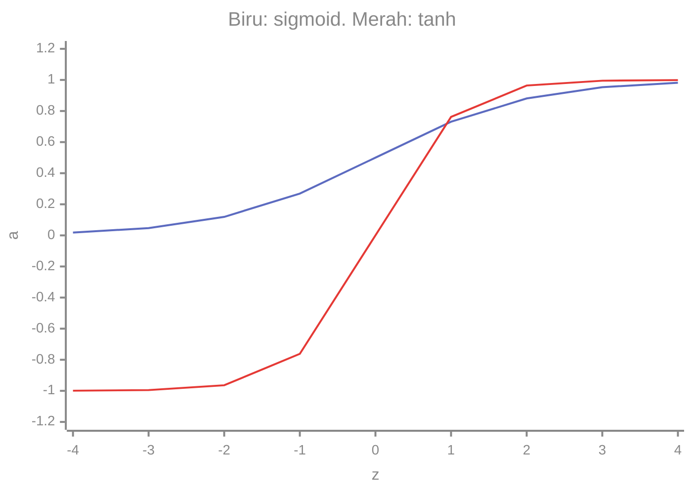
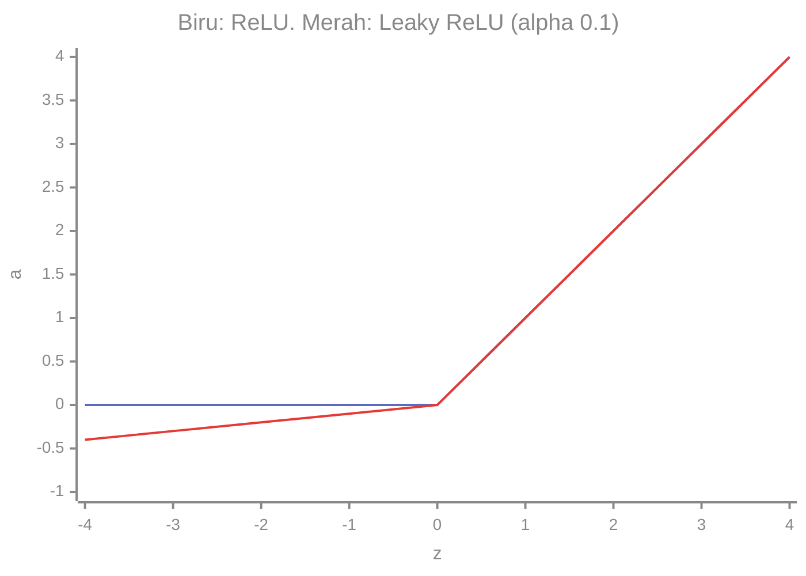

# Part 4 — Fungsi Aktivasi

## Tujuan Pembelajaran

Setelah mempelajari bagian ini, kamu mampu:

- menjelaskan mengapa jaringan membutuhkan **fungsi aktivasi non-linear**;
- menghitung sigmoid, tanh, ReLU, Leaky ReLU, dan softmax beserta **turunannya** dengan angka;
- menyebut rentang nilai dan sifat tiap fungsi (simetris di nol atau tidak, jenuh atau tidak);
- menjelaskan **saturasi**, **gradien menghilang** (*vanishing gradient*), dan **ReLU mati** (*dying ReLU*) dengan contoh angka;
- memilih aktivasi untuk lapisan tersembunyi dan lapisan keluaran sesuai jenis masalah;
- menghitung softmax, memeriksa jumlahnya satu, dan menjelaskan sifat bahwa softmax tidak berubah bila semua logit digeser.

## Prasyarat

[Part 3 — Matematika Neural Network](03-matematika-neural-network.md) (neuron: $z$ lalu $a=\varphi(z)$), [Level 1 Part 10 — Eksponensial dan Logaritma](../level-1-aljabar-dasar-dan-fungsi/10-fungsi-eksponensial-dan-logaritma.md) ($e^x$), dan [Level 2 Part 7 — Turunan](../level-2-aljabar-linear-dan-kalkulus/07-turunan.md) (aturan turunan dan turunan fungsi bersarang).

## Masalah yang Ingin Diselesaikan

Di Part 3 kita melihat bahwa dua lapisan linear tanpa aktivasi sama dengan satu lapisan linear. Fungsi aktivasi $\varphi$ memutus penyederhanaan itu dan memberi jaringan kemampuan membentuk kurva. Tetapi pilihan $\varphi$ bukan sekadar soal bentuk. Aktivasi menentukan dua hal yang menentukan keberhasilan pelatihan:

1. **Rentang keluaran**: apakah keluaran boleh berupa probabilitas, bilangan negatif, atau bilangan besar?
2. **Turunannya**: karena *backpropagation* mengalikan turunan lokal sepanjang jaringan ([Part 6](06-backpropagation-mendalam.md)), turunan yang terlalu kecil atau nol menghentikan pembelajaran.

## Intuisi dan Istilah Penting

- **Fungsi aktivasi** (*activation function*): fungsi $\varphi$ yang diterapkan pada pra-aktivasi $z$ untuk menghasilkan aktivasi $a=\varphi(z)$.
- **Non-linear**: grafiknya bukan garis lurus; $\varphi(z_1+z_2)\neq\varphi(z_1)+\varphi(z_2)$ pada umumnya.
- **Jenuh** (*saturate*): untuk $|z|$ besar, keluaran hampir konstan sehingga turunannya hampir 0.
- **Gradien menghilang** (*vanishing gradient*): gradien menjadi sangat kecil ketika mundur melewati banyak lapisan, sehingga lapisan awal hampir tidak belajar.
- **Elemen demi elemen** (*element-wise*): sigmoid, tanh, ReLU, dan Leaky ReLU diterapkan pada tiap elemen $Z$ secara terpisah. **Softmax berbeda**: ia diterapkan pada **seluruh vektor logit** satu contoh, karena tiap keluarannya bergantung pada semua logit.

## Rumus dan Penjelasan Setiap Simbol

Pada semua rumus, $z$ adalah pra-aktivasi (skalar), $a=\varphi(z)$ adalah aktivasi, dan $\varphi'(z)=da/dz$ adalah turunan yang dipakai di *backpropagation*.

### Sigmoid

$$
\sigma(z)=\frac{1}{1+e^{-z}},\qquad \sigma'(z)=\sigma(z)\bigl(1-\sigma(z)\bigr)
$$

Rentang $(0,1)$; $\sigma(0)=0{,}5$. Turunan diperoleh dari $\sigma'(z)=\dfrac{e^{-z}}{(1+e^{-z})^2}=\dfrac{1}{1+e^{-z}}\cdot\dfrac{e^{-z}}{1+e^{-z}}=\sigma(z)\bigl(1-\sigma(z)\bigr)$. Turunan terbesar $0{,}25$ di $z=0$ dan mengecil ke 0 di kedua sisi.

### Tanh

$$
\tanh(z)=\frac{e^{z}-e^{-z}}{e^{z}+e^{-z}}=2\sigma(2z)-1,\qquad \tanh'(z)=1-\tanh^2(z)
$$

Rentang $(-1,1)$; $\tanh(0)=0$. Bentuknya mirip sigmoid tetapi **berpusat di nol** dan lebih curam (turunan maksimum $1$ di $z=0$).

### ReLU dan Leaky ReLU

$$
\operatorname{ReLU}(z)=\max(0,z),\qquad
\operatorname{ReLU}'(z)=\begin{cases}1 & z>0\\ 0 & z<0\end{cases}
$$

$$
\operatorname{LeakyReLU}_\alpha(z)=\begin{cases}z & z>0\\ \alpha z & z\le 0\end{cases},\qquad
\operatorname{LeakyReLU}_\alpha'(z)=\begin{cases}1 & z>0\\ \alpha & z<0\end{cases}
$$

$\alpha$ adalah hiperparameter kecil positif (nilai umum $0{,}01$; contoh di sini memakai $0{,}1$ agar angkanya mudah dibaca). Di $z=0$ turunan tidak terdefinisi; dalam praktik dipilih satu nilai (biasanya $0$).

### Softmax

Untuk vektor logit $\mathbf{z}=(z_1,\dots,z_K)$ dari $K$ kelas:

$$
\operatorname{softmax}(\mathbf{z})_k=\frac{e^{z_k}}{\sum_{j=1}^{K}e^{z_j}}
$$

Semua keluaran positif dan **berjumlah 1** (asumsinya: softmax diterapkan pada seluruh $K$ kelas yang dimaksud). Turunannya berbentuk matriks (Jacobian). Dengan $p_k=\operatorname{softmax}(\mathbf{z})_k$:

$$
\frac{\partial p_i}{\partial z_j}=p_i\,(\delta_{ij}-p_j),\qquad \delta_{ij}=\begin{cases}1&i=j\\0&i\neq j\end{cases}
$$

$\delta_{ij}$ (delta Kronecker) bernilai 1 hanya bila $i=j$. Sifat penting: **menggeser semua logit dengan bilangan yang sama tidak mengubah softmax**, karena faktor $e^{c}$ muncul di pembilang dan penyebut lalu saling meniadakan. Softmax dibahas lebih dalam di [Part 11](11-softmax-dan-probabilitas-keluaran.md).

## Visualisasi

Sigmoid (biru) dan tanh (merah) pada $z=-4,\dots,4$ (nilai dibulatkan 3 desimal):



ReLU (biru) dan Leaky ReLU dengan $\alpha=0{,}1$ (merah):



Pada sigmoid dan tanh, ujung kiri dan kanan mendatar: di situlah turunannya mendekati 0. Pada ReLU, sisi kanan terus naik dengan kemiringan 1.

## Contoh Numerik Langkah demi Langkah

### Contoh 1 — Aktivasi dan turunan pada dua nilai $z$

| $z$ | $\sigma(z)$ | $\sigma'(z)$ | $\tanh(z)$ | $\tanh'(z)$ | ReLU | ReLU$'$ | Leaky ($\alpha=0{,}1$) | Leaky$'$ |
|---|---|---|---|---|---|---|---|---|
| $0{,}8$ | $0{,}6900$ | $0{,}2139$ | $0{,}6640$ | $0{,}5591$ | $0{,}8$ | $1$ | $0{,}8$ | $1$ |
| $-1{,}5$ | $0{,}1824$ | $0{,}1491$ | $-0{,}9051$ | $0{,}1807$ | $0$ | $0$ | $-0{,}15$ | $0{,}1$ |

Langkah-langkah untuk $z=0{,}8$: $\sigma(0{,}8)=\dfrac{1}{1+e^{-0{,}8}}=\dfrac{1}{1+0{,}4493}=0{,}6900$; $\sigma'=0{,}6900\times(1-0{,}6900)=0{,}2139$; $\tanh(0{,}8)=0{,}6640$; $\tanh'=1-0{,}6640^2=1-0{,}4409=0{,}5591$.

Untuk $z=-1{,}5$: $\sigma=0{,}1824$ dan $\sigma'=0{,}1824\times0{,}8176=0{,}1491$; $\tanh=-0{,}9051$ dan $\tanh'=1-0{,}8192=0{,}1807$; ReLU memotong menjadi $0$ dengan turunan $0$; Leaky memberi $0{,}1\times(-1{,}5)=-0{,}15$ dengan turunan $0{,}1$.

**Interpretasi.** Pada $z=-1{,}5$, ReLU tidak meneruskan gradien sama sekali (turunan $0$), sedangkan Leaky ReLU tetap meneruskan sedikit ($0{,}1$). Pada $z=0{,}8$ turunan sigmoid hanya $0{,}2139$ tetapi turunan ReLU tetap $1$.

### Contoh 2 — Nilai sigmoid dan tanh pada jangkauan lebar

| $z$ | $\sigma$ | $\sigma'$ | $\tanh$ | $\tanh'$ |
|---|---|---|---|---|
| $-4$ | $0{,}0180$ | $0{,}0177$ | $-0{,}9993$ | $0{,}0013$ |
| $-2$ | $0{,}1192$ | $0{,}1050$ | $-0{,}9640$ | $0{,}0707$ |
| $0$ | $0{,}5000$ | $0{,}2500$ | $0{,}0000$ | $1{,}0000$ |
| $2$ | $0{,}8808$ | $0{,}1050$ | $0{,}9640$ | $0{,}0707$ |
| $4$ | $0{,}9820$ | $0{,}0177$ | $0{,}9993$ | $0{,}0013$ |

Untuk $|z|=4$ turunan sigmoid hanya $0{,}0177$ dan turunan tanh hanya $0{,}0013$. Neuron yang memiliki $|z|$ besar hampir tidak "merasakan" koreksi: itulah **saturasi**.

### Contoh 3 — Softmax

Logit $\mathbf{z}=(2,\,1,\,0)$ untuk tiga kelas.

1. Eksponen: $e^{2}=7{,}3891$, $e^{1}=2{,}7183$, $e^{0}=1$.
2. Jumlah: $7{,}3891+2{,}7183+1=11{,}1073$.
3. Bagi: $p_1=\dfrac{7{,}3891}{11{,}1073}=0{,}6652$, $p_2=\dfrac{2{,}7183}{11{,}1073}=0{,}2447$, $p_3=\dfrac{1}{11{,}1073}=0{,}0900$.

Periksa jumlah: $0{,}6652+0{,}2447+0{,}0900=1{,}0000$.

**Pergeseran logit.** Untuk $\mathbf{z}=(102,\,101,\,100)$, yaitu semua logit ditambah $100$, hasilnya sama persis: $(0{,}6652,\ 0{,}2447,\ 0{,}0900)$, karena $e^{102}/(e^{102}+e^{101}+e^{100})=e^{2}/(e^{2}+e^{1}+e^{0})$. Hanya **selisih** logit yang berperan.

**Jacobian di titik ini.** $\dfrac{\partial p_1}{\partial z_1}=p_1(1-p_1)=0{,}6652\times0{,}3348=0{,}2227$, $\dfrac{\partial p_1}{\partial z_2}=-p_1p_2=-0{,}1628$, $\dfrac{\partial p_1}{\partial z_3}=-p_1p_3=-0{,}0599$. Jumlahnya $0{,}2227-0{,}1628-0{,}0599=0$: menaikkan satu logit menaikkan peluang kelasnya tetapi menurunkan peluang kelas lain, sehingga total tetap 1.

### Contoh 4 — Gradien menghilang pada rantai sigmoid

Bayangkan $n$ lapisan, tiap lapisan satu neuron sigmoid dengan bobot $w=1$ dan $z=0$. Pada *backpropagation*, gradien dikalikan $w\cdot\sigma'(z)=1\times0{,}25$ untuk setiap lapisan yang dilewati ([Part 6](06-backpropagation-mendalam.md)). Setelah $n$ lapisan faktornya $0{,}25^{\,n}$:

| Jumlah lapisan $n$ | Faktor $0{,}25^{n}$ |
|---|---|
| 1 | $0{,}25$ |
| 5 | $0{,}000977$ |
| 8 | $0{,}0000153$ |

Dengan ReLU aktif ($z>0$) setiap lapisan memberi faktor $1\times1=1$, sehingga gradien tidak mengecil karena aktivasi. Ini salah satu alasan ReLU umum dipakai pada jaringan dalam. Skenario ini disederhanakan (bobot $1$, $z=0$): pada jaringan nyata faktornya bergantung pada bobot dan $z$, tetapi karena $\sigma'\le0{,}25$, faktor aktivasinya selalu menekan gradien.

### Contoh 5 — ReLU mati

Neuron ReLU dengan $w=1$, $b=-10$ dan data masukan $x\in\{1,2,3\}$ memberi $z=-9,-8,-7$. Semua $z<0$ sehingga keluaran selalu $0$ dan turunan selalu $0$. Gradien terhadap $w$ dan $b$ juga $0$, jadi parameter neuron ini tidak pernah berubah: neuron tersebut "mati". Leaky ReLU menghindari kasus ini karena turunannya $\alpha>0$ untuk $z<0$.

## Memilih Aktivasi

| Posisi | Pilihan umum | Alasan |
|---|---|---|
| Lapisan tersembunyi | ReLU, atau Leaky ReLU bila khawatir neuron mati | turunan 1 di sisi aktif, murah dihitung |
| Lapisan tersembunyi (alternatif) | tanh | berpusat di nol; dapat jenuh |
| Keluaran regresi | identitas ($a=z$) | keluaran boleh berapa pun |
| Keluaran klasifikasi biner | sigmoid | keluaran di $(0,1)$ sebagai peluang |
| Keluaran klasifikasi multikelas (satu kelas benar) | softmax | peluang berjumlah 1 |
| Keluaran multi-label (beberapa label dapat benar sekaligus) | sigmoid per label | tiap label diputuskan sendiri |

Pilihan di atas adalah kebiasaan umum, bukan aturan mutlak; hasil bergantung pada data dan arsitektur. Pasangan aktivasi keluaran dengan loss dibahas di [Part 5](05-loss-function.md).

## Interpretasi, Asumsi, dan Keterbatasan

- Tabel dan contoh memakai turunan di titik tertentu; jaringan nyata mengalikannya di banyak titik sekaligus.
- Sigmoid dan tanh jenuh di kedua ujung; ReLU tidak jenuh di sisi positif tetapi bisa "mati" di sisi negatif; Leaky ReLU mengurangi masalah itu.
- Ada banyak aktivasi lain (misalnya GELU yang dipakai di Transformer, [Part 13](13-transformer.md)); ide dasarnya sama.
- Gradien menghilang tidak hanya disebabkan aktivasi; inisialisasi bobot dan arsitektur juga berperan. Contoh 4 hanya mengisolasi satu penyebab.
- Probabilitas dari sigmoid atau softmax belum tentu terkalibrasi (peluang $0{,}9$ belum tentu benar $90\%$ dari kasus).

## Hubungan dengan Deep Learning dan NLP

Lapisan *feed-forward* di dalam Transformer memakai ReLU atau variannya, sedangkan softmax muncul dua kali: pada keluaran klasifikasi dan pada **bobot attention** ([Part 12](12-attention-dan-self-attention.md)). Pada klasifikasi pesan Emergency vs Non-Emergency (data contoh/simulasi), logit dua kelas yang diubah softmax setara dengan sigmoid pada selisih logit (soal 5).

## Python

Pustaka standar saja.

```python
import math

def sigmoid(z):
    return 1 / (1 + math.exp(-z))

def relu(z):
    return max(0.0, z)

def leaky_relu(z, a=0.1):
    return z if z > 0 else a * z

def softmax(zs):
    e = [math.exp(z) for z in zs]
    jumlah = sum(e)
    return [v / jumlah for v in e]

# z, sigmoid, turunan sigmoid, tanh, turunan tanh
for z in (-4, -2, 0, 2, 4):
    s, t = sigmoid(z), math.tanh(z)
    print(z, round(s, 4), round(s * (1 - s), 4), round(t, 4), round(1 - t * t, 4))

# ReLU dan Leaky ReLU
for z in (0.8, -1.5):
    print(z, relu(z), round(leaky_relu(z), 4))

# softmax
p = softmax([2, 1, 0])
print([round(v, 4) for v in p], round(sum(p), 4))
print([round(v, 4) for v in softmax([102, 101, 100])])   # sama: tidak berubah jika semua logit digeser

# gradien menghilang: n lapisan sigmoid, bobot 1, z = 0 -> faktor 0.25 per lapisan
print(0.25 ** 5, 0.25 ** 8)
```

Keluaran:

```text
-4 0.018 0.0177 -0.9993 0.0013
-2 0.1192 0.105 -0.964 0.0707
0 0.5 0.25 0.0 1.0
2 0.8808 0.105 0.964 0.0707
4 0.982 0.0177 0.9993 0.0013
0.8 0.8 0.8
-1.5 0.0 -0.15
[0.6652, 0.2447, 0.09] 1.0
[0.6652, 0.2447, 0.09]
0.0009765625 1.52587890625e-05
```

Semua nilai sama dengan tabel di Contoh 2, 3, dan 4. Softmax pada logit $(102,101,100)$ berjalan baik di sini, tetapi untuk logit yang jauh lebih besar `math.exp` akan meluap; cara yang aman (mengurangi logit terbesar lebih dulu) dibahas di [Part 11](11-softmax-dan-probabilitas-keluaran.md).

## Kesalahan Umum

1. **Menyamakan semua aktivasi dengan probabilitas.** Hanya sigmoid dan softmax yang menghasilkan nilai di $(0,1)$; ReLU dan tanh tidak.
2. **Menerapkan softmax elemen demi elemen**, bukan pada seluruh vektor logit satu contoh.
3. **Menerapkan softmax pada sumbu yang salah** pada tensor $(n,K)$: jumlah per baris harus 1, bukan jumlah per kolom.
4. **Memasang aktivasi non-linear pada keluaran regresi** sehingga rentang prediksi terbatas.
5. **Menganggap turunan ReLU di $z=0$ bernilai tertentu secara matematis.** Itu konvensi.
6. **Mengira ReLU sempurna.** Neuron bisa mati bila masukannya selalu negatif.
7. **Lupa bahwa softmax dua kelas sama dengan sigmoid** dan memakai keduanya sekaligus pada keluaran yang sama.

## Latihan Mandiri

1. Hitung $\sigma(-2)$, $\sigma'(-2)$, $\tanh(0{,}5)$, dan $\tanh'(0{,}5)$.
2. Hitung ReLU, Leaky ReLU ($\alpha=0{,}1$), dan turunan keduanya untuk $z=-3$, $z=0{,}5$, dan $z=4$.
3. Hitung softmax untuk logit $(1,2,3)$ dan bandingkan dengan Contoh 3.
4. Tunjukkan bahwa softmax $(101,102,103)$ sama dengan softmax $(0,1,2)$. Berapa hasilnya?
5. Untuk dua kelas dengan logit $(2,0)$, hitung softmax dan bandingkan dengan $\sigma(2-0)$.
6. Berapa faktor gradien setelah 8 lapisan sigmoid dengan $\sigma'=0{,}25$ dan bobot $1$? Bandingkan dengan 8 lapisan ReLU aktif.
7. Pilih aktivasi keluaran: (a) memprediksi harga rumah; (b) mendeteksi spam (ya/tidak); (c) mengklasifikasikan pesan ke salah satu dari 5 kategori; (d) memberi tag pesan yang dapat memiliki beberapa topik sekaligus.
8. Neuron ReLU dengan $w=1$, $b=-10$ dan data $x\in\{1,2,3\}$. Hitung $z$, keluaran, dan turunan terhadap $z$. Mengapa neuron ini tidak belajar? Apa yang berubah jika memakai Leaky ReLU?
9. Verifikasi $\tanh(0{,}5)=2\sigma(1)-1$.
10. Untuk $\mathbf{p}=(0{,}6652,\,0{,}2447,\,0{,}0900)$ hitung $\partial p_1/\partial z_1$, $\partial p_1/\partial z_2$, $\partial p_1/\partial z_3$ dan tunjukkan jumlahnya $0$.

## Kunci Jawaban dan Pembahasan

??? success "Soal 1"
    $\sigma(-2)=\dfrac{1}{1+e^{2}}=\dfrac{1}{8{,}3891}\approx0{,}1192$. $\sigma'(-2)=0{,}1192\times0{,}8808\approx0{,}1050$. $\tanh(0{,}5)=\dfrac{e^{0{,}5}-e^{-0{,}5}}{e^{0{,}5}+e^{-0{,}5}}=\dfrac{1{,}6487-0{,}6065}{1{,}6487+0{,}6065}\approx0{,}4621$. $\tanh'(0{,}5)=1-0{,}4621^2\approx0{,}7864$.

??? success "Soal 2"
    $z=-3$: ReLU $0$ (turunan $0$); Leaky $-0{,}3$ (turunan $0{,}1$). $z=0{,}5$: ReLU $0{,}5$ (turunan $1$); Leaky $0{,}5$ (turunan $1$). $z=4$: ReLU $4$ (turunan $1$); Leaky $4$ (turunan $1$).

??? success "Soal 3"
    $e^{1}=2{,}7183$, $e^{2}=7{,}3891$, $e^{3}=20{,}0855$, jumlah $30{,}1929$. Hasil: $(0{,}0900,\ 0{,}2447,\ 0{,}6652)$. Ini angka yang sama dengan Contoh 3 tetapi urutannya terbalik, karena $(1,2,3)$ adalah $(0,1,2)$ digeser $+1$ dan urutan logitnya terbalik terhadap $(2,1,0)$.

??? success "Soal 4"
    Kurangkan $101$ dari semua logit: $(0,1,2)$. $e^0=1$, $e^1=2{,}7183$, $e^2=7{,}3891$, jumlah $11{,}1073$; hasil $(0{,}0900,\ 0{,}2447,\ 0{,}6652)$. Logit asli menghasilkan angka yang sama karena faktor $e^{101}$ saling meniadakan.

??? success "Soal 5"
    $\dfrac{e^{2}}{e^{2}+e^{0}}=\dfrac{7{,}3891}{8{,}3891}\approx0{,}8808$ untuk kelas pertama dan $0{,}1192$ untuk kelas kedua. $\sigma(2)\approx0{,}8808$. Sama: softmax dua kelas $=\sigma(z_1-z_2)$ karena $\dfrac{e^{z_1}}{e^{z_1}+e^{z_2}}=\dfrac{1}{1+e^{-(z_1-z_2)}}$.

??? success "Soal 6"
    Sigmoid: $0{,}25^{8}\approx1{,}5\times10^{-5}$ (kira-kira satu per 65 ribu). ReLU aktif: $1^{8}=1$. Gradien lewat ReLU aktif tidak mengecil karena aktivasi, sedangkan lewat sigmoid mengecil drastis.

??? success "Soal 7"
    (a) identitas (regresi). (b) sigmoid. (c) softmax. (d) sigmoid per label (multi-label), karena label tidak saling meniadakan sehingga peluangnya tidak harus berjumlah 1.

??? success "Soal 8"
    $z=x-10=-9,-8,-7$. Keluaran ReLU $0$ untuk ketiganya, turunan $0$. Gradien terhadap $w$ dan $b$ adalah (gradien dari atas) $\times\ 0\times x=0$, sehingga $w$ dan $b$ tak berubah. Pada Leaky ReLU turunannya $\alpha>0$ sehingga gradien kecil tetap mengalir dan neuron dapat pulih.

??? success "Soal 9"
    $\sigma(1)=\dfrac{1}{1+e^{-1}}\approx0{,}7311$; $2\times0{,}7311-1=0{,}4621$, sama dengan $\tanh(0{,}5)$.

??? success "Soal 10"
    $\partial p_1/\partial z_1=p_1(1-p_1)=0{,}6652\times0{,}3348\approx0{,}2227$. $\partial p_1/\partial z_2=-p_1p_2=-0{,}6652\times0{,}2447\approx-0{,}1628$. $\partial p_1/\partial z_3=-p_1p_3=-0{,}6652\times0{,}0900\approx-0{,}0599$. Jumlah $0{,}2227-0{,}1628-0{,}0599=0$. Secara umum jumlahnya $p_1(1-p_1-p_2-p_3)=0$ karena $p_1+p_2+p_3=1$.

## Ringkasan Materi

- Fungsi aktivasi non-linear membuat jaringan lebih dari satu lapisan linear; pilihannya menentukan rentang keluaran dan turunan.
- Sigmoid $(0,1)$, $\sigma'=\sigma(1-\sigma)\le0{,}25$; tanh $(-1,1)$, $\tanh'=1-\tanh^2\le1$; ReLU $\max(0,z)$ dengan turunan 0 atau 1; Leaky ReLU memberi turunan kecil $\alpha$ untuk $z<0$.
- **Saturasi** pada sigmoid dan tanh menyebabkan **gradien menghilang** bila banyak lapisan dilewati; ReLU mengurangi masalah itu tetapi dapat "mati".
- **Softmax** menerapkan $e^{z_k}/\sum_j e^{z_j}$ pada seluruh vektor logit; hasilnya berjumlah 1 dan tidak berubah bila semua logit digeser; Jacobian-nya $p_i(\delta_{ij}-p_j)$.
- Pilih ReLU-family di lapisan tersembunyi; keluaran: identitas (regresi), sigmoid (biner/multi-label), softmax (multikelas).

## Checklist Penguasaan

- [ ] Menghitung sigmoid, tanh, ReLU, dan Leaky ReLU beserta turunannya.
- [ ] Menghitung softmax dan memeriksa jumlahnya satu.
- [ ] Menjelaskan sifat invarian softmax terhadap pergeseran logit.
- [ ] Menjelaskan saturasi, gradien menghilang, dan ReLU mati dengan angka.
- [ ] Memilih aktivasi keluaran untuk regresi, klasifikasi biner, multikelas, dan multi-label.
- [ ] Membedakan aktivasi elemen demi elemen dengan softmax.

## Prasyarat untuk Materi Berikutnya

[Part 5 — Loss Function](05-loss-function.md) memasangkan aktivasi keluaran dengan fungsi loss yang sesuai (identitas dengan MSE, sigmoid dengan *binary cross-entropy*, softmax dengan *categorical cross-entropy*). Pastikan kamu nyaman dengan sigmoid, softmax, dan logaritma natural.
