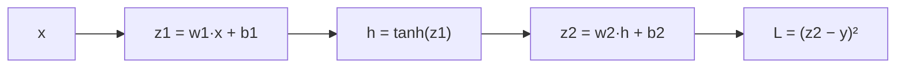

# Part 6 — Backpropagation Mendalam

## Tujuan Pembelajaran

Setelah mempelajari bagian ini, kamu mampu:

- menggambar **computational graph** sebuah perhitungan dan menyebut turunan lokal tiap simpul;
- menerapkan ***chain rule*** untuk menghitung gradien loss terhadap setiap parameter pada jaringan satu neuron dan jaringan dua lapisan skalar;
- menjumlahkan kontribusi **beberapa jalur** bila suatu nilai dipakai lebih dari sekali;
- menuliskan **Jacobian** sederhana dan memakainya pada *chain rule* berbentuk vektor;
- menurunkan dan memakai rumus matriks $dW=A^\top dZ$, $d\mathbf{b}$, dan $dA_{\text{prev}}=dZ\,W^\top$ beserta shape-nya;
- menghitung manual satu langkah *backpropagation* pada jaringan $3\to2\to1$ dengan batch dua contoh;
- memeriksa gradien dengan **turunan numerik** (*gradient checking*).

## Prasyarat

[Level 2 Part 8 — Turunan Parsial dan Gradien](../level-2-aljabar-linear-dan-kalkulus/08-turunan-parsial-dan-gradien.md), [Level 2 Part 9 — Chain Rule dan Backpropagation](../level-2-aljabar-linear-dan-kalkulus/09-chain-rule-dan-backpropagation.md) (ide dengan angka tunggal), [Part 3](03-matematika-neural-network.md) (forward propagation berbentuk matriks), serta [Part 4](04-fungsi-aktivasi.md) dan [Part 5](05-loss-function.md) (turunan aktivasi dan gradien loss).

## Masalah yang Ingin Diselesaikan

Untuk memperbaiki parameter kita butuh $\partial L/\partial\theta$ untuk **setiap** parameter. Jaringan punya ribuan sampai miliaran parameter; menurunkan rumusnya satu per satu secara langsung tidak mungkin. *Backpropagation* (propagasi mundur) adalah cara menghitung semua gradien itu secara sistematis dengan biaya yang kira-kira sama dengan satu kali *forward*: mulai dari loss, bergerak mundur, dan di tiap simpul mengalikan satu turunan lokal sederhana. Ini bukan algoritma pembelajaran baru, melainkan **cara efisien menerapkan chain rule**.

## Intuisi dan Istilah Penting

- **Computational graph** (graf komputasi): perhitungan digambar sebagai simpul (nilai antara) dan panah (operasi). Loss berada di ujung kanan.
- **Turunan lokal** (*local derivative*): turunan keluaran satu simpul terhadap masukannya, hanya melihat operasi di simpul itu.
- **Gradien hulu** (*upstream gradient*): $\partial L/\partial(\text{keluaran simpul})$, yang datang dari simpul-simpul di kanan.
- **Aturan inti**: gradien masukan $=$ gradien hulu $\times$ turunan lokal.

$$
\underbrace{\frac{\partial L}{\partial x}}_{\text{gradien masukan}}=\underbrace{\frac{\partial L}{\partial y}}_{\text{gradien hulu}}\cdot\underbrace{\frac{\partial y}{\partial x}}_{\text{turunan lokal}}
$$

- Karena gradien dihitung dari kanan ke kiri, kita perlu **menyimpan** nilai antara dari *forward* ($z$, $a$, dan seterusnya). Itu sebabnya pelatihan memakai memori jauh lebih banyak daripada *inference*.

## Rumus dan Penjelasan Setiap Simbol

### Chain rule dan jumlah jalur

Bila $L$ bergantung pada $y$ dan $y=g(x)$, maka $\dfrac{dL}{dx}=\dfrac{dL}{dy}\dfrac{dy}{dx}$. Bila $x$ memengaruhi $L$ lewat **beberapa jalur** (misalnya dipakai di dua simpul), gradiennya adalah **jumlah** kontribusi semua jalur:

$$
\frac{\partial L}{\partial x}=\sum_{\text{jalur}}\ \prod_{\text{simpul di jalur}}(\text{turunan lokal})
$$

### Satu neuron: sigmoid dan *binary cross-entropy*

Dengan $z=wx+b$, $a=\sigma(z)$, $\ell=-[y\ln a+(1-y)\ln(1-a)]$:

$$
\frac{\partial\ell}{\partial a}=-\frac{y}{a}+\frac{1-y}{1-a},\qquad
\frac{\partial a}{\partial z}=a(1-a),\qquad
\frac{\partial z}{\partial w}=x,\quad\frac{\partial z}{\partial b}=1
$$

$$
\frac{\partial\ell}{\partial z}=\frac{\partial\ell}{\partial a}\frac{\partial a}{\partial z}=a-y,\qquad
\frac{\partial\ell}{\partial w}=(a-y)\,x,\qquad
\frac{\partial\ell}{\partial b}=a-y
$$

Ini rumus yang dipakai tanpa penurunan di [Part 1](01-fondasi-matematika-deep-learning.md) dan [Part 5](05-loss-function.md).

### Jacobian

Untuk fungsi vektor $\mathbf{f}:\mathbb{R}^{m}\to\mathbb{R}^{k}$, **Jacobian** adalah matriks $k\times m$ turunan parsial:

$$
J_{ij}=\frac{\partial f_i}{\partial x_j},\qquad i=1,\dots,k,\ j=1,\dots,m
$$

*Chain rule* berbentuk vektor: bila $\mathbf{y}=\mathbf{f}(\mathbf{x})$ dan $g=\nabla_{\mathbf{y}}L$ (vektor gradien hulu berukuran $k$), maka

$$
\nabla_{\mathbf{x}}L=J^\top\,\nabla_{\mathbf{y}}L
$$

Dua Jacobian yang sering muncul: (a) fungsi **elemen demi elemen** $y_i=\varphi(x_i)$ punya Jacobian **diagonal** dengan $\varphi'(x_i)$ di diagonal, sehingga $J^\top g$ cukup berupa perkalian elemen demi elemen $g\odot\varphi'(\mathbf{x})$; (b) pemetaan linear $\mathbf{y}=\mathbf{x}W$ punya $\partial y_j/\partial x_k=W_{kj}$, sehingga gradien masukan adalah $W$ dikali gradien hulu.

### Satu lapisan dalam bentuk matriks

Untuk $Z=A_{\text{prev}}W+\mathbf{b}$ dengan $A_{\text{prev}}\in\mathbb{R}^{n\times d_{\text{in}}}$, $W\in\mathbb{R}^{d_{\text{in}}\times d_{\text{out}}}$, dan $dZ=\partial L/\partial Z\in\mathbb{R}^{n\times d_{\text{out}}}$ (gradien hulu):

$$
dW=A_{\text{prev}}^\top\,dZ,\qquad d\mathbf{b}=\sum_{i=1}^{n}dZ_{i,:},\qquad dA_{\text{prev}}=dZ\,W^\top
$$

| Gradien | Rumus | Shape |
|---|---|---|
| $dW$ | $A_{\text{prev}}^\top\,dZ$ | $(d_{\text{in}},n)(n,d_{\text{out}})\to(d_{\text{in}},d_{\text{out}})$ |
| $d\mathbf{b}$ | jumlah $dZ$ sepanjang contoh | $(d_{\text{out}})$ |
| $dA_{\text{prev}}$ | $dZ\,W^\top$ | $(n,d_{\text{out}})(d_{\text{out}},d_{\text{in}})\to(n,d_{\text{in}})$ |

**Sumber rumus.** Elemennya $z_{ij}=\sum_k a_{ik}w_{kj}+b_j$. Maka $\partial z_{ij}/\partial w_{kj}=a_{ik}$, dan karena $w_{kj}$ dipakai oleh **semua** contoh $i$ (jalur ganda):

$$
\frac{\partial L}{\partial w_{kj}}=\sum_{i=1}^{n}\frac{\partial L}{\partial z_{ij}}\,a_{ik}=\bigl(A_{\text{prev}}^\top dZ\bigr)_{kj}
$$

Dengan alasan yang sama $\partial L/\partial b_j=\sum_i dZ_{ij}$, dan $\partial L/\partial a_{ik}=\sum_j dZ_{ij}w_{kj}=(dZ\,W^\top)_{ik}$. **Pegangan praktis:** gradien suatu parameter selalu berukuran sama dengan parameternya; bila shape hasil tidak cocok, rumusnya salah.

### Aktivasi dan keluaran

$$
dZ=dA\odot\varphi'(Z)\quad\text{(aktivasi elemen demi elemen)},\qquad
dZ_{\text{keluaran}}=\frac{1}{n}(P-Y)\quad\text{(sigmoid atau softmax dengan cross-entropy rata-rata)}
$$

$\odot$ adalah perkalian elemen demi elemen. Faktor $1/n$ muncul karena loss adalah **rata-rata** atas $n$ contoh. $P$ adalah matriks peluang, $Y$ matriks label (*one-hot* atau 0/1).

## Contoh Numerik Langkah demi Langkah

### Contoh 1 — Satu neuron dengan *chain rule*

Data Part 1: $x=2$, $y=1$, $w=0{,}5$, $b=-0{,}5$. *Forward*: $z=0{,}5$, $a=\sigma(0{,}5)=0{,}6225$, $\ell=-\ln0{,}6225=0{,}4741$.

*Backward*, simpul demi simpul:

1. $\dfrac{\partial\ell}{\partial a}=-\dfrac{1}{0{,}6225}=-1{,}6065$ (untuk $y=1$).
2. $\dfrac{\partial a}{\partial z}=a(1-a)=0{,}6225\times0{,}3775=0{,}2350$.
3. $\dfrac{\partial\ell}{\partial z}=-1{,}6065\times0{,}2350=-0{,}3775$, sama dengan $a-y=0{,}6225-1$.
4. $\dfrac{\partial\ell}{\partial w}=-0{,}3775\times x=-0{,}7551$ dan $\dfrac{\partial\ell}{\partial b}=-0{,}3775$.

Persis angka di Part 1, sekarang dengan asal-usulnya.

### Contoh 2 — Dua lapisan skalar dengan tanh

Satu masukan, satu neuron tersembunyi (tanh), satu keluaran linear, dan loss kuadrat. Nilai: $x=1$, $w_1=0{,}5$, $b_1=0{,}1$, $w_2=-1$, $b_2=0{,}3$, target $y=0{,}5$.



**Forward** (simpan semua nilai):

- $z_1=0{,}5\cdot1+0{,}1=0{,}6$
- $h=\tanh(0{,}6)=0{,}5370$
- $z_2=(-1)(0{,}5370)+0{,}3=-0{,}2370$
- $L=(-0{,}2370-0{,}5)^2=(-0{,}7370)^2=0{,}5432$

**Backward** (kanan ke kiri):

| Simpul | Gradien hulu | Turunan lokal | Hasil |
|---|---|---|---|
| $L$ terhadap $z_2$ | $1$ | $2(z_2-y)=2(-0{,}7370)$ | $\dfrac{\partial L}{\partial z_2}=-1{,}4741$ |
| $z_2$ terhadap $w_2$ | $-1{,}4741$ | $h=0{,}5370$ | $\dfrac{\partial L}{\partial w_2}=-0{,}7917$ |
| $z_2$ terhadap $b_2$ | $-1{,}4741$ | $1$ | $\dfrac{\partial L}{\partial b_2}=-1{,}4741$ |
| $z_2$ terhadap $h$ | $-1{,}4741$ | $w_2=-1$ | $\dfrac{\partial L}{\partial h}=1{,}4741$ |
| $h$ terhadap $z_1$ | $1{,}4741$ | $1-h^2=0{,}7116$ | $\dfrac{\partial L}{\partial z_1}=1{,}0489$ |
| $z_1$ terhadap $w_1$ | $1{,}0489$ | $x=1$ | $\dfrac{\partial L}{\partial w_1}=1{,}0489$ |
| $z_1$ terhadap $b_1$ | $1{,}0489$ | $1$ | $\dfrac{\partial L}{\partial b_1}=1{,}0489$ |

**Pemeriksaan numerik.** Turunan numerik tengah dengan $\varepsilon=10^{-6}$ untuk $w_1$, $b_1$, $w_2$, $b_2$ memberi $1{,}0489$, $1{,}0489$, $-0{,}7917$, $-1{,}4741$, sama dengan hasil *backpropagation*.

**Interpretasi.** Untuk menurunkan $L$, kurangi $w_2$ dan $b_2$ dengan arah berlawanan gradien (naikkan, karena gradien negatif) dan turunkan $w_1$ dan $b_1$ (gradien positif). Perhatikan bahwa gradien $w_1$ harus melewati $w_2$ dan $\tanh'$: lapisan awal "mendengar" kesalahan hanya lewat lapisan sesudahnya.

### Contoh 3 — Dua jalur dijumlahkan

$L=u+v$ dengan $u=x^2$ dan $v=3x$, di $x=2$. Variabel $x$ memengaruhi $L$ lewat dua jalur:

$$
\frac{\partial L}{\partial x}=\underbrace{1\cdot2x}_{\text{lewat }u}+\underbrace{1\cdot3}_{\text{lewat }v}=4+3=7
$$

Sama dengan menurunkan langsung $L=x^2+3x$: $L'(x)=2x+3=7$. Situasi serupa muncul di jaringan: bobot $W$ dipakai oleh semua contoh dalam batch (jalur ganda), dan pada koneksi residual ([Part 13](13-transformer.md)) sebuah nilai mengalir lewat dua jalan.

### Contoh 4 — Jacobian

$\mathbf{f}(x_1,x_2)=(x_1x_2,\ x_1+x_2)$ di $(2,3)$:

$$
J=\begin{bmatrix}\partial f_1/\partial x_1&\partial f_1/\partial x_2\\\partial f_2/\partial x_1&\partial f_2/\partial x_2\end{bmatrix}=\begin{bmatrix}x_2&x_1\\1&1\end{bmatrix}=\begin{bmatrix}3&2\\1&1\end{bmatrix}
$$

Misalkan gradien hulu $g=(1,\,2)$ (artinya $L=f_1+2f_2$). Maka

$$
\nabla_{\mathbf{x}}L=J^\top g=\begin{bmatrix}3&1\\2&1\end{bmatrix}\begin{bmatrix}1\\2\end{bmatrix}=\begin{bmatrix}3+2\\2+2\end{bmatrix}=\begin{bmatrix}5\\4\end{bmatrix}
$$

Pemeriksaan langsung: $L=x_1x_2+2x_1+2x_2$, sehingga $\partial L/\partial x_1=x_2+2=5$ dan $\partial L/\partial x_2=x_1+2=4$. Cocok.

### Contoh 5 — *Backpropagation* matriks pada jaringan $3\to2\to1$

Pakai jaringan dan batch dari [Part 3](03-matematika-neural-network.md), dengan label $Y=(1,\ 1)$ dan loss BCE rata-rata. Hasil *forward* (dari Part 3):

$$
X=\begin{bmatrix}1&2&-1\\0&1&2\end{bmatrix},\quad
Z^{[1]}=\begin{bmatrix}-0{,}65&2{,}8\\1{,}35&-1{,}7\end{bmatrix},\quad
A^{[1]}=\begin{bmatrix}0&2{,}8\\1{,}35&0\end{bmatrix},\quad
P=\begin{bmatrix}0{,}0198\\0{,}8389\end{bmatrix}
$$

Loss: $L=\tfrac12\bigl(-\ln0{,}0198-\ln0{,}8389\bigr)=\tfrac12(3{,}9202+0{,}1759)=2{,}0479$.

**Langkah 1 — gradien di keluaran** ($n=2$): $dZ^{[2]}=\tfrac1n(P-Y)=\tfrac12\begin{bmatrix}0{,}0198-1\\0{,}8389-1\end{bmatrix}=\begin{bmatrix}-0{,}4901\\-0{,}0806\end{bmatrix}$, shape $(2,1)$.

**Langkah 2 — lapisan 2.**

- $dW^{[2]}=A^{[1]\top}dZ^{[2]}=\begin{bmatrix}0&1{,}35\\2{,}8&0\end{bmatrix}\begin{bmatrix}-0{,}4901\\-0{,}0806\end{bmatrix}=\begin{bmatrix}-0{,}1087\\-1{,}3722\end{bmatrix}$, shape $(2,1)$, sama dengan $W^{[2]}$.
- $db^{[2]}=-0{,}4901-0{,}0806=-0{,}5706$.
- $dA^{[1]}=dZ^{[2]}W^{[2]\top}=\begin{bmatrix}-0{,}4901\\-0{,}0806\end{bmatrix}\begin{bmatrix}1&-1{,}5\end{bmatrix}=\begin{bmatrix}-0{,}4901&0{,}7351\\-0{,}0806&0{,}1208\end{bmatrix}$, shape $(2,2)$.

**Langkah 3 — melewati ReLU:** $dZ^{[1]}=dA^{[1]}\odot\mathbb{1}[Z^{[1]}>0]$. Topeng (1 bila $Z^{[1]}>0$): $\begin{bmatrix}0&1\\1&0\end{bmatrix}$. Maka

$$
dZ^{[1]}=\begin{bmatrix}0&0{,}7351\\-0{,}0806&0\end{bmatrix}
$$

Gradien pada posisi yang ReLU-nya "mati" dibuang menjadi $0$.

**Langkah 4 — lapisan 1.**

- $dW^{[1]}=X^\top dZ^{[1]}=\begin{bmatrix}1&0\\2&1\\-1&2\end{bmatrix}\begin{bmatrix}0&0{,}7351\\-0{,}0806&0\end{bmatrix}=\begin{bmatrix}0&0{,}7351\\-0{,}0806&1{,}4702\\-0{,}1611&-0{,}7351\end{bmatrix}$, shape $(3,2)$.
- $d\mathbf{b}^{[1]}=\bigl(0-0{,}0806,\ 0{,}7351+0\bigr)=(-0{,}0806,\ 0{,}7351)$.

**Langkah 5 — pembaruan** dengan $\eta=0{,}5$ ($\theta\leftarrow\theta-\eta\,d\theta$) lalu *forward* lagi: loss turun dari $2{,}0479$ menjadi $0{,}3059$.

**Pemeriksaan numerik.** Turunan numerik tengah untuk elemen $W^{[1]}_{2,2}$ (bobot dari fitur ke-2 ke neuron ke-2) memberi $1{,}4702$, sama dengan $dW^{[1]}_{2,2}$.

Ringkasan shape sepanjang jalur mundur:

| Langkah | Ekspresi | Shape |
|---|---|---|
| $dZ^{[2]}$ | $\tfrac1n(P-Y)$ | $(2,1)$ |
| $dW^{[2]}$ | $A^{[1]\top}dZ^{[2]}$ | $(2,1)$ |
| $dA^{[1]}$ | $dZ^{[2]}W^{[2]\top}$ | $(2,2)$ |
| $dZ^{[1]}$ | $dA^{[1]}\odot\varphi'(Z^{[1]})$ | $(2,2)$ |
| $dW^{[1]}$ | $X^\top dZ^{[1]}$ | $(3,2)$ |

### Contoh 6 — *Gradient checking*

Turunan numerik tengah dari suatu parameter $\theta_k$:

$$
\frac{\partial L}{\partial\theta_k}\approx\frac{L(\theta_k+\varepsilon)-L(\theta_k-\varepsilon)}{2\varepsilon}
$$

dengan $\varepsilon$ kecil (misalnya $10^{-6}$). Untuk $L(w)=w^3$ di $w=2$ dengan $\varepsilon=0{,}01$: $\dfrac{2{,}01^3-1{,}99^3}{0{,}02}=\dfrac{8{,}120601-7{,}880599}{0{,}02}=12{,}0001$, sedangkan turunan analitik $3w^2=12$. Metode ini lambat (satu kali *forward* ganda per parameter) sehingga hanya dipakai untuk menguji kode *backpropagation*, bukan untuk pelatihan.

## Interpretasi, Asumsi, dan Keterbatasan

- *Backpropagation* mengasumsikan semua operasi dapat diturunkan. ReLU tidak terdiferensiasi di $0$ (dipakai konvensi turunan $0$ atau $1$) tetapi ini jarang bermasalah dalam praktik.
- Gradien yang dihitung adalah gradien **loss pada batch saat ini**. Gradien batch lain akan berbeda ([Part 7](07-optimasi-deep-learning.md)).
- Biaya komputasi *backward* sebanding dengan *forward*, tetapi memori untuk menyimpan nilai antara bertambah seiring kedalaman jaringan.
- Pada jaringan dalam, gradien dapat membesar atau mengecil secara eksponensial sepanjang rantai ([Part 4](04-fungsi-aktivasi.md) menunjukkan sisi mengecilnya).
- Contoh di sini memakai bobot contoh, bukan hasil pelatihan; yang diperiksa adalah kebenaran rumus gradien.

## Hubungan dengan Deep Learning dan NLP

Pustaka seperti PyTorch menyimpan graf komputasi saat *forward* dan menjalankan seluruh langkah mundur di atas secara otomatis (*automatic differentiation*), termasuk untuk operasi attention ([Part 12](12-attention-dan-self-attention.md)). Pada model bahasa dengan miliaran parameter, rumus yang dipakai tetap sama: $dW=A^\top dZ$, $dA=dZ\,W^\top$, dan perkalian elemen demi elemen untuk aktivasi, hanya dengan tensor yang jauh lebih besar dan dijalankan di GPU.

## Python

Pustaka standar saja. Kode berikut mengulang Contoh 5 dan pemeriksaan numeriknya.

```python
import math

def matmul(P, Q):
    return [[sum(P[i][k] * Q[k][j] for k in range(len(Q)))
             for j in range(len(Q[0]))] for i in range(len(P))]

def T(M):
    return [list(kolom) for kolom in zip(*M)]

def sigmoid(z):
    return 1 / (1 + math.exp(-z))

X = [[1.0, 2.0, -1.0], [0.0, 1.0, 2.0]]
Y = [1, 1]
W1, b1 = [[0.5, 1.0], [-0.25, 0.5], [0.75, -1.0]], [0.1, -0.2]
W2, b2 = [[1.0], [-1.5]], [0.3]

def maju(W1, b1, W2, b2):
    Z1 = [[v + b1[j] for j, v in enumerate(baris)] for baris in matmul(X, W1)]
    A1 = [[max(0.0, v) for v in baris] for baris in Z1]
    Z2 = [[v + b2[0] for v in baris] for baris in matmul(A1, W2)]
    P = [sigmoid(baris[0]) for baris in Z2]
    loss = sum(-math.log(p if y == 1 else 1 - p) for p, y in zip(P, Y)) / len(Y)
    return Z1, A1, P, loss

Z1, A1, P, loss = maju(W1, b1, W2, b2)
print([round(p, 4) for p in P], round(loss, 4))

# mundur
dZ2 = [[(p - y) / len(Y)] for p, y in zip(P, Y)]                    # (2, 1)
dW2 = matmul(T(A1), dZ2)                                            # (2, 1)
db2 = sum(baris[0] for baris in dZ2)                                # skalar
dA1 = matmul(dZ2, T(W2))                                            # (2, 2)
dZ1 = [[g if Z1[i][j] > 0 else 0.0 for j, g in enumerate(baris)]
       for i, baris in enumerate(dA1)]                              # (2, 2)
dW1 = matmul(T(X), dZ1)                                             # (3, 2)
db1 = [sum(dZ1[i][j] for i in range(2)) for j in range(2)]          # (2,)
print([[round(v, 4) for v in b] for b in dZ2])
print([[round(v, 4) for v in b] for b in dW2], round(db2, 4))
print([[round(v, 4) for v in b] for b in dZ1])
print([[round(v, 4) for v in b] for b in dW1], [round(v, 4) for v in db1])

# cek gradien: turunan numerik W1[1][1]
e = 1e-6
Wp = [baris[:] for baris in W1]; Wp[1][1] += e
Wm = [baris[:] for baris in W1]; Wm[1][1] -= e
print(round((maju(Wp, b1, W2, b2)[3] - maju(Wm, b1, W2, b2)[3]) / (2 * e), 4), round(dW1[1][1], 4))

# satu langkah pembaruan, eta = 0.5
eta = 0.5
W1n = [[w - eta * g for w, g in zip(br, bg)] for br, bg in zip(W1, dW1)]
b1n = [w - eta * g for w, g in zip(b1, db1)]
W2n = [[w - eta * g for w, g in zip(br, bg)] for br, bg in zip(W2, dW2)]
b2n = [b2[0] - eta * db2]
print(round(maju(W1n, b1n, W2n, b2n)[3], 4))
```

Keluaran:

```text
[0.0198, 0.8389] 2.0479
[[-0.4901], [-0.0806]]
[[-0.1087], [-1.3722]] -0.5706
[[0.0, 0.7351], [-0.0806, 0.0]]
[[0.0, 0.7351], [-0.0806, 1.4702], [-0.1611, -0.7351]] [-0.0806, 0.7351]
1.4702 1.4702
0.3059
```

Semua gradien sama dengan Contoh 5; elemen $dW^{[1]}_{2,2}$ cocok dengan turunan numerik ($1{,}4702$), dan loss setelah satu langkah $0{,}3059$.

## Kesalahan Umum

1. **Lupa membagi dengan $n$** (atau membaginya dua kali) ketika loss adalah rata-rata batch.
2. **Lupa mengalikan turunan aktivasi** ($\varphi'$) atau topeng ReLU, sehingga gradien terlalu besar (soal 10).
3. **Salah transpose.** $dW=A^\top dZ$, bukan $dZ\,A^\top$; periksa shape.
4. **Tidak menjumlahkan jalur ganda**, misalnya tidak menjumlahkan gradien bobot atas seluruh contoh.
5. **Memakai nilai antara yang salah** pada *backward* (harus nilai dari *forward* yang sama).
6. **Menyamakan turunan lokal dengan gradien total.** Turunan lokal hanya satu faktor dalam rantai.
7. **Lupa mengembalikan gradien yang dibuang oleh ReLU** sebagai $0$ (bukan menghilangkannya dari bentuk matriks).

## Latihan Mandiri

1. Neuron sigmoid dengan BCE: $x=1$, $w=1$, $b=0$, $y=0$. Hitung $\partial\ell/\partial a$, $\partial a/\partial z$, $\partial\ell/\partial z$, dan $\partial\ell/\partial w$ dengan *chain rule*.
2. Jaringan skalar: $x=2$, $h=\operatorname{ReLU}(w_1x+b_1)$, $z_2=w_2h+b_2$, $L=(z_2-y)^2$ dengan $w_1=1$, $b_1=-1$, $w_2=3$, $b_2=0$, $y=2$. Hitung *forward* lalu semua gradien.
3. Ulangi soal 2 dengan $b_1=-3$. Apa yang terjadi pada gradien $w_1$ dan $b_1$?
4. $L=xy+x^2$ di $x=3$, $y=2$. Hitung $\partial L/\partial x$ dan $\partial L/\partial y$ dengan menjumlahkan jalur.
5. Satu lapisan memproses $X\in\mathbb{R}^{32\times100}$ dengan $W\in\mathbb{R}^{100\times50}$. Tentukan shape $dZ$, $dW$, $d\mathbf{b}$, dan $dX$.
6. $\mathbf{f}(x_1,x_2)=(x_1+x_2,\ x_1x_2)$ di $(3,4)$ dan gradien hulu $g=(2,1)$. Hitung Jacobian dan $J^\top g$, lalu periksa dengan menurunkan langsung.
7. Logit $(2,1,0)$ dengan kelas benar kelas 3 dan softmax–CCE. Hitung gradien terhadap logit dan jumlahnya.
8. Hitung turunan numerik tengah $L(w)=w^3$ di $w=2$ dengan $\varepsilon=0{,}01$. Berapa selisihnya dari $3w^2$?
9. Pada Contoh 5, mengapa $dZ^{[2]}$ dibagi $n=2$? Tulis $dZ^{[2]}$ jika tanpa pembagian itu.
10. Misalkan kode dengan kesalahan: topeng ReLU terlupa, sehingga $dZ^{[1]}=dA^{[1]}$ pada Contoh 5. Hitung $dW^{[1]}_{2,2}$ yang keliru dan bandingkan dengan hasil numerik $1{,}4702$.

## Kunci Jawaban dan Pembahasan

??? success "Soal 1"
    $z=1$, $a=\sigma(1)=0{,}7311$. Untuk $y=0$: $\ell=-\ln(1-a)$ sehingga $\partial\ell/\partial a=\dfrac{1}{1-a}=3{,}7183$. $\partial a/\partial z=0{,}7311\times0{,}2689=0{,}1966$. $\partial\ell/\partial z=3{,}7183\times0{,}1966=0{,}7311=a-y$. $\partial\ell/\partial w=0{,}7311\times1=0{,}7311$.

??? success "Soal 2"
    *Forward*: $z_1=1\cdot2-1=1$, $h=1$, $z_2=3\cdot1+0=3$, $L=(3-2)^2=1$. *Backward*: $\partial L/\partial z_2=2(3-2)=2$; $\partial L/\partial w_2=2\cdot h=2$; $\partial L/\partial b_2=2$; $\partial L/\partial h=2\cdot w_2=6$; ReLU aktif ($z_1>0$) sehingga $\partial L/\partial z_1=6$; $\partial L/\partial w_1=6\cdot x=12$; $\partial L/\partial b_1=6$.

??? success "Soal 3"
    $z_1=2-3=-1$, $h=0$, $z_2=0$, $L=(0-2)^2=4$. $\partial L/\partial z_2=2(0-2)=-4$; $\partial L/\partial w_2=-4\cdot h=0$; $\partial L/\partial h=-4\cdot3=-12$. ReLU tidak aktif ($z_1<0$), sehingga $\partial L/\partial z_1=0$, dan $\partial L/\partial w_1=\partial L/\partial b_1=0$. Neuron tersembunyi tidak menerima gradien sama sekali meski $L=4$ besar: contoh jalur yang "mati".

??? success "Soal 4"
    $\partial L/\partial x=y+2x=2+6=8$ (jalur lewat $xy$ memberi $y=2$ dan lewat $x^2$ memberi $2x=6$). $\partial L/\partial y=x=3$.

??? success "Soal 5"
    $dZ$: $(32,50)$. $dW=X^\top dZ$: $(100,32)(32,50)\to(100,50)$. $d\mathbf{b}$: $(50)$. $dX=dZ\,W^\top$: $(32,50)(50,100)\to(32,100)$. Gradien $dW$ dan $d\mathbf{b}$ berukuran sama dengan parameternya.

??? success "Soal 6"
    $J=\begin{bmatrix}1&1\\x_2&x_1\end{bmatrix}=\begin{bmatrix}1&1\\4&3\end{bmatrix}$. $J^\top g=\begin{bmatrix}1&4\\1&3\end{bmatrix}\begin{bmatrix}2\\1\end{bmatrix}=\begin{bmatrix}6\\5\end{bmatrix}$. Langsung: $L=2(x_1+x_2)+x_1x_2$; $\partial L/\partial x_1=2+x_2=6$ dan $\partial L/\partial x_2=2+x_1=5$. Cocok.

??? success "Soal 7"
    $\mathbf{p}=(0{,}6652,\ 0{,}2447,\ 0{,}0900)$, $\mathbf{y}=(0,0,1)$. Gradien $\mathbf{p}-\mathbf{y}=(0{,}6652,\ 0{,}2447,\ -0{,}9100)$. Jumlah: $0$.

??? success "Soal 8"
    $\dfrac{2{,}01^3-1{,}99^3}{0{,}02}=\dfrac{8{,}120601-7{,}880599}{0{,}02}=\dfrac{0{,}240002}{0{,}02}=12{,}0001$. Selisih dari $12$ hanya $0{,}0001$ ($\approx\varepsilon^2$), karena turunan tengah berorde $\varepsilon^2$.

??? success "Soal 9"
    Karena loss adalah rata-rata $\tfrac1n\sum$ dan turunan rata-rata ikut dibagi $n$. Tanpa pembagian: $dZ^{[2]}=(0{,}0198-1,\ 0{,}8389-1)^\top=(-0{,}9802,\ -0{,}1611)^\top$, dua kali lebih besar daripada $(-0{,}4901,\ -0{,}0806)$. Semua gradien di belakangnya ikut dua kali lebih besar, sehingga tidak cocok dengan gradien numerik dari loss rata-rata.

??? success "Soal 10"
    Tanpa topeng, $dZ^{[1]}=dA^{[1]}=\begin{bmatrix}-0{,}4901&0{,}7351\\-0{,}0806&0{,}1208\end{bmatrix}$. Kolom kedua $(0{,}7351,\ 0{,}1208)^\top$ dan baris $X^\top$ untuk fitur ke-2 adalah $(2,\ 1)$, sehingga $dW^{[1]}_{2,2}=2\cdot0{,}7351+1\cdot0{,}1208=1{,}5910$, berbeda dari numerik $1{,}4702$. Perbedaan itu menunjukkan ada kesalahan; *gradient checking* menangkapnya.

## Ringkasan Materi

- *Backpropagation* = *chain rule* yang diterapkan dari loss mundur melalui graf komputasi: gradien masukan $=$ gradien hulu $\times$ turunan lokal; jalur ganda dijumlahkan.
- Untuk satu neuron sigmoid–BCE: $\partial\ell/\partial z=a-y$. Untuk softmax–CCE: $p_j-y_j$.
- *Chain rule* berbentuk vektor: $\nabla_{\mathbf{x}}L=J^\top\nabla_{\mathbf{y}}L$; Jacobian aktivasi elemen demi elemen berbentuk diagonal.
- Satu lapisan: $dW=A_{\text{prev}}^\top dZ$, $d\mathbf{b}=$ jumlah $dZ$ sepanjang contoh, $dA_{\text{prev}}=dZ\,W^\top$; aktivasi: $dZ=dA\odot\varphi'(Z)$; gradien selalu berukuran sama dengan parameternya.
- Loss rata-rata menambah faktor $1/n$ pada gradien.
- *Gradient checking* dengan turunan numerik tengah menguji kebenaran kode, bukan untuk pelatihan.

## Checklist Penguasaan

- [ ] Menggambar graf komputasi dan menyebut turunan lokal tiap simpul.
- [ ] Menghitung gradien semua parameter jaringan skalar dua lapisan.
- [ ] Menjumlahkan kontribusi beberapa jalur.
- [ ] Menghitung Jacobian kecil dan $J^\top g$.
- [ ] Memakai $dW=A^\top dZ$, $d\mathbf{b}$, dan $dA=dZ\,W^\top$ dengan shape yang benar.
- [ ] Menghitung manual satu langkah *backpropagation* jaringan $3\to2\to1$.
- [ ] Menguji gradien dengan turunan numerik.

## Prasyarat untuk Materi Berikutnya

[Part 7 — Optimasi Deep Learning](07-optimasi-deep-learning.md) memakai gradien ini untuk memperbarui parameter dengan SGD, momentum, RMSProp, dan Adam. Pastikan kamu paham bahwa gradien dari satu *mini-batch* hanyalah perkiraan gradien seluruh data.
