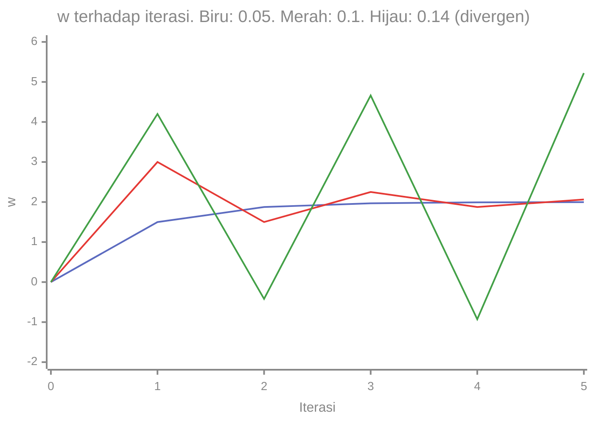

# Part 7 — Optimasi Deep Learning

## Tujuan Pembelajaran

Setelah mempelajari bagian ini, kamu mampu:

- membedakan **gradient descent penuh**, **SGD**, dan **mini-batch SGD**, serta istilah *epoch*, *iterasi*, dan ukuran *batch*;
- menghitung pembaruan parameter secara manual untuk **momentum**, **RMSProp**, dan **Adam**;
- menjelaskan pengaruh ***learning rate*** dan menurunkan syarat konvergensi pada kasus kuadrat;
- menghitung **jadwal learning rate** (*step decay*, *cosine*, *warmup*);
- menjelaskan secara intuitif bagaimana konvergensi dapat gagal atau lambat;
- menyatakan batas klaim: tidak ada optimizer yang selalu paling baik.

## Prasyarat

[Level 2 Part 11 — Optimasi dan Gradient Descent](../level-2-aljabar-linear-dan-kalkulus/11-optimasi-dan-gradient-descent.md) (pembaruan $\theta\leftarrow\theta-\eta\nabla L$), [Part 6 — Backpropagation Mendalam](06-backpropagation-mendalam.md) (cara memperoleh gradien), dan [Level 3 Part 9](../level-3-probabilitas-dan-statistika/09-distribusi-sampling-dan-clt.md) (rata-rata sampel sebagai perkiraan rata-rata populasi).

## Masalah yang Ingin Diselesaikan

*Backpropagation* memberi gradien; **optimizer** memutuskan bagaimana memakainya. Dua masalah praktis muncul:

1. **Data banyak.** Menghitung gradien seluruh data pada tiap langkah mahal. Bisakah kita memakai sebagian data saja?
2. **Permukaan loss rumit.** Pada satu arah loss sangat curam, pada arah lain hampir datar. Satu *learning rate* untuk semua arah sering terlalu besar di satu arah dan terlalu kecil di arah lain.

Optimizer modern menjawab keduanya: memakai *mini-batch* untuk perkiraan gradien yang murah, dan menyesuaikan langkah dengan sejarah gradien (momentum, penskalaan per parameter).

## Intuisi dan Istilah Penting

- **Batch penuh** (*full batch*): gradien dihitung dari seluruh $n$ contoh.
- **SGD** (*stochastic gradient descent*): gradien dari **satu** contoh per langkah.
- **Mini-batch SGD**: gradien dari sekelompok kecil contoh (misalnya 32 atau 64). Inilah yang umum disebut "SGD" di praktik.
- **Iterasi** (*step*): satu kali pembaruan parameter. **Epoch**: satu kali melewati seluruh data. Bila $n$ contoh dan ukuran *batch* $B$, satu epoch berisi $\lceil n/B\rceil$ iterasi.
- ***Learning rate*** $\eta$: ukuran langkah. **Hiperparameter**, dipilih manusia.
- **Momentum**: ingatan terhadap arah gerak sebelumnya, seperti bola menggelinding yang membawa kecepatan.
- **Penskalaan adaptif** (RMSProp, Adam): langkah tiap parameter dibagi dengan perkiraan besar gradiennya yang baru-baru ini, sehingga parameter dengan gradien besar tidak melompat terlalu jauh.

## Rumus dan Penjelasan Setiap Simbol

Pada semua rumus, $\theta$ adalah satu parameter (atau vektor parameter, dioperasikan elemen demi elemen), $g_t=\nabla L(\theta_t)$ adalah gradien pada iterasi $t$ (dari satu *mini-batch*), dan $\eta$ adalah *learning rate*.

### Gradient descent dan mini-batch

$$
\theta_{t+1}=\theta_t-\eta\,g_t,\qquad g_t=\frac{1}{B}\sum_{i\in\mathcal{B}_t}\nabla\ell^{(i)}(\theta_t)
$$

$\mathcal{B}_t$ adalah himpunan indeks contoh dalam *batch* iterasi $t$ dan $B$ ukurannya. Jika *mini-batch* dipilih acak, rata-rata gradien *mini-batch* sama dengan gradien seluruh data (**tak bias**), tetapi tiap perkiraan bersifat **berisik** (*noisy*).

### Konvergensi pada kasus kuadrat

Untuk $L(w)=\tfrac{\lambda}{2}(w-w^{\star})^2+\text{konstanta}$ (kelengkungan $\lambda=L''>0$), $g=\lambda(w-w^{\star})$ dan

$$
w_{t+1}-w^{\star}=(1-\eta\lambda)\,(w_t-w^{\star})
$$

Galat dikalikan faktor $r=1-\eta\lambda$ tiap langkah. Maka: konvergen jika $\lvert r\rvert<1$, yaitu $0<\eta<2/\lambda$; paling cepat bila $\eta=1/\lambda$ ($r=0$); bila $1<\eta\lambda<2$ galat berganti tanda (berosilasi) tetapi mengecil; bila $\eta\lambda>2$ galat membesar (**divergen**). Pada banyak dimensi, $\lambda$ terbesar membatasi $\eta$, sedangkan $\lambda$ terkecil menentukan lambatnya kemajuan di arah datar.

### Momentum

$$
\mathbf{v}_t=\beta\,\mathbf{v}_{t-1}+g_t,\qquad \theta_{t+1}=\theta_t-\eta\,\mathbf{v}_t
$$

$\mathbf{v}_t$ adalah "kecepatan" (dimulai dari $0$), $\beta\in[0,1)$ koefisien momentum (umumnya $0{,}9$). Gradien yang searah dari waktu ke waktu menumpuk (kecepatan membesar); gradien yang bolak-balik saling meniadakan. (Beberapa pustaka menulis dengan faktor $(1-\beta)$; hasil akhirnya sama dengan penyesuaian $\eta$.)

### RMSProp

$$
\mathbf{s}_t=\rho\,\mathbf{s}_{t-1}+(1-\rho)\,g_t^{\,2},\qquad \theta_{t+1}=\theta_t-\eta\,\frac{g_t}{\sqrt{\mathbf{s}_t}+\varepsilon}
$$

$\mathbf{s}_t$ adalah rata-rata bergerak kuadrat gradien (per parameter), $\rho$ koefisien peluruhan (umumnya $0{,}9$), $\varepsilon$ konstanta kecil (misalnya $10^{-8}$) agar tidak membagi nol. Pembagian oleh $\sqrt{\mathbf{s}_t}$ membuat langkah tiap parameter berukuran kira-kira $\eta$, **terlepas dari skala gradiennya**.

### Adam

$$
\mathbf{m}_t=\beta_1\mathbf{m}_{t-1}+(1-\beta_1)g_t,\qquad
\mathbf{s}_t=\beta_2\mathbf{s}_{t-1}+(1-\beta_2)g_t^{\,2}
$$

$$
\hat{\mathbf{m}}_t=\frac{\mathbf{m}_t}{1-\beta_1^{\,t}},\qquad
\hat{\mathbf{s}}_t=\frac{\mathbf{s}_t}{1-\beta_2^{\,t}},\qquad
\theta_{t+1}=\theta_t-\eta\,\frac{\hat{\mathbf{m}}_t}{\sqrt{\hat{\mathbf{s}}_t}+\varepsilon}
$$

$\mathbf{m}_t$ adalah rata-rata bergerak gradien (seperti momentum), $\mathbf{s}_t$ rata-rata bergerak kuadrat gradien (seperti RMSProp). Nilai umum $\beta_1=0{,}9$, $\beta_2=0{,}999$, $\varepsilon=10^{-8}$. Karena $\mathbf{m}_0=\mathbf{s}_0=0$, perkiraan awal terlalu kecil; pembagian $1-\beta^t$ (**koreksi bias**) memperbaikinya, dan efeknya menghilang saat $t$ besar.

### Jadwal *learning rate*

| Jadwal | Rumus | Catatan |
|---|---|---|
| *Step decay* | $\eta_t=\eta_0\,\gamma^{\lfloor t/k\rfloor}$ | dikalikan $\gamma$ (misalnya $0{,}5$) tiap $k$ langkah |
| *Cosine* | $\eta_t=\eta_{\min}+\tfrac12(\eta_0-\eta_{\min})\bigl(1+\cos\tfrac{\pi t}{T}\bigr)$ | turun mulus dari $\eta_0$ ke $\eta_{\min}$ dalam $T$ langkah |
| *Warmup* | $\eta_t=\eta_0\,\dfrac{t}{T_w}$ untuk $t\le T_w$ | naik linear di awal, lalu dilanjutkan jadwal lain |

*Warmup* lazim dipakai pada Transformer karena estimasi $\mathbf{s}_t$ di awal belum stabil.

## Contoh Numerik Langkah demi Langkah

Model sederhana $\hat y=wx$ dengan loss $L(w)=\tfrac1n\sum(wx^{(i)}-y^{(i)})^2$, data $x=(1,2,3,4)$ dan $y=(2,4,6,8)$ (jadi $w^{\star}=2$). Gradien: $\dfrac{dL}{dw}=\dfrac{2}{n}\sum x^{(i)}(wx^{(i)}-y^{(i)})$.

### Contoh 1 — Gradien penuh vs *mini-batch*

Di $w=0$:

- Gradien penuh ($n=4$): $\tfrac{2}{4}\bigl(1(-2)+2(-4)+3(-6)+4(-8)\bigr)=\tfrac12(-60)=-30$.
- *Mini-batch* $\{x=1,2\}$: $\tfrac22(-2-8)=-10$.
- *Mini-batch* $\{x=3,4\}$: $\tfrac22(-18-32)=-50$.

Rata-rata kedua *mini-batch*: $\tfrac{-10-50}{2}=-30$, sama dengan gradien penuh (tak bias), tetapi tiap *mini-batch* sendiri menyimpang jauh ($-10$ atau $-50$): itulah "berisik".

### Contoh 2 — Satu epoch mini-batch SGD

Ukuran *batch* $B=2$, $\eta=0{,}02$, mulai $w=0$. Satu epoch berisi $\lceil4/2\rceil=2$ iterasi.

- Iterasi 1 (*batch* $\{1,2\}$): $g=-10$, $w=0-0{,}02(-10)=0{,}2$.
- Iterasi 2 (*batch* $\{3,4\}$, di $w=0{,}2$): $g=\tfrac22\bigl(3(0{,}6-6)+4(0{,}8-8)\bigr)=-16{,}2-28{,}8=-45$, $w=0{,}2+0{,}02\cdot45=1{,}1$.

Setelah satu epoch $w=1{,}1$ (menuju $2$). Pada tiap langkah $w$ digeser berdasarkan *batch* yang sedang dilihat.

### Contoh 3 — Pengaruh *learning rate* dan syarat konvergensi

Kelengkungan: $L''(w)=\tfrac2n\sum x^2=\tfrac24\cdot30=15$. Maka konvergen bila $\eta<2/15=0{,}1333$. Faktor galat $r=1-15\eta$:

| $\eta$ | $r=1-15\eta$ | $w_0\ldots w_5$ (mulai $w=0$, galat awal $-2$) | Perilaku |
|---|---|---|---|
| $0{,}05$ | $0{,}25$ | $0;\ 1{,}5;\ 1{,}875;\ 1{,}9688;\ 1{,}9922;\ 1{,}998$ | konvergen mulus |
| $0{,}1$ | $-0{,}5$ | $0;\ 3;\ 1{,}5;\ 2{,}25;\ 1{,}875;\ 2{,}0625$ | konvergen sambil berosilasi |
| $0{,}14$ | $-1{,}1$ | $0;\ 4{,}2;\ -0{,}42;\ 4{,}662;\ -0{,}9282;\ 5{,}221$ | **divergen** |



Jejak $\eta=0{,}05$ cocok dengan rumus: galat awal $w_0-w^{\star}=-2$ dikali $0{,}25$ tiap langkah, jadi $w_1-2=-0{,}5\Rightarrow w_1=1{,}5$, lalu $w_2-2=-0{,}125\Rightarrow w_2=1{,}875$, dan seterusnya. Untuk $\eta=0{,}14$ galat dikali $-1{,}1$ tiap langkah: $-2\to2{,}2\to-2{,}42\to\cdots$, membesar dan berganti tanda.

### Contoh 4 — Momentum

$L(w)=w^2$ (gradien $2w$), mulai $w=1$, $\eta=0{,}1$, $\beta=0{,}9$, bandingkan dengan GD biasa.

| Langkah $t$ | GD: $w$ | Momentum: $g=2w$ | $v=0{,}9v+g$ | Momentum: $w$ |
|---|---|---|---|---|
| 0 | $1$ | — | $0$ | $1$ |
| 1 | $0{,}8$ | $2$ | $2$ | $1-0{,}1(2)=0{,}8$ |
| 2 | $0{,}64$ | $1{,}6$ | $0{,}9(2)+1{,}6=3{,}4$ | $0{,}8-0{,}34=0{,}46$ |
| 3 | $0{,}512$ | $0{,}92$ | $0{,}9(3{,}4)+0{,}92=3{,}98$ | $0{,}46-0{,}398=0{,}062$ |
| 4 | $0{,}4096$ | $0{,}124$ | $0{,}9(3{,}98)+0{,}124=3{,}706$ | $0{,}062-0{,}3706=-0{,}3086$ |

Momentum maju lebih cepat (sudah di $0{,}062$ pada langkah 3, GD baru $0{,}512$) tetapi **melampaui** minimum dan balik arah ($-0{,}3086$ pada langkah 4, lalu $-0{,}5804$ dan $-0{,}709$ pada langkah 5 dan 6; pada enam langkah ini ia belum kembali). Momentum tidak selalu lebih baik: ia mempercepat arah yang konsisten tetapi dapat berosilasi.

### Contoh 5 — RMSProp: skala gradien dinetralkan

Dua parameter dengan gradien $g=(10,\ 0{,}1)$ pada langkah pertama, $\rho=0{,}9$, $\eta=0{,}1$.

- GD biasa: langkah $\eta g=(1{,}0,\ 0{,}01)$. Parameter pertama melompat 100 kali lebih jauh.
- RMSProp: $\mathbf{s}_1=(1-\rho)g^2=0{,}1\cdot(100,\ 0{,}01)=(10,\ 0{,}001)$; $\sqrt{\mathbf{s}_1}=(3{,}1623,\ 0{,}031623)$; langkah $\eta g/\sqrt{\mathbf{s}_1}=(0{,}3162,\ 0{,}3162)$.

Kedua parameter kini bergerak sama jauh meski gradiennya berbeda 100 kali.

### Contoh 6 — Adam dan koreksi bias

Satu parameter, gradien berturut-turut $g=2,\ 1,\ 1$; $\eta=0{,}1$, $\beta_1=0{,}9$, $\beta_2=0{,}999$.

| $t$ | $g_t$ | $m_t$ | $s_t$ | $\hat m_t$ | $\hat s_t$ | langkah $\eta\hat m/\sqrt{\hat s}$ | $\theta_t$ |
|---|---|---|---|---|---|---|---|
| 1 | $2$ | $0{,}2$ | $0{,}004$ | $2$ | $4$ | $0{,}1$ | $-0{,}1$ |
| 2 | $1$ | $0{,}28$ | $0{,}004996$ | $1{,}4737$ | $2{,}49925$ | $0{,}09322$ | $-0{,}19322$ |
| 3 | $1$ | $0{,}352$ | $0{,}005991$ | $1{,}2989$ | $1{,}999$ | $0{,}09187$ | $-0{,}28509$ |

Perhitungan $t=1$: $m_1=0{,}9\cdot0+0{,}1\cdot2=0{,}2$; $s_1=0{,}999\cdot0+0{,}001\cdot4=0{,}004$; $\hat m_1=\dfrac{0{,}2}{1-0{,}9}=2$; $\hat s_1=\dfrac{0{,}004}{1-0{,}999}=4$; langkah $=0{,}1\cdot\dfrac{2}{\sqrt4}=0{,}1$.

Pada langkah pertama, besar langkah Adam selalu $\approx\eta$ (arah mengikuti tanda gradien). **Tanpa** koreksi bias, $m_1=0{,}2$ dan $s_1=0{,}004$ memberi langkah $0{,}1\cdot0{,}2/\sqrt{0{,}004}=0{,}316$, tiga kali lebih besar dari seharusnya, karena $s$ jauh lebih terpotong daripada $m$. Itulah gunanya koreksi bias.

### Contoh 7 — Jadwal *learning rate*

$\eta_0=0{,}1$:

| $t$ | *Step decay* ($\gamma=0{,}5$, $k=5$) | *Cosine* ($T=10$, $\eta_{\min}=0$) | *Warmup* ($T_w=4$) |
|---|---|---|---|
| 0 | $0{,}1$ | $0{,}1$ | $0$ |
| 2 | $0{,}1$ | $0{,}0905$ | $0{,}05$ |
| 4 | $0{,}1$ | — | $0{,}1$ |
| 5 | $0{,}05$ | $0{,}05$ | — |
| 8 | $0{,}05$ | $0{,}0095$ | — |
| 10 | $0{,}025$ | $0$ | — |
| 15 | $0{,}0125$ | — | — |

Contoh *cosine*: $t=2$: $0{,}5\cdot0{,}1\bigl(1+\cos\tfrac{2\pi}{10}\bigr)=0{,}05(1+0{,}8090)=0{,}0905$. *Warmup*: $t=2$: $0{,}1\cdot\tfrac24=0{,}05$.

## Interpretasi, Asumsi, dan Keterbatasan

- Analisis kuadrat hanya model lokal: di sekitar minimum permukaan loss sering mirip mangkuk kuadrat, tetapi jaringan nyata **tidak konveks** (banyak minimum lokal, pelana, dan dataran). Tidak ada jaminan menemukan minimum global.
- Konvergensi pada contoh adalah hasil model tiruan satu parameter; jaringan nyata memiliki banyak arah dengan kelengkungan berbeda.
- Gradien *mini-batch* berisik. *Batch* kecil: pembaruan murah tetapi acak. *Batch* besar: lebih stabil tetapi tiap langkah lebih mahal.
- **Tidak ada optimizer yang selalu unggul.** Adam sering bekerja baik tanpa banyak penyetelan, tetapi pada beberapa masalah SGD dengan momentum menghasilkan generalisasi yang lebih baik. Pilihan dan $\eta$ perlu diuji pada validasi.
- Nilai default ($\beta_1=0{,}9$, $\beta_2=0{,}999$, $\varepsilon=10^{-8}$) adalah kebiasaan umum, bukan hukum.
- Adam dengan *weight decay* ditangani berbeda daripada L2 biasa (disebut AdamW); pembahasan regularisasi ada di [Part 8](08-regularisasi-dan-generalisasi.md).

## Hubungan dengan Deep Learning dan NLP

Model bahasa umumnya dilatih dengan Adam atau variannya, *warmup* di awal, lalu peluruhan (misalnya *cosine* atau linear). Fine-tuning BERT/IndoBERT memakai *learning rate* kecil (orde $10^{-5}$) agar parameter pralatih tidak rusak ([Part 14](14-fondasi-matematis-bert-dan-indobert.md)). Pada data teks yang besar, *mini-batch* wajib karena seluruh korpus tak muat dalam satu perhitungan.

## Python

Pustaka standar saja.

```python
import math

xs, ys = [1, 2, 3, 4], [2, 4, 6, 8]          # model: y_topi = w * x  (w yang benar = 2)

def grad(w, idx):
    """Gradien MSE terhadap w pada contoh dengan indeks idx."""
    return 2 / len(idx) * sum(xs[i] * (w * xs[i] - ys[i]) for i in idx)

# gradien penuh vs dua mini-batch
print(grad(0, [0, 1, 2, 3]), grad(0, [0, 1]), grad(0, [2, 3]))

# satu epoch mini-batch (ukuran 2), eta = 0.02
w = 0.0
for idx in ([0, 1], [2, 3]):
    g = grad(w, idx)
    w -= 0.02 * g
    print(idx, g, round(w, 4))

# pengaruh learning rate pada gradient descent penuh
lam = 2 / 4 * sum(v * v for v in xs)          # kelengkungan L''(w) = 15
print(lam, 2 / lam)
for eta in (0.05, 0.1, 0.14):
    w, jejak = 0.0, []
    for t in range(6):
        jejak.append(round(w, 4))
        w -= eta * grad(w, [0, 1, 2, 3])
    print(eta, round(1 - eta * lam, 2), jejak)

# momentum vs gradient descent biasa pada L(w) = w^2 (gradien 2w)
for nama in ("gd", "momentum"):
    w, v, jejak = 1.0, 0.0, [1.0]
    for t in range(6):
        g = 2 * w
        if nama == "gd":
            w -= 0.1 * g
        else:
            v = 0.9 * v + g
            w -= 0.1 * v
        jejak.append(round(w, 4))
    print(nama, jejak)

# RMSProp langkah pertama untuk dua gradien berbeda skala
g, rho, eta = [10.0, 0.1], 0.9, 0.1
s = [(1 - rho) * v * v for v in g]
print([round(eta * v / (math.sqrt(q) + 1e-8), 4) for v, q in zip(g, s)], [round(eta * v, 4) for v in g])

# Adam, satu parameter, gradien 2, 1, 1
b1, b2, eta = 0.9, 0.999, 0.1
m = s = 0.0
th = 0.0
for t, g in enumerate([2, 1, 1], 1):
    m = b1 * m + (1 - b1) * g
    s = b2 * s + (1 - b2) * g * g
    mh, sh = m / (1 - b1 ** t), s / (1 - b2 ** t)
    langkah = eta * mh / (math.sqrt(sh) + 1e-8)
    th -= langkah
    print(t, round(m, 5), round(s, 6), round(mh, 4), round(sh, 5), round(langkah, 5), round(th, 5))

# jadwal learning rate
print([round(0.1 * 0.5 ** (t // 5), 4) for t in (0, 5, 10, 15)])
print([round(0.5 * 0.1 * (1 + math.cos(math.pi * t / 10)), 4) for t in (0, 2, 5, 8, 10)])
print([round(0.1 * t / 4, 4) for t in range(6)])
```

Keluaran:

```text
-30.0 -10.0 -50.0
[0, 1] -10.0 0.2
[2, 3] -45.0 1.1
15.0 0.13333333333333333
0.05 0.25 [0.0, 1.5, 1.875, 1.9688, 1.9922, 1.998]
0.1 -0.5 [0.0, 3.0, 1.5, 2.25, 1.875, 2.0625]
0.14 -1.1 [0.0, 4.2, -0.42, 4.662, -0.9282, 5.221]
gd [1.0, 0.8, 0.64, 0.512, 0.4096, 0.3277, 0.2621]
momentum [1.0, 0.8, 0.46, 0.062, -0.3086, -0.5804, -0.709]
[0.3162, 0.3162] [1.0, 0.01]
1 0.2 0.004 2.0 4.0 0.1 -0.1
2 0.28 0.004996 1.4737 2.49925 0.09322 -0.19322
3 0.352 0.005991 1.2989 1.999 0.09187 -0.28509
[0.1, 0.05, 0.025, 0.0125]
[0.1, 0.0905, 0.05, 0.0095, 0.0]
[0.0, 0.025, 0.05, 0.075, 0.1, 0.125]
```

Semua angka sama dengan Contoh 1 sampai 7. Pada contoh momentum, iterasi ke-5 dan ke-6 menunjukkan osilasi (nilai $w$ negatif) yang disebut di Contoh 4.

## Kesalahan Umum

1. **Menyamakan epoch dengan iterasi.** Satu epoch berisi $\lceil n/B\rceil$ iterasi.
2. **Menganggap $\eta$ besar selalu lebih cepat.** Di atas $2/\lambda$, pelatihan divergen (Contoh 3).
3. **Menganggap momentum atau Adam selalu lebih baik.** Keduanya punya hiperparameter sendiri dan dapat berosilasi atau generalisasi lebih buruk.
4. **Melupakan koreksi bias pada Adam**, sehingga langkah awal terlalu besar atau kecil.
5. **Mencampur $\mathbf{s}$ (kuadrat gradien) dengan $\mathbf{v}$ (kecepatan)** dan $\mathbf{m}$ (rata-rata gradien).
6. **Tidak mengacak urutan data tiap epoch**, sehingga *mini-batch* berurutan dan bias.
7. **Memakai $\eta$ yang sama untuk semua tahap pelatihan** padahal jadwal sering membantu.
8. **Mengambil kesimpulan dari satu seed.** Hasil optimasi bergantung pada inisialisasi dan urutan data.

## Latihan Mandiri

1. Untuk data contoh di bagian ini, hitung gradien penuh dan gradien kedua *mini-batch* ($\{1,2\}$ dan $\{3,4\}$) di $w=1$. Apakah rata-rata gradien *mini-batch* sama dengan gradien penuh?
2. Satu dataset berisi $n=1000$ contoh. Berapa iterasi per epoch untuk $B=50$? Berapa total pembaruan untuk 10 epoch? Berapa iterasi per epoch untuk $B=64$?
3. $L(w)=(w-3)^2$, gradien $2(w-3)$, $\eta=0{,}25$, $w_0=0$. Hitung tiga iterasi dan faktor $r=1-\eta\lambda$.
4. Pada soal 3, hitung dua iterasi bila $\eta=1$ dan $\eta=1{,}2$. Apa yang terjadi?
5. Momentum pada $L(w)=w^2$, $w_0=1$, $\eta=0{,}1$, $\beta=0{,}5$. Hitung dua iterasi.
6. RMSProp langkah pertama ($\rho=0{,}9$, $\eta=0{,}1$) untuk $g=4$ dan untuk $g=0{,}04$. Bandingkan.
7. Adam langkah pertama dengan $\eta=0{,}01$ dan $g=5$. Hitung besar langkah dengan dan tanpa koreksi bias ($\beta_1=0{,}9$, $\beta_2=0{,}999$).
8. Hitung jadwal *cosine* ($\eta_0=0{,}1$, $\eta_{\min}=0$, $T=10$) pada $t=0$, $5$, $10$, dan jadwal *step decay* ($\gamma=0{,}5$, $k=5$) pada $t=0$, $5$, $10$.
9. Dataset $x=(1,2,3)$ dengan model $\hat y=wx$ dan MSE. Hitung kelengkungan $\lambda=\tfrac2n\sum x^2$ dan batas $\eta$ agar konvergen. Apakah $\eta=0{,}1$, $0{,}2$, dan $0{,}25$ konvergen?
10. Jelaskan dengan angka dari Contoh 1 mengapa gradien *mini-batch* "tak bias namun berisik". Apa konsekuensinya bagi pilihan ukuran *batch*?

## Kunci Jawaban dan Pembahasan

??? success "Soal 1"
    Di $w=1$, residual $wx-y=-x$. Penuh: $\tfrac24\sum x(-x)=-\tfrac12\cdot30=-15$. $\{1,2\}$: $\tfrac22(-1-4)=-5$. $\{3,4\}$: $\tfrac22(-9-16)=-25$. Rata-rata $\tfrac{-5-25}{2}=-15$. Sama dengan gradien penuh karena kedua *batch* berukuran sama dan membagi seluruh data.

??? success "Soal 2"
    $B=50$: $1000/50=20$ iterasi per epoch; 10 epoch $=200$ pembaruan. $B=64$: $\lceil1000/64\rceil=\lceil15{,}625\rceil=16$ iterasi (15 *batch* penuh dan satu *batch* berisi 40 contoh).

??? success "Soal 3"
    $\lambda=L''=2$, $r=1-0{,}25\cdot2=0{,}5$. $w_1=0-0{,}25\cdot2(0-3)=1{,}5$; $w_2=1{,}5-0{,}25\cdot2(1{,}5-3)=2{,}25$; $w_3=2{,}25-0{,}25\cdot2(2{,}25-3)=2{,}625$. Galat: $3,\ 1{,}5,\ 0{,}75,\ 0{,}375$ (dikali $0{,}5$ tiap langkah).

??? success "Soal 4"
    $\eta=1$: $r=1-2=-1$. $w_1=0-1\cdot2(-3)=6$; $w_2=6-2(6-3)=0$. Berayun $0\to6\to0\to6\ldots$ tidak konvergen dan tidak divergen. $\eta=1{,}2$: $r=1-2{,}4=-1{,}4$. $w_1=0+1{,}2\cdot6=7{,}2$; $w_2=7{,}2-1{,}2\cdot2(7{,}2-3)=7{,}2-10{,}08=-2{,}88$. Galat membesar ($3\to4{,}2\to5{,}88$): divergen. Batasnya $\eta<2/\lambda=1$.

??? success "Soal 5"
    $t=1$: $g=2$, $v=0{,}5\cdot0+2=2$, $w=1-0{,}1\cdot2=0{,}8$. $t=2$: $g=1{,}6$, $v=0{,}5\cdot2+1{,}6=2{,}6$, $w=0{,}8-0{,}26=0{,}54$.

??? success "Soal 6"
    $g=4$: $s=0{,}1\cdot16=1{,}6$, $\sqrt s=1{,}2649$, langkah $0{,}1\cdot4/1{,}2649=0{,}3162$. $g=0{,}04$: $s=0{,}1\cdot0{,}0016=0{,}00016$, $\sqrt s=0{,}012649$, langkah $0{,}1\cdot0{,}04/0{,}012649=0{,}3162$. Sama: langkah pertama tidak bergantung pada skala gradien.

??? success "Soal 7"
    Dengan koreksi: $m_1=0{,}5$, $s_1=0{,}001\cdot25=0{,}025$; $\hat m=5$, $\hat s=25$; langkah $0{,}01\cdot5/5=0{,}01$. Tanpa koreksi: $0{,}01\cdot0{,}5/\sqrt{0{,}025}=0{,}01\cdot0{,}5/0{,}1581=0{,}0316$, sekitar tiga kali lebih besar.

??? success "Soal 8"
    *Cosine*: $t=0$: $0{,}1$; $t=5$: $0{,}05(1+\cos\tfrac\pi2)=0{,}05$; $t=10$: $0{,}05(1+\cos\pi)=0$. *Step decay*: $t=0$: $0{,}1$; $t=5$: $0{,}05$; $t=10$: $0{,}025$.

??? success "Soal 9"
    $\lambda=\tfrac23(1+4+9)=\tfrac{28}{3}\approx9{,}333$; batas $\eta<2/\lambda=0{,}2143$. Faktor $r=1-\eta\lambda$: $\eta=0{,}1\to r=0{,}0667$ (konvergen cepat); $\eta=0{,}2\to r=-0{,}8667$ (konvergen, berosilasi); $\eta=0{,}25\to r=-1{,}3333$ (divergen).

??? success "Soal 10"
    Rata-rata gradien *mini-batch* ($-10$ dan $-50$) adalah $-30$, sama dengan gradien penuh: tak bias. Tetapi masing-masing menyimpang sampai $20$ dari nilai benar: berisik. *Batch* lebih besar membuat rata-rata lebih dekat ke gradien penuh (derau lebih kecil) dengan biaya per langkah lebih mahal; *batch* kecil murah tetapi acak. Derau juga dapat membantu keluar dari minimum lokal yang dangkal, tetapi memperlambat konvergensi halus di dekat minimum (sering diatasi dengan menurunkan $\eta$).

## Ringkasan Materi

- **Mini-batch SGD**: $\theta\leftarrow\theta-\eta g$, $g$ dari rata-rata gradien sejumlah contoh; tak bias namun berisik. Satu epoch $=\lceil n/B\rceil$ iterasi.
- Pada kasus kuadrat, galat dikalikan $1-\eta\lambda$; konvergen untuk $0<\eta<2/\lambda$, divergen di atasnya.
- **Momentum** mengakumulasi arah (bisa melampaui target); **RMSProp** membagi langkah dengan $\sqrt{\mathbf{s}}$ sehingga skala gradien dinetralkan; **Adam** menggabungkan keduanya dengan koreksi bias.
- **Jadwal** *learning rate* (*step*, *cosine*, *warmup*) menyesuaikan $\eta$ sepanjang pelatihan.
- Jaringan nyata tidak konveks; tidak ada optimizer yang selalu paling baik.

## Checklist Penguasaan

- [ ] Menjelaskan *batch penuh*, SGD, mini-batch, epoch, dan iterasi.
- [ ] Menghitung pembaruan SGD, momentum, RMSProp, dan Adam secara manual.
- [ ] Menurunkan dan memakai syarat konvergensi $\eta<2/\lambda$ pada kasus kuadrat.
- [ ] Menjelaskan koreksi bias pada Adam dengan angka.
- [ ] Menghitung jadwal *step decay*, *cosine*, dan *warmup*.
- [ ] Menyatakan keterbatasan: non-konveks dan tidak ada optimizer terbaik mutlak.

## Prasyarat untuk Materi Berikutnya

[Part 8 — Regularisasi dan Generalisasi](08-regularisasi-dan-generalisasi.md) membahas mengapa loss latih yang kecil belum cukup dan bagaimana penalti, *dropout*, dan *early stopping* mengendalikan *overfitting*. Pastikan kamu paham pembaruan parameter dan peran $\eta$, karena penalti L2 akan muncul sebagai tambahan pada pembaruan ini.
