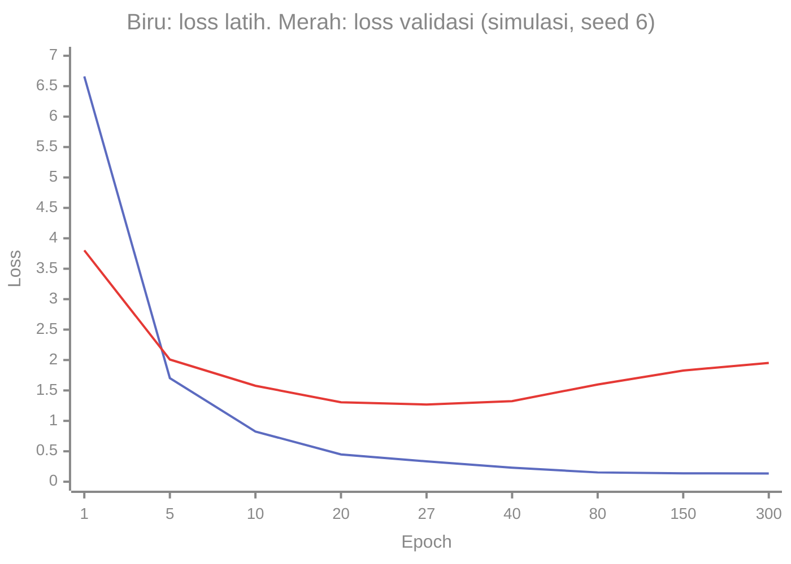

# Part 8 — Regularisasi dan Generalisasi

## Tujuan Pembelajaran

Setelah mempelajari bagian ini, kamu mampu:

- membedakan ***underfitting***, ***overfitting***, dan **generalisasi** dari kurva loss latih dan validasi;
- menjelaskan **celah generalisasi** (*generalization gap*) dan mengapa loss latih rendah belum cukup;
- menuliskan penalti **L2** dan **L1**, dan menunjukkan bahwa penalti L2 setara dengan ***weight decay*** pada pembaruan;
- menghitung efek penalti L2 vs L1 pada satu bobot langkah demi langkah;
- menghitung **dropout** (versi *inverted*) beserta nilai harapan dan variansnya, dan menjelaskan bedanya saat pelatihan dan *inference*;
- menerapkan ***early stopping*** dengan *patience*;
- menghitung **bias dan varians** pada contoh penyusutan, dan menjelaskan trade-off-nya;
- menyatakan bahwa teknik regularisasi tidak sama satu dengan lainnya.

## Prasyarat

[Level 4 Part 1 — Pengantar Matematika ML](../level-4-matematika-ml-klasik/01-pengantar-matematika-ml.md) (data latih, validasi, uji), [Level 4 Part 12 — Regularisasi dan Reduksi Dimensi](../level-4-matematika-ml-klasik/12-regularisasi-dan-reduksi-dimensi.md) (Ridge, Lasso, bias-varians), dan [Part 7 — Optimasi Deep Learning](07-optimasi-deep-learning.md) (pembaruan parameter dan *learning rate*).

## Masalah yang Ingin Diselesaikan

Jaringan saraf punya banyak parameter, sering lebih banyak daripada jumlah contoh latih. Model sebesar itu dapat "menghafal" data latih termasuk derau, sehingga loss latih sangat kecil tetapi loss pada data baru besar. Tujuan sebenarnya adalah **generalisasi**: bekerja baik pada data yang belum pernah dilihat. **Regularisasi** adalah sekumpulan cara untuk menurunkan celah antara performa latih dan performa data baru, biasanya dengan membatasi kebebasan model.

## Intuisi dan Istilah Penting

- ***Underfitting***: model terlalu sederhana atau belum cukup dilatih; loss latih **dan** loss validasi sama-sama tinggi.
- ***Overfitting***: loss latih rendah tetapi loss validasi jauh lebih tinggi; model menghafal derau.
- **Celah generalisasi** (*generalization gap*): $\text{loss validasi}-\text{loss latih}$.
- **Regularisasi**: teknik apa pun yang mengurangi *overfitting* tanpa (terlalu banyak) menambah *underfitting*.
- **Bias** dan **varians**: galat sistematis dan sensitivitas terhadap data latih tertentu. Model yang terlalu sederhana berbias; model terlalu fleksibel berfluktuasi (varians tinggi).

Teknik di bagian ini bekerja dengan cara yang **berbeda**, jadi jangan disamakan:

| Teknik | Cara kerja | Yang dibatasi |
|---|---|---|
| Penalti L2 / *weight decay* | menarik bobot ke nol | besar bobot |
| Penalti L1 | menarik bobot ke nol dengan dorongan tetap | besar dan jumlah bobot aktif |
| *Dropout* | menonaktifkan unit secara acak saat pelatihan | ketergantungan antar-unit |
| *Early stopping* | berhenti sebelum loss validasi naik | lama pelatihan |
| Lebih banyak data / augmentasi | menambah variasi contoh | (di luar cakupan bagian ini) |

## Rumus dan Penjelasan Setiap Simbol

### Penalti L2 dan L1

Fungsi tujuan dengan penalti (konvensi sama dengan [Level 4 Part 12](../level-4-matematika-ml-klasik/12-regularisasi-dan-reduksi-dimensi.md)):

$$
J(\theta)=L_{\text{data}}(\theta)+\alpha\,\lVert\theta\rVert_2^2\quad(\text{L2}),\qquad
J(\theta)=L_{\text{data}}(\theta)+\alpha\,\lVert\theta\rVert_1\quad(\text{L1})
$$

$L_{\text{data}}$ adalah loss pada data (rata-rata), $\theta$ vektor bobot, $\alpha\ge0$ kekuatan regularisasi (hiperparameter), $\lVert\theta\rVert_2^2=\sum_j\theta_j^2$ dan $\lVert\theta\rVert_1=\sum_j\lvert\theta_j\rvert$. Bias biasanya tidak dikenai penalti.

Gradien penalti: $\nabla(\alpha\lVert\theta\rVert_2^2)=2\alpha\theta$ (sebanding dengan bobot) dan $\nabla(\alpha\lVert\theta\rVert_1)=\alpha\operatorname{sign}(\theta)$ (dorongan konstan, subgradien). Dengan *gradient descent* dan gradien data $g$:

$$
\theta\leftarrow\theta-\eta\,(g+2\alpha\theta)=\underbrace{(1-2\alpha\eta)}_{\text{peluruhan}}\theta-\eta\,g\qquad(\text{L2})
$$

Bentuk kanan menunjukkan mengapa L2 disebut ***weight decay***: tiap langkah bobot dikalikan faktor $(1-2\alpha\eta)<1$ sebelum ditambah koreksi gradien. Pustaka sering menyebut koefisien $2\alpha$ ini sebagai `weight_decay`, jadi nilai angkanya bergantung konvensi. Untuk optimizer adaptif seperti Adam, penalti L2 dan *weight decay* yang dipisahkan (AdamW) memberi hasil berbeda; ini penyempurnaan yang tidak dibahas di sini.

### Dropout (versi *inverted*)

Untuk vektor aktivasi $\mathbf{a}$ dan peluang **mempertahankan** unit $p$ (jadi peluang membuang $1-p$), saat pelatihan:

$$
\tilde a_i=\frac{m_i\,a_i}{p},\qquad m_i\sim\text{Bernoulli}(p)\ \text{(saling bebas)}
$$

$m_i\in\{0,1\}$ adalah topeng acak baru di tiap iterasi. Pembagian oleh $p$ menjaga nilai harapan: $\mathbb{E}[\tilde a_i]=\dfrac{p\,a_i}{p}=a_i$. Variansnya $\operatorname{Var}(\tilde a_i)=a_i^2\dfrac{1-p}{p}$, makin besar bila makin banyak unit dibuang. Saat **inference**, dropout dimatikan (semua unit dipakai, tanpa topeng dan tanpa pembagian lagi). Pada *backpropagation*, gradien hanya mengalir lewat unit yang dipertahankan dan dikali $1/p$ yang sama: $d a_i=d\tilde a_i\,m_i/p$.

### *Early stopping*

Pantau loss validasi tiap epoch. Simpan bobot saat loss validasi terendah. Berhenti bila loss validasi tidak membaik selama ***patience*** epoch berturut-turut, lalu kembalikan bobot terbaik. Panjang pelatihan menjadi hiperparameter yang dipilih lewat data validasi.

### Dekomposisi bias-varians

Untuk estimator $\hat\theta$ dari parameter $\theta$:

$$
\mathbb{E}\bigl[(\hat\theta-\theta)^2\bigr]=\underbrace{\bigl(\mathbb{E}[\hat\theta]-\theta\bigr)^2}_{\text{bias}^2}+\underbrace{\operatorname{Var}(\hat\theta)}_{\text{varians}}
$$

Pada prediksi, galat kuadrat harapan juga memuat **derau tak tereduksi** $\sigma^2$ yang tidak dapat dikurangi oleh model apa pun.

## Contoh Numerik Langkah demi Langkah

### Contoh 1 — Kurva latih dan validasi (simulasi)

Data simulasi: $y=2x_1-x_2+\text{derau}\ \mathcal{N}(0,1)$ dengan 6 fitur ($x_3,\dots,x_6$ tidak berpengaruh), hanya **8 contoh latih** dan 200 contoh validasi, model linear $\hat y=\mathbf{w}\cdot\mathbf{x}$ dilatih dengan *gradient descent* ($\eta=0{,}05$, bobot awal $0$). Derau $\sigma^2=1$ membuat loss validasi tidak mungkin jauh di bawah $\approx1$. Hasil satu eksperimen (seed 6):

| Epoch | Loss latih | Loss validasi |
|---|---|---|
| 1 | $6{,}661$ | $3{,}802$ |
| 5 | $1{,}703$ | $2{,}008$ |
| 10 | $0{,}825$ | $1{,}577$ |
| 20 | $0{,}449$ | $1{,}306$ |
| **27** | $0{,}334$ | **$1{,}269$** |
| 40 | $0{,}230$ | $1{,}325$ |
| 80 | $0{,}153$ | $1{,}598$ |
| 150 | $0{,}138$ | $1{,}827$ |
| 300 | $0{,}136$ | $1{,}952$ |

Loss latih turun terus, tetapi loss validasi turun sampai epoch 27 ($1{,}269$) lalu **naik** sampai $1{,}952$: celah generalisasi (validasi dikurangi latih) membesar dari $0{,}935$ pada epoch 27 menjadi $1{,}816$ pada epoch 300. Model makin menyesuaikan diri dengan derau 8 contoh. Ini satu eksperimen; pada seed lain titik terendahnya berbeda, tetapi bentuk "turun lalu naik" umum pada data kecil dengan banyak fitur.



### Contoh 2 — *Early stopping*

Pada data Contoh 1, loss validasi terbaik $1{,}269$ pada epoch 27. Dengan *patience* $20$, pelatihan berhenti di epoch $47$ (karena $47-27=20$ epoch tanpa perbaikan) dan bobot epoch 27 dipulihkan. Pelatihan 300 epoch tanpa berhenti berakhir di $1{,}952$, jadi *early stopping* menghemat komputasi dan menghindari kenaikan loss validasi. Catatan: memilih epoch terbaik memakai data validasi, jadi nilai $1{,}269$ cenderung optimistis; performa jujur perlu diukur pada data uji yang terpisah.

### Contoh 3 — L2 mengurangi *overfitting*

Dengan data yang sama dan 300 epoch, hanya mengubah kekuatan penalti L2 $\alpha$:

| $\alpha$ | Loss latih | Loss validasi |
|---|---|---|
| $0$ | $0{,}136$ | $1{,}952$ |
| $0{,}05$ | $0{,}165$ | $1{,}505$ |
| $0{,}2$ | $0{,}376$ | $1{,}208$ |
| $0{,}5$ | $0{,}876$ | $1{,}365$ |

Menaikkan $\alpha$ menaikkan loss latih (model lebih dibatasi) tetapi menurunkan loss validasi, sampai titik tertentu ($\alpha=0{,}2$). Pada $\alpha=0{,}5$ model mulai *underfitting*: loss latih tinggi dan loss validasi naik lagi. Ini trade-off bias-varians. Rata-rata atas 20 seed berbeda (tiap seed 8 contoh latih dan 200 validasi): loss validasi akhir tanpa penalti $3{,}420$, dengan $\alpha=0{,}2$ turun menjadi $2{,}380$, dan jika memilih epoch terbaik tiap seed memakai data validasi (optimistis) $1{,}941$. Perbedaannya besar karena hanya 8 contoh latih; angka ini milik simulasi ini saja.

### Contoh 4 — L2 vs L1 pada satu bobot

Isolasi penalti saja (anggap gradien data $0$): $w=1$, $\eta=0{,}1$, $\alpha=0{,}5$.

- L2: $w\leftarrow w-\eta\cdot2\alpha w=0{,}9\,w$ (faktor $1-2\alpha\eta=0{,}9$).
- L1: $w\leftarrow w-\eta\alpha\operatorname{sign}(w)=w-0{,}05$.

| Langkah | L2 | L1 |
|---|---|---|
| 0 | $1$ | $1$ |
| 1 | $0{,}9$ | $0{,}95$ |
| 2 | $0{,}81$ | $0{,}9$ |
| 3 | $0{,}729$ | $0{,}85$ |
| 4 | $0{,}6561$ | $0{,}8$ |

L2 menyusutkan sebanding dengan nilai bobot sehingga makin pelan saat bobot kecil dan **tidak pernah tepat nol**. L1 menyusutkan dengan dorongan tetap, dan bobot yang gradien datanya kecil dapat mencapai nol sungguhan dalam 20 langkah (bobot dengan gradien data besar tetap bertahan). Itu sebabnya L1 menghasilkan bobot yang jarang (*sparse*). Dalam praktik L1 jarang dipakai langsung pada jaringan besar dibanding L2; ini pilihan empiris.

### Contoh 5 — *Weight decay* dua penulisan

$\theta=2$, gradien data $g=0{,}5$, $\eta=0{,}1$, $\alpha=0{,}25$ (jadi $2\alpha=0{,}5$).

- Langsung: $\theta-\eta(g+2\alpha\theta)=2-0{,}1(0{,}5+0{,}5\cdot2)=2-0{,}15=1{,}85$.
- Bentuk peluruhan: $(1-2\alpha\eta)\theta-\eta g=(1-0{,}05)\cdot2-0{,}05=1{,}9-0{,}05=1{,}85$.

Keduanya sama.

### Contoh 6 — Dropout

Aktivasi $\mathbf{a}=(2,4,6,8)$, peluang mempertahankan $p=0{,}5$, topeng $m=(1,0,1,0)$:

$$
\tilde{\mathbf{a}}=\frac{(2\cdot1,\ 4\cdot0,\ 6\cdot1,\ 8\cdot0)}{0{,}5}=(4,\ 0,\ 12,\ 0)
$$

Unit yang dipertahankan dilipatduakan agar jumlah total harapannya tetap. **Nilai harapan:** mengambil rata-rata berbobot atas semua $2^4=16$ topeng yang mungkin memberi $(2,4,6,8)$ lagi, jadi dropout tidak mengubah rata-rata. **Varians untuk satu unit** $a=4$: dengan $p=0{,}5$ keluarannya $8$ (peluang $0{,}5$) atau $0$ (peluang $0{,}5$): rata-rata $4$, varians $0{,}5\cdot64-16=16$. Dengan $p=0{,}8$: $5$ (peluang $0{,}8$) atau $0$: rata-rata $4$, varians $0{,}8\cdot25-16=4$. Membuang lebih banyak unit ($p$ kecil) menambah derau.

### Contoh 7 — Bias dan varians pada penyusutan

Rata-rata sampel $\bar x$ dari $n=4$ pengamatan dengan $\mu=1$ dan simpangan baku $\sigma=2$: $\mathbb{E}[\bar x]=1$ dan $\operatorname{Var}(\bar x)=\sigma^2/n=1$, jadi galat kuadrat harapan $\bar x$ adalah $1$. Sekarang susutkan menjadi $c\,\bar x$:

$$
\text{bias}^2=\bigl((c-1)\mu\bigr)^2,\qquad \text{varians}=c^2\,\frac{\sigma^2}{n},\qquad \text{MSE}=\text{bias}^2+\text{varians}
$$

| $c$ | bias$^2$ | varians | MSE |
|---|---|---|---|
| $1$ | $0$ | $1$ | $1{,}000$ |
| $0{,}8$ | $0{,}04$ | $0{,}64$ | $0{,}680$ |
| $0{,}5$ | $0{,}25$ | $0{,}25$ | $0{,}500$ |
| $0{,}25$ | $0{,}5625$ | $0{,}0625$ | $0{,}625$ |
| $0$ | $1$ | $0$ | $1{,}000$ |

Sedikit bias (menyusutkan) menurunkan varians lebih banyak daripada menaikkan bias$^2$, sehingga MSE terbaik ($0{,}5$ pada $c=\mu^2/(\mu^2+\sigma^2/n)=0{,}5$) lebih kecil daripada tanpa penyusutan. Tetapi **terlalu** banyak ($c=0$) memburuk lagi. Ini intuisi di balik L2: mengurangi varians dengan harga sedikit bias. Perhatikan bahwa $c$ optimal bergantung pada $\mu$ yang tidak diketahui; dalam praktik kekuatan regularisasi dipilih lewat validasi. Simulasi 200.000 pengulangan untuk $c=0{,}5$ memberi MSE $0{,}498$, cocok dengan hitungan.

## Interpretasi, Asumsi, dan Keterbatasan

- Eksperimen di Contoh 1–3 memakai model **linear** pada data simulasi kecil agar dapat dilacak; pada jaringan dalam bentuk kurvanya serupa tetapi detailnya berbeda.
- Angka bergantung pada seed dan banyak data latih (8). Dengan data yang jauh lebih banyak, celah akan jauh lebih kecil.
- Memilih epoch atau $\alpha$ dengan data validasi membuat validasi sedikit "bocor" ke pemilihan model; ukur performa akhir pada data uji terpisah.
- Dropout, L2, dan *early stopping* **tidak sama** dan bisa dipakai bersamaan; bekerja dengan mekanisme berbeda dan tidak ada yang selalu terbaik.
- Jaringan modern besar kadang menunjukkan perilaku generalisasi yang tidak sepenuhnya dijelaskan oleh gambaran klasik bias-varians; bagian ini hanya memberi intuisi dasar.
- Dropout bergantung pada $p$ dan lapisan tempatnya; nilai umum ($p$ sekitar $0{,}8$ sampai $0{,}9$ untuk mempertahankan) bukan aturan tetap.

## Hubungan dengan Deep Learning dan NLP

Transformer dan BERT memakai dropout pada beberapa titik (misalnya setelah attention dan feed-forward, [Part 13](13-transformer.md)) dan *weight decay* pada pembaruan parameter. Pada *fine-tuning* dengan sedikit data berlabel, *overfitting* adalah risiko utama, sehingga *early stopping* berdasarkan metrik validasi umum dilakukan ([Part 14](14-fondasi-matematis-bert-dan-indobert.md)). Pada klasifikasi Emergency vs Non-Emergency (contoh/simulasi) dengan sedikit pesan latih, kurva latih dan validasi seperti Contoh 1 adalah alat diagnosis pertama.

## Python

Blok pertama mengulang Contoh 1–3 (pustaka standar, data simulasi dengan seed tetap).

```python
import random

def data(rng, n, d=6):
    """y = 2*x1 - x2 + derau N(0,1); fitur lain tidak berpengaruh. Data simulasi."""
    X = [[rng.gauss(0, 1) for _ in range(d)] for _ in range(n)]
    y = [2 * x[0] - x[1] + rng.gauss(0, 1) for x in X]
    return X, y

def mse(w, X, y):
    return sum((sum(a * b for a, b in zip(w, x)) - t) ** 2 for x, t in zip(X, y)) / len(y)

def grad(w, X, y, alpha=0.0):
    n, g = len(y), [0.0] * len(w)
    for x, t in zip(X, y):
        e = sum(a * b for a, b in zip(w, x)) - t
        for j in range(len(w)):
            g[j] += 2 * e * x[j] / n
    return [gj + 2 * alpha * wj for gj, wj in zip(g, w)]      # suku 2*alpha*w = weight decay

def latih(Xt, yt, Xv, yv, alpha=0.0, eta=0.05, epoch=300, sabar=None):
    w, jejak, terbaik, e_terbaik = [0.0] * 6, [], 1e9, 0
    for e in range(1, epoch + 1):
        w = [a - eta * b for a, b in zip(w, grad(w, Xt, yt, alpha))]
        tl, vl = mse(w, Xt, yt), mse(w, Xv, yv)
        jejak.append((e, tl, vl))
        if vl < terbaik:
            terbaik, e_terbaik = vl, e
        if sabar and e - e_terbaik >= sabar:                   # early stopping
            break
    return jejak, e_terbaik, terbaik

rng = random.Random(6)
Xt, yt = data(rng, 8)          # 8 contoh latih
Xv, yv = data(rng, 200)        # 200 contoh validasi
jejak, e_best, v_best = latih(Xt, yt, Xv, yv)
for e, tl, vl in jejak:
    if e in (1, 5, 10, 20, 27, 40, 80, 150, 300):
        print(e, round(tl, 3), round(vl, 3))
print("terbaik:", e_best, round(v_best, 3))

jejak, e_best, v_best = latih(Xt, yt, Xv, yv, sabar=20)
print("early stopping berhenti di epoch", jejak[-1][0], "terbaik di", e_best, round(v_best, 3))

for alpha in (0.0, 0.05, 0.2, 0.5):
    jejak, _, _ = latih(Xt, yt, Xv, yv, alpha=alpha)
    print(alpha, round(jejak[-1][1], 3), round(jejak[-1][2], 3))

# 20 seed berbeda: rata-rata galat validasi
rata = {"terbaik": 0.0, "akhir": 0.0, "L2": 0.0}
for seed in range(1, 21):
    r = random.Random(seed)
    A, b = data(r, 8)
    C, d = data(r, 200)
    jej, _, tb = latih(A, b, C, d)
    jl2, _, _ = latih(A, b, C, d, alpha=0.2)
    rata["terbaik"] += tb / 20
    rata["akhir"] += jej[-1][2] / 20
    rata["L2"] += jl2[-1][2] / 20
print({k: round(v, 3) for k, v in rata.items()})
```

Keluaran:

```text
1 6.661 3.802
5 1.703 2.008
10 0.825 1.577
20 0.449 1.306
27 0.334 1.269
40 0.23 1.325
80 0.153 1.598
150 0.138 1.827
300 0.136 1.952
terbaik: 27 1.269
early stopping berhenti di epoch 47 terbaik di 27 1.269
0.0 0.136 1.952
0.05 0.165 1.505
0.2 0.376 1.208
0.5 0.876 1.365
{'terbaik': 1.941, 'akhir': 3.42, 'L2': 2.38}
```

Blok kedua mengulang Contoh 4–7.

```python
from itertools import product

# 1) penalti saja: L2 (meluruh proporsional) vs L1 (turun konstan), w = 1, eta = 0.1, alpha = 0.5
w2 = w1 = 1.0
for t in range(5):
    print(t, round(w2, 4), round(w1, 4))
    w2 -= 0.1 * (2 * 0.5 * w2)                 # gradien penalti L2 = 2*alpha*w
    w1 -= 0.1 * 0.5 * (1 if w1 > 0 else -1 if w1 < 0 else 0)   # subgradien L1 = alpha*sign(w)

# 2) weight decay: dua cara penulisan sama
theta, g, eta, alpha = 2.0, 0.5, 0.1, 0.25
print(round(theta - eta * (g + 2 * alpha * theta), 4), round((1 - 2 * alpha * eta) * theta - eta * g, 4))

# 3) dropout terbalik: a * m / p. Rata-rata atas semua topeng = a
a, p = [2.0, 4.0, 6.0, 8.0], 0.5
print([ai * m / p for ai, m in zip(a, (1, 0, 1, 0))])
rata = [0.0] * 4
for topeng in product((0, 1), repeat=4):
    peluang = 1.0
    for m in topeng:
        peluang *= p if m else 1 - p
    for i in range(4):
        rata[i] += peluang * a[i] * topeng[i] / p
print(rata)
for p in (0.5, 0.8):                            # satu unit a = 4: rata-rata dan varians
    mean = p * (4 / p)
    var = p * (4 / p) ** 2 - mean ** 2
    print(p, mean, round(var, 4))

# 4) bias-varians penyusutan x_bar -> c * x_bar, mu = 1, sigma = 2, n = 4
mu, sigma, n = 1.0, 2.0, 4
for c in (1.0, 0.8, 0.5, 0.25, 0.0):
    bias2 = ((c - 1) * mu) ** 2
    var = c ** 2 * sigma ** 2 / n
    print(c, round(bias2, 4), round(var, 4), round(bias2 + var, 4))
print(mu ** 2 / (mu ** 2 + sigma ** 2 / n))
```

Keluaran:

```text
0 1.0 1.0
1 0.9 0.95
2 0.81 0.9
3 0.729 0.85
4 0.6561 0.8
1.85 1.85
[4.0, 0.0, 12.0, 0.0]
[2.0, 4.0, 6.0, 8.0]
0.5 4.0 16.0
0.8 4.0 4.0
1.0 0.0 1.0 1.0
0.8 0.04 0.64 0.68
0.5 0.25 0.25 0.5
0.25 0.5625 0.0625 0.625
0.0 1.0 0.0 1.0
0.5
```

## Kesalahan Umum

1. **Menilai model dari loss latih saja.** Selalu bandingkan dengan loss validasi.
2. **Menyamakan semua regularisasi.** Dropout, L2, dan *early stopping* bekerja berbeda (tabel di atas).
3. **Lupa mematikan dropout saat *inference*** atau lupa pembagian $1/p$ (versi *inverted*), sehingga skala keluaran berubah.
4. **Memilih $\alpha$ atau epoch dengan data uji**, bukan data validasi.
5. **Menghukum bias** $b$ seperti bobot, atau lupa standardisasi fitur sebelum penalti ([Level 4 Part 12](../level-4-matematika-ml-klasik/12-regularisasi-dan-reduksi-dimensi.md)).
6. **Mengira regularisasi selalu menurunkan loss validasi.** $\alpha$ terlalu besar menyebabkan *underfitting* (Contoh 3).
7. **Menyalin nilai `weight_decay` antar-pustaka** tanpa memeriksa konvensi ($\alpha$ vs $2\alpha$).
8. **Menyimpulkan dari satu seed.** Angka kurva berubah antar-seed.

## Latihan Mandiri

1. Diagnosis: (a) loss latih $0{,}2$ dan validasi $1{,}5$; (b) loss latih $1{,}8$ dan validasi $1{,}9$. Apa kemungkinan masalahnya dan tindakan awalnya?
2. Pembaruan dengan penalti L2: $\theta=3$, gradien data $g=1$, $\eta=0{,}1$, $\alpha=0{,}5$. Hitung dengan dua cara (langsung dan bentuk peluruhan).
3. Hanya penalti L2: $w=2$, $\alpha=0{,}25$, $\eta=0{,}2$. Hitung tiga langkah.
4. Hanya penalti L1: $w=0{,}3$, $\alpha=0{,}5$, $\eta=0{,}1$. Hitung sampai $w$ mencapai $0$, dengan konvensi $\operatorname{sign}(0)=0$.
5. Dropout versi *inverted*: $\mathbf{a}=(1,2,3,4)$. Hitung $\tilde{\mathbf{a}}$ untuk (a) $p=0{,}5$ dan topeng $(0,1,1,0)$; (b) $p=0{,}8$ dan topeng $(1,1,0,1)$.
6. Satu unit $a=5$, $p=0{,}8$. Hitung nilai harapan dan varians keluaran dropout.
7. *Early stopping* dengan *patience* 3: loss validasi per epoch 1 sampai 8 adalah $3{,}0,\ 2{,}0,\ 1{,}5,\ 1{,}4,\ 1{,}45,\ 1{,}5,\ 1{,}6,\ 1{,}7$. Kapan pelatihan berhenti dan bobot epoch berapa yang dipakai?
8. Penyusutan $c\bar x$ dengan $\mu=2$, $\sigma=3$, $n=9$. Hitung MSE untuk $c=1$, $c=0{,}5$, dan $c^*=\mu^2/(\mu^2+\sigma^2/n)$.
9. Jodohkan pernyataan dengan teknik (L1, L2, dropout, *early stopping*): (a) bobot yang tidak penting menjadi tepat nol; (b) tiap langkah bobot dikalikan faktor kurang dari 1; (c) unit dinonaktifkan acak saat pelatihan; (d) berhenti saat loss validasi naik.
10. Dropout $p=0{,}5$ dengan topeng $(1,0,1,0)$ dan gradien hulu $d\tilde{\mathbf{a}}=(1,1,1,1)$. Hitung $d\mathbf{a}$.

## Kunci Jawaban dan Pembahasan

??? success "Soal 1"
    (a) Loss latih jauh di bawah validasi: *overfitting* (celah $1{,}3$). Tindakan: regularisasi, data lebih banyak, model lebih kecil, atau *early stopping*. (b) Keduanya tinggi dan dekat: *underfitting*. Tindakan: model lebih fleksibel, latih lebih lama, atau kurangi regularisasi.

??? success "Soal 2"
    Langsung: $3-0{,}1(1+2\cdot0{,}5\cdot3)=3-0{,}1\cdot4=2{,}6$. Peluruhan: $(1-2\cdot0{,}5\cdot0{,}1)\cdot3-0{,}1\cdot1=0{,}9\cdot3-0{,}1=2{,}6$. Sama.

??? success "Soal 3"
    Faktor $1-2\alpha\eta=1-0{,}1=0{,}9$. $w$: $2\to1{,}8\to1{,}62\to1{,}458$.

??? success "Soal 4"
    Langkah tetap $\eta\alpha=0{,}05$: $0{,}3\to0{,}25\to0{,}20\to0{,}15\to0{,}10\to0{,}05\to0$. Enam langkah; setelah itu $\operatorname{sign}(0)=0$ sehingga bobot tetap $0$. (Tanpa konvensi itu bobot akan berosilasi di sekitar nol.)

??? success "Soal 5"
    (a) $\dfrac{(0,2,3,0)}{0{,}5}=(0,\ 4,\ 6,\ 0)$. (b) $\dfrac{(1,2,0,4)}{0{,}8}=(1{,}25,\ 2{,}5,\ 0,\ 5)$.

??? success "Soal 6"
    Keluaran $\dfrac{5}{0{,}8}=6{,}25$ dengan peluang $0{,}8$, atau $0$ dengan peluang $0{,}2$. Harapan: $0{,}8\cdot6{,}25=5$. Varians: $0{,}8\cdot6{,}25^2-5^2=31{,}25-25=6{,}25$ (juga $a^2\dfrac{1-p}{p}=25\cdot0{,}25=6{,}25$).

??? success "Soal 7"
    Terbaik $1{,}4$ pada epoch 4. Epoch 5, 6, 7 tidak membaik ($1{,}45,\ 1{,}5,\ 1{,}6>1{,}4$), jadi setelah 3 epoch tanpa perbaikan pelatihan berhenti di **epoch 7**. Bobot yang dipakai: bobot epoch 4.

??? success "Soal 8"
    $\operatorname{Var}(\bar x)=9/9=1$. $c=1$: MSE $=1$. $c=0{,}5$: bias$^2=(0{,}5\cdot2)^2=1$, varians $=0{,}25\cdot1=0{,}25$, MSE $=1{,}25$ (lebih buruk dari tanpa penyusutan). $c^*=\dfrac{4}{4+1}=0{,}8$: bias$^2=(0{,}2\cdot2)^2=0{,}16$, varians $=0{,}64$, MSE $=0{,}80$ (lebih baik). Penyusutan yang salah ukuran bisa merugikan.

??? success "Soal 9"
    (a) L1. (b) L2 (*weight decay*). (c) dropout. (d) *early stopping*.

??? success "Soal 10"
    $d\mathbf{a}=d\tilde{\mathbf{a}}\odot\mathbf{m}/p=(1,1,1,1)\odot(1,0,1,0)/0{,}5=(2,\ 0,\ 2,\ 0)$. Unit yang dibuang tidak menerima gradien.

## Ringkasan Materi

- *Underfitting*: latih dan validasi sama-sama tinggi; *overfitting*: latih rendah, validasi jauh lebih tinggi (celah generalisasi besar).
- **L2** menambah $\alpha\lVert\theta\rVert_2^2$: setara *weight decay* $\theta\leftarrow(1-2\alpha\eta)\theta-\eta g$. **L1** menambah $\alpha\lVert\theta\rVert_1$: dorongan konstan ke nol, menghasilkan bobot jarang.
- **Dropout** (inverted): $\tilde a=ma/p$, nilai harapan tetap $a$, varians $a^2(1-p)/p$; mati saat *inference*.
- ***Early stopping***: berhenti saat loss validasi tidak membaik selama *patience* epoch, pulihkan bobot terbaik.
- **Bias-varians**: sedikit penyusutan menurunkan galat total, terlalu banyak merugikan; kekuatan regularisasi dipilih lewat validasi.
- Teknik-teknik ini bekerja berbeda dan tidak ada yang selalu terbaik.

## Checklist Penguasaan

- [ ] Mendiagnosis *underfitting* dan *overfitting* dari loss latih dan validasi.
- [ ] Menuliskan penalti L1 dan L2 beserta gradiennya.
- [ ] Menunjukkan bahwa L2 setara *weight decay* dengan perhitungan.
- [ ] Menghitung dropout versi *inverted* dan menjelaskan bedanya saat pelatihan dan *inference*.
- [ ] Menerapkan *early stopping* dengan *patience*.
- [ ] Menghitung bias, varians, dan MSE pada contoh penyusutan.
- [ ] Menjelaskan bahwa teknik regularisasi bekerja dengan cara berbeda.

## Prasyarat untuk Materi Berikutnya

[Part 9 — Embedding dan Representasi Vektor](09-embedding-dan-representasi-vektor.md) memulai bagian bahasa: bagaimana token diubah menjadi vektor yang dapat dipelajari oleh jaringan. Pastikan kamu nyaman dengan perkalian matriks, kemiripan vektor (dot product dan cosine), dan gradien terhadap parameter.
