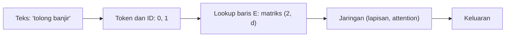

# Part 9 — Embedding dan Representasi Vektor

## Tujuan Pembelajaran

Setelah mempelajari bagian ini, kamu mampu:

- menjelaskan **embedding** sebagai pemetaan token ke vektor yang **dipelajari**, dan mengapa ia bukan sekadar kode ID;
- menghitung *lookup* embedding sebagai baris matriks dan sebagai perkalian **one-hot** dengan matriks embedding;
- menentukan shape matriks embedding, jumlah parameternya, dan memori yang dibutuhkan;
- menghitung **dot product**, **cosine similarity**, dan **jarak Euclid** antarvektor dan menjelaskan kapan masing-masing cocok;
- menjelaskan bagaimana embedding diperbarui oleh gradien (hanya baris yang dipakai);
- menjelaskan gagasan dasar pembelajaran representasi kata (*skip-gram*) dengan perhitungan mini;
- menyebut keterbatasan embedding statis dan rata-rata vektor sebagai representasi kalimat.

## Prasyarat

[Level 2 Part 2 — Vektor](../level-2-aljabar-linear-dan-kalkulus/02-vektor.md) (dot product, norma, cosine), [Part 2 — Tensor dan Operasi Multidimensi](02-tensor-dan-operasi-multidimensi.md) (shape dan perkalian matriks), [Level 4 Part 2](../level-4-matematika-ml-klasik/02-representasi-data-dan-feature-engineering.md) (one-hot, BoW, TF-IDF, dan cosine antar-dokumen), dan [Part 6](06-backpropagation-mendalam.md) (gradien terhadap parameter).

## Masalah yang Ingin Diselesaikan

Jaringan hanya mengerti angka. Kata harus diubah menjadi angka dengan cara yang menyimpan **makna**. Ada tiga pilihan, dan dua yang pertama bermasalah:

1. **Kode ID** (misalnya "banjir" $=1$, "hujan" $=2$): angkanya acak. Memberi $1<2$ atau $|1-2|<|1-4|$ tidak berarti apa-apa tentang makna, tetapi jaringan bisa tertipu menganggapnya bermakna.
2. **One-hot**: setiap kata adalah vektor panjang $V$ (ukuran kosakata) berisi satu angka 1. Tidak ada angka palsu, tetapi **semua kata saling tegak lurus**: "banjir" dan "hujan" sama jauhnya dengan "banjir" dan "makan". Vektor sangat panjang dan hampir semuanya nol.
3. **Embedding**: setiap kata dipetakan ke vektor pendek $d$ dimensi ($d\ll V$) yang **dipelajari** bersama jaringan, sehingga kata yang dipakai dalam konteks serupa mendapat vektor yang berdekatan.

## Intuisi dan Istilah Penting

- **Token**: potongan teks yang menjadi satuan masukan (kata atau potongan kata; dibahas di [Part 10](10-matematika-pemrosesan-bahasa.md)). **Kosakata** (*vocabulary*) berukuran $V$: himpunan token yang dikenal.
- **ID token**: nomor urut token pada kosakata. Hanya penanda.
- **Matriks embedding** $E\in\mathbb{R}^{V\times d}$: baris ke-$i$ adalah vektor token dengan ID $i$. $d$ adalah **dimensi embedding**.
- **Embedding** (*embedding*): vektor baris itu. Nilainya parameter yang dipelajari lewat *backpropagation*, bukan ditentukan manual.
- **Ruang embedding**: ruang $\mathbb{R}^d$ tempat vektor-vektor itu hidup. Kedekatan di ruang itu diharapkan mencerminkan kemiripan penggunaan kata.



## Rumus dan Penjelasan Setiap Simbol

### *Lookup* sama dengan perkalian one-hot

Untuk token dengan ID $i$ (mulai dari 0), one-hot-nya $\mathbf{e}_i\in\{0,1\}^V$ berisi 1 pada posisi $i$. Vektor embedding:

$$
\mathbf{x}=\mathbf{e}_i^\top E=E_{i,:}\in\mathbb{R}^d
$$

Perkalian $(1,V)(V,d)\to(1,d)$ memilih baris ke-$i$. Untuk kalimat dengan $T$ token (ID $i_1,\dots,i_T$), tumpuk barisnya: $X=E[\,i_1,\dots,i_T\,]\in\mathbb{R}^{T\times d}$, dan untuk batch $B$ kalimat menjadi tensor $(B,T,d)$ ([Part 2](02-tensor-dan-operasi-multidimensi.md)). Dalam praktik *lookup* dikerjakan dengan mengambil baris (jauh lebih cepat daripada perkalian matriks besar yang hampir seluruhnya nol).

### Parameter dan memori

$$
\#\text{parameter}=V\times d,\qquad \text{memori (float32)}\approx 4\,V\,d\ \text{byte}
$$

Satu bilangan *float32* memakai 4 byte. Contoh hipotetis (bukan spesifikasi model tertentu): $V=30{,}000$, $d=768$ menghasilkan $23{,}040{,}000$ parameter ($\approx92{,}2$ MB).

### Kemiripan dan jarak antarvektor

Untuk dua vektor $\mathbf{u},\mathbf{v}\in\mathbb{R}^d$:

$$
\mathbf{u}\cdot\mathbf{v}=\sum_{k=1}^{d}u_kv_k,\qquad
\cos(\mathbf{u},\mathbf{v})=\frac{\mathbf{u}\cdot\mathbf{v}}{\lVert\mathbf{u}\rVert_2\,\lVert\mathbf{v}\rVert_2},\qquad
d(\mathbf{u},\mathbf{v})=\lVert\mathbf{u}-\mathbf{v}\rVert_2
$$

- **Dot product** besar jika arah searah **dan** panjang vektor besar.
- **Cosine** hanya melihat arah (rentang $[-1,1]$); tidak berubah jika vektor diperpanjang.
- **Jarak Euclid** melihat posisi absolut; berubah jika vektor diperpanjang.

### Gradien embedding

Misalkan $\partial L/\partial X\in\mathbb{R}^{T\times d}$ adalah gradien hulu pada embedding kalimat (dari [Part 6](06-backpropagation-mendalam.md)). Maka gradien terhadap $E$ adalah nol untuk baris yang tidak dipakai, dan untuk baris token ke-$i$:

$$
\frac{\partial L}{\partial E_{i,:}}=\sum_{t:\ i_t=i}\frac{\partial L}{\partial X_{t,:}}
$$

Jika satu token muncul beberapa kali, gradiennya dijumlahkan (jalur ganda). Pembaruan: $E_{i,:}\leftarrow E_{i,:}-\eta\,\partial L/\partial E_{i,:}$. Karena itu hanya embedding kata yang muncul di *batch* saat ini yang berubah.

### Gagasan *skip-gram*

Hipotesis distribusional: kata yang muncul di konteks serupa punya makna serupa. Pada *skip-gram* untuk kata pusat $c$ dan kata konteks $o$, tiap kata punya vektor pusat $\mathbf{v}_c$ dan vektor konteks $\mathbf{u}_w$:

$$
P(o\mid c)=\frac{\exp(\mathbf{u}_o\cdot\mathbf{v}_c)}{\sum_{w=1}^{V}\exp(\mathbf{u}_w\cdot\mathbf{v}_c)},\qquad
\ell=-\ln P(o\mid c),\qquad
\frac{\partial\ell}{\partial\mathbf{v}_c}=\sum_{w}P(w\mid c)\,\mathbf{u}_w-\mathbf{u}_o
$$

Ini softmax atas dot product ([Part 4](04-fungsi-aktivasi.md) dan [5](05-loss-function.md)): skor tiap kandidat adalah dot product dengan vektor pusat, loss adalah cross-entropy, dan gradiennya mengikuti pola "prediksi dikurangi target". Meminimalkan loss mendekatkan $\mathbf{v}_c$ ke $\mathbf{u}_o$ untuk pasangan yang benar-benar muncul bersama.

## Contoh Numerik Langkah demi Langkah

Kosakata mini $V=5$ dan dimensi $d=3$. **Vektor di bawah adalah angka contoh yang dipilih agar kata terkait berdekatan; bukan hasil pelatihan.**

| ID | Token | Vektor (baris $E$) |
|---|---|---|
| 0 | tolong | $(0{,}5,\ 0{,}5,\ 0{,}5)$ |
| 1 | banjir | $(0{,}9,\ 0{,}8,\ 0{,}1)$ |
| 2 | hujan | $(0{,}8,\ 0{,}7,\ 0{,}2)$ |
| 3 | makan | $(0{,}1,\ 0{,}2,\ 0{,}9)$ |
| 4 | siang | $(0{,}2,\ 0{,}1,\ 0{,}8)$ |

### Contoh 1 — *Lookup* dan kalimat

"banjir" memiliki ID $1$. One-hot-nya $\mathbf{e}_1=(0,1,0,0,0)$ dan

$$
\mathbf{e}_1^\top E=0\cdot E_0+1\cdot E_1+0\cdot E_2+0\cdot E_3+0\cdot E_4=(0{,}9,\ 0{,}8,\ 0{,}1)
$$

Kalimat contoh "tolong banjir hujan" memiliki ID $(0,1,2)$, sehingga

$$
X=\begin{bmatrix}0{,}5&0{,}5&0{,}5\\0{,}9&0{,}8&0{,}1\\0{,}8&0{,}7&0{,}2\end{bmatrix},\quad\text{shape }(3,3)
$$

Rata-rata ketiga baris (satu cara sederhana merangkum kalimat): $\bigl(\tfrac{0{,}5+0{,}9+0{,}8}{3},\ \tfrac{0{,}5+0{,}8+0{,}7}{3},\ \tfrac{0{,}5+0{,}1+0{,}2}{3}\bigr)=(0{,}7333,\ 0{,}6667,\ 0{,}2667)$.

### Contoh 2 — Parameter dan memori

Matriks $E$ pada kosakata mini: $5\times3=15$ parameter. Untuk $V=30{,}000$ dan $d=768$: $30{,}000\times768=23{,}040{,}000$ parameter, atau $4\times23{,}040{,}000=92{,}160{,}000$ byte $\approx92{,}2$ MB dalam *float32*. Selama pelatihan, memori yang dibutuhkan beberapa kali lipat karena gradien dan keadaan *optimizer* (Adam menyimpan $\mathbf{m}$ dan $\mathbf{s}$ untuk tiap parameter, [Part 7](07-optimasi-deep-learning.md)) juga disimpan.

### Contoh 3 — Kemiripan dan jarak

| Pasangan | Dot product | Cosine | Jarak Euclid |
|---|---|---|---|
| banjir, hujan | $0{,}72+0{,}56+0{,}02=1{,}30$ | $0{,}9947$ | $0{,}1732$ |
| makan, siang | $0{,}02+0{,}02+0{,}72=0{,}76$ | $0{,}9866$ | $0{,}1732$ |
| banjir, makan | $0{,}09+0{,}16+0{,}09=0{,}34$ | $0{,}3034$ | $1{,}2806$ |
| tolong, banjir | $0{,}45+0{,}40+0{,}05=0{,}90$ | $0{,}8601$ | $0{,}6403$ |

Contoh perhitungan cosine banjir–hujan: $\lVert\text{banjir}\rVert=\sqrt{0{,}81+0{,}64+0{,}01}=1{,}2083$, $\lVert\text{hujan}\rVert=\sqrt{0{,}64+0{,}49+0{,}04}=1{,}0817$, $\cos=\dfrac{1{,}30}{1{,}2083\times1{,}0817}=0{,}9947$. Pasangan terkait ("banjir, hujan" dan "makan, siang") sangat mirip; pasangan tak terkait ("banjir, makan") jauh. Pada **one-hot**, cosine setiap pasangan kata berbeda adalah $0$.

**Mengapa cosine sering lebih disukai daripada dot product.** Jika vektor "hujan" diperpanjang 3 kali, dot product banjir–hujan menjadi $3{,}90$ (tiga kali), padahal kata yang dibicarakan sama; cosine tetap $0{,}9947$. Dot product bercampur antara arah dan panjang vektor.

### Contoh 4 — Mengapa ID bukan embedding

ID: banjir $=1$, hujan $=2$, siang $=4$. Jarak ID: $|1-2|=1$, $|1-4|=3$, seolah "banjir lebih dekat ke hujan daripada siang". Tetapi kosakata bisa diurutkan ulang: jika siang diberi ID $2$ dan hujan ID $4$, kesimpulannya terbalik. Kedekatan ID tergantung urutan penomoran yang sembarang, sedangkan kedekatan vektor embedding (Contoh 3) berasal dari penggunaan kata.

### Contoh 5 — Gradien hanya pada baris yang dipakai

Kalimat "tolong banjir" (ID $0,1$) dengan gradien hulu

$$
\frac{\partial L}{\partial X}=\begin{bmatrix}0{,}1&-0{,}2&0{,}3\\-0{,}4&0{,}5&0{,}6\end{bmatrix}
$$

Gradien terhadap $E$: baris 0 $=(0{,}1,-0{,}2,0{,}3)$, baris 1 $=(-0{,}4,0{,}5,0{,}6)$, baris 2, 3, 4 $=(0,0,0)$. Dengan $\eta=0{,}1$ embedding "banjir" menjadi

$$
(0{,}9,\ 0{,}8,\ 0{,}1)-0{,}1\,(-0{,}4,\ 0{,}5,\ 0{,}6)=(0{,}94,\ 0{,}75,\ 0{,}04)
$$

Embedding "hujan", "makan", dan "siang" tidak berubah pada langkah ini. Jika kalimatnya "hujan hujan" dengan gradien baris $(0{,}1,0,0)$ dan $(0{,}2,0{,}1,0)$, gradien baris "hujan" adalah jumlahnya $(0{,}3,0{,}1,0)$ dan embedding menjadi $(0{,}8-0{,}03,\ 0{,}7-0{,}01,\ 0{,}2)=(0{,}77,\ 0{,}69,\ 0{,}2)$.

### Contoh 6 — Satu langkah *skip-gram* (dimensi 2)

Kata pusat dengan $\mathbf{v}_c=(0{,}8,\ 0{,}2)$. Tiga kandidat konteks dengan vektor konteks $\mathbf{u}_{\text{banjir}}=(1,0)$, $\mathbf{u}_{\text{hujan}}=(0{,}5,0{,}5)$, $\mathbf{u}_{\text{makan}}=(0,1)$; kata konteks yang benar adalah "banjir". (Angka contoh, bukan hasil pelatihan.)

1. Skor (dot product): banjir $0{,}8$, hujan $0{,}5$, makan $0{,}2$.
2. Softmax: $e^{0{,}8}=2{,}2255$, $e^{0{,}5}=1{,}6487$, $e^{0{,}2}=1{,}2214$, jumlah $5{,}0956$; peluang $(0{,}4368,\ 0{,}3236,\ 0{,}2397)$.
3. Loss: $\ell=-\ln0{,}4368=0{,}8284$.
4. Gradien: $\partial\ell/\partial\mathbf{v}_c=0{,}4368(1,0)+0{,}3236(0{,}5,0{,}5)+0{,}2397(0,1)-(1,0)=(-0{,}4015,\ 0{,}4015)$.
5. Pembaruan dengan $\eta=0{,}5$: $\mathbf{v}_c\leftarrow(0{,}8,0{,}2)-0{,}5(-0{,}4015,0{,}4015)=(1{,}0007,\ -0{,}0007)$.
6. Periksa: skor baru banjir $1{,}0007$, hujan $0{,}5000$, makan $-0{,}0007$ dan peluang banjir naik dari $0{,}4368$ menjadi $0{,}5067$; loss turun dari $0{,}8284$ menjadi $0{,}6798$.

Vektor pusat bergerak ke arah vektor konteks yang benar. Dengan jutaan pasangan kata-konteks, vektor kata yang sering berbagi konteks saling mendekat.

## Interpretasi, Asumsi, dan Keterbatasan

- Vektor di atas **dipilih tangan**. Embedding sungguhan dipelajari; angka dan dimensinya tidak dapat ditafsirkan satu per satu (sumbu 1 tidak berarti "banjir").
- Gambar atau perhitungan dua/tiga dimensi hanya ilustrasi: pada $d=768$ geometri berperilaku berbeda dan kedekatan lebih sulit dibayangkan.
- Embedding menyerap pola penggunaan di data latih, termasuk **bias** (stereotip) dan kesalahan di data itu. Kemiripan tinggi bukan jaminan hubungan makna.
- **Embedding statis** (satu vektor per token) tidak membedakan arti kata menurut konteks (misalnya "bisa" sebagai kemampuan atau racun); ini diatasi **embedding kontekstual** ([Part 10](10-matematika-pemrosesan-bahasa.md) dan [Part 14](14-fondasi-matematis-bert-dan-indobert.md)).
- Rata-rata vektor kata sebagai representasi kalimat **membuang urutan kata**: "anjing menggigit manusia" dan "manusia menggigit anjing" memiliki rata-rata yang sama (soal 9).
- Pilihan $d$ adalah hiperparameter: $d$ kecil kurang ekspresif, $d$ besar menambah parameter dan risiko *overfitting* ([Part 8](08-regularisasi-dan-generalisasi.md)).
- Token yang tidak ada di kosakata tidak punya baris di $E$; penanganan token baru dibahas pada tokenisasi ([Part 10](10-matematika-pemrosesan-bahasa.md)).

## Hubungan dengan Deep Learning dan NLP

Lapisan pertama hampir semua model bahasa adalah lapisan embedding $E$, diikuti informasi posisi ([Part 13](13-transformer.md)). Pada BERT, vektor token ditambah vektor posisi dan segmen sebelum masuk ke encoder ([Part 14](14-fondasi-matematis-bert-dan-indobert.md)). Kemiripan cosine antarvektor dipakai untuk pencarian dokumen dan pengelompokan; pada [Level 4 Part 2](../level-4-matematika-ml-klasik/02-representasi-data-dan-feature-engineering.md) cosine dipakai pada vektor TF-IDF, sekarang pada vektor yang dipelajari. Bagian ini juga dasar *attention*: skor query–key di [Part 12](12-attention-dan-self-attention.md) adalah dot product antarvektor seperti di atas.

## Python

Pustaka standar saja.

```python
import math

kata = ["tolong", "banjir", "hujan", "makan", "siang"]
E = [[0.5, 0.5, 0.5],      # tolong
     [0.9, 0.8, 0.1],      # banjir
     [0.8, 0.7, 0.2],      # hujan
     [0.1, 0.2, 0.9],      # makan
     [0.2, 0.1, 0.8]]      # siang

def dot(a, b):
    return sum(x * y for x, y in zip(a, b))

def norm(a):
    return math.sqrt(dot(a, a))

def cos(a, b):
    return dot(a, b) / (norm(a) * norm(b))

def jarak(a, b):
    return norm([x - y for x, y in zip(a, b)])

# lookup = perkalian one-hot dengan E
def onehot(i, V=5):
    return [1 if j == i else 0 for j in range(V)]

def matvec(v, M):
    return [sum(v[i] * M[i][j] for i in range(len(M))) for j in range(len(M[0]))]

print(matvec(onehot(1), E), E[1])
kalimat = [0, 1, 2]                                  # "tolong banjir hujan" sebagai ID
X = [E[i] for i in kalimat]                          # shape (3, 3)
print(X)
print([round(sum(X[i][j] for i in range(3)) / 3, 4) for j in range(3)])   # rata-rata

# kemiripan
for a, b in [(1, 2), (1, 3), (3, 4), (0, 1)]:
    print(kata[a], kata[b], round(dot(E[a], E[b]), 4), round(cos(E[a], E[b]), 4), round(jarak(E[a], E[b]), 4))

# gradien embedding hanya pada baris yang dipakai
dX = [[0.1, -0.2, 0.3], [-0.4, 0.5, 0.6]]            # gradien hulu untuk "tolong banjir"
ids = [0, 1]
dE = [[0.0] * 3 for _ in range(5)]
for baris, i in enumerate(ids):
    for j in range(3):
        dE[i][j] += dX[baris][j]
eta = 0.1
print([[round(v, 2) for v in r] for r in dE])
print([round(E[1][j] - eta * dE[1][j], 2) for j in range(3)])

# skip-gram mini: pusat 'hujan', konteks benar 'banjir', d = 2
v = [0.8, 0.2]
U = {"banjir": [1.0, 0.0], "hujan": [0.5, 0.5], "makan": [0.0, 1.0]}
def softmax(zs):
    e = [math.exp(z) for z in zs]
    s = sum(e)
    return [x / s for x in e]
skor = [dot(u, v) for u in U.values()]
p = softmax(skor)
loss = -math.log(p[0])
g = [sum(p[k] * list(U.values())[k][j] for k in range(3)) - U["banjir"][j] for j in range(2)]
print([round(s, 2) for s in skor], [round(q, 4) for q in p], round(loss, 4))
print([round(x, 4) for x in g])
v2 = [a - 0.5 * b for a, b in zip(v, g)]
p2 = softmax([dot(u, v2) for u in U.values()])
print([round(x, 4) for x in v2], [round(q, 4) for q in p2], round(-math.log(p2[0]), 4))
print(30000 * 768, 30000 * 768 * 4)
```

Keluaran:

```text
[0.9, 0.8, 0.1] [0.9, 0.8, 0.1]
[[0.5, 0.5, 0.5], [0.9, 0.8, 0.1], [0.8, 0.7, 0.2]]
[0.7333, 0.6667, 0.2667]
banjir hujan 1.3 0.9947 0.1732
banjir makan 0.34 0.3034 1.2806
makan siang 0.76 0.9866 0.1732
tolong banjir 0.9 0.8601 0.6403
[[0.1, -0.2, 0.3], [-0.4, 0.5, 0.6], [0.0, 0.0, 0.0], [0.0, 0.0, 0.0], [0.0, 0.0, 0.0]]
[0.94, 0.75, 0.04]
[0.8, 0.5, 0.2] [0.4368, 0.3236, 0.2397] 0.8284
[-0.4015, 0.4015]
[1.0007, -0.0007] [0.5067, 0.3071, 0.1861] 0.6798
23040000 92160000
```

Semua angka sama dengan Contoh 1, 2, 3, 5, dan 6. Perhatikan bahwa pada baris pertama perkalian one-hot dengan $E$ memberi baris yang sama dengan `E[1]`.

## Kesalahan Umum

1. **Menganggap ID token punya urutan atau jarak yang bermakna.** Hanya embedding (atau one-hot) yang layak dimasukkan ke jaringan.
2. **Menyamakan embedding dengan one-hot.** One-hot panjang $V$, tetap, tanpa kemiripan; embedding panjang $d\ll V$ dan dipelajari.
3. **Salah shape.** $E$ berukuran $(V,d)$, bukan $(d,V)$; keluaran *lookup* kalimat $T$ token adalah $(T,d)$.
4. **Memakai dot product mentah sebagai kemiripan** padahal panjang vektor berbeda; gunakan cosine atau normalkan.
5. **Menafsirkan satu sumbu embedding** sebagai makna tertentu.
6. **Menganggap rata-rata vektor kata menyimpan urutan.**
7. **Mengabaikan token di luar kosakata** atau bias yang terbawa dari data latih.
8. **Mengira jarak di dimensi tinggi bisa dibaca seperti di dua dimensi.**

## Latihan Mandiri

1. Dengan $E$ dari bagian ini, tuliskan vektor "makan" lewat perkalian one-hot dan matriks $X$ serta rata-rata untuk kalimat "makan siang".
2. Hitung jumlah parameter matriks embedding untuk $V=1000,\ d=50$ dan untuk $V=30{,}000,\ d=768$, serta memori *float32* yang kedua.
3. Hitung dot product, norma, dan cosine "tolong" dan "hujan".
4. Hitung jarak Euclid "banjir" dan "siang".
5. Mengapa cosine antara dua one-hot berbeda selalu $0$, dan mengapa kedekatan ID tidak bermakna? Beri contoh dengan ID banjir $=1$, hujan $=2$, siang $=4$.
6. Kalimat "hujan hujan" (ID $2,2$) dengan gradien hulu baris $(0{,}1,\ 0,\ 0)$ dan $(0{,}2,\ 0{,}1,\ 0)$. Hitung gradien baris "hujan" dan embedding barunya untuk $\eta=0{,}1$.
7. Pada Contoh 6, ganti kata konteks yang benar menjadi "makan". Hitung loss dan gradien terhadap $\mathbf{v}_c$.
8. Perpanjang vektor "hujan" 3 kali. Hitung dot product dan cosine dengan "banjir" sebelum dan sesudahnya. Mana yang berubah?
9. Tiga token dengan vektor $(1,0)$, $(0,1)$, $(1,1)$. Hitung rata-rata vektor untuk urutan A-B-C dan C-B-A. Apa implikasinya untuk representasi kalimat?
10. Jelaskan dengan kata sendiri mengapa embedding "bukan sekadar kode ID", dengan menyebut sedikitnya tiga perbedaan.

## Kunci Jawaban dan Pembahasan

??? success "Soal 1"
    "makan" memiliki ID $3$: $\mathbf{e}_3^\top E=E_3=(0{,}1,\ 0{,}2,\ 0{,}9)$. "makan siang" (ID $3,4$): $X=\begin{bmatrix}0{,}1&0{,}2&0{,}9\\0{,}2&0{,}1&0{,}8\end{bmatrix}$, shape $(2,3)$. Rata-rata $=(0{,}15,\ 0{,}15,\ 0{,}85)$.

??? success "Soal 2"
    $1000\times50=50{,}000$ parameter. $30{,}000\times768=23{,}040{,}000$ parameter; memori $4\times23{,}040{,}000=92{,}160{,}000$ byte $\approx92$ MB.

??? success "Soal 3"
    Dot: $0{,}5\cdot0{,}8+0{,}5\cdot0{,}7+0{,}5\cdot0{,}2=0{,}40+0{,}35+0{,}10=0{,}85$. $\lVert\text{tolong}\rVert=\sqrt{0{,}75}=0{,}8660$. $\lVert\text{hujan}\rVert=\sqrt{1{,}17}=1{,}0817$. Cosine $=\dfrac{0{,}85}{0{,}8660\times1{,}0817}=0{,}9074$.

??? success "Soal 4"
    Selisih $(0{,}7,\ 0{,}7,\ -0{,}7)$; jarak $=\sqrt{3\times0{,}49}=\sqrt{1{,}47}=1{,}2124$.

??? success "Soal 5"
    Dua one-hot berbeda tidak punya posisi 1 yang sama, jadi dot product $0$ dan cosine $0$: tak ada informasi kemiripan. Jarak ID: banjir–hujan $=1$, banjir–siang $=3$ tampak seperti "banjir lebih mirip hujan". Tetapi jika penomoran ditukar (siang $=2$, hujan $=4$) jaraknya terbalik. Kedekatan ID hanya akibat penomoran sembarang.

??? success "Soal 6"
    Gradien baris "hujan" $=(0{,}1,0,0)+(0{,}2,0{,}1,0)=(0{,}3,\ 0{,}1,\ 0)$. Embedding baru: $(0{,}8,0{,}7,0{,}2)-0{,}1(0{,}3,0{,}1,0)=(0{,}77,\ 0{,}69,\ 0{,}2)$.

??? success "Soal 7"
    Peluang makan $=0{,}2397$ (dari Contoh 6), loss $=-\ln0{,}2397=1{,}4284$. Gradien $=\sum_wP(w)\mathbf{u}_w-\mathbf{u}_{\text{makan}}=(0{,}4368+0{,}1618,\ 0{,}1618+0{,}2397)-(0,1)=(0{,}5985,\ -0{,}5985)$. Pembaruan akan menggeser $\mathbf{v}_c$ ke arah $\mathbf{u}_{\text{makan}}$ (komponen kedua naik).

??? success "Soal 8"
    Sebelum: dot $=1{,}30$, cosine $=0{,}9947$. Setelah ($3\times$ hujan $=(2{,}4,\ 2{,}1,\ 0{,}6)$): dot $=3\times1{,}30=3{,}90$, cosine tetap $0{,}9947$ karena pembilang dan penyebut sama-sama tiga kali lipat. Yang berubah hanya dot product.

??? success "Soal 9"
    Urutan A-B-C: $\tfrac13[(1,0)+(0,1)+(1,1)]=(\tfrac23,\tfrac23)$. Urutan C-B-A: jumlah sama, rata-rata sama. Rata-rata tidak peka terhadap urutan, jadi kalimat dengan kata yang sama tetapi urutan berbeda (dan makna berbeda) mendapat representasi sama.

??? success "Soal 10"
    Contoh jawaban: (1) ID hanya penanda tanpa makna, embedding adalah vektor yang **dipelajari** dan mencerminkan penggunaan kata. (2) Jarak antar-ID tak bermakna, sedangkan jarak/cosine antar-embedding mengukur kemiripan. (3) ID berupa satu bilangan, embedding berupa vektor $d$ dimensi yang dapat diperbarui oleh gradien dan dioperasikan oleh lapisan jaringan. (4) Menjadikan ID sebagai masukan memaksa jaringan menafsirkan urutan penomoran sebagai besaran; embedding menghindarinya.

## Ringkasan Materi

- **Embedding**: matriks $E\in\mathbb{R}^{V\times d}$; baris ke-$i$ adalah vektor token ID $i$; *lookup* sama dengan $\mathbf{e}_i^\top E$.
- Parameter $V\times d$; memori *float32* $\approx4Vd$ byte.
- One-hot: panjang $V$, semua pasangan tegak lurus; embedding: pendek, dipelajari, kemiripan bermakna.
- Ukur kemiripan dengan dot product, **cosine** (arah saja), atau jarak Euclid.
- Gradien hanya mengalir ke baris yang dipakai; token yang berulang dijumlahkan.
- *Skip-gram*: softmax atas dot product antara vektor pusat dan vektor konteks.
- Keterbatasan: statis (satu vektor per token), bias dari data, rata-rata membuang urutan.

## Checklist Penguasaan

- [ ] Menghitung *lookup* embedding dan membuktikannya sama dengan perkalian one-hot.
- [ ] Menentukan shape, jumlah parameter, dan memori matriks embedding.
- [ ] Menghitung dot product, cosine, dan jarak Euclid antarvektor.
- [ ] Menjelaskan mengapa ID bukan embedding dan mengapa one-hot tidak menyimpan kemiripan.
- [ ] Menghitung pembaruan embedding dari gradien hulu.
- [ ] Menghitung satu langkah *skip-gram* kecil.
- [ ] Menyebut keterbatasan embedding statis dan rata-rata vektor.

## Prasyarat untuk Materi Berikutnya

[Part 10 — Matematika Pemrosesan Bahasa](10-matematika-pemrosesan-bahasa.md) menjelaskan bagaimana teks dipotong menjadi token, membandingkan one-hot, TF-IDF, dan embedding, serta memperkenalkan embedding kontekstual. Pastikan kamu nyaman dengan *lookup*, cosine, dan batas embedding statis.
