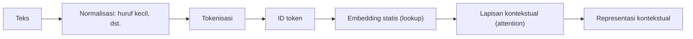

# Part 10 — Matematika Pemrosesan Bahasa

## Tujuan Pembelajaran

Setelah mempelajari bagian ini, kamu mampu:

- menjelaskan **tokenisasi** sebagai proses representasi dan membandingkan token berbasis kata, karakter, dan subkata;
- menjalankan tokenisasi subkata sederhana (pencocokan terpanjang dari kiri) dan menjelaskan bagaimana ia menangani kata baru;
- membandingkan **one-hot**, **BoW/TF-IDF**, dan **embedding** dari segi dimensi, sparsitas, dan kemampuan menangkap kemiripan;
- menunjukkan dengan angka keterbatasan BoW (sinonim, negasi, urutan) dan keterbatasan rata-rata embedding;
- menjelaskan gagasan **embedding kontekstual** dan mengapa embedding statis tidak cukup;
- menyebut keterbatasan representasi sederhana secara jujur.

## Prasyarat

[Level 4 Part 2 — Representasi Data dan Feature Engineering](../level-4-matematika-ml-klasik/02-representasi-data-dan-feature-engineering.md) (kosakata, BoW, TF-IDF, kosinus; bagian ini hanya menaut, tidak mengulang penurunannya) dan [Part 9 — Embedding dan Representasi Vektor](09-embedding-dan-representasi-vektor.md) (matriks embedding, cosine).

## Masalah yang Ingin Diselesaikan

Teks adalah deretan karakter dengan panjang berbeda-beda, sedangkan jaringan membutuhkan tensor berukuran tetap. Sebelum matematika jaringan bisa bekerja, teks harus melewati beberapa keputusan representasi, dan **setiap keputusan membuang atau menyimpan informasi**:

1. Teks dipotong menjadi satuan apa (kata, karakter, potongan kata)?
2. Satuan itu diubah menjadi angka dengan cara apa (ID, one-hot, TF-IDF, embedding)?
3. Apakah urutan dan konteks dipertahankan?

Part ini membandingkan pilihan-pilihan itu dengan angka kecil supaya kelebihan dan batas masing-masing terlihat jelas.

## Intuisi dan Istilah Penting

- **Tokenisasi** (*tokenization*): memotong teks menjadi **token**. Hasilnya bergantung pada aturan dan kosakata tokenizer.
- **Kosakata** ukuran $V$: himpunan token yang dikenal. Token yang tidak ada di kosakata disebut ***out-of-vocabulary*** (OOV) dan biasanya diganti `[UNK]`.
- **Token kata**: satu kata satu token. Pendek, tetapi kosakata besar dan OOV banyak (kata berimbuhan baru).
- **Token karakter**: satu karakter satu token. Kosakata kecil dan tidak ada OOV, tetapi urutannya panjang dan makna sulit tertangkap.
- **Token subkata** (*subword*): jalan tengah; kata umum jadi satu token, kata langka dipecah menjadi potongan yang sering muncul (misalnya awalan, akar, akhiran). Dipakai oleh BERT (WordPiece) dan banyak model lain.
- **Embedding statis**: satu vektor per token, sama di semua kalimat.
- **Embedding kontekstual**: vektor token **bergantung kalimatnya**.



## Rumus dan Penjelasan Setiap Simbol

### Tokenisasi subkata dengan pencocokan terpanjang (WordPiece sederhana)

Untuk satu kata, mulai dari kiri: ambil potongan **terpanjang** yang ada di kosakata; potongan berikutnya diawali penanda `##` (artinya "lanjutan dari kata yang sama"). Jika tidak ada potongan yang cocok, hasilnya `[UNK]`. Ini hanya *inference* tokenizer; pembuatan kosakatanya (misalnya dari frekuensi pasangan potongan) tidak dibahas di sini.

### Panjang barisan vs ukuran kosakata

Untuk teks dengan $N_{\text{karakter}}$ karakter, jumlah token per kalimat dan ukuran tabel embedding:

$$
T_{\text{karakter}}\ge T_{\text{subkata}}\ge T_{\text{kata}},\qquad
\#\text{parameter embedding}=V\times d
$$

Kosakata kecil membuat $V\times d$ kecil tetapi barisan $T$ panjang; kosakata besar membuat barisan pendek tetapi tabel embedding besar dan OOV lebih mungkin. Biaya komputasi attention tumbuh kira-kira dengan $T^2$ ([Part 12](12-attention-dan-self-attention.md)), sehingga panjang barisan penting.

### Perbandingan representasi

| Representasi | Bentuk per kalimat | Dimensi | Menyimpan urutan? | Kemiripan antarkata |
|---|---|---|---|---|
| ID token | barisan $T$ bilangan | $T$ | ya | tidak bermakna |
| One-hot per token | $T\times V$ | $V$ | ya | semua tegak lurus |
| BoW / TF-IDF | satu vektor $V$ | $V$ | **tidak** | hanya kata yang sama persis |
| Embedding statis | $T\times d$ | $d\ll V$ | ya (lewat barisan) | ya, dipelajari |
| Embedding kontekstual | $T\times d$ | $d$ | ya | bergantung konteks |

### Rata-rata embedding sebagai vektor kalimat

$$
\bar{\mathbf{x}}=\frac{1}{T}\sum_{t=1}^{T}\mathbf{x}_t\in\mathbb{R}^d
$$

$\mathbf{x}_t$ adalah embedding token ke-$t$. Hasilnya satu vektor per kalimat, mudah dibandingkan dengan cosine, tetapi **membuang urutan**.

### Gagasan embedding kontekstual

Pada model kontekstual, vektor token ke-$t$ pada lapisan berikutnya adalah fungsi **seluruh barisan**:

$$
\mathbf{h}_t=f_\theta(\mathbf{x}_1,\dots,\mathbf{x}_T;\,t)
$$

Pada Transformer, $f_\theta$ dibentuk dari attention ([Part 12](12-attention-dan-self-attention.md) dan [13](13-transformer.md)): tiap token mengumpulkan informasi dari token lain dengan bobot yang dihitung dari isi barisan itu.

## Contoh Numerik Langkah demi Langkah

### Contoh 1 — Panjang barisan menurut jenis token

Pesan korpus simulasi nomor 1 (Level 4 Part 2): "tolong ada kebakaran di gedung".

- Token kata: $5$ token (tolong, ada, kebakaran, di, gedung).
- Token karakter (tanpa spasi): $26$ token; dengan spasi sebagai karakter: $30$.
- Token subkata (kosakata mini di Contoh 2): "tolong", "ada", `ke`, `##bakar`, `##an`, "di", "gedung" $=7$ token (asumsikan "ada" dan "di" ada di kosakata).

Barisan karakter ($26$) lebih dari lima kali lebih panjang daripada barisan kata ($5$).

### Contoh 2 — Tokenisasi subkata dengan kosakata mini

Kosakata mini buatan (bukan tokenizer IndoBERT): `tolong, ada, di, gedung, kirim, ke, ##bakar, ##an, ##kan, bakar, banjir`.

- "kebakaran": potongan terpanjang dari kiri yang ada di kosakata adalah `ke` (karena "kebakaran", "kebakara", ... tidak ada). Sisa "bakaran": terpanjang `##bakar`. Sisa "an": `##an`. Hasil: `ke`, `##bakar`, `##an`.
- "kirimkan": `kirim`, lalu sisa "kan": `##kan`.
- "banjirkan": `banjir`, lalu `##kan`. Kata ini tidak ada di korpus, tetapi dikenali lewat potongan.
- "pembakaran": tidak ada potongan awal yang cocok ("pem", "pe", "p" tidak ada) sehingga `[UNK]`. Pada tokenizer sungguhan, kosakata subkata memuat karakter tunggal sehingga hampir tidak pernah menghasilkan `[UNK]`; ini keterbatasan kosakata mini.

Kata yang sama sekali baru ("banjirkan") tetap dapat diwakili oleh potongan yang sudah punya embedding. Itulah keunggulan subkata.

### Contoh 3 — BoW tidak menangkap sinonim, negasi, dan urutan

Kosakata BoW: ada, api, bantu, kebakaran, menyala, tidak, tolong (7 kata).

- **Sinonim.** "tolong ada kebakaran" dan "bantu api menyala" maknanya serupa (permintaan bantuan atas api), tetapi tidak berbagi satu kata pun: cosine BoW $=0$.
- **Negasi.** "ada kebakaran" vs "tidak ada kebakaran": vektor $(\text{ada}{=}1,\text{kebakaran}{=}1)$ dan $(\text{ada}{=}1,\text{kebakaran}{=}1,\text{tidak}{=}1)$; dot product $2$, norma $\sqrt2$ dan $\sqrt3$, cosine $=\dfrac{2}{\sqrt2\sqrt3}=0{,}8165$. Dua kalimat dengan makna berlawanan tampak sangat mirip.
- **Urutan.** "anjing gigit orang" dan "orang gigit anjing" memiliki vektor BoW yang persis sama.

### Contoh 4 — Rata-rata embedding menangkap sebagian kemiripan

Embedding statis contoh ($d=3$; **angka contoh pilihan tangan, bukan hasil pelatihan**): tolong $(0{,}5,0{,}5,0{,}5)$, bantu $(0{,}5,0{,}4,0{,}6)$, kebakaran $(0{,}9,0{,}1,0{,}2)$, api $(0{,}8,0{,}2,0{,}2)$, menyala $(0{,}7,0{,}3,0{,}3)$, ada $(0{,}1,0{,}9,0{,}1)$, tidak $(0{,}0,0{,}2,0{,}9)$.

Rata-rata "tolong ada kebakaran": $\bigl(\tfrac{0{,}5+0{,}1+0{,}9}{3},\ \tfrac{0{,}5+0{,}9+0{,}1}{3},\ \tfrac{0{,}5+0{,}1+0{,}2}{3}\bigr)=(0{,}5,\ 0{,}5,\ 0{,}2667)$.
Rata-rata "bantu api menyala": $\bigl(\tfrac{0{,}5+0{,}8+0{,}7}{3},\ \tfrac{0{,}4+0{,}2+0{,}3}{3},\ \tfrac{0{,}6+0{,}2+0{,}3}{3}\bigr)=(0{,}6667,\ 0{,}3,\ 0{,}3667)$.

Cosine $=\dfrac{0{,}5\cdot0{,}6667+0{,}5\cdot0{,}3+0{,}2667\cdot0{,}3667}{\lVert\cdot\rVert\,\lVert\cdot\rVert}=0{,}9402$. Berbeda dengan BoW ($0$), rata-rata embedding mengenali bahwa kedua kalimat mirip karena kata-katanya memiliki vektor yang dekat.

Namun rata-rata embedding **juga** gagal pada negasi: "ada kebakaran" vs "tidak ada kebakaran" memiliki cosine rata-rata embedding $0{,}8990$ (tinggi), karena satu kata "tidak" tidak mengubah rata-rata terlalu jauh. Embedding statis ditambah rata-rata belum cukup untuk makna kalimat.

### Contoh 5 — Ilustrasi embedding kontekstual

Kata "bisa" bermakna ganda (kemampuan atau racun). Embedding statis contoh ($d=2$): bisa $(0{,}5,\ 0{,}5)$, ular $(0,\ 1)$, kami $(1,\ 0)$. **Ilustrasi** pencampuran dengan tetangga: $\mathbf{h}=0{,}5\,\mathbf{x}_{\text{kata}}+0{,}5\,\mathbf{x}_{\text{tetangga}}$ (bukan model sungguhan; di Transformer bobot pencampuran dihitung oleh attention).

- "ular bisa": $\mathbf{h}_{\text{bisa}}=0{,}5(0{,}5,0{,}5)+0{,}5(0,1)=(0{,}25,\ 0{,}75)$.
- "kami bisa": $\mathbf{h}_{\text{bisa}}=0{,}5(0{,}5,0{,}5)+0{,}5(1,0)=(0{,}75,\ 0{,}25)$.

Cosine kedua vektor "bisa" yang kontekstual: $\dfrac{0{,}1875+0{,}1875}{0{,}625}=0{,}6$, sedangkan cosine vektor statisnya dengan dirinya sendiri $1$. Satu kata, dua vektor berbeda sesuai konteks. Ini hanya potret gagasan; model kontekstual sungguhan mempelajari pencampuran itu dari data.

## Interpretasi, Asumsi, dan Keterbatasan

- Semua vektor di part ini adalah **angka contoh**; kosakata subkata mini dibuat tangan. Hasilnya menggambarkan prinsip, bukan performa model nyata.
- **OOV**: token kata menghasilkan `[UNK]` untuk kata baru; subkata mengurangi masalah ini, tetapi tidak menghilangkannya untuk semua kasus.
- **Urutan dan negasi**: BoW dan rata-rata embedding tidak menangkapnya. Model berurutan atau berbasis attention diperlukan.
- **Polisemi**: embedding statis menyatukan semua makna satu kata menjadi satu vektor.
- **Bahasa Indonesia**: imbuhan, singkatan, bahasa gaul, dan campuran bahasa (*code-mixing*) membuat tokenisasi kata sederhana kurang memadai; tokenizer subkata lebih tahan tetapi tetap perlu diuji pada domain sendiri.
- **Domain dan bias**: representasi dipelajari dari korpus tertentu dan dapat membawa bias atau tidak cocok untuk domain lain.
- **Kosakata dan panjang barisan**: kosakata besar menghemat panjang barisan tetapi menambah parameter embedding; tidak ada ukuran kosakata yang selalu terbaik.
- Pembandingan di sini bersifat ilustratif. Mana yang lebih baik (BoW/TF-IDF atau embedding) bergantung pada jumlah data, tugas, dan domain; TF-IDF dengan model linear tetap pembanding yang kuat dan murah pada data kecil.

## Hubungan dengan Deep Learning dan NLP

Pipeline klasifikasi pesan Emergency vs Non-Emergency (korpus simulasi Level 4) dapat dibangun dengan TF-IDF dan regresi logistik ([Level 4 Part 13](../level-4-matematika-ml-klasik/13-integrasi-dan-studi-kasus.md)) atau dengan embedding dan Transformer. Perbedaannya: TF-IDF memberi satu vektor $V$ dimensi per pesan; Transformer memberi barisan vektor kontekstual $T\times d$ yang kemudian dirangkum untuk klasifikasi ([Part 14](14-fondasi-matematis-bert-dan-indobert.md)). IndoBERT memakai tokenizer subkata dan embedding kontekstual; tokenizernya tidak sama dengan kosakata mini di sini.

## Python

Pustaka standar saja. Kosakata subkata dan vektor adalah contoh buatan.

```python
import math

# --- tokenisasi: kata, karakter, subkata (WordPiece sederhana, kosakata mini buatan) ---
pesan = "tolong ada kebakaran di gedung"
print(len(pesan.split()), len(pesan.replace(" ", "")), len(pesan))

vocab = {"tolong", "ada", "di", "gedung", "kirim", "ke", "##bakar", "##an", "##kan", "bakar", "banjir"}

def wordpiece(kata, vocab):
    """Cocokkan potongan terpanjang dari kiri; potongan lanjutan diberi awalan ##."""
    hasil, awal = [], 0
    while awal < len(kata):
        akhir = len(kata)
        potong = None
        while akhir > awal:
            kandidat = kata[awal:akhir] if awal == 0 else "##" + kata[awal:akhir]
            if kandidat in vocab:
                potong = kandidat
                break
            akhir -= 1
        if potong is None:
            return ["[UNK]"]
        hasil.append(potong)
        awal = akhir
    return hasil

for kata in ["kebakaran", "kirimkan", "tolong", "pembakaran", "banjir"]:
    print(kata, wordpiece(kata, vocab))

# --- BoW: sinonim tidak dikenali, urutan dan negasi tidak terlihat ---
def bow(teks, kosa):
    k = teks.split()
    return [k.count(w) for w in kosa]

def dot(a, b):
    return sum(x * y for x, y in zip(a, b))

def cos(a, b):
    return dot(a, b) / math.sqrt(dot(a, a) * dot(b, b))

kosa = sorted(set("tolong ada kebakaran bantu api menyala tidak".split()))
a, b, c = "tolong ada kebakaran", "bantu api menyala", "tidak ada kebakaran"
print(round(cos(bow(a, kosa), bow(b, kosa)), 4), round(cos(bow("ada kebakaran", kosa), bow(c, kosa)), 4))
print(bow("anjing gigit orang", ["anjing", "gigit", "orang"]) == bow("orang gigit anjing", ["anjing", "gigit", "orang"]))

# --- embedding contoh (angka pilihan, bukan hasil pelatihan), d = 3 ---
E = {"tolong": [0.5, 0.5, 0.5], "bantu": [0.5, 0.4, 0.6], "kebakaran": [0.9, 0.1, 0.2],
     "api": [0.8, 0.2, 0.2], "menyala": [0.7, 0.3, 0.3], "ada": [0.1, 0.9, 0.1], "tidak": [0.0, 0.2, 0.9]}

def rata(teks):
    v = [E[w] for w in teks.split()]
    return [sum(x[j] for x in v) / len(v) for j in range(3)]

print([round(x, 4) for x in rata(a)], [round(x, 4) for x in rata(b)])
print(round(cos(rata(a), rata(b)), 4))
print(round(cos(rata("ada kebakaran"), rata("tidak ada kebakaran")), 4))

# --- embedding kontekstual: ilustrasi pencampuran dengan tetangga (bukan model sungguhan) ---
statis = {"bisa": [0.5, 0.5], "ular": [0.0, 1.0], "kami": [1.0, 0.0]}
def kontekstual(kata, tetangga):
    return [0.5 * s + 0.5 * t for s, t in zip(statis[kata], statis[tetangga])]
h1, h2 = kontekstual("bisa", "ular"), kontekstual("bisa", "kami")
print(h1, h2, round(cos(h1, h2), 4), cos(statis["bisa"], statis["bisa"]))
```

Keluaran:

```text
5 26 30
kebakaran ['ke', '##bakar', '##an']
kirimkan ['kirim', '##kan']
tolong ['tolong']
pembakaran ['[UNK]']
banjir ['banjir']
0.0 0.8165
True
[0.5, 0.5, 0.2667] [0.6667, 0.3, 0.3667]
0.9402
0.899
[0.25, 0.75] [0.75, 0.25] 0.6 1.0
```

Semua angka sama dengan Contoh 1 sampai 5. Contoh "banjirkan" tidak dijalankan di kode, tetapi mengikuti aturan yang sama dan dapat dicoba dengan memanggil `wordpiece("banjirkan", vocab)`.

## Kesalahan Umum

1. **Menyamakan token dengan kata.** Pada tokenizer subkata, satu kata bisa menjadi beberapa token.
2. **Menganggap BoW/TF-IDF "paham" makna.** Ia hanya menghitung kata yang sama persis.
3. **Menganggap rata-rata embedding menyimpan urutan atau negasi.**
4. **Memakai kosakata dari seluruh data** (termasuk uji) saat membangun tokenizer atau TF-IDF; bangun dari data latih saja.
5. **Mengabaikan OOV** sehingga kata penting menjadi `[UNK]` tanpa disadari.
6. **Mengira embedding kontekstual hanyalah "rata-rata dengan tetangga".** Contoh 5 hanya ilustrasi; bobot sebenarnya dipelajari lewat attention.
7. **Memilih representasi tanpa pembanding sederhana.** TF-IDF + model linear kerap menjadi garis dasar yang kuat.
8. **Membaca vektor contoh sebagai hasil model nyata.**

## Latihan Mandiri

1. Untuk "tolong ada kebakaran di gedung", hitung jumlah token kata, jumlah karakter tanpa spasi, dan jumlah karakter dengan spasi.
2. Dengan kosakata mini di Contoh 2, tokenisasikan "kirimkan", "banjirkan", dan "kebakaran". Jelaskan mengapa "banjirkan" bukan OOV.
3. Sebut satu keunggulan dan satu kelemahan token karakter, token kata, dan token subkata.
4. Hitung cosine BoW antara "tolong ada kebakaran" dan "bantu api menyala" (kosakata Contoh 3). Mengapa nilainya $0$?
5. Hitung cosine BoW antara "ada kebakaran" dan "tidak ada kebakaran". Apa kelemahan yang ditunjukkan?
6. Tunjukkan bahwa BoW "anjing gigit orang" sama dengan "orang gigit anjing". Apa yang hilang?
7. Pesan 1 korpus Level 4 memiliki 5 elemen tak nol dari 29. Berapa persen kepadatannya? Bandingkan dimensi BoW pada $V=30{,}000$ dengan embedding $d=768$.
8. Ulangi Contoh 5 dengan bobot $\mathbf{h}=0{,}8\,\mathbf{x}_{\text{kata}}+0{,}2\,\mathbf{x}_{\text{tetangga}}$. Hitung kedua vektor "bisa" dan cosinenya. Apa yang terjadi bila bobot milik sendiri membesar?
9. Pilih TF-IDF + regresi logistik atau Transformer untuk: (a) 10 pesan berlabel, hanya kata kunci yang berpengaruh; (b) puluhan ribu pesan dengan banyak sinonim dan negasi. Beri alasan.
10. Cocokkan keterbatasan: (a) "bisa" selalu satu vektor; (b) "pembakaran" menjadi `[UNK]`; (c) "tidak ada kebakaran" tampak mirip "ada kebakaran"; (d) urutan hilang pada rata-rata.

## Kunci Jawaban dan Pembahasan

??? success "Soal 1"
    Token kata: $5$. Karakter tanpa spasi: tolong $6$ + ada $3$ + kebakaran $9$ + di $2$ + gedung $6=26$. Dengan spasi (4 spasi): $30$.

??? success "Soal 2"
    "kirimkan" $\to$ `kirim`, `##kan`. "banjirkan" $\to$ `banjir`, `##kan`. "kebakaran" $\to$ `ke`, `##bakar`, `##an`. "banjirkan" tidak ada utuh di kosakata, tetapi potongan `banjir` dan `##kan` ada, sehingga bisa dipecah tanpa `[UNK]`.

??? success "Soal 3"
    Karakter: kosakata kecil dan tanpa OOV; barisan sangat panjang dan makna sulit tertangkap. Kata: barisan pendek dan token bermakna; kosakata besar dan OOV pada kata baru. Subkata: kompromi (kata umum utuh, kata langka dipecah); kosakata dan aturan pemecahan harus dibuat, dan potongan bisa tidak bermakna linguistik.

??? success "Soal 4"
    Kedua kalimat tidak berbagi kata, jadi dot product $0$ dan cosine $0$. BoW hanya melihat kata yang sama persis, bukan kemiripan makna.

??? success "Soal 5"
    Vektor: $(\text{ada}{=}1,\text{kebakaran}{=}1)$ dan $(\text{ada}{=}1,\text{kebakaran}{=}1,\text{tidak}{=}1)$. Cosine $=\dfrac{2}{\sqrt2\sqrt3}=0{,}8165$. Kelemahan: negasi mengubah makna, tetapi BoW hanya menambah satu elemen sehingga kalimat tampak sangat mirip.

??? success "Soal 6"
    Kedua kalimat berisi kata anjing, gigit, orang masing-masing sekali, jadi BoW sama persis $(1,1,1)$. Yang hilang adalah **urutan** (siapa menggigit siapa).

??? success "Soal 7"
    Kepadatan $5/29=17{,}2\%$. BoW pada $V=30{,}000$ berdimensi $30{,}000$ (hampir seluruhnya nol), embedding berdimensi $768$: sekitar $39$ kali lebih pendek dan padat.

??? success "Soal 8"
    "ular bisa": $0{,}8(0{,}5,0{,}5)+0{,}2(0,1)=(0{,}4,\ 0{,}6)$. "kami bisa": $0{,}8(0{,}5,0{,}5)+0{,}2(1,0)=(0{,}6,\ 0{,}4)$. Cosine $=\dfrac{0{,}24+0{,}24}{0{,}52}=0{,}9231$. Makin besar bobot milik sendiri, makin mirip kedua vektor (dengan bobot $1$ keduanya identik, yaitu embedding statis).

??? success "Soal 9"
    (a) TF-IDF + regresi logistik: data kecil, kata kunci jelas, murah, mudah dijelaskan, dan sulit dikalahkan model besar tanpa data. (b) Transformer/embedding kontekstual: banyak data memungkinkan mempelajari sinonim dan menangani negasi dan konteks. Tidak ada jaminan; keduanya perlu dibandingkan pada data validasi.

??? success "Soal 10"
    (a) polisemi pada embedding statis. (b) OOV pada kosakata terbatas. (c) keterbatasan negasi pada BoW dan rata-rata embedding. (d) rata-rata membuang urutan.

## Ringkasan Materi

- **Tokenisasi** adalah keputusan representasi: karakter (barisan panjang, tanpa OOV), kata (barisan pendek, OOV), subkata (kompromi).
- Subkata dengan pencocokan terpanjang memecah kata baru menjadi potongan yang sudah dikenal (`ke`, `##bakar`, `##an`).
- **One-hot** tidak menyimpan kemiripan; **BoW/TF-IDF** menyimpan frekuensi tetapi bukan urutan, sinonim, atau negasi; **embedding** menyimpan kemiripan yang dipelajari.
- Rata-rata embedding mengenali kemiripan sinonim (cosine $0{,}94$ dibanding BoW $0$) tetapi tetap membuang urutan dan lemah pada negasi (cosine $0{,}90$).
- **Embedding kontekstual** membuat vektor token bergantung kalimat; di Transformer dilakukan oleh attention.
- Semua contoh memakai angka dan kosakata buatan; representasi sederhana tetap pembanding yang sah.

## Checklist Penguasaan

- [ ] Membandingkan token kata, karakter, dan subkata dengan angka.
- [ ] Menjalankan tokenisasi subkata terpanjang-dari-kiri dengan kosakata mini.
- [ ] Menjelaskan dimensi dan sparsitas one-hot, BoW/TF-IDF, dan embedding.
- [ ] Menunjukkan keterbatasan BoW (sinonim, negasi, urutan) dengan cosine.
- [ ] Menjelaskan keterbatasan rata-rata embedding statis.
- [ ] Menjelaskan gagasan embedding kontekstual.

## Prasyarat untuk Materi Berikutnya

[Part 11 — Softmax dan Probabilitas Keluaran](11-softmax-dan-probabilitas-keluaran.md) memperdalam bagaimana skor mentah (logit) diubah menjadi probabilitas atas kelas atau atas kosakata, yang dibutuhkan oleh attention dan klasifikasi. Pastikan kamu ingat softmax dari [Part 4](04-fungsi-aktivasi.md) dan cross-entropy dari [Part 5](05-loss-function.md).
