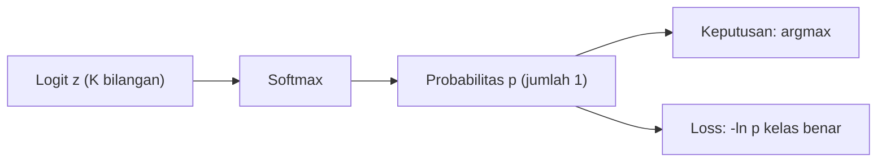

# Part 11 — Softmax dan Probabilitas Keluaran

## Tujuan Pembelajaran

Setelah mempelajari bagian ini, kamu mampu:

- mengubah **logit** menjadi **probabilitas multikelas** dengan softmax dan memeriksa bahwa jumlahnya satu;
- menjelaskan bahwa $p_i/p_j=e^{z_i-z_j}$ dan bahwa softmax tidak berubah bila semua logit digeser;
- menghitung softmax dan **cross-entropy** secara stabil dengan ***log-sum-exp***;
- menjelaskan pengaruh **temperature** dan menghitungnya dengan angka;
- membedakan klasifikasi **multikelas** (softmax) dari **multi-label** (sigmoid);
- menafsirkan prediksi: kelas terpilih, keyakinan, ketidakpastian (entropi), dan **kalibrasi**;
- menghitung *label smoothing* dan **perplexity** pada contoh kecil.

## Prasyarat

[Part 4 — Fungsi Aktivasi](04-fungsi-aktivasi.md) (definisi softmax, invariansi terhadap pergeseran, Jacobian), [Part 5 — Loss Function](05-loss-function.md) (cross-entropy dan gradien $p-y$), dan [Level 1 Part 10](../level-1-aljabar-dasar-dan-fungsi/10-fungsi-eksponensial-dan-logaritma.md) ($e^x$, $\ln x$, sifat logaritma).

## Masalah yang Ingin Diselesaikan

Lapisan terakhir jaringan menghasilkan satu skor mentah (**logit**) per kelas, bilangan real apa pun. Kita ingin (1) mengubahnya menjadi distribusi peluang, (2) menghitung loss tanpa kesalahan numerik walau logit besar, dan (3) menafsirkan angka itu dengan benar. Part 4 sudah memperkenalkan softmax; Part ini memperdalamnya: sifat-sifatnya, cara menghitungnya dengan aman, dan apa arti probabilitas yang keluar.

Softmax juga muncul di dua tempat lain pada Level 5: untuk **bobot attention** ([Part 12](12-attention-dan-self-attention.md)) dan untuk **prediksi token** pada model bahasa ([Part 14](14-fondasi-matematis-bert-dan-indobert.md)).

## Intuisi dan Istilah Penting

- **Logit** ($z_k$): skor mentah kelas ke-$k$. Bukan peluang; boleh negatif atau lebih dari 1.
- **Softmax**: mengubah logit menjadi peluang: yang lebih besar mendapat peluang lebih besar, dan jumlahnya satu.
- **Multikelas**: tepat satu kelas yang benar ($K$ kelas, saling meniadakan) $\Rightarrow$ softmax.
- **Multi-label**: beberapa label dapat benar sekaligus $\Rightarrow$ satu sigmoid per label.
- ***Log-sum-exp*** (LSE): $\ln\sum_je^{z_j}$, "maksimum yang dihaluskan"; kunci perhitungan yang stabil.
- **Temperature** $T$: pembagi logit sebelum softmax; mengatur seberapa tajam distribusinya.
- **Kalibrasi**: apakah peluang yang dinyatakan model sesuai dengan frekuensi kebenaran sebenarnya.



## Rumus dan Penjelasan Setiap Simbol

### Softmax dan sifat-sifatnya

Untuk logit $\mathbf{z}=(z_1,\dots,z_K)$:

$$
p_k=\operatorname{softmax}(\mathbf{z})_k=\frac{e^{z_k}}{\sum_{j=1}^{K}e^{z_j}},\qquad p_k>0,\qquad \sum_kp_k=1
$$

Sifat penting:

1. **Rasio peluang** $=$ eksponen selisih logit: $\dfrac{p_i}{p_j}=e^{\,z_i-z_j}$. Selisih logit $1$ berarti peluang $e\approx2{,}72$ kali lebih besar.
2. **Invarian terhadap pergeseran**: $\operatorname{softmax}(\mathbf{z}+c\mathbf{1})=\operatorname{softmax}(\mathbf{z})$. Hanya selisih logit yang berarti.
3. **Urutan terjaga**: $z_i>z_j\Rightarrow p_i>p_j$. Kelas dengan peluang terbesar sama dengan kelas dengan logit terbesar (*argmax*).
4. Dua kelas: $\operatorname{softmax}(z_1,z_2)_1=\sigma(z_1-z_2)$ ([Part 4](04-fungsi-aktivasi.md)).

### *Log-sum-exp* dan perhitungan stabil

$$
\operatorname{LSE}(\mathbf{z})=\ln\sum_{j}e^{z_j}=m+\ln\sum_je^{\,z_j-m},\qquad m=\max_jz_j
$$

Mengurangi $m$ membuat eksponen paling besar menjadi $e^0=1$, sehingga tidak meluap (*overflow*), dan paling sedikit satu suku tidak lenyap (*underflow*). Dengan itu:

$$
\ln p_k=z_k-\operatorname{LSE}(\mathbf{z}),\qquad p_k=e^{\,z_k-\operatorname{LSE}(\mathbf{z})}
$$

Cross-entropy untuk kelas benar $c$ dapat dihitung **langsung dari logit**:

$$
\ell=-\ln p_c=\operatorname{LSE}(\mathbf{z})-z_c
$$

Ini yang sebenarnya dilakukan pustaka Deep Learning pada "cross-entropy from logits".

### Temperature

$$
p_k^{(T)}=\frac{e^{z_k/T}}{\sum_je^{z_j/T}},\qquad T>0
$$

$T=1$ adalah softmax biasa. $T\to0$: peluang mengumpul pada logit terbesar (*argmax*). $T\to\infty$: mendekati seragam $1/K$. $T>1$ melunakkan, $T<1$ menajamkan.

### Entropi sebagai ukuran ketidakpastian

$$
H(\mathbf{p})=-\sum_kp_k\ln p_k
$$

Bernilai $0$ jika satu kelas berpeluang 1, dan maksimum $\ln K$ jika seragam.

### *Label smoothing*

Mengganti label *one-hot* $\mathbf{y}$ dengan campuran bersama distribusi seragam:

$$
\mathbf{y}'=(1-\varepsilon)\,\mathbf{y}+\frac{\varepsilon}{K}\mathbf{1}
$$

$\varepsilon\in[0,1)$ kecil. Gradien terhadap logit tetap berbentuk $\mathbf{p}-\mathbf{y}'$. Efeknya mencegah model mengejar peluang 1 yang tidak bisa dicapai dan sering mengurangi keyakinan berlebih.

### Perplexity

Untuk model yang memberi peluang $p_t$ pada token benar ke-$t$ dari $T$ token:

$$
\text{CE}=-\frac1T\sum_{t=1}^T\ln p_t,\qquad \text{perplexity}=e^{\text{CE}}
$$

Perplexity dibaca sebagai "kira-kira berapa pilihan yang sama-sama mungkin yang dihadapi model pada tiap langkah"; makin kecil makin baik.

## Contoh Numerik Langkah demi Langkah

### Contoh 1 — Softmax, LSE, dan cross-entropy dari logit

$\mathbf{z}=(2,\,1,\,0)$.

1. $m=2$. Suku: $e^{2-2}=1$, $e^{1-2}=0{,}3679$, $e^{0-2}=0{,}1353$; jumlah $1{,}5032$.
2. $\operatorname{LSE}=2+\ln1{,}5032=2+0{,}4076=2{,}4076$.
3. $\ln p_1=z_1-\operatorname{LSE}=2-2{,}4076=-0{,}4076\Rightarrow p_1=0{,}6652$; dengan cara yang sama $p_2=e^{1-2{,}4076}=0{,}2447$, $p_3=e^{0-2{,}4076}=0{,}0900$.
4. Cross-entropy bila kelas benar adalah kelas 1: $\ell=\operatorname{LSE}-z_1=2{,}4076-2=0{,}4076$, sama dengan $-\ln0{,}6652$.
5. Rasio: $p_1/p_2=0{,}6652/0{,}2447=2{,}7183=e^{2-1}$.

### Contoh 2 — Mengapa perlu stabil

Logit $(1000,\ 1001,\ 1002)$. Hitungan naif $e^{1000}$ meluap (galat *overflow*). Dengan LSE, $m=1002$: suku $e^{-2}=0{,}1353$, $e^{-1}=0{,}3679$, $e^0=1$, jumlah $1{,}5032$, hasil $(0{,}0900,\ 0{,}2447,\ 0{,}6652)$, sama dengan softmax $(0,1,2)$ (invarian pergeseran). Logit $(-1000,\ -1001)$: hitungan naif menghasilkan $0/0$; dengan LSE $=-1000+\ln(1+e^{-1})=-999{,}6867$.

### Contoh 3 — Temperature

$\mathbf{z}=(2,1,0)$:

| $T$ | $p_1$ | $p_2$ | $p_3$ | Entropi |
|---|---|---|---|---|
| $0{,}5$ | $0{,}8668$ | $0{,}1173$ | $0{,}0159$ | $0{,}4411$ |
| $1$ | $0{,}6652$ | $0{,}2447$ | $0{,}0900$ | $0{,}8324$ |
| $2$ | $0{,}5065$ | $0{,}3072$ | $0{,}1863$ | $1{,}0202$ |
| $5$ | $0{,}4018$ | $0{,}3289$ | $0{,}2693$ | $1{,}0854$ |

Temperature rendah menajamkan (entropi kecil), tinggi melembutkan (entropi mendekati maksimum $\ln3=1{,}0986$). Pada model bahasa, $T$ tinggi menghasilkan teks lebih beragam dan $T$ rendah lebih konservatif.

### Contoh 4 — Multikelas vs multi-label

Logit yang sama $(2,1,0)$. Softmax: $(0{,}6652,\ 0{,}2447,\ 0{,}0900)$, jumlah $1$ (kelas saling bersaing). Sigmoid per label: $(0{,}8808,\ 0{,}7311,\ 0{,}5)$, jumlah $2{,}1119$ (tiap label diputuskan sendiri; boleh ada beberapa yang aktif). Pilih sesuai masalah: sebuah pesan hanya satu kategori $\Rightarrow$ softmax; sebuah pesan boleh memuat beberapa topik sekaligus $\Rightarrow$ sigmoid.

### Contoh 5 — Dua kelas

Pesan contoh (data simulasi) dengan logit $(\text{Emergency},\text{Non-Emergency})=(1{,}2,\ -0{,}3)$. Softmax: $p_{\text{E}}=\dfrac{e^{1{,}2}}{e^{1{,}2}+e^{-0{,}3}}=0{,}8176$. Sama dengan $\sigma(1{,}2-(-0{,}3))=\sigma(1{,}5)=0{,}8176$. Model menyatakan keyakinan $81{,}76\%$ pada Emergency; ini keyakinan model, bukan fakta.

### Contoh 6 — *Label smoothing*

$K=3$, $\varepsilon=0{,}1$, kelas benar kelas 1: $\mathbf{y}'=(0{,}9\cdot1+0{,}0333,\ 0{,}0333,\ 0{,}0333)=(0{,}9333,\ 0{,}0333,\ 0{,}0333)$. Dengan $\mathbf{p}=(0{,}6652,\ 0{,}2447,\ 0{,}0900)$:

$$
\text{CE}=-(0{,}9333\ln0{,}6652+0{,}0333\ln0{,}2447+0{,}0333\ln0{,}0900)=0{,}3804+0{,}0469+0{,}0803=0{,}5076
$$

(dibandingkan $0{,}4076$ tanpa smoothing). Gradien terhadap logit $\mathbf{p}-\mathbf{y}'=(-0{,}2681,\ 0{,}2114,\ 0{,}0567)$, jumlah $0$. Tanpa smoothing gradien kelas 1 adalah $-0{,}3348$; dengan smoothing sedikit lebih kecil, jadi model tidak terus didorong menuju peluang 1.

### Contoh 7 — Perplexity

Peluang yang diberikan model pada tiga token yang benar: $0{,}5,\ 0{,}25,\ 0{,}125$. $\text{CE}=\tfrac13(0{,}6931+1{,}3863+2{,}0794)=1{,}3863$. Perplexity $=e^{1{,}3863}=4{,}0$: model sama bingungnya dengan memilih seragam di antara 4 kemungkinan. Bandingkan: model yang memberi peluang $1$ pada semuanya punya perplexity $1$.

### Contoh 8 — Kalibrasi

Model memberi keyakinan $0{,}9$ pada 10 pesan uji (contoh). Hanya 7 yang benar, sehingga akurasi kelompok itu $0{,}7$. Selisih $0{,}9-0{,}7=0{,}2$: model **terlalu yakin** (*overconfident*). Peluang yang terkalibrasi baik akan cocok dengan frekuensi kebenaran: dari 10 pesan berkeyakinan $0{,}9$, kira-kira 9 yang benar.

## Interpretasi, Asumsi, dan Keterbatasan

- Softmax **memaksa** jumlah peluang menjadi satu atas $K$ kelas yang diberikan. Untuk masukan yang tidak termasuk kelas mana pun (data di luar distribusi), model tetap membagikan peluang ke kelas yang ada, kadang dengan keyakinan tinggi.
- Peluang yang dihasilkan **belum tentu terkalibrasi**. Model dalam sering terlalu yakin; temperature scaling dan label smoothing dapat membantu, tetapi hasilnya perlu diukur pada data validasi.
- Hanya selisih logit yang bermakna. Besar logit mutlak tidak memiliki arti (invarian pergeseran).
- Argmax adalah keputusan; peluang adalah informasi tambahan. Menggunakan ambang atau menolak prediksi berpeluang rendah (*abstain*) adalah keputusan terpisah.
- Pada ukuran kosakata besar ($V$ puluhan ribu), softmax mahal; ada pendekatan khusus, tetapi di luar cakupan di sini.
- Entropi tinggi berarti model tidak yakin, bukan berarti salah; entropi rendah tidak menjamin benar.
- Contoh logit di sini adalah angka sederhana untuk melacak hitungan, bukan keluaran model terlatih.

## Hubungan dengan Deep Learning dan NLP

Pada klasifikasi pesan (Emergency vs Non-Emergency, contoh/simulasi), keluaran akhir adalah softmax dua kelas pada logit *classification head* ([Part 14](14-fondasi-matematis-bert-dan-indobert.md)). Pada pralatih BERT, softmax bekerja atas seluruh kosakata untuk menebak token yang disembunyikan. Pada attention, softmax mengubah skor query–key menjadi bobot yang berjumlah satu atas token-token ([Part 12](12-attention-dan-self-attention.md)); semua hitungan stabil di atas dipakai di sana.

## Python

Pustaka standar saja.

```python
import math

def softmax_naif(zs):
    e = [math.exp(z) for z in zs]
    s = sum(e)
    return [v / s for v in e]

def logsumexp(zs):
    m = max(zs)
    return m + math.log(sum(math.exp(z - m) for z in zs))

def softmax(zs):
    lse = logsumexp(zs)
    return [math.exp(z - lse) for z in zs]

z = [2.0, 1.0, 0.0]
print([round(p, 4) for p in softmax(z)], round(logsumexp(z), 4), round(logsumexp(z) - z[0], 4))

# rasio peluang = e^(selisih logit)
p = softmax(z)
print(round(p[0] / p[1], 4), round(math.e ** (z[0] - z[1]), 4))

# stabilitas numerik
try:
    softmax_naif([1000.0, 1001.0, 1002.0])
except OverflowError as e:
    print("naif:", e)
print([round(p, 4) for p in softmax([1000.0, 1001.0, 1002.0])])
print(round(logsumexp([-1000.0, -1001.0]), 4))

# temperatur
def entropi(p):
    return -sum(q * math.log(q) for q in p if q > 0)

for T in (0.5, 1, 2, 5):
    p = softmax([v / T for v in z])
    print(T, [round(q, 4) for q in p], round(entropi(p), 4))

# multikelas (softmax) vs multi-label (sigmoid)
sig = lambda v: 1 / (1 + math.exp(-v))
print(round(sum(softmax(z)), 4), [round(sig(v), 4) for v in z], round(sum(sig(v) for v in z), 4))

# label smoothing, K = 3, epsilon = 0.1, kelas benar = kelas 1
K, eps = 3, 0.1
y = [1.0, 0.0, 0.0]
ys = [(1 - eps) * v + eps / K for v in y]
p = softmax(z)
ce_keras = -sum(a * math.log(b) for a, b in zip(ys, p))
print([round(v, 4) for v in ys], round(ce_keras, 4), [round(b - a, 4) for a, b in zip(ys, p)])

# perplexity
p_benar = [0.5, 0.25, 0.125]
ce = -sum(math.log(q) for q in p_benar) / len(p_benar)
print(round(ce, 4), round(math.exp(ce), 4))

# dua kelas: softmax = sigmoid dari selisih logit
print(round(softmax([1.2, -0.3])[0], 4), round(sig(1.5), 4))
```

Keluaran:

```text
[0.6652, 0.2447, 0.09] 2.4076 0.4076
2.7183 2.7183
naif: math range error
[0.09, 0.2447, 0.6652]
-999.6867
0.5 [0.8668, 0.1173, 0.0159] 0.4411
1 [0.6652, 0.2447, 0.09] 0.8324
2 [0.5065, 0.3072, 0.1863] 1.0202
5 [0.4018, 0.3289, 0.2693] 1.0854
1.0 [0.8808, 0.7311, 0.5] 2.1119
[0.9333, 0.0333, 0.0333] 0.5076 [-0.2681, 0.2114, 0.0567]
1.3863 4.0
0.8176 0.8176
```

Semua nilai sama dengan Contoh 1 sampai 7. Contoh 8 (kalibrasi) adalah hitungan sederhana yang tidak memerlukan kode.

## Kesalahan Umum

1. **Menganggap logit sebagai peluang**, atau menjumlahkan logit.
2. **Menghitung softmax naif** pada logit besar sehingga meluap; kurangi nilai maksimum atau pakai LSE.
3. **Menerapkan softmax lalu cross-entropy yang juga memakai softmax**, sehingga softmax terpakai dua kali. Gunakan loss yang menerima logit (atau softmax saja, bukan keduanya).
4. **Memakai softmax untuk multi-label**, atau sigmoid untuk multikelas yang saling meniadakan.
5. **Menafsirkan peluang tinggi sebagai kepastian.** Peluang adalah keyakinan model dan dapat tidak terkalibrasi.
6. **Mengira logit mutlak bermakna.** Hanya selisih logit yang berarti.
7. **Menjumlahkan softmax pada sumbu yang salah** pada tensor $(n,K)$.
8. **Memilih temperature tanpa tujuan**: $T$ mengubah sebaran peluang, bukan urutan kelas (argmax tidak berubah).

## Latihan Mandiri

1. Hitung softmax untuk $(0,0,0)$, untuk $(1,1,1,1)$, dan untuk $(\ln1,\ln2,\ln3)$.
2. Logit $(3,1)$: hitung softmax dan rasio $p_1/p_2$. Cocokkan dengan $e^{z_1-z_2}$.
3. Tunjukkan bahwa softmax $(10,11,12)$ sama dengan softmax $(0,1,2)$ dan tuliskan hasilnya.
4. Hitung softmax $(800,\ 801)$ secara stabil dengan mengurangi maksimum.
5. Untuk $\mathbf{z}=(1,0,-1)$ dan kelas benar kelas 2, hitung LSE dan loss cross-entropy $=\operatorname{LSE}-z_c$. Bandingkan dengan $-\ln p_2$.
6. Hitung softmax $(2,1,0)$ dengan $T=2$ dan $T=0{,}5$. Bagaimana perubahan keyakinan pada kelas pertama?
7. *Label smoothing* dengan $\varepsilon=0{,}2$, $K=3$, kelas benar kelas 1, dan $\mathbf{p}=(0{,}6652,\ 0{,}2447,\ 0{,}0900)$. Hitung $\mathbf{y}'$, cross-entropy, dan gradien $\mathbf{p}-\mathbf{y}'$.
8. Model memberi peluang pada token benar: $0{,}5,\ 0{,}5,\ 0{,}25,\ 0{,}25$. Hitung cross-entropy rata-rata dan perplexity.
9. Dari 10 prediksi berkeyakinan $0{,}9$, hanya 7 yang benar. Hitung akurasi, selisih keyakinan dengan akurasi, dan nyatakan apakah model terlalu yakin atau kurang yakin.
10. Logit $(2,1,0)$ dipakai pada dua masalah: (a) satu pesan tepat satu dari tiga kategori; (b) satu pesan boleh punya beberapa tag. Pakai aktivasi mana, dan berapa jumlah keluarannya?

## Kunci Jawaban dan Pembahasan

??? success "Soal 1"
    $(0,0,0)$: $e^0=1$ ketiganya, jumlah $3$: $(\tfrac13,\tfrac13,\tfrac13)$. $(1,1,1,1)$: $(0{,}25,0{,}25,0{,}25,0{,}25)$. $(\ln1,\ln2,\ln3)$: $e^{\ln k}=k$, jadi $(1,2,3)/6=(0{,}1667,\ 0{,}3333,\ 0{,}5)$.

??? success "Soal 2"
    $e^{3}=20{,}0855$, $e^{1}=2{,}7183$, jumlah $22{,}8038$: $p=(0{,}8808,\ 0{,}1192)$. Rasio $0{,}8808/0{,}1192=7{,}389=e^{3-1}=e^2$.

??? success "Soal 3"
    Kurangi $10$ dari semua logit: $(0,1,2)$. $e^0=1$, $e^1=2{,}7183$, $e^2=7{,}3891$, jumlah $11{,}1073$: $(0{,}0900,\ 0{,}2447,\ 0{,}6652)$. Faktor $e^{10}$ meniadakan diri sendiri pada pembilang dan penyebut.

??? success "Soal 4"
    Kurangi $m=801$: $(-1,\ 0)$. $e^{-1}=0{,}3679$, $e^0=1$, jumlah $1{,}3679$: $p=(0{,}2689,\ 0{,}7311)$. Hitungan naif $e^{800}$ meluap, hitungan stabil tidak.

??? success "Soal 5"
    $m=1$: suku $e^0=1$, $e^{-1}=0{,}3679$, $e^{-2}=0{,}1353$, jumlah $1{,}5032$; $\operatorname{LSE}=1+\ln1{,}5032=1{,}4076$. Kelas 2: $z_2=0$, jadi $\ell=1{,}4076-0=1{,}4076$. Peluang kelas 2: $e^{0-1{,}4076}=0{,}2447$ dan $-\ln0{,}2447=1{,}4076$. Sama.

??? success "Soal 6"
    $T=2$: logit menjadi $(1,0{,}5,0)$, softmax $(0{,}5065,\ 0{,}3072,\ 0{,}1863)$: keyakinan kelas pertama turun dari $0{,}6652$ ke $0{,}5065$. $T=0{,}5$: logit $(4,2,0)$, softmax $(0{,}8668,\ 0{,}1173,\ 0{,}0159)$: naik ke $0{,}8668$. Urutan kelas tidak berubah.

??? success "Soal 7"
    $\mathbf{y}'=(0{,}8+0{,}0667,\ 0{,}0667,\ 0{,}0667)=(0{,}8667,\ 0{,}0667,\ 0{,}0667)$. CE $=0{,}8667(0{,}4076)+0{,}0667(1{,}4076)+0{,}0667(2{,}4076)=0{,}3533+0{,}0938+0{,}1605=0{,}6076$. Gradien $\mathbf{p}-\mathbf{y}'=(-0{,}2014,\ 0{,}1781,\ 0{,}0234)$; jumlah $0$.

??? success "Soal 8"
    $\text{CE}=\tfrac14(0{,}6931+0{,}6931+1{,}3863+1{,}3863)=1{,}0397$. Perplexity $=e^{1{,}0397}=2{,}83$ (juga $64^{1/4}=2\sqrt2=2{,}8284$ karena $0{,}5\cdot0{,}5\cdot0{,}25\cdot0{,}25=1/64$). Model setara dengan memilih di antara sekitar 2,8 pilihan seimbang.

??? success "Soal 9"
    Akurasi $=0{,}7$. Selisih $0{,}9-0{,}7=0{,}2$: keyakinan lebih tinggi daripada akurasi, jadi model **terlalu yakin** (*overconfident*).

??? success "Soal 10"
    (a) Softmax: $3$ keluaran yang berjumlah $1$, yaitu $(0{,}6652,\ 0{,}2447,\ 0{,}0900)$; pilih argmax. (b) Sigmoid per tag: $3$ keluaran independen $(0{,}8808,\ 0{,}7311,\ 0{,}5)$ yang tidak harus berjumlah $1$; tentukan tag dengan ambang (misalnya $0{,}5$).

## Ringkasan Materi

- **Softmax** mengubah logit menjadi peluang positif berjumlah $1$; $p_i/p_j=e^{z_i-z_j}$; invarian terhadap pergeseran; urutan kelas terjaga.
- Hitung stabil dengan ***log-sum-exp***: $\ln p_k=z_k-\operatorname{LSE}(\mathbf{z})$; cross-entropy dari logit $=\operatorname{LSE}-z_c$.
- **Temperature** $T$ menajamkan ($T<1$) atau melembutkan ($T>1$) distribusi tanpa mengubah argmax.
- Multikelas $\Rightarrow$ softmax; multi-label $\Rightarrow$ sigmoid per label.
- **Entropi** mengukur ketidakpastian; **label smoothing** menurunkan dorongan menuju peluang 1; **perplexity** $=e^{\text{CE}}$.
- Peluang adalah keyakinan model dan perlu diperiksa kalibrasinya; softmax memaksa jumlah satu atas kelas yang ada.

## Checklist Penguasaan

- [ ] Menghitung softmax dan memeriksa jumlahnya satu.
- [ ] Menjelaskan invarian pergeseran dan rasio $e^{z_i-z_j}$.
- [ ] Menghitung softmax dan cross-entropy stabil dengan *log-sum-exp*.
- [ ] Menghitung pengaruh temperature.
- [ ] Memilih softmax vs sigmoid untuk multikelas vs multi-label.
- [ ] Menghitung *label smoothing* dan perplexity.
- [ ] Menjelaskan keterbatasan interpretasi probabilitas dan kalibrasi.

## Prasyarat untuk Materi Berikutnya

[Part 12 — Attention dan Self-Attention](12-attention-dan-self-attention.md) memakai softmax untuk mengubah skor kemiripan query–key menjadi bobot yang berjumlah satu, lalu menghitung rata-rata berbobot dari value. Pastikan kamu nyaman dengan softmax stabil, dot product ([Part 9](09-embedding-dan-representasi-vektor.md)), dan shape tensor ([Part 2](02-tensor-dan-operasi-multidimensi.md)).
