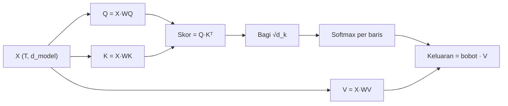

# Part 12 — Attention dan Self-Attention

## Tujuan Pembelajaran

Setelah mempelajari bagian ini, kamu mampu:

- menjelaskan peran **query**, **key**, dan **value** dengan analogi pencarian;
- menghitung langkah demi langkah: **skor** (dot product), ***scaling***, **softmax**, **bobot attention**, dan ***weighted sum***;
- menuliskan $\operatorname{Attention}(Q,K,V)=\operatorname{softmax}\!\bigl(QK^\top/\sqrt{d_k}\bigr)V$ beserta shape tiap matriks;
- menjelaskan alasan pembagian dengan $\sqrt{d_k}$ dengan angka;
- membentuk $Q$, $K$, $V$ dari satu barisan $X$ lewat tiga proyeksi (**self-attention**) dan membedakannya dari *cross-attention*;
- menerapkan **mask** (kausal atau padding) sebelum softmax;
- menafsirkan bobot attention tanpa melebih-lebihkan, dan menyebut biaya komputasinya.

## Prasyarat

[Part 2 — Tensor dan Operasi Multidimensi](02-tensor-dan-operasi-multidimensi.md) (shape, perkalian matriks, transpose), [Part 9 — Embedding dan Representasi Vektor](09-embedding-dan-representasi-vektor.md) (dot product sebagai kemiripan), [Part 10](10-matematika-pemrosesan-bahasa.md) (mengapa konteks diperlukan), dan [Part 11 — Softmax dan Probabilitas Keluaran](11-softmax-dan-probabilitas-keluaran.md) (softmax stabil dan invarian pergeseran).

## Masalah yang Ingin Diselesaikan

Di Part 10 kita melihat bahwa vektor kata statis tidak membedakan makna "bisa" pada "ular bisa" dan "kami bisa", dan rata-rata vektor membuang urutan. Kita butuh mekanisme yang membuat vektor setiap token **bergantung pada token-token lain dalam kalimat**, dengan pengaruh yang **dipelajari** dan **berbeda-beda** untuk tiap pasangan token (bukan rata-rata rata).

Attention menjawabnya: tiap token "bertanya" (query) ke semua token (key), mendapat tingkat relevansi, lalu mengambil campuran berbobot dari isi (value) token-token itu.

## Intuisi dan Istilah Penting

Bayangkan mencari di perpustakaan. Kamu punya **pertanyaan** (query). Setiap buku punya **label** (key) dan **isi** (value). Kamu membandingkan pertanyaan dengan semua label; semakin cocok, semakin besar perhatianmu pada isi buku itu; hasil akhir adalah ringkasan isi, diambil lebih banyak dari buku yang lebih cocok.

- **Query** ($\mathbf{q}_i$): vektor yang mewakili "apa yang dicari token $i$".
- **Key** ($\mathbf{k}_j$): vektor yang mewakili "apa yang ditawarkan token $j$ untuk dicocokkan".
- **Value** ($\mathbf{v}_j$): vektor isi yang dikirim token $j$ bila diperhatikan.
- **Skor**: kecocokan query–key, berupa dot product.
- **Bobot attention** ($\alpha_{ij}$): skor yang sudah di-softmax; tiap baris berjumlah $1$.
- **Self-attention**: $Q$, $K$, $V$ semuanya dihitung dari barisan yang **sama**. **Cross-attention**: $Q$ dari satu barisan, $K$ dan $V$ dari barisan lain.



## Rumus dan Penjelasan Setiap Simbol

### Proyeksi

Untuk barisan $T$ token dengan embedding $X\in\mathbb{R}^{T\times d_{\text{model}}}$ dan tiga matriks bobot yang dipelajari:

$$
Q=XW_Q,\qquad K=XW_K,\qquad V=XW_V
$$

$W_Q\in\mathbb{R}^{d_{\text{model}}\times d_k}$, $W_K\in\mathbb{R}^{d_{\text{model}}\times d_k}$, $W_V\in\mathbb{R}^{d_{\text{model}}\times d_v}$. Maka $Q,K\in\mathbb{R}^{T\times d_k}$ dan $V\in\mathbb{R}^{T\times d_v}$. Query dan key harus berdimensi sama ($d_k$) agar dot product terdefinisi; $d_v$ boleh berbeda.

### Skor, skala, softmax, jumlah berbobot

Untuk token $i$ (query) dan token $j$ (key):

$$
s_{ij}=\mathbf{q}_i\cdot\mathbf{k}_j,\qquad
e_{ij}=\frac{s_{ij}}{\sqrt{d_k}},\qquad
\alpha_{ij}=\frac{\exp(e_{ij})}{\sum_{j'=1}^{T}\exp(e_{ij'})},\qquad
\mathbf{o}_i=\sum_{j=1}^{T}\alpha_{ij}\,\mathbf{v}_j
$$

- $s_{ij}$: skor mentah (skalar), besar bila $\mathbf{q}_i$ dan $\mathbf{k}_j$ searah.
- $e_{ij}$: skor setelah *scaling* dengan $\sqrt{d_k}$.
- $\alpha_{ij}\ge0$: bobot attention token $i$ pada token $j$; $\sum_j\alpha_{ij}=1$.
- $\mathbf{o}_i\in\mathbb{R}^{d_v}$: keluaran token $i$, **jumlah berbobot** (kombinasi konveks) dari seluruh value. Jadi keluaran selalu berada di antara value-value itu.

Dalam bentuk matriks:

$$
\operatorname{Attention}(Q,K,V)=\operatorname{softmax}\!\left(\frac{QK^\top}{\sqrt{d_k}}\right)V
$$

| Matriks | Ekspresi | Shape |
|---|---|---|
| skor | $QK^\top$ | $(T,d_k)(d_k,T)\to(T,T)$ |
| bobot | $\operatorname{softmax}$ per **baris** | $(T,T)$ |
| keluaran | $\text{bobot}\cdot V$ | $(T,T)(T,d_v)\to(T,d_v)$ |

Softmax dikerjakan sepanjang sumbu kunci (tiap baris), sehingga setiap query mendapat satu distribusi atas semua key. Untuk batch, tensor menjadi $(B,T,\cdot)$ dan perkalian dilakukan per anggota batch ([Part 2](02-tensor-dan-operasi-multidimensi.md)).

### Mengapa dibagi $\sqrt{d_k}$

Jika elemen $\mathbf{q}$ dan $\mathbf{k}$ saling bebas, bernilai rata-rata $0$ dan varians $1$, maka $\mathbf{q}\cdot\mathbf{k}=\sum_{m=1}^{d_k}q_mk_m$ memiliki varians $d_k$ (jumlah $d_k$ suku, tiap suku bervarians $1$), sehingga simpangan bakunya $\sqrt{d_k}$. Untuk $d_k$ besar skor menjadi besar, softmax menjadi sangat tajam (hampir *one-hot*) dan gradiennya mendekati nol ([Part 4](04-fungsi-aktivasi.md), saturasi). Membagi dengan $\sqrt{d_k}$ mengembalikan simpangan baku skor ke sekitar $1$.

### Mask

Sebelum softmax, posisi yang tidak boleh dilihat diberi skor $-\infty$ sehingga bobotnya $e^{-\infty}=0$:

- **Mask padding**: token pengisi (*padding*) agar batch berpanjang sama tidak boleh diperhatikan.
- **Mask kausal** (*causal*): token ke-$i$ hanya boleh melihat token $j\le i$ (dipakai saat menebak token berikutnya).

### *Cross-attention*

Bila $Q\in\mathbb{R}^{T_q\times d_k}$ berasal dari satu barisan dan $K\in\mathbb{R}^{T_k\times d_k}$, $V\in\mathbb{R}^{T_k\times d_v}$ dari barisan lain, skornya berbentuk $(T_q,T_k)$ dan keluarannya $(T_q,d_v)$.

## Contoh Numerik Langkah demi Langkah

### Contoh 1 — Self-attention tiga token

Tiga token contoh (misalnya "tolong", "banjir", "segera"; **angka di bawah adalah contoh, bukan embedding sungguhan**) dengan $d_{\text{model}}=d_k=d_v=2$:

$$
X=\begin{bmatrix}1&0\\0&1\\1&1\end{bmatrix},\quad
W_Q=\begin{bmatrix}1&0\\0&1\end{bmatrix},\quad
W_K=\begin{bmatrix}1&0\\0&2\end{bmatrix},\quad
W_V=\begin{bmatrix}1&2\\3&4\end{bmatrix}
$$

**Langkah 1 — proyeksi.**

$$
Q=XW_Q=\begin{bmatrix}1&0\\0&1\\1&1\end{bmatrix},\quad
K=XW_K=\begin{bmatrix}1&0\\0&2\\1&2\end{bmatrix},\quad
V=XW_V=\begin{bmatrix}1&2\\3&4\\4&6\end{bmatrix}
$$

(Contoh baris 3 dari $V$: $[1,1]W_V=[1\cdot1+1\cdot3,\ 1\cdot2+1\cdot4]=[4,6]$.)

**Langkah 2 — skor** $QK^\top$ (setiap elemen adalah dot product satu baris $Q$ dengan satu baris $K$):

$$
QK^\top=\begin{bmatrix}1&0&1\\0&2&2\\1&2&3\end{bmatrix}
$$

Misalnya $s_{23}=\mathbf{q}_2\cdot\mathbf{k}_3=(0,1)\cdot(1,2)=2$ dan $s_{33}=(1,1)\cdot(1,2)=3$.

**Langkah 3 — *scaling*** dengan $\sqrt{d_k}=\sqrt2=1{,}4142$:

$$
\frac{QK^\top}{\sqrt2}=\begin{bmatrix}0{,}7071&0&0{,}7071\\0&1{,}4142&1{,}4142\\0{,}7071&1{,}4142&2{,}1213\end{bmatrix}
$$

**Langkah 4 — softmax per baris.**

- Baris 1: $e^{0{,}7071}=2{,}0281$, $e^{0}=1$, $e^{0{,}7071}=2{,}0281$, jumlah $5{,}0562$: $\alpha_{1,:}=(0{,}4011,\ 0{,}1978,\ 0{,}4011)$.
- Baris 2: $e^0=1$, $e^{1{,}4142}=4{,}1133$ (dua kali), jumlah $9{,}2266$: $\alpha_{2,:}=(0{,}1084,\ 0{,}4458,\ 0{,}4458)$.
- Baris 3: $e^{0{,}7071}=2{,}0281$, $e^{1{,}4142}=4{,}1133$, $e^{2{,}1213}=8{,}3446$, jumlah $14{,}486$: $\alpha_{3,:}=(0{,}1400,\ 0{,}2840,\ 0{,}5760)$.

Setiap baris berjumlah $1$.

**Langkah 5 — jumlah berbobot** $\mathbf{o}_i=\sum_j\alpha_{ij}\mathbf{v}_j$:

- $\mathbf{o}_1=0{,}4011[1,2]+0{,}1978[3,4]+0{,}4011[4,6]=[0{,}4011+0{,}5934+1{,}6044,\ 0{,}8022+0{,}7912+2{,}4066]=[2{,}5989,\ 4{,}0000]$.
- $\mathbf{o}_2=0{,}1084[1,2]+0{,}4458[3,4]+0{,}4458[4,6]=[3{,}2290,\ 4{,}6748]$.
- $\mathbf{o}_3=0{,}1400[1,2]+0{,}2840[3,4]+0{,}5760[4,6]=[3{,}2959,\ 4{,}8719]$.

$$
\operatorname{Attention}(Q,K,V)=\begin{bmatrix}2{,}5989&4{,}0000\\3{,}2290&4{,}6748\\3{,}2959&4{,}8719\end{bmatrix}\quad\text{shape }(3,2)
$$

**Interpretasi.** Token 3 paling "memperhatikan" dirinya sendiri ($\alpha_{33}=0{,}576$) karena key-nya paling selaras dengan query-nya. Token 1 memperhatikan tokennya sendiri dan token 3 sama besar. Keluaran tiap token kini **campuran** value semua token: itulah vektor kontekstual (gagasan di [Part 10](10-matematika-pemrosesan-bahasa.md), kini dengan bobot yang dihitung, bukan dipilih tangan). Perhatikan bahwa koordinat pertama $\mathbf{o}_i$ semuanya berada antara $1$ dan $4$, nilai terkecil dan terbesar di kolom pertama $V$.

### Contoh 2 — Mask kausal

Gunakan skor terskala Contoh 1 dengan mask kausal (token $i$ hanya melihat $j\le i$; posisi terlarang diberi $-\infty$):

$$
\begin{bmatrix}0{,}7071&-\infty&-\infty\\0&1{,}4142&-\infty\\0{,}7071&1{,}4142&2{,}1213\end{bmatrix}
$$

- Baris 1: hanya satu posisi sah, jadi $\alpha_{1,:}=(1,0,0)$ dan $\mathbf{o}_1=\mathbf{v}_1=[1,2]$.
- Baris 2: softmax$(0,\ 1{,}4142)=(\tfrac{1}{1+4{,}1133},\ \tfrac{4{,}1133}{1+4{,}1133})=(0{,}1956,\ 0{,}8044)$ dan $\mathbf{o}_2=0{,}1956[1,2]+0{,}8044[3,4]=[2{,}6089,\ 3{,}6089]$.
- Baris 3 tidak berubah (boleh melihat semua): $\mathbf{o}_3=[3{,}2959,\ 4{,}8719]$.

Dengan mask, keluaran token $i$ tidak bergantung pada token sesudahnya, yang diperlukan saat model menebak token berikutnya.

### Contoh 3 — Mengapa *scaling*

Untuk $d_k=64$, skor tipikal berukuran sekitar $\pm\sqrt{64}=\pm8$. Misalkan tiga skor $(8,\ -8,\ 0)$.

- Tanpa *scaling*: softmax $=(0{,}9997,\ 0{,}0000,\ 0{,}0003)$, hampir semua peluang pada satu token, dan gradien terhadap skor hampir nol.
- Dengan membagi $\sqrt{64}=8$: skor $(1,\ -1,\ 0)$, softmax $=(0{,}6652,\ 0{,}0900,\ 0{,}2447)$: distribusi yang masih membedakan token sambil berbagi perhatian.

Simulasi (seed 0, 20.000 pasang vektor dengan elemen $\mathcal{N}(0,1)$): simpangan baku $\mathbf{q}\cdot\mathbf{k}$ adalah $1{,}978$ untuk $d_k=4$ (teori $2$), $3{,}998$ untuk $d_k=16$ (teori $4$), dan $7{,}985$ untuk $d_k=64$ (teori $8$): tumbuh seperti $\sqrt{d_k}$.

## Interpretasi, Asumsi, dan Keterbatasan

- Matriks $X$, $W_Q$, $W_K$, $W_V$ pada contoh dipilih agar hitungan mudah; pada model sungguhan bobot dipelajari dan jauh lebih besar.
- **Bobot attention bukan penjelasan penuh.** Nilai $\alpha_{ij}$ besar menunjukkan token $j$ berkontribusi besar pada keluaran lapisan ini, tetapi tidak otomatis menjelaskan keputusan akhir model; banyak lapisan dan kepala memodifikasi hasilnya.
- **Biaya kuadrat.** Matriks skor berukuran $T\times T$: panjang barisan 512 memberi $262{,}144$ elemen per kepala, panjang 2048 memberi $4{,}194{,}304$ (16 kali lipat untuk panjang 4 kali lipat).
- Attention murni **tidak mengetahui urutan**: tanpa informasi posisi, mengocok urutan token hanya mengocok baris keluaran. Informasi posisi ditambahkan terpisah ([Part 13](13-transformer.md)).
- Keluaran adalah kombinasi konveks value; attention tidak dapat "menciptakan" nilai di luar jangkauan value pada satu lapisan (lapisan berikutnya dan proyeksi keluaran memperkaya).
- Satu "kepala" menghasilkan satu pola perhatian; menggunakan beberapa kepala sekaligus diperkenalkan di Part 13.
- Penskalaan $1/\sqrt{d_k}$ adalah pilihan yang beralasan di bawah asumsi elemen bebas berukuran satuan; pada praktik inisialisasi dan normalisasi juga berperan.

## Hubungan dengan Deep Learning dan NLP

Self-attention adalah inti Transformer. Pada klasifikasi pesan Emergency vs Non-Emergency (contoh/simulasi), kata "tolong" dapat memengaruhi vektor kata lain dan sebaliknya, sehingga vektor akhir sebuah pesan mencerminkan kombinasi kata, bukan sekadar daftar kata. Model bahasa menggunakan mask kausal ([Part 14](14-fondasi-matematis-bert-dan-indobert.md) membedakannya dari BERT yang melihat dua arah). *Cross-attention* dipakai pada model penerjemahan (decoder memperhatikan keluaran encoder).

## Python

Pustaka standar saja. Fungsi `attention` mengikuti rumus di atas, dengan mask opsional.

```python
import math
import random

def matmul(P, Q):
    return [[sum(P[i][k] * Q[k][j] for k in range(len(Q)))
             for j in range(len(Q[0]))] for i in range(len(P))]

def T(M):
    return [list(k) for k in zip(*M)]

def softmax(zs):
    m = max(zs)
    e = [math.exp(z - m) if z != -math.inf else 0.0 for z in zs]
    s = sum(e)
    return [v / s for v in e]

def attention(Q, K, V, mask=None):
    dk = len(K[0])
    skor = matmul(Q, T(K))                                       # (T, T)
    skala = [[s / math.sqrt(dk) for s in baris] for baris in skor]
    if mask:                                                     # mask[i][j] = False -> dilarang
        skala = [[s if mask[i][j] else -math.inf for j, s in enumerate(b)] for i, b in enumerate(skala)]
    bobot = [softmax(b) for b in skala]                          # tiap baris berjumlah 1
    return skor, skala, bobot, matmul(bobot, V)

r = lambda M, n=4: [[round(v, n) for v in b] for b in M]

X = [[1, 0], [0, 1], [1, 1]]                                     # 3 token, d_model = 2 (contoh)
WQ, WK, WV = [[1, 0], [0, 1]], [[1, 0], [0, 2]], [[1, 2], [3, 4]]
Q, K, V = matmul(X, WQ), matmul(X, WK), matmul(X, WV)
print(Q, K, V)
skor, skala, bobot, out = attention(Q, K, V)
print(skor)
print(r(skala))
print(r(bobot), [round(sum(b), 4) for b in bobot])
print(r(out))

# mask kausal: token tidak boleh melihat token sesudahnya
kausal = [[j <= i for j in range(3)] for i in range(3)]
_, _, bobot_k, out_k = attention(Q, K, V, kausal)
print(r(bobot_k))
print(r(out_k))

# mengapa diskalakan: simpangan baku dot product ~ sqrt(d)
rng = random.Random(0)
for d in (4, 16, 64):
    dp = []
    for _ in range(20000):
        q = [rng.gauss(0, 1) for _ in range(d)]
        k = [rng.gauss(0, 1) for _ in range(d)]
        dp.append(sum(a * b for a, b in zip(q, k)))
    sd = math.sqrt(sum(v * v for v in dp) / len(dp))
    print(d, round(sd, 3), round(math.sqrt(d), 3))

# kejenuhan softmax tanpa skala (d_k = 64: skor kira-kira (8, -8, 0))
print([round(p, 4) for p in softmax([8, -8, 0])], [round(p, 4) for p in softmax([1, -1, 0])])
```

Keluaran:

```text
[[1, 0], [0, 1], [1, 1]] [[1, 0], [0, 2], [1, 2]] [[1, 2], [3, 4], [4, 6]]
[[1, 0, 1], [0, 2, 2], [1, 2, 3]]
[[0.7071, 0.0, 0.7071], [0.0, 1.4142, 1.4142], [0.7071, 1.4142, 2.1213]]
[[0.4011, 0.1978, 0.4011], [0.1084, 0.4458, 0.4458], [0.14, 0.284, 0.576]] [1.0, 1.0, 1.0]
[[2.5989, 4.0], [3.229, 4.6748], [3.2959, 4.8719]]
[[1.0, 0.0, 0.0], [0.1956, 0.8044, 0.0], [0.14, 0.284, 0.576]]
[[1.0, 2.0], [2.6089, 3.6089], [3.2959, 4.8719]]
4 1.978 2.0
16 3.998 4.0
64 7.985 8.0
[0.9997, 0.0, 0.0003] [0.6652, 0.09, 0.2447]
```

Semua angka sama dengan Contoh 1 sampai 3. Hasil simulasi simpangan baku bergantung pada seed dan versi Python; polanya ($\approx\sqrt{d}$) yang penting.

### Opsional: pembanding dengan NumPy

!!! note "Blok opsional"
    Blok ini membutuhkan **NumPy**, yang **tidak dipasang oleh proyek ini** dan tidak dijalankan oleh situs. Keluaran dijalankan sungguhan dengan Python 3.14 dan NumPy 2.5.2.

```python
import numpy as np

X = np.array([[1, 0], [0, 1], [1, 1]], dtype=float)
WQ = np.array([[1, 0], [0, 1]], dtype=float)
WK = np.array([[1, 0], [0, 2]], dtype=float)
WV = np.array([[1, 2], [3, 4]], dtype=float)
Q, K, V = X @ WQ, X @ WK, X @ WV

skor = Q @ K.T / np.sqrt(K.shape[1])
bobot = np.exp(skor - skor.max(axis=-1, keepdims=True))
bobot /= bobot.sum(axis=-1, keepdims=True)
out = bobot @ V
print(skor.shape, bobot.shape, out.shape)
print(bobot.round(4))
print(out.round(4))

# batch: (B, T, d) dengan matriks yang sama
Xb = np.stack([X, X[::-1]])
Qb, Kb, Vb = Xb @ WQ, Xb @ WK, Xb @ WV
sb = Qb @ Kb.transpose(0, 2, 1) / np.sqrt(2)
print(sb.shape)
```

```text
(3, 3) (3, 3) (3, 2)
[[0.4011 0.1978 0.4011]
 [0.1084 0.4458 0.4458]
 [0.14   0.284  0.576 ]]
[[2.5989 4.    ]
 [3.229  4.6748]
 [3.2959 4.8719]]
(2, 3, 3)
```

Pada tensor $(B,T,d)$, transpose hanya pada dua sumbu terakhir (`transpose(0, 2, 1)`), dan hasil skor berbentuk $(B,T,T)$.

## Kesalahan Umum

1. **Softmax pada sumbu yang salah.** Softmax dikerjakan per baris (sepanjang key), sehingga tiap query punya distribusi sendiri yang berjumlah $1$.
2. **Lupa transpose** $K$: skor adalah $QK^\top$, bukan $QK$.
3. **Lupa *scaling*** $1/\sqrt{d_k}$, atau memakai $d_{\text{model}}$ sebagai gantinya.
4. **Salah memilih dimensi:** query dan key harus berdimensi sama ($d_k$); value boleh $d_v$ berbeda.
5. **Menganggap bobot attention sebagai penjelasan lengkap.**
6. **Menerapkan mask setelah softmax.** Mask harus diberikan **sebelum** softmax (skor $-\infty$) agar baris tetap berjumlah $1$.
7. **Mencampur self-attention dan cross-attention**: pada cross-attention $T_q\neq T_k$ sehingga skor tidak persegi.
8. **Mengira attention memahami urutan.** Tanpa informasi posisi, urutan tidak terlihat.

## Latihan Mandiri

1. Satu query $\mathbf{q}=(1,2)$ dan tiga key $(1,0)$, $(0,1)$, $(2,1)$. Hitung skor, skor terskala ($\sqrt{d_k}=\sqrt2$), dan bobot attention.
2. Bobot attention $(0{,}6652,\ 0{,}2447,\ 0{,}0900)$ dan value $(1,0)$, $(0,1)$, $(1,1)$. Hitung keluaran.
3. Untuk $T=5$, $d_{\text{model}}=8$, $d_k=4$, $d_v=6$: tentukan shape $Q$, $K$, $V$, skor, bobot, keluaran, dan jumlah parameter $W_Q,W_K,W_V$ (tanpa bias).
4. Untuk $d_k=16$, skor $(4,\ -4,\ 0)$: hitung softmax tanpa dan dengan pembagian $\sqrt{d_k}$. Mengapa yang kedua lebih baik untuk pelatihan?
5. Skor terskala token 2 (dari 3 token) adalah $(0{,}5,\ 1{,}5,\ 3{,}0)$ dengan mask kausal. Hitung bobotnya.
6. Semua key sama $(1,1)$ dan value $(3,0)$, $(0,3)$, $(3,3)$. Berapa bobot dan keluaran untuk query apa pun?
7. Skor terskala $(10/\sqrt2,\ 0,\ 0)$. Hitung bobot dan jelaskan perilakunya.
8. Hitung jumlah elemen matriks skor untuk $T=512$ dan $T=2048$ dan rasionya.
9. Mengapa keluaran satu lapisan attention untuk koordinat tertentu tidak bisa lebih besar dari nilai terbesar koordinat itu di antara value? Periksa dengan hasil Contoh 1.
10. Cross-attention: query dari decoder dengan 3 token, key dan value dari encoder dengan 5 token, $d_k=d_v=4$. Tentukan shape skor, bobot, dan keluaran. Berapa jumlah baris yang berjumlah $1$?

## Kunci Jawaban dan Pembahasan

??? success "Soal 1"
    Skor: $(1,2)\cdot(1,0)=1$, $(1,2)\cdot(0,1)=2$, $(1,2)\cdot(2,1)=4$. Terskala: $(0{,}7071,\ 1{,}4142,\ 2{,}8284)$. Eksponen: $2{,}0281,\ 4{,}1133,\ 16{,}919$, jumlah $23{,}060$. Bobot $(0{,}0879,\ 0{,}1784,\ 0{,}7337)$.

??? success "Soal 2"
    $\mathbf{o}=0{,}6652(1,0)+0{,}2447(0,1)+0{,}0900(1,1)=(0{,}6652+0{,}0900,\ 0{,}2447+0{,}0900)=(0{,}7553,\ 0{,}3348)$.

??? success "Soal 3"
    $Q$: $(5,4)$; $K$: $(5,4)$; $V$: $(5,6)$; skor: $(5,5)$; bobot: $(5,5)$; keluaran: $(5,6)$. Parameter: $W_Q$ $8\cdot4=32$, $W_K$ $32$, $W_V$ $8\cdot6=48$; total $112$.

??? success "Soal 4"
    Tanpa skala: $e^{4}=54{,}598$, $e^{-4}=0{,}0183$, $e^0=1$; jumlah $55{,}616$; softmax $(0{,}9817,\ 0{,}0003,\ 0{,}0180)$: hampir semua pada satu token. Dengan pembagian $\sqrt{16}=4$: skor $(1,-1,0)$, softmax $(0{,}6652,\ 0{,}0900,\ 0{,}2447)$. Yang kedua lebih baik karena softmax tidak jenuh, sehingga gradien terhadap skor tidak mendekati nol dan semua token tetap dapat berkontribusi.

??? success "Soal 5"
    Mask kausal membuang posisi 3: softmax$(0{,}5,\ 1{,}5)$: $e^{0{,}5}=1{,}6487$, $e^{1{,}5}=4{,}4817$, jumlah $6{,}1304$. Bobot $(0{,}2689,\ 0{,}7311,\ 0)$. (Sama dengan $\sigma(1)=0{,}7311$ untuk dua posisi.)

??? success "Soal 6"
    Semua skor sama (query dot $(1,1)$ adalah bilangan yang sama untuk ketiga key), jadi bobot seragam $(\tfrac13,\tfrac13,\tfrac13)$. Keluaran = rata-rata value $=\tfrac13[(3,0)+(0,3)+(3,3)]=(2,\ 2)$.

??? success "Soal 7"
    Skor $(7{,}0711,\ 0,\ 0)$: $e^{7{,}0711}=1175{,}9$, jumlah $1177{,}9$; bobot $(0{,}9983,\ 0{,}0008,\ 0{,}0008)$. Selisih skor besar membuat attention hampir sepenuhnya pada satu token ("pilih satu"), dan keluaran hampir sama dengan value token itu.

??? success "Soal 8"
    $512^2=262{,}144$ dan $2048^2=4{,}194{,}304$. Rasio $16$ (panjang naik 4 kali, biaya naik $4^2=16$ kali).

??? success "Soal 9"
    Keluaran adalah $\sum_j\alpha_{ij}v_{jm}$ dengan $\alpha_{ij}\ge0$ dan $\sum_j\alpha_{ij}=1$ (kombinasi konveks), sehingga tidak melebihi maksimum dan tidak kurang dari minimum $v_{jm}$. Pada Contoh 1, kolom pertama $V$ bernilai $1,3,4$; keluaran kolom pertama $2{,}5989$, $3{,}2290$, $3{,}2959$ semuanya di antara $1$ dan $4$; kolom kedua $V$ bernilai $2,4,6$ dan keluarannya $4{,}0$, $4{,}6748$, $4{,}8719$ berada di antara $2$ dan $6$.

??? success "Soal 10"
    Skor: $(3,4)(4,5)\to(3,5)$. Bobot: $(3,5)$ (softmax sepanjang 5 key). Keluaran: $(3,5)(5,4)\to(3,4)$. Ada $3$ baris bobot (satu per query) yang masing-masing berjumlah $1$.

## Ringkasan Materi

- **Query** mencari, **key** dicocokkan, **value** dikirim. Skor $=\mathbf{q}\cdot\mathbf{k}$; bobot $=\operatorname{softmax}$ per baris; keluaran $=$ jumlah berbobot value.
- $\operatorname{Attention}(Q,K,V)=\operatorname{softmax}(QK^\top/\sqrt{d_k})V$; shape $(T,d_k)(d_k,T)\to(T,T)$ lalu $(T,T)(T,d_v)\to(T,d_v)$.
- Pembagian $\sqrt{d_k}$ menjaga simpangan baku skor sekitar $1$ sehingga softmax tidak jenuh.
- **Self-attention**: $Q=XW_Q$, $K=XW_K$, $V=XW_V$ dari barisan yang sama; **cross-attention**: $K,V$ dari barisan lain.
- **Mask** (padding atau kausal) diterapkan sebelum softmax sebagai skor $-\infty$.
- Keluaran adalah kombinasi konveks value; biaya skor tumbuh $T^2$; attention murni tidak tahu urutan; bobot attention bukan penjelasan lengkap.

## Checklist Penguasaan

- [ ] Menghitung $Q$, $K$, $V$ dari $X$ dan tiga matriks proyeksi beserta shape-nya.
- [ ] Menghitung skor, *scaling*, softmax per baris, dan jumlah berbobot langkah demi langkah.
- [ ] Menjelaskan alasan $\sqrt{d_k}$ dengan angka.
- [ ] Menerapkan mask kausal sebelum softmax.
- [ ] Membedakan self-attention dan cross-attention serta shape skornya.
- [ ] Menyebut keterbatasan: biaya $T^2$, tanpa urutan, bobot bukan penjelasan penuh.

## Prasyarat untuk Materi Berikutnya

[Part 13 — Transformer](13-transformer.md) menyusun attention ini menjadi blok lengkap: beberapa kepala (*multi-head*), informasi posisi, koneksi residual, *layer normalization*, dan jaringan *feed-forward*. Pastikan kamu dapat menghitung satu kepala attention dengan shape yang benar.
