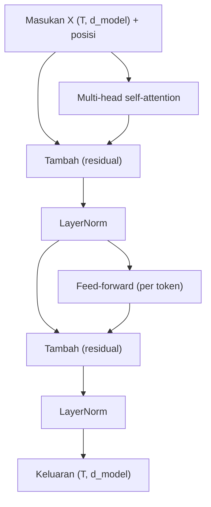

# Part 13 — Transformer

## Tujuan Pembelajaran

Setelah mempelajari bagian ini, kamu mampu:

- menjelaskan **multi-head attention** sebagai beberapa attention paralel yang digabung, beserta shape dan jumlah parameternya;
- menghitung **positional encoding** sinusoidal dan menjelaskan mengapa informasi posisi dibutuhkan;
- menjelaskan **koneksi residual** dan efeknya pada aliran gradien;
- menghitung **layer normalization** langkah demi langkah dan membedakannya dari *batch normalization*;
- menghitung **feed-forward network** per token beserta jumlah parameternya;
- menelusuri **aliran data dan shape tensor** melalui satu blok encoder Transformer;
- menghitung jumlah parameter satu lapisan encoder dan model berukuran BERT-base.

## Prasyarat

[Part 12 — Attention dan Self-Attention](12-attention-dan-self-attention.md) (satu kepala attention), [Part 3 — Matematika Neural Network](03-matematika-neural-network.md) (lapisan $XW+\mathbf{b}$), [Part 4](04-fungsi-aktivasi.md) (ReLU dan variannya), [Part 6](06-backpropagation-mendalam.md) (aliran gradien), dan [Part 8](08-regularisasi-dan-generalisasi.md) (dropout).

## Masalah yang Ingin Diselesaikan

Satu lapisan attention sudah membuat vektor token kontekstual, tetapi belum cukup: (1) satu pola perhatian terlalu sempit, (2) attention tidak mengetahui urutan, (3) tumpukan puluhan lapisan sulit dilatih, dan (4) attention hanya mencampur informasi antar-token, belum mengolah tiap token secara non-linear. **Transformer** menyusun attention bersama beberapa komponen pendukung menjadi blok yang dapat ditumpuk:

| Kebutuhan | Komponen |
|---|---|
| beberapa pola perhatian | *multi-head attention* |
| informasi urutan | *positional encoding* |
| melatih tumpukan dalam | koneksi residual dan *layer normalization* |
| pengolahan non-linear per token | *feed-forward network* |

## Intuisi dan Istilah Penting

- **Blok encoder**: satu unit yang dapat ditumpuk $N$ kali. Setiap blok menerima $(T,d_{\text{model}})$ dan mengeluarkan $(T,d_{\text{model}})$, sehingga bentuknya selalu sama dan mudah ditumpuk.
- **Kepala** (*head*): satu attention dengan proyeksi sendiri. $h$ kepala berjalan paralel pada subruang berdimensi lebih kecil.
- **Residual**: keluaran sublapisan ditambahkan ke masukannya, $\mathbf{y}=\mathbf{x}+F(\mathbf{x})$.
- **Normalisasi lapisan**: menormalkan tiap token terhadap elemen-elemen vektornya sendiri.
- **FFN**: dua lapisan padat dengan aktivasi di antaranya, diterapkan **terpisah dan sama** pada tiap token.



Diagram ini adalah urutan *post-LN* seperti pada Transformer asli dan BERT. Banyak model modern menaruh normalisasi **sebelum** sublapisan (*pre-LN*) karena melatih tumpukan dalam lebih stabil; ini variasi, dan prinsip perhitungannya sama.

## Rumus dan Penjelasan Setiap Simbol

### Multi-head attention

Dengan $h$ kepala dan $d_k=d_v=d_{\text{model}}/h$:

$$
\text{head}_i=\operatorname{Attention}\bigl(XW_Q^{(i)},\,XW_K^{(i)},\,XW_V^{(i)}\bigr)\in\mathbb{R}^{T\times d_v},\qquad i=1,\dots,h
$$

$$
\operatorname{MHA}(X)=\operatorname{Concat}(\text{head}_1,\dots,\text{head}_h)\,W_O,\qquad W_O\in\mathbb{R}^{d_{\text{model}}\times d_{\text{model}}}
$$

$W_Q^{(i)},W_K^{(i)}\in\mathbb{R}^{d_{\text{model}}\times d_k}$ dan $W_V^{(i)}\in\mathbb{R}^{d_{\text{model}}\times d_v}$ khusus kepala $i$. Konkatenasi menyambung kepala di sumbu terakhir menjadi $(T,h\,d_v)=(T,d_{\text{model}})$, lalu $W_O$ mencampur kepala-kepala itu. Parameter (tanpa bias): $3h\,d_{\text{model}}d_k+d_{\text{model}}^2=4\,d_{\text{model}}^2$. Memakai $h$ kepala berdimensi $d_k=d_{\text{model}}/h$ memiliki jumlah parameter dan komputasi yang kira-kira sama dengan satu kepala besar, tetapi menghasilkan $h$ pola perhatian berbeda.

### *Positional encoding* sinusoidal

Attention tidak peka urutan (Part 12): mengubah urutan masukan hanya mengubah urutan baris keluaran. Informasi posisi ditambahkan ke embedding: $X\leftarrow X+PE$ dengan $PE\in\mathbb{R}^{T\times d_{\text{model}}}$:

$$
PE_{(\text{pos},\,2i)}=\sin\!\left(\frac{\text{pos}}{10000^{2i/d_{\text{model}}}}\right),\qquad
PE_{(\text{pos},\,2i+1)}=\cos\!\left(\frac{\text{pos}}{10000^{2i/d_{\text{model}}}}\right)
$$

$\text{pos}=0,1,2,\dots$ adalah indeks posisi token, $i$ indeks pasangan dimensi. Dimensi berindeks kecil berosilasi cepat, yang berindeks besar lambat, sehingga setiap posisi mendapat "sidik jari" berbeda. BERT memakai **embedding posisi yang dipelajari** (tabel $(T_{\max},d)$ seperti embedding kata) sebagai ganti rumus tetap; fungsinya sama.

### Koneksi residual

$$
\mathbf{y}=\mathbf{x}+F(\mathbf{x}),\qquad \frac{\partial\mathbf{y}}{\partial\mathbf{x}}=I+\frac{\partial F}{\partial\mathbf{x}}
$$

Suku $I$ (matriks identitas) memberi jalur gradien langsung dari keluaran ke masukan, sehingga gradien tidak harus melewati setiap sublapisan dan tidak ikut mengecil bila $\partial F/\partial\mathbf{x}$ kecil. Syaratnya $F(\mathbf{x})$ dan $\mathbf{x}$ berdimensi sama, itulah sebabnya semua sublapisan menjaga $(T,d_{\text{model}})$.

### *Layer normalization*

Untuk vektor satu token $\mathbf{x}\in\mathbb{R}^{d}$ (dihitung **sepanjang elemen**, terpisah untuk tiap token):

$$
\mu=\frac1d\sum_{m=1}^dx_m,\qquad
\sigma^2=\frac1d\sum_{m=1}^d(x_m-\mu)^2,\qquad
\hat x_m=\frac{x_m-\mu}{\sqrt{\sigma^2+\varepsilon}},\qquad
y_m=\gamma_m\hat x_m+\beta_m
$$

$\varepsilon$ konstanta kecil (misalnya $10^{-5}$) untuk mencegah pembagian nol; $\gamma$ dan $\beta$ adalah parameter yang dipelajari (skala dan geser), masing-masing vektor berukuran $d$ dengan satu nilai per elemen ($\gamma_m$ dan $\beta_m$). Varians di sini dibagi $d$ (bukan $d-1$). Berbeda dengan *batch normalization* yang menghitung statistik sepanjang **batch** untuk tiap fitur, *layer normalization* tidak bergantung ukuran batch maupun panjang barisan sehingga cocok untuk teks.

### Feed-forward network

$$
\operatorname{FFN}(\mathbf{x})=\varphi(\mathbf{x}W_1+\mathbf{b}_1)W_2+\mathbf{b}_2,\qquad W_1\in\mathbb{R}^{d_{\text{model}}\times d_{\text{ff}}},\ W_2\in\mathbb{R}^{d_{\text{ff}}\times d_{\text{model}}}
$$

Biasanya $d_{\text{ff}}=4\,d_{\text{model}}$. Tensor $(T,d_{\text{model}})\to(T,d_{\text{ff}})\to(T,d_{\text{model}})$. Bobot yang **sama** dipakai untuk setiap token; token tidak saling bercampur di sini (pencampuran antar-token hanya terjadi di attention). Jumlah parameter: $2\,d_{\text{model}}d_{\text{ff}}+d_{\text{ff}}+d_{\text{model}}$. $\varphi$ adalah ReLU pada Transformer asli dan GELU (sejenis ReLU yang halus) pada BERT.

### Satu blok encoder (post-LN)

$$
\begin{aligned}
H&=\operatorname{LayerNorm}\bigl(X+\operatorname{MHA}(X)\bigr)\\
Y&=\operatorname{LayerNorm}\bigl(H+\operatorname{FFN}(H)\bigr)
\end{aligned}
$$

Setiap tahap menghasilkan $(T,d_{\text{model}})$. Encoder adalah $N$ blok bertumpuk; keluaran blok terakhir adalah representasi kontekstual tiap token.

## Contoh Numerik Langkah demi Langkah

### Contoh 1 — Dua kepala (proyeksi identitas, ilustrasi)

$d_{\text{model}}=4$, $h=2$, $d_k=d_v=2$, dua token. **Untuk menyederhanakan, semua proyeksi dianggap identitas yang membagi dimensi** (kepala 1 memakai elemen 1–2, kepala 2 elemen 3–4); pada model sungguhan proyeksi dipelajari.

$$
X=\begin{bmatrix}1&0&2&0\\0&1&0&2\end{bmatrix}\ \Rightarrow\ X^{(1)}=\begin{bmatrix}1&0\\0&1\end{bmatrix},\quad X^{(2)}=\begin{bmatrix}2&0\\0&2\end{bmatrix}
$$

- **Kepala 1.** Skor $X^{(1)}X^{(1)\top}=\begin{bmatrix}1&0\\0&1\end{bmatrix}$, terskala $\div\sqrt2$: diagonal $0{,}7071$, lainnya $0$. Softmax baris 1: $e^{0{,}7071}=2{,}0281$ dan $e^0=1$: $(0{,}6698,\ 0{,}3302)$. Keluaran $\begin{bmatrix}0{,}6698&0{,}3302\\0{,}3302&0{,}6698\end{bmatrix}$.
- **Kepala 2.** Skor $\begin{bmatrix}4&0\\0&4\end{bmatrix}$, terskala: diagonal $2{,}8284$. Softmax: $e^{2{,}8284}=16{,}919$: $(\tfrac{16{,}919}{17{,}919},\tfrac{1}{17{,}919})=(0{,}9442,\ 0{,}0558)$. Keluaran $\begin{bmatrix}1{,}8884&0{,}1116\\0{,}1116&1{,}8884\end{bmatrix}$.
- **Gabung** (konkatenasi): 

$$
\operatorname{Concat}=\begin{bmatrix}0{,}6698&0{,}3302&1{,}8884&0{,}1116\\0{,}3302&0{,}6698&0{,}1116&1{,}8884\end{bmatrix}\quad\text{shape }(2,4)
$$

Kepala 1 membagi perhatian lebih merata ($0{,}67/0{,}33$), kepala 2 jauh lebih tajam ($0{,}94/0{,}06$): dua kepala menghasilkan pola perhatian berbeda dari masukan yang sama. $W_O$ (di sini dianggap identitas) lalu mencampurkan keduanya.

### Contoh 2 — *Positional encoding*

Untuk $d_{\text{model}}=4$ ($i=0,1$): pembagi $10000^{0}=1$ dan $10000^{2/4}=100$.

| pos | $\sin(\text{pos}/1)$ | $\cos(\text{pos}/1)$ | $\sin(\text{pos}/100)$ | $\cos(\text{pos}/100)$ |
|---|---|---|---|---|
| 0 | $0{,}0000$ | $1{,}0000$ | $0{,}0000$ | $1{,}0000$ |
| 1 | $0{,}8415$ | $0{,}5403$ | $0{,}0100$ | $1{,}0000$ |
| 2 | $0{,}9093$ | $-0{,}4161$ | $0{,}0200$ | $0{,}9998$ |
| 3 | $0{,}1411$ | $-0{,}9900$ | $0{,}0300$ | $0{,}9996$ |

Dua dimensi pertama berubah cepat antar-posisi, dua dimensi terakhir lambat. Setiap baris berbeda, sehingga menambahkannya ke embedding menandai posisi.

**Mengapa dibutuhkan.** Tanpa posisi, memakai $X$ dari Contoh 1 dan membalik urutan tokennya hanya membalik baris keluaran (diperiksa di kode): attention memperlakukan "token A lalu B" sama dengan "B lalu A" kecuali ada informasi posisi.

### Contoh 3 — Residual dan aliran gradien (skalar, disederhanakan)

$x=2$ dan $F(x)=0{,}1x$. Keluaran $y=2+0{,}2=2{,}2$. Turunan $dy/dx=1+0{,}1=1{,}1$, sedangkan tanpa residual ($y=F(x)$) turunannya $0{,}1$. Untuk 10 lapisan bersusun, turunan total tanpa residual $0{,}1^{10}=10^{-10}$ (menghilang), dengan residual $1{,}1^{10}=2{,}5937$. Ini hanya skalar yang sangat disederhanakan: pada jaringan nyata $F$ tidak linear dan gradien dapat pula membesar; tetapi inilah intuisi mengapa jalur identitas membantu pelatihan yang dalam.

### Contoh 4 — *Layer normalization*

Vektor satu token $\mathbf{x}=(1,\,2,\,3,\,6)$, $d=4$.

1. Rata-rata $\mu=\dfrac{1+2+3+6}{4}=3$.
2. Varians $\sigma^2=\dfrac{(1-3)^2+(2-3)^2+(3-3)^2+(6-3)^2}{4}=\dfrac{4+1+0+9}{4}=3{,}5$; $\sigma=1{,}8708$.
3. Normalisasi (abaikan $\varepsilon$): $\hat{\mathbf{x}}=\bigl(\tfrac{-2}{1{,}8708},\tfrac{-1}{1{,}8708},0,\tfrac{3}{1{,}8708}\bigr)=(-1{,}0690,\ -0{,}5345,\ 0,\ 1{,}6036)$.
4. Periksa: jumlah $\hat{\mathbf{x}}=0$, dan rata-rata kuadratnya $1{,}0$ (mean $0$, varians $1$).
5. Dengan $\gamma=2$ dan $\beta=1$ untuk semua elemen: $\mathbf{y}=2\hat{\mathbf{x}}+1=(-1{,}1381,\ -0{,}0690,\ 1,\ 4{,}2071)$. $\gamma$ dan $\beta$ dapat mengembalikan skala dan geser yang dibutuhkan jaringan.

### Contoh 5 — *Feed-forward* per token

$d_{\text{model}}=2$, $d_{\text{ff}}=3$, $W_1=\begin{bmatrix}1&-1&0\\0&1&2\end{bmatrix}$, $\mathbf{b}_1=(0,\ 0{,}5,\ -1)$, $W_2=\begin{bmatrix}1&0\\0&1\\1&1\end{bmatrix}$, $\mathbf{b}_2=(0{,}1,\ 0{,}2)$, ReLU.

- Token $\mathbf{x}=(1,2)$: $\mathbf{x}W_1+\mathbf{b}_1=(1,\ -1+2+0{,}5,\ 4-1)=(1,\ 1{,}5,\ 3)$; ReLU tidak mengubahnya (semua positif). Lalu $(1,1{,}5,3)W_2+\mathbf{b}_2=(1+3+0{,}1,\ 1{,}5+3+0{,}2)=(4{,}1,\ 4{,}7)$.
- Token $\mathbf{x}=(2,0)$: $\mathbf{x}W_1+\mathbf{b}_1=(2,\ -2+0{,}5,\ -1)=(2,\ -1{,}5,\ -1)$; ReLU $\to(2,0,0)$. Lalu $(2,0,0)W_2+\mathbf{b}_2=(2{,}1,\ 0{,}2)$.

Kedua token memakai $W_1,W_2$ yang sama tetapi diproses sendiri-sendiri. Jumlah parameter FFN ini: $2\cdot2\cdot3+3+2=17$ (yaitu $6+6$ bobot dan $5$ bias).

### Contoh 6 — Aliran shape dan jumlah parameter (ukuran BERT-base)

Konfigurasi BERT-base asli: $d_{\text{model}}=768$, $h=12$ ($d_k=64$), $d_{\text{ff}}=3072$, $N=12$ lapisan. Untuk $T$ token dalam satu kalimat (dan batch $B$, $(B,T,\cdot)$):

| Tahap | Shape |
|---|---|
| masukan $X$ | $(T,768)$ |
| $Q,K,V$ per kepala | $(T,64)$ |
| skor per kepala | $(T,T)$, ada 12 |
| konkatenasi kepala | $(T,768)$ |
| setelah $W_O$, residual, LayerNorm | $(T,768)$ |
| FFN tengah | $(T,3072)$ |
| keluaran blok | $(T,768)$ |

Parameter satu lapisan (dengan bias):

- Attention: $4(768^2+768)=2{,}362{,}368$.
- FFN: $768\cdot3072+3072+3072\cdot768+768=4{,}722{,}432$.
- Dua LayerNorm: $2\cdot(2\cdot768)=3{,}072$.
- Total per lapisan: $7{,}087{,}872$; untuk $12$ lapisan: $85{,}054{,}464$.

Ditambah embedding (kosakata $30{,}522\times768$, posisi $512\times768$, segmen $2\times768$, LayerNorm embedding $2\times768$) $=23{,}837{,}184$ dan *pooler* ($768^2+768=590{,}592$), totalnya $109{,}482{,}240$, sesuai angka yang lazim dilaporkan untuk BERT-base bahasa Inggris (sekitar 110 juta). Model berbahasa lain, termasuk varian IndoBERT, memakai kosakata sendiri sehingga jumlah parameter embeddingnya berbeda; periksa konfigurasi model yang dipakai. Bagian lapisan encoder bergantung pada $d_{\text{model}}$, $d_{\text{ff}}$, dan $N$ saja.

## Interpretasi, Asumsi, dan Keterbatasan

- Contoh kecil memakai proyeksi identitas atau bobot buatan agar dapat dilacak; pada model sungguhan semua matriks dipelajari dan dimensinya besar. Angka sebenarnya jauh lebih rumit, namun **rumus dan shape-nya sama**.
- Hitungan penuh model berukuran BERT tidak mungkin dilakukan manual. Yang dilakukan framework adalah menjalankan rumus-rumus ini dengan tensor besar di GPU dan menurunkannya otomatis ([Part 6](06-backpropagation-mendalam.md)).
- Positional encoding sinusoidal dan embedding posisi yang dipelajari sama-sama pilihan; masing-masing punya batas panjang atau kemampuan generalisasi berbeda.
- Contoh residual (Contoh 3) menyederhanakan: ia menunjukkan jalur identitas, bukan menjamin pelatihan stabil.
- *Pre-LN* vs *post-LN* adalah pilihan desain yang memengaruhi stabilitas; hasilnya bergantung pada kedalaman dan penyetelan.
- Biaya attention tumbuh $T^2$ ([Part 12](12-attention-dan-self-attention.md)); FFN dan proyeksi tumbuh linear terhadap $T$.
- Transformer bukan satu-satunya arsitektur; ini salah satu pilihan yang kini dominan untuk bahasa.

## Hubungan dengan Deep Learning dan NLP

Encoder-only (BERT dan IndoBERT) menumpuk blok seperti di atas dengan attention dua arah; decoder-only (model bahasa generatif) memakai mask kausal ([Part 12](12-attention-dan-self-attention.md)); encoder–decoder menambah cross-attention. Pada klasifikasi pesan Emergency vs Non-Emergency (contoh/simulasi), representasi kontekstual tiap token dari blok terakhir dirangkum (misalnya vektor token khusus `[CLS]`) lalu diberi lapisan klasifikasi ([Part 14](14-fondasi-matematis-bert-dan-indobert.md)). Dropout dan *weight decay* ([Part 8](08-regularisasi-dan-generalisasi.md)) dipakai di dalam blok.

## Python

Pustaka standar saja. Fungsi `attention` sama dengan di Part 12.

```python
import math

def matmul(P, Q):
    return [[sum(P[i][k] * Q[k][j] for k in range(len(Q)))
             for j in range(len(Q[0]))] for i in range(len(P))]

def T(M):
    return [list(k) for k in zip(*M)]

def softmax(zs):
    m = max(zs)
    e = [math.exp(z - m) for z in zs]
    s = sum(e)
    return [v / s for v in e]

def attention(Q, K, V):
    dk = len(K[0])
    S = [[s / math.sqrt(dk) for s in b] for b in matmul(Q, T(K))]
    A = [softmax(b) for b in S]
    return A, matmul(A, V)

r = lambda M, n=4: [[round(v, n) for v in b] for b in M]

# 1) multi-head dengan proyeksi identitas (ilustrasi): d_model = 4, h = 2, d_k = 2
X = [[1, 0, 2, 0], [0, 1, 0, 2]]
kepala = [[b[0:2] for b in X], [b[2:4] for b in X]]
hasil = []
for h, Xh in enumerate(kepala, 1):
    A, O = attention(Xh, Xh, Xh)
    print("kepala", h, r(A), r(O))
    hasil.append(O)
gabung = [hasil[0][i] + hasil[1][i] for i in range(2)]
print(r(gabung))

# 2) positional encoding sinusoidal, d = 4
def pe(pos, d):
    v = []
    for i in range(d // 2):
        sudut = pos / 10000 ** (2 * i / d)
        v += [math.sin(sudut), math.cos(sudut)]
    return v
for pos in range(3):
    print(pos, [round(x, 4) for x in pe(pos, 4)])

# permutasi: tanpa PE, membalik urutan hanya membalik baris keluaran
A1, O1 = attention(X, X, X)
A2, O2 = attention(X[::-1], X[::-1], X[::-1])
print(r(O2[::-1]) == r(O1))

# 3) residual: gradien jalur identitas
x, F = 2.0, lambda v: 0.1 * v
print(x + F(x), 1 + 0.1, "%.0e" % 0.1 ** 10, round(1.1 ** 10, 4))

# 4) layer normalization
def layernorm(x, gamma=None, beta=None, eps=1e-5):
    d = len(x)
    mu = sum(x) / d
    var = sum((v - mu) ** 2 for v in x) / d
    xh = [(v - mu) / math.sqrt(var + eps) for v in x]
    gamma = gamma or [1.0] * d
    beta = beta or [0.0] * d
    return mu, var, xh, [g * h + b for g, h, b in zip(gamma, xh, beta)]

mu, var, xh, y = layernorm([1.0, 2.0, 3.0, 6.0])
print(mu, var, [round(v, 4) for v in xh], abs(round(sum(xh), 6)), round(sum(v * v for v in xh) / 4, 4))
print([round(v, 4) for v in layernorm([1.0, 2.0, 3.0, 6.0], [2.0] * 4, [1.0] * 4)[3]])

# 5) feed-forward per token: d = 2 -> d_ff = 3 -> d = 2 (ReLU)
W1, b1 = [[1, -1, 0], [0, 1, 2]], [0.0, 0.5, -1.0]
W2, b2 = [[1, 0], [0, 1], [1, 1]], [0.1, 0.2]
def ffn(x):
    h = [max(0.0, sum(x[i] * W1[i][j] for i in range(2)) + b1[j]) for j in range(3)]
    return h, [sum(h[j] * W2[j][k] for j in range(3)) + b2[k] for k in range(2)]
for tok in ([1.0, 2.0], [2.0, 0.0]):
    h, o = ffn(tok)
    print(tok, h, [round(v, 4) for v in o])

# 6) jumlah parameter satu lapisan encoder (d = 768, h = 12, d_ff = 3072)
d, dff = 768, 3072
att = 4 * (d * d + d)
ff = d * dff + dff + dff * d + d
ln = 2 * (2 * d)
print(att, ff, ln, att + ff + ln, 12 * (att + ff + ln))
emb = 30522 * d + 512 * d + 2 * d + 2 * d
pool = d * d + d
print(emb, pool, 12 * (att + ff + ln) + emb + pool)
```

Keluaran:

```text
kepala 1 [[0.6698, 0.3302], [0.3302, 0.6698]] [[0.6698, 0.3302], [0.3302, 0.6698]]
kepala 2 [[0.9442, 0.0558], [0.0558, 0.9442]] [[1.8884, 0.1116], [0.1116, 1.8884]]
[[0.6698, 0.3302, 1.8884, 0.1116], [0.3302, 0.6698, 0.1116, 1.8884]]
0 [0.0, 1.0, 0.0, 1.0]
1 [0.8415, 0.5403, 0.01, 1.0]
2 [0.9093, -0.4161, 0.02, 0.9998]
True
2.2 1.1 1e-10 2.5937
3.0 3.5 [-1.069, -0.5345, 0.0, 1.6036] 0.0 1.0
[-1.1381, -0.069, 1.0, 4.2071]
[1.0, 2.0] [1.0, 1.5, 3.0] [4.1, 4.7]
[2.0, 0.0] [2.0, 0.0, 0.0] [2.1, 0.2]
2362368 4722432 3072 7087872 85054464
23837184 590592 109482240
```

Semua angka sama dengan Contoh 1 sampai 6. Baris `True` memeriksa bahwa membalik urutan masukan hanya membalik baris keluaran attention (tanpa informasi posisi). Pada satu blok lengkap, hanya langkah-langkah ini yang dirangkai berurutan, sesuai urutan *post-LN* di atas.

## Kesalahan Umum

1. **Menyamakan banyak kepala dengan banyak lapisan.** Kepala berjalan paralel pada lapisan yang sama; lapisan ditumpuk berurutan.
2. **Salah dimensi kepala:** $d_k=d_{\text{model}}/h$ harus bilangan bulat; konkatenasi harus kembali ke $d_{\text{model}}$.
3. **Mengira attention memahami urutan.** Tanpa positional encoding urutan tidak terlihat.
4. **Menormalkan sepanjang sumbu yang salah.** *Layer normalization* bekerja sepanjang elemen vektor satu token, bukan sepanjang batch atau token.
5. **Mengacaukan $d$ dan $d-1$.** Varians pada LayerNorm dibagi $d$.
6. **Lupa bahwa FFN berbagi bobot antar-token** (dan tidak mencampur token).
7. **Menukar urutan residual dan LayerNorm** tanpa menyadari perbedaan *post-LN* dan *pre-LN*.
8. **Mengira Transformer dapat dihitung manual penuh.** Contoh kecil hanya menjelaskan prinsip; skala besar dijalankan framework.

## Latihan Mandiri

1. Hitung jumlah parameter multi-head attention (tanpa bias) untuk $d_{\text{model}}=512$, $h=8$. Berapa $d_k$?
2. Untuk $T=10$, $d_{\text{model}}=512$, $h=8$: tentukan shape $Q$ per kepala, skor per kepala, konkatenasi, dan jumlah matriks skor.
3. Hitung positional encoding sinusoidal $d_{\text{model}}=4$ untuk posisi $3$ (empat nilai).
4. Terapkan *layer normalization* (abaikan $\varepsilon$) pada $\mathbf{x}=(2,4,6,8)$ dengan $\gamma=1$, $\beta=0$.
5. Untuk $\hat{\mathbf{x}}$ pada soal 4, hitung keluaran bila $\gamma=0{,}5$ dan $\beta=2$ untuk semua elemen.
6. Residual $y=x+F(x)$ dengan $F(x)=-0{,}5x$ dan $x=4$. Hitung $y$ dan $dy/dx$. Lalu hitung $dy/dx$ total untuk 3 lapisan dengan $F(x)=0{,}1x$.
7. FFN pada Contoh 5 untuk token $\mathbf{x}=(0,3)$.
8. Hitung jumlah parameter FFN dengan $d_{\text{model}}=512$ dan $d_{\text{ff}}=2048$ (dengan bias).
9. Jelaskan, dengan contoh pertukaran dua token, mengapa positional encoding diperlukan.
10. Mengapa memakai $h=8$ kepala berdimensi $64$ lebih disukai daripada satu kepala berdimensi $512$ walau jumlah parameter dan ukuran konkatenasi sama?

## Kunci Jawaban dan Pembahasan

??? success "Soal 1"
    $d_k=512/8=64$. Parameter: $4\cdot512^2=4\cdot262{,}144=1{,}048{,}576$ (yaitu $3\cdot8\cdot512\cdot64=786{,}432$ untuk $W_Q,W_K,W_V$ semua kepala, ditambah $512^2=262{,}144$ untuk $W_O$).

??? success "Soal 2"
    $Q$ per kepala: $(10,64)$. Skor per kepala: $(10,10)$, sebanyak $8$ matriks. Konkatenasi: $(10,8\cdot64)=(10,512)$.

??? success "Soal 3"
    Pasangan pertama: $\sin(3)=0{,}1411$, $\cos(3)=-0{,}9900$. Pasangan kedua (pembagi $100$): $\sin(0{,}03)=0{,}0300$, $\cos(0{,}03)=0{,}9996$. Hasil $(0{,}1411,\ -0{,}9900,\ 0{,}0300,\ 0{,}9996)$.

??? success "Soal 4"
    $\mu=5$, $\sigma^2=\dfrac{9+1+1+9}{4}=5$, $\sigma=2{,}2361$. $\hat{\mathbf{x}}=(-1{,}3416,\ -0{,}4472,\ 0{,}4472,\ 1{,}3416)$.

??? success "Soal 5"
    $0{,}5\hat{\mathbf{x}}+2=(1{,}3292,\ 1{,}7764,\ 2{,}2236,\ 2{,}6708)$.

??? success "Soal 6"
    $y=4+(-0{,}5)(4)=2$; $dy/dx=1-0{,}5=0{,}5$. Tiga lapisan dengan $F=0{,}1x$: $1{,}1^3=1{,}331$.

??? success "Soal 7"
    $\mathbf{x}W_1+\mathbf{b}_1=(0,\ 0\cdot(-1)+3\cdot1+0{,}5,\ 0+3\cdot2-1)=(0,\ 3{,}5,\ 5)$. ReLU tidak mengubahnya. $(0,3{,}5,5)W_2+\mathbf{b}_2=(0+0+5+0{,}1,\ 0+3{,}5+5+0{,}2)=(5{,}1,\ 8{,}7)$.

??? success "Soal 8"
    $512\cdot2048+2048+2048\cdot512+512=1{,}048{,}576+2{,}048+1{,}048{,}576+512=2{,}099{,}712$.

??? success "Soal 9"
    Attention memperlakukan barisan sebagai himpunan: menukar dua token hanya menukar baris keluaran yang bersesuaian (diperiksa di kode). Jadi "banjir naik" dan "naik banjir" mendapat keluaran yang sama untuk token yang sama, sampai ada informasi posisi. Positional encoding menambahkan vektor yang berbeda untuk setiap posisi sehingga token yang sama di posisi berbeda memiliki masukan berbeda.

??? success "Soal 10"
    Dengan $h=8$ kepala, tiap kepala punya pola perhatian sendiri (misalnya satu kepala menyorot token yang berdekatan, yang lain menyorot kata kunci), sedangkan satu kepala besar hanya menghasilkan satu distribusi atas token untuk tiap query. Total parameter dan ukuran konkatenasi sama, sehingga tambahan kemampuan tidak membutuhkan biaya parameter yang jauh lebih besar. Apakah tiap kepala benar-benar mempelajari pola yang berbeda dan berguna adalah pertanyaan empiris, bukan jaminan.

## Ringkasan Materi

- **Multi-head attention**: $h$ kepala berdimensi $d_k=d_{\text{model}}/h$, digabung lalu dikali $W_O$; parameter $4d_{\text{model}}^2$ (tanpa bias).
- **Positional encoding** (sinusoidal atau dipelajari) menambahkan informasi urutan yang tidak dimiliki attention.
- **Residual** $\mathbf{y}=\mathbf{x}+F(\mathbf{x})$ memberi jalur gradien identitas; **LayerNorm** menormalkan tiap token sepanjang elemennya: $(x-\mu)/\sqrt{\sigma^2+\varepsilon}$ lalu $\gamma,\beta$.
- **FFN** per token: $\varphi(xW_1+b_1)W_2+b_2$ dengan $d_{\text{ff}}=4d_{\text{model}}$.
- Blok encoder (post-LN): $H=\operatorname{LN}(X+\operatorname{MHA}(X))$, $Y=\operatorname{LN}(H+\operatorname{FFN}(H))$; semua tahap menjaga shape $(T,d_{\text{model}})$ sehingga dapat ditumpuk $N$ kali.
- BERT-base: $d=768$, $h=12$, $d_{\text{ff}}=3072$, $N=12$; sekitar $109{,}5$ juta parameter menurut hitungan struktur di atas.

## Checklist Penguasaan

- [ ] Menghitung multi-head attention kecil dan shape konkatenasinya.
- [ ] Menghitung positional encoding sinusoidal.
- [ ] Menjelaskan residual dan jalur gradien identitas.
- [ ] Menghitung *layer normalization* langkah demi langkah.
- [ ] Menghitung FFN per token dan jumlah parameternya.
- [ ] Menelusuri shape tensor melalui satu blok encoder.
- [ ] Menghitung jumlah parameter satu lapisan encoder.

## Prasyarat untuk Materi Berikutnya

[Part 14 — Fondasi Matematis BERT dan IndoBERT](14-fondasi-matematis-bert-dan-indobert.md) memakai tumpukan blok encoder ini: embedding kontekstual, pralatih dengan *masked language modeling*, lalu *fine-tuning* dengan *classification head*, loss, dan pembaruan parameter. Pastikan kamu dapat menelusuri shape melalui satu blok dan mengingat softmax serta cross-entropy ([Part 11](11-softmax-dan-probabilitas-keluaran.md)).
