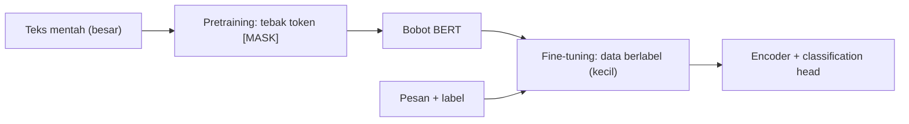

# Part 14 — Fondasi Matematis BERT dan IndoBERT

## Tujuan Pembelajaran

Setelah mempelajari bagian ini, kamu mampu:

- menjelaskan bagaimana **BERT** membentuk masukan (embedding token, posisi, segmen) dan menghasilkan **embedding kontekstual** lewat tumpukan encoder Transformer;
- membedakan **pretraining** (*masked language modeling*) dari **fine-tuning** (klasifikasi), dari segi data, tujuan, loss, dan parameter yang diperbarui;
- menghitung loss **MLM** pada contoh kecil, termasuk komposisi pemilihan token (15%, 80/10/10);
- menghitung **classification head** (logit, softmax, cross-entropy) dan gradiennya, termasuk gradien yang mengalir kembali ke encoder;
- menjelaskan mengapa *fine-tuning* memakai *learning rate* kecil dan memperkirakan seberapa jauh parameter bergerak;
- menyebut batas klaim: bagian ini adalah pengantar matematika, bukan pelatihan model sungguhan.

## Prasyarat

[Part 13 — Transformer](13-transformer.md) (blok encoder), [Part 11 — Softmax dan Probabilitas Keluaran](11-softmax-dan-probabilitas-keluaran.md) (softmax dan cross-entropy dari logit), [Part 7 — Optimasi Deep Learning](07-optimasi-deep-learning.md) (Adam, learning rate, warmup), [Part 8](08-regularisasi-dan-generalisasi.md) (weight decay, dropout, early stopping), dan [Level 4 Part 11](../level-4-matematika-ml-klasik/11-evaluasi-dan-pemilihan-model.md) (presisi, *recall*, F1 pada kelas tak seimbang).

## Masalah yang Ingin Diselesaikan

Melatih model bahasa dari nol butuh data teks sangat besar dan komputasi mahal, sedangkan data berlabel untuk satu tugas (misalnya klasifikasi pesan darurat) biasanya sedikit. Gagasan BERT: **belajar bahasa dulu tanpa label** dari teks mentah (*pretraining*), lalu **menyesuaikan sedikit** untuk tugas berlabel (*fine-tuning*). Pengetahuan bahasa dipindahkan lewat bobot model yang sudah dilatih.

## Intuisi dan Istilah Penting

- **BERT** (*Bidirectional Encoder Representations from Transformers*): tumpukan encoder Transformer ([Part 13](13-transformer.md)) yang melihat konteks **dua arah** (tanpa mask kausal), sehingga vektor tiap token memuat informasi token di kiri dan kanan.
- **IndoBERT**: sebutan untuk model berarsitektur BERT yang dilatih pada teks bahasa Indonesia. Nama ini dipakai oleh beberapa varian dari kelompok berbeda dengan kosakata, korpus, dan ukuran berbeda; **periksa kartu model** varian yang dipakai. Matematika di bagian ini berlaku untuk keluarganya.
- **Token khusus**: `[CLS]` di awal barisan (vektor akhirnya dipakai untuk klasifikasi), `[SEP]` pemisah atau akhir kalimat, `[MASK]` penanda token yang disembunyikan, `[PAD]` pengisi.
- **Pretraining**: pelatihan tanpa label manusia dengan tugas yang labelnya diambil dari teks itu sendiri (token yang disembunyikan).
- **Fine-tuning**: melanjutkan pelatihan seluruh model (encoder + kepala baru) pada tugas berlabel.
- **Classification head**: lapisan linear kecil di atas vektor `[CLS]` yang menghasilkan logit per kelas.



## Rumus dan Penjelasan Setiap Simbol

### Masukan dan keluaran encoder

Untuk barisan token berpanjang $T$ (termasuk `[CLS]` dan `[SEP]`):

$$
\mathbf{x}_t=\operatorname{LayerNorm}\bigl(E_{\text{token}}[w_t]+E_{\text{posisi}}[t]+E_{\text{segmen}}[s_t]\bigr),\qquad X\in\mathbb{R}^{T\times d}
$$

$w_t$ ID token ke-$t$, $s_t$ penanda segmen (kalimat pertama atau kedua), dan masing-masing $E$ adalah tabel embedding ([Part 9](09-embedding-dan-representasi-vektor.md)) yang dijumlahkan. $X$ lalu melewati $N$ blok encoder ([Part 13](13-transformer.md)) dan menghasilkan

$$
H=\operatorname{Encoder}(X)\in\mathbb{R}^{T\times d},\qquad H_{t,:}=\mathbf{h}_t
$$

$\mathbf{h}_t$ adalah **embedding kontekstual** token $t$: berbeda untuk kata yang sama pada kalimat berbeda.

### *Masked language modeling* (MLM)

Pilih sekitar $15\%$ posisi secara acak sebagai himpunan $\mathcal{M}$. Untuk posisi terpilih: $80\%$ diganti `[MASK]`, $10\%$ diganti token acak, $10\%$ dibiarkan. Model menebak token aslinya dari $\mathbf{h}_t$ memakai softmax atas seluruh kosakata ($V$ token):

$$
\mathbf{z}_t=E_{\text{keluaran}}\,\mathbf{h}_t+\mathbf{b}\in\mathbb{R}^V,\qquad
\mathbf{p}_t=\operatorname{softmax}(\mathbf{z}_t),\qquad
L_{\text{MLM}}=-\frac{1}{\lvert\mathcal{M}\rvert}\sum_{t\in\mathcal{M}}\ln p_{t,\,w_t}
$$

$E_{\text{keluaran}}\in\mathbb{R}^{V\times d}$ sering **berbagi bobot** dengan tabel embedding token (disebut *weight tying*). Loss dihitung **hanya** di posisi $\mathcal{M}$. Pencampuran 80/10/10 mengurangi ketidakcocokan karena `[MASK]` tidak pernah muncul saat *fine-tuning*. (BERT asli juga memakai tugas *next sentence prediction*; varian berikutnya sering menghilangkannya, dan bagian ini tidak membahasnya.)

### *Fine-tuning* untuk klasifikasi

Ambil vektor `[CLS]` ($\mathbf{h}_{\text{CLS}}=\mathbf{h}_1$) dan tambahkan kepala linear untuk $K$ kelas:

$$
\mathbf{z}=\mathbf{h}_{\text{CLS}}W_c+\mathbf{b}_c,\qquad \mathbf{p}=\operatorname{softmax}(\mathbf{z}),\qquad
\ell=-\ln p_{c},\qquad L=\frac1n\sum_{i=1}^n\ell^{(i)}
$$

$W_c\in\mathbb{R}^{d\times K}$ dan $\mathbf{b}_c\in\mathbb{R}^{K}$ adalah parameter **baru** (acak di awal), $c$ kelas benar, dan loss adalah cross-entropy ([Part 5](05-loss-function.md)). Beberapa implementasi menaruh dropout dan satu lapisan tambahan (*pooler*) sebelum kepala; pola dasarnya sama. Jumlah parameter kepala: $dK+K$.

Gradien terhadap logit adalah $\mathbf{p}-\mathbf{y}$ ([Part 6](06-backpropagation-mendalam.md)), sehingga

$$
\frac{\partial\ell}{\partial W_c}=\mathbf{h}_{\text{CLS}}^\top(\mathbf{p}-\mathbf{y}),\qquad
\frac{\partial\ell}{\partial\mathbf{b}_c}=\mathbf{p}-\mathbf{y},\qquad
\frac{\partial\ell}{\partial\mathbf{h}_{\text{CLS}}}=(\mathbf{p}-\mathbf{y})\,W_c^\top
$$

Suku terakhir adalah gradien yang **mengalir ke encoder** dan diteruskan lewat *backpropagation* ke semua lapisan (attention, FFN, embedding). Itu sebabnya seluruh model ikut berubah saat *fine-tuning*.

### Pembaruan parameter

Fine-tuning umumnya memakai AdamW ([Part 7](07-optimasi-deep-learning.md)), yakni Adam dengan *weight decay* yang dipisahkan dari gradien:

$$
\theta\leftarrow\theta-\eta\left(\frac{\hat m}{\sqrt{\hat s}+\varepsilon}+\lambda\,\theta\right)
$$

$\lambda$ adalah koefisien *weight decay*. *Learning rate* $\eta$ kecil (kisaran yang lazim dilaporkan sekitar $10^{-5}$ sampai $5\times10^{-5}$) dengan *warmup*, jumlah epoch sedikit (misalnya 2–4), karena model sudah punya pengetahuan bahasa dan data berlabel kecil rentan *overfitting* ([Part 8](08-regularisasi-dan-generalisasi.md)).

### Pretraining vs *fine-tuning*

| Aspek | Pretraining | Fine-tuning |
|---|---|---|
| Data | teks mentah sangat besar, tanpa label manusia | data berlabel untuk tugas, biasanya kecil |
| Tujuan | menebak token yang disembunyikan (MLM) | memprediksi kelas |
| Keluaran | softmax atas kosakata ($V$ kelas) | softmax atas $K$ kelas tugas |
| Loss | cross-entropy pada posisi $\mathcal{M}$ | cross-entropy pada label |
| Parameter baru | tidak ada | kepala klasifikasi $W_c,\mathbf{b}_c$ |
| Parameter diperbarui | semua, dari awal | semua (atau sebagian), dari bobot pralatih |
| Learning rate | relatif lebih besar, jadwal panjang | kecil, beberapa epoch |
| Biaya | sangat besar | kecil sampai sedang |

## Contoh Numerik Langkah demi Langkah

Semua vektor di bawah adalah **angka contoh** untuk melacak hitungan, **bukan keluaran BERT sungguhan**; label dan pesan adalah **data contoh/simulasi**.

### Contoh 1 — Loss MLM

Kalimat "tolong ada `[MASK]` di gedung"; jawaban benar "kebakaran". Misalkan $\mathbf{h}_t=(1,\ 0{,}5)$ ($d=2$) dan embedding keluaran empat kandidat: kebakaran $(1{,}5,\ 1)$, banjir $(1,\ 0{,}5)$, makan $(-0{,}5,\ 0{,}5)$, rapat $(0,\ -1)$ (kosakata dibatasi empat agar mudah; sungguhan $V$ puluhan ribu).

1. Logit $\mathbf{z}=E_{\text{keluaran}}\mathbf{h}_t$: kebakaran $1{,}5\cdot1+1\cdot0{,}5=2$; banjir $1+0{,}25=1{,}25$; makan $-0{,}5+0{,}25=-0{,}25$; rapat $0-0{,}5=-0{,}5$.
2. Softmax: $e^{2}=7{,}389$, $e^{1{,}25}=3{,}490$, $e^{-0{,}25}=0{,}779$, $e^{-0{,}5}=0{,}607$; jumlah $12{,}264$; $\mathbf{p}=(0{,}6025,\ 0{,}2846,\ 0{,}0635,\ 0{,}0495)$.
3. Loss: $-\ln0{,}6025=0{,}5067$.
4. Gradien terhadap logit $\mathbf{p}-\mathbf{y}=(-0{,}3975,\ 0{,}2846,\ 0{,}0635,\ 0{,}0495)$ (jumlah $0$): kandidat benar didorong naik, yang lain turun.

Gradien ini mengalir ke $\mathbf{h}_t$ dan seluruh encoder; model belajar bahwa konteks "tolong ada ... di gedung" cocok dengan "kebakaran".

### Contoh 2 — Komposisi pemilihan token

Untuk barisan 100 token: $15$ token dipilih; dari itu $12$ diganti `[MASK]`, $1{,}5$ (rata-rata) diganti token acak, $1{,}5$ dibiarkan tetap. Loss dihitung hanya pada $15$ posisi itu, tidak pada $85$ posisi lainnya.

### Contoh 3 — Satu langkah *fine-tuning* klasifikasi

Pesan contoh dengan vektor `[CLS]` kontekstual $\mathbf{h}_{\text{CLS}}=(0{,}5,\ -1,\ 2)$ ($d=3$). Kelas: 0 = Emergency, 1 = Non-Emergency; label benar kelas 0. Kepala awal:

$$
W_c=\begin{bmatrix}1&0\\0&1\\0{,}5&0{,}5\end{bmatrix},\qquad\mathbf{b}_c=(0,\ 0)
$$

**Forward.** $\mathbf{z}=\mathbf{h}W_c+\mathbf{b}=(0{,}5\cdot1+0+2\cdot0{,}5,\ \ 0+(-1)\cdot1+2\cdot0{,}5)=(1{,}5,\ 0)$. $\mathbf{p}=\operatorname{softmax}(1{,}5,0)=(0{,}8176,\ 0{,}1824)$ (sama dengan $\sigma(1{,}5)$). Loss $=-\ln0{,}8176=0{,}2014$.

**Backward.** $\mathbf{p}-\mathbf{y}=(0{,}8176-1,\ 0{,}1824)=(-0{,}1824,\ 0{,}1824)$.

- $\dfrac{\partial\ell}{\partial W_c}=\mathbf{h}^\top(\mathbf{p}-\mathbf{y})=\begin{bmatrix}0{,}5\\-1\\2\end{bmatrix}\begin{bmatrix}-0{,}1824&0{,}1824\end{bmatrix}=\begin{bmatrix}-0{,}0912&0{,}0912\\0{,}1824&-0{,}1824\\-0{,}3649&0{,}3649\end{bmatrix}$, shape $(3,2)$.
- $\dfrac{\partial\ell}{\partial\mathbf{b}_c}=(-0{,}1824,\ 0{,}1824)$.
- $\dfrac{\partial\ell}{\partial\mathbf{h}_{\text{CLS}}}=(\mathbf{p}-\mathbf{y})W_c^\top=\bigl(1\cdot(-0{,}1824),\ 1\cdot0{,}1824,\ 0{,}5(-0{,}1824)+0{,}5(0{,}1824)\bigr)=(-0{,}1824,\ 0{,}1824,\ 0)$. Vektor ini diteruskan ke encoder.

Pemeriksaan numerik untuk elemen $W_c[1,1]$: turunan numerik tengah $=-0{,}0912$, sama dengan hasil di atas.

**Update** dengan $\eta=0{,}5$ (angka besar hanya agar perubahan terlihat; fine-tuning nyata memakai $\eta$ jauh lebih kecil):

$$
W_c\leftarrow\begin{bmatrix}1{,}0456&-0{,}0456\\-0{,}0912&1{,}0912\\0{,}6824&0{,}3176\end{bmatrix},\qquad\mathbf{b}_c\leftarrow(0{,}0912,\ -0{,}0912)
$$

*Forward* ulang memberi $\mathbf{p}=(0{,}9334,\ 0{,}0666)$ dan loss $0{,}0689$ (turun dari $0{,}2014$). Kepala punya $3\cdot2+2=8$ parameter di contoh ini; pada $d=768$ dan $K=2$ ada $768\cdot2+2=1{,}538$.

### Contoh 4 — Seberapa jauh parameter bergerak saat *fine-tuning*

Langkah pertama AdamW (Part 7: $\hat m/\sqrt{\hat s}=1$ untuk gradien tetap) dengan $\eta=2\times10^{-5}$, $\lambda=0{,}01$, $\theta=0{,}5$:

$$
\text{langkah}=\eta\cdot1+\eta\lambda\theta=2\times10^{-5}+2\times10^{-5}\cdot0{,}01\cdot0{,}5=2{,}01\times10^{-5},\qquad\theta_{\text{baru}}=0{,}4999799
$$

Perubahan per langkah hanya orde $10^{-5}$, dan langkah Adam kira-kira dibatasi oleh $\eta$. Jadi dalam $1000$ langkah satu parameter bergerak paling jauh sekitar $1000\times2\times10^{-5}=0{,}02$ (jika gradiennya konsisten satu arah). Fine-tuning hanya "menggeser sedikit" bobot pralatih, itulah alasan *learning rate* kecil dan epoch sedikit: *learning rate* besar dapat merusak pengetahuan pralatih dan memicu *overfitting* pada data kecil.

### Contoh 5 — Evaluasi pada kelas tak seimbang (contoh/simulasi)

Dari $100$ pesan uji, hanya $5$ yang Emergency. Model memprediksi: TP $=4$, FN $=1$, FP $=3$, TN $=92$. Akurasi $=\dfrac{4+92}{100}=0{,}96$. Presisi $=\dfrac{4}{7}=0{,}5714$, *recall* $=\dfrac{4}{5}=0{,}8$, $F_1=\dfrac{2\cdot4}{2\cdot4+3+1}=0{,}6667$. Model yang selalu menjawab Non-Emergency mendapat akurasi $0{,}95$ tetapi *recall* $0$. Metrik harus dipilih sesuai biaya kesalahan ([Level 4 Part 11](../level-4-matematika-ml-klasik/11-evaluasi-dan-pemilihan-model.md)); untuk pesan darurat, *recall* biasanya lebih penting.

## Interpretasi, Asumsi, dan Keterbatasan

- Bagian ini adalah **pengantar matematika**. Pelatihan BERT/IndoBERT sungguhan tidak dilakukan di sini dan tidak dapat dihitung manual; framework menjalankan rumus yang sama dengan tensor besar.
- Vektor, bobot, dan kosakata di contoh adalah **buatan** untuk melacak hitungan; hasilnya bukan performa model sungguhan.
- **Varian IndoBERT berbeda-beda** (korpus, kosakata, ukuran, tokenizer). Jangan mengandalkan angka tertentu tanpa memeriksa model yang dipakai.
- Hasil *fine-tuning* bergantung pada data berlabel, kualitas label, pembagian latih/validasi/uji, dan seed; data kecil membuat varians hasil besar.
- Panjang masukan terbatas (BERT asli: 512 token); teks lebih panjang dipotong atau dipecah.
- Embedding kontekstual membawa bias dari korpus pralatih. Domain yang berbeda (misalnya bahasa informal, singkatan, atau campuran bahasa) dapat menurunkan kualitas.
- `[CLS]` hanyalah salah satu cara merangkum barisan; alternatifnya rata-rata vektor semua token (*mean pooling*). Mana yang lebih baik bergantung pada tugas.
- *Fine-tuning* seluruh parameter belum tentu paling baik untuk setiap tugas; ada pendekatan lain (membekukan sebagian lapisan, adaptor), di luar cakupan di sini.
- Tidak ada jaminan BERT mengungguli TF-IDF + regresi logistik pada data sangat kecil; bandingkan pada validasi ([Part 10](10-matematika-pemrosesan-bahasa.md)).

## Hubungan dengan Deep Learning dan NLP

Seluruh komponen dari Part 1 sampai 13 bertemu di sini. Embedding ([Part 9](09-embedding-dan-representasi-vektor.md)), attention ([Part 12](12-attention-dan-self-attention.md)), blok Transformer ([Part 13](13-transformer.md)), softmax dan cross-entropy ([Part 11](11-softmax-dan-probabilitas-keluaran.md)), *backpropagation* ([Part 6](06-backpropagation-mendalam.md)), AdamW ([Part 7](07-optimasi-deep-learning.md)), dan regularisasi ([Part 8](08-regularisasi-dan-generalisasi.md)) membentuk satu siklus pelatihan: pesan $\to$ token $\to$ embedding $\to$ encoder $\to$ `[CLS]` $\to$ logit $\to$ loss $\to$ gradien $\to$ pembaruan. Untuk klasifikasi pesan Emergency vs Non-Emergency (contoh/simulasi), satu-satunya komponen yang baru dibuat saat *fine-tuning* adalah kepala klasifikasi; sisanya berasal dari pralatih.

## Python

Pustaka standar saja. Seluruh angka adalah contoh buatan.

```python
import math

def softmax(zs):
    m = max(zs)
    e = [math.exp(z - m) for z in zs]
    s = sum(e)
    return [v / s for v in e]

# 1) masked language modeling: "tolong ada [MASK] di gedung", jawaban benar: kebakaran
h = [1.0, 0.5]                                           # vektor kontekstual posisi [MASK] (d = 2, contoh)
kosa = ["kebakaran", "banjir", "makan", "rapat"]
Eout = [[1.5, 1.0], [1.0, 0.5], [-0.5, 0.5], [0.0, -1.0]]   # embedding keluaran (contoh)
z = [sum(a * b for a, b in zip(e, h)) for e in Eout]
p = softmax(z)
print(z, [round(q, 4) for q in p], round(-math.log(p[0]), 4))
print([round(q - y, 4) for q, y in zip(p, [1, 0, 0, 0])])

# komposisi pemilihan token: 15% dipilih; dari yang dipilih 80% [MASK], 10% acak, 10% tetap
n = 100
dipilih = 0.15 * n
print(dipilih, 0.8 * dipilih, 0.1 * dipilih, 0.1 * dipilih)

# 2) kepala klasifikasi pada vektor [CLS]; kelas: 0 = Emergency, 1 = Non-Emergency (contoh/simulasi)
hc = [0.5, -1.0, 2.0]
W = [[1.0, 0.0], [0.0, 1.0], [0.5, 0.5]]
b = [0.0, 0.0]

def maju(W, b):
    z = [sum(hc[i] * W[i][k] for i in range(3)) + b[k] for k in range(2)]
    p = softmax(z)
    return z, p, -math.log(p[0])                         # label benar = kelas 0

z, p, loss = maju(W, b)
print(z, [round(q, 4) for q in p], round(loss, 4))
dz = [p[0] - 1, p[1]]
dW = [[hc[i] * dz[k] for k in range(2)] for i in range(3)]
dh = [sum(W[i][k] * dz[k] for k in range(2)) for i in range(3)]
print([round(v, 4) for v in dz], [[round(v, 4) for v in r] for r in dW], [round(v, 4) + 0.0 for v in dh])

# cek gradien numerik untuk W[0][0]
e = 1e-6
Wp = [r[:] for r in W]; Wp[0][0] += e
Wm = [r[:] for r in W]; Wm[0][0] -= e
print(round((maju(Wp, b)[2] - maju(Wm, b)[2]) / (2 * e), 4), round(dW[0][0], 4))

eta = 0.5
W2 = [[W[i][k] - eta * dW[i][k] for k in range(2)] for i in range(3)]
b2 = [b[k] - eta * dz[k] for k in range(2)]
z2, p2, loss2 = maju(W2, b2)
print([[round(v, 4) for v in r] for r in W2], [round(v, 4) for v in b2], [round(q, 4) for q in p2], round(loss2, 4))
print(3 * 2 + 2, 768 * 2 + 2)

# 3) satu langkah AdamW pertama (langkah efektif = eta untuk m_hat/sqrt(s_hat) = 1) + weight decay terpisah
theta, eta, wd = 0.5, 2e-5, 0.01
langkah = eta * 1.0 + eta * wd * theta
print(langkah, theta - langkah)
```

Keluaran:

```text
[2.0, 1.25, -0.25, -0.5] [0.6025, 0.2846, 0.0635, 0.0495] 0.5067
[-0.3975, 0.2846, 0.0635, 0.0495]
15.0 12.0 1.5 1.5
[1.5, 0.0] [0.8176, 0.1824] 0.2014
[-0.1824, 0.1824] [[-0.0912, 0.0912], [0.1824, -0.1824], [-0.3649, 0.3649]] [-0.1824, 0.1824, 0.0]
-0.0912 -0.0912
[[1.0456, -0.0456], [-0.0912, 1.0912], [0.6824, 0.3176]] [0.0912, -0.0912] [0.9334, 0.0666] 0.0689
8 1538
2.01e-05 0.4999799
```

Semua angka sama dengan Contoh 1 sampai 4. Contoh 5 adalah hitungan metrik sederhana.

## Kesalahan Umum

1. **Menyamakan pretraining dengan fine-tuning.** Pretraining tanpa label manusia (tebak token); fine-tuning memakai label tugas dan kepala baru.
2. **Menghitung loss MLM pada semua token**, padahal hanya pada posisi terpilih $\mathcal{M}$.
3. **Menganggap `[CLS]` otomatis berisi arti kalimat sebelum fine-tuning.** Fungsinya terbentuk lewat pelatihan.
4. **Memakai *learning rate* besar** saat fine-tuning sehingga pengetahuan pralatih rusak.
5. **Lupa bahwa hanya kepala yang baru; seluruh encoder ikut diperbarui** lewat gradien yang mengalir.
6. **Mengevaluasi hanya dengan akurasi pada kelas tak seimbang.**
7. **Mengambil keputusan dari satu seed atau data uji yang dipakai untuk memilih model.**
8. **Menganggap semua "IndoBERT" sama** atau memakai angka dari satu varian untuk varian lain.
9. **Mengira bagian ini melatih model sungguhan.** Ini penjelasan matematika dengan contoh kecil.

## Latihan Mandiri

1. Untuk barisan 200 token, berapa token yang dipilih untuk MLM, berapa yang diganti `[MASK]`, diganti acak, dan dibiarkan?
2. Logit kandidat $(3,\ 1,\ 0,\ 0)$ dengan kandidat benar yang pertama. Hitung softmax dan loss MLM.
3. Jelaskan mengapa MLM tidak memakai `[MASK]` pada $100\%$ token terpilih.
4. Hitung jumlah parameter kepala klasifikasi untuk $d=768$ dan $K=3$ kelas (dengan bias).
5. $\mathbf{h}=(1,0,-1)$, $W_c=\begin{bmatrix}1&2\\0&1\\1&0\end{bmatrix}$, $\mathbf{b}_c=(0{,}5,\ 0)$. Hitung logit, softmax, dan loss bila kelas benar adalah kelas 1 (indeks 1).
6. Untuk soal 5, hitung $\mathbf{p}-\mathbf{y}$, $\partial\ell/\partial W_c$, dan $\partial\ell/\partial\mathbf{h}$.
7. Langkah pertama AdamW dengan $\eta=3\times10^{-5}$, $\lambda=0{,}01$, $\theta=0{,}2$ dan $\hat m/\sqrt{\hat s}=1$. Hitung langkah dan $\theta$ baru.
8. Cocokkan dengan pretraining atau fine-tuning: (a) menebak token yang disembunyikan; (b) memakai data berlabel kecil; (c) menambahkan lapisan linear baru; (d) softmax atas puluhan ribu kelas; (e) learning rate paling kecil.
9. Dari $100$ pesan uji (5 Emergency), model menghasilkan TP $=4$, FN $=1$, FP $=3$, TN $=92$. Hitung akurasi, presisi, *recall*, dan $F_1$.
10. Berdasarkan Contoh 4, perkirakan gerakan maksimum sebuah parameter dalam 2000 langkah dengan $\eta=2\times10^{-5}$, dan jelaskan mengapa nilai itu masuk akal untuk *fine-tuning*.

## Kunci Jawaban dan Pembahasan

??? success "Soal 1"
    Dipilih $0{,}15\times200=30$ token. Dari itu: $0{,}8\times30=24$ diganti `[MASK]`, $3$ diganti token acak, $3$ dibiarkan.

??? success "Soal 2"
    $e^{3}=20{,}0855$, $e^{1}=2{,}7183$, $e^0=1$ (dua kali), jumlah $24{,}8038$. $\mathbf{p}=(0{,}8098,\ 0{,}1096,\ 0{,}0403,\ 0{,}0403)$. Loss $=-\ln0{,}8098=0{,}2110$.

??? success "Soal 3"
    Token `[MASK]` tidak pernah muncul pada data tugas saat *fine-tuning* dan *inference*. Jika model hanya melihat `[MASK]` saat pelatihan, ia belajar mengandalkannya dan ada ketidakcocokan antara pretraining dan penggunaan. Mengganti sebagian dengan token acak atau membiarkan token asli memaksa model menjaga representasi kontekstual yang baik untuk semua posisi, karena ia tidak tahu posisi mana yang dievaluasi.

??? success "Soal 4"
    $768\times3+3=2307$ parameter.

??? success "Soal 5"
    $\mathbf{h}W_c=(1\cdot1+0\cdot0+(-1)\cdot1,\ 1\cdot2+0\cdot1+(-1)\cdot0)=(0,\ 2)$; tambah bias: $\mathbf{z}=(0{,}5,\ 2)$. $e^{0{,}5}=1{,}6487$, $e^{2}=7{,}3891$, jumlah $9{,}0378$: $\mathbf{p}=(0{,}1824,\ 0{,}8176)$. Kelas benar indeks 1: loss $=-\ln0{,}8176=0{,}2014$.

??? success "Soal 6"
    $\mathbf{y}=(0,1)$ sehingga $\mathbf{p}-\mathbf{y}=(0{,}1824,\ -0{,}1824)$. $\partial\ell/\partial W_c=\mathbf{h}^\top(\mathbf{p}-\mathbf{y})$: baris 1 ($h=1$): $(0{,}1824,\ -0{,}1824)$; baris 2 ($h=0$): $(0,0)$; baris 3 ($h=-1$): $(-0{,}1824,\ 0{,}1824)$. $\partial\ell/\partial\mathbf{h}=(\mathbf{p}-\mathbf{y})W_c^\top$: $(1\cdot0{,}1824+2\cdot(-0{,}1824),\ 0+1\cdot(-0{,}1824),\ 1\cdot0{,}1824+0)=(-0{,}1824,\ -0{,}1824,\ 0{,}1824)$.

??? success "Soal 7"
    Langkah $=3\times10^{-5}+3\times10^{-5}\cdot0{,}01\cdot0{,}2=3\times10^{-5}+6\times10^{-8}=3{,}006\times10^{-5}$. $\theta_{\text{baru}}=0{,}2-0{,}00003006=0{,}19996994$.

??? success "Soal 8"
    (a) pretraining. (b) fine-tuning. (c) fine-tuning. (d) pretraining (softmax atas kosakata, $V$ puluhan ribu kelas). (e) fine-tuning.

??? success "Soal 9"
    Akurasi $=\dfrac{4+92}{100}=0{,}96$. Presisi $=\dfrac{4}{4+3}=0{,}5714$. *Recall* $=\dfrac{4}{4+1}=0{,}8$. $F_1=\dfrac{2\cdot4}{2\cdot4+3+1}=\dfrac{8}{12}=0{,}6667$. Akurasi terlihat tinggi tetapi hampir sama dengan model "selalu Non-Emergency" ($0{,}95$); presisi dan *recall* lebih informatif.

??? success "Soal 10"
    $2000\times2\times10^{-5}=0{,}04$. Bobot Transformer umumnya berukuran kecil (inisialisasi yang lazim berstandar deviasi sekitar $0{,}02$, dan nilai setelah pralatih bervariasi), sehingga pergeseran maksimum $0{,}04$ (bila gradien konsisten searah; biasanya lebih kecil) cukup berarti untuk menyesuaikan model ke tugas tetapi tidak sebesar mengganti bobot pralatih sepenuhnya. Ini perkiraan kasar, bukan jaminan. Karena itu *learning rate* kecil dan epoch sedikit dipakai, sehingga data kecil tidak membuat model *overfitting* atau "melupakan" bahasa.

## Ringkasan Materi

- **BERT**: masukan $=$ embedding token $+$ posisi $+$ segmen; $N$ blok encoder dua arah menghasilkan embedding kontekstual $\mathbf{h}_t$. **IndoBERT** adalah model berarsitektur BERT yang dilatih pada teks Indonesia (varian berbeda-beda; periksa kartu model).
- **Pretraining (MLM)**: sekitar $15\%$ token dipilih ($80\%$ `[MASK]`, $10\%$ acak, $10\%$ tetap); loss $-\frac1{\lvert\mathcal{M}\rvert}\sum\ln p$ hanya di posisi terpilih, softmax atas kosakata.
- **Fine-tuning**: kepala linear baru pada `[CLS]`, logit $\mathbf{h}W_c+\mathbf{b}_c$, softmax, cross-entropy; gradien $\mathbf{p}-\mathbf{y}$ mengalir ke kepala **dan** seluruh encoder.
- Pembaruan dengan AdamW, $\eta$ kecil (orde $10^{-5}$), warmup, beberapa epoch; langkah per iterasi $\lesssim\eta$.
- Pretraining dan fine-tuning berbeda dalam data, tujuan, kepala, dan biaya.
- Ini pengantar matematika; contoh memakai angka buatan dan data simulasi.

## Checklist Penguasaan

- [ ] Menjelaskan komposisi masukan BERT dan arti embedding kontekstual.
- [ ] Menghitung loss MLM dan komposisi pemilihan token 15%/80/10/10.
- [ ] Menghitung forward, loss, gradien, dan update *classification head*.
- [ ] Menjelaskan aliran gradien dari kepala ke encoder.
- [ ] Menjelaskan mengapa fine-tuning memakai learning rate kecil dan memperkirakan pergeseran parameter.
- [ ] Membedakan pretraining dan fine-tuning dengan tabel.
- [ ] Memilih metrik yang sesuai untuk kelas tak seimbang.

## Prasyarat untuk Materi Berikutnya

[Part 15 — Integrasi dan Evaluasi Level 5](15-integrasi-dan-evaluasi.md) menelusuri aliran data dari pesan masukan sampai prediksi dan loss, menghubungkan rumus dengan kode, dan memuat latihan terpadu Deep Learning dan NLP. Pastikan kamu dapat menyebut shape tensor di setiap tahap dan kapan setiap komponen (embedding, attention, FFN, softmax, loss) dipakai.
